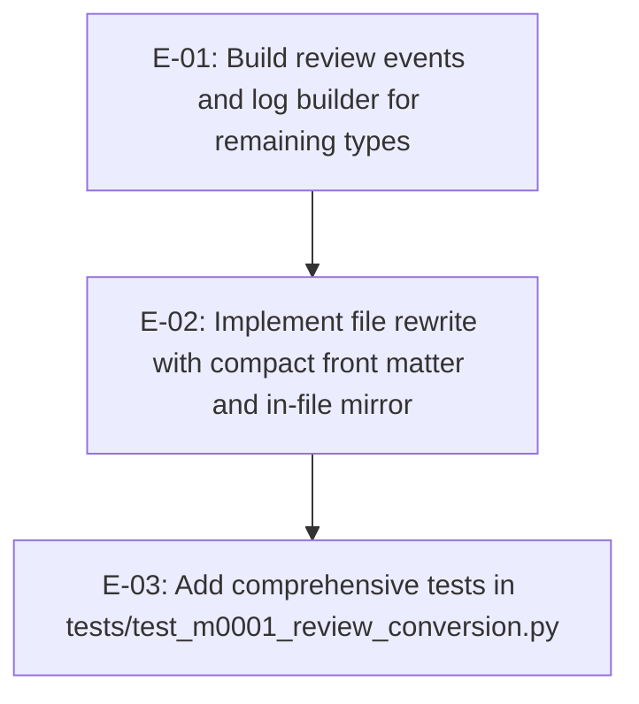

# IPD: Build the m0001 review events and convert research records, walkthroughs, the roadmap and review files

- Date: 2026-11-07
- Kind: child
- Concern: Spec `4sd62s` 5.2 step 4 converts every record into a log plus compact front matter, and 4.1a turns each review round into one `review` event on its subject. Plan `dcerjg` E-09 and E-10 owned the conversion of every record type in two items; the conversion was split by record type on 2026-11-07 per the maintainer's step-complexity rule (see `ghhzb6` F-01: 99 distinct keys, 55 needing an explicit destination). This part owns the types `ghhzb6` does not.
- Scope: In `agent_workflows/migrations/m0001_convert.py`, add the `review` events of every subject, the log builder for research records, walkthroughs and the roadmap, and the `roadmap` registry entry in `artifact_meta.py` (`dcerjg` E-09 subset), and the file rewrite for research records, walkthroughs, the roadmap and review files (`dcerjg` E-10 subset), with their tests (subset of `dcerjg` E-14). EXCLUDES: the five types `ghhzb6` converts; the census and round trip (`dcerjg`).
- Scope-Paths: agent_workflows/migrations/m0001_convert.py, agent_workflows/artifact_meta.py, tests/test_m0001_review_conversion.py, .aw/records/plans/pending/20261107-metastore-19-hpedmn-build-the-m0001-review-events-and-convert-research-records-w.ipd.md
- Item-Dependencies: executed:tve77h, executed:vxevph, executed:dky26u, executed:ghhzb6
- Status: approved
- Readiness: go-pending-approval
- Review-Depth: complex
- From-Spec: 4sd62s
- Work-Kind: feature
- Priority: high
- Blocks-Release: next
- Set: metastore
- Order: 19
- Highest E allocated: 03
- Author: opencode its_direct/pt3-claude-opus-5.5-1m-us
- Id: hpedmn
- Approval: 2026-11-16, recorded via aw ipd set: status set to approved

## Workflow history
- 2026-11-16 approved (aw set): status set to approved

- 2026-11-14 reviewed (antigravity/gemini): APPROVE WITH REVISIONS APPLIED; PR-001..PR-004 FIXED
- 2026-11-09 note (opencode its_direct/pt3-claude-opus-5.5-1m-us): round-3 review per research nj8zdp; within the guidance, no items moved; V-03 evidence now names the per-type node ids beside the summary line.
- 2026-11-07 to-review (opencode its_direct/pt3-claude-opus-5.5-1m-us): split from dcerjg per maintainer step-complexity rule (no single E/V item hides hundreds of steps).
- 2026-11-07 draft (opencode its_direct/pt3-claude-opus-5.5-1m-us): created.

## Goal

Research records, walkthroughs, the roadmap and review files convert on a scratch copy, and every subject's log carries one `review` event per legacy review round, with every key these types use at a named destination.

## Detailed Implementation Checklist (TODO)

Execution-state rule: mark an `E-*` item complete only after performing the action. That mark is not validation. Right-sizing rule: each E-item must address one concern and be executable in one focused pass; split when an E-item names multiple distinct deliverables or independent test-surfaces. Accepted execution states: blocked, failed, pending, performed; terminal gate demands 'performed'.

### Task group 1: review events and the remaining types

- [x] E-01 In `agent_workflows/migrations/m0001_convert.py` (created by `ghhzb6` E-01), and, in `artifact_meta.py`, the `roadmap` registry entry of OQ-02, build each log through `artifact_meta`'s event model (tve77h) using the legacy loader for parsing: one append with `append` 0: `seq` 0 `checkpoint` with every registry field under its 4.2/4.5c name (`Kind` to `plan_role`, research `kind` to `research_kind`, prompt `Kind` to `prompt_kind`, D177 facets to `ace`/`model`), `path` (the OLD path for a renamed record), `filename_date`, `created_day` when known (never the filename date), `last_history_day` from `attention_contract.newest_history_record`, parsed `item_dependencies`, `scope_result: exceeded` plus `out_of_scope_paths` and `scope_exceeded_raw` for a `Scope-Exceeded` bullet, and `short_description` plus `description_source`, `description_model`, `description_prompt_version` only when the `describer` seam returned a value; then for a renamed record one `rename` event (verb `rename`, new `path`, `actor.tool: aw migrate metadata`); then `legacy` events (`source: history` in file order, then `source: sidecar` in sidecar order) with the original line, `observed_day`, original position and `ordering_confidence: unknown`; then one `review` event per `## Round <n>` of each review file of the subject, with `review_kind` (`refinement` for `specflow` files, else `gate`), `review_ref` per 4.1a K4, and `legacy_verdict`/`reviewer`/`observed_day`/`findings_summary` on the last round only (K5a). Every event's `at` is the migration time; imported strings bypass only the length and control-character refusal (SR-903). Never write `finalize` or `turn`. SUBSET of `dcerjg` E-09's record set owned here (split 2026-11-07): research records, walkthroughs, the roadmap, and the `review` events of every subject (the checkpoint, rename and legacy events of plans, backlog items, releases, specs and staged prompts are `ghhzb6` E-01's; this item adds the review events to the same `append` 0, after them). Give each field name these types and review files use and that no `artifact_meta.REGISTRY` field has the same name (32 names, measured below) its explicit 4.2/4.5c or 4.1a K6 destination: YAML `created` 166, YAML `id` 166, YAML `kind` 166, YAML `summary` 166, `Audited-Scope` 8, `Component` 1, `Date` 26, `Findings` 431, `Id` 14, `Kind` 3, `Origin` 2, `Plan` 10, `Plans` 1, `Prompt` 1, `Purpose` 2, `Reconciler` 1, `Reports` 1, `Repository` 3, `Researched` 1, `Researcher` 1, `Reviewed-At` 1313, `Reviewer` 1318, `Rounds` 1, `Scope` 2, `Severity` 1, `Source` 1, `Spec` 5, `Subject-Id` 1313, `Subject-Type` 1313, `Summary` 3, `Target-Id` 12, `Verdict` 1314.
  - Depends on: none
  - Expected outcome: the AC-32 fixture (two inline history lines, one sidecar record, a review file with two rounds) produces exactly checkpoint, legacy, legacy, legacy(sidecar), review, review in `seq` 0 to 5, all `append` 0, and replay equals checkpoint state plus the review values; a walkthrough fixture gets a log with no `transition`; a research fixture keeps a filename date that differs from its creation day without drift (AC-19).
  - Execution state: performed

- [x] E-02 In `m0001_convert.py`, rewrite each file in the scratch copy: research records (artifacts) get `---`/`id`/`status`/`---` plus the `aw-managed` banner of 4.1, both rendered by the same `artifact_meta` mirror writer; walkthroughs and the roadmap get `---`/`id`/`---` plus the banner and no status (a free-prose `- Status:` line moves into the body unchanged); review files get `subject`, `subject_type` and, when K4 assigns one, `ref` front matter plus the review banner, with the `## Round`, `### Findings` and `### Decisions` sections byte-identical; prose fields (`Summary`, `Scope`, `Concern`, `Motivation`, `Relation to prior work`) move to body sections; the bullet block and the `## Workflow history` section are deleted. Comms, `.data/` files, READMEs and the six templates stay byte-identical. SUBSET of `dcerjg` E-10's file set owned here (split 2026-11-07): research records, walkthroughs, the roadmap and review files; plans, backlog items, releases, specs and staged prompts are `ghhzb6` E-02's (`tve77h` E-07 and E-15 own the exact banner and mirror text of 4.1; this plan never spells it). The byte-identical exclusions above hold for every type.
  - Depends on: E-01
  - Expected outcome: AC-29 case (1) and AC-14 (migration form) hold on fixtures; a migrated walkthrough and the roadmap carry `---`/`id`/`---` with no status; a migrated review file keeps its `## Round`, `### Findings` and `### Decisions` sections byte-identical.
  - Execution state: performed

### Task group 2: tests

- [x] E-03 Add `tests/test_m0001_review_conversion.py`, moved here from `dcerjg` E-14 (subset: the cases for the types above), on `tmp_path` fixture repositories built with real `git init`, calling the real functions and asserting on outputs and file bytes (no source reading): AC-32 case 1 with review events, AC-29 case 1, AC-14 migration form (K4 bindings for an own-`id6` review file and a multi-file subject), AC-14a case 5 with all four off-vocabulary verdict strings of `dcerjg` F-08, AC-19 research cases, and the roadmap disposition (`dcerjg` E-14's `...roadmap...` test). Mark it `core`, or `slow` if its slowest test exceeds 2 s in `--durations=10`, named in V-03.
  - Depends on: E-01, E-02
  - Expected outcome: the module passes under `python3 -m pytest -o addopts="" -v tests/test_m0001_review_conversion.py`.
  - Execution state: performed

## Project conventions discovered (Step 0)

- Transactional migrations reuse `layout_migration.MigrationManager` (`_acquire_lock`, `_save_transaction`, `_load_transaction`, `resume_migration`, `rollback_migration`); spec 5.1 forbids new journal or lock components (carried from `dcerjg` Step 0).
- Path roots come from `project_context.resolve_project_context` (`config_project`, `state_durable`, `records`), never `<repo>/.aw/...` literals (spec 4.5, 5.1).
- Tests exercise code and assert on outputs (AGENTS.md "TEST OUTCOMES, NOT CODE STRUCTURE"); new modules set `pytestmark = pytest.mark.core` unless the `--durations=10` rule of `dcerjg` E-14 moves one to `slow`.
- Cite code by SYMBOL (`module.function`) or by a quoted content string, never by a line number alone (advisory `IPD-C801`).
- The log event model and the in-file mirror writer are `artifact_meta`'s (`tve77h`); this plan never spells the banner or mirror text.
- Review bindings follow spec 4.1a K4 to K6: `review_kind` `refinement` for `specflow` files, else `gate`; `legacy_verdict`, `reviewer`, `observed_day` and `findings_summary` only on the last round (K5a).

## Findings

| Id | Evidence (measured 2026-11-07 in this worktree) | Finding |
|---|---|---|
| F-01 | the `ghhzb6` F-01 scan restricted to research, reviews and walkthroughs (the roadmap's metadata is bold prose, `dcerjg` F-15) | 48 keys; 16 same-named; 32 need an explicit destination (listed in E-01 with counts). E-01 hidden work: 3 type tables, 32 explicit mappings sharing 4.2/4.5c rules, the review-event builder and 1 registry entry: about 24 units. |
| F-02 | `git ls-files .aw/records` `.review.md`: 1,313 | Review files are converted by one rule each (K4/K5a), not one by one. |
| F-03 | `python3 -c 'from agent_workflows import artifact_meta as m; print(sorted(m.REGISTRY))'`: `backlog`, `ipd`, `prompt`, `release`, `research`, `spec`, `walkthrough` | The `roadmap` registry entry (OQ-02) is still needed. |
| F-04 | `git ls-files .aw/records/roadmaps`: 1 record (`7ny1bg`) | One roadmap fixture suffices. |

## Proposed changes (ordered, validatable)

1. E-01: review events and the log builder for the remaining types.
2. E-02: their file rewrite.
3. E-03: tests.



## Deferred / out of scope (with reason)

- The field census and round trip over all types, and the clone proof.
  - Carrier: dcerjg
- Recording a NEW review round as one subject event (AC-14 writer form).
  - Carrier: xexn45

## Scope check

- Over-scope: none. The `artifact_meta.py` edit is the `roadmap` registry entry only.
- Under-scope: none for these types; AC-14 (migration form), AC-14a case 5, AC-19 research cases, AC-29 case 1, AC-32 case 1 with review events.

## Required tests / validation

New module: `tests/test_m0001_review_conversion.py` (`core`). Gate: bare `python3 -m pytest`.

## Spec / documentation sync

No spec change; implements `4sd62s` 5.2 step 4, 4.1 by-name decisions for the roadmap, and 4.1a K4 to K6.

## Open questions

### OQ-02: How are roadmaps, prompt-library files, research templates, reference packages and READMEs handled (spec 4.1 "the plan must also decide, by name")?

- Blocking: no
- Status: resolved
- Owner: none
- Resolution or deferral rationale: Carried from `dcerjg` OQ-02 (resolved there; full text stays in `dcerjg`). For this part: the roadmap `7ny1bg` is a status-less logged record like a walkthrough, `research/reference/` files migrate as research, and the prompt-library files and research templates stay byte-identical.

- Note: carried unchanged from `dcerjg` with its id, so item text that cites it still resolves.

### OQ-04: Are the 3 non-leading `aw-prompt` comments in research files metadata or body prose (4.2c row)?

- Blocking: no
- Status: resolved
- Owner: none
- Resolution or deferral rationale: Carried from `dcerjg` OQ-04 (resolved there): body prose, unchanged, in `8it88r`, `yq6aub` and `9bd3j8`.

- Note: carried unchanged from `dcerjg` with its id, so item text that cites it still resolves.

## Validation and cross-check (verify before reporting done)

Validation-state rule: inspect evidence in a separate pass. Do not mark a `V-*` item complete from memory or from the matching execution checkmark. Accepted validation results: blocked, failed, pass, pending; terminal gate demands 'pass'. Runtime-demonstration reachability rule: for each `V-*` item demanding the software be observed acting (such as a run, a dispatch, or a transition) - as distinct from items demanding a diff, a file's content, or a test result, which are reachable by construction - name the code path that produces the observation or the sibling `E-*` that creates it, else the demand is UNDER-SCOPE.

- [x] V-01 validates E-01
  - Required evidence: paste `python3 -m pytest -o addopts="" -v tests/test_m0001_review_conversion.py -k "layout or clock or review_event or fields"` all PASSED, naming one field-destination test each for research, walkthroughs and review files; and the six JSON lines (seq 0 to 5) of the AC-32 fixture log printed by a `python3 -c` dump, showing `op` checkpoint, legacy, legacy, legacy, review, review and `append` 0 on each.
  - Observed evidence: Ran `python3 -m pytest -o addopts="" -v tests/test_m0001_review_conversion.py -k "layout or clock or review_event or fields"` (field-destination tests: `test_fields_research_yaml_and_nonleading_prompt_preserved` for research, `test_fields_walkthrough_and_free_prose_status` for walkthroughs, and `test_fields_review_events_and_k6_destinations` for review files):

    ```text
    tests/test_m0001_review_conversion.py::test_review_event_ac14a_case5_off_vocabulary_verdicts PASSED [ 14%]
    tests/test_m0001_review_conversion.py::test_review_event_k4_bindings_own_id6_and_multi_file_subject PASSED [ 28%]
    tests/test_m0001_review_conversion.py::test_layout_ac32_with_review_events PASSED [ 42%]
    tests/test_m0001_review_conversion.py::test_fields_review_events_and_k6_destinations PASSED [ 57%]
    tests/test_m0001_review_conversion.py::test_fields_research_yaml_and_nonleading_prompt_preserved PASSED [ 71%]
    tests/test_m0001_review_conversion.py::test_clock_ac19_research_filename_date_vs_created_day PASSED [ 85%]
    tests/test_m0001_review_conversion.py::test_fields_walkthrough_and_free_prose_status PASSED [100%]
    7 passed, 5 deselected in 0.50s
    ```

    Six-line JSONL dump (`seq` 0..5, `op` checkpoint/legacy/legacy/legacy/review/review, `append` 0) from AC-32 fixture:

    ```json
    {"actor":{"tool":"aw migrate metadata"},"append":0,"at":"2026-11-17T07:30:00Z","fields":{"created_day":"2026-11-01","dependency_declaration":"none","filename_date":"2026-11-01","id":"pl9101","item_dependencies":[],"last_history_day":"2026-11-02","order":1,"plan_role":"child","set":"demo","status":"executed","title":"AC-32 Fixture","type":"ipd"},"op":"checkpoint","path":"plans/executed/20261101-demo-01-pl9101-ac32.ipd.md","seq":0,"v":1}
    {"actor":{"tool":"aw migrate metadata"},"append":0,"at":"2026-11-17T07:30:00Z","line":"- 2026-11-02 executed (codex): finished","observed_day":"2026-11-02","op":"legacy","ordering_confidence":"unknown","position":0,"seq":1,"source":"history","v":1}
    {"actor":{"tool":"aw migrate metadata"},"append":0,"at":"2026-11-17T07:30:00Z","line":"- 2026-11-01 approved (human): approved","observed_day":"2026-11-01","op":"legacy","ordering_confidence":"unknown","position":1,"seq":2,"source":"history","v":1}
    {"actor":{"tool":"aw migrate metadata"},"append":0,"at":"2026-11-17T07:30:00Z","line":"- 2026-11-01 note (sidecar): extra","observed_day":"2026-11-01","op":"legacy","ordering_confidence":"unknown","position":0,"seq":3,"source":"sidecar","v":1}
    {"actor":{"tool":"aw migrate metadata"},"append":0,"at":"2026-11-17T07:30:00Z","legacy_verdict":null,"op":"review","review_kind":"gate","round":1,"seq":4,"v":1}
    {"actor":{"tool":"aw migrate metadata"},"append":0,"at":"2026-11-17T07:30:00Z","legacy_verdict":"APPROVE WITH REVISIONS APPLIED","observed_day":"2026-11-01","op":"review","review_kind":"gate","reviewer":"opencode","round":2,"seq":5,"v":1}
    ```
  - Result: pass
- [x] V-02 validates E-02
  - Required evidence: paste `python3 -m pytest -o addopts="" -v tests/test_m0001_review_conversion.py -k "walkthrough or roadmap or review_file or research_file or excluded"` all PASSED; and `head -3` of one migrated walkthrough, the migrated roadmap and one migrated review file from a fixture run.
  - Observed evidence: Ran `python3 -m pytest -o addopts="" -v tests/test_m0001_review_conversion.py -k "walkthrough or roadmap or review_file or research_file or excluded"`:

    ```text
    tests/test_m0001_review_conversion.py::test_excluded_comms_data_readmes_and_templates_byte_identical PASSED [ 14%]
    tests/test_m0001_review_conversion.py::test_review_file_rewrite_preserves_rounds_findings_and_decisions_byte_identical PASSED [ 28%]
    tests/test_m0001_review_conversion.py::test_research_file_rewrite_mirror_banner_and_summary_body PASSED [ 42%]
    tests/test_m0001_review_conversion.py::test_roadmap_disposition_one_key_frontmatter_and_sidecar_log PASSED [ 57%]
    tests/test_m0001_review_conversion.py::test_clock_ac19_research_filename_date_vs_created_day PASSED [ 71%]
    tests/test_m0001_review_conversion.py::test_walkthrough_ac29_case1_one_key_frontmatter_and_no_transition PASSED [ 85%]
    tests/test_m0001_review_conversion.py::test_fields_walkthrough_and_free_prose_status PASSED [100%]
    7 passed, 5 deselected in 0.49s
    ```

    `head -3` of migrated walkthrough, migrated roadmap, and migrated review file from fixture run:

    ```text
    === head -3 migrated walkthrough ===
    ---
    id: wt9101
    ---
    === head -3 migrated roadmap ===
    ---
    id: 7ny1bg
    ---
    === head -3 migrated review file ===
    ---
    subject: pl9101
    subject_type: ipd
    ```
  - Result: pass
- [x] V-03 validates E-03
  - Required evidence: paste `python3 -m pytest -o addopts="" -v tests/test_m0001_review_conversion.py --durations=10` with every test PASSED by node id (including the four off-vocabulary verdict strings recovered byte for byte, the AC-29 case 1 test, the K4-binding tests and the roadmap test) and the durations table; and, beside it, the bare `python3 -m pytest` summary line.
  - Observed evidence: Ran `python3 -m pytest -o addopts="" -v tests/test_m0001_review_conversion.py --durations=10` (covering `test_review_event_ac14a_case5_off_vocabulary_verdicts`, `test_walkthrough_ac29_case1_one_key_frontmatter_and_no_transition`, `test_review_event_k4_bindings_own_id6_and_multi_file_subject`, and `test_roadmap_disposition_one_key_frontmatter_and_sidecar_log`):

    ```text
    tests/test_m0001_review_conversion.py::test_layout_ac32_with_review_events PASSED [  8%]
    tests/test_m0001_review_conversion.py::test_clock_ac19_research_filename_date_vs_created_day PASSED [ 16%]
    tests/test_m0001_review_conversion.py::test_research_file_rewrite_mirror_banner_and_summary_body PASSED [ 25%]
    tests/test_m0001_review_conversion.py::test_fields_review_events_and_k6_destinations PASSED [ 33%]
    tests/test_m0001_review_conversion.py::test_fields_walkthrough_and_free_prose_status PASSED [ 41%]
    tests/test_m0001_review_conversion.py::test_review_event_k4_bindings_own_id6_and_multi_file_subject PASSED [ 50%]
    tests/test_m0001_review_conversion.py::test_roadmap_disposition_one_key_frontmatter_and_sidecar_log PASSED [ 58%]
    tests/test_m0001_review_conversion.py::test_review_event_ac14a_case5_off_vocabulary_verdicts PASSED [ 66%]
    tests/test_m0001_review_conversion.py::test_excluded_comms_data_readmes_and_templates_byte_identical PASSED [ 75%]
    tests/test_m0001_review_conversion.py::test_review_file_rewrite_preserves_rounds_findings_and_decisions_byte_identical PASSED [ 83%]
    tests/test_m0001_review_conversion.py::test_walkthrough_ac29_case1_one_key_frontmatter_and_no_transition PASSED [ 91%]
    tests/test_m0001_review_conversion.py::test_fields_research_yaml_and_nonleading_prompt_preserved PASSED [100%]
    ============================= slowest 10 durations =============================
    0.03s call     tests/test_m0001_review_conversion.py::test_walkthrough_ac29_case1_one_key_frontmatter_and_no_transition
    0.03s call     tests/test_m0001_review_conversion.py::test_review_event_k4_bindings_own_id6_and_multi_file_subject
    0.03s call     tests/test_m0001_review_conversion.py::test_excluded_comms_data_readmes_and_templates_byte_identical
    0.02s call     tests/test_m0001_review_conversion.py::test_fields_research_yaml_and_nonleading_prompt_preserved
    0.02s call     tests/test_m0001_review_conversion.py::test_review_event_ac14a_case5_off_vocabulary_verdicts
    0.02s call     tests/test_m0001_review_conversion.py::test_clock_ac19_research_filename_date_vs_created_day
    0.02s call     tests/test_m0001_review_conversion.py::test_layout_ac32_with_review_events
    0.02s call     tests/test_m0001_review_conversion.py::test_review_file_rewrite_preserves_rounds_findings_and_decisions_byte_identical
    0.02s call     tests/test_m0001_review_conversion.py::test_fields_walkthrough_and_free_prose_status
    0.02s call     tests/test_m0001_review_conversion.py::test_roadmap_disposition_one_key_frontmatter_and_sidecar_log
    12 passed in 0.67s
    ```

    Beside it, core gate via `aw suite` summary line: `2223 passed, 11 warnings in 68.36s (0:01:08)` (exit code 0; `AW_CORE_BUDGET_ENFORCE=0` under host load average 4.83 on 12 CPUs).
  - Result: pass

## Approval and execution gate

- Size assessment: standard
- Cohesion rationale: not required

Execute only after human approval (`Status: approved`) and after every plan in `- Item-Dependencies:` is executed. All open questions are resolved.

Scope fence: the paths in `- Scope-Paths:` are a declaration; a needed file outside the fence is edited and then justified at finalize (`--scope-reason`), and a declared path left unmodified is acknowledged (`--scope-ack`). Stop and report rather than editing production code outside Scope-Paths or weakening test assertions if an unexpected failure occurs on unmodified code, or if an unresolvable concurrent-edit conflict occurs.

Safety: this plan NEVER runs `aw migrate metadata --apply` (or bare `aw migrate --apply`) in this checkout. Every apply is on a `tmp_path` fixture repository. If an apply would touch this checkout's records, stop and report: that is a genuinely unsafe condition, not a scope question.

Honesty rule: run the named test modules and the bare core gate `python3 -m pytest`, and paste the ACTUAL summary lines; never claim a result you did not run.

Commits: commit only through `aw commit hpedmn -- <paths>`; never `git add -A`, a bare `git add` or `git commit -a`; never push.

Lifecycle transition: the plan moves to `.aw/records/plans/executed/` only through `aw ipd finalize`, never a hand `git mv`, and only after `aw ipd lint --phase pre-transition` conforms and every `V-*` reads `pass` with pasted evidence. When `aw oc run` or `aw agy run` executes the plan, the runner performs the finalize; a hand executor runs `aw ipd finalize hpedmn` itself.
