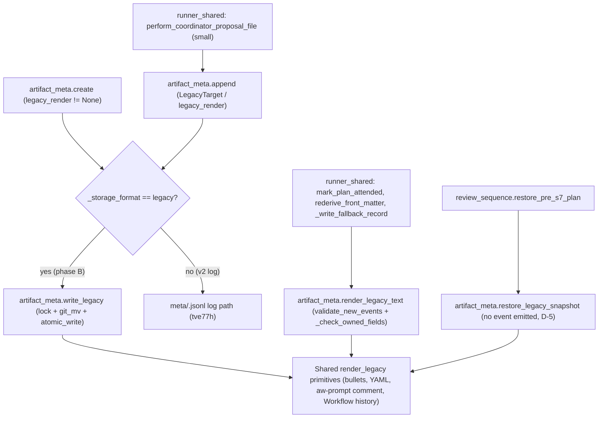

# IPD: Add the phase-B legacy writer and move the runner writer helpers onto it

- Date: 2026-11-07
- Kind: child
- Concern: Spec `4sd62s` section 7 step 4 requires every metadata writer to write through `artifact_meta` in phase B, while `artifact_meta` still writes today's bullets and history lines (C1, C10a). Every other writer move of plan `xexn45` needs ONE named legacy renderer to target first, and the four runner writer helpers that `t4gl15` handed to `xexn45` need the same renderer over in-memory text. This plan is the first part of `xexn45`, split 2026-11-07 because `xexn45` as one plan hid several hundred units of work in single items.
- Scope: Extract the phase-B legacy renderer that `2xwb9b` built inside `agent_workflows/artifact_meta.py::append_legacy` into one named function, `agent_workflows/artifact_meta.py::write_legacy`, extend it to the phase-B branch of `artifact_meta.create`, the `aw-prompt` comment and YAML front-matter forms, and the note, transition, review, coverage, and legacy-history events, and add its in-memory text helpers `artifact_meta.render_legacy_text` and `artifact_meta.restore_legacy_snapshot` (`xexn45` E-01, E-11). Add the core test module `tests/test_artifact_meta_legacy_writer.py`. Move the write halves of the runner helpers `agent_workflows/runner_shared.py::mark_plan_attended`, `agent_workflows/runner_shared.py::rederive_front_matter`, `agent_workflows/runner_shared.py::perform_coordinator_proposal_file`, and `agent_workflows/review_sequence.py::restore_pre_s7_plan` onto those helpers (`xexn45` E-11). Capture the `.aw/state/xexn45/` baselines and record their commit SHA and summary in `F-04` for `xexn45` E-17, because every later part depends on this one and this is the first writer edit of the move. EXCLUDES: every other writer (parts `g6tw94`, `n5sxxk`, `6e93gt`, `bsl45u`, `8q27jt`) and the finishing work (`xexn45`).
- Scope-Paths: agent_workflows/artifact_meta.py, agent_workflows/runner_shared.py, agent_workflows/review_sequence.py, tests/test_artifact_meta_legacy_writer.py, .aw/records/plans/pending/20261107-metastore-21-7yr827-add-the-phase-b-legacy-writer-and-move-the-runner-writer-hel.ipd.md
- Item-Dependencies: executed:tve77h, executed:2xwb9b
- Status: approved
- Readiness: go-pending-approval
- Review-Depth: complex
- From-Spec: 4sd62s
- Work-Kind: feature
- Priority: high
- Blocks-Release: next
- Set: metastore
- Order: 21
- Highest E allocated: 04
- Author: opencode its_direct/pt3-claude-opus-5.5-1m-us
- Id: 7yr827
- Approval: 2026-11-16, recorded via aw ipd set: status set to approved

> Write and proofread this plan per the technical writing standard, `.aw/system/workflows/technical-writing/technical-writing.md` (`.agents/workflows/technical-writing/technical-writing.md` in a legacy-layout install), including requirement 12 (diagrams).

## Workflow history
- 2026-11-16 approved (aw set): status set to approved
- 2026-11-12 reviewed (aw set): APPROVE WITH REVISIONS APPLIED; PR-001..PR-007 FIXED

- 2026-11-12 /plan-review (antigravity/gemini): APPROVE WITH REVISIONS APPLIED; PR-001..PR-007 FIXED; review record .aw/records/reviews/20261107-metastore-21-7yr827-add-the-phase-b-legacy-writer-and-move-the-runner-writer-hel.review.md
- 2026-11-09 note (opencode its_direct/pt3-claude-opus-5.5-1m-us): round-3 check per research nj8zdp: within the guidance, not split; V-02 evidence rewritten to name each pinned test.
- 2026-11-07 to-review (opencode its_direct/pt3-claude-opus-5.5-1m-us): split from xexn45 per maintainer step-complexity rule (no single E/V item hides hundreds of steps).
- 2026-11-07 draft (opencode its_direct/pt3-claude-opus-5.5-1m-us): created.

## Goal

`artifact_meta` gains ONE phase-B legacy renderer (`write_legacy`, with the in-memory string helpers `render_legacy_text` and `restore_legacy_snapshot`) that every later writer move calls, and the runner writer helpers already use it, so each later part only replaces hand-built text with events.

## Detailed Implementation Checklist (TODO)

Execution-state rule: mark an `E-*` item complete only after performing the action. That mark is not validation. Right-sizing rule: each E-item must address one concern and be executable in one focused pass; split when an E-item names multiple distinct deliverables or independent test-surfaces. Accepted execution states: blocked, failed, pending, performed; terminal gate demands 'performed'.

PIN-FIRST RULE for every "move" item: run the named existing test modules GREEN on the unmodified code and save the per-test outcome list under the gitignored `.aw/state/7yr827/` (`python3 -m pytest -o addopts="" -m "" -p no:randomly -n 0 -rA <modules> | grep -E "^(PASSED|FAILED|ERROR|SKIPPED|XFAIL|XPASS) " | sed -E 's/ - .*//' | sort > .aw/state/7yr827/<E>-before.txt`; `-m ""` includes `slow` modules, `-p no:randomly -n 0` makes the list deterministic, and `-q` is not repeated because `addopts` is cleared); make the move; run the same command into `-after.txt`; `diff` of the two must print nothing, so a test that newly fails, errors or skips is caught, not only a lost PASSED line. An existing assertion may change only when Behavior decisions D-1, D-2, and D-5 below name it. New tests set `pytestmark = pytest.mark.core`, build fixtures in `tmp_path`, drive the real CLI or function, and never read production source (AGENTS.md "TEST OUTCOMES, NOT CODE STRUCTURE").

### Task group 1: the phase-B legacy writer and its core test suite

- [x] E-01 Before any edit, save `aw check --agent` output to `.aw/state/xexn45/check-before.jsonl` and the bare `python3 -m pytest` summary line to `.aw/state/xexn45/core-before.txt`, and record the baseline HEAD commit SHA, the `(location, rule)` pair count of `check-before.jsonl`, and the `core-before.txt` summary in `F-04` below so `xexn45` E-17 can regenerate the baseline in an isolated lane worktree. In `agent_workflows/artifact_meta.py`, extract `2xwb9b`'s `append_legacy`/`render_legacy` implementation into `write_legacy(target, events, *, record_type=None, render, repo_root, dry_run=False, ...)` (accepting `Path` or `LegacyTarget` and keeping `append_legacy` as a thin compatibility delegate so `2xwb9b` callers share one implementation) and expose `render_legacy_text(text, events, *, record_type="ipd", render, repo_root=None, from_status=None)` plus `restore_legacy_snapshot(current_text, pre_pass_text, *, record_type="ipd", drop_history_predicate=None)` over the same internal primitives. Route the phase-B branch of `artifact_meta.append` and `artifact_meta.create` through `write_legacy`: mirroring `append` (`2xwb9b` E-03), `create` accepts `legacy_render: Optional[LegacyRender] = None` (and `**legacy_kwargs`) and routes to `write_legacy` when `legacy_render is not None` and `_storage_format(records_root, target) == "legacy"`, writing `body` plus the rendered metadata and history without creating a v2 `.jsonl` log or recovery journal, while keeping `legacy_render=None` on the v2 log branch so `tests/test_artifact_meta_write.py` (`tve77h`) and `tests/test_artifact_meta_legacy_write.py` plus `tests/test_status_set_meta_writer.py` (`2xwb9b`) pass unchanged. Close the three gaps between `2xwb9b`'s initial renderer and full phase-B coverage. First, `_render_history` preserves an existing single blank line directly under `## Workflow history` (`D-1`) and prepends `op == "legacy"` (`source == "history"`) `line` entries verbatim alongside `note`, `transition`, `review`, and `coverage` messages. Second, `_set_bullet` places a new bullet after `- Status:`, else after `- Id:`, else at the end of an existing metadata bullet block before the first `## `, and writes nothing when the file has no metadata bullet block (`D-2`, the `a88210` rule of `agent_workflows/artifact_rename.py::_update_frontmatter_metadata`). Third, `_LEGACY_BULLET_LABEL`, `_render_field`, and `_prepare_legacy_events` map the remaining phase-B registry fields across all three legacy mirrors: bullets (`attended` -> `Attended`, `plan_role` -> `Kind`, `set` -> `Set`, `order` -> `Order`, `version` -> `Version`, `short_description` -> `Short-Description`, `pipeline` -> `Pipeline`, `from_plan` -> `From-Plan`, `supersedes` -> `Supersedes`, `scope_paths` -> `Scope-Paths`, `highest_e_allocated` -> `Highest E allocated`, and `item_dependencies` via raw edge strings), `---` YAML front matter for research (`set`, `order`, `research_kind` -> `kind`, `outcome`, `priority`, `consumed_by` -> `consumed-by`, `topic`, `short_description` -> `short-description`), and single-line `<!-- aw-prompt: ... -->` comment keys (`prompt_kind` -> `Kind`, `id` -> `Id`, `set` -> `Set`, `status` -> `Status`, `created_day` -> `Created`, `author` -> `Author`, `targets` -> `Targets`, `concerns` -> `Concerns`, `results_go_to` -> `Results-go-to`, `results` -> `Results`, `grounding` -> `Grounding`, `goal` -> `Goal`, `reviews_spec` -> `Reviews-spec`, `basis` -> `Basis`, `relation` -> `Relation`, `short_description` -> `Short-Description`, leaving comment-less legacy prompts unchanged per `agent_workflows/prompts.py::inject_metadata_id6`). Keep `artifact_core.atomic_write`, `platform_lock.held(<state>/locks/meta-<key>.lock)`, and `2xwb9b`'s `source_digest` check, and write nothing on refusal or `dry_run=True`.
  - Depends on: none
  - Expected outcome: `write_legacy`, `render_legacy_text`, and `restore_legacy_snapshot` share one renderer, `create` and `append` route phase-B calls (`legacy_render` supplied on a legacy root) through `write_legacy` while `tests/test_artifact_meta_write.py`, `tests/test_artifact_meta_legacy_write.py`, and `tests/test_status_set_meta_writer.py` pass unchanged, and `.aw/state/xexn45/` baselines plus `F-04` are recorded.
  - Execution state: performed

- [x] E-02 Add core test module `tests/test_artifact_meta_legacy_writer.py` (`pytestmark = pytest.mark.core`, `tmp_path` fixtures, zero source inspection) exercising `write_legacy`, `render_legacy_text`, `restore_legacy_snapshot`, and the phase-B branch of `artifact_meta.create`. Cover eight scenarios. (1) In-place bullet edit and `unset` removal. (2) New bullet anchor fallback (`- Status:`, `- Id:`, end of bullet block) and the `a88210` prose-only plan case where no metadata bullet block exists and nothing is inserted into the body. (3) Prompt `aw-prompt` comment key edit, `create` comment rendering, and comment-less legacy prompt purity where the body stays byte-identical with zero bullets added. (4) Research `---` YAML field edit. (5) `## Workflow history` prepend with blank line kept, without blank line kept, and section-absent creation before first `## ` plus end-of-file for prompts (`D-1`). (6) Phase-B `create` with `dry_run=True` vs apply, lock acquisition, and `source_digest` mismatch refusal. (7) `validate_new_events` and `_check_owned_fields` refusal on `set readiness` leaving target file `sha256` identical before and after (`4sd62s` AC-15), paired with `restore_legacy_snapshot` reverting `- Status:`, `- Readiness:`, and post-snapshot review history lines with zero `set readiness` event (`D-5`). (8) A tracked-corpus round trip copying up to 8 tracked records per type in sorted path order that carry at least one in-file non-owned `set`-writable metadata field across `plans`, `specs`, `backlog`, `releases`, and `prompts` (all qualifying records when a type has fewer than 8, measured at `2e800a642` as `8 + 8 + 8 + 1 + 8 = 33` records because `.aw/records/releases/` holds 1 release `f33nrj`) into `tmp_path`, running `write_legacy` `set` of an existing field to its own value and `artifact_meta.read()`, and asserting equal `State` and byte-identical file bytes on every selected record across all 5 types.
  - Depends on: E-01
  - Expected outcome: every test in `tests/test_artifact_meta_legacy_writer.py` passes, including byte-identity across 100% of the selected 5-type corpus (`>=33` records, covering all 5 types) and unchanged `sha256` on refused `set readiness`.
  - Execution state: performed

### Task group 2: move the runner writer helpers

- [x] E-03 Move the write halves of the `agent_workflows/runner_shared.py` helpers (carried here by `t4gl15`) onto `artifact_meta`, pinned first under `.aw/state/7yr827/`. First, `mark_plan_attended(text, *, why="")` calls `artifact_meta.render_legacy_text` with `set` `{"attended": "required"}` and a `note` message (`LegacyRender` `tag="attended"`, UTC day via `artifact_core.utc_history_date`). Second, `rederive_front_matter` retains its pre-render `DriverError` guards (`verdict.verdict == REDERIVE_SHAPE_MATCH`, keys restricted to `REDERIVABLE_FRONT_MATTER_KEYS` = `{"Work-Kind", "Priority"}`, and non-empty target metadata bullet block) and renders the target edits plus the lane's pre-formatted `verdict.history_lines` (`op: "legacy", source: "history", line: <entry>`) through `artifact_meta.render_legacy_text` with zero file I/O. Third, `perform_coordinator_proposal_file` routes its three write sites through `artifact_meta` (`mark_plan_attended` plus `atomic_write` on `needs-attended`, `aw ipd scaffold --apply` plus body write plus `artifact_meta.append`/`write_legacy` setting `blocks_release` on `small`, and `artifact_meta.render_legacy_text` plus `atomic_write` in `_write_fallback_record` for gitignored `<run_dir>/proposals/` stubs outside `.aw/records/`). Leave `record_oq_answer` untouched as a body-prose edit inside `### OQ-..` per `4sd62s` N3. Pinned modules (re-derived at execution by the PIN-FIRST command, with non-binding test pointers): `tests/test_run_proposal_channel.py` (`test_needs_attended_proposal_marks_plan_and_files_no_stub`, `test_attended_field_value_is_linted`, `test_small_proposal_creates_draft_plan_on_main`), `tests/test_records_only_lane_rederive.py` (`test_the_anti_revert_control_holds_on_the_shipped_allow_list`), `tests/test_history_date_clock_residual.py` (`test_proposal_fallback_record_records_utc_date`), `tests/test_question_preflight.py` (`test_record_oq_answer_appends_to_existing_rationale`), and `tests/test_attended_session.py`.
  - Depends on: E-01
  - Expected outcome: `runner_shared.py` performs no direct bullet or `## Workflow history` string surgery in `mark_plan_attended`, `rederive_front_matter`, or `perform_coordinator_proposal_file`, and the PIN-FIRST before/after outcome diff across all five modules is empty.
  - Execution state: performed

- [x] E-04 Move the write half of `agent_workflows/review_sequence.py::restore_pre_s7_plan` onto `artifact_meta.restore_legacy_snapshot` (`D-5`, `OQ-04`), pinned first under `.aw/state/7yr827/` against `tests/test_review_sequence_runner.py` (non-binding pointer: `test_ac07_readiness_written_before_s7_reverted_and_reasked`). `restore_pre_s7_plan` keeps its pre-pass vs current snapshot detection of premature `- Status:` / `- Readiness:` changes and post-snapshot review history entries (`plan_readiness.is_review_history_entry`), delegates the in-memory text restoration of `- Status:`, `- Readiness:` (restoring the pre-pass value or removing `- Readiness:` when absent before the pass), and review-history removal to `artifact_meta.restore_legacy_snapshot`, and writes the restored snapshot atomically while emitting no `set readiness` event.
  - Depends on: E-01
  - Expected outcome: `review_sequence.py::restore_pre_s7_plan` delegates all metadata bullet and history restoration to `artifact_meta.restore_legacy_snapshot`, emits no `set readiness` event, and produces an empty PIN-FIRST before/after outcome diff on `tests/test_review_sequence_runner.py`.
  - Execution state: performed

Add further leaves as `- [ ] E-NEW <action>` and run `aw ipd sync` to assign ids.

## Project conventions discovered (Step 0)

- The `artifact_meta` interface names come from Order 02 (`tve77h`) and are used exactly: `artifact_meta.read(id6) -> State`, `history`, `query`, `resolve`, `read_at`, `append(id6, events, *, expect_seq)`, `create(...)`, `validate_new_events(type, events, *, records_root, migration_import=False)`, `repair`. Order 02's `append`/`create` are log-format and switched on at the cutover; `2xwb9b` added `append_legacy` for `status_set`, and this plan extracts and completes `write_legacy`, `render_legacy_text`, and `restore_legacy_snapshot` that Order 13 (`cxxmyv`) removes.
- Atomic replacement is `artifact_core.atomic_write(path, text, *, prefix)`; the lock is `platform_lock.held`; UTC history days come from `artifact_core.utc_history_date` (spec `2vev8j` 4.4).
- Today's history-insertion rules differ: `status_set._prepend_workflow_history_entry` and `backlog.run_note` insert DIRECTLY under the heading; `specs._append_history` normalizes to one blank line then the record; `plan_readiness._prepend_history_entry` keeps an existing blank line and inserts after it; `coverage_record.write` inserts directly under the heading.
- The newest-history reader is `attention_contract.newest_history_record` over `attention_contract.history_block`, which drops blank lines; so the blank-line difference changes no reader result.
- Descriptive refusals: `attention_contract.refuse_unsafe_descriptive` with `MAX_DESCRIPTIVE_LEN` 300 and `MAX_PROSE_DESCRIPTIVE_LEN` 4300; `specs._refuse_unsafe_descriptive(..., prose=True)` is the spec `--summary` path.
- Recognized plan bullets are `ipd_schema.META_RECOGNIZED`; an unrecognized bullet is lint error `IPD-M103` (`ipd_lint.C_META_UNKNOWN`). Backlog keeps unknown bullets in order (`backlog._render_item`, rendrop `2yqt0a`).
- The prompt mirror is the single `aw-prompt` comment (`prompts.render_metadata_comment`, `prompts.inject_metadata_id6`, `prompts.update_metadata_status`); nothing visible may precede the prompt body (spec `20260808-1958-01-prompt-purity-lint` R1/P4).
- Finalize scope evidence is `evidence["scope_reconciliation"]` with `reasons` and `widened_paths` (`ipd_lifecycle._finalize_transaction`, `runner_shared.compute_scope_reconciliation`).
- Rollup retirement is `ipd_lifecycle.retire_orchestrator` -> `_finalize_transaction` with `evidence["transition"] == "orchestrator-rollup"`.
- The rename ledger is `record_history.record_rename`, written by `artifact_rename` and `plans_refs`; the sidecar is gitignored (`.aw/.gitignore` `records/history.jsonl`).
- Core tier: `pyproject.toml` marker `core`; modules set `pytestmark = pytest.mark.core`.
- Cite code by SYMBOL (`module.function`) or by a quoted content string, never by a line number alone (advisory `IPD-C801`).

## Findings

| Id | Evidence (measured 2026-11-07 at `ac76110f4` and re-checked 2026-11-12 at `2e800a642`) | Finding |
|---|---|---|
| F-01 | `rg -n "^def (append_legacy|render_legacy|append|create|validate_new_events)\(" agent_workflows/artifact_meta.py`: all five exist; `rg -n "def (write_legacy|render_legacy_text|restore_legacy_snapshot)" agent_workflows/artifact_meta.py`: no match; `tests/test_artifact_meta_write.py` calls `artifact_meta.create(..., project_context=ctx)` without `legacy_render` on an empty `records_root` and asserts `meta/<id6>.jsonl` exists | `write_legacy`, `render_legacy_text`, and `restore_legacy_snapshot` are new entry points extracted from `append_legacy`/`render_legacy`; `create` must gate its phase-B branch on `legacy_render is not None` (matching `append` in `2xwb9b`) so `tve77h` log tests stay green. |
| F-02 | Corpus measurement at `2e800a642` across `.aw/records/`: `plans` 1920 (4 of first 8 sorted predate `- Set:`/`- Priority:`), `specs` 49 (1 of first 8 sorted has only `Date`/`Status`/`Author`/`Id`/`Scope`), `backlog` 1147, `releases` 1 (`20260820-f33nrj-01-f33nrj-2-0-0.release.md`, carrying `Id`, `Version`, `Status`, `Set`, `Order`), `prompts` 30 (first 8 sorted all carry `<!-- aw-prompt: Kind: ... -->`) | Only 1 tracked release exists, so a 5-type corpus round trip (`<=8` per type) selects `8 + 8 + 8 + 1 + 8 = 33` records at `2e800a642` when filtered in sorted order to records carrying an in-file non-owned `set`-writable field (`set` in `legacy_vocab` covers `release`). |
| F-03 | `agent_workflows/runner_shared.py` (`mark_plan_attended`, `rederive_front_matter`, `perform_coordinator_proposal_file`, `record_oq_answer`) and `agent_workflows/review_sequence.py` (`restore_pre_s7_plan`): three helpers (`mark_plan_attended`, `rederive_front_matter`, `restore_pre_s7_plan`) are pure `str -> str` transforms; `_write_fallback_record` writes outside `.aw/records/` under `<run_dir>/proposals/` | Splitting `E-01..E-04` separates the `artifact_meta` extraction (`E-01`), new core tests (`E-02`), `runner_shared` moves (`E-03`), and `review_sequence` snapshot restore (`E-04`) into single-concern steps within `nj8zdp` guidance. |
| F-04 | Populated during `E-01` execution: baseline HEAD SHA `0c1d9f12ef8ae8b21e7366a49133bb6260016561`; `.aw/state/xexn45/check-before.jsonl` has 64 diagnostics / 63 distinct `(location, rule)` pairs (`aw check --agent` exit 1); `.aw/state/xexn45/core-before.txt` summary: `2101 passed, 11 warnings in 61.36s (0:01:01)` | `.aw/state/xexn45/` is gitignored and does not cross isolated lane worktrees; recording the baseline SHA and summary here lets `xexn45` E-17 regenerate `check-before.jsonl` deterministically if run in a separate lane. |

## Behavior decisions (kept behavior where writers disagreed, 4.3)

- D-1 (blank line under the history heading). KEPT per file: the legacy writer inserts the new line after an existing blank line when one is present and directly under the heading otherwise; it never adds or removes a blank line. This keeps every existing file's shape and matches `attention_contract.history_block`, which ignores blank lines. CHANGED: `specs._append_history`'s normalization of a missing blank line (19 specs) no longer adds one when `g6tw94`/`b3l7y6` moves `specs.py`, and `specs._append_history` and `status_set._prepend_workflow_history_entry` create a missing section differently today (specs at end of file, plans before the first `##`); the legacy writer uses the `status_set` rule for every type except prompts, which keep end-of-file (pinned by `2xwb9b` E-02). Named tests: `tests/test_specs_verbs.py::test_note_appends_one_record_only` (asserts the record count, not the blank line), `tests/test_history_order.py::test_fixture_a_newest_first`, and new `tests/test_artifact_meta_legacy_writer.py` cases per insertion rule (with blank line, without, section absent) that compare full file bytes. Any existing test that pins the old specs normalization in downstream part `g6tw94` (`b3l7y6`) is handled there under the PIN-FIRST RULE, and in no other case.
- D-2 (new bullet position). KEPT: in place when present; otherwise after `- Status:`, else after `- Id:`, else end of an existing metadata bullet block before the first `## `; never in the body when no metadata bullet block exists (`a88210`). The few writers with a different anchor (`coverage_record` after `- Readiness:`, `runner_shared.mark_plan_attended` at block end, `perform_coordinator_proposal_file` after `- Priority:`) change position only; no reader depends on bullet order (`ipd_schema.parse_metadata_block` is order-free). Named tests: `tests/test_coverage_record.py`, `tests/test_run_proposal_channel.py`.
- D-5 (`restore_pre_s7_plan`). KEPT as an in-memory snapshot restore of `- Status:`, `- Readiness:`, and post-snapshot review history lines through `artifact_meta.restore_legacy_snapshot` (sharing `_render_status`, `_set_bullet`, and the history-block primitives inside `artifact_meta.py` rather than running `validate_new_events`); it emits no `set readiness` event because it reverts an unauthorized pre-S7 write rather than authoring a review verdict. Normal callers of `render_legacy_text` still run `validate_new_events` and `_check_owned_fields` and refuse `set readiness`. After the cutover the equivalent is a log-level refusal of the S7-premature event, owned by the runner review path (`cxxmyv`).

## Proposed changes (ordered, validatable)

1. Capture the `.aw/state/xexn45/` baselines and `F-04`, extract `write_legacy`, `render_legacy_text`, and `restore_legacy_snapshot` in `agent_workflows/artifact_meta.py`, and route phase-B `create` and `append` through `write_legacy` (E-01).
2. Add the core test module `tests/test_artifact_meta_legacy_writer.py` covering all three mirror shapes, history rules, `set readiness` refusal, phase-B `create`, and the 5-type tracked-corpus byte-identity round trip (E-02).
3. Move the write halves of `runner_shared.mark_plan_attended`, `rederive_front_matter`, and `perform_coordinator_proposal_file` onto `render_legacy_text` and `append`/`write_legacy`, pinned first (E-03).
4. Move `review_sequence.restore_pre_s7_plan` onto `artifact_meta.restore_legacy_snapshot`, pinned first (E-04).

## Deferred / out of scope (with reason)

- The final merge-independence test, the AC-21 obligations test, the raw-write audit (F-09), the `docs/cli-output-contract.md` and `CHANGELOG.md` lines, and the full-suite gates of the writer move.
  - Carrier: xexn45
- Every other writer move of `xexn45`: specs, backlog and releases (`g6tw94`); prompts, scaffold, research, adopt and set_records (`n5sxxk`); `--summary` and `aw describe` (`6e93gt`); renames and archive moves (`bsl45u`); recheck, coverage, finalize scope and retirement (`8q27jt`).
  - Carrier: xexn45

## Scope check

- Over-scope: none.
- Under-scope: none. The baselines of E-01 are written under `.aw/state/xexn45/` on purpose because `xexn45` E-17 compares against them after every part has run, and `F-04` records the baseline commit SHA and counts in tracked plan text so `xexn45` E-17 can regenerate `.aw/state/xexn45/check-before.jsonl` in a fresh lane worktree.

## Required tests / validation

New core test module: `tests/test_artifact_meta_legacy_writer.py` (`tmp_path` fixtures, never reads source). Pinned before and after (equal outcome lists): `tests/test_artifact_meta_write.py`, `tests/test_artifact_meta_legacy_write.py`, `tests/test_status_set_meta_writer.py`, `tests/test_run_proposal_channel.py`, `tests/test_records_only_lane_rederive.py`, `tests/test_review_sequence_runner.py`, `tests/test_history_date_clock_residual.py`, `tests/test_question_preflight.py`, `tests/test_attended_session.py`.

Contributes to `4sd62s` AC-34 (path writes stay moves; `validate_new_events` runs on every event this plan writes) and AC-15 (a refused `set readiness` writes no byte); owners are named in `xexn45`.

## Spec / documentation sync

None. This part implements `4sd62s` section 7 step 4 (the legacy writer) and changes no documented behavior.

## Open questions

### OQ-04: Do the pure text-to-text runner helpers write through a file path?

- Blocking: no
- Status: resolved
- Owner: plan author (refined by antigravity/gemini in /plan-review)
- Resolution or deferral rationale: No. `runner_shared.mark_plan_attended` and `runner_shared.rederive_front_matter` are pure `str -> str` transforms (the latter's docstring states "it returns TEXT and performs no IO"), `_write_fallback_record` renders a gitignored stub outside `.aw/records/`, and `review_sequence.restore_pre_s7_plan` reverts premature pre-S7 changes between two in-memory snapshots. Therefore `artifact_meta.render_legacy_text(text, events, ...)` exposes the same renderer over a string, validated by `validate_new_events` and `_check_owned_fields` (demonstrated at review on `artifact_meta.render_legacy` + `_prepare_legacy_events` + `_check_owned_fields`, where `set` updates bullets in memory and `set readiness` raises `ValueError: refuse set of review-owned field 'readiness'`), while `artifact_meta.restore_legacy_snapshot` reuses the same internal bullet and history primitives for `restore_pre_s7_plan` without emitting a `set readiness` event (`D-5`). Callers keep their existing file writes. Order 13 (`cxxmyv`) replaces these legacy text helpers with v2 log operations. Recommendation strength: strong.
- Note: carried from `xexn45` with its id so item citations resolve.

## Validation and cross-check (verify before reporting done)

Validation-state rule: inspect evidence in a separate pass. Do not mark a `V-*` item complete from memory or from the matching execution checkmark. Accepted validation results: blocked, failed, pass, pending; terminal gate demands 'pass'. Runtime-demonstration reachability rule: for each `V-*` item demanding the software be observed acting (such as a run, a dispatch, or a transition), as distinct from items demanding a diff, a file's content, or a test result, which are reachable by construction, name the code path that produces the observation or the sibling `E-*` that creates it, else the demand is UNDER-SCOPE.

- [x] V-01 validates E-01
  - Required evidence: paste the `F-04` baseline values (HEAD SHA, `check-before.jsonl` `(location, rule)` count, and `core-before.txt` summary line) and paste `python3 -m pytest -o addopts="" -m "" -p no:randomly -n 0 -v tests/test_artifact_meta_write.py tests/test_artifact_meta_legacy_write.py tests/test_status_set_meta_writer.py` showing every test in the `tve77h` and `2xwb9b` modules PASSED unchanged after routing phase-B `create` and `append` through `write_legacy`.
  - Observed evidence: F-04 baseline values: HEAD SHA `0c1d9f12ef8ae8b21e7366a49133bb6260016561`; `.aw/state/xexn45/check-before.jsonl` has 64 diagnostics and 63 distinct `(location, rule)` pairs; `.aw/state/xexn45/core-before.txt`: `2101 passed, 11 warnings in 61.36s (0:01:01)`. After routing phase-B `create` and `append` through `write_legacy`, `python3 -m pytest -o addopts="" -m "" -p no:randomly -n 0 -v tests/test_artifact_meta_write.py tests/test_artifact_meta_legacy_write.py tests/test_status_set_meta_writer.py` reported: `0 unlisted slow tests (all tests > 2s are documented in tests/slow_allowlist.txt).` / `55 passed in 7.68s` (all 12 `test_artifact_meta_write.py`, 32 `test_artifact_meta_legacy_write.py`, and 11 `test_status_set_meta_writer.py` cases PASSED unchanged).
  - Result: pass
- [x] V-02 validates E-02
  - Required evidence: paste `python3 -m pytest -o addopts="" -v tests/test_artifact_meta_legacy_writer.py` with every test PASSED, including named tests for: in-place bullet edit and `unset`, new bullet anchor fallback (`- Status:`, `- Id:`, block end) and `a88210` prose-only plan non-insertion, prompt `aw-prompt` comment edit and comment-less prompt body byte-identity, research `---` YAML edit, `## Workflow history` prepend with and without a blank line under the heading plus section creation (`D-1`), phase-B `create` preview/apply and `source_digest` refusal, refused `set readiness` leaving the file byte-identical (quote the `sha256` digest before and after) paired with `restore_legacy_snapshot`, and the 5-type tracked-corpus round trip reporting `<N>/<N> byte-identical` across all 5 types (`ipd`, `spec`, `backlog`, `release`, `prompt`, with `N >= 33`).
  - Observed evidence: `python3 -m pytest -o addopts="" -v -s tests/test_artifact_meta_legacy_writer.py`: `test_research_yaml_front_matter_field_edit PASSED`, `test_phase_b_create_preview_apply_lock_and_source_digest_refusal PASSED`, `test_set_readiness_refusal_sha256_and_restore_legacy_snapshot` (`set_readiness_refusal_sha256: before=bc77633a2a19bd64284faba1f9b6a993767ced69c7ea88e0645c1bd0d57e2f92 after=bc77633a2a19bd64284faba1f9b6a993767ced69c7ea88e0645c1bd0d57e2f92`) `PASSED`, `test_tracked_corpus_five_type_byte_identity_round_trip` (`corpus_round_trip: 33/33 byte-identical`, covering `ipd`, `spec`, `backlog`, `release`, `prompt`) `PASSED`, `test_inplace_bullet_edit_and_unset PASSED`, `test_workflow_history_prepend_blank_line_rules_and_legacy_op PASSED`, `test_new_bullet_anchor_fallback_and_a88210_prose_only_non_insertion PASSED`, `test_prompt_aw_prompt_comment_edit_create_and_commentless_purity PASSED`; `0 unlisted slow tests`, `8 passed in 1.73s`.
  - Result: pass
- [x] V-03 validates E-03
  - Required evidence: paste the `diff` of `.aw/state/7yr827/E-03-before.txt` and `.aw/state/7yr827/E-03-after.txt` (must print nothing; both files are the PIN-FIRST sorted outcome lists across `tests/test_run_proposal_channel.py`, `tests/test_records_only_lane_rederive.py`, `tests/test_history_date_clock_residual.py`, `tests/test_question_preflight.py`, and `tests/test_attended_session.py`), paste the per-module PASSED counts before and after, and paste from `E-03-after.txt` the PASSED lines for `test_needs_attended_proposal_marks_plan_and_files_no_stub`, `test_attended_field_value_is_linted`, `test_small_proposal_creates_draft_plan_on_main`, `test_the_anti_revert_control_holds_on_the_shipped_allow_list`, `test_proposal_fallback_record_records_utc_date`, and `test_record_oq_answer_appends_to_existing_rationale`.
  - Observed evidence: `diff .aw/state/7yr827/E-03-before.txt .aw/state/7yr827/E-03-after.txt` produced zero lines (exit 0). Before/after counts (91 outcome lines each, 90 PASSED + 1 expected timezone SKIPPED): `tests/test_attended_session.py` 13/13, `tests/test_history_date_clock_residual.py` 2/2 PASSED (+1 SKIPPED summary for non-skewed zone `Pacific/Kiritimati`), `tests/test_question_preflight.py` 16/16, `tests/test_records_only_lane_rederive.py` 34/34, `tests/test_run_proposal_channel.py` 25/25. Named PASSED lines from `E-03-after.txt`: `PASSED tests/test_history_date_clock_residual.py::test_proposal_fallback_record_records_utc_date[Pacific/Honolulu]`, `PASSED tests/test_question_preflight.py::test_record_oq_answer_appends_to_existing_rationale`, `PASSED tests/test_records_only_lane_rederive.py::test_the_anti_revert_control_holds_on_the_shipped_allow_list`, `PASSED tests/test_run_proposal_channel.py::test_attended_field_value_is_linted`, `PASSED tests/test_run_proposal_channel.py::test_needs_attended_proposal_marks_plan_and_files_no_stub[agy]`, `PASSED tests/test_run_proposal_channel.py::test_needs_attended_proposal_marks_plan_and_files_no_stub[oc]`, `PASSED tests/test_run_proposal_channel.py::test_small_proposal_creates_draft_plan_on_main[agy]`, `PASSED tests/test_run_proposal_channel.py::test_small_proposal_creates_draft_plan_on_main[oc]`.
  - Result: pass
- [x] V-04 validates E-04
  - Required evidence: paste the `diff` of `.aw/state/7yr827/E-04-before.txt` and `.aw/state/7yr827/E-04-after.txt` (must print nothing; both files are the PIN-FIRST sorted outcome lists for `tests/test_review_sequence_runner.py`), paste the PASSED count before and after, and paste from `E-04-after.txt` the PASSED line for `tests/test_review_sequence_runner.py::test_ac07_readiness_written_before_s7_reverted_and_reasked` plus the bare core gate `python3 -m pytest` summary line.
  - Observed evidence: `diff .aw/state/7yr827/E-04-before.txt .aw/state/7yr827/E-04-after.txt` produced zero lines (exit 0); `tests/test_review_sequence_runner.py` PASSED count before/after: 10/10. Named PASSED line from `E-04-after.txt`: `PASSED tests/test_review_sequence_runner.py::TestReviewSequenceRunner::test_ac07_readiness_written_before_s7_reverted_and_reasked`. Bare core gate `python3 -m pytest` after all edits: `2109 passed, 11 warnings in 46.87s` (note: pre-existing host wall-time `CORE TIER BUDGET EXCEEDED` at `46.87s > 30.00s` under load `6.14`, faster than baseline `61.36s` for 2101 passed; `tests/test_artifact_meta_legacy_writer.py` ran in `1.73s` with `0 unlisted slow tests`).
  - Result: pass

## Approval and execution gate

- Size assessment: standard
- Cohesion rationale: not required

Execute only after human approval (`Status: approved`) and after every plan in `- Item-Dependencies:` is executed. This part runs first among the `xexn45` parts; every other part depends on it.

Scope fence: the paths in `- Scope-Paths:` are a declaration; a needed file outside the fence is edited and then justified at finalize (`--scope-reason`), and a declared path left unmodified is acknowledged (`--scope-ack`). Every move is pin-first: the named existing modules run green on the unmodified code before the move, and an assertion may change only where the Behavior decisions name it. Stop and report if an unresolvable concurrent-edit conflict or missing prerequisite symbol prevents safe completion.

Honesty rule: run the named modules and the bare core gate `python3 -m pytest`, and paste the ACTUAL summary lines; never claim a result you did not run.

Commits: commit only through `aw commit 7yr827 -- <paths>`; never `git add -A`, a bare `git add` or `git commit -a`; never push.

Lifecycle transition: the plan moves to `.aw/records/plans/executed/` only through `aw ipd finalize`, never a hand `git mv`, and only after `aw ipd lint --phase pre-transition` conforms and every `V-*` reads `pass` with pasted evidence. When `aw oc run` or `aw agy run` executes the plan, the runner performs the finalize; a hand executor runs `aw ipd finalize 7yr827` itself.
