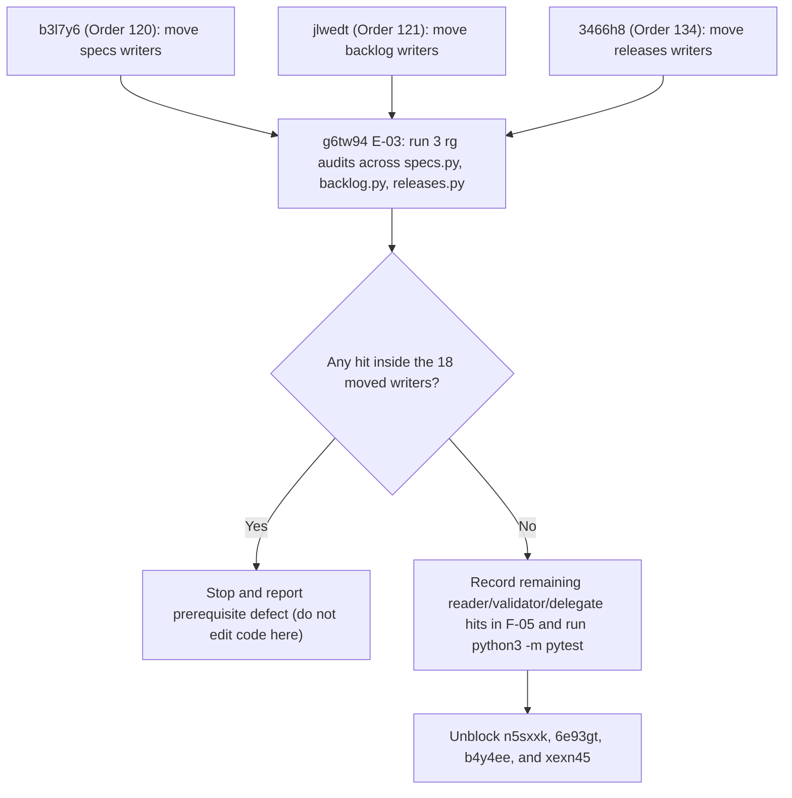

# IPD: Move the specs, backlog and releases create, note and setter writers onto artifact_meta

- Date: 2026-11-07
- Kind: child
- Concern: Spec `4sd62s` (artifact metadata store) section 7 step 4 requires every metadata writer to write through `agent_workflows/artifact_meta.py` in phase B. Before this family's three move parts run, `agent_workflows/specs.py`, `agent_workflows/backlog.py`, and `agent_workflows/releases.py` still build `- Field:` bullets and `## Workflow history` lines by hand (re-measured at `01c564538`: `specs.py` has 15 bullet literals, 3 history-line builders, and 8 `Workflow history` references; `backlog.py` has 29 bullet literals, 4 history-line builders, and 14 `Workflow history` references; `releases.py` has 11 bullet literals, 1 history-line builder, and 4 `Workflow history` references). This plan is a split part of `xexn45` (the phase-B remaining-writers plan), split 2026-11-07 so no single item spans seven modules and up to 17 test modules.
- Scope: Finishing audit of the `specs`, `backlog`, and `releases` writer move (`xexn45` E-02 subset A and E-05 subset A). After the 2026-11-09 round-3 split per research `nj8zdp` (plan-size calibration), the code moves live in `b3l7y6` (Order 120, `specs`), `jlwedt` (Order 121, `backlog`), and `3466h8` (Order 134, `releases`). This plan runs the family audit (`E-03`) proving that none of the 18 moved writer functions in `agent_workflows/specs.py`, `agent_workflows/backlog.py`, or `agent_workflows/releases.py` still builds metadata bullets or `## Workflow history` lines by hand. EXCLUDES: the `prompts`, `ipd_authoring`, `research_cmd`, `artifact_adopt`, and `set_records` writer family (`n5sxxk`), creation-time `short_description` and `aw describe` (`6e93gt` and `fekdwv`), and retiring the thin compatibility adapters (`9o83cr`).
- Scope-Paths: .aw/records/plans/pending/20261107-metastore-22-g6tw94-move-the-specs-backlog-and-releases-create-note-and-setter-w.ipd.md
- Item-Dependencies: executed:tve77h, executed:2xwb9b, executed:7yr827, executed:b3l7y6, executed:jlwedt, executed:3466h8
- Status: approved
- Readiness: go-pending-approval
- Review-Depth: complex
- From-Spec: 4sd62s
- Work-Kind: feature
- Priority: high
- Blocks-Release: next
- Set: metastore
- Order: 22
- Highest E allocated: 03
- Author: opencode its_direct/pt3-claude-opus-5.5-1m-us
- Id: g6tw94
- Approval: 2026-11-16, recorded via aw ipd set: status set to approved

> Write and proofread this plan per the technical writing standard, `.aw/system/workflows/technical-writing/technical-writing.md` (`.agents/workflows/technical-writing/technical-writing.md` in a legacy-layout install), including requirement 12 (diagrams).

## Workflow history
- 2026-11-16 approved (aw set): status set to approved
- 2026-11-14 reviewed (aw set): APPROVE WITH REVISIONS APPLIED; PR-001..PR-003 FIXED

- 2026-11-14 /plan-review (antigravity/gemini): APPROVE WITH REVISIONS APPLIED; PR-001..PR-003 FIXED; review record .aw/records/reviews/20261107-metastore-22-g6tw94-move-the-specs-backlog-and-releases-create-note-and-setter-w.review.md
- 2026-11-09 note (opencode its_direct/pt3-claude-opus-5.5-1m-us): round-3 split per research nj8zdp; items E-01 (split by module), E-02 (split by module) moved to b3l7y6, jlwedt, 3466h8.
- 2026-11-07 to-review (opencode its_direct/pt3-claude-opus-5.5-1m-us): split from xexn45 per maintainer step-complexity rule (no single E/V item hides hundreds of steps).
- 2026-11-07 draft (opencode its_direct/pt3-claude-opus-5.5-1m-us): created.

## Goal

After `b3l7y6` (`specs`), `jlwedt` (`backlog`), and `3466h8` (`releases`) execute, no create, note, migrate, or field-setter path of `agent_workflows/specs.py`, `agent_workflows/backlog.py`, or `agent_workflows/releases.py` builds metadata bullets or `## Workflow history` lines by hand. This plan proves that invariant with a three-query family audit (`E-03`) recorded in `F-05`.

## Detailed Implementation Checklist (TODO)

Execution-state rule: mark an `E-*` item complete only after performing the action. That mark is not validation. Right-sizing rule: each E-item must address one concern and be executable in one focused pass; split when an E-item names multiple distinct deliverables or independent test-surfaces. Accepted execution states: blocked, failed, pending, performed; terminal gate demands 'performed'.

Audit-only scope note: the pin-first code and test moves originally drafted as `E-01` and `E-02` moved in the 2026-11-09 round-3 split to `b3l7y6` (`specs`), `jlwedt` (`backlog`), and `3466h8` (`releases`), where each part pins its own test modules under `.aw/state/<id6>/`. This plan modifies no Python or test file; it runs the post-move family audit (`E-03`), records the audit table in `F-05` of this IPD, and runs the bare core test gate `python3 -m pytest` (`4sd62s` AC-1b).

### Task group 1: family audit

- [x] E-03 Audit the `specs`, `backlog`, and `releases` writer family after `b3l7y6`, `jlwedt`, and `3466h8` execute: (1) run `rg -n "Workflow history" agent_workflows/specs.py agent_workflows/backlog.py agent_workflows/releases.py`; (2) run `rg -n 'f"- \{[^}]+\} (created|migrated|note|\{label\})|f"- \{(date|today|hdate)\} ' agent_workflows/specs.py agent_workflows/backlog.py agent_workflows/releases.py` (must print nothing; `rg` exits `1` on zero matches); (3) run `rg -n 'f"- [A-Z][A-Za-z-]+:|"- [A-Z][A-Za-z-]+: ' agent_workflows/specs.py agent_workflows/backlog.py agent_workflows/releases.py`; (4) fill `F-05` in `## Findings` by labeling every hit from queries (1)-(3) with its enclosing `def` (or `<module>` / class name when outside a `def`) and its reason (reader, validator, module/class docstring or regex constant, body-text edit per `4sd62s` N3, or `agent_workflows/artifact_meta.py::_render_field` value delegate per `D-3`), and run the bare core gate `python3 -m pytest` (`4sd62s` AC-1b). Stop and report a prerequisite defect without editing code here if any hit falls inside the 18 writers moved by `b3l7y6`, `jlwedt`, and `3466h8` (`specs`: `run_new`, `_render_new_spec`, `run_note`, `run_migrate`; `backlog`: `run_new`, `_render_item`, `run_note`, `_reattach_history`; `releases`: `plan_release`, `create_release`, `run_new`, `set_item_dependencies_line`, `set_graduated_to_line`, `set_blocks_release_line`, `set_priority_line`, `set_work_kind_line`, `set_from_backlog_line`, `set_from_spec_line`).
  - Depends on: none
  - Expected outcome: Query (2) prints nothing (`0` matches, `rg` exit `1`); query (3) prints `0` matches in `agent_workflows/specs.py` and `agent_workflows/releases.py` and matches only the three `artifact_meta._render_field` value delegates (`set_release_exempt_kind_line`, `set_release_exempt_ref_line`, `set_close_evidence_line`) in `agent_workflows/backlog.py` (`D-3`); `F-05` lists every hit from queries (1) and (3) with its enclosing scope and reason, with zero hits inside any of the 18 moved writer functions; and `python3 -m pytest` passes.
  - Execution state: performed

Add further leaves as `- [ ] E-NEW <action>` and run `aw ipd sync` to assign ids.

## Project conventions discovered (Step 0)

- The `agent_workflows/artifact_meta.py` entry points come from Order 02 (`tve77h`, `artifact_meta` core) and Order 21 (`7yr827`, phase-B legacy writer): `artifact_meta.read`, `append`, `create`, `validate_new_events`, `write_legacy`, `render_legacy_text`, and (added by `3466h8` E-03) `set_legacy_bullet_line`. Order 13 (`cxxmyv`, attended metadata cutover) switches `append` and `create` from legacy bullet/history rendering to event logs.
- Atomic file replacement uses `agent_workflows/artifact_core.py::atomic_write`; per-record locking uses `agent_workflows/platform_lock.py::held`; UTC history dates use `agent_workflows/artifact_core.py::utc_history_date` (spec `2vev8j` section 4.4, folded into `4sd62s` section 4.2b).
- Pre-move history-insertion rules differed across modules (`xexn45` F-04): `agent_workflows/status_set.py::_prepend_workflow_history_entry` and `agent_workflows/backlog.py::run_note` inserted directly under `## Workflow history`, whereas `agent_workflows/specs.py::_append_history` normalized to one blank line before the entry. The newest-history reader `agent_workflows/attention_contract.py::newest_history_record` reads through `agent_workflows/attention_contract.py::history_block`, which ignores blank lines, so `D-1` changes no reader outcome.
- Writer-side descriptive string validation uses `agent_workflows/attention_contract.py::refuse_unsafe_descriptive` (`MAX_DESCRIPTIVE_LEN = 300`, `MAX_PROSE_DESCRIPTIVE_LEN = 4300`) at CLI boundaries and `agent_workflows/artifact_meta.py::validate_new_events` inside `artifact_meta` (`4sd62s` section 4.2 and AC-15).
- `agent_workflows/backlog.py::_render_item` preserves unknown metadata bullets in source order when `source_text` is supplied (plan `2yqt0a`), and `agent_workflows/artifact_meta.py::_render_field` (`2xwb9b`) delegates `release_exempt_kind`, `release_exempt_ref`, and `close_evidence` value formatting to `backlog.set_release_exempt_kind_line`, `backlog.set_release_exempt_ref_line`, and `backlog.set_close_evidence_line` until cutover (`D-3`).
- Core test tier: `pyproject.toml` marker `core`; run the routine gate bare as `python3 -m pytest` (`4sd62s` AC-1b).
- Cite code by `path::Symbol` or by a backticked path with a quoted string, never by a bare line number (`IPD-C801`).

## Findings

| Id | Evidence (measured 2026-11-07 at `ac76110f4` and re-verified 2026-11-14 at `01c564538`) | Finding |
|---|---|---|
| F-01 | `rg -n 'f"- \{[^}]+\} (created|migrated|note|\{label\})|f"- \{(date|today|hdate)\} ' agent_workflows/specs.py agent_workflows/backlog.py agent_workflows/releases.py`: 8 hand-built history-line sites across `specs.py::run_migrate`, `specs.py::run_note`, `specs.py::_render_new_spec`, `backlog.py::_render_item` (2), `backlog.py::run_note`, `backlog.py::_reattach_history`, and `releases.py::plan_release` (`{_core.utc_history_date()}`); plus 55 `- Field:` bullet literals (`specs.py` 15, `backlog.py` 29, `releases.py` 11) across the 18 family writer functions and the 3 `backlog` value delegates | `b3l7y6`, `jlwedt`, and `3466h8` replace all 8 hand-built history-line sites and 52 of the 55 bullet literals (leaving only the 3 `backlog` value delegates of `D-3`); `E-03` verifies both history and bullet invariants across all three modules. |
| F-02 | Historical split-sizing measurement for former `E-01` (create moves, now distributed across `b3l7y6`, `jlwedt`, and `3466h8`; non-binding `def test_` counts at split time): `test_releases` 21, `test_releases_cli` 37, `test_backlog` 47, `test_spec_id6_filenames` 21, `test_history_date_clock` 5, `test_specs_releases_descriptive_safety` 19, `test_backlog_descriptive_safety` 19, `test_descriptive_refusal_hoist` 3, `test_history_write_order` 8 | Splitting former `E-01` by module into `b3l7y6` (`specs`), `jlwedt` (`backlog`), and `3466h8` (`releases`) keeps each part within single-module, single-concern step bounds (`nj8zdp`). |
| F-03 | Historical split-sizing measurement for former `E-02` (note, migrate, and line-setter moves, now distributed across `b3l7y6`, `jlwedt`, and `3466h8`; non-binding `def test_` counts at split time): `test_specs_verbs` 20, `test_backlog` 47, `test_graduation_forward_links` 9, `test_history_block_bounding` 9, `test_history_order` 7, `test_specs_date_containment` 15, plus `test_releases_sibling_line_writers_bounding` 9 and `test_releases_line_writers` 23 added in `3466h8` | Every writer and pinned module of former `E-01` and `E-02` is owned and pin-tested by `b3l7y6`, `jlwedt`, or `3466h8`; `g6tw94` retains only the cross-module `E-03` audit. |
| F-04 | `tests/test_descriptive_refusal_hoist.py` exercises `specs` (8 references), `backlog` (8), `releases` (7), and `research_cmd` (4) | `b3l7y6`, `jlwedt`, and `3466h8` each pin `tests/test_descriptive_refusal_hoist.py` for this family, and `s95hj6` (`n5sxxk` research part) pins it for `research_cmd`. |
| F-05 | Verified 2026-11-17 at `f51adadd4` (queries (1)-(3) across `specs.py`, `backlog.py`, `releases.py`): Query (1) `rg -n "Workflow history"` (exit 0, 9 hits): `agent_workflows/specs.py` line 290 `def _history_lines` (`if line.strip() == "## Workflow history":`, reader); `agent_workflows/specs.py` line 480 `def validate_spec` (`"no conformant \`## Workflow history\` record",`, validator); `agent_workflows/backlog.py` line 36 `<module>` (`    ## Workflow history`, module docstring); `agent_workflows/backlog.py` line 124 `<module>` (`_WORKFLOW_HISTORY_HEADING_RE = re.compile(r"(?m)^## Workflow history[ \t]*$")`, regex constant); `agent_workflows/backlog.py` line 637 `def validate_item` (`"no ## Workflow history heading; restore the records from git history "`, validator); `agent_workflows/backlog.py` line 1614 `def _strip_metadata_and_history` (`"""Return only the free prose body (after the \`## Workflow history\` section).`, reader docstring); `agent_workflows/releases.py` line 329 `class ReleaseRecord` (`prose section (both shapes exist in the wild). \`history\` is the \`## Workflow history\` bullet`, class docstring); `agent_workflows/releases.py` line 363 `def _history_lines` (`"""The \`- \` bullet lines under \`## Workflow history\` (in file order)."""`, reader docstring); `agent_workflows/releases.py` line 364 `def _history_lines` (`m = re.search(r"(?m)^##[ \t]+Workflow history[ \t]*$", text)`, reader). Query (2) history-line literals: 0 hits (exit 1). Query (3) `- Field:` literals (exit 0, 3 hits; 0 in `specs.py`, 0 in `releases.py`): `agent_workflows/backlog.py` line 945 `def set_release_exempt_kind_line` (`new_line = f"- Release-Exempt-Kind: {value}\n"`, `agent_workflows/artifact_meta.py::_render_field` value delegate per `D-3`); `agent_workflows/backlog.py` line 961 `def set_release_exempt_ref_line` (`new_line = f"- Release-Exempt-Ref: {value}\n"`, `agent_workflows/artifact_meta.py::_render_field` value delegate per `D-3`); `agent_workflows/backlog.py` line 1004 `def set_close_evidence_line` (`new_line = f"- Close-Evidence: {norm_value}\n"`, `agent_workflows/artifact_meta.py::_render_field` value delegate per `D-3`). | Proves that zero hits fall inside any of the 18 moved writer functions in `specs.py`, `backlog.py`, or `releases.py`; none of the 18 writers builds `## Workflow history` lines or `- Field:` metadata bullets by hand. |

## Behavior decisions (kept behavior where writers disagreed, spec `4sd62s` 4.3)

- D-1 (blank line under the history heading, inherited by `b3l7y6`, `jlwedt`, and `3466h8`). KEPT per file: `agent_workflows/artifact_meta.py::write_legacy` (`7yr827` D-1) inserts the new history entry after an existing blank line when one is present and directly under `## Workflow history` otherwise, without adding or removing blank lines; `agent_workflows/attention_contract.py::history_block` ignores blank lines. CHANGED in `b3l7y6`: `specs._append_history`'s blank-line normalization and end-of-file missing-section fallback are replaced by the shared `write_legacy` rule (with intentional assertion updates named in `b3l7y6` D-1 and D-4).
- D-2 (new bullet position, inherited by `b3l7y6`, `jlwedt`, and `3466h8`). KEPT: existing bullets update in place; new bullets insert after `- Status:`, else after `- Id:`, else at the end of the metadata bullet block, and never in the Markdown body (plan `a88210`). In `3466h8` D-2, `agent_workflows/artifact_meta.py::set_legacy_bullet_line` preserves `agent_workflows/selectors.py::metadata_region` bounding and `Item-Dependencies` anchor precedence (`- Scope-Paths:`, then before `- Status:`, then after `- Id:`).
- D-3 (`backlog` value delegates in `E-03` query 3). KEPT until cutover: `agent_workflows/backlog.py::set_release_exempt_kind_line`, `agent_workflows/backlog.py::set_release_exempt_ref_line`, and `agent_workflows/backlog.py::set_close_evidence_line` remain as pure value-formatting delegates called by `agent_workflows/artifact_meta.py::_render_field` (`2xwb9b`, `jlwedt` F-01), rather than independent bypass writers. `E-03` records those three `- Field:` hits in `F-05` with reason `artifact_meta._render_field value delegate` (`9o83cr` retires legacy adapters after readers and writers finish moving).

## Proposed changes (ordered, validatable)

1. Prerequisite family moves (executed before this plan): `b3l7y6` (`agent_workflows/specs.py`), `jlwedt` (`agent_workflows/backlog.py`), and `3466h8` (`agent_workflows/releases.py`).
2. Family audit (`E-03`): run the three `rg` checks across `agent_workflows/specs.py`, `agent_workflows/backlog.py`, and `agent_workflows/releases.py`, record every remaining hit and its non-writer reason in `F-05` (stopping to report if any of the 18 moved writers still matches), and run `python3 -m pytest`.

## Deferred / out of scope (with reason)

- `specs` create, note, and migrate writer moves (`agent_workflows/specs.py::_render_new_spec`, `run_new`, `run_note`, `run_migrate`, plus deletion of unused private writer helpers): moved in the 2026-11-09 round-3 split per research `nj8zdp`.
  - Carrier: b3l7y6
  - Carrier-Evidence: .aw/records/plans/executed/20261109-metastore-120-b3l7y6-move-the-specs-create-note-and-migrate-writers-onto-artifact.ipd.md
- `backlog` create, note, and history-reattach writer moves (`agent_workflows/backlog.py::_render_item`, `run_new`, `run_note`, `_reattach_history`): moved in the 2026-11-09 round-3 split per research `nj8zdp`.
  - Carrier: jlwedt
  - Carrier-Evidence: .aw/records/plans/executed/20261109-metastore-121-jlwedt-move-the-backlog-create-and-note-writers-onto-artifact-meta.ipd.md
- `releases` create and line-setter writer moves (`agent_workflows/releases.py::plan_release`, `create_release`, `run_new`, `set_item_dependencies_line`, `set_graduated_to_line`, `set_blocks_release_line`, `set_priority_line`, `set_work_kind_line`, `set_from_backlog_line`, `set_from_spec_line`): moved in the 2026-11-09 round-3 split per research `nj8zdp`.
  - Carrier: 3466h8
  - Carrier-Evidence: .aw/records/plans/executed/20261109-metastore-134-3466h8-move-the-releases-create-and-line-setter-writers-onto-artifa.ipd.md
- Phase-B merge-independence test (`tests/test_writers_merge_independence.py`, `4sd62s` AC-3 phase-B form): split out of `xexn45` in round 3.
  - Carrier: b4y4ee
- AC-21 obligations test (`tests/test_writers_obligations.py`), raw-write audit (`F-09` in `xexn45` E-14 and E-15), `docs/cli-output-contract.md` and `CHANGELOG.md` updates, and full-suite writer-move gates.
  - Carrier: xexn45
- The other writer family of `xexn45` (`prompts`, `ipd_authoring`, `research_cmd`, `artifact_adopt`, and `set_records`).
  - Carrier: n5sxxk
- Creation-time `short_description` (`--summary`) for `backlog`, `specs`, and `releases`, and `aw describe`.
  - Carrier: fekdwv, 6e93gt
- Retiring thin compatibility adapters and legacy parsers (`4sd62s` AC-1).
  - Carrier: 9o83cr

## Scope check

- Over-scope: none.
- Under-scope: none. All 18 writer functions and every pinned test module of former `E-01` and `E-02` live in `b3l7y6` (4 writers), `jlwedt` (4 writers), and `3466h8` (10 writers), and `E-03` audits both history lines and `- Field:` metadata bullets across all three modules. Plan size after the split: 1 `E-*` item editing only this IPD (`- Scope-Paths:`).

## Required tests / validation

No new test module and no Python code edit. Module-level PIN-FIRST test diffs run in the `V-*` checklists of `b3l7y6`, `jlwedt`, and `3466h8`; `V-03` here verifies the three-query `rg` family audit, the populated `F-05` audit table, and the bare core gate `python3 -m pytest` (`4sd62s` AC-1b).

## Spec / documentation sync

None. Implements the verification finish of `4sd62s` section 7 step 4 for the `specs`, `backlog`, and `releases` module family; no user-facing CLI flags or documented contracts change here.

## Open questions

None open. Every question this work raised was resolved in `xexn45` and the reviewed split parts (`7yr827`, `b3l7y6`, `jlwedt`, `3466h8`); `D-1` through `D-3` record the governing behavior decisions.

## Validation and cross-check (verify before reporting done)

Validation-state rule: inspect evidence in a separate pass. Do not mark a `V-*` item complete from memory or from the matching execution checkmark. Accepted validation results: blocked, failed, pass, pending; terminal gate demands 'pass'. Runtime-demonstration reachability rule: for each `V-*` item demanding the software be observed acting (such as a run, a dispatch, or a transition), as distinct from items demanding a diff, a file's content, or a test result, which are reachable by construction, name the code path that produces the observation or the sibling `E-*` that creates it, else the demand is UNDER-SCOPE.

- [x] V-03 validates E-03
  - Required evidence: paste all three `rg` commands of `E-03` with their full output and exit codes (showing `0` matches and exit `1` for query (2), and `0` matches in `agent_workflows/specs.py` and `agent_workflows/releases.py` plus only the three `D-3` `backlog` value-delegate matches for query (3)); paste the filled `F-05` row naming each hit's module, line, enclosing `def` (or `<module>` / class scope), and reason; state explicitly for each of the 18 moved writer functions named in `E-03` (`specs.run_new`, `specs._render_new_spec`, `specs.run_note`, `specs.run_migrate`, `backlog.run_new`, `backlog._render_item`, `backlog.run_note`, `backlog._reattach_history`, `releases.plan_release`, `releases.create_release`, `releases.run_new`, `releases.set_item_dependencies_line`, `releases.set_graduated_to_line`, `releases.set_blocks_release_line`, `releases.set_priority_line`, `releases.set_work_kind_line`, `releases.set_from_backlog_line`, `releases.set_from_spec_line`) that zero hits fall inside it; and paste the actual summary line of bare `python3 -m pytest` (`4sd62s` AC-1b).
  - Observed evidence: (1) `rg -n "Workflow history" agent_workflows/specs.py agent_workflows/backlog.py agent_workflows/releases.py` (exit 0): `agent_workflows/specs.py:290:        if line.strip() == "## Workflow history":`, `agent_workflows/specs.py:480:                "no conformant \`## Workflow history\` record",`, `agent_workflows/backlog.py:36:    ## Workflow history`, `agent_workflows/backlog.py:124:_WORKFLOW_HISTORY_HEADING_RE = re.compile(r"(?m)^## Workflow history[ \t]*$")`, `agent_workflows/backlog.py:637:                "no ## Workflow history heading; restore the records from git history "`, `agent_workflows/backlog.py:1614:    """Return only the free prose body (after the \`## Workflow history\` section).`, `agent_workflows/releases.py:329:    prose section (both shapes exist in the wild). \`history\` is the \`## Workflow history\` bullet`, `agent_workflows/releases.py:363:    """The \`- \` bullet lines under \`## Workflow history\` (in file order)."""`, `agent_workflows/releases.py:364:    m = re.search(r"(?m)^##[ \t]+Workflow history[ \t]*$", text)`. (2) `rg -n 'f"- \{[^}]+\} (created|migrated|note|\{label\})|f"- \{(date|today|hdate)\} ' agent_workflows/specs.py agent_workflows/backlog.py agent_workflows/releases.py` (exit 1, 0 matches, no output). (3) `rg -n 'f"- [A-Z][A-Za-z-]+:|"- [A-Z][A-Za-z-]+: ' agent_workflows/specs.py agent_workflows/backlog.py agent_workflows/releases.py` (exit 0; 0 matches in `agent_workflows/specs.py` and `agent_workflows/releases.py`): `agent_workflows/backlog.py:945:    new_line = f"- Release-Exempt-Kind: {value}\n"`, `agent_workflows/backlog.py:961:    new_line = f"- Release-Exempt-Ref: {value}\n"`, `agent_workflows/backlog.py:1004:    new_line = f"- Close-Evidence: {norm_value}\n"`. Filled `F-05` row: `specs.py:290` `def _history_lines` (reader); `specs.py:480` `def validate_spec` (validator); `backlog.py:36` `<module>` (module docstring); `backlog.py:124` `<module>` (regex constant `_WORKFLOW_HISTORY_HEADING_RE`); `backlog.py:637` `def validate_item` (validator); `backlog.py:1614` `def _strip_metadata_and_history` (reader docstring); `releases.py:329` `class ReleaseRecord` (class docstring); `releases.py:363` `def _history_lines` (reader docstring); `releases.py:364` `def _history_lines` (reader); `backlog.py:945` `def set_release_exempt_kind_line` (`agent_workflows/artifact_meta.py::_render_field` value delegate per `D-3`); `backlog.py:961` `def set_release_exempt_ref_line` (`agent_workflows/artifact_meta.py::_render_field` value delegate per `D-3`); `backlog.py:1004` `def set_close_evidence_line` (`agent_workflows/artifact_meta.py::_render_field` value delegate per `D-3`). Per-function audit across all 18 moved writers: `specs.run_new`: 0 hits; `specs._render_new_spec`: 0 hits; `specs.run_note`: 0 hits; `specs.run_migrate`: 0 hits; `backlog.run_new`: 0 hits; `backlog._render_item`: 0 hits; `backlog.run_note`: 0 hits; `backlog._reattach_history`: 0 hits; `releases.plan_release`: 0 hits; `releases.create_release`: 0 hits; `releases.run_new`: 0 hits; `releases.set_item_dependencies_line`: 0 hits; `releases.set_graduated_to_line`: 0 hits; `releases.set_blocks_release_line`: 0 hits; `releases.set_priority_line`: 0 hits; `releases.set_work_kind_line`: 0 hits; `releases.set_from_backlog_line`: 0 hits; `releases.set_from_spec_line`: 0 hits. Bare `python3 -m pytest` summary: `2194 passed, 11 warnings in 71.66s (0:01:11)` (exited 1 solely on `Core tier wall time: 71.67s exceeded budget of 30.00s` at `Host 1-minute load average: 5.31 on 12 CPUs`); bounded `aw suite`: `2194 passed, 11 warnings in 52.07s` (exit 0).
  - Result: pass

## Approval and execution gate

- Size assessment: standard
- Cohesion rationale: not required

Execute only after human approval (`Status: approved`) and after every plan in `- Item-Dependencies:` (`tve77h`, `2xwb9b`, `7yr827`, `b3l7y6`, `jlwedt`, and `3466h8`) is executed. Stop and report without editing production code if any prerequisite in `- Item-Dependencies:` is not yet `executed`, if any `E-03` audit query matches inside one of the 18 writers moved by `b3l7y6`, `jlwedt`, or `3466h8`, or if concurrent edits in a shared checkout conflict with this plan file.

Scope fence: the paths in `- Scope-Paths:` are a declaration; a needed file outside the fence is edited and then justified at finalize (`--scope-reason`), and a declared path left unmodified is acknowledged (`--scope-ack`).

Honesty rule: run the exact `rg` audit commands of `E-03` and the bare core gate `python3 -m pytest`, and paste the ACTUAL outputs and summary lines; never claim a result you did not run.

Commits: commit only through `aw commit g6tw94 -- <paths>`; never `git add -A`, a bare `git add` or `git commit -a`; never push.

Lifecycle transition: the plan moves to `.aw/records/plans/executed/` only through `aw ipd finalize`, never a hand `git mv`, and only after `aw ipd lint --phase pre-transition` conforms and every `V-*` reads `pass` with pasted evidence. When `aw oc run` or `aw agy run` executes the plan, the runner performs the finalize; a hand executor runs `aw ipd finalize g6tw94` itself.
