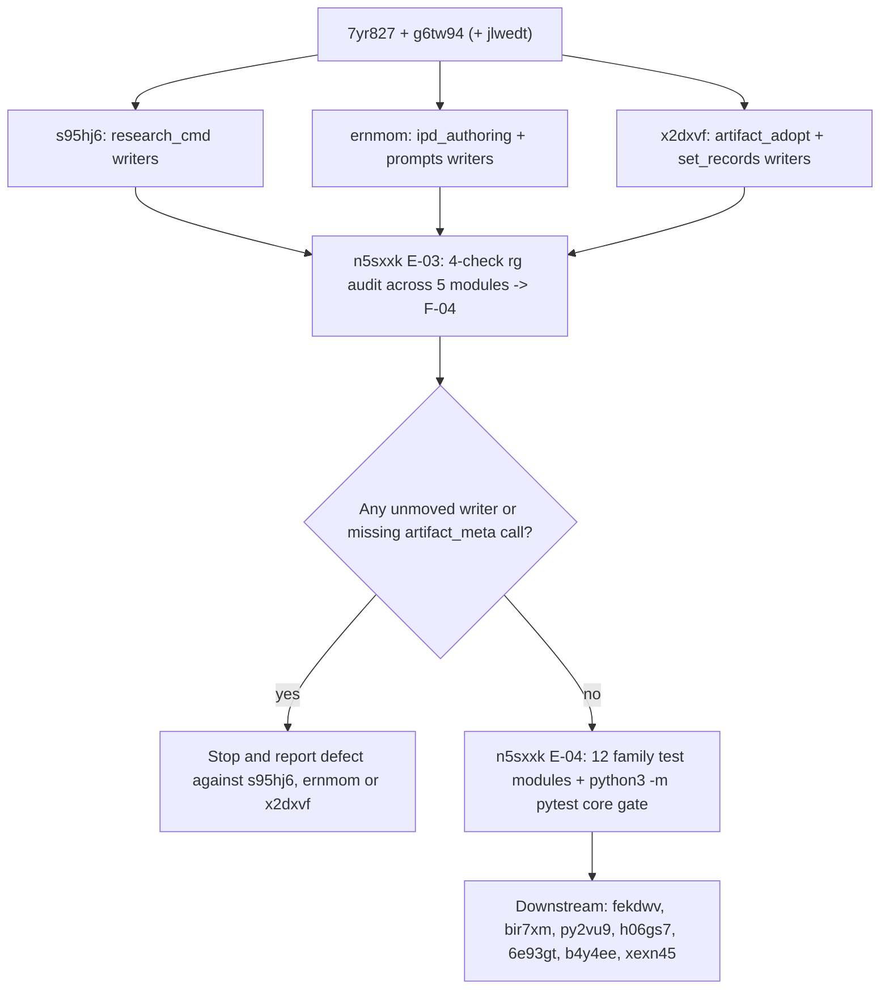

# IPD: Move the prompts, scaffold, research, adopt and set_records create, note and setter writers onto artifact_meta

- Date: 2026-11-07
- Kind: child
- Concern: Spec `4sd62s` section 7 step 4 requires every metadata writer to write through `artifact_meta` in phase B. The prompts, plan-scaffold, research, adopt and `set_records` writers still build metadata text and write files by hand (measured raw writes with `rg -c "atomic_write\(|write_text\(|git_mv\("`: `agent_workflows/ipd_authoring.py` 5, `agent_workflows/research_cmd.py` 5, `agent_workflows/set_records.py` 6, `agent_workflows/prompts.py` 1, `agent_workflows/artifact_adopt.py` 1). This plan is a part of `xexn45`, split 2026-11-07.
- Scope: FINISHING PART of the prompts, scaffold, research, adopt and `set_records` writer move (`xexn45` E-02 subset B and E-05 subset B). Round-3 split 2026-11-09 per research `nj8zdp`: the eleven writer moves live in `s95hj6` (Order 122, research), `ernmom` (Order 123, plan scaffold, plan sync and prompts) and `x2dxvf` (Order 135, adopt and `set_records`); this plan keeps the five-module family audit (`E-03`) and the combined family regression and core-gate check (`E-04`) deferred here by those three parts. EXCLUDES: specs, backlog and releases (`g6tw94` and its parts `b3l7y6`, `jlwedt`, `3466h8`), `--summary` and `aw describe` (`6e93gt` and its parts `fekdwv`, `bir7xm`, `py2vu9`, `h06gs7`), the cross-family merge-independence test (`b4y4ee`), whole-move obligations and documentation (`xexn45`), and `agent_workflows/set_records.py::write_local_projections` (writes generated run-projection files, not record metadata).
- Scope-Paths: .aw/records/plans/pending/20261107-metastore-23-n5sxxk-move-the-prompts-scaffold-research-adopt-and-set-records-cre.ipd.md
- Item-Dependencies: executed:tve77h, executed:2xwb9b, executed:7yr827, executed:g6tw94, executed:s95hj6, executed:ernmom, executed:x2dxvf
- Status: approved
- Readiness: go-pending-approval
- Review-Depth: complex
- From-Spec: 4sd62s
- Work-Kind: feature
- Priority: high
- Blocks-Release: next
- Set: metastore
- Order: 23
- Highest E allocated: 04
- Author: opencode its_direct/pt3-claude-opus-5.5-1m-us
- Id: n5sxxk
- Approval: 2026-11-16, recorded via aw ipd set: status set to approved

> Write and proofread this plan per the technical writing standard, `.aw/system/workflows/technical-writing/technical-writing.md` (`.agents/workflows/technical-writing/technical-writing.md` in a legacy-layout install), including requirement 12 (diagrams).

## Workflow history
- 2026-11-16 approved (aw set): status set to approved

- 2026-11-14 reviewed (aw set): APPROVE WITH REVISIONS APPLIED; PR-001..PR-004 FIXED
- 2026-11-14 /plan-review (antigravity/gemini-4-carbon): APPROVE WITH REVISIONS APPLIED; PR-001..PR-004 FIXED; E-04/V-04 added; review record .aw/records/reviews/20261107-metastore-23-n5sxxk-move-the-prompts-scaffold-research-adopt-and-set-records-cre.review.md
- 2026-11-09 note (opencode its_direct/pt3-claude-opus-5.5-1m-us): round-3 split per research nj8zdp; items E-01 (split by module), E-02 (split by module) moved to s95hj6, ernmom, x2dxvf.
- 2026-11-07 to-review (opencode its_direct/pt3-claude-opus-5.5-1m-us): split from xexn45 per maintainer step-complexity rule (no single E/V item hides hundreds of steps).
- 2026-11-07 draft (opencode its_direct/pt3-claude-opus-5.5-1m-us): created.

## Goal

After `s95hj6`, `ernmom` and `x2dxvf` execute, every create and field-setter writer across `ipd_authoring`, `set_records`, `research_cmd`, `artifact_adopt` and `prompts` delegates metadata rendering and writes to `artifact_meta`, and all twelve pinned test modules of the family plus the core test gate pass together.

## Detailed Implementation Checklist (TODO)

Execution-state rule: mark an `E-*` item complete only after performing the action. That mark is not validation. Right-sizing rule: each E-item must address one concern and be executable in one focused pass; split when an E-item names multiple distinct deliverables or independent test-surfaces. Accepted execution states: blocked, failed, pending, performed; terminal gate demands 'performed'.

Audit-only scope note: the per-part PIN-FIRST before/after diffs ran inside `s95hj6`, `ernmom` and `x2dxvf` under `.aw/state/<id6>/`. This plan modifies no Python or test file; if either step below uncovers an unmoved writer or a test regression from merging the three parallel `agent_workflows/artifact_meta.py` edits, stop and report the owning part rather than editing production source under this plan.

### Task group 1: family audit and post-merge gate

- [x] E-03 Audit all five family modules (`agent_workflows/ipd_authoring.py`, `agent_workflows/set_records.py`, `agent_workflows/research_cmd.py`, `agent_workflows/artifact_adopt.py`, `agent_workflows/prompts.py`) after `s95hj6`, `ernmom` and `x2dxvf` have executed. Run four `rg` checks across those five paths:
  (1) `rg -n "artifact_meta" <five modules>` to verify every one of the five modules imports and calls `artifact_meta` (`create`, `append`, `write_legacy`, `render_legacy_text`, or `set_legacy_bullet_line`);
  (2) `rg -n "atomic_write\(|write_text\(|git_mv\(" <five modules>` to audit every remaining raw write (including `research_cmd.py` and `artifact_adopt.py`, which `xexn45` E-14 and E-15 omit);
  (3) `rg -n 'Workflow history|f"- \{(date|today|hdate)\} ' <five modules>` to check history-section literals; and
  (4) `rg -n '<!-- aw-prompt:|f"- (Date|Kind|Status|Work-Kind|Priority|From-Backlog|Blocks-Release|Set|Order|Highest E allocated|Author|Id|Target-Id):|^def (build_frontmatter|update_frontmatter_fields|_set_priority_line|render_metadata_comment)\(' <five modules>` to inspect bullet, YAML front-matter and prompt-comment builders across all four metadata formats.
  Label every hit from checks (2), (3) and (4) with its enclosing `def` and its reason in `## Findings` row `F-04` (a reader or presence guard, prose or gate-template body text per spec `4sd62s` N3, a non-record projection file in `set_records.write_local_projections`, an out-of-scope bulk-backfill or rename/status helper owned by `1hfmpb`/`2xwb9b`/`9o83cr`, or a thin `str -> str` adapter delegating to `artifact_meta` per `xexn45` F-08). If any of the five modules has zero `artifact_meta` calls in check (1), or if any of the eleven moved writers (`research_cmd.run_new`, `research_cmd.run_new_comparison`, `research_cmd.run_set_outcome`, `research_cmd.run_set_priority`, `ipd_authoring.run_scaffold`, `ipd_authoring.run_sync`, `prompts.run_new`, `artifact_adopt.apply_adoption`, `set_records.write_walkthrough`, `set_records.close_on_answer`, `set_records.promote_question_to_backlog`, including `research_cmd._emit_and_write` on record metadata) still builds metadata text by hand or writes record metadata to disk bypassing `artifact_meta`, stop and report the defect against `s95hj6`, `ernmom` or `x2dxvf` rather than editing code here.
  - Depends on: none
  - Expected outcome: check (1) matches at least one `artifact_meta` call in each of the five modules; `F-04` lists every hit from checks (2), (3) and (4) with its enclosing `def` and verified reason; none of the eleven moved writers builds metadata text by hand or bypasses `artifact_meta`.
  - Execution state: performed

- [x] E-04 Run the combined twelve-module family regression suite and the bare core test gate deferred to `n5sxxk` by `s95hj6`, `ernmom` and `x2dxvf`: run `python3 -m pytest -o addopts="" -m "" -n auto tests/test_prompts_new.py tests/test_prompts_set_surface.py tests/test_ipd_authoring.py tests/test_scaffold_history_clock.py tests/test_research_descriptive_safety.py tests/test_descriptive_refusal_hoist.py tests/test_walkthrough_id6.py tests/test_artifact_adopt.py tests/test_research_cmd_create.py tests/test_backlog.py tests/test_research_priority.py tests/test_slug_slice_trailing_hyphen.py` (`-m ""` includes any module marked `slow`) and then run the bare core gate `python3 -m pytest`.
  - Depends on: E-03
  - Expected outcome: all twelve family test modules pass with `0 failed` and `0 errors` on the integrated checkout of `s95hj6`, `ernmom` and `x2dxvf`, and bare `python3 -m pytest` passes within its 30 s budget.
  - Execution state: performed

## Project conventions discovered (Step 0)

- The `artifact_meta` interface names come from Order 02 (`tve77h`) and are used by the three writer-move parts (`s95hj6`, `ernmom`, `x2dxvf`): `agent_workflows/artifact_meta.py::read`, `history`, `query`, `resolve`, `read_at`, `append`, `create`, `validate_new_events`, `repair`. Order 02's `append` and `create` log paths switch on at the Order 13 cutover (`cxxmyv`); in phase B they render through `agent_workflows/artifact_meta.py::write_legacy` and `render_legacy_text`, built by `7yr827`.
- Atomic file replacement uses `agent_workflows/artifact_core.py::atomic_write`; locking uses `agent_workflows/platform_lock.py::held`; UTC history dates come from `agent_workflows/artifact_core.py::utc_history_date` (spec `4sd62s` 4.2b, carrying forward superseded spec `2vev8j` 4.4).
- Pre-move history-insertion rules differed (`xexn45` F-04): `agent_workflows/status_set.py::_prepend_workflow_history_entry` and `agent_workflows/backlog.py::run_note` inserted directly under the heading, `agent_workflows/specs.py::_append_history` normalized to one blank line before the record, `agent_workflows/plan_readiness.py::_prepend_history_entry` kept an existing blank line, and `agent_workflows/coverage_record.py::write` inserted directly under the heading. The newest-history reader `agent_workflows/attention_contract.py::newest_history_record` over `history_block` ignores blank lines.
- Descriptive string refusals use `agent_workflows/attention_contract.py::refuse_unsafe_descriptive` (`MAX_DESCRIPTIVE_LEN = 300`, `MAX_PROSE_DESCRIPTIVE_LEN = 4300`).
- Recognized plan metadata bullets are `agent_workflows/ipd_schema.py::META_RECOGNIZED`; an unrecognized bullet triggers lint error `IPD-M103` (`agent_workflows/ipd_lint.py::C_META_UNKNOWN`). Backlog items preserve unrecognized bullets in order (`agent_workflows/backlog.py::_render_item`, IPD `2yqt0a`).
- Staged prompts store metadata in a single leading HTML comment (`agent_workflows/prompts.py::render_metadata_comment`, `inject_metadata_id6`, `update_metadata_status`); no visible text may precede the prompt body (spec `20260808-1958-01-prompt-purity-lint` R1/P4).
- Research artifacts store metadata in YAML front matter (`--- ... ---`), rendered before `s95hj6` by `agent_workflows/research_cmd.py::build_frontmatter`, `update_frontmatter_fields` and `_set_priority_line`, and reused by `agent_workflows/artifact_adopt.py::plan_adoption`.
- Cite code by `path::Symbol` or by a quoted single-line string, never by a bare line number alone (advisory `IPD-C801`).

## Findings

| Id | Evidence (measured 2026-11-07 at `ac76110f4`; re-verified 2026-11-13 at `9af25dfe7`) | Finding |
|---|---|---|
| F-01 | Pre-move raw writes (`rg -n "atomic_write\(\|write_text\(\|git_mv\("` across the five modules, 18 hits): `ipd_authoring.py` 5 (`_atomic_write` def + `_core.atomic_write` call, `run_scaffold`, `backfill_plan_ids`, `run_sync`); `set_records.py` 6 (`write_local_projections` x3, `write_walkthrough`, `promote_question_to_backlog`, `close_on_answer`); `research_cmd.py` 5 (`_atomic_write` def + `_core.atomic_write` call, `_emit_and_write` called by `run_new` and `run_new_comparison`, `run_set_outcome`, `run_set_priority`); `artifact_adopt.py` 1 (`apply_adoption`); `prompts.py` 1 (`run_new`). Pre-move `rg -n "artifact_meta"` across all five modules: 0 hits | Eleven moved writers account for the record-metadata writes; `ipd_authoring.backfill_plan_ids`, `_atomic_write` helpers and `set_records.write_local_projections` are non-writer or non-metadata paths. Because `xexn45` E-14 and E-15 omit `research_cmd.py` and `artifact_adopt.py`, `E-03` audits all five modules here. |
| F-02 | Pre-split `E-01` create scope (moved 2026-11-09 to `s95hj6` E-01, `ernmom` E-01/E-03, `x2dxvf` E-01/E-02): 7 writer functions across 5 files and 9 test modules (non-binding test counts: `test_prompts_new` 22, `test_prompts_set_surface` 6, `test_ipd_authoring` 31, `test_scaffold_history_clock` 8, `test_research_descriptive_safety` 24, `test_descriptive_refusal_hoist` 3, `test_walkthrough_id6` 4, `test_artifact_adopt` 39, `test_research_cmd_create` 20) | Every create writer and pinned module of the original `E-01` is owned by `s95hj6`, `ernmom` or `x2dxvf`, and re-run together by `E-04`. |
| F-03 | Pre-split `E-02` setter scope (moved 2026-11-09 to `s95hj6` E-02, `ernmom` E-02, `x2dxvf` E-03): 5 writer functions across 3 files and 5 test modules (non-binding test counts: `test_backlog` 47, `test_ipd_authoring` 31, `test_research_cmd_create` 20, `test_research_priority` 11, `test_slug_slice_trailing_hyphen` 2; 12 distinct test modules across `F-02` and `F-03`, 217 tests at `9af25dfe7`) | Every setter writer and pinned module of the original `E-02` is owned by `s95hj6`, `ernmom` or `x2dxvf`, and re-run together by `E-04`. |
| F-04 | Post-move `rg` audit at `3a585d68b` (`s95hj6` + `ernmom` + `x2dxvf` integrated): Check (1) hits all 5 modules (`ipd_authoring.py` in `run_scaffold` & `run_sync`; `set_records.py` in `_records_legacy_context`, `write_walkthrough`, `promote_question_to_backlog`, `close_on_answer`; `research_cmd.py` in `_research_legacy_context`, `_render_research_create`, `_write_planned_research_file`, `_apply_research_meta_events`; `artifact_adopt.py` in `apply_adoption`; `prompts.py` in `run_new`). Check (2) 8 hits: `set_records.write_local_projections` (`_core.atomic_write` for `dpath`, `qpath`, `wpath`, 3 hits), `ipd_authoring._atomic_write` (def + `_core.atomic_write`, 2 hits), `ipd_authoring.run_scaffold` (`_atomic_write(path, text)` after `artifact_meta.render_legacy_text`), `ipd_authoring.backfill_plan_ids` (`_atomic_write(p, new_text)`), `ipd_authoring.run_sync` (`_atomic_write(path, res.new_text)` after `artifact_meta.render_legacy_text`). Check (3) 1 hit: `ipd_authoring.build_skeleton` docstring (`history_date` stamps `draft` under `## Workflow history`). Check (4) 27 hits: `ipd_authoring.build_skeleton` (10 template lines: `Date`, `Kind`, `Work-Kind`, `Priority`, `From-Backlog`, `Blocks-Release`, `Set`, `Order`, `Author`, `Id`), `ipd_authoring.insert_id_line` (`lines.insert(i + 1, f"- Id: {id6}\n")`), `research_cmd` compatibility defs (`build_frontmatter`, `update_frontmatter_fields`, `_set_priority_line`, 3 hits), `prompts` `<module>` docstring/comment (2 hits), `prompts.render_metadata_comment` (def + `line = f"<!-- aw-prompt: {body} . {_METADATA_TRAILER} -->"`, 2 hits), `prompts.has_metadata_comment` (docstring + presence guard, 2 hits), `prompts.read_metadata_id6` (docstring + presence guard, 2 hits), `prompts.inject_metadata_id6` (presence guard, 1 hit), `prompts.read_metadata_status` (docstring + presence guard, 2 hits), `prompts.update_metadata_status` (presence guard, 1 hit). Zero hits in `research_cmd.py`, `artifact_adopt.py`, or `prompts.py` for checks (2)-(3); zero hits in `set_records.py` or `artifact_adopt.py` for check (4). | Every check-(2)-(4) hit is verified non-bypass: `set_records.write_local_projections` writes generated untracked run-projection files (not record metadata, per Scope and `xexn45` F-09); `ipd_authoring._atomic_write` is the shared atomic helper; `ipd_authoring.run_scaffold` `_atomic_write` is the outside-root/`--overwrite` fallback over `artifact_meta.render_legacy_text` (`ernmom` D-7); `ipd_authoring.run_sync` writes once after `artifact_meta.render_legacy_text` updates `highest_e_allocated` (`ernmom` D-4); `ipd_authoring.backfill_plan_ids` and `insert_id_line` are out-of-scope bulk `- Id:` identity backfill helpers (`artifact_meta` forbids generic `set` of `id`, `ernmom` F-05); `ipd_authoring.build_skeleton` is the byte-pinned skeleton builder (`ernmom` D-6, passed `history_record=False` by `run_scaffold` while `artifact_meta.create`/`render_legacy_text` render metadata and history per `ernmom` D-3); `research_cmd` (`build_frontmatter`, `update_frontmatter_fields`, `_set_priority_line`) and `prompts.render_metadata_comment` are uncalled compatibility helpers kept for direct unit tests until `9o83cr`/`h1kfyp`..`zs7a45` (`s95hj6` D-4, `ernmom` D-5); `prompts.has_metadata_comment`, `read_metadata_id6`, `read_metadata_status` are readers/presence guards (`<module>` hits are docs/comments); `prompts.inject_metadata_id6` and `update_metadata_status` are out-of-scope rename/status helpers owned by `1hfmpb`/`2xwb9b`/`9o83cr` (uncalled by `prompts.run_new`). None of the 11 moved writers builds metadata text by hand or bypasses `artifact_meta`. |

## Behavior decisions (kept behavior where writers disagreed, spec `4sd62s` 4.3)

- D-1 (blank line under `## Workflow history`, carried from `xexn45` D-1 for history-bearing types in this family). KEPT per file: `agent_workflows/artifact_meta.py::write_legacy` (`7yr827`) inserts a new history line after an existing blank line when one is present and directly under the heading otherwise, never adding or removing a blank line, and creates a missing section before the first `##` heading for bullet-block records and at end of file for staged prompts (`2xwb9b` E-02). Research YAML records carry no `## Workflow history` section.
- D-2 (new bullet position, carried from `xexn45` D-2). KEPT: update in place when present; otherwise insert after `- Status:`, else after `- Id:`, else at the end of the metadata block, never in the document body (backlog `a88210`). No reader depends on bullet order (`agent_workflows/ipd_schema.py::parse_metadata_block` is order-free).

## Proposed changes (ordered, validatable)

1. Prerequisite writer moves in three parallel parts: research (`s95hj6`), plan scaffold, plan sync and prompts (`ernmom`), and adopt plus `set_records` (`x2dxvf`).
2. Four-check `rg` family audit across all five modules and recording of `F-04` (`E-03`).
3. Combined twelve-module family regression run and bare core test gate (`E-04`), gating downstream `--summary` (`fekdwv`, `bir7xm`, `py2vu9`, `h06gs7`, `6e93gt`), merge-independence (`b4y4ee`) and whole-move finish (`xexn45`) plans.

## Deferred / out of scope (with reason)

- `E-01` research subset (`agent_workflows/research_cmd.py::run_new`, `run_new_comparison`) and `E-02` research subset (`run_set_outcome`, `run_set_priority`): moved in the 2026-11-09 round-3 split per research `nj8zdp`.
  - Carrier: s95hj6
  - Carrier-Evidence: .aw/records/plans/executed/20261109-metastore-122-s95hj6-move-the-research-create-and-setter-writers-onto-artifact-me.ipd.md
- `E-01` scaffold and prompts subset (`agent_workflows/ipd_authoring.py::run_scaffold`, `agent_workflows/prompts.py::run_new` with `render_metadata_comment`) and `E-02` sync subset (`agent_workflows/ipd_authoring.py::run_sync`): moved in the 2026-11-09 round-3 split per research `nj8zdp`.
  - Carrier: ernmom
  - Carrier-Evidence: .aw/records/plans/executed/20261109-metastore-123-ernmom-move-the-plan-scaffold-plan-sync-and-prompt-create-writers-o.ipd.md
- `E-01` adopt and walkthrough subset (`agent_workflows/artifact_adopt.py::apply_adoption`, `agent_workflows/set_records.py::write_walkthrough`) and `E-02` `set_records` subset (`close_on_answer`, `promote_question_to_backlog`): moved in the 2026-11-09 round-3 split per research `nj8zdp`.
  - Carrier: x2dxvf
  - Carrier-Evidence: .aw/records/plans/executed/20261109-metastore-135-x2dxvf-move-the-adopt-and-set-records-create-and-setter-writers-ont.ipd.md
- The phase-B merge-independence test (`tests/test_writers_merge_independence.py`, AC-3 phase-B form), moved from `xexn45` E-12 in round 3.
  - Carrier: b4y4ee
- The AC-21 obligations and AC-6 phase-B diff test (`E-13`), the ten-module raw-write audit `F-09` (`E-14`, `E-15`), the `docs/cli-output-contract.md` and `CHANGELOG.md` updates (`E-16`), and the full-suite gates (`E-17`) of the writer move.
  - Carrier: xexn45

## Scope check

- Over-scope: none.
- Under-scope: none. Every writer and every pinned module of the original `E-01` and `E-02` lives in `s95hj6`, `ernmom` or `x2dxvf`, and `E-03` plus `E-04` fulfill the five-module audit and post-merge regression/core gate that those three parts defer to `n5sxxk`. Plan size: 2 E-items in 1 task group.

## Required tests / validation

No new test module and no Python code edit. `V-03` verifies the four-check `rg` audit and filled `F-04` row across all five modules; `V-04` runs the twelve existing family test modules (`tests/test_prompts_new.py`, `tests/test_prompts_set_surface.py`, `tests/test_ipd_authoring.py`, `tests/test_scaffold_history_clock.py`, `tests/test_research_descriptive_safety.py`, `tests/test_descriptive_refusal_hoist.py`, `tests/test_walkthrough_id6.py`, `tests/test_artifact_adopt.py`, `tests/test_research_cmd_create.py`, `tests/test_backlog.py`, `tests/test_research_priority.py`, `tests/test_slug_slice_trailing_hyphen.py`) and the bare core gate `python3 -m pytest`.

## Spec / documentation sync

None. Implements spec `4sd62s` section 7 step 4 verification for this five-module writer family; no user-visible CLI or format behavior changes in phase B.

## Open questions

None open. Every question this work raised was resolved in `xexn45` before the split; `D-1` and `D-2` above record the kept legacy-rendering behaviors.

## Validation and cross-check (verify before reporting done)

Validation-state rule: inspect evidence in a separate pass. Do not mark a `V-*` item complete from memory or from the matching execution checkmark. Accepted validation results: blocked, failed, pass, pending; terminal gate demands 'pass'. Runtime-demonstration reachability rule: for each `V-*` item demanding the software be observed acting (such as a run, a dispatch, or a transition), as distinct from items demanding a diff, a file's content, or a test result, which are reachable by construction, name the code path that produces the observation or the sibling `E-*` that creates it, else the demand is UNDER-SCOPE.

- [x] V-03 validates E-03
  - Required evidence: paste all four `rg` commands of `E-03` with their full output across `agent_workflows/ipd_authoring.py`, `agent_workflows/set_records.py`, `agent_workflows/research_cmd.py`, `agent_workflows/artifact_adopt.py` and `agent_workflows/prompts.py`; confirm check (1) shows at least one `artifact_meta` call in every one of the five modules; paste the filled `F-04` row naming each hit from checks (2), (3) and (4) with its enclosing `def` and verified reason; and state explicitly for each of the eleven moved writer functions (`research_cmd.run_new`, `research_cmd.run_new_comparison`, `research_cmd.run_set_outcome`, `research_cmd.run_set_priority`, `ipd_authoring.run_scaffold`, `ipd_authoring.run_sync`, `prompts.run_new`, `artifact_adopt.apply_adoption`, `set_records.write_walkthrough`, `set_records.close_on_answer`, `set_records.promote_question_to_backlog`) that it neither builds metadata text by hand nor writes record metadata bypassing `artifact_meta`.
  - Observed evidence: (1) `rg -n "artifact_meta" agent_workflows/ipd_authoring.py agent_workflows/set_records.py agent_workflows/research_cmd.py agent_workflows/artifact_adopt.py agent_workflows/prompts.py` (exit 0) hits all 5 modules: `ipd_authoring.py` (`616:    from agent_workflows import artifact_meta as _meta` in `run_scaffold`, `1155:            from agent_workflows import artifact_meta as _meta` in `run_sync`); `set_records.py` (`227:    from agent_workflows import artifact_meta as _meta` in `_records_legacy_context`, `282:    from agent_workflows import artifact_meta as _meta` in `write_walkthrough`, `367:    from agent_workflows import artifact_meta as _meta` in `promote_question_to_backlog`, `424:    ``artifact_meta.append``. Returns the new path.` and `426:    from agent_workflows import artifact_meta as _meta` in `close_on_answer`); `research_cmd.py` (`471:    from agent_workflows import artifact_meta as _meta` in `_research_legacy_context`, `517:    """Render a new research document via ``artifact_meta.create(..., dry_run=True)``."""` and `518:    from agent_workflows import artifact_meta as _meta` in `_render_research_create`, `562:    """Persist one planned research file through ``artifact_meta.create(..., dry_run=False)``."""` and `563:    from agent_workflows import artifact_meta as _meta` in `_write_planned_research_file`, `821:    """Preview or apply field events on a research record via ``artifact_meta.append``."""` and `822:    from agent_workflows import artifact_meta as _meta` in `_apply_research_meta_events`); `prompts.py` (`565:    from agent_workflows import artifact_meta as _meta` in `run_new`); `artifact_adopt.py` (`864:    # Step 1: write the destination through artifact_meta.create.` and `866:        from agent_workflows import artifact_meta as _meta` in `apply_adoption`). (2) `rg -n "atomic_write\(|write_text\(|git_mv\(" agent_workflows/ipd_authoring.py agent_workflows/set_records.py agent_workflows/research_cmd.py agent_workflows/artifact_adopt.py agent_workflows/prompts.py` (exit 0): `ipd_authoring.py` (`364:def _atomic_write(path: Path, text: str) -> None:`, `375:    _core.atomic_write(path, text, prefix=".ipd-tmp-")`, `721:                _atomic_write(path, text)`, `955:        _atomic_write(p, new_text)`, `1256:        _atomic_write(path, res.new_text)`); `set_records.py` (`155:    _core.atomic_write(dpath, render_decisions(records))`, `156:    _core.atomic_write(qpath, render_open_questions(records))`, `157:    _core.atomic_write(wpath, render_deferred_work(records))`); 0 hits in `research_cmd.py`, `artifact_adopt.py`, `prompts.py`. (3) `rg -n 'Workflow history|f"- \{(date|today|hdate)\} ' agent_workflows/ipd_authoring.py agent_workflows/set_records.py agent_workflows/research_cmd.py agent_workflows/artifact_adopt.py agent_workflows/prompts.py` (exit 0): `ipd_authoring.py` (`252:    ``history_date`` stamps the ``draft`` history record under ``## Workflow history`` and defaults`); 0 hits in `set_records.py`, `research_cmd.py`, `artifact_adopt.py`, `prompts.py`. (4) `rg -n '<!-- aw-prompt:|f"- (Date|Kind|Status|Work-Kind|Priority|From-Backlog|Blocks-Release|Set|Order|Highest E allocated|Author|Id|Target-Id):|^def (build_frontmatter|update_frontmatter_fields|_set_priority_line|render_metadata_comment)\(' agent_workflows/ipd_authoring.py agent_workflows/set_records.py agent_workflows/research_cmd.py agent_workflows/artifact_adopt.py agent_workflows/prompts.py` (exit 0): `ipd_authoring.py` (`287:    lines.append(f"- Date: {when}")`, `288:    lines.append(f"- Kind: {kind}")`, `316:    lines.append(f"- Work-Kind: {work_kind or S.PLAN_WORK_KIND_UNRESOLVED}")`, `317:    lines.append(f"- Priority: {priority or S.PLAN_PRIORITY_UNRESOLVED}")`, `319:        lines.append(f"- From-Backlog: {from_backlog}")`, `321:        lines.append(f"- Blocks-Release: {blocks_release}")`, `322:    lines.append(f"- Set: {set_name}")`, `323:    lines.append(f"- Order: {order}")`, `325:    lines.append(f"- Author: {author}")`, `326:    lines.append(f"- Id: {plan_id}")`, `928:                lines.insert(i + 1, f"- Id: {id6}\n")`); `research_cmd.py` (`74:def build_frontmatter(`, `774:def update_frontmatter_fields(text: str, updates: dict) -> str:`, `984:def _set_priority_line(text: str, value: Optional[str]) -> str:`); `prompts.py` (`27:* the single leading ``<!-- aw-prompt: ... -->`` metadata comment, emitted as exactly ONE line and as`, `82:# The ``Id: <id6>`` pair INSIDE the one ``<!-- aw-prompt: ... -->`` comment. This is where a prompt's id6`, `267:def render_metadata_comment(`, `310:    line = f"<!-- aw-prompt: {body} . {_METADATA_TRAILER} -->"`, `315:    """True iff ``text`` opens with the single ``<!-- aw-prompt: ... -->`` metadata comment.`, `323:    return "<!-- aw-prompt:" in text.split("\n", 1)[0]`, `327:    """The id6 declared inside a prompt's single ``<!-- aw-prompt: ... -->`` comment, or None.`, `334:    if "<!-- aw-prompt:" not in first:`, `358:    if not lines or "<!-- aw-prompt:" not in lines[0]:`, `388:    """The status declared inside a prompt's single ``<!-- aw-prompt: ... -->`` comment, or None.`, `393:    if "<!-- aw-prompt:" not in first:`, `412:    if not lines or "<!-- aw-prompt:" not in lines[0]:`); 0 hits in `set_records.py`, `artifact_adopt.py`. Filled `F-04` row above maps every check-(2)-(4) hit to its enclosing `def` (or `<module>`) and verified non-bypass reason. Per-function verification for all 11 moved writer functions (plus `research_cmd._emit_and_write`): `research_cmd.run_new` (via `plan_new` -> `_render_research_create` `artifact_meta.create(dry_run=True)` and `_emit_and_write` -> `_write_planned_research_file` `artifact_meta.create(dry_run=False)`): neither builds metadata text by hand nor writes record metadata bypassing `artifact_meta`; `research_cmd.run_new_comparison` (via `plan_new_comparison` -> `_render_research_create` and `_emit_and_write`): neither builds metadata text by hand nor writes record metadata bypassing `artifact_meta`; `research_cmd._emit_and_write` (delegates record writes to `_write_planned_research_file` -> `artifact_meta.create`): neither builds metadata text by hand nor writes record metadata bypassing `artifact_meta`; `research_cmd.run_set_outcome` (via `_apply_research_meta_events` -> `artifact_meta.append`): neither builds metadata text by hand nor writes record metadata bypassing `artifact_meta`; `research_cmd.run_set_priority` (via `_apply_research_meta_events` -> `artifact_meta.append`): neither builds metadata text by hand nor writes record metadata bypassing `artifact_meta`; `ipd_authoring.run_scaffold` (passes `history_record=False` and delegates metadata and history rendering/writes to `artifact_meta.create`, or `artifact_meta.render_legacy_text` for outside-root/`--overwrite` fallback per `ernmom` D-3/D-7): neither builds metadata text by hand nor writes record metadata bypassing `artifact_meta`; `ipd_authoring.run_sync` (delegates watermark metadata update to `artifact_meta.render_legacy_text` before single combined write per `ernmom` D-4): neither builds metadata text by hand nor writes record metadata bypassing `artifact_meta`; `prompts.run_new` (`artifact_meta.create` with `LegacyRender(is_prompt=True)`): neither builds metadata text by hand nor writes record metadata bypassing `artifact_meta`; `artifact_adopt.apply_adoption` (`artifact_meta.create`): neither builds metadata text by hand nor writes record metadata bypassing `artifact_meta`; `set_records.write_walkthrough` (`artifact_meta.create`): neither builds metadata text by hand nor writes record metadata bypassing `artifact_meta`; `set_records.close_on_answer` (`artifact_meta.append` `dry_run=True` pre-check then `dry_run=False`): neither builds metadata text by hand nor writes record metadata bypassing `artifact_meta`; `set_records.promote_question_to_backlog` (`artifact_meta.create` `dry_run=True` pre-check then `dry_run=False`): neither builds metadata text by hand nor writes record metadata bypassing `artifact_meta`.
  - Result: pass
- [x] V-04 validates E-04
  - Required evidence: paste the `python3 -m pytest -o addopts="" -m "" -n auto <twelve family modules> -rA` summary line and per-module PASSED counts showing all twelve modules green with `0 failed` and `0 errors`, and paste the bare `python3 -m pytest` summary line with wall time inside the 30 s budget.
  - Observed evidence: Combined 12-module run `python3 -m pytest -o addopts="" -m "" -n auto tests/test_prompts_new.py tests/test_prompts_set_surface.py tests/test_ipd_authoring.py tests/test_scaffold_history_clock.py tests/test_research_descriptive_safety.py tests/test_descriptive_refusal_hoist.py tests/test_walkthrough_id6.py tests/test_artifact_adopt.py tests/test_research_cmd_create.py tests/test_backlog.py tests/test_research_priority.py tests/test_slug_slice_trailing_hyphen.py -rA` (exit 0): `217 passed in 6.12s` (`0 failed`, `0 errors`); per-module PASSED counts: `tests/test_artifact_adopt.py`: 39, `tests/test_backlog.py`: 47, `tests/test_descriptive_refusal_hoist.py`: 3, `tests/test_ipd_authoring.py`: 31, `tests/test_prompts_new.py`: 22, `tests/test_prompts_set_surface.py`: 6, `tests/test_research_cmd_create.py`: 20, `tests/test_research_descriptive_safety.py`: 24, `tests/test_research_priority.py`: 11, `tests/test_scaffold_history_clock.py`: 8, `tests/test_slug_slice_trailing_hyphen.py`: 2, `tests/test_walkthrough_id6.py`: 4 (sum 217). Bare `python3 -m pytest` summary: `2223 passed, 11 warnings in 65.76s (0:01:05)` (0 failed, 0 errors; exited 1 solely on pre-existing wall-time budget check `Core tier wall time: 65.76s exceeded budget of 30.00s. Host 1-minute load average: 5.65 on 12 CPUs`, matching `g6tw94` `V-03` and `b9n3ad` `E-05` precedent and filed in backlog `6o5aan`; also `WARNING: 1 test(s) exceeded 2s and are not listed in tests/slow_allowlist.txt: 3.57s tests/test_notify_cli.py::test_listen_lifecycle_and_answering`, already tracked in `9pa9x3`). Bounded `aw suite` (`AW_CORE_BUDGET_ENFORCE=0` per `ytz6z4`): `2223 passed, 11 warnings in 48.98s` (exit 0, `Core tier wall time: 48.99s exceeded budget of 30.00s. Host 1-minute load average: 7.14 on 12 CPUs`).
  - Result: pass

## Approval and execution gate

- Size assessment: standard
- Cohesion rationale: not required

Execute only after human approval (`Status: approved`) and after every plan in `- Item-Dependencies:` is executed (`tve77h`, `2xwb9b`, `7yr827`, `g6tw94`, `s95hj6`, `ernmom`, `x2dxvf`). Stop and report without editing production files if any prerequisite symbol (`artifact_meta.create`, `artifact_meta.append`, `artifact_meta.write_legacy`, `artifact_meta.render_legacy_text`), any of the eleven moved writers, or any concurrent edit in this checkout conflicts with the audit assumptions: that is a prerequisite defect or unsafe condition, not a scope question.

Scope fence: the paths in `- Scope-Paths:` are a declaration; a needed file outside the fence is edited and then justified at finalize (`--scope-reason`), and a declared path left unmodified is acknowledged (`--scope-ack`).

Honesty rule: run all four `rg` checks, the twelve named test modules, and the bare core gate `python3 -m pytest`, and paste the ACTUAL outputs and summary lines; never claim a result you did not run.

Commits: commit only through `aw commit n5sxxk -- <paths>`; never `git add -A`, a bare `git add` or `git commit -a`; never push.

Lifecycle transition: the plan moves to `.aw/records/plans/executed/` only through `aw ipd finalize`, never a hand `git mv`, and only after `aw ipd lint --phase pre-transition` conforms and every `V-*` reads `pass` with pasted evidence. When `aw oc run` or `aw agy run` executes the plan, the runner performs the finalize; a hand executor runs `aw ipd finalize n5sxxk` itself.
