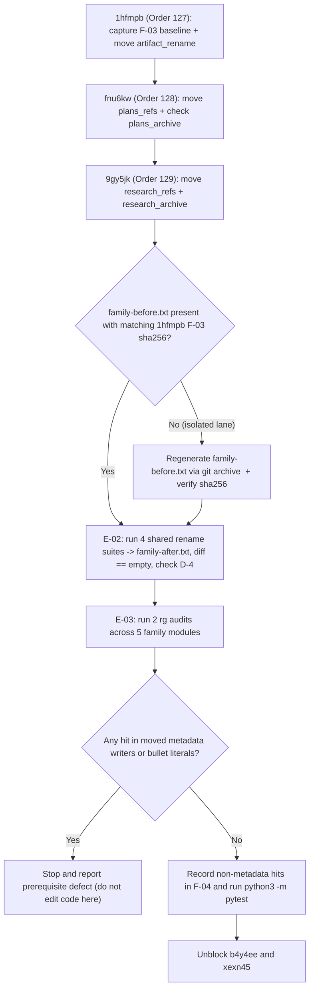

# IPD: Move the rename, regroup and archive field writers onto artifact_meta

- Date: 2026-11-07
- Kind: child
- Concern: Spec `4sd62s` (artifact metadata store) section 7 step 4 requires the rename, regroup, and archive verbs to write their metadata edits through `agent_workflows/artifact_meta.py` in phase B, while each file move itself stays a `git mv` until the cutover (section 7: path-bearing events start at the cutover commit). Re-measured at `326d38481` before the three move parts execute: `agent_workflows/artifact_rename.py` holds 11 hand-built `- Set:`/`- Order:`/`- Id:` bullet literals and 3 `atomic_write` calls, `agent_workflows/plans_refs.py` holds 4 bullet literals and 1 `atomic_write` call, `agent_workflows/research_refs.py` holds 1 `_atomic_write` call (`update_frontmatter_fields`), and `agent_workflows/research_archive.py` holds 1 `RF._atomic_write` call (`_rewrite_status_in_text`). This plan is a split part of `xexn45` (the phase-B remaining-writers plan), split 2026-11-07.
- Scope: Finishing close-out and writer audit of the rename, regroup, and archive field-writer move (`xexn45` E-06). After the 2026-11-09 round-3 split per research `nj8zdp` (plan-size calibration), the code moves live in `1hfmpb` (Order 127, `agent_workflows/artifact_rename.py`, which also captures and records the family baseline in `1hfmpb` `F-03`), `fnu6kw` (Order 128, `agent_workflows/plans_refs.py` and the pure-move check of `agent_workflows/plans_archive.py::apply_shard_moves`), and `9gy5jk` (Order 129, `agent_workflows/research_refs.py` and `agent_workflows/research_archive.py`). This plan runs the cross-module test baseline comparison and `D-4` rename-ledger check (`E-02`, including isolated-lane regeneration of `.aw/state/bsl45u/family-before.txt` from `1hfmpb` `F-03`) and the five-module writer audit (`E-03`) recorded in `F-04`. EXCLUDES: `rename` and path-bearing events and sidecar retirement (`cxxmyv`, attended metadata cutover), and retiring thin compatibility adapters and `INDEX.*` manifest writers (`9o83cr`).
- Scope-Paths: .aw/records/plans/pending/20261107-metastore-25-bsl45u-move-the-rename-regroup-and-archive-field-writers-onto-artif.ipd.md
- Item-Dependencies: executed:tve77h, executed:2xwb9b, executed:7yr827, executed:1hfmpb, executed:fnu6kw, executed:9gy5jk
- Status: approved
- Readiness: go-pending-approval
- Review-Depth: complex
- From-Spec: 4sd62s
- Work-Kind: feature
- Priority: high
- Blocks-Release: next
- Set: metastore
- Order: 25
- Highest E allocated: 03
- Author: opencode its_direct/pt3-claude-opus-5.5-1m-us
- Id: bsl45u
- Approval: 2026-11-16, recorded via aw ipd set: status set to approved

> Write and proofread this plan per the technical writing standard, `.aw/system/workflows/technical-writing/technical-writing.md` (`.agents/workflows/technical-writing/technical-writing.md` in a legacy-layout install), including requirement 12 (diagrams).

## Workflow history
- 2026-11-16 approved (aw set): status set to approved
- 2026-11-14 reviewed (aw set): APPROVE WITH REVISIONS APPLIED; PR-001..PR-003 FIXED

- 2026-11-14 /plan-review (antigravity/gemini): APPROVE WITH REVISIONS APPLIED; PR-001..PR-003 FIXED; review record .aw/records/reviews/20261107-metastore-25-bsl45u-move-the-rename-regroup-and-archive-field-writers-onto-artif.review.md
- 2026-11-09 note (opencode its_direct/pt3-claude-opus-5.5-1m-us): round-3 split per research nj8zdp; items E-01 (split by writer module) moved to 1hfmpb, fnu6kw, 9gy5jk.
- 2026-11-07 to-review (opencode its_direct/pt3-claude-opus-5.5-1m-us): split from xexn45 per maintainer step-complexity rule (no single E/V item hides hundreds of steps).
- 2026-11-07 draft (opencode its_direct/pt3-claude-opus-5.5-1m-us): created.

## Goal

After `1hfmpb` (`artifact_rename`), `fnu6kw` (`plans_refs` and `plans_archive`), and `9gy5jk` (`research_refs` and `research_archive`) execute, the rename, regroup, and archive verbs edit record metadata only through `agent_workflows/artifact_meta.py`, and the four cross-module rename test suites and the rename ledger behave identically to the pre-move baseline (`E-02`, `E-03`).

## Detailed Implementation Checklist (TODO)

Execution-state rule: mark an `E-*` item complete only after performing the action. That mark is not validation. Right-sizing rule: each E-item must address one concern and be executable in one focused pass; split when an E-item names multiple distinct deliverables or independent test-surfaces. Accepted execution states: blocked, failed, pending, performed; terminal gate demands 'performed'.

Close-out outcome-list rule: the code and test moves originally drafted as `E-01` moved in the 2026-11-09 round-3 split to `1hfmpb`, `fnu6kw`, and `9gy5jk`; this plan modifies no Python or test file. Produce sorted per-test outcome lists under gitignored `.aw/state/bsl45u/` with the deterministic command `python3 -m pytest -o addopts="" -m "" -p no:randomly -n 0 -rA <modules> | grep -E "^(PASSED|FAILED|ERROR|SKIPPED|XFAIL|XPASS) " | sed -E 's/ - .*//' | sort > .aw/state/bsl45u/<name>.txt` (`-m ""` includes `slow` modules, `-p no:randomly -n 0` keeps order deterministic, and `addopts=""` clears extra `-q` flags). `diff` between `family-before.txt` and `family-after.txt` must print nothing: zero existing assertions change (`D-2`, `D-4`).

### Task group 1: family close-out and writer audit

- [ ] E-02 Compare the four shared cross-module rename suites against the `1hfmpb` baseline and verify `D-4`: read the baseline pre-edit commit SHA, per-module `PASSED` counts, and `sha256` digest recorded in `.aw/records/plans/executed/20261109-metastore-127-1hfmpb-move-the-artifact-rename-field-writers-onto-artifact-meta.ipd.md` (`F-03` and `V-01`). When `.aw/state/bsl45u/family-before.txt` is absent in an isolated lane worktree (or its `sha256sum` does not match `1hfmpb` `F-03`), regenerate it deterministically at `<baseline_sha>` via `tmpdir=$(mktemp -d)`, `git archive <baseline_sha> agent_workflows tests pyproject.toml | tar -x -C "$tmpdir"`, and `(cd "$tmpdir" && PYTHONPATH="$tmpdir" AW_NO_REEXEC=1 python3 -m pytest -o addopts="" -m "" -p no:randomly -n 0 -rA tests/test_rename_ledger.py tests/test_rename_group_machine_output.py tests/test_mutation_result_facts.py tests/test_artifact_refs_rewrite.py) | grep -E "^(PASSED|FAILED|ERROR|SKIPPED|XFAIL|XPASS) " | sed -E 's/ - .*//' | sort > .aw/state/bsl45u/family-before.txt` (`rm -rf "$tmpdir"` afterwards), and confirm `sha256sum .aw/state/bsl45u/family-before.txt` equals `1hfmpb` `F-03`'s recorded digest. Then run the same outcome-list command on current `HEAD` into `.aw/state/bsl45u/family-after.txt`, run `diff .aw/state/bsl45u/family-before.txt .aw/state/bsl45u/family-after.txt`, and confirm `PASSED tests/test_rename_ledger.py::CliEmissionTests::test_applied_plan_rename_appends_one_record` (non-binding pointer for `D-4`, proving `agent_workflows/record_history.py::record_rename` sidecar emission is unchanged).
  - Depends on: none
  - Expected outcome: `sha256sum .aw/state/bsl45u/family-before.txt` matches `1hfmpb` `F-03`, `diff .aw/state/bsl45u/family-before.txt .aw/state/bsl45u/family-after.txt` prints nothing (`exit 0`), and `tests/test_rename_ledger.py::CliEmissionTests::test_applied_plan_rename_appends_one_record` passes.
  - Execution state: pending

- [ ] E-03 Audit the five rename, regroup, and archive modules after `1hfmpb`, `fnu6kw`, and `9gy5jk` execute: (1) run `rg -n 'atomic_write\(|_atomic_write\(|write_text\(|update_frontmatter_fields\(|_rewrite_status_in_text\(' agent_workflows/artifact_rename.py agent_workflows/plans_refs.py agent_workflows/plans_archive.py agent_workflows/research_refs.py agent_workflows/research_archive.py`; (2) run `rg -n 'f"- (Set|Order|Id|Status):|"- (Set|Order|Id|Status): ' agent_workflows/artifact_rename.py agent_workflows/plans_refs.py agent_workflows/plans_archive.py agent_workflows/research_refs.py agent_workflows/research_archive.py` (must print nothing; `rg` exits `1` on zero matches); (3) record every hit from query (1) in `F-04` of `## Findings` with its module, line, enclosing `def` (or `<module>` scope), and non-metadata reason (generated `INDEX.json`/`INDEX.md` manifest refresh or uncalled helper/alias retired in `9o83cr`), and run the bare core gate `python3 -m pytest` (`4sd62s` AC-1b). Stop and report a prerequisite defect without editing code here if query (2) prints any match or if query (1) matches inside any metadata writer moved by `1hfmpb` (`artifact_rename._update_frontmatter_metadata`, `_update_or_inject_set_metadata`), `fnu6kw` (`plans_refs._set_metadata`, `apply_renames`), or `9gy5jk` (`research_refs._apply_renames`, `research_archive.apply_moves` record-frontmatter write).
  - Depends on: E-02
  - Expected outcome: Query (2) prints nothing (`0` matches, `rg` exit `1`); query (1) prints `0` matches in `agent_workflows/artifact_rename.py` and `agent_workflows/plans_refs.py` and matches only generated `INDEX.json`/`INDEX.md` `write_text` calls in `plans_archive.py::apply_shard_moves` and `research_archive.py::apply_moves` (plus any uncalled helper/alias retired in `9o83cr`, with zero front-matter writes remaining); `F-04` classifies every query (1) hit; and `python3 -m pytest` passes.
  - Execution state: pending

Add further leaves as `- [ ] E-NEW <action>` and run `aw ipd sync` to assign ids.

## Project conventions discovered (Step 0)

- The `agent_workflows/artifact_meta.py` entry points come from Order 02 (`tve77h`, `artifact_meta` core) and Order 21 (`7yr827`, phase-B legacy writer): `artifact_meta.read`, `append`, `create`, `validate_new_events`, `write_legacy`, and `render_legacy_text`, with `1hfmpb` E-04 adding `checkpoint` `"id"` rendering, integer `order` formatting, and dual-form `prompts` `op == "set"` fallback, and `9gy5jk` E-04 extending the research `---` YAML form (`model`, two-digit `order`, update-only `set`, and `status:` insertion after `kind:`). Order 13 (`cxxmyv`, attended metadata cutover) switches `append` and `create` onto event logs and turns on path-bearing `rename` events.
- Atomic file replacement uses `agent_workflows/artifact_core.py::atomic_write`; per-record write locking uses `agent_workflows/platform_lock.py::held`; file moves stay `agent_workflows/artifact_core.py::git_mv` in phase B (`4sd62s` section 7: path-bearing events start at the cutover commit).
- None of the rename, regroup, or archive verbs appends a `## Workflow history` line in phase B, so `1hfmpb`, `fnu6kw`, and `9gy5jk` pass `LegacyRender(..., history=False)`.
- Identity ownership (`4sd62s` AC-15, `agent_workflows/artifact_meta.py::_check_owned_fields`): `op == "set"` unconditionally refuses `"id"` and `"status"`, so `1hfmpb` E-02 emits `op: "checkpoint"` for `--to-id6` initial `Id` minting and `9gy5jk` E-02 emits `op: "transition"` for `research_archive.apply_moves` status updates.
- The rename ledger is `agent_workflows/record_history.py::record_rename`, called by `agent_workflows/artifact_rename.py` (`run_rename_generic`, `run_group_generic`), `agent_workflows/plans_refs.py::apply_renames`, and `agent_workflows/research_refs.py::_apply_renames`; the sidecar file `.aw/records/history.jsonl` is gitignored (`.aw/.gitignore`) and stays active until `cxxmyv` (`D-4`).
- The prompt metadata mirror is the single leading `<!-- aw-prompt: ... -->` HTML comment (`agent_workflows/prompts.py::render_metadata_comment`, `inject_metadata_id6`, `update_metadata_status`); nothing visible may precede the prompt body (spec `20260808-1958-01-prompt-purity-lint` R1/P4), while `1hfmpb` E-04 preserves `op == "set"` updates on legacy bullet-header `.prompt.md` fixtures lacking `aw-prompt`.
- Core test tier: `pyproject.toml` marker `core`; run the routine gate bare as `python3 -m pytest` (`4sd62s` AC-1b).
- Cite code by `path::Symbol` or by a backticked path with a quoted string, never by a bare line number (`IPD-C801`).

## Findings

| Id | Evidence (measured 2026-11-07 at `ac76110f4`, split 2026-11-09 at `3d0ddb845`, and re-verified 2026-11-14 at `326d38481`) | Finding |
|---|---|---|
| F-01 | Historical split-sizing measurement for former `E-01`: 6 metadata writer sites across 4 edited modules and 13 pinned test modules (about 24 units total, 21 named units by `IPD-Z603`, non-binding context) | Over the `nj8zdp` per-item step guidance of 8; split by module family into `1hfmpb` (`artifact_rename`), `fnu6kw` (`plans_refs` and `plans_archive`), and `9gy5jk` (`research_refs` and `research_archive`). |
| F-02 | Pre-move metadata write sites across the five family modules at `326d38481`: `agent_workflows/artifact_rename.py::_update_frontmatter_metadata` (2 `atomic_write` calls, 3 bullet literals) and `_update_or_inject_set_metadata` (1 `atomic_write` call, 8 bullet literals); `agent_workflows/plans_refs.py::_set_metadata` (4 bullet literals) and `apply_renames` (1 `atomic_write` call); `agent_workflows/research_refs.py::_apply_renames` (1 `_atomic_write` call + `update_frontmatter_fields`); `agent_workflows/research_archive.py::apply_moves` (1 `RF._atomic_write` call + `_rewrite_status_in_text`, plus 2 `INDEX.*` `write_text` calls); `agent_workflows/plans_archive.py::apply_shard_moves` (0 record-metadata writes, 2 `INDEX.*` `write_text` calls) | `1hfmpb`, `fnu6kw`, and `9gy5jk` move all 6 record-metadata writer functions; because `xexn45` E-15 audits only `artifact_rename.py` and `plans_refs.py`, `E-03` here audits all five family modules. |
| F-03 | Cross-module shared test coverage re-verified at `326d38481` (`60 passed` total, non-binding counts re-derived at execution): `tests/test_mutation_result_facts.py` (8) imports `artifact_rename`, `plans_refs`, and `research_refs`; `tests/test_artifact_refs_rewrite.py` (25) drives `rename plans`, `group`, and `research_refs`; `tests/test_rename_group_machine_output.py` (14) drives `rename` and `group` across `plans`, `specs`, `backlog`, and `research`; `tests/test_rename_ledger.py` (13, including `CliEmissionTests::test_applied_plan_rename_appends_one_record`) drives the rename ledger. Verified at review that `git archive HEAD` in a temporary directory with `PYTHONPATH="$tmpdir" AW_NO_REEXEC=1` reproduces the exact sorted outcome list (`sha256` `a58e0fedfc9185c64dd5418c2c1078a83742f5632791197de2a9ddff672f175b`) | These four modules span all three writer parts, so `1hfmpb` E-01 captures the baseline and records its commit SHA and `sha256` digest in `1hfmpb` `F-03`, and `bsl45u` `E-02` regenerates `family-before.txt` when run in an isolated lane worktree and verifies an empty `diff`. |
| F-04 | (filled at execution by `E-03`) every hit from `E-03` query (1) across `artifact_rename.py`, `plans_refs.py`, `plans_archive.py`, `research_refs.py`, and `research_archive.py` with its module, line, enclosing `def` (or `<module>` scope), and non-metadata reason | Proves across all five family modules that zero record-metadata writes or hand-built `- Set:`/`- Order:`/`- Id:`/`- Status:` bullet literals remain outside `artifact_meta`. |

## Behavior decisions (kept behavior where writers disagreed, spec `4sd62s` 4.3)

- D-2 (bullet and front-matter rules across `1hfmpb`, `fnu6kw`, and `9gy5jk`). KEPT: existing bullets update in place; new bullets on `aw group` (`1hfmpb` E-03, `fnu6kw` E-01) insert after `- Status:`, else after `- Id:`, else at the end of an existing metadata bullet block before the first `## `, and never in the body (plan `a88210`), while `aw rename` (`1hfmpb` E-02) updates `Set` and `Order` only when already present and mints `--to-id6` `Id` via `op: "checkpoint"`. On `prompts` (`1hfmpb` D-2), `aw-prompt` comments remain authoritative when present, `op == "set"` updates an existing bullet block when `aw-prompt` is absent, and comment-less prose prompts stay byte-identical. On `research` `---` YAML front matter (`9gy5jk` D-5 to D-8), `research_refs._apply_renames` rewrites only existing YAML keys with two-digit `order` and `history=False`, and `research_archive.apply_moves` emits `op: "transition"` inserting missing `status:` after `kind:`. Zero assertions in the four shared modules of `E-02` change.
- D-4 (rename ledger and pre-batch validation). KEPT until the cutover (`cxxmyv`): `agent_workflows/record_history.py::record_rename` continues to append to gitignored `.aw/records/history.jsonl` from `artifact_rename`, `plans_refs`, and `research_refs`, pre-batch validation refuses invalid batches before mutating files, and no `rename` or path-bearing event is written in phase B.

## Proposed changes (ordered, validatable)

1. Prerequisite family moves (executed before this plan): `1hfmpb` (`artifact_rename` + `F-03` baseline capture), `fnu6kw` (`plans_refs` + `plans_archive` pure-move check), and `9gy5jk` (`research_refs` + `research_archive`).
2. Cross-module family close-out (`E-02`): verify or deterministically regenerate `.aw/state/bsl45u/family-before.txt` from `1hfmpb` `F-03`, run the four shared cross-module rename test suites into `family-after.txt`, verify an empty `diff`, and confirm `D-4` (`CliEmissionTests::test_applied_plan_rename_appends_one_record`).
3. Five-module writer audit (`E-03`): run the raw-write and bullet-literal `rg` audits across `artifact_rename.py`, `plans_refs.py`, `plans_archive.py`, `research_refs.py`, and `research_archive.py`, record remaining non-metadata hits in `F-04`, and run `python3 -m pytest`.

## Deferred / out of scope (with reason)

- `artifact_rename` subset (`agent_workflows/artifact_rename.py::_update_frontmatter_metadata`, `_update_or_inject_set_metadata`, `run_group_generic` pre-batch `dry_run=True` check, `artifact_meta.render_legacy` `checkpoint` `"id"` and dual-form `prompts` extensions; pins `tests/test_artifact_rename.py`, `tests/test_artifact_group.py`, `tests/test_spec_id6_filenames.py`) and the `F-03` family baseline capture: moved in the 2026-11-09 round-3 split per research `nj8zdp`.
  - Carrier: 1hfmpb
  - Carrier-Evidence: .aw/records/plans/executed/20261109-metastore-127-1hfmpb-move-the-artifact-rename-field-writers-onto-artifact-meta.ipd.md
- `plans_refs` subset (`agent_workflows/plans_refs.py::_set_metadata`, `apply_renames`, pre-batch refusal before write; pins `tests/test_plans_group_order_preservation.py`, `tests/test_plans_order_grammar.py`) and the `agent_workflows/plans_archive.py::apply_shard_moves` pure-move check (`tests/test_plans_archive.py`): moved in the 2026-11-09 round-3 split per research `nj8zdp`.
  - Carrier: fnu6kw
- Research shelf subset (`agent_workflows/research_refs.py::_apply_renames` shared by `run_mv` and `run_set_assign`, `agent_workflows/research_archive.py::apply_moves` status transition, `artifact_meta` research `---` YAML extensions, and `tests/test_research_meta_writer_characterization.py`; pins `tests/test_research_rename_frontmatter.py`, `tests/test_research_set_assign_date_containment.py`, `tests/test_research_archive.py`): moved in the 2026-11-09 round-3 split per research `nj8zdp`.
  - Carrier: 9gy5jk
- Phase-B merge-independence test (`tests/test_writers_merge_independence.py`, `4sd62s` AC-3 phase-B form): split out of `xexn45` in round 3.
  - Carrier: b4y4ee
- AC-21 obligations test (`tests/test_writers_obligations.py`), 10-module raw-write audit (`F-09` in `xexn45` E-14 and E-15), `docs/cli-output-contract.md` and `CHANGELOG.md` lines, and full-suite writer-move gates.
  - Carrier: xexn45
- `rename` and path-bearing events (`4sd62s` AC-31 and AC-34 post-cutover form), retiring the sidecar writer and rename ledger, and switching `write_legacy` off.
  - Carrier: cxxmyv
- Retiring thin compatibility adapters, generated `INDEX.*` manifest writers, and legacy metadata regex parsers (`4sd62s` AC-1, AC-9).
  - Carrier: 9o83cr

## Scope check

- Over-scope: none.
- Under-scope: none. Each of the 13 originally pinned existing modules is pinned in exactly one plan (nine across `1hfmpb`, `fnu6kw`, and `9gy5jk`, plus `tests/test_research_meta_writer_characterization.py` added in `9gy5jk`, and the four shared cross-module suites in `E-02`), and `E-03` audits all five family production modules including `plans_archive.py`, `research_refs.py`, and `research_archive.py`. Plan size after the split: 2 `E-*` items in 1 task group, editing only this IPD (`- Scope-Paths:`).

## Required tests / validation

No new test module and no Python code edit. `V-02` compares `tests/test_rename_ledger.py`, `tests/test_rename_group_machine_output.py`, `tests/test_mutation_result_facts.py`, and `tests/test_artifact_refs_rewrite.py` against `1hfmpb`'s `F-03`-verified baseline and checks `D-4`; `V-03` verifies the two-query five-module writer audit, the populated `F-04` table, and the bare core gate `python3 -m pytest`.

Contributes to `4sd62s` AC-1b (core-tier summary per child merge), AC-31 (`D-4` phase-B sidecar preservation until `cxxmyv`), AC-34 (phase-B moves emit no path events until `cxxmyv`), and AC-40 case 3 (`1hfmpb` prompt comment edits; owners named in `xexn45`).

## Spec / documentation sync

None. Implements the verification close-out of `4sd62s` section 7 step 4 for the rename, regroup, and archive verb family; no user-facing CLI flags or documented behavior change here.

## Open questions

None open. Every question this work raised was resolved in `xexn45` and the reviewed split parts (`7yr827`, `1hfmpb`, `9gy5jk`) or verified from live repository tests during review (`F-03`); `D-2` and `D-4` record the governing behavior decisions.

## Validation and cross-check (verify before reporting done)

Validation-state rule: inspect evidence in a separate pass. Do not mark a `V-*` item complete from memory or from the matching execution checkmark. Accepted validation results: blocked, failed, pass, pending; terminal gate demands 'pass'. Runtime-demonstration reachability rule: for each `V-*` item demanding the software be observed acting (such as a run, a dispatch, or a transition), as distinct from items demanding a diff, a file's content, or a test result, which are reachable by construction, name the code path that produces the observation or the sibling `E-*` that creates it, else the demand is UNDER-SCOPE.

- [ ] V-02 validates E-02
  - Required evidence: paste the baseline commit SHA and `sha256` digest read from executed `1hfmpb` `F-03` alongside `sha256sum .aw/state/bsl45u/family-before.txt` (matching digest, noting whether `family-before.txt` was reused on disk or regenerated via `git archive <baseline_sha>`), the empty output (and exit code `0`) of `diff .aw/state/bsl45u/family-before.txt .aw/state/bsl45u/family-after.txt`, the equal before/after per-module `PASSED` counts from `family-before.txt` and `family-after.txt` for each of `tests/test_rename_ledger.py`, `tests/test_rename_group_machine_output.py`, `tests/test_mutation_result_facts.py`, and `tests/test_artifact_refs_rewrite.py`, and the `PASSED` line `PASSED tests/test_rename_ledger.py::CliEmissionTests::test_applied_plan_rename_appends_one_record` from `family-after.txt`.
  - Observed evidence:
  - Result: pending
- [ ] V-03 validates E-03
  - Required evidence: paste both `rg` commands of `E-03` with their full output and exit codes (showing `0` matches and exit `1` for query (2), and `0` matches in `agent_workflows/artifact_rename.py` and `agent_workflows/plans_refs.py` plus only generated `INDEX.json`/`INDEX.md` `write_text` calls or uncalled helpers/aliases retired in `9o83cr` in `agent_workflows/plans_archive.py`, `agent_workflows/research_refs.py`, and `agent_workflows/research_archive.py` for query (1)); paste the filled `F-04` row naming each query (1) hit's module, line, enclosing `def` (or `<module>` scope), and non-metadata reason; state explicitly for each moved writer (`artifact_rename._update_frontmatter_metadata`, `artifact_rename._update_or_inject_set_metadata`, `plans_refs._set_metadata`, `plans_refs.apply_renames`, `research_refs._apply_renames`, and `research_archive.apply_moves` record-frontmatter write) that zero metadata-write hits remain; and paste the actual summary line of bare `python3 -m pytest` (`4sd62s` AC-1b).
  - Observed evidence:
  - Result: pending

## Approval and execution gate

- Size assessment: standard
- Cohesion rationale: not required

Execute only after human approval (`Status: approved`) and after every plan in `- Item-Dependencies:` (`tve77h`, `2xwb9b`, `7yr827`, `1hfmpb`, `fnu6kw`, and `9gy5jk`) is executed. Stop and report without editing production code if any prerequisite in `- Item-Dependencies:` is not yet `executed`, if executed `1hfmpb` `F-03` lacks the baseline commit SHA or `sha256` digest, if `E-02` produces a non-empty `diff`, if `E-03` matches inside a moved metadata writer or prints any bullet-literal hit in query (2), or if concurrent edits in a shared checkout conflict with this plan file.

Scope fence: the paths in `- Scope-Paths:` are a declaration; a needed file outside the fence is edited and then justified at finalize (`--scope-reason`), and a declared path left unmodified is acknowledged (`--scope-ack`).

Honesty rule: run the four shared test modules of `E-02`, the two `rg` audit commands of `E-03`, and the bare core gate `python3 -m pytest`, and paste the ACTUAL outputs and summary lines; never claim a result you did not run.

Commits: commit only through `aw commit bsl45u -- <paths>`; never `git add -A`, a bare `git add` or `git commit -a`; never push.

Lifecycle transition: the plan moves to `.aw/records/plans/executed/` only through `aw ipd finalize`, never a hand `git mv`, and only after `aw ipd lint --phase pre-transition` conforms and every `V-*` reads `pass` with pasted evidence. When `aw oc run` or `aw agy run` executes the plan, the runner performs the finalize; a hand executor runs `aw ipd finalize bsl45u` itself.
