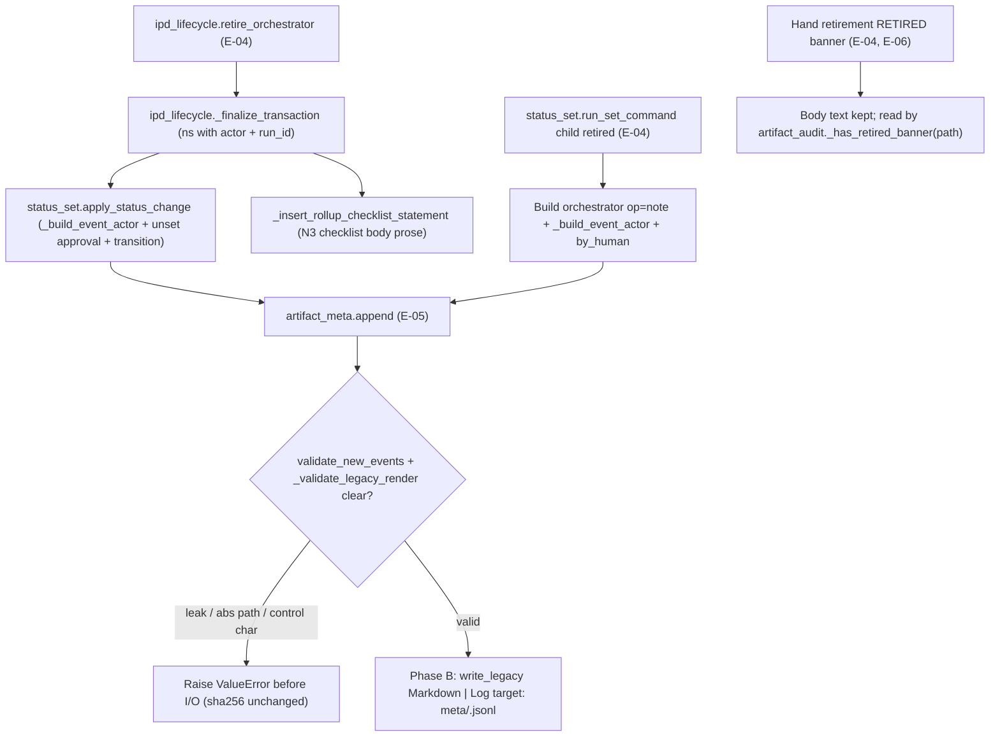

# IPD: Move the attestation, finalize scope and retirement writers onto artifact_meta

- Date: 2026-11-07
- Kind: child
- Concern: Spec `4sd62s` Sections 4.2, 4.4, 7 (step 4), and 9 (`77tr3o` orchestrator retirement) require the retirement writers (`agent_workflows/ipd_lifecycle.py::retire_orchestrator` and `agent_workflows/status_set.py::run_set_command`'s child-retirement note) to commit complete, validated v1 event envelopes through `agent_workflows/artifact_meta.py::append` and refuse unsafe or leaked actor strings before mutating disk (`4sd62s` AC-15, AC-24 (2)). Order 06 (`2xwb9b`, executed) routed `status_set` transitions and the child-retirement `note` onto `artifact_meta.append`, leaving three live gaps at `01c564538`: (1) `status_set._prepare_status_change`, `status_set.apply_status_change`, and child retirement omit `actor` (falling back to `{"tool": "artifact_meta"}`) and `overrides`, child retirement omits `by_human`, and `ipd_lifecycle._finalize_transaction` drops `run_id`; (2) `artifact_meta` skips string-safety checks on `actor` fields, misses `key=/multi/segment` paths, and skips string-safety, absolute-path, and leak-sanitizer refusals on `LegacyRender.actor_label`; and (3) retirement obligations have no Phase-B and log-backed obligations tests. Round-3 split 2026-11-09 from `xexn45` (`nj8zdp`): readiness and coverage live in `d4w53g` (Order 130), finalize path-root rules in `9qhtrc` (Order 131), and finalize scope fields in `1dvb08` (Order 132); this plan finishes the four-plan family.
- Scope: Enforce writer-side string-safety, absolute-path (`key=/multi/segment` included), and leak-sanitizer refusals on `ev["actor"]` and `LegacyRender` actor labels in `agent_workflows/artifact_meta.py`; wire structured `4sd62s` Section 4.2 `actor`, `overrides`, `by_human`, and `run_id` envelopes through `agent_workflows/status_set.py` and `agent_workflows/ipd_lifecycle.py` while keeping `_insert_rollup_checklist_statement` and hand-retirement `RETIRED <date>: <reason>` banners as body prose (`4sd62s` N3); and extend `tests/test_writers_obligations.py` (`d4w53g`) with Phase-B and log-backed retirement, `unset approval` (`2xwb9b` F-04), and `AC-24 (2)` actor-refusal cases (`xexn45` E-10). EXCLUDES: the `status_set` setter engine (`2xwb9b`), path-bearing transition events (cutover `cxxmyv`), and the `finalize` event payload (`nq1src`).
- Scope-Paths: agent_workflows/artifact_meta.py, agent_workflows/status_set.py, agent_workflows/ipd_lifecycle.py, tests/test_writers_obligations.py, .aw/records/plans/pending/20261107-metastore-26-8q27jt-move-the-attestation-finalize-scope-and-retirement-writers-o.ipd.md
- Item-Dependencies: executed:tve77h, executed:2xwb9b, executed:7yr827, executed:d4w53g, executed:9qhtrc, executed:1dvb08
- Status: reviewed
- Readiness: go-pending-approval
- Review-Depth: complex
- From-Spec: 4sd62s
- Work-Kind: feature
- Priority: high
- Blocks-Release: next
- Set: metastore
- Order: 26
- Highest E allocated: 06
- Author: opencode its_direct/pt3-claude-opus-5.5-1m-us
- Id: 8q27jt

> Write and proofread this plan per the technical writing standard, `.aw/system/workflows/technical-writing/technical-writing.md` (`.agents/workflows/technical-writing/technical-writing.md` in a legacy-layout install), including requirement 12 (diagrams).

## Workflow history
- 2026-11-14 reviewed (aw set): APPROVE WITH REVISIONS APPLIED; PR-001..PR-005 FIXED

- 2026-11-13 /plan-review (antigravity/gemini): APPROVE WITH REVISIONS APPLIED; PR-001..PR-005 FIXED; review record .aw/records/reviews/20261107-metastore-26-8q27jt-move-the-attestation-finalize-scope-and-retirement-writers-o.review.md
- 2026-11-09 note (opencode its_direct/pt3-claude-opus-5.5-1m-us): round-3 split per research nj8zdp; items E-01, E-02, E-03 (split into path rule and finalize fields) moved to d4w53g, 9qhtrc, 1dvb08.
- 2026-11-07 to-review (opencode its_direct/pt3-claude-opus-5.5-1m-us): split from xexn45 per maintainer step-complexity rule (no single E/V item hides hundreds of steps).
- 2026-11-07 draft (opencode its_direct/pt3-claude-opus-5.5-1m-us): created.

## Goal

Orchestrator rollup retirement (`agent_workflows/ipd_lifecycle.py::retire_orchestrator`) and child-retirement orchestrator notes (`agent_workflows/status_set.py::run_set_command`) record structured `4sd62s` Section 4.2 `actor`, `overrides`, `by_human`, and `run_id` envelopes through `agent_workflows/artifact_meta.py::append` while preserving today's Phase-B Markdown bytes and body-only retirement prose. Unsafe or leaked actor strings are refused before any file mutation on both legacy and log-backed targets.

## Detailed Implementation Checklist (TODO)

Execution-state rule: mark an `E-*` item complete only after performing the action. That mark is not validation. Right-sizing rule: each E-item must address one concern and be executable in one focused pass; split when an E-item names multiple distinct deliverables or independent test-surfaces. Accepted execution states: blocked, failed, pending, performed; terminal gate demands 'performed'.

PIN-FIRST RULE for every "move" item: create `.aw/state/8q27jt/` (`mkdir -p .aw/state/8q27jt`), re-derive the per-test outcome list at execution time on the unmodified code, and save it under the gitignored `.aw/state/8q27jt/` (`python3 -m pytest -o addopts="" -m "" -p no:randomly -n 0 -rA <modules> | grep -E "^(PASSED|FAILED|ERROR|SKIPPED|XFAIL|XPASS) " | sed -E 's/ - .*//' | sort > .aw/state/8q27jt/<E>-before.txt`; `-m ""` includes `slow` modules, `-p no:randomly -n 0` makes the list deterministic, and `-q` is not repeated because `addopts` is cleared); make the change; run the same command into `-after.txt`; `diff` of the two must print nothing, so any test that newly fails, errors, or skips is caught, not only a lost PASSED line (collected counts in `F-04` and `F-05` are non-binding authoring-time context). An existing assertion may change only when Behavior decisions D-2 through D-4 below name it. New tests set `pytestmark = pytest.mark.core`, build fixtures in `tmp_path`, drive the real CLI or function, and never read production source (AGENTS.md "TEST OUTCOMES, NOT CODE STRUCTURE").

### Task group 1: actor safety and retirement writers

- [ ] E-05 Enforce writer-side actor and legacy-render safety in `agent_workflows/artifact_meta.py` (`4sd62s` Section 4.2 and `AC-24 (2)`), pinned first under `.aw/state/8q27jt/E-05-{before,after}.txt`. First, in `_check_no_absolute_paths_in_text`, inspect both `token` and `token.split("=", 1)[1]` when `"=" in token` so `key=/multi/segment` and `key=C:\...` tokens (such as `profile=/opt/secret/file`) raise `ValueError` alongside bare `/multi/segment` paths, while keeping single-slash tool names (`/plan-review`) and provider/model identifiers without a leading slash (`antigravity/gemini`, `its_direct/pt3-claude-opus-5.5-1m-us`) valid. Second, in `validate_new_events`, call `_check_string_safety(f"actor.{ak}", av, prose=False, migration_import=migration_import)` on every string value in `ev["actor"]` alongside `_check_no_absolute_paths_in_text` and `_check_leak_sanitizer`. Third, add `_validate_legacy_render(render: LegacyRender, *, repo_root: Path) -> None` and call it before rendering or mutating disk (including `dry_run=True`) in `write_legacy` (`append_legacy` delegate) and `render_legacy_text` (`7yr827`): validate `render.actor_label` (when `render.history` is true or `render.actor_label` is non-empty) and `getattr(render, "checked_by", None)` (from `d4w53g`, when non-empty) through `_check_string_safety(..., prose=False, migration_import=False)`, `_check_no_absolute_paths_in_text`, and `_check_leak_sanitizer(..., _writer_ruleset(repo_root))`. Pinned modules: `tests/test_artifact_meta_registry.py`, `tests/test_artifact_meta_legacy_write.py`, `tests/test_artifact_meta_legacy_writer.py` (`7yr827`), and `tests/test_status_set_meta_writer.py`.
  - Depends on: none
  - Expected outcome: unsafe control characters, `key=/multi/segment` or bare absolute paths, and leak-sanitizer tokens in `ev["actor"]`, `LegacyRender.actor_label`, or `LegacyRender.checked_by` raise `ValueError` before any write, while the PIN-FIRST outcome diff across all four pinned modules is empty.
  - Execution state: pending

- [ ] E-04 Complete the retirement and setter envelope wiring across `agent_workflows/status_set.py` and `agent_workflows/ipd_lifecycle.py` on top of `2xwb9b` and `1dvb08`, pinned first under `.aw/state/8q27jt/E-04-{before,after}.txt`. First, in `agent_workflows/status_set.py`, add `_build_event_actor(raw_actor: Optional[str], *, default_tool: str = "aw set", run_id: Optional[str] = None) -> dict[str, Any]` producing a `4sd62s` Section 4.2 `actor` mapping restricted to `validate_envelope`'s allowed keys `("tool", "ace", "host", "model", "variant", "run_id", "attempt")`: join leading non-`key=value` tokens as `tool` (defaulting to `default_tool`), extract recognized `key=value` tokens (`ace`, `host`, `model`, `variant`, `run_id`, plus integer `attempt` parsed as `int`), derive `host` (`"oc"` for `"aw oc ..."`, `"agy"` for `"aw agy ..."`) when absent, omit display-only tokens (`profile=...`, `step=...`) from the dict while preserving `LegacyRender.actor_label` byte-for-byte (`D-3`), and attach non-empty `run_id` when not already set. Second, in `_prepare_status_change` and `apply_status_change` (preserving `1dvb08`'s `extra_events` parameter), build `event_actor` from the pre-suffix `raw_actor` and collect active `SUPPORTED_OVERRIDES` (`"allow-open-questions"`, `"allow-terminal-reopen"`, `"allow-unresolvable-release-sentinel"`) into `event_overrides`, store both on `_PreparedStatusChange`, and pass `actor=event_actor` and `overrides=event_overrides or None` to `artifact_meta.append` in both `_preview` (`dry_run=True`) and `apply_status_change`. Third, in `run_set_command`'s child-retirement orchestrator block, validate `actor` via `attention_contract.actor_refusal(actor)` and pass `actor=_build_event_actor(actor, default_tool="aw set", run_id=getattr(args, "run_id", None))` and `by_human=bool(getattr(args, "by_human", False))` to `artifact_meta.append` while keeping `LegacyRender("same-status", today, actor)` unchanged. Fourth, in `agent_workflows/ipd_lifecycle.py::_finalize_transaction`, pass `run_id=run_id` on `argparse.Namespace(actor=actor, message=message, by_human=False, run_id=run_id)` and record `evidence["finalize_actor"] = _ss._build_event_actor(actor, default_tool="aw ipd finalize", run_id=run_id)` on `FinalizeResult.evidence`, keeping `rollup_history_message` as the `executed` transition message, `_insert_rollup_checklist_statement` (`ROLLUP_SUPERSEDED_STATEMENT`) as a checklist body edit (`4sd62s` N3, `D-4`), and hand-retirement `RETIRED <date>: <reason>` banners as body prose read by `agent_workflows/artifact_audit.py::_has_retired_banner`. Pinned modules (re-derived at execution; non-binding pointers in parentheses): `tests/test_orchestrator_retirement.py` (`TheHonestTerminalRecord::test_honest_terminal_record_history_entry_and_actor`, `RollupRetiresAnEligibleSet::test_an_eligible_set_retires_and_lands_in_executed`), `tests/test_orchestrator_child_retired.py` (`TestOrchestratorChildRetired::test_retirement_appends_orchestrator_history_and_commits_both`, `TestOrchestratorChildRetired::test_skip_conditions_no_set_dirty_whole_set`), and `tests/test_lifecycle_holder_gate.py` (`LifecycleHolderGateMatrixTests::test_entry_05_retire_orchestrator_in_process`).
  - Depends on: E-05
  - Expected outcome: `retire_orchestrator`, `apply_status_change`, and child-retirement orchestrator `note` writes emit structured `actor`, `overrides`, `by_human`, and `run_id` envelopes with byte-identical Phase-B Markdown output, and the PIN-FIRST outcome diff across the three retirement suites is empty.
  - Execution state: pending

- [ ] E-06 Extend `tests/test_writers_obligations.py` (created by `d4w53g`, `pytestmark = pytest.mark.core`, real `tmp_path` fixtures, zero source inspection) with four behavioral retirement and actor-safety cases (`4sd62s` Sections 4.2, 4.4, 9, `AC-15 (4)`, and `AC-24 (2)`): (1) rollup retirement via `ipd_lifecycle.retire_orchestrator(..., actor="aw oc run model=claude-opus-4-6 variant=high profile=fast", run_id="run-20261113T000000Z-1", apply=True)` on an `approved` orchestrator carrying `- Approval:` whose Set children are `executed` moves the orchestrator to `executed/`, strips `- Approval:` (`unset approval`, closing `2xwb9b` F-04 so `artifact_meta.read` reports `approval is None`), writes `rollup_history_message`, inserts `ROLLUP_SUPERSEDED_STATEMENT` under `## Detailed Implementation Checklist`, omits `- Scope-Exceeded:`, and records `evidence["finalize_actor"] == {"tool": "aw oc run", "host": "oc", "model": "claude-opus-4-6", "variant": "high", "run_id": "run-20261113T000000Z-1"}`, and appending the resulting `unset approval` + `transition` payload to a log-backed `meta/<id6>.jsonl` orchestrator replays to `status == "executed"` with `approval is None` and the same `actor` envelope; (2) retiring a child plan via `cli.main(["set", "not-executed", child_id6, "--actor", "aw oc run model=claude-sonnet-4-6", "--by-human", "-m", "dropped", "--yes", "--no-commit", "--dir", str(repo)])` writes `- <day> same-status (aw oc run model=claude-sonnet-4-6): child <child_id6> retired not-executed: dropped` on a Phase-B orchestrator, and when the orchestrator is log-backed (`meta/<orch_id6>.jsonl` created via `artifact_meta.create`) appends one `op == "note"` event with `by_human is True`, `actor == {"tool": "aw oc run", "host": "oc", "model": "claude-sonnet-4-6"}`, and `message == f"child {child_id6} retired not-executed: dropped"`; (3) passing a constructed session token (`"aw oc run profile=" + "ses_" + "0" * 20`), an embedded absolute path (`"aw oc run profile=" + "/opt/secret/file"`), or a newline in `--actor` to `retire_orchestrator(..., apply=True)`, `cli.main(["set", ...])`, or `artifact_meta.write_legacy` refuses before writing and leaves target plan and orchestrator `sha256` digests unchanged; and (4) retiring a child plan carrying a top-of-body `RETIRED 2026-11-13: superseded by sibling` banner via `aw set superseded` preserves the banner in `superseded/` so `artifact_audit._has_retired_banner(dest_path)` returns `True`.
  - Depends on: E-04, E-05
  - Expected outcome: every retirement, `unset approval`, log-backed child-retirement `note`, `AC-24 (2)` actor-refusal, and body-banner case in `tests/test_writers_obligations.py` passes alongside `d4w53g`'s readiness and coverage cases.
  - Execution state: pending

Add further leaves as `- [ ] E-NEW <action>` and run `aw ipd sync` to assign ids.

## Project conventions discovered (Step 0)

- The `artifact_meta` interface names come from Order 02 (`tve77h`): `artifact_meta.read(id6) -> State`, `append(target, events, *, expect_seq=None, ...)`, `create(...)`, and `validate_new_events(type, events, *, records_root, repo_root=None, migration_import=False)`. Order 06 (`2xwb9b`) added phase-B `append_legacy` and routed `agent_workflows/status_set.py::_prepare_status_change`, `apply_status_change`, and `run_set_command`'s child-retirement `note` onto `artifact_meta.append`; Order 21 (`7yr827`) extracts `write_legacy` and `render_legacy_text`; Order 130 (`d4w53g`) adds `LegacyRender.checked_by` and creates `tests/test_writers_obligations.py`; Order 132 (`1dvb08`) threads keyword-only `extra_events` through `_prepare_status_change` and `apply_status_change` and runs pre-commit `replay` on the log branch.
- Envelope actor schema (`agent_workflows/artifact_meta.py::validate_envelope`): `actor` must be a `dict` with non-empty string `tool` and optional non-null keys restricted to `("tool", "ace", "host", "model", "variant", "run_id", "attempt")`; `overrides` when present must be a non-empty list drawn from `SUPPORTED_OVERRIDES` (`"allow-open-questions"`, `"allow-terminal-reopen"`, `"allow-unresolvable-release-sentinel"`).
- Rollup retirement (`agent_workflows/ipd_lifecycle.py::retire_orchestrator` -> `_finalize_transaction` with `evidence["transition"] == "orchestrator-rollup"`) transitions the orchestrator inside `commit_lock.coordinator_worktree` via `status_set.apply_status_change(wt_rec, "executed", coord.path, ns, ...)` using `rollup_history_message` as `message`, then inserts `ROLLUP_SUPERSEDED_STATEMENT` into `## Detailed Implementation Checklist` via `_insert_rollup_checklist_statement` (`4sd62s` N3 body prose). Leaving `approved` in `_prepare_status_change` already emits `{"op": "unset", "fields": ["approval"]}` alongside `{"op": "transition", "from": "approved", "to": "executed"}`.
- Path-bearing transition events (`ev["path"]`) are intentionally NOT emitted in Phase B (`4sd62s` Section 7 step 4 and `xexn45` `- Scope:` defer `rename` and path events to the cutover `cxxmyv`, because Phase-B `legacy_context(repo_root)` assumes `.aw/records` while `.agents/` and companion-backend repos resolve paths differently under `4sd62s` C12).
- Hand-retirement `RETIRED <date>: <reason>` banners live in the Markdown body and are read from the file's first 4096 bytes by `agent_workflows/artifact_audit.py::_has_retired_banner(path: Path) -> bool` (`4sd62s` N3).
- Core tier: `pyproject.toml` marker `core`; test modules set `pytestmark = pytest.mark.core`. Cite code by symbol (`path::Symbol`) or quoted content string, never by line number alone (`IPD-C801`).

## Findings

| Id | Evidence (measured 2026-11-07 at `ac76110f4` and re-verified 2026-11-13 at `01c564538`) | Finding |
|---|---|---|
| F-01 | Hidden units of E-01 (`plan_readiness.recheck_readiness`): 12 named units by `IPD-Z603` | Over the round-3 guidance; moved to `d4w53g` and split into the event move and the verdict rule. |
| F-02 | Hidden units of E-02 (`coverage_record.write`): 8 named units | Moved to `d4w53g` so the two attestation writers share `tests/test_writers_obligations.py`. |
| F-03 | Hidden units of E-03: 11 named units by `IPD-Z603` (`_finalize_transaction`, deletion of `_insert_scope_exceeded_metadata`, `validate_new_events`, spec amendment, 5 pinned modules, 1 new module) | Over the guidance; split into the path-root rule (`9qhtrc`) and the finalize scope fields (`1dvb08`). |
| F-04 | Retirement surface at `01c564538`: `2xwb9b` already moved `status_set.apply_status_change` and `run_set_command`'s child-retirement `note` onto `artifact_meta.append`, but `status_set.py` (`_prepare_status_change`, `apply_status_change`, `run_set_command`) passes no `actor` or `overrides` (falling back to `{"tool": "artifact_meta"}`), child retirement omits `by_human`, and `ipd_lifecycle._finalize_transaction` drops `run_id`; 3 pinned retirement modules (non-binding authoring-time counts: `test_orchestrator_retirement` 44, `test_orchestrator_child_retired` 8, `test_lifecycle_holder_gate` 14) | Complete structured `actor`, `overrides`, `by_human`, and `run_id` wiring in `E-04`, keeping `_insert_rollup_checklist_statement` and `RETIRED` banners as body prose, and verify retirement + `unset approval` (`2xwb9b` F-04) in `E-06`. |
| F-05 | Actor safety surface at `01c564538`: `attention_contract.actor_refusal` checks only empty strings and `()`, `artifact_meta._check_no_absolute_paths_in_text` misses `key=/multi/segment` tokens, `validate_new_events` omits `_check_string_safety` on `ev["actor"]`, and `append_legacy`/`write_legacy` skips safety and leak-sanitizer checks on `LegacyRender.actor_label` (`4sd62s` 4.2, `AC-24 (2)`); 3 baseline writer modules (`test_artifact_meta_registry`, `test_artifact_meta_legacy_write`, `test_status_set_meta_writer`: 64 non-binding authoring-time tests) | Close all three actor/render validation holes in `agent_workflows/artifact_meta.py` (`E-05`) before wiring `E-04`, and pin pre-write refusals with unchanged `sha256` in `E-06`. |

## Behavior decisions (kept behavior where writers disagreed, `4sd62s` 4.3)

- D-2 (new bullet position, `4sd62s` 4.3). KEPT: replace in place when present; otherwise insert after `- Status:`, else after `- Id:`, else at the end of an existing metadata bullet block before the first `## `; never insert into the body (`a88210`). No reader depends on bullet order (`agent_workflows/ipd_schema.py::parse_metadata_block` is order-free).
- D-3 (display `actor_label` vs structured `ev["actor"]`, `4sd62s` 4.2 and 4.3). KEPT on disk, STRUCTURED in the event envelope: `LegacyRender.actor_label` preserves today's exact `## Workflow history` parenthetical (`aw set`, `aw set, --by-human`, `aw oc run model=claude-opus-4-6 variant=high profile=fast`, `aw oc run step=orchestrator-rollup`), while `status_set._build_event_actor` populates `ev["actor"]` with `validate_envelope`'s structured keys (`tool`, optional `ace`, `host`, `model`, `variant`, `run_id`, integer `attempt`) and strips display-only tokens (`profile=...`, `step=...`) and flag suffixes (`--by-human` -> `by_human=True`; `--allow-*` -> `overrides=[...]`). Both `ev["actor"]` and `LegacyRender.actor_label` pass string-safety, absolute-path, and leak-sanitizer checks before any write.
- D-4 (retirement body prose, `4sd62s` N3 and Section 9). KEPT as body edits outside `artifact_meta`: `ipd_lifecycle._insert_rollup_checklist_statement` writes `ROLLUP_SUPERSEDED_STATEMENT` under `## Detailed Implementation Checklist` (checklist prose, not front matter or history), and hand-retirement `RETIRED <date>: <reason>` banners remain body prose read by `artifact_audit._has_retired_banner(path)`.

## Proposed changes (ordered, validatable)

1. Harden `agent_workflows/artifact_meta.py` actor and `LegacyRender` validation (`_check_no_absolute_paths_in_text` `key=/multi/segment` check, `_check_string_safety` on `ev["actor"]`, and `_validate_legacy_render` before rendering or writing in `write_legacy` and `render_legacy_text`) (`E-05`).
2. Wire structured `4sd62s` Section 4.2 `actor`, `overrides`, `by_human`, and `run_id` envelopes through `agent_workflows/status_set.py` (`_build_event_actor`, `_prepare_status_change`, `apply_status_change`, and `run_set_command` child retirement) and `agent_workflows/ipd_lifecycle.py::_finalize_transaction`, preserving Phase-B retirement bytes and body-only prose (`E-04`).
3. Extend `tests/test_writers_obligations.py` (`d4w53g`) with Phase-B and log-backed rollup retirement (`unset approval`, `finalize_actor`, body prose), child-retirement `note` (`by_human`, structured `actor`), `AC-24 (2)` actor refusals with unchanged `sha256`, and `RETIRED` banner preservation (`E-06`).

## Deferred / out of scope (with reason)

- E-01 (readiness re-check as one gate `review` event, creating `tests/test_writers_obligations.py`) and E-02 (coverage as one `op: coverage` event): Moved to d4w53g (round-3 split 2026-11-09 per research nj8zdp guidance).
  - Carrier: d4w53g
- E-03 path-root subset (OQ-03 rule in `artifact_meta.validate_new_events`, `tests/test_writers_scope_fields.py`, and `4sd62s` 4.2 amendment): Moved to 9qhtrc (round-3 split 2026-11-09 per research nj8zdp guidance).
  - Carrier: 9qhtrc
- E-03 finalize subset (three scope fields in the executed append of `ipd_lifecycle._finalize_transaction`, phase-B `- Scope-Exceeded:` rendering, deletion of `_insert_scope_exceeded_metadata`): Moved to 1dvb08 (round-3 split 2026-11-09 per research nj8zdp guidance).
  - Carrier: 1dvb08
- Path-bearing `transition` and `rename` events (`ev["path"]`) and removal of `LegacyRender` / `write_legacy` at the log-format cutover.
  - Carrier: cxxmyv
- The final merge-independence test (`b4y4ee`), the `4sd62s` AC-21 and AC-6 obligations cases, the raw-write audit (F-09), `docs/cli-output-contract.md` and `CHANGELOG.md`, and the full writer-move suite gates.
  - Carrier: xexn45
- The `finalize` event payload that later replaces the interim scope fields.
  - Carrier: nq1src

## Scope check

- Over-scope: none.
- Under-scope: none. Every path in `- Scope-Paths:` (`agent_workflows/artifact_meta.py`, `agent_workflows/status_set.py`, `agent_workflows/ipd_lifecycle.py`, `tests/test_writers_obligations.py`, and this plan) is modified by `E-04..E-06`. Plan size: 3 E-items across 4 work Scope-Paths.

## Required tests / validation

Extends core test module `tests/test_writers_obligations.py` (created by `d4w53g`; extended further by `xexn45` E-13) with four retirement and actor-safety cases (`V-06`). Pinned before and after with empty outcome diffs: `tests/test_artifact_meta_registry.py`, `tests/test_artifact_meta_legacy_write.py`, `tests/test_artifact_meta_legacy_writer.py`, and `tests/test_status_set_meta_writer.py` (`V-05`), plus `tests/test_orchestrator_retirement.py`, `tests/test_orchestrator_child_retired.py`, and `tests/test_lifecycle_holder_gate.py` (`V-04`).

With its round-3 sibling plans (`d4w53g`, `9qhtrc`, `1dvb08`), contributes to `4sd62s` AC-15 (1)-(4), AC-14a (1)-(2), AC-24 (2), and AC-39 (4) (owners named in `xexn45`).

## Spec / documentation sync

None here: the `4sd62s` Section 4.2 path-root amendment moved with the E-03 path-root subset to `9qhtrc`. This plan implements `4sd62s` Sections 4.2, 4.4, 7 (step 4), and 9 as written.

## Open questions

None open. OQ-03 (finalize path root) moved with the item it decides to `9qhtrc` and `1dvb08` under the same id; technical decisions on structured `actor` mapping (`D-3`) and body-only retirement prose (`D-4`) were resolved from repository code and spec `4sd62s` during `/plan-review`.

## Validation and cross-check (verify before reporting done)

Validation-state rule: inspect evidence in a separate pass. Do not mark a `V-*` item complete from memory or from the matching execution checkmark. Accepted validation results: blocked, failed, pass, pending; terminal gate demands 'pass'. Runtime-demonstration reachability rule: for each `V-*` item demanding the software be observed acting (such as a run, a dispatch, or a transition), as distinct from items demanding a diff, a file's content, or a test result, which are reachable by construction, name the code path that produces the observation or the sibling `E-*` that creates it, else the demand is UNDER-SCOPE.

- [ ] V-04 validates E-04
  - Required evidence: paste the `diff` of `.aw/state/8q27jt/E-04-before.txt` and `.aw/state/8q27jt/E-04-after.txt` (must print nothing), and from `-after.txt` paste the PASSED lines of `tests/test_orchestrator_retirement.py::TheHonestTerminalRecord::test_honest_terminal_record_history_entry_and_actor`, `tests/test_orchestrator_retirement.py::RollupRetiresAnEligibleSet::test_an_eligible_set_retires_and_lands_in_executed`, `tests/test_orchestrator_child_retired.py::TestOrchestratorChildRetired::test_retirement_appends_orchestrator_history_and_commits_both`, `tests/test_orchestrator_child_retired.py::TestOrchestratorChildRetired::test_skip_conditions_no_set_dirty_whole_set`, and `tests/test_lifecycle_holder_gate.py::LifecycleHolderGateMatrixTests::test_entry_05_retire_orchestrator_in_process`, plus the equal before/after per-module PASSED counts of all three modules.
  - Observed evidence:
  - Result: pending
- [ ] V-05 validates E-05
  - Required evidence: paste the `diff` of `.aw/state/8q27jt/E-05-before.txt` and `.aw/state/8q27jt/E-05-after.txt` (must print nothing), and from `-after.txt` paste the PASSED lines of `tests/test_artifact_meta_legacy_write.py::test_owned_ac15_4_approval_owned_by_the_approved_transition`, `tests/test_artifact_meta_legacy_write.py::test_owned_message_with_home_path_is_refused_by_the_writer`, and `tests/test_status_set_meta_writer.py::test_w16_approval_lands_directly_after_id`, plus the equal before/after per-module outcome counts of `tests/test_artifact_meta_registry.py`, `tests/test_artifact_meta_legacy_write.py`, `tests/test_artifact_meta_legacy_writer.py`, and `tests/test_status_set_meta_writer.py`.
  - Observed evidence:
  - Result: pending
- [ ] V-06 validates E-06
  - Required evidence: paste `python3 -m pytest -o addopts="" -v tests/test_writers_obligations.py` showing all four new retirement and actor-safety cases PASSED by node id alongside `d4w53g`'s readiness and coverage cases: (1) rollup retirement strips `- Approval:` (`unset approval`), writes `rollup_history_message` and `ROLLUP_SUPERSEDED_STATEMENT` body prose with no `- Scope-Exceeded:`, and replays `finalize_actor` + `run_id` on `meta/<id6>.jsonl`; (2) child retirement writes the Phase-B `same-status` history line and appends `op == "note"` with `by_human is True` and structured `actor` on `meta/<orch_id6>.jsonl`; (3) session-token (`ses_...`), `key=/opt/secret/file`, and newline `--actor` inputs refuse before writing with unchanged target and orchestrator `sha256` digests (`AC-24 (2)`); and (4) `artifact_audit._has_retired_banner(dest_path)` returns `True` on a hand-retired plan's `RETIRED` banner; plus paste the bare `python3 -m pytest` summary line.
  - Observed evidence:
  - Result: pending

## Approval and execution gate

- Size assessment: standard
- Cohesion rationale: not required

Execute only after human approval (`Status: approved`) and after every plan in `- Item-Dependencies:` is executed (`tve77h`, `2xwb9b`, `7yr827`, `d4w53g`, `9qhtrc`, `1dvb08`).

Unsafe-condition stop rule: if a pinned baseline test module fails before any edit on the unmodified checkout, if a concurrent edit modifies any file in `- Scope-Paths:` in a way that cannot be safely combined, or if a prerequisite symbol from `7yr827`, `d4w53g`, or `1dvb08` (`write_legacy`, `render_legacy_text`, `LegacyRender.checked_by`, `extra_events`, `tests/test_writers_obligations.py`) is absent, STOP immediately without committing partial work and report the discrepancy.

Scope fence: the paths in `- Scope-Paths:` are a declaration; a needed file outside the fence is edited and then justified at finalize (`--scope-reason`), and a declared path left unmodified is acknowledged (`--scope-ack`). Every move is pin-first: the named existing modules run green on the unmodified code before the move, and an assertion may change only where the Behavior decisions name it.

Honesty rule: run the named modules and the bare core gate `python3 -m pytest`, and paste the ACTUAL summary lines; never claim a result you did not run.

Commits: commit only through `aw commit 8q27jt -- <paths>`; never `git add -A`, a bare `git add` or `git commit -a`; never push.

Lifecycle transition: the plan moves to `.aw/records/plans/executed/` only through `aw ipd finalize`, never a hand `git mv`, and only after `aw ipd lint --phase pre-transition` conforms and every `V-*` reads `pass` with pasted evidence. When `aw oc run` or `aw agy run` executes the plan, the runner performs the finalize; a hand executor runs `aw ipd finalize 8q27jt` itself.
