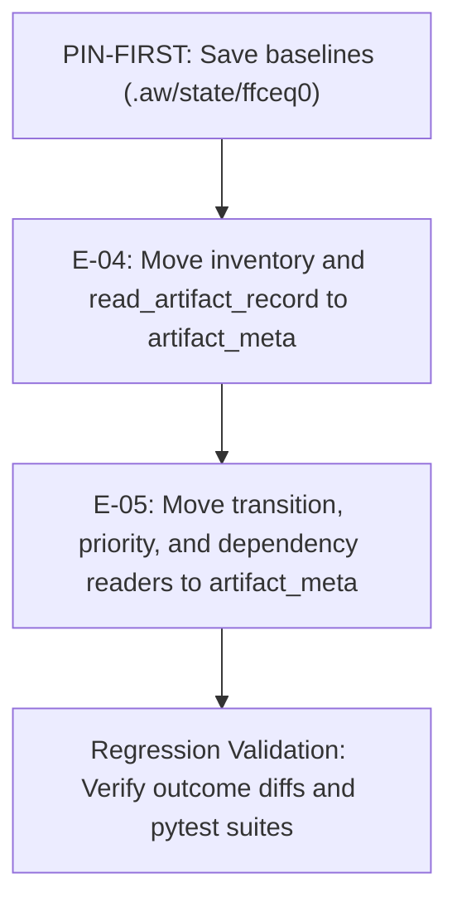

# IPD: Move selectors, aw find, aw ipd board and status_set reads onto artifact_meta

- Date: 2026-11-07
- Kind: child
- Concern: Split from `ffceq0` (Task group 1) under the maintainer's step-complexity rule, and split again on 2026-11-09 (round 3, research `nj8zdp` guidance). `status_set` reads `id`, `status` and `set_id` with its own regexes (`_ID_RE`, `_STATUS_RE`, `_SET_RE` and two inline YAML regexes) and its transition-line, priority and dependency readers parse bullets on in-memory text; spec `4sd62s` C5 requires them to answer from `artifact_meta`.
- Scope: FINISHING PART after the round-3 split: move the `status_set` inventory and transition reads onto `artifact_meta`, applying D-6 (`ffceq0` E-15 and E-16, carried here as E-04 and E-05). The `selectors`, `aw find`, `aw search`, `aw ipd board` and `artifact_meta.read_text` work (E-01 to E-03) moved to `cdglt1` (Order 142). EXCLUDES: `attention`, `ipd_lint`, `check_engine`, the meta commands and the cache-parity test.
- Scope-Paths: agent_workflows/status_set.py, tests/test_artifact_meta_loader_parity.py, .aw/records/plans/pending/20261107-metastore-27-r81uvz-move-selectors-aw-find-aw-ipd-board-and-status-set-reads-ont.ipd.md
- Item-Dependencies: executed:g5hpbb, executed:tve77h, executed:xexn45, executed:cdglt1
- Status: approved
- Readiness: go-pending-approval
- Review-Depth: complex
- From-Spec: 4sd62s
- Work-Kind: feature
- Priority: high
- Blocks-Release: next
- Set: metastore
- Order: 27
- Highest E allocated: 05
- Author: opencode its_direct/pt3-claude-opus-5.5-1m-us
- Id: r81uvz
- Approval: 2026-11-16, recorded via aw ipd set: status set to approved

> Write and proofread this plan per the technical writing standard, `.aw/system/workflows/technical-writing/technical-writing.md` (`.agents/workflows/technical-writing/technical-writing.md` in a legacy-layout install), including requirement 12 (diagrams).

## Workflow history
- 2026-11-16 approved (aw set): status set to approved
- 2026-11-14 reviewed (aw set): APPROVE WITH REVISIONS APPLIED; PR-001..PR-005 FIXED

- 2026-11-14 /plan-review (antigravity/gemini-3.8-flash): APPROVE WITH REVISIONS APPLIED; PR-001..PR-005 FIXED; review record .aw/records/reviews/20261107-metastore-27-r81uvz-move-selectors-aw-find-aw-ipd-board-and-status-set-reads-ont.review.md
- 2026-11-09 note (opencode its_direct/pt3-claude-opus-5.5-1m-us): round-3 split per research nj8zdp; items E-01, E-02, E-03 moved to cdglt1.
- 2026-11-07 to-review (opencode its_direct/pt3-claude-opus-5.5-1m-us): split from ffceq0 per maintainer step-complexity rule (no single E/V item hides hundreds of steps).
- 2026-11-07 draft (opencode its_direct/pt3-claude-opus-5.5-1m-us): created.

## Goal

The `status_set` inventory and transition readers answer from the `artifact_meta` cache, after `cdglt1` has moved `selectors` and the `aw find` paths, with every inventory difference limited to the D-6 records.

## Detailed Implementation Checklist (TODO)

Execution-state rule: mark an `E-*` item complete only after performing the action. That mark is not validation. Right-sizing rule: each E-item must address one concern and be executable in one focused pass; split when an E-item names multiple distinct deliverables or independent test-surfaces. Accepted execution states: blocked, failed, pending, performed; terminal gate demands 'performed'.

Every E-item that moves a reader follows one rule, so a reviewer can check each the same way: (1) BEFORE the edit, add or extend a behavioral test in the named module that pins the reader's CURRENT observable behavior on a `tmp_path` fixture repository (the "prior behavior" column of the reader ledger in `## Findings`), and run it green against the unmodified code; (2) change the reader to call `artifact_meta`; (3) run the same test unchanged. A test that has to change in step 3 is a behavior change and must be one of the decisions listed in the ledger (D-1 to D-6), never a silent one. For every existing module named as a baseline, ensure directory existence (`mkdir -p .aw/state/ffceq0 .aw/state/r81uvz`), save the per-test outcome list under the gitignored `.aw/state/ffceq0/` (`python3 -m pytest -o addopts="" -m "" -p no:randomly -n 0 -rA <modules> | grep -E "^(PASSED|FAILED|ERROR|SKIPPED|XFAIL|XPASS) " | sed -E 's/ - .*//' | sort > .aw/state/ffceq0/<E>-before.txt`) before the move and the same command into `<E>-after.txt` after it; `diff` of the two prints nothing except lines a named decision explains. Every saved baseline (command output, JSON, rule counts) also goes under `.aw/state/ffceq0/`, never `/tmp`, so it survives a lane integration. A count measured at authoring (for example the 1,635 executed plans of F-03) is non-binding context, never the bar: each expected outcome compares a before and after value re-derived on the same tree. New test modules set `pytestmark = pytest.mark.core`, call real functions or the real `aw` CLI, and never read production source.

The baseline directory stays `.aw/state/ffceq0/`, not this plan's own id6, because the split parent `ffceq0` keeps the final cache-parity, residual-audit and finishing items that compare against these saved files. Commit through `aw commit r81uvz -- <each changed path>`, one commit per task group allowed, never `git add -A`, a bare `git add` or `git commit -a`. Never push.

### Task group 1: the status_set reads

Round-3 note (2026-11-09): E-01 to E-03 moved to `cdglt1`, which must be executed before this plan starts (it is an `- Item-Dependencies:` edge), so E-04's former `Depends on: E-03` is carried by that edge.

- [ ] E-04 Change `agent_workflows/status_set.py::read_artifact_record` and `agent_workflows/status_set.py::inventory_all_artifacts` to take `id6`, `status`, `set_id` and `record_type` from `agent_workflows/artifact_meta.py::resolve`/`agent_workflows/artifact_meta.py::read`/`agent_workflows/artifact_meta.py::query` (type detection by path stays, since it reads no file content); `ArtifactRecord.raw_text` stays as the body text for body-prose consumers (open-question gates, N3); delete `_ID_RE`, `_STATUS_RE`, `_SET_RE` and the two inline YAML regexes. First dump today's inventory as sorted JSON (`path`, `record_type`, `id6`, `set_id`, `status`) to `.aw/state/ffceq0/inventory-before.json`, then dump it again after the change to `inventory-after.json`.
  - Depends on: none
  - Expected outcome: the before and after inventory dumps are identical EXCEPT the D-6 records (no in-file `- Set:` bullet), which gain their filename Set and nothing else; `tests/test_status_set_metadata_region.py` (`test_read_artifact_record_bullet_frontmatter_all_fields`, `test_match_selector_does_not_collide_with_quoted_id`, `test_read_artifact_record_yaml_fence_declared_or_nothing`), `tests/test_selector_resolver_matrix.py` (21 tests), `tests/test_check_engine_metadata_region.py`, and `tests/test_artifact_meta_loader_parity.py::test_cache_agrees_with_status_set_reader_on_every_fixture_record` pass unchanged.
  - Execution state: pending

- [ ] E-05 Change the remaining `status_set` metadata reads to cached fields: `agent_workflows/status_set.py::_format_status_transition_line` (priority, blocks_release, gate kind and ref), `agent_workflows/status_set.py::plan_priority_work_kind_problems` (priority and work kind; same `agent_workflows/ipd_schema.py::parse_plan_priority`/`parse_plan_work_kind` judgement), `agent_workflows/status_set.py::read_item_dependencies_value` (raw `item_dependencies` declaration), and the backlog gate-default inputs in `agent_workflows/status_set.py::_prepare_status_change` (`work_kind`, `blocks_release`, the release exemption pair; today `agent_workflows/backlog.py::parse_item` and `agent_workflows/selectors.py::read_front_matter_blocks_release` on in-memory text). `_format_status_transition_line(rec, dest_path, norm_stat, term, ...)` KEEPS its `ArtifactRecord` signature (it reads the cached fields for `rec` internally), because `tests/test_blocks_release_reader_bounding.py` calls it directly and must pass unchanged; only the text-taking `plan_priority_work_kind_problems` and `read_item_dependencies_value`, whose only callers are inside `status_set.py`, change to take a `State`.
  - Depends on: E-04
  - Expected outcome: `rg -n "re\.(compile|match|search|finditer|split)" agent_workflows/status_set.py` lists only non-metadata patterns (none of `Id`, `Status`, `Set`, `Priority`, `Gate-`, `Kind`, `Work-Kind`, `Approval`, `Readiness`, `Workflow history`); the R-row baseline tests of `2xwb9b` pass, specifically verifying `tests/test_blocks_release_reader_bounding.py::TestBlocksReleaseReaderBounding::test_bidirectional_display_divergence`, `tests/test_status_set.py::RefusalMessagePolishAndGateTests::test_terminal_reopen_and_priority_backstop_multiline_output`, and `tests/test_status_set_descriptive_safety.py::TestLengthAsymmetryAndNonRegressions::test_in_repo_callers_and_deps_wrapper`.
  - Execution state: pending

Add further leaves as `- [ ] E-NEW <action>` and run `aw ipd sync` to assign ids.

## Project conventions discovered (Step 0)

Carried from `ffceq0` Step 0; where a line says "this plan" it means the split parent `ffceq0`.

- The `artifact_meta` interface names come from Order 02 (`tve77h`) and are used exactly: `agent_workflows/artifact_meta.py::read(id6) -> State`, `agent_workflows/artifact_meta.py::history(id6)`, `agent_workflows/artifact_meta.py::query(...)` with typed filters (type, status, Set, order, `depends_on`, `latest_gate_review_of`, `path`) and an `incomplete` list, `agent_workflows/artifact_meta.py::resolve(path_or_id6)`, `agent_workflows/artifact_meta.py::read_at(id6, rev)` (Order 09 only), `agent_workflows/artifact_meta.py::repair(id6, *, confirm=None)`, and the `artifacts.short_description` column. The legacy loader stores a multi-word `- Status:` raw value in a legacy-only column and sets `artifacts.status` only for a single token (`tve77h` OQ-03, which names this plan as the carrier of the reader decision).
- One status normalizer already exists: `agent_workflows/plans.py::normalize_status` maps `EXECUTED`/`DONE` to `executed` and any other unrecognized token to `plans.LEGACY_GROUP` (`legacy/unknown`); `agent_workflows/plans.py::read_status` applies it to the FIRST token of the whole-file `- Status:` line. `agent_workflows/attention.py::_plans_record` and `agent_workflows/ipd_lint.py::lint_text` (M105) already use it.
- `agent_workflows/selectors.py::metadata_region` is the shared region bound (the bullet block before the first `## `, or the YAML fence). The PARITY CONSTRAINT comment above `agent_workflows/selectors.py::_STATUS_RE` records the 24-plan disagreement and forbids changing it without "owning that contract change", which D-1 does here.
- Shared history rules: `agent_workflows/attention_contract.py::history_block`, `agent_workflows/attention_contract.py::newest_history_record`, `agent_workflows/attention_contract.py::last_history_at`.
- `aw find` for plans uses `agent_workflows/plans_index.py::plan_entry` and `agent_workflows/plans_index.py::query` for display rows and `agent_workflows/selectors.py::resolve` (through `agent_workflows/cli.py::_resolve_selectors_with_kinds`) for selector hits; `aw ipd board` is `agent_workflows/cli.py::_run_plans` over `agent_workflows/plans.py::scan`.
- New CLI leaves are declared in `agent_workflows/command_surface.py::CommandDeclaration` and covered by `tests/conformance_matrix.py`. Order 03 (`1ajqaa`) creates `agent_workflows/meta_cli.py` for `aw show --history`, so this plan adds `check meta` and `meta repair` to that module.
- Traversal exclusions live in `agent_workflows/layout.py::TRAVERSAL_EXCLUSIONS` (consumed by `selectors`); `_SKIP_NAMES` is defined separately in `check_engine`, `selectors` and `artifact_refs`.
- Core tier: modules set `pytestmark = pytest.mark.core`; the bare gate is `python3 -m pytest` (30 s budget).
- Cite code by SYMBOL (`path::Symbol`) or by a quoted content string, with a line number only appended to one of those and never alone: an offset expires before this plan executes (spec `ipd-structure-and-linting` Section 10.2; advisory `IPD-C801`).

## Findings

Round-3 note (2026-11-09): the F-03, F-04, F-05 and F-11 rows (the `aw find` status disagreement) moved with E-01 to E-03 to `cdglt1`; the `status_set` items need no carried finding row beyond D-6 below.

Step-complexity measurement for this part (2026-11-07, at the worktree HEAD of the split; the rule is that no E-item hides more than about 25 units of work):

- E-04 (`status_set` inventory, `ffceq0` E-15): `rg -n 're\.(compile|search|match|finditer|split)\(' agent_workflows/status_set.py` lists `_ID_RE`, `_STATUS_RE`, `_SET_RE` and the two inline YAML regexes inside `read_artifact_record` (5 deletions), 2 functions changed (`read_artifact_record`, `inventory_all_artifacts`), 2 inventory dumps, 2 test modules run unchanged (`test_status_set_metadata_region` 3 tests, `test_selector_resolver_matrix` 21). About 11 units.
- E-05 (remaining `status_set` reads, `ffceq0` E-16): 4 readers (`_format_status_transition_line` with 3 inline `^-` searches, `plan_priority_work_kind_problems` with 2 regex uses, `read_item_dependencies_value`, the gate-default inputs in `_prepare_status_change`), callers counted with `rg -c '<name>\(' agent_workflows tests` (the two text-taking functions have only their 2 in-module call sites each; `_format_status_transition_line` has 2 test call sites in `tests/test_blocks_release_reader_bounding.py`, which must pass unchanged), 3 test modules run. About 14 units.

READER LEDGER rows this part moves: the `status_set` reader rows are D-6's (below); the `selectors` and `aw find` rows moved to `cdglt1` with their items.

DECISIONS that govern this part's reader moves (copied verbatim from `ffceq0`, which keeps the full D-1..D-6 table; a test that changes after a move must be one of these, never a silent change):

- D-1 (status of the 24 multi-word plans; F-03, F-04). KEPT: the canonical normalized status that `aw attention`, `aw ipd board` and `ipd_lint` already report (`executed` for `EXECUTED ...` and `DONE ...`, `legacy/unknown` for any other unrecognized token). For PLAN records only, both `aw find` paths match `plans.normalize_status` of the FIRST token of the cached raw value (the `plans.read_status` rule). Every other type keeps today's exact single-token match on the raw value, because `plans.normalize_status` knows only the plan vocabulary and maps `open`, `implemented`, `active` and `planned` to `legacy/unknown`.
- D-2 (whitespace and YAML; F-05). KEPT: each caller's current answer. The cache holds research YAML status, so `_read_status`/`MATCH_STATUS` keep matching research by it, while the public `read_front_matter_status` keeps returning None for a YAML-only record. Whitespace keeps each caller's current answer too: the legacy loader parses "one strict `- Field: value` grammar" (`tve77h` E-11), which matches the strict internal readers (`_read_id`/`_read_status` reject `-  ` and `-\t`), while the public `read_front_matter_*` readers keep accepting `-  ` and `-\t` through the loose values that `read_text` also returns.
- D-3 (detail text). KEPT: the `_extract_detail` cascade as the fallback; `short_description` wins when present (`4sd62s` 4.4 first bullet). In phase B no record has one, so output is unchanged until Order 13 (`cxxmyv`).
- D-4 (status bullet outside the metadata region; F-06). KEPT: region-bounded reading. The 4 records are 3 reviews and 1 walkthrough, which have no lifecycle status, so no plan-status consumer changes.
- D-5 (where the skip list applies; E-08). KEPT: record walkers skip `README.md`, `INDEX.md` and `STATUS.md` exactly as today; citation scans through `artifact_core.iter_scan_files` keep reading `README.md`. ADDED: every walker skips `records/meta/`. No record row changes today, because no `meta/` directory exists before the cutover.
- D-6 (records with no in-file `- Set:` bullet; added 2026-11-07, maintainer decision recorded on backlog `suth7l`). KEPT: the cache's filename-derived Set. `status_set`'s reader returns no Set for these records (242 on this repository on 2026-11-07: 164 research, 30 prompts, 23 specs, 14 plans, 8 walkthroughs, 3 roadmaps), while the cache takes it from the filename, which spec `4sd62s` C1/C10 make the checked mirror of `set` and 5.2 step 3 already uses as the default. What a consumer loses: nothing; what changes: `aw set <setid>` and `aw find <setid>` also match those records once E-15 lands. Pinned by `tests/test_artifact_meta_loader_parity.py::test_cache_agrees_with_status_set_reader_on_every_fixture_record`.

## Proposed changes (ordered, validatable)

1. Move the `status_set` inventory and transition reads, applying D-6 (E-04, E-05; `ffceq0` E-15, E-16, re-scoped there from `2xwb9b` by the maintainer on 2026-11-07, run `run-20261107T082247Z-2899457`, question `02-2xwb9b-a2-sequence-loader-fix`, answer C).

## Deferred / out of scope (with reason)

- `attention` reads (`ffceq0` E-04, E-05). Moved to dqutt8 (split 2026-11-07 per maintainer step-complexity rule).
  - Carrier: dqutt8
- `check_engine` working-tree readers (`ffceq0` E-06, E-07) and the skip list (E-08). Moved to w1cs3p, na188y, i3b5zu and ebrc4t (split 2026-11-07 per maintainer step-complexity rule).
  - Carrier: w1cs3p
- `ipd_lint` reads (`ffceq0` E-09). Moved to dqutt8 (split 2026-11-07 per maintainer step-complexity rule).
  - Carrier: dqutt8
- E-01, E-02, E-03 (`selectors`, `aw find`/`aw search`/`aw ipd board`, `artifact_meta.read_text` and its spec 4.3 entry). Moved to cdglt1 (round-3 split 2026-11-09 per research nj8zdp guidance).
  - Carrier: cdglt1
- `aw check meta`, `aw meta repair`, cache parity, offline proof and the residual audit: kept in the split parent.
  - Carrier: ffceq0
- Deleting `selectors._STATUS_RE` and every other leftover parser.
  - Carrier: 9o83cr

## Scope check

- Over-scope: none. Only `status_set.py` changes; `tests/test_artifact_meta_loader_parity.py` is run as the D-6 pin and changes only if its fixture must name a D-6 record.
- Under-scope: none known. This part carries E-15 and E-16 of `ffceq0` (as E-04 and E-05) unchanged; E-01 to E-03 moved to `cdglt1`.

## Required tests / validation

No new test module. The existing modules named in E-04 and E-05 (`tests/test_status_set_metadata_region.py`, `tests/test_selector_resolver_matrix.py`, `tests/test_check_engine_metadata_region.py`, `tests/test_blocks_release_reader_bounding.py`, `tests/test_status_set.py`, `tests/test_status_set_descriptive_safety.py`, `tests/test_artifact_meta_loader_parity.py`) run before and after each move.

Commands: the named modules, the bare core gate `python3 -m pytest`, `aw check`, `aw sanitize --agent`. The thorough tier `make test-all` runs once, in `ffceq0`'s final item.

## Spec / documentation sync

N/A: no spec text changes in this part; the `read_text` spec 4.3 amendment moved to `cdglt1` with E-02. Implements `4sd62s` C5 for `status_set`.

## Open questions

### OQ-01: Does this part fit the step-complexity limits?

- Blocking: no
- Status: resolved
- Owner: none
- Resolution or deferral rationale: Superseded 2026-11-09 by the round-3 split (research `nj8zdp` guidance): E-01 to E-03 moved to `cdglt1`, and this plan keeps E-04 and E-05 (2 E-items, 2 work Scope-Paths). Recommendation strength: strong.

## Validation and cross-check (verify before reporting done)

Validation-state rule: inspect evidence in a separate pass. Do not mark a `V-*` item complete from memory or from the matching execution checkmark. Accepted validation results: blocked, failed, pass, pending; terminal gate demands 'pass'. Runtime-demonstration reachability rule: for each `V-*` item demanding the software be observed acting (such as a run, a dispatch, or a transition), as distinct from items demanding a diff, a file's content, or a test result, which are reachable by construction, name the code path that produces the observation or the sibling `E-*` that creates it, else the demand is UNDER-SCOPE.

- [ ] V-04 validates E-04
  - Required evidence: paste `diff .aw/state/ffceq0/inventory-before.json .aw/state/ffceq0/inventory-after.json` showing ONLY D-6 records (each line a `set_id` going from `null` to its filename Set, every other field equal), with the count of differing records, and the summary line of `python3 -m pytest -o addopts="" tests/test_status_set_metadata_region.py tests/test_selector_resolver_matrix.py tests/test_check_engine_metadata_region.py tests/test_artifact_meta_loader_parity.py` with 0 failed (specifically verifying `tests/test_status_set_metadata_region.py::test_read_artifact_record_bullet_frontmatter_all_fields`, `tests/test_status_set_metadata_region.py::test_match_selector_does_not_collide_with_quoted_id`, `tests/test_status_set_metadata_region.py::test_read_artifact_record_yaml_fence_declared_or_nothing`, and `tests/test_artifact_meta_loader_parity.py::test_cache_agrees_with_status_set_reader_on_every_fixture_record`).
  - Observed evidence:
  - Result: pending

- [ ] V-05 validates E-05
  - Required evidence: paste the output of `rg -n "re\.(compile|match|search|finditer|split)" agent_workflows/status_set.py` (no line names a metadata field) and the summary lines of `python3 -m pytest -o addopts="" tests/test_blocks_release_reader_bounding.py tests/test_status_set.py tests/test_status_set_descriptive_safety.py` with 0 failed, specifically verifying `tests/test_blocks_release_reader_bounding.py::TestBlocksReleaseReaderBounding::test_bidirectional_display_divergence`, `tests/test_status_set.py::RefusalMessagePolishAndGateTests::test_terminal_reopen_and_priority_backstop_multiline_output`, and `tests/test_status_set_descriptive_safety.py::TestLengthAsymmetryAndNonRegressions::test_in_repo_callers_and_deps_wrapper`.
  - Observed evidence:
  - Result: pending

## Approval and execution gate

- Size assessment: standard
- Cohesion rationale: not required

Execute only after human approval (`Status: approved`) and after every `- Item-Dependencies:` edge (`g5hpbb`, `tve77h`, `xexn45`, `cdglt1`) is executed. Every reader move is pin-first: the baseline runs green on the unmodified code before the matching move, and a test edited after a move must be one that the copied decisions name. Stop and report without editing production code if prerequisite symbols from `cdglt1`, `xexn45`, or `tve77h` (`artifact_meta.read`, `artifact_meta.query`, `artifact_meta.resolve`) are absent on HEAD, if a baseline test module fails on unmodified HEAD before the move, or if concurrent edits in a shared checkout conflict with `- Scope-Paths:`.

Scope fence: the paths in `- Scope-Paths:` are a declaration; a needed file outside the fence is edited and then justified at finalize (`--scope-reason`), and a declared path left unmodified is acknowledged (`--scope-ack`).

Honesty rule: run the named modules and `python3 -m pytest` (core gate) and paste the ACTUAL summary lines; never claim a result you did not run.

Commits: commit only through `aw commit r81uvz -- <paths>`; never `git add -A`, a bare `git add` or `git commit -a`; never push.

Lifecycle transition: the plan moves to `.aw/records/plans/executed/` only through `aw ipd finalize`, never a hand `git mv`, and only after `aw ipd lint --phase pre-transition` conforms and every `V-*` reads `pass` with pasted evidence.
