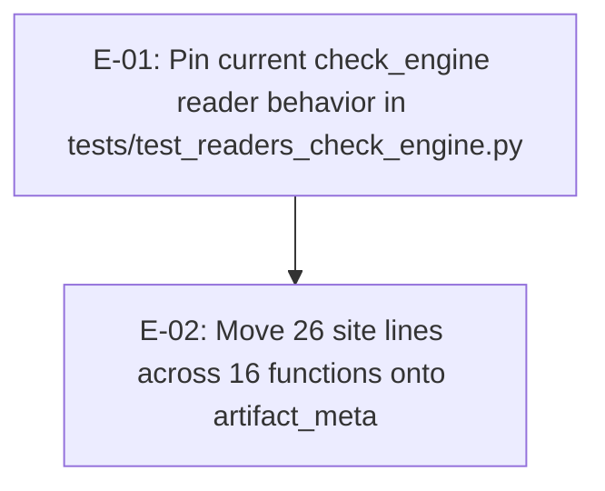

# IPD: Move the check_engine identity, Set, date and From-Spec readers onto artifact_meta

- Date: 2026-11-07
- Kind: child
- Concern: Split from `ffceq0` (Task group 3) under the maintainer's step-complexity rule: `ffceq0` E-07 moved 100 measured working-tree metadata-read site lines in 60 `check_engine` functions as one item. This part takes the identity, Set, date and From-Spec subset (26 site lines in 16 functions).
- Scope: Pin then move the identity, collision, Set-length, date and From-Spec readers of `check_engine` onto `artifact_meta` (`ffceq0` E-06 and E-07, partitioned). EXCLUDES: every other check_engine subset (Orders 30 to 32), git-content readers (Order 09 `t4gl15`), the skip list (Order 32).
- Scope-Paths: agent_workflows/check_engine.py, tests/test_readers_check_engine.py, tests/test_check_engine.py, tests/test_check_engine_metadata_region.py, tests/test_check_engine_from_spec_missing.py, .aw/records/plans/pending/20261107-metastore-29-w1cs3p-move-the-check-engine-identity-set-date-and-from-spec-reader.ipd.md
- Item-Dependencies: executed:g5hpbb, executed:tve77h, executed:xexn45
- Status: approved
- From-Spec: 4sd62s
- Work-Kind: feature
- Priority: high
- Blocks-Release: next
- Set: metastore
- Order: 29
- Highest E allocated: 02
- Author: opencode its_direct/pt3-claude-opus-5.5-1m-us
- Id: w1cs3p
- Approval: 2026-11-16, recorded via aw ipd set: status set to approved
- Readiness: go-pending-approval
- Review-Depth: complex

## Workflow history
- 2026-11-16 approved (aw set): status set to approved
- 2026-11-14 reviewed (aw set): APPROVE WITH REVISIONS APPLIED; PR-001..PR-004 FIXED

- 2026-11-14 /plan-review (antigravity/gemini): APPROVE WITH REVISIONS APPLIED; PR-001..PR-004 FIXED; review record .aw/records/reviews/20261107-metastore-29-w1cs3p-move-the-check-engine-identity-set-date-and-from-spec-reader.review.md
- 2026-11-07 to-review (opencode its_direct/pt3-claude-opus-5.5-1m-us): split from ffceq0 per maintainer step-complexity rule (no single E/V item hides hundreds of steps).
- 2026-11-07 draft (opencode its_direct/pt3-claude-opus-5.5-1m-us): created.

## Goal

The `check_engine` identity, Set, date and From-Spec rules read cached fields and report the same rule ids on this checkout as before.

## Detailed Implementation Checklist (TODO)

Execution-state rule: mark an `E-*` item complete only after performing the action. That mark is not validation. Right-sizing rule: each E-item must address one concern and be executable in one focused pass; split when an E-item names multiple distinct deliverables or independent test-surfaces. Accepted execution states: blocked, failed, pending, performed; terminal gate demands 'performed'.

Every E-item that moves a reader follows one rule, so a reviewer can check each the same way: (1) BEFORE the edit, add or extend a behavioral test in the named module that pins the reader's CURRENT observable behavior on a `tmp_path` fixture repository (the "prior behavior" column of the reader ledger in `## Findings`), and run it green against the unmodified code; (2) change the reader to call `artifact_meta`; (3) run the same test unchanged. A test that has to change in step 3 is a behavior change and must be one of the decisions listed in the ledger (D-1 to D-5), never a silent one. For every existing module named as a baseline, save the per-test outcome list under the gitignored `.aw/state/ffceq0/` (`mkdir -p .aw/state/ffceq0 && python3 -m pytest -o addopts="" -m "" -p no:randomly -n 0 -rA <modules> | grep -E "^(PASSED|FAILED|ERROR|SKIPPED|XFAIL|XPASS) " | sed -E 's/ - .*//' | sort > .aw/state/ffceq0/<E>-before.txt`) before the move and the same command into `<E>-after.txt` after it; `diff` of the two prints nothing except lines a named decision explains. Every saved baseline (command output, JSON, rule counts) also goes under `.aw/state/ffceq0/`, never `/tmp`, so it survives a lane integration. A count measured at authoring (for example the 1,635 executed plans of F-03) is context, never the bar: each expected outcome compares a before and after value re-derived on the same tree. New test modules set `pytestmark = pytest.mark.core`, call real functions or the real `aw` CLI, and never read production source.

The baseline directory stays `.aw/state/ffceq0/`, not this plan's own id6, because the split parent `ffceq0` keeps the final cache-parity, residual-audit and finishing items that compare against these saved files. Commit through `aw commit w1cs3p -- <each changed path>`, one commit per task group allowed, never `git add -A`, a bare `git add` or `git commit -a`. Never push.

### Task group 1: check_engine identity, Set, date and From-Spec readers

- [x] E-01 Pin the current behavior of THIS PART'S SUBSET of the `check_engine` working-tree readers (the original `ffceq0` E-06 list, partitioned across Orders 29 to 32) in `tests/test_readers_check_engine.py`: `check.id-missing`/identity rules (`check_collisions`, `_identity_declared_values`), `check_id_outside_metadata_region`, `check_setid_length`, `find_lifecycle_placement_conflicts`, `is_retired`, `validate_prompt_content`, `build_plan_setid_index`, the plan-date readers (`_plan_date`, `_plan_date_compact`, `_artifact_compact_date`), `known_spec_ids`, `find_from_spec_plans`, `check_from_spec_dangling`, `check_plan_spec_link_missing` and `check_spec_criteria_uncovered`, each on a `tmp_path` fixture through `aw check <type> --agent`. Run `tests/test_check_engine.py`, `tests/test_check_engine_metadata_region.py` and `tests/test_check_engine_from_spec_missing.py` green as the baseline.
  - Depends on: none
  - Expected outcome: the new module passes on the unmodified code; the baseline outcome list is saved, and the sorted rule-id counts of `aw check all --agent` (one `rule` per diagnostic) are saved to `.aw/state/ffceq0/check-before.txt` if that file does not yet exist (the first check_engine part to run writes it; later parts keep it, because it is the parent's final comparison bar) and, always, to this part's own `.aw/state/ffceq0/check-before-29.txt`.
  - Execution state: performed

- [x] E-02 Move the `check_engine` working-tree metadata readers onto `artifact_meta`: THIS PART'S SUBSET of the `ffceq0` E-07 site list (partitioned across Orders 29 to 32), namely every working-tree metadata read inside these functions, with its measured site-line count: `is_retired` (1), `validate_prompt_content` (1), `check_collisions` (2), `find_lifecycle_placement_conflicts` (2), `_artifact_compact_date` (1), `check_setid_length` (1), `check_id_outside_metadata_region` (1), `_identity_declared_values` (3, with `_identity_metadata_region` and its bullet/YAML pairs), `find_from_spec_plans` (2), `build_plan_setid_index` (3), `_plan_date` (1), `known_spec_ids` (1), `check_from_spec_dangling` (1), `check_plan_spec_link_missing` (3), `check_spec_criteria_uncovered` (2), `_plan_date_compact` (1); 26 site lines. In each function the reads to replace are the calls of `_read_declared_id`, `_read_item_id`, `_read_plan_status`, `_read_blocks_release`, `_parse_setid` and `_metadata_status`/`_status_meta` on working-tree text, the `_ITEM_*`/`_META_*`/`_PLAN_STATUS_RE`/`_ITEM_DEPENDENCIES_RE`/`_DATE_LINE_RE`/`_REVIEW_SUBJECT_TYPE_RE`/`_FROM_SPEC_LINE_RE`/`_CARRIER_DATE_RE` users, the inline `^- Kind:`/`^- Status:`/`^- Set:`/`^- Date:`/`^- Id:` searches, `backlog.parse_item` uses, the `prompts_index._parse_metadata_comment` use, and the `history_block`/`last_history_at` uses, all through `artifact_meta.read`/`query`/`history`. `_metadata_status(text)` keeps its text signature ONLY for the git-content callers that Order 09 moves to `read_at`; every working-tree call site passes through `artifact_meta.read` instead. Body-prose bullets kept by N3 (`_TARGET_BULLET_RE` over `Concern`/`Scope`/`Scope-Paths` body scanning for citations, open-question `Carrier*` rows) are NOT metadata reads and stay; each is listed in the `ffceq0` E-14 exclusion list.
  - Depends on: E-01
  - Expected outcome: E-01 and its baseline modules pass unchanged; `aw check all --agent` on this checkout reports the same rule-id multiset as `.aw/state/ffceq0/check-before-29.txt` (pasted sorted counts, empty diff), with any difference explained by a plan or record that changed between the two runs.
  - Execution state: performed

Add further leaves as `- [ ] E-NEW <action>` and run `aw ipd sync` to assign ids.

## Project conventions discovered (Step 0)

Carried verbatim from `ffceq0` Step 0; where a line says "this plan" it means the split parent `ffceq0`.

- The `artifact_meta` interface names come from Order 02 (`tve77h`) and are used exactly: `artifact_meta.read(id6) -> State`, `artifact_meta.history(id6)`, `artifact_meta.query(...)` with typed filters (type, status, Set, order, `depends_on`, `latest_gate_review_of`, `path`) and an `incomplete` list, `artifact_meta.resolve(path_or_id6)`, `artifact_meta.read_at(id6, rev)` (Order 09 only), `artifact_meta.repair(id6, *, confirm=None)`, and the `artifacts.short_description` column. The legacy loader stores a multi-word `- Status:` raw value in a legacy-only column and sets `artifacts.status` only for a single token (tve77h OQ-03, which names this plan as the carrier of the reader decision).
- One status normalizer already exists: `plans.normalize_status` maps `EXECUTED`/`DONE` to `executed` and any other unrecognized token to `plans.LEGACY_GROUP` (`legacy/unknown`); `plans.read_status` applies it to the FIRST token of the whole-file `- Status:` line. `attention._plans_record` and `ipd_lint.lint_text` (M105) already use it.
- `selectors.metadata_region` is the shared region bound (the bullet block before the first `##`, or the YAML fence). The PARITY CONSTRAINT comment above `selectors._STATUS_RE` records the 24-plan disagreement and forbids changing it without "owning that contract change", which D-1 does here.
- Shared history rules: `attention_contract.history_block`, `attention_contract.newest_history_record`, `attention_contract.last_history_at`.
- `aw find` for plans uses `plans_index.plan_entry` and `plans_index.query` for display rows and `selectors.resolve` (through `cli._resolve_selectors_with_kinds`) for selector hits; `aw ipd board` is `cli._run_plans` over `plans.scan`.
- New CLI leaves are declared in `command_surface` (`CommandDeclaration`) and covered by `tests/conformance_matrix.py`. Order 03 (`1ajqaa`) creates `agent_workflows/meta_cli.py` for `aw show --history`, so this plan adds `check meta` and `meta repair` to that module.
- Traversal exclusions live in `layout.TRAVERSAL_EXCLUSIONS` (consumed by `selectors`); `_SKIP_NAMES` is defined separately in `check_engine`, `selectors` and `artifact_refs`.
- Core tier: modules set `pytestmark = pytest.mark.core`; the bare gate is `python3 -m pytest` (30 s budget).
- Cite code by SYMBOL (`module.function`) or by a quoted content string, with a line number only appended to one of those and never alone: an offset expires before this plan executes (spec `ipd-structure-and-linting` Section 10.2; advisory `IPD-C801`).

## Findings

Carried from `ffceq0` `## Findings` (measured 2026-11-02 at `0cbfcc706`), the rows this part relies on:

| Id | Evidence | Finding |
|---|---|---|
| F-02 | Reader modules by owner (writers are Orders 06/07). THIS PLAN: `selectors` (7 regex sites), `cli` find/search/board paths (`_find_type_records`, `_find_prompt_id6`, `_find_prompt_setid`, `_run_search`, `_run_plans`), `attention` (10), `attention_contract` (history readers), `plans` (3), `check_engine` working-tree readers (30 sites in the module; its 12 `_blob_text` git call sites go to Order 09), `ipd_lint` (5), `ipd_schema.parse_metadata_block` (via its caller), `artifact_refs._SKIP_NAMES`. ORDER 09: `runner_shared` (20), `oc_runipd`, `agy_runipd`, the four hooks, `check_engine` git readers, `plan_readiness.review_staleness_index`, `ipd_lifecycle._release_own_plan_edit_before_landing`, `status_set._prepare_status_change` HEAD read, `plans_index` (6), `plans_archive` (5), `plans_refs` read side, `research_index` (2), `research_archive`, `prompts_index`, `artifact_audit` (1), `review_findings` (1), `review_sequence` (2), `review_tier`, `review_rereview`, `orchestrator_readiness` (1), `production_checks` (5), `work_cmd` (2), `artifact_adopt` (1), `ipd_set_plan`, `completion` | 9 reader modules here, 27 in Order 09; with the writer modules of Orders 06/07 they cover the 59. Comment-only mentions (`term`, `config`, `lifecycle_style`, `command_surface`, docstrings in `agy_runipd`) are not readers. |
| F-06 | 4 records have a `- Status:` bullet only OUTSIDE the metadata region (3 reviews, 1 walkthrough quoting `- Status: approved <- unchanged`); `plans.read_status` (whole file) reads them, the region readers do not | No plan is affected (D-4). |
| F-08 | `history_block(` call sites: `attention` 6, `check_engine` 3; `last_history_at(` and `history_block(` together 10 sites in `attention` and `check_engine` | All history reads in this plan's modules go through `artifact_meta.history`. |

Step-complexity measurement for this part (2026-11-07, at the worktree HEAD of the split; the rule is that no E-item hides more than about 25 units of work):

- Measured with an `ast` walk of `agent_workflows/check_engine.py` over every top-level function, counting non-comment lines that call a metadata reader (`_read_declared_id(`, `_read_item_id(`, `_read_plan_status(`, `_read_blocks_release(`, `_parse_setid(`, `_identity_metadata_region(`, `_metadata_status(`, `_status_meta(`, `backlog.parse_item(`, `_parse_metadata_comment(`, `history_block(`, `last_history_at(`) or use a metadata regular expression (`_ITEM_*_RE`, `_META_*_RE`, `_PLAN_STATUS_RE`, `_ITEM_DEPENDENCIES_RE`, `_DATE_LINE_RE`, `_REVIEW_SUBJECT_TYPE_RE`, `_FROM_SPEC_LINE_RE`, `_CARRIER_DATE_RE`, `_ID_LINE_RE`, `_SET_LINE_RE`, `_IDENT_*_RE`, `_STATUS_META_RE`, or an inline `^-` literal). The whole working-tree population is 93 site lines in 50 functions, which `ffceq0` E-07 moved as one item; it is partitioned across Orders 29 to 32 by function, and the four subsets together equal it (no function unassigned).
- Sites inside the git-content readers (`_status_meta`, `_check_untooled_plan_transition`, `check_staged_illegal_backlog_transition`, `_lane_carrier_is_executed`, and every site within four lines after a `_blob_text` call) are Order 09 `t4gl15`'s and are not counted. The reader definitions themselves (`_read_declared_id`, `_read_item_id`, `_read_plan_status`, `_read_blocks_release`, `_parse_setid`, `_identity_metadata_region`, `_metadata_status`) keep their text signatures for the git-content callers in this phase and are not moved by any part.
- E-01 (pin): about 16 reader fixtures plus 3 baseline modules (`test_check_engine` 57 tests, `test_check_engine_metadata_region` 3, `test_check_engine_from_spec_missing` 37). About 20 units.
- E-02 (move): 26 site lines in 16 functions (listed in the item). About 26 units.

READER LEDGER rows this part moves (copied from `ffceq0`; the full ledger stays in `ffceq0`):

| Reader | Prior behavior | Pinning test | After |
|---|---|---|---|
| `check_engine` identity, status, Set, Item-Dependencies and From-* readers | region-bounded `^- ` bullets with mixed whitespace rules | E-06 module and its nine baseline modules | cached fields; identical rule ids on this checkout |

DECISIONS that govern this part's reader moves (copied verbatim from `ffceq0`, which keeps the full D-1..D-6 table; a test that changes after a move must be one of these, never a silent change):

- D-1 (status of the 24 multi-word plans; F-03, F-04). KEPT: the canonical normalized status that `aw attention`, `aw ipd board` and `ipd_lint` already report (`executed` for `EXECUTED ...` and `DONE ...`, `legacy/unknown` for any other unrecognized token). For PLAN records only, both `aw find` paths match `plans.normalize_status` of the FIRST token of the cached raw value (the `plans.read_status` rule). Every other type keeps today's exact single-token match on the raw value, because `plans.normalize_status` knows only the plan vocabulary and maps `open`, `implemented`, `active` and `planned` to `legacy/unknown` (measured at review: `aw find backlog open` lists 27 rows and `aw find specs implemented` 22 today, and both must stay unchanged). The rule lives in `selectors`' `MATCH_STATUS` branch, so every `selectors.resolve` caller that allows `MATCH_STATUS` sees it; E-01 pins one non-find caller (`tests/test_selector_resolver_matrix.py`) so the change to those callers is observed, not assumed. WHAT EACH CONSUMER LOSES OR GAINS: `aw find plans executed` (selector path) GAINS the 24 plans plus `vfa1tl` and agrees with `--status executed` (1,635 rows at authoring); `aw find plans EXECUTED` stops matching `vfa1tl` by exact case (its only match today); the `aw find` JSON `status` of those 24 changes from the prose line to `executed` (the prose stays in the raw legacy column and in the file); the test edits are the expected value in `tests/test_find_single_read.py::test_d_status_disagreement_record_matches_and_preserves_plans_index_status` (only if its `plans_index` assertion reads through the moved path; Order 09 owns `plans_index`) and the `_read_status(multi)` assertion in `tests/test_front_matter_loose_whitespace.py::test_single_token_status_contract_survives`, whose `read_front_matter_status(multi)` and `parse_plan_file` assertions stay unchanged (D-2; the runner is Order 09's). Reason: one reader, one answer (4.3), and it is the answer three surfaces already give. The migration (Order 04) normalizes these terminal records at the cutover.
- D-4 (status bullet outside the metadata region; F-06). KEPT: region-bounded reading. The 4 records are 3 reviews and 1 walkthrough, which have no lifecycle status, so no plan-status consumer changes.
- D-6 (records with no in-file `- Set:` bullet; added 2026-11-07, maintainer decision recorded on backlog `suth7l`). KEPT: the cache's filename-derived Set. `status_set`'s reader returns no Set for these records (242 on this repository on 2026-11-07: 164 research, 30 prompts, 23 specs, 14 plans, 8 walkthroughs, 3 roadmaps), while the cache takes it from the filename, which spec `4sd62s` C1/C10 make the checked mirror of `set` and 5.2 step 3 already uses as the default. What a consumer loses: nothing; what changes: `aw set <setid>` and `aw find <setid>` also match those records once E-15 lands. Pinned by `tests/test_artifact_meta_loader_parity.py::test_cache_agrees_with_status_set_reader_on_every_fixture_record`.

## Proposed changes (ordered, validatable)

1. Pin then move this subset of the `check_engine` working-tree readers (E-01, E-02).

## Deferred / out of scope (with reason)

- The git-content readers of `check_engine` (`_blob_text`/`_status_meta` callers).
  - Carrier: t4gl15
- The other check_engine site subsets of `ffceq0` E-06/E-07 (split 2026-11-07 per maintainer step-complexity rule): see Orders 29 (w1cs3p), 30 (na188y), 31 (i3b5zu) and 32 (ebrc4t).
  - Carrier: ffceq0

## Scope check

- Over-scope: none. Only `check_engine.py` and the shared pin module change; the pin module gains one test class per part, so the four parts never edit the same test.
- Under-scope: none known. This part carries its subset of E-06 and E-07 of `ffceq0` unchanged except where its site list is partitioned, as named in each item.

## Required tests / validation

`tests/test_readers_check_engine.py` (core, `tmp_path` fixtures through `aw check <type> --agent`); this part adds only its own test class to the module, named after its Order, so the four check_engine parts never edit the same test. The baseline modules named in E-01 run before and after the move.

Commands: the named modules, the bare core gate `python3 -m pytest`, `aw check`, `aw sanitize --agent`. The thorough tier `make test-all` runs once, in `ffceq0`'s final item.

## Spec / documentation sync

N/A: no spec text changes; implements `4sd62s` section 7 step 5 for this subset of `check_engine`.

## Open questions

### OQ-01: Does this part fit the step-complexity limits?

- Blocking: no
- Status: resolved
- Owner: none
- Resolution or deferral rationale: Yes. 2 E-items, 5 Scope-Paths entries, measured at about 20 and 26 units (see `## Findings`). Recommendation strength: strong.

## Validation and cross-check (verify before reporting done)

Validation-state rule: inspect evidence in a separate pass. Do not mark a `V-*` item complete from memory or from the matching execution checkmark. Accepted validation results: blocked, failed, pass, pending; terminal gate demands 'pass'. Runtime-demonstration reachability rule: for each `V-*` item demanding the software be observed acting (such as a run, a dispatch, or a transition), as distinct from items demanding a diff, a file's content, or a test result, which are reachable by construction, name the code path that produces the observation or the sibling `E-*` that creates it, else the demand is UNDER-SCOPE.

- [x] V-01 validates E-01
  - Required evidence: paste `git diff --stat agent_workflows/check_engine.py` empty, then `python3 -m pytest -o addopts="" -v tests/test_readers_check_engine.py` all PASSED (one test per reader listed in E-01), and `wc -l` of the baseline modules' saved outcome list `.aw/state/ffceq0/E-06-before-29.txt`; also paste the sorted rule-id counts saved to `.aw/state/ffceq0/check-before-29.txt` (and `ls -l .aw/state/ffceq0/check-before.txt` showing the shared bar exists).
  - Observed evidence: Before editing `agent_workflows/check_engine.py` (`git diff --stat agent_workflows/check_engine.py` empty), added `TestCheckEngineReadersOrder29` (14 tests) to `tests/test_readers_check_engine.py` and ran `python3 -m pytest -o addopts="" -v tests/test_readers_check_engine.py`: `38 passed in 15.35s` (all 14 Order 29 tests, 14 Order 30 tests, and 10 Order 31 tests `PASSED`). Saved baseline outcomes of `tests/test_check_engine.py`, `tests/test_check_engine_metadata_region.py`, and `tests/test_check_engine_from_spec_missing.py` (`97 passed in 14.38s`) to `.aw/state/ffceq0/E-06-before-29.txt` (`97 .aw/state/ffceq0/E-06-before-29.txt`). Saved sorted `aw check all --agent` rule-id counts to `.aw/state/ffceq0/check-before-29.txt` and `.aw/state/ffceq0/check-before.txt` (`381` bytes each; `.aw/state/ffceq0/check-before.txt` exists at 381 bytes): `1 check.graduated-to-dangling`, `1 check.identity-absent-from-name`, `4 check.ipd-carrier-finished-unverified`, `1 check.ipd-uncarried-obligation`, `6 check.lifecycle-transition-unvalidated`, `2 check.live-bug-ungated`, `4 check.name-nonconformant`, `6 check.prompt-metadata-missing`, `42 check.source-test-citation-dangling`, `2 check.spec-criteria-uncovered`, `1 check.system-layout-missing`, `2 spec.prose-dash`.
  - Result: pass

- [x] V-02 validates E-02
  - Required evidence: paste `diff .aw/state/ffceq0/E-06-before-29.txt .aw/state/ffceq0/E-07-after-29.txt` printing nothing, and `aw check all --agent` sorted rule-id counts with `diff .aw/state/ffceq0/check-before-29.txt -` printing nothing (or each difference traced to a record changed between the runs).
  - Observed evidence: Moved all 16 named `check_engine` functions (26 working-tree metadata read site lines) onto `artifact_meta` (`query`, `read`, `read_text`, `load_legacy_artifact` fallback in `validate_prompt_content`). Post-edit checks: `python3 -m pytest -o addopts="" -v tests/test_readers_check_engine.py`: `38 passed in 17.25s`; `tests/test_check_engine.py`, `tests/test_check_engine_metadata_region.py`, and `tests/test_check_engine_from_spec_missing.py` saved to `.aw/state/ffceq0/E-07-after-29.txt` (`97 .aw/state/ffceq0/E-07-after-29.txt`), `diff -u .aw/state/ffceq0/E-06-before-29.txt .aw/state/ffceq0/E-07-after-29.txt` exited 0 with empty output; `aw check all --agent` rule-id counts saved to `.aw/state/ffceq0/check-after-29.txt` (`1 check.graduated-to-dangling`, `1 check.identity-absent-from-name`, `4 check.ipd-carrier-finished-unverified`, `1 check.ipd-uncarried-obligation`, `6 check.lifecycle-transition-unvalidated`, `2 check.live-bug-ungated`, `4 check.name-nonconformant`, `6 check.prompt-metadata-missing`, `42 check.source-test-citation-dangling`, `2 check.spec-criteria-uncovered`, `1 check.system-layout-missing`, `2 spec.prose-dash`), `diff -u .aw/state/ffceq0/check-before-29.txt -` exited 0 with empty output; related suites (`test_prompts_index.py`, `test_prompts_set_surface.py`, `test_identity_rename_hint.py`, `test_walkthrough_id6.py`, `test_check_severity_tally.py`, `test_precommit_scope_gate_severity.py`): `41 passed in 5.50s`; `test_check_engine_restored_behavior.py` + `test_carrier_reverse_lookup.py`: `7 passed in 1.48s`; `python3 -m mypy agent_workflows/check_engine.py`: `Success: no issues found in 1 source file`; `python3 -m agent_workflows.cli sanitize --agent`: `{"schema":"aw.agent/v1","kind":"result","cmd":"check-local-leaks","outcome":"clean","exit":0,"verified":true,"complete":true,"checked":6780,"findings":0,"evidence":["leak-scan"],"next":null}`; `python3 -m agent_workflows.cli suite`: `2487 passed, 11 warnings in 75.26s (0:01:15)` (exit 0, `AW_CORE_BUDGET_ENFORCE=0` under host load average 6.48 on 12 CPUs).
  - Result: pass

## Approval and execution gate

- Size assessment: standard
- Cohesion rationale: not required

Execute only after human approval (`Status: approved`) and after every `- Item-Dependencies:` edge is executed. Every reader move is pin-first: the baseline runs green on the unmodified code before the matching move, and a test edited after a move must be one that the copied decisions name.

Honesty rule: run the named modules and `python3 -m pytest` (core gate) and paste the ACTUAL summary lines; never claim a result you did not run.

Safety rule: Stop and report rather than editing production code outside Scope-Paths or weakening test assertions if an unexpected failure occurs on unmodified code, or if an unresolvable concurrent-edit conflict occurs.

Commits: commit only through `aw commit w1cs3p -- <paths>`; never `git add -A`, a bare `git add` or `git commit -a`; never push.

Lifecycle transition: the plan moves to `.aw/records/plans/executed/` only through `aw ipd finalize`, never a hand `git mv`, and only after `aw ipd lint --phase pre-transition` conforms and every `V-*` reads `pass` with pasted evidence.
