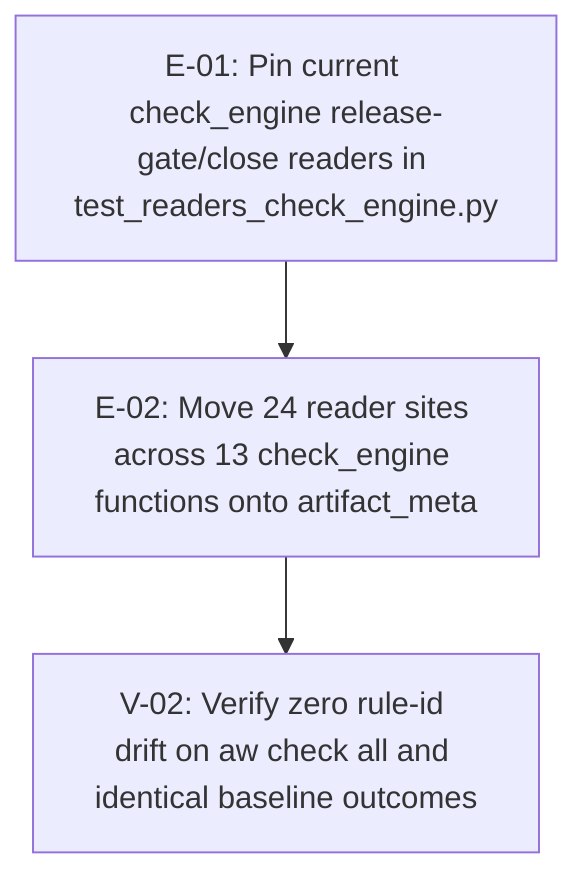

# IPD: Move the check_engine release-gate and From-Backlog readers onto artifact_meta

- Date: 2026-11-07
- Kind: child
- Concern: Split from `ffceq0` (Task group 3) under the maintainer's step-complexity rule. This part takes the release-gate, close and From-Backlog subset of the `ffceq0` E-07 site list (24 site lines in 13 functions).
- Scope: Pin then move the release-gate and close readers of `check_engine` (`evaluate_blocking_close`, `check_release_gate_consistency` working-tree half, `release_gate_warnings`, `check_live_bug_gate`, `check_decision_ref_dangling`, the From-Backlog carrier readers and the close-date history read) onto `artifact_meta` (`ffceq0` E-06 and E-07, partitioned). EXCLUDES: the other check_engine subsets (Orders 29, 30, 32) and the staged-content half of `check_release_gate_consistency` (`t4gl15`).
- Scope-Paths: agent_workflows/check_engine.py, tests/test_readers_check_engine.py, tests/test_check_engine_release_gate.py, tests/test_from_backlog_cardinality.py, .aw/records/plans/pending/20261107-metastore-31-i3b5zu-move-the-check-engine-release-gate-and-from-backlog-readers.ipd.md
- Item-Dependencies: executed:g5hpbb, executed:tve77h, executed:xexn45
- Status: approved
- Readiness: go-pending-approval
- Review-Depth: complex
- From-Spec: 4sd62s
- Work-Kind: feature
- Priority: high
- Blocks-Release: next
- Set: metastore
- Order: 31
- Highest E allocated: 02
- Author: opencode its_direct/pt3-claude-opus-5.5-1m-us
- Id: i3b5zu
- Approval: 2026-11-16, recorded via aw ipd set: status set to approved

> Write and proofread this plan per the technical writing standard, `.aw/system/workflows/technical-writing/technical-writing.md` (`.agents/workflows/technical-writing/technical-writing.md` in a legacy-layout install), including requirement 12 (diagrams).

## Workflow history
- 2026-11-16 approved (aw set): status set to approved
- 2026-11-14 reviewed (aw set): APPROVE WITH REVISIONS APPLIED; PR-001..PR-006 FIXED

- 2026-11-14 /plan-review (antigravity/gemini): APPROVE WITH REVISIONS APPLIED; PR-001..PR-006 FIXED; review record .aw/records/reviews/20261107-metastore-31-i3b5zu-move-the-check-engine-release-gate-and-from-backlog-readers.review.md
- 2026-11-07 to-review (opencode its_direct/pt3-claude-opus-5.5-1m-us): split from ffceq0 per maintainer step-complexity rule (no single E/V item hides hundreds of steps).
- 2026-11-07 draft (opencode its_direct/pt3-claude-opus-5.5-1m-us): created.

## Goal

The `check_engine` release-gate and close rules read cached fields via `artifact_meta` and report the same rule ids on this checkout as before.

## Detailed Implementation Checklist (TODO)

Execution-state rule: mark an `E-*` item complete only after performing the action. That mark is not validation. Right-sizing rule: each E-item must address one concern and be executable in one focused pass; split when an E-item names multiple distinct deliverables or independent test-surfaces. Accepted execution states: blocked, failed, pending, performed; terminal gate demands 'performed'.

Every E-item that moves a reader follows one rule, so a reviewer can check each the same way: (1) BEFORE the edit, create `.aw/state/ffceq0/` and `.aw/state/i3b5zu/` (`mkdir -p .aw/state/ffceq0 .aw/state/i3b5zu`), add or extend a behavioral test in the named module that pins the reader's CURRENT observable behavior on a `tmp_path` fixture repository (the "prior behavior" column of the reader ledger in `## Findings`), and run it green against the unmodified code; (2) change the reader to call `artifact_meta`; (3) run the same test unchanged. A test that has to change in step 3 is a behavior change and must be one of the decisions listed in the ledger (D-1 to D-6), never a silent one. For every existing module named as a baseline, save the per-test outcome list under the gitignored `.aw/state/ffceq0/` (`python3 -m pytest -o addopts="" -m "" -p no:randomly -n 0 -rA <modules> | grep -E "^(PASSED|FAILED|ERROR|SKIPPED|XFAIL|XPASS) " | sed -E 's/ - .*//' | sort > .aw/state/ffceq0/<E>-before.txt`) before the move and the same command into `<E>-after.txt` after it; `diff` of the two prints nothing except lines a named decision explains. Every saved baseline (command output, JSON, rule counts) also goes under `.aw/state/ffceq0/`, never `/tmp`, so it survives a lane integration. A count measured at authoring (for example the 1,635 executed plans of F-03) is context, never the bar: each expected outcome compares a before and after value re-derived on the same tree. New test modules set `pytestmark = pytest.mark.core`, call real functions or the real `aw` CLI, and never read production source.

The baseline directory stays `.aw/state/ffceq0/`, not this plan's own id6, because the split parent `ffceq0` keeps the final cache-parity, residual-audit and finishing items that compare against these saved files. Commit through `aw commit i3b5zu -- <each changed path>`, one commit per task group allowed, never `git add -A`, a bare `git add` or `git commit -a`. Never push.

### Task group 1: check_engine release-gate, close and From-Backlog readers

- [ ] E-01 Pin the current behavior of THIS PART'S SUBSET of the `check_engine` working-tree readers (the original `ffceq0` E-06 list, partitioned across Orders 29 to 32) in `tests/test_readers_check_engine.py`: `evaluate_blocking_close` (handoff, satisfied, de-gated), `check_live_bug_gate`, `check_decision_ref_dangling` (with `_iter_live_gate_carriers`), `check_release_gate_consistency` (working-tree half), `release_gate_warnings`, `find_from_backlog_plans`, `find_from_backlog_specs` and the close-date reader `_item_close_date`, each on a `tmp_path` fixture through `aw check <type> --agent` under test class `TestCheckEngineReleaseGateReadersOrder31`. Run `tests/test_check_engine_release_gate.py` and `tests/test_from_backlog_cardinality.py` green as the baseline.
  - Depends on: none
  - Expected outcome: the new test class passes on the unmodified code; the baseline outcome list is saved, and the sorted rule-id counts of `aw check all --agent` (one `rule` per diagnostic) are saved to `.aw/state/ffceq0/check-before.txt` if that file does not yet exist (the first check_engine part to run writes it; later parts keep it, because it is the parent's final comparison bar) and, always, to this part's own `.aw/state/ffceq0/check-before-31.txt`.
  - Execution state: pending

- [ ] E-02 Move the `check_engine` working-tree metadata readers onto `artifact_meta`: THIS PART'S SUBSET of the `ffceq0` E-07 site list (partitioned across Orders 29 to 32), namely every working-tree metadata read inside these functions, with its measured site-line count: `_from_backlog_value` (1), `_evidence_spec_unshipped` (1), `find_from_backlog_plans` (1), `find_from_backlog_specs` (1), `_carrier_is_executed` (1), `evaluate_blocking_close` (4), `_from_backlog_carrier_index` (1), `_item_close_date` (2), `check_release_gate_consistency` (6, working-tree reads only; its `_blob_text` staged read is `t4gl15`'s), `check_live_bug_gate` (1), `release_gate_warnings` (3), `check_decision_ref_dangling` (1), `_iter_live_gate_carriers` (1); 24 site lines. In each function the reads to replace are the calls of `_read_declared_id`, `_read_item_id`, `_read_plan_status`, `_read_blocks_release`, `_parse_setid` and `_metadata_status`/`_status_meta` on working-tree text, the `_ITEM_*`/`_META_*`/`_PLAN_STATUS_RE`/`_ITEM_DEPENDENCIES_RE`/`_DATE_LINE_RE`/`_REVIEW_SUBJECT_TYPE_RE`/`_FROM_SPEC_LINE_RE`/`_CARRIER_DATE_RE` users, the inline `^- Kind:`/`^- Status:`/`^- Set:`/`^- Date:`/`^- Id:` searches, `backlog.parse_item` uses, the `prompts_index._parse_metadata_comment` use, and the `history_block`/`last_history_at` uses, all through `artifact_meta.read`/`query`/`history`. `_metadata_status(text)` keeps its text signature ONLY for the git-content callers that Order 09 moves to `read_at`; every working-tree call site passes through `artifact_meta.read` instead. Body-prose bullets kept by N3 (`_TARGET_BULLET_RE` over `Concern`/`Scope`/`Scope-Paths` body scanning for citations, open-question `Carrier*` rows) are NOT metadata reads and stay; each is listed in the `ffceq0` E-14 exclusion list.
  - Depends on: E-01
  - Expected outcome: E-01 and its baseline modules pass unchanged; `aw check all --agent` on this checkout reports the same rule-id multiset as `.aw/state/ffceq0/check-before-31.txt` (pasted sorted counts, empty diff), with any difference explained by a plan or record that changed between the two runs.
  - Execution state: pending

Add further leaves as `- [ ] E-NEW <action>` and run `aw ipd sync` to assign ids.

## Project conventions discovered (Step 0)

Carried from `ffceq0` Step 0; where a line says "this plan" it means the split parent `ffceq0`.

- The `artifact_meta` interface names come from Order 02 (`tve77h`) and are used exactly: `agent_workflows/artifact_meta.py::read(id6) -> State`, `history(id6)`, `query(...)` with typed filters (type, status, Set, order, `depends_on`, `latest_gate_review_of`, `path`) and an `incomplete` list, `resolve(path_or_id6)`, `read_at(id6, rev)` (Order 09 only), `repair(id6, *, confirm=None)`, and the `artifacts.short_description` column. The legacy loader stores a multi-word `- Status:` raw value in a legacy-only column and sets `artifacts.status` only for a single token (tve77h OQ-03, which names this plan as the carrier of the reader decision).
- One status normalizer already exists: `agent_workflows/plans.py::normalize_status` maps `EXECUTED`/`DONE` to `executed` and any other unrecognized token to `plans.LEGACY_GROUP` (`legacy/unknown`); `agent_workflows/plans.py::read_status` applies it to the FIRST token of the whole-file `- Status:` line. `agent_workflows/attention.py::_plans_record` and `agent_workflows/ipd_lint.py::lint_text` (M105) already use it.
- `agent_workflows/selectors.py::metadata_region` is the shared region bound (the bullet block before the first `##`, or the YAML fence). The PARITY CONSTRAINT comment above `selectors._STATUS_RE` records the 24-plan disagreement and forbids changing it without "owning that contract change", which D-1 does here.
- Shared history rules: `agent_workflows/attention_contract.py::history_block`, `agent_workflows/attention_contract.py::newest_history_record`, `agent_workflows/attention_contract.py::last_history_at`.
- `aw find` for plans uses `agent_workflows/plans_index.py::plan_entry` and `agent_workflows/plans_index.py::query` for display rows and `agent_workflows/selectors.py::resolve` (through `agent_workflows/cli.py::_resolve_selectors_with_kinds`) for selector hits; `aw ipd board` is `agent_workflows/cli.py::_run_plans` over `agent_workflows/plans.py::scan`.
- Traversal exclusions live in `agent_workflows/layout.py::TRAVERSAL_EXCLUSIONS` (consumed by `selectors`); `_SKIP_NAMES` is defined separately in `check_engine`, `selectors` and `artifact_refs`.
- Core tier: modules set `pytestmark = pytest.mark.core`; the bare gate is `python3 -m pytest` (30 s budget).
- Cite code by SYMBOL (`path::Symbol`), with a line number only appended to one of those and never alone: an offset expires before this plan executes (advisory `IPD-C801`).

## Findings

Carried from `ffceq0` `## Findings` (measured 2026-11-02 at `0cbfcc706` and re-verified 2026-11-13 at HEAD `bc7623d11`), the rows this part relies on:

| Id | Evidence | Finding |
|---|---|---|
| F-02 | Reader modules by owner (writers are Orders 06/07). THIS PLAN: `agent_workflows/check_engine.py` working-tree release-gate and From-Backlog readers (24 site lines across 13 functions; its 12 `_blob_text` git call sites go to Order 09 `t4gl15`). ORDER 29 (`w1cs3p`): identity, Set, date, From-Spec (26 site lines). ORDER 30 (`na188y`): plan-rule and review readers (24 site lines). ORDER 32 (`ebrc4t`): graduation and handoff readers. | Four clean, disjoint check_engine subsets partitioned under the maintainer's step-complexity rule; no function unassigned or duplicated. |
| F-06 | 4 records have a `- Status:` bullet only OUTSIDE the metadata region (3 reviews, 1 walkthrough quoting `- Status: approved <- unchanged`); `plans.read_status` (whole file) reads them, the region readers do not | No plan is affected (D-4). |
| F-08 | `history_block(` call sites: `attention` 6, `check_engine` 3; `last_history_at(` and `history_block(` together 10 sites in `attention` and `check_engine` | All history reads in this plan's modules go through `artifact_meta.history` (D-6). |
| F-09 | Non-binding test counts on HEAD `bc7623d11`: `tests/test_check_engine_release_gate.py` (53 tests), `tests/test_from_backlog_cardinality.py` (7 tests) passing in 2.19s; related suites `tests/test_carrier_ungated_rule.py`, `tests/test_release_gate_one_way_mismatch.py`, `tests/test_backlog_positional_close_gate.py`, and `tests/test_backlog_gate_follows_status.py` (52 tests passing in 3.06s) | Complete baseline suites run fast and deterministic under PIN-FIRST rule, with zero test failures on unmodified code. |

Step-complexity measurement for this part:
- Measured with an `ast` walk of `agent_workflows/check_engine.py` over every top-level function, counting non-comment lines that call a metadata reader or use a metadata regular expression.
- E-01 (pin): 10 reader fixtures in `TestCheckEngineReleaseGateReadersOrder31` plus 2 baseline modules (`test_check_engine_release_gate` 53 tests, `test_from_backlog_cardinality` 7 tests).
- E-02 (move): 24 site lines in 13 functions (`_from_backlog_value`, `_evidence_spec_unshipped`, `find_from_backlog_plans`, `find_from_backlog_specs`, `_carrier_is_executed`, `evaluate_blocking_close`, `_from_backlog_carrier_index`, `_item_close_date`, `check_release_gate_consistency`, `check_live_bug_gate`, `release_gate_warnings`, `check_decision_ref_dangling`, `_iter_live_gate_carriers`).

READER LEDGER rows this part moves:

| Reader | Prior behavior | Pinning test | After |
|---|---|---|---|
| `check_engine` release-gate, close, and From-Backlog readers | region-bounded `^- ` bullets with mixed whitespace rules and disk walks | `TestCheckEngineReleaseGateReadersOrder31` and two baseline suites | `artifact_meta` cached fields and index queries; identical rule ids on this checkout |

## Behavior decisions (kept behavior where writers disagreed, spec `4sd62s` 4.3)

- D-1 (status of the 24 multi-word plans; F-03, F-04). KEPT: the canonical normalized status that `aw attention`, `aw ipd board` and `ipd_lint` already report (`executed` for `EXECUTED ...` and `DONE ...`, `legacy/unknown` for any other unrecognized token). For PLAN records only, both `aw find` paths match `plans.normalize_status` of the FIRST token of the cached raw value (the `plans.read_status` rule). Every other type keeps today's exact single-token match on the raw value, because `plans.normalize_status` knows only the plan vocabulary and maps `open`, `implemented`, `active` and `planned` to `legacy/unknown`. Reason: one reader, one answer (4.3), and it is the answer three surfaces already give. The migration (Order 04) normalizes these terminal records at the cutover.
- D-2 (absent versus empty `Blocks-Release` gate). KEPT: `_from_backlog_carrier_index` preserves the distinction between an absent gate (`None`) and a malformed or empty gate (`""`). In `artifact_meta`, records without a `blocks_release` field return `None`, while explicit empty values are preserved, ensuring `check_release_gate_consistency` Rule 2 and `check_live_bug_gate` evaluate gate parity identically.
- D-3 (live versus terminal carrier scoping in `check_release_gate_consistency`). KEPT: Rule 2 remains narrowed to live carriers; a carrier whose status in `artifact_meta` is in a terminal disposition (`executed`, `superseded`, `not-executed`) is skipped, preserving maintainer ruling 2026-09-12 (parent `qmgn12` OQ-03) that completed carriers cannot drop future release obligations.
- D-4 (status bullet outside the metadata region; F-06). KEPT: region-bounded reading. The 4 records are 3 reviews and 1 walkthrough, which have no lifecycle status, so no plan-status consumer changes.
- D-5 (From-Backlog query resolution). KEPT: `find_from_backlog_plans`, `find_from_backlog_specs`, and `_from_backlog_carrier_index` query `artifact_meta` for records declaring `from_backlog == item_id6`. Queries hit cached index tables in SQLite, replacing O(corpus) disk walks while returning identical `(path, blocks_release)` tuples.
- D-6 (close-date reading from history). KEPT: `_item_close_date` reads from `artifact_meta.history(item_id6)` events rather than whole-file regex scanning, extracting the newest record date and formatting compact `YYYYMMDD` identically.

## Proposed changes (ordered, validatable)

1. E-01: Pin current behavior of release-gate, close, and From-Backlog readers in `tests/test_readers_check_engine.py` under class `TestCheckEngineReleaseGateReadersOrder31`, saving baseline outcome lists under `.aw/state/ffceq0/`.
2. E-02: Move the 24 metadata reader sites across the 13 `check_engine` functions onto `artifact_meta.read`, `artifact_meta.query`, and `artifact_meta.history`, verifying zero rule-id drift via `aw check all --agent`.

## Deferred / out of scope (with reason)

- The git-content readers of `check_engine` (`_blob_text`/`_status_meta` callers).
  - Carrier: t4gl15
- The check_engine identity, Set, date, and From-Spec readers (Order 29).
  - Carrier: w1cs3p
- The check_engine plan-rule and review readers (Order 30).
  - Carrier: na188y
- The check_engine graduation and handoff readers (Order 32).
  - Carrier: ebrc4t
- The parent cache-parity and residual-audit finish items.
  - Carrier: ffceq0

## Scope check

- Over-scope: none. Only `check_engine.py`, `tests/test_readers_check_engine.py`, and the plan itself are modified; `test_readers_check_engine.py` gains only `TestCheckEngineReleaseGateReadersOrder31`.
- Under-scope: none. Carries the complete release-gate, close, and From-Backlog subset of `ffceq0` E-06 and E-07.

## Required tests / validation

`tests/test_readers_check_engine.py` (core, `tmp_path` fixtures through `aw check <type> --agent`); this part adds only its own test class `TestCheckEngineReleaseGateReadersOrder31`. Existing baseline suites: `tests/test_check_engine_release_gate.py` (53 tests) and `tests/test_from_backlog_cardinality.py` (7 tests).

Commands: the named modules, the bare core gate `python3 -m pytest`, `aw check`, `aw sanitize --agent`. The thorough tier `make test-all` runs once, in `ffceq0`'s final item.

## Spec / documentation sync

N/A: no spec text changes; implements `4sd62s` section 7 step 5 for this subset of `check_engine`.

## Open questions

### OQ-01: Does this part fit the step-complexity limits?

- Blocking: no
- Status: resolved
- Owner: none
- Resolution or deferral rationale: Yes. 2 E-items, 5 Scope-Paths entries, measured at about 14 and 24 units (see `## Findings`). Recommendation strength: strong.

## Validation and cross-check (verify before reporting done)

Validation-state rule: inspect evidence in a separate pass. Do not mark a `V-*` item complete from memory or from the matching execution checkmark. Accepted validation results: blocked, failed, pass, pending; terminal gate demands 'pass'. Runtime-demonstration reachability rule: for each `V-*` item demanding the software be observed acting (such as a run, a dispatch, or a transition), as distinct from items demanding a diff, a file's content, or a test result, which are reachable by construction, name the code path that produces the observation or the sibling `E-*` that creates it, else the demand is UNDER-SCOPE.

- [ ] V-01 validates E-01
  - Required evidence: paste `git diff --stat agent_workflows/check_engine.py` empty, then `python3 -m pytest -o addopts="" -v tests/test_readers_check_engine.py -k TestCheckEngineReleaseGateReadersOrder31` all PASSED (`test_evaluate_blocking_close_handoff`, `test_evaluate_blocking_close_satisfied`, `test_evaluate_blocking_close_degated`, `test_check_live_bug_gate`, `test_check_decision_ref_dangling`, `test_check_release_gate_consistency_working_tree`, `test_release_gate_warnings`, `test_find_from_backlog_plans`, `test_find_from_backlog_specs`, `test_item_close_date`), and `wc -l` of the baseline modules' saved outcome list `.aw/state/ffceq0/E-06-before-31.txt` (60 tests across `tests/test_check_engine_release_gate.py` and `tests/test_from_backlog_cardinality.py`); also paste the sorted rule-id counts saved to `.aw/state/ffceq0/check-before-31.txt` (and `ls -l .aw/state/ffceq0/check-before.txt` showing the shared bar exists).
  - Observed evidence:
  - Result: pending

- [ ] V-02 validates E-02
  - Required evidence: paste `diff .aw/state/ffceq0/E-06-before-31.txt .aw/state/ffceq0/E-07-after-31.txt` printing nothing across the 60 baseline tests, and `aw check all --agent` sorted rule-id counts with `diff .aw/state/ffceq0/check-before-31.txt -` printing nothing (or each difference traced to a record changed between the runs).
  - Observed evidence:
  - Result: pending

## Approval and execution gate

- Size assessment: standard
- Cohesion rationale: not required

Execute only after human approval (`Status: approved`) and after every `- Item-Dependencies:` edge (`g5hpbb`, `tve77h`, `xexn45`) is executed. Every reader move is pin-first: the baseline runs green on the unmodified code before the matching move, and a test edited after a move must be one that the copied decisions name. Stop and report without editing production code if prerequisite symbols from `xexn45` or `tve77h` (`artifact_meta.read`, `artifact_meta.query`, `artifact_meta.history`) are absent on HEAD, if a baseline test module fails on unmodified HEAD before the move, or if concurrent edits in a shared checkout conflict with `- Scope-Paths:`.

Scope fence: the paths in `- Scope-Paths:` are a declaration; a needed file outside the fence is edited and then justified at finalize (`--scope-reason`), and a declared path left unmodified is acknowledged (`--scope-ack`).

Honesty rule: run the named modules and `python3 -m pytest` (core gate) and paste the ACTUAL summary lines; never claim a result you did not run.

Commits: commit only through `aw commit i3b5zu -- <paths>`; never `git add -A`, a bare `git add` or `git commit -a`; never push.

Lifecycle transition: the plan moves to `.aw/records/plans/executed/` only through `aw ipd finalize`, never a hand `git mv`, and only after `aw ipd lint --phase pre-transition` conforms and every `V-*` reads `pass` with pasted evidence.
