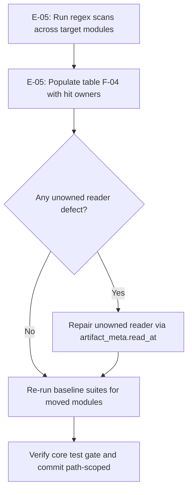

# IPD: Move the check_engine, hook and setter git-content readers onto read_at

- Date: 2026-11-07
- Kind: child
- Concern: Spec `4sd62s` 4.4 requires every reader of a HEAD, staged or branch revision to call `artifact_meta.read_at` instead of parsing git content, and C5a requires every gate and hook to read metadata through the cache. Measured 2026-11-07 at `ac76110f4`: `check_engine._blob_text` (`git show <ref>:<path>`, `:0:<path>`) has 12 call sites in 6 functions across `check_engine`, `hooks/ipd_dependency_statement_gate` and `status_set`, and `check_engine._status_meta` has 35 call sites in 13 functions; `hooks/executed_transition_gate` reads blobs with its own `_blob_at`; `plan_readiness.review_staleness_index` uses `git cat-file --batch`; `ipd_lifecycle._release_own_plan_edit_before_landing` uses `git show <landed>:<path>`. Part 1 of the split of `t4gl15` (Order 09), whose single plan hid several hundred units of work.
- Scope: FINISHING PART after the round-3 split (2026-11-09, research `nj8zdp` guidance). The baseline, the 4.4 search rows and the `check_engine` and hook moves (former E-01 baseline and gate-file rows, E-02, E-03) moved to `snh19k` (Order 145); the remaining 4.4 search rows and the setter, staleness, lifecycle and runner merge-path moves (former E-01 remaining rows, E-04) moved to `iqhzse` (Order 146). This plan keeps E-05: the residual-audit rows of `t4gl15` E-15 for the hook, readiness and lifecycle modules, the re-run of every moved module, and the gates. EXCLUDES: every other runner read (Order 34 `y97k46`), the record, review and orchestration modules (Orders 35 `jd7874` and 36 `2zpw22`), the new `meta/*.jsonl` append hook (`jq82as`), the cache-parity and offline tests and the repo-wide finish (`t4gl15`).
- Scope-Paths: .aw/records/plans/pending/20261107-metastore-33-h58z9n-move-the-check-engine-hook-and-setter-git-content-readers-on.ipd.md
- Item-Dependencies: executed:ffceq0, executed:g5hpbb, executed:tve77h, executed:xexn45, executed:snh19k, executed:iqhzse
- Status: approved
- Readiness: go-pending-approval
- Review-Depth: standard
- From-Spec: 4sd62s
- Work-Kind: feature
- Priority: high
- Blocks-Release: next
- Set: metastore
- Order: 33
- Highest E allocated: 05
- Author: opencode its_direct/pt3-claude-opus-5.5-1m-us
- Id: h58z9n
- Approval: 2026-11-16, recorded via aw ipd set: status set to approved

> Write and proofread this plan per the technical writing standard, `.aw/system/workflows/technical-writing/technical-writing.md` (`.agents/workflows/technical-writing/technical-writing.md` in a legacy-layout install), including requirement 12 (diagrams).

## Workflow history
- 2026-11-16 approved (aw set): status set to approved

- 2026-11-14 reviewed (antigravity/gemini-3.8-flash): /plan-review (antigravity/gemini-3.8-flash): APPROVE WITH REVISIONS APPLIED; PR-001, PR-002
- 2026-11-09 note (opencode its_direct/pt3-claude-opus-5.5-1m-us): round-3 split per research nj8zdp; items E-01, E-02, E-03 moved to snh19k; E-01 (remaining search rows) and E-04 moved to iqhzse.
- 2026-11-07 to-review (opencode its_direct/pt3-claude-opus-5.5-1m-us): split from t4gl15 per maintainer step-complexity rule (no single E/V item hides hundreds of steps).

## Goal

Every gate, hook, setter and runner merge path that reads metadata out of a git revision (HEAD, the index, a commit, a merge stage) reads it through `artifact_meta.read_at`, with each moved reader's verdict pinned by a behavioral test before and after the move. After the round-3 split the moves are done by `snh19k` and `iqhzse`; this plan audits what remains in the hook, readiness and lifecycle modules and re-runs every moved module.

## Detailed Implementation Checklist (TODO)

Execution-state rule: mark an `E-*` item complete only after performing the action. That mark is not validation. Right-sizing rule: each E-item must address one concern and be executable in one focused pass; split when an E-item names multiple distinct deliverables or independent test-surfaces. Accepted execution states: blocked, failed, pending, performed; terminal gate demands 'performed'.

The pin-first rule of `ffceq0` applies to every move here (carried from `t4gl15`): BEFORE the edit, a behavioral test in the named module pins the reader's current observable behavior (the ledger in `## Findings`) and runs green on the unmodified code; AFTER the edit, the same test runs unchanged. A test that must change is a behavior change and must be one of `t4gl15`'s decisions D-1 to D-4 (copied below). For every existing module named as a baseline, save the per-test outcome list under the gitignored `.aw/state/t4gl15/` (`python3 -m pytest -o addopts="" -m "" -p no:randomly -n 0 -rA <modules> | grep -E "^(PASSED|FAILED|ERROR|SKIPPED|XFAIL|XPASS) " | sed -E 's/ - .*//' | sort > .aw/state/t4gl15/<E>-before.txt`) before the move and the same command into `<E>-after.txt` after it, where `<E>` is the ORIGINAL `t4gl15` item id named in each item below; `diff` of the two prints nothing except lines a named decision explains. Run a new module's `-k` selection as its own command, never combined with baseline module paths, because `-k` filters every path on the command line. Every saved baseline goes under `.aw/state/t4gl15/`, never `/tmp`. New test modules set `pytestmark = pytest.mark.core` unless they need real `git` subprocesses across many commits, in which case they are marked `slow` and run in `make test-all`; none reads production source.

Round-3 note (2026-11-09): Task groups 1 and 2 (E-01 to E-04) moved to `snh19k` and `iqhzse`, both `- Item-Dependencies:` edges of this plan, so E-05's former `Depends on: E-03, E-04` is carried by those edges.

### Task group 3: residual audit and finish

- [ ] E-05 (carried from `t4gl15` E-15, this plan's module subset) Run `rg -n "re\.(compile|search|match|finditer|findall|sub|fullmatch)\(\s*r?[\"'](\(\?m\))?\^-" <files>` and `rg -n "Workflow history" <files>` over `agent_workflows/hooks/executed_transition_gate.py`, `agent_workflows/hooks/status_untooled_gate.py`, `agent_workflows/plan_readiness.py` and `agent_workflows/ipd_lifecycle.py` (31 hits in 17 functions measured at `ac76110f4`; the `check_engine` and `status_set` rows belong to `ffceq0`'s residual table F-12, because both modules are in `ffceq0`'s scope, and `runner_shared` rows to Order 34 `y97k46`), and write table F-04 in this plan listing every remaining hit with its owner: writer (Orders 06/07, named), body-prose bullet kept by N3 (named pattern), a working-tree reader owned by `ffceq0` (named), or a parser that Order 11 deletes. A reader hit with no such owner is a defect of this plan and is moved before finishing. Run every module named in `snh19k` E-03 and E-04 and `iqhzse` E-02 and E-03 again (the moved `h58z9n` E-02 to E-04), the bare core gate `python3 -m pytest` and `aw sanitize --agent`; commit through `aw commit h58z9n -- <each changed path>`, never `git add -A`, a bare `git add` or `git commit -a`. Never push.
  - Depends on: none
  - Expected outcome: F-04 has no unowned reader hit; all runs pass; every commit is path-scoped to Scope-Paths (or justified at finalize).
  - Execution state: pending

Add further leaves as `- [ ] E-NEW <action>` and run `aw ipd sync` to assign ids.

## Project conventions discovered (Step 0)

- Interface names from Order 02 (`tve77h`), used exactly: `artifact_meta.read(id6) -> State`, `artifact_meta.history(id6)`, `artifact_meta.query(...)`, `artifact_meta.resolve(path_or_id6)`, and `artifact_meta.read_at(id6, rev)`, which runs git in the repository that owns the resolved records root, resolves the record's path inside that revision (`git ls-files -s` for the index, `git rev-parse <rev>:<path>` for a commit), caches by blob sha in `rev_log_states`/`rev_mirrors`, feeds a miss to the same loader (the legacy loader for a bullet blob in phase B), fails closed on a validation error, and returns distinct results for an absent record, an invalid revision and an unversioned placement. From Order 08 (`ffceq0`): `artifact_meta.read_text(text, *, record_type=None) -> State` and decision D-1 (canonical normalized status for multi-word plans).
- Today's git-content helpers: `check_engine._blob_text(repo_root, ref, path)` (`git show <ref>:<path>`, `:0:<path>` for the index) and `check_engine._status_meta(text)`; `hooks.executed_transition_gate._blob_at`.
- The hooks are thin: `hooks.status_untooled_gate.check` delegates to `check_engine.check_status_untooled`, and `hooks.backlog_blocking_close_gate.check` filters `check_engine.check_release_gate_consistency`; both are dispatched by `cli` (`ipd-status-untooled-gate`, `backlog-blocking-close-gate`, `ipd-executed-gate`, `ipd-dependency-statement-gate`) and installed as optional pre-commit hooks from the `engine` template.
- Core tier: `pytestmark = pytest.mark.core`; tests needing many real git commits use the `slow` marker and run in `make test-all`.
- Cite code by SYMBOL (`module.function`) or by a quoted content string, with a line number only appended to one of those and never alone (advisory `IPD-C801`).

## Findings

Measured 2026-11-07 at `ac76110f4` (the split measurement); F-02 is copied from `t4gl15` (measured 2026-11-02 at `0cbfcc706`).

| Id | Evidence | Finding |
|---|---|---|
| F-01 | `rg -n "_blob_text\(\|_status_meta\(" agent_workflows` prints 39 lines: the two definitions, 12 `_blob_text` calls (in `check_status_untooled`, `check_status_untooled_range`, `check_staged_illegal_backlog_transition` 8, `_lane_carrier_is_executed`, `check_release_gate_consistency`, `hooks.ipd_dependency_statement_gate._staged_ipd_overlay`, `status_set._prepare_status_change`) and `_status_meta` calls in 13 functions | E-02 moves 6 `check_engine` callers; E-03 and E-04 move the other two. |
| F-02 | (from `t4gl15`) git-content metadata readers moved by this plan: `check_engine._blob_text` callers `check_status_untooled`, `check_status_untooled_range`, `check_staged_illegal_backlog_transition`, `_lane_carrier_is_executed`, `check_release_gate_consistency` (via `_staged_backlog_done_items`); `hooks.executed_transition_gate._blob_at`; `hooks.ipd_dependency_statement_gate._staged_ipd_overlay`; `status_set._prepare_status_change`; `plan_readiness.review_staleness_index` (`git cat-file --batch`); `ipd_lifecycle._release_own_plan_edit_before_landing` (`git show <landed>:<path>`); `runner_shared.backlog_item_paths_for_commit` (`git show <sha>:<path>` then `backlog.parse_item`), `check_review_lane_artifacts` (`git show <branch>:<path>`), `read_merge_stage`, `classify_conflict_set_for_rederivation` (`git cat-file -p`), `integrate_lane_branch` (`git cat-file -p <tree>:<path>` then `check_engine._metadata_status`) | All 15 functions of the 4.4 list. |
| F-03 | (written by `snh19k` E-02 and `iqhzse` E-01 in their own plans since the round-3 split; formerly E-01 here) the re-run 4.4 search over this plan's six files, each hit classified, and the merge-stage path chosen (OQ-02 of `t4gl15`). Measured at the split: 44 hits (`check_engine` 11, `hooks/executed_transition_gate` 8, `hooks/ipd_dependency_statement_gate` 2, `plan_readiness` 2, `ipd_lifecycle` 17, `artifact_meta` 4) | 4.4 says the list is a minimum. |
| F-04 | (written by E-05) residual `^-` regex and `Workflow history` hits in this plan's four modules, with owners. Measured at the split: `hooks/executed_transition_gate` 2 hits, `hooks/status_untooled_gate` 3, `plan_readiness` 16, `ipd_lifecycle` 10 | Input to `t4gl15` E-15 and Order 11. |
| F-10 | (written by `snh19k` E-01 in `snh19k` since the round-3 split; formerly E-01 here) rule-id counts of `aw check all --agent` before any edit of the `t4gl15` split | Baseline for `t4gl15` E-15. |

READER LEDGER (this plan's rows, copied from `t4gl15`):

| Reader | Prior behavior | Pinning test | After |
|---|---|---|---|
| `check_engine.check_status_untooled` and `_range` | HEAD vs staged `- Status:` via `_blob_text` + `_status_meta`; refuse with no matching history line | E-02 fixtures; `tests/test_check_engine_status_meta.py`, `tests/test_precommit_scope_gate_severity.py` | same verdicts via `read_at` states and their history |
| `check_engine.check_staged_illegal_backlog_transition`, `_staged_backlog_done_items`, `check_release_gate_consistency`, `_lane_carrier_is_executed` | staged/HEAD backlog and carrier status via git blobs | E-02 fixtures; `tests/test_check_engine_release_gate.py`, `tests/test_backlog_close_gate_prose.py` | same via `read_at` |
| `hooks.executed_transition_gate` | case-insensitive region `status: executed\|done`, `- Id:` outside fences, finalize evidence | `tests/test_executed_transition_gate.py`, `tests/test_executed_transition_gate_e2e.py` | same via `read_at`; D-2 for case |
| `hooks.ipd_dependency_statement_gate` | staged `- Status:` and `Item-Dependencies` overlay | `tests/test_ipd_dependency_statement_gate.py` | same via `read_at(":0:")` |
| `status_set._prepare_status_change` HEAD read | HEAD `- Status:` of the plan path | `tests/test_status_set.py` | `read_at(id6, "HEAD")` |
| `plan_readiness.review_staleness_index` | status at latest `plan-review:` commit plus frozen-region body digest | `tests/test_review_staleness_advisory.py` | status via `read_at`; body digest unchanged (N3) |
| `runner_shared` git readers | backlog id from commit blob, review-lane plan checks, merge-stage keys, conflict status | `tests/test_runner_backlog_close_behavior.py`, `tests/test_records_only_lane_rederive.py`, `tests/test_merge_conflict_sendback.py` | `read_at` or `read_text` |
| `ipd_lifecycle._release_own_plan_edit_before_landing` | byte equality of landed blob vs mirrored bytes | `tests/test_ipd_lifecycle_cli.py` | unchanged (not a metadata read); recorded in F-03 |

DECISIONS (copied from `t4gl15`; authoritative text stays there): D-1 multi-word status (plan records return the canonical normalized status); D-2 the executed-transition hook's case-insensitive match is preserved because the cached status is canonical lower-case.

## Proposed changes (ordered, validatable)

1. Run residual audit across hook, readiness, and lifecycle modules, populating table F-04 (E-05).
2. Re-run test suites across all moved modules, verify gates, and commit (E-05).

## Deferred / out of scope (with reason)

- E-01 (the split-wide `aw check` baseline and table F-10, and the 4.4 search rows for `check_engine` and the two blob-reading hooks), E-02 (the `check_engine` git readers) and E-03 (the four hooks). Moved to snh19k (round-3 split 2026-11-09 per research nj8zdp guidance).
  - Carrier: snh19k
  - Carrier-Evidence: .aw/records/plans/executed/20261109-metastore-145-snh19k-save-the-read-at-split-baseline-and-move-the-check-engine-an.ipd.md
- E-01 (the 4.4 search rows for `plan_readiness`, `ipd_lifecycle`, `artifact_meta` and `status_set`) and E-04 (the setter, staleness, lifecycle and runner merge-path readers). Moved to iqhzse (round-3 split 2026-11-09 per research nj8zdp guidance).
  - Carrier: iqhzse
  - Carrier-Evidence: .aw/records/plans/executed/20261109-metastore-146-iqhzse-move-the-setter-staleness-lifecycle-and-runner-merge-path-gi.ipd.md
- The 4.4 search rows for `runner_shared`/`oc_runipd`/`agy_runipd`, the runner selection and execution reads, the own-log finalize scope, and the runner residual rows.
  - Carrier: y97k46
- The 4.4 search rows for the other 31 files, and the plans, research and prompts module reads.
  - Carrier: jd7874
- The review, orchestration, production-check and work module reads.
  - Carrier: 2zpw22
- The `meta/*.jsonl` append hook, the gate cache-parity and offline tests, the repo-wide residual audit and the `CHANGELOG.md` line.
  - Carrier: t4gl15

## Scope check

- Over-scope: none. This plan edits no code; it writes table F-04 into itself and moves any unowned reader hit it finds (a defect), which the finalize scope reconciliation then records.
- Under-scope: none known; E-05 exists to find what the measurement missed. Size after round 3: 1 E-item, 0 work Scope-Paths.

## Required tests / validation

No new test module (`tests/test_readers_read_at_gates.py` is created by `snh19k` and extended by `iqhzse`). CONTRIBUTES to `4sd62s` AC-16 and AC-33 through those parts. Commands: every module named in `snh19k` E-03/E-04 and `iqhzse` E-02/E-03, the bare core gate `python3 -m pytest`, `aw sanitize --agent`.

## Spec / documentation sync

No spec change. Implements the gate, hook, setter and merge-path part of `4sd62s` 4.4 and C5a. CONTRIBUTES to AC-3 and AC-17 (merge-path readers through `read_at`; owned by `xexn45` and `tve77h`).

## Open questions

### OQ-01: Where do the split-wide baselines live?

- Blocking: no
- Status: resolved
- Owner: none
- Resolution or deferral rationale: `.aw/state/` is gitignored, so a baseline saved inside an isolated lane worktree does not reach a later plan. `snh19k` E-01 (formerly E-01 here) therefore also pastes the `aw check all --agent` rule-id counts into `snh19k` (F-10), which is tracked; `t4gl15` E-15 compares against F-10. Recommendation strength: strong.

## Validation and cross-check (verify before reporting done)

Validation-state rule: inspect evidence in a separate pass. Do not mark a `V-*` item complete from memory or from the matching execution checkmark. Accepted validation results: blocked, failed, pass, pending; terminal gate demands 'pass'. Runtime-demonstration reachability rule: for each `V-*` item demanding the software be observed acting (such as a run, a dispatch, or a transition), as distinct from items demanding a diff, a file's content, or a test result, which are reachable by construction, name the code path that produces the observation or the sibling `E-*` that creates it, else the demand is UNDER-SCOPE.

- [ ] V-05 validates E-05
  - Required evidence: paste the two `rg` commands of E-05 and the F-04 table with a per-module hit count for each of `agent_workflows/hooks/executed_transition_gate.py`, `agent_workflows/hooks/status_untooled_gate.py`, `agent_workflows/plan_readiness.py` and `agent_workflows/ipd_lifecycle.py` (every remaining hit with its owner, none unowned); the summary line of each re-run baseline module of `snh19k` E-03/E-04 and `iqhzse` E-02/E-03, named one per line with 0 failed; the bare `python3 -m pytest` summary line and wall time; the `aw sanitize --agent` result with zero `fail`; and every `aw commit h58z9n` output listing only Scope-Paths (or paths justified at finalize).
  - Observed evidence:
  - Result: pending

## Approval and execution gate

- Size assessment: standard
- Cohesion rationale: not required

Execute only after human approval (`Status: approved`) and after `ffceq0`, `g5hpbb`, `tve77h`, `xexn45`, `snh19k` and `iqhzse` are executed. OQ-01 is resolved and not blocking.

Scope fence: the paths in `- Scope-Paths:` are a declaration; a needed file outside the fence is edited and then justified at finalize (`--scope-reason`), and a declared path left unmodified is acknowledged (`--scope-ack`). Production code is not modified unless E-05 uncovers an unowned reader defect.

Safety: if prerequisite modules or `artifact_meta.read_at` reader implementations from `snh19k` or `iqhzse` are absent, stop and report immediately: that is an unsafe condition, not a scope question.

Honesty rule: run the named modules and `python3 -m pytest` (core gate), and paste the ACTUAL summary lines; never claim a result you did not run.

Commits: commit only through `aw commit h58z9n -- <paths>`; never `git add -A`, a bare `git add` or `git commit -a`; never push.

Lifecycle transition: the plan moves to `.aw/records/plans/executed/` only through `aw ipd finalize`, never a hand `git mv`, and only after `aw ipd lint --phase pre-transition` conforms and every `V-*` reads `pass` with pasted evidence. When `aw oc run` or `aw agy run` executes the plan, the runner performs the finalize; a hand executor runs `aw ipd finalize h58z9n` itself.
