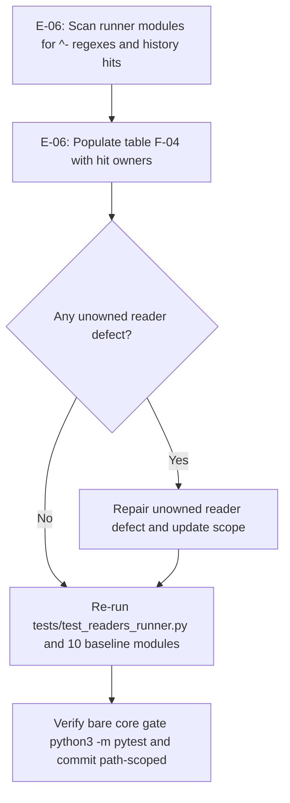

# IPD: Pin the runner reads and move the runner selection and execution reads onto artifact_meta

- Date: 2026-11-07
- Kind: child
- Concern: Spec `4sd62s` C5a requires every runner to read metadata through the cache. `runner_shared` holds one plan record for both hosts (`runner_shared.PlanRecord`, built by `runner_shared.parse_plan_file`), and the queue is built from it by per-file regex reads. Measured 2026-11-07 at `ac76110f4`: `runner_shared` has 68 metadata reader or regex sites in 26 functions (`_SET_RE`, `_ORDER_RE`, `_KIND_RE`, `read_front_matter_*`, `backlog.parse_item`, `ipd_schema.read_readiness`, `^-` regexes), and `oc_runipd` and `agy_runipd` re-export 10 of those names. Part 2 of the split of `t4gl15` (Order 09): this part pins the runner's metadata behavior and moves both the plan-selection reads (the queue-building path) and the execution-path reads, in two task groups, and adds the 4.4 own-log finalize scope rule.
- Scope: FINISHING PART after the round-3 split (2026-11-09, research `nj8zdp` guidance). E-01, E-02 and E-03 (search rows, pin, selection move) moved to `k86yq7` (Order 147); E-04 and E-05 (execution move, own-log finalize scope) moved to `k3hb06` (Order 152). This plan keeps E-06: the `runner_shared`/`oc_runipd`/`agy_runipd` rows of `t4gl15` E-15's residual audit, and the final runner runs. EXCLUDES: the five `runner_shared` git-content readers (`iqhzse`); every writer (Orders 06/07); deleting parsers (Order 11).
- Scope-Paths: .aw/records/plans/pending/20261107-metastore-34-y97k46-pin-the-runner-reads-and-move-the-runner-selection-and-git-c.ipd.md
- Item-Dependencies: executed:ffceq0, executed:g5hpbb, executed:h58z9n, executed:tve77h, executed:xexn45, executed:k86yq7, executed:k3hb06
- Status: reviewed
- Readiness: go-pending-approval
- Review-Depth: standard
- From-Spec: 4sd62s
- Work-Kind: feature
- Priority: high
- Blocks-Release: next
- Set: metastore
- Order: 34
- Highest E allocated: 06
- Author: opencode its_direct/pt3-claude-opus-5.5-1m-us
- Id: y97k46

> Write and proofread this plan per the technical writing standard, `.aw/system/workflows/technical-writing/technical-writing.md` (`.agents/workflows/technical-writing/technical-writing.md` in a legacy-layout install), including requirement 12 (diagrams).

## Workflow history

- 2026-11-14 reviewed (antigravity/gemini-3.8-flash): /plan-review (antigravity/gemini-3.8-flash): APPROVE WITH REVISIONS APPLIED; PR-001, PR-002, PR-003, PR-004
- 2026-11-09 note (opencode its_direct/pt3-claude-opus-5.5-1m-us): round-3 split per research nj8zdp; items E-01, E-02, E-03 moved to k86yq7; E-04, E-05 moved to k3hb06.
- 2026-11-07 to-review (opencode its_direct/pt3-claude-opus-5.5-1m-us): split from t4gl15 per maintainer step-complexity rule (no single E/V item hides hundreds of steps).

## Goal

After the round-3 split, `k86yq7` and `k3hb06` do the runner moves below; this plan audits what remains. The runner builds its queue (plan discovery, selectors, dependency edges, disposition and freeze checks) and executes items (item execution, review sequence, production-set retries, backlog resolution) from `artifact_meta.read`/`query` instead of per-file regexes, on both hosts, with the observable behavior pinned before the move and unchanged after it except the named D-1 status normalization; a finalized plan's own metadata log is in its scope; and every remaining runner regex hit has a named owner.

## Detailed Implementation Checklist (TODO)

Execution-state rule: mark an `E-*` item complete only after performing the action. That mark is not validation. Right-sizing rule: each E-item must address one concern and be executable in one focused pass; split when an E-item names multiple distinct deliverables or independent test-surfaces. Accepted execution states: blocked, failed, pending, performed; terminal gate demands 'performed'.

The pin-first rule of `ffceq0` applies to every move here (carried from `t4gl15`): BEFORE the edit, a behavioral test in the named module pins the reader's current observable behavior and runs green on the unmodified code; AFTER the edit, the same test runs unchanged. A test that must change is a behavior change and must be one of decisions D-1 to D-4 (copied below from `t4gl15`). For every existing module named as a baseline, save the per-test outcome list under the gitignored `.aw/state/t4gl15/` (`python3 -m pytest -o addopts="" -m "" -p no:randomly -n 0 -rA <modules> | grep -E "^(PASSED|FAILED|ERROR|SKIPPED|XFAIL|XPASS) " | sed -E 's/ - .*//' | sort > .aw/state/t4gl15/<E>-before.txt`) before the move and the same command into `<E>-after.txt` after it, where `<E>` is the ORIGINAL `t4gl15` item id named below; `diff` of the two prints nothing except lines a named decision explains. Run a new module's `-k` selection as its own command. Every saved baseline goes under `.aw/state/t4gl15/`, never `/tmp`. A count measured at authoring (for example F-05's 1,719 records) is context, never the bar. New test modules set `pytestmark = pytest.mark.core` unless they need real `git` subprocesses across many commits (then `slow`); none reads production source.

Round-3 note (2026-11-09): Task groups 1 to 3 (E-01 to E-05) moved to `k86yq7` and `k3hb06`, both `- Item-Dependencies:` edges of this plan, so E-06's former `Depends on: E-04, E-05` is carried by those edges.

### Task group 4: runner residual audit and finish

- [ ] E-06 (carried from `t4gl15` E-15, runner subset) Run `rg -n "re\.(compile|search|match|finditer|findall|sub|fullmatch)\(\s*r?[\"'](\(\?m\))?\^-" agent_workflows/runner_shared.py agent_workflows/oc_runipd.py agent_workflows/agy_runipd.py` and `rg -n "Workflow history" <the same files>` (40 hits in 21 functions at `ac76110f4`, before this plan) and write table F-04 in this plan listing every remaining hit with its owner: writer (Orders 06/07, named: `record_oq_answer`, `perform_coordinator_proposal_file`, `mark_plan_attended`, `set_plan_approved`, `_fail_incomplete`, `rederive_front_matter`, `resolve_history_append_conflict`, `_write_fallback_record`, `process_backlog_close`, `commit_review_lane_output`), body-prose bullet kept by N3 (named pattern), or a parser that Order 11 deletes (the module-level `_SET_RE`, `_ORDER_RE`, `_KIND_RE`, `_HISTORY_BULLET_RE`, `_FRONT_MATTER_BULLET_RE` definitions). A reader hit with no such owner is a defect of this plan and is moved before finishing. Run `tests/test_readers_runner.py`, the ten `k86yq7` E-03/E-04 baseline modules (the original E-02 baseline) and the bare core gate `python3 -m pytest`; commit through `aw commit y97k46 -- <each changed path>`, never `git add -A`, a bare `git add` or `git commit -a`. Never push.
  - Depends on: none
  - Expected outcome: F-04 has no unowned reader hit; all runs pass; every commit is path-scoped to Scope-Paths (or justified at finalize).
  - Execution state: pending

Add further leaves as `- [ ] E-NEW <action>` and run `aw ipd sync` to assign ids.

## Project conventions discovered (Step 0)

- Interface names from Order 02 (`tve77h`): `artifact_meta.read(id6) -> State`, `artifact_meta.history(id6)`, `artifact_meta.query(...)` (type, status, Set, order, `depends_on`, `latest_gate_review_of`, `path` filters, and an `incomplete` list), `artifact_meta.resolve(path_or_id6)`. From Order 08 (`ffceq0`): `artifact_meta.read_text(text, *, record_type=None) -> State` and decision D-1.
- One runner plan record serves both hosts: `runner_shared.PlanRecord` (`id6`, `setid`, `status`, `order`, `path`, `rel_path`, `dependencies`, `kind`, `dependency_error`, `from_backlog`) built by `runner_shared.parse_plan_file`; `oc_runipd` re-exports `selectors.read_front_matter_id as _read_id`, and `tools/ipdrunner/runagy.py` consumes `agy_runipd._read_id`.
- `runner_shared._front_matter_bullets` and `_split_metadata_region` feed the records-only conflict classifier (`classify_records_only_front_matter_conflict`) and `rederive_front_matter` (plan `kl18sz`).
- Cite code by SYMBOL (`module.function`), never a bare line number (advisory `IPD-C801`).

## Findings

Measured 2026-11-07 at `ac76110f4`; F-05 and F-06 copied from `t4gl15` (2026-11-02 at `0cbfcc706`).

| Id | Evidence | Finding |
|---|---|---|
| F-01 | Reader sites per `runner_shared` function, measured with an AST pass over `rg` hits of `_SET_RE\|_ORDER_RE\|_KIND_RE\|read_front_matter_\w+\(\|parse_item\(\|_read_set\(\|_read_order\(\|_read_item_dependencies\(\|_read_from_backlog\(\|read_readiness\(\|_metadata_status\(` plus the `^-` regex pattern: 68 sites in 26 functions; module-level definitions 18; `execute_item_core` 9; writers `record_oq_answer` 6 and `perform_coordinator_proposal_file` 6 (Orders 06/07) | E-03 moves the selection functions; E-04 the execution functions. |
| F-02 | Execution-function reader sites: `execute_item_core` 9, `production_set_findings_are_retryable` 3, `production_set_retry_attempts` 1, `production_set_retry_key_already_spent` 1, `run_review_sequence` 1, `_promote_reviewed_plan` 1, `resolve_backlog_item` 1, `backlog_item_paths_for_id` 1, `populate_manifest_backlog` 1, `declared_spec_paths` 1, `enforce_no_active_runner_conflict` 1 | 21 direct sites for E-04; `initialize_run_core` and `handle_review_orchestrator_readiness` read through the moved functions. |
| F-03 | (written by `k86yq7` E-01 since the round-3 split; formerly E-01 here) the runner-file 4.4 rows | 4.4 says the list is a minimum. |
| F-04 | (written by E-06) residual `^-` regex and `Workflow history` hits in the three runner files with owners. Measured at the split: `runner_shared` 38 hits in 19 functions (module level 10), `oc_runipd` 2 | Input to `t4gl15` E-15 and Order 11. |
| F-05 | `runner_shared.discover_plans(repo)` returns 1,719 records on this checkout (at `0cbfcc706`) | Baseline context for `k86yq7` E-05's parity check (formerly E-03 here). |
| F-06 | `aw oc run` sub-commands are `start, resume, status, report, stop, integrate, audit`; none has a dry-run option | `k86yq7` E-05 compares `discover_plans` output instead of a queue preview. |

READER LEDGER (this plan's rows, copied from `t4gl15`):

| Reader | Prior behavior | Pinning test | After |
|---|---|---|---|
| `runner_shared.parse_plan_file` (both hosts) | loose `^-\s*` id/status/kind/Set/Order; multi-word status falls back to the directory bucket (`pending`) | `tests/test_front_matter_loose_whitespace.py`, E-02 | D-1, D-4 |
| `runner_shared.discover_plans`, `discover_specs`, `edge_satisfied`, `expand_selectors`, `resolve_backlog_item` | per-file regex reads | `k86yq7` E-02 module, `tests/test_runner_shared.py`, `tests/test_oc_runipd.py`, `tests/test_agy_runipd_cli.py`, `tests/test_typed_queue_entries.py`, `tests/test_run_selection_policy.py`, `tests/test_spec_review_dispatch.py` | cached fields; same `discover_plans` list (F-05) |
| `plan_readiness.is_plan_review_approved` | structured readiness believed only with review provenance in history; missing readiness refused (4.4a `l56tyz`) | `tests/test_readiness_absence_invariant.py` | same rule over cached readiness and `history` (pinned here; not moved by this plan) |

DECISIONS (copied from `t4gl15`, whose text is authoritative):

- D-1 (multi-word status): PLAN records return the canonical normalized status (`plans.normalize_status` of the first token); every other type keeps its raw single-token status. `runner_shared.parse_plan_file` today returns the directory bucket for a multi-word value and now returns the normalized first-token value. The one test assertion that changes is the fixture in `tests/test_front_matter_loose_whitespace.py::test_single_token_status_contract_survives`, whose multi-word `EXECUTED (approved by maintainer)` in `pending/` now yields `executed` instead of `pending`; that test is updated and listed in Scope-Paths. Measured at review: `discover_plans` differs on one record only (`vfa1tl`, `EXECUTED` to `executed`).
- D-4 (loose whitespace in the runner): KEPT; the runner takes `id` and `status` from `read_text`'s loose values when the strict value is absent (`k86yq7` E-05), so `tests/test_front_matter_loose_whitespace.py::test_parse_plan_file_tolerates_loose_leading_whitespace` passes unchanged.

## Proposed changes (ordered, validatable)

1. Run residual audit across runner modules (`agent_workflows/runner_shared.py`, `agent_workflows/oc_runipd.py`, `agent_workflows/agy_runipd.py`), populating table F-04 with hit owners (E-06).
2. Move and repair any unowned reader defect discovered before finishing, re-run `tests/test_readers_runner.py` and the ten baseline modules, verify core gate `python3 -m pytest`, and commit path-scoped (E-06).

## Deferred / out of scope (with reason)

- E-01, E-02, E-03 (the runner-file 4.4 rows, the runner pin with its ten-module baseline, the plan-selection move). Moved to k86yq7 (round-3 split 2026-11-09 per research nj8zdp guidance).
  - Carrier: k86yq7
- E-04, E-05 (the execution-path move, the own-log finalize scope). Moved to k3hb06 (round-3 split 2026-11-09 per research nj8zdp guidance).
  - Carrier: k3hb06
- The five `runner_shared` git-content readers (moved onto `read_at`).
  - Carrier: h58z9n
- The runner writers named in E-06.
  - Carrier: xexn45
- Deleting the module-level runner parsers.
  - Carrier: 9o83cr

## Scope check

- Over-scope: none. This plan edits no code; it writes table F-04 into itself and moves any unowned reader hit it finds (a defect), which the finalize scope reconciliation then records.
- Under-scope: none known. Size after round 3: 1 E-item, 0 work Scope-Paths; E-06 classifies 40 hits.

## Required tests / validation

No new test module (`tests/test_readers_runner.py` is created by `k86yq7`). Commands: the ten `k86yq7` baseline modules, `tests/test_readers_runner.py`, the bare core gate `python3 -m pytest`.

## Spec / documentation sync

No spec change. Implements the runner part of `4sd62s` C5a and section 7 step 5, and the 4.4 finalize own-log rule.

## Open questions

### OQ-01: How is the runner move split?

- Blocking: no
- Status: resolved
- Owner: plan author
- Resolution or deferral rationale: Superseded 2026-11-09 by the round-3 split (research `nj8zdp` guidance): the selection subset went to `k86yq7` and the execution subset to `k3hb06`, each a plan of its own. The original resolution read: Into two task groups of this plan, at the seam `t4gl15` OQ-03 named (E-03: `parse_plan_file`, `discover_*`, `edge_satisfied` and the other queue-building reads; E-04: `execute_item_core`/`initialize_run_core`/review-sequence reads), not into two plans: each item is under the 25-unit bound and both share one pinning module and one baseline. Recommendation strength: strong.

## Validation and cross-check (verify before reporting done)

Validation-state rule: inspect evidence in a separate pass. Do not mark a `V-*` item complete from memory or from the matching execution checkmark. Accepted validation results: blocked, failed, pass, pending; terminal gate demands 'pass'. Runtime-demonstration reachability rule: for each `V-*` item demanding the software be observed acting (such as a run, a dispatch, or a transition), as distinct from items demanding a diff, a file's content, or a test result, which are reachable by construction, name the code path that produces the observation or the sibling `E-*` that creates it, else the demand is UNDER-SCOPE.

- [ ] V-06 validates E-06
  - Required evidence: paste the two `rg` commands of E-06 and the F-04 table with a per-file hit count for each of `agent_workflows/runner_shared.py`, `agent_workflows/oc_runipd.py` and `agent_workflows/agy_runipd.py` (every remaining hit with its owner, none unowned); the summary line of `python3 -m pytest -o addopts="" -v tests/test_readers_runner.py` and of each of the ten `k86yq7` baseline modules, named one per line with 0 failed; the bare `python3 -m pytest` summary line and wall time; and every `aw commit y97k46` output listing only Scope-Paths.
  - Observed evidence:
  - Result: pending

## Approval and execution gate

- Size assessment: standard
- Cohesion rationale: not required

Execute only after human approval (`Status: approved`) and after `ffceq0`, `g5hpbb`, `h58z9n`, `tve77h`, `xexn45`, `k86yq7` and `k3hb06` are executed. OQ-01 is resolved and not blocking.

Scope fence: the paths in `- Scope-Paths:` are a declaration; a needed file outside the fence is edited and then justified at finalize (`--scope-reason`), and a declared path left unmodified is acknowledged (`--scope-ack`). Production code is not modified unless E-06 uncovers an unowned reader defect. Every reader move is pin-first, and a test edited after a move must be one that D-1 to D-4 name.

Safety: if prerequisite modules or `artifact_meta.read` / `query` runner implementations from `k86yq7` or `k3hb06` are absent (or `tests/test_readers_runner.py` from `k86yq7`), stop and report immediately: that is an unsafe condition, not a scope question.

Honesty rule: run the named modules and `python3 -m pytest` (core gate), and paste the ACTUAL summary lines; never claim a result you did not run.

Commits: commit only through `aw commit y97k46 -- <paths>`; never `git add -A`, a bare `git add` or `git commit -a`; never push.

Lifecycle transition: the plan moves to `.aw/records/plans/executed/` only through `aw ipd finalize`, never a hand `git mv`, and only after `aw ipd lint --phase pre-transition` conforms and every `V-*` reads `pass` with pasted evidence. When `aw oc run` or `aw agy run` executes the plan, the runner performs the finalize; a hand executor runs `aw ipd finalize y97k46` itself.
