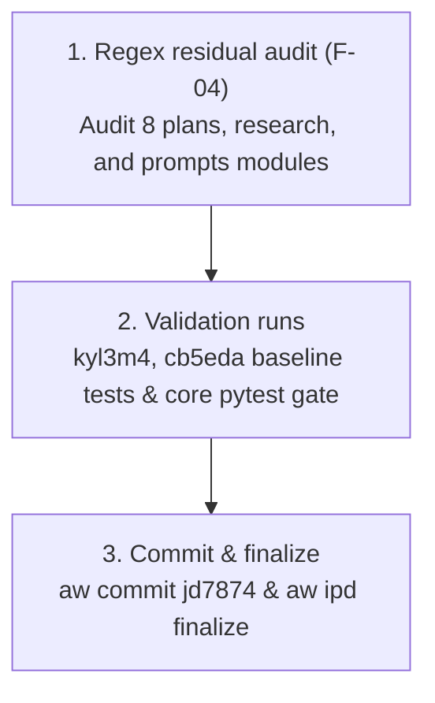

# IPD: Move the plans, research and prompts module reads onto artifact_meta

- Date: 2026-11-07
- Kind: child
- Concern: Spec `4sd62s` C5a requires every record module to read metadata through the cache, and AC-9 requires that no reader depend on an INDEX file. Measured 2026-11-07 at `ac76110f4`: the plans modules read metadata with their own regexes (`plans_index._META_RE` 7 patterns, `plans_archive` 5 `^-` regexes, `plans_refs` 5), the research modules through `research_contract.parse_frontmatter` and `research_index._META_ID_RE`, and `prompts_index` through `_parse_metadata_comment`; `research_index._doc_entry` also computes `has_body` in a way the 4.1 `aw-managed` banner will break (F-09). Part 3 of the split of `t4gl15` (Order 09).
- Scope: FINISHING PART after the round-3 split (2026-11-09, research `nj8zdp` guidance). E-01 and E-02 (INDEX baseline, 4.4 search rows, plans modules) moved to `kyl3m4` (Order 148); E-03 and E-04 (research and prompts modules, banner-blind research body test) moved to `cb5eda` (Order 153). This plan keeps E-05: the residual-audit rows of `t4gl15` E-15 for the eight plans, research and prompts modules, and the final runs. EXCLUDES: the review, orchestration, production-check and work modules (Order 36, `2zpw22`); deleting the INDEX writers and parsers (Order 11).
- Scope-Paths: .aw/records/plans/pending/20261107-metastore-35-jd7874-move-the-plans-research-and-prompts-module-reads-onto-artifa.ipd.md
- Item-Dependencies: executed:ffceq0, executed:g5hpbb, executed:h58z9n, executed:tve77h, executed:xexn45, executed:kyl3m4, executed:cb5eda
- Status: approved
- Readiness: go-pending-approval
- Review-Depth: standard
- From-Spec: 4sd62s
- Work-Kind: feature
- Priority: high
- Blocks-Release: next
- Set: metastore
- Order: 35
- Highest E allocated: 05
- Author: opencode its_direct/pt3-claude-opus-5.5-1m-us
- Id: jd7874
- Approval: 2026-11-16, recorded via aw ipd set: status set to approved

> Write and proofread this plan per the technical writing standard, `.aw/system/workflows/technical-writing/technical-writing.md` (`.agents/workflows/technical-writing/technical-writing.md` in a legacy-layout install), including requirement 12 (diagrams).

## Workflow history
- 2026-11-16 approved (aw set): status set to approved

- 2026-11-14 reviewed (antigravity/gemini-3.8-flash): plan-review verified E/V bijection, Scope-Paths, audit targets, execution gate, and state directory initialization; findings PR-001..PR-005 fixed; marked reviewed and go-pending-approval.
- 2026-11-09 note (opencode its_direct/pt3-claude-opus-5.5-1m-us): round-3 split per research nj8zdp; items E-01, E-02 moved to kyl3m4; E-03, E-04 moved to cb5eda.
- 2026-11-07 to-review (opencode its_direct/pt3-claude-opus-5.5-1m-us): split from t4gl15 per maintainer step-complexity rule (no single E/V item hides hundreds of steps).

## Goal

After the round-3 split, `kyl3m4` and `cb5eda` do the moves below; this plan audits what remains in the eight modules. The plans, research and prompts modules answer from `artifact_meta.query`/`read`, so no reader depends on an INDEX file, each move keeps a named tested behavior, and the research pipeline position ignores the 4.1 banner.

## Detailed Implementation Checklist (TODO)

Execution-state rule: mark an `E-*` item complete only after performing the action. That mark is not validation. Right-sizing rule: each E-item must address one concern and be executable in one focused pass; split when an E-item names multiple distinct deliverables or independent test-surfaces. Accepted execution states: blocked, failed, pending, performed; terminal gate demands 'performed'.

The pin-first rule of `ffceq0` applies to every move here (carried from `t4gl15`): BEFORE the edit, a behavioral test pins the reader's current observable behavior and runs green on the unmodified code; AFTER the edit, the same test runs unchanged except where decision D-1 (copied below) names it. For every existing module named as a baseline, save the per-test outcome list under the gitignored `.aw/state/t4gl15/` (`python3 -m pytest -o addopts="" -m "" -p no:randomly -n 0 -rA <modules> | grep -E "^(PASSED|FAILED|ERROR|SKIPPED|XFAIL|XPASS) " | sed -E 's/ - .*//' | sort > .aw/state/t4gl15/<E>-before.txt`) before the move and into `<E>-after.txt` after it, where `<E>` is the ORIGINAL `t4gl15` item id named below (ensure `.aw/state/t4gl15/` exists via `mkdir -p .aw/state/t4gl15/`). Run a new module's `-k` selection as its own command. New test modules set `pytestmark = pytest.mark.core`; none reads production source.

Round-3 note (2026-11-09): Task groups 1 and 2 (E-01 to E-04) moved to `kyl3m4` and `cb5eda`, both `- Item-Dependencies:` edges of this plan, so E-05's former `Depends on: E-04` is carried by those edges.

### Task group 3: residual audit and finish

- [x] E-05 (carried from `t4gl15` E-15, this plan's module subset) Ensure `.aw/state/t4gl15/` exists (`mkdir -p .aw/state/t4gl15/`). Run `rg -n "re\.(compile|search|match|finditer|findall|sub|fullmatch)\(\s*r?[\"'](\(\?m\))?\^-" <files>` and `rg -n "Workflow history" <files>` over the eight modules listed in F-04 (18 hits in 10 functions at `ac76110f4`, before this plan) and write table F-04 in this plan listing every remaining hit with its owner: writer (Orders 06/07, named; for example `plans_refs._set_metadata`), body-prose bullet kept by N3 (named pattern), or a parser that Order 11 deletes. A reader hit with no such owner is a defect of this plan and is moved before finishing. Then run every module named in `kyl3m4` E-02 and `cb5eda` E-01 to E-03 (the moved E-02 to E-04) and the bare core gate `python3 -m pytest`, and commit through `aw commit jd7874 -- <each changed path>`, never `git add -A`, a bare `git add` or `git commit -a`. Never push.
  - Depends on: none
  - Expected outcome: F-04 has no unowned reader hit; all runs pass; every commit is path-scoped to Scope-Paths (or justified at finalize).
  - Execution state: performed

Add further leaves as `- [ ] E-NEW <action>` and run `aw ipd sync` to assign ids.

## Project conventions discovered (Step 0)

- Interface names: `artifact_meta.read(id6) -> State`, `artifact_meta.query(...)` (type, status, Set, order, `path` filters, `incomplete` list), from `tve77h`; decision D-1 from `ffceq0`.
- The plans index writer and reader are one module (`plans_index.run_index`, `scan_plans`, `plan_entry`, `query`); `ipd_set_plan` and `completion` consume `scan_plans`; `plans_archive` reads `_idx._EXCLUDE_NAMES` and calls `scan_plans`.
- Cite code by SYMBOL (`module.function`), never a bare line number (advisory `IPD-C801`).

## Findings

Measured 2026-11-07 at `ac76110f4`; F-09 copied from `t4gl15` (measured 2026-11-05).

| Id | Evidence | Finding |
|---|---|---|
| F-01 | AST pass over `rg` hits of each module's reader symbols (`_META_RE`, `_ID_RE`, `_DATE_RE`, `_SET_LINE_RE`, `_ORDER_LINE_RE`, `scan_plans(`, `parse_frontmatter(`, `_parse_metadata_comment(`, `_META_ID_RE`, `_plan_status(` and the `^-` regex pattern): `plans_index` 12 sites in 6 functions, `plans_archive` 11 in 8, `plans_refs` 22 in 6, `ipd_set_plan` 1, `completion` 2, `research_index` 6 in 4, `research_archive` 2, `prompts_index` 3 | `kyl3m4` E-02 has 23 functions; `cb5eda` E-01/E-02 have 9. |
| F-02 | The 21 functions outside the gate and runner files with a `show`/`cat-file`/`ls-files -s`/`:0:` hit at `ac76110f4`: `cli.<module>`, `cli._build_parser`, `cli._dispatch`, `cli._oc_profile_show`, `cli._rewrite_help_token`, `cli._run_oc_profile`, `cli._run_show`, `cli._run_show_meta`, `command_surface.<module>`, `completion.complete_query`, `layout_migration._is_removable_leftover`, `leak_sanitizer.scan_staged_counted`, `leak_sanitizer.scan_working_tree_counted`, `meta_cli.show_history`, `meta_cli.show_json`, `project_context._git_cached_entries`, `run_analytics_taxonomy.<module>`, `run_cli.run_cli`, `run_viewer.<module>`, `typecheck_gate._tree_declares_mypy`, `worktree_lease._lane_base_sha` | Most are the `show` sub-command NAME, not `git show`; `t4gl15` F-07 classified the rest as path-only or non-metadata. |
| F-03 | (written by `kyl3m4` E-01 since the round-3 split; formerly E-01 here) the classified rows | 4.4 says the list is a minimum. |
| F-04 | Executed 2026-11-22 at `eb6dbb4cd` (E-05): 3 total hits across the eight audited modules (3 `^-` regex hits, 0 `Workflow history` hits): `agent_workflows/plans_refs.py` 3 (3 regex, 0 history), and 0 each in `agent_workflows/plans_index.py`, `agent_workflows/plans_archive.py`, `agent_workflows/ipd_set_plan.py`, `agent_workflows/completion.py`, `agent_workflows/research_index.py`, `agent_workflows/research_archive.py`, and `agent_workflows/prompts_index.py`; down from 18 hits in 10 functions at `ac76110f4`. Every hit is classified with its owner in Table F-04 below; 0 unowned reader hits. | Input to `t4gl15` E-15 and Order 11 (`9o83cr`). |
| F-09 | `research_index._doc_entry` sets `has_body` true for any non-blank text after the closing `---`, and `derive_pipeline_positions` uses it to place a Set `unrun`, `partial` or `synthesized`. `4sd62s` 4.1 puts the `aw-managed` banner after the front matter of every artifact; forcing every `has_body` true moves Set `awclia` from `unrun` to `synthesized`, because its reconciliation report `v912ed` has no body today. Found by research `53jbi5` findings E-2/E-3. | `cb5eda` E-03 (formerly E-04 here) fixes it before Order 13 (`cxxmyv`). |

### Table F-04: Residual `^-` regex and `Workflow history` audit (E-05, commit `eb6dbb4cd`, 3 hits)

Per-module hit counts across all eight audited modules under `agent_workflows/`:

- `agent_workflows/plans_index.py`: 0 hits (0 `^-` regex, 0 `Workflow history`; down from 6 at `ac76110f4` after `kyl3m4`).
- `agent_workflows/plans_archive.py`: 0 hits (0 `^-` regex, 0 `Workflow history`; down from 5 at `ac76110f4` after `kyl3m4`).
- `agent_workflows/plans_refs.py`: 3 hits (3 `^-` regex, 0 `Workflow history`; down from 5 at `ac76110f4` after `fnu6kw` and `kyl3m4`).
- `agent_workflows/ipd_set_plan.py`: 0 hits (0 `^-` regex, 0 `Workflow history`; unchanged from 0 at `ac76110f4`).
- `agent_workflows/completion.py`: 0 hits (0 `^-` regex, 0 `Workflow history`; unchanged from 0 at `ac76110f4`).
- `agent_workflows/research_index.py`: 0 hits (0 `^-` regex, 0 `Workflow history`; down from 2 at `ac76110f4` after `cb5eda`).
- `agent_workflows/research_archive.py`: 0 hits (0 `^-` regex, 0 `Workflow history`; unchanged from 0 at `ac76110f4`).
- `agent_workflows/prompts_index.py`: 0 hits (0 `^-` regex, 0 `Workflow history`; unchanged from 0 at `ac76110f4`).

| # | File and symbol | Query | Matched code | Class | Owner / Action |
|---|---|---|---|---|---|
| 1 | `agent_workflows/plans_refs.py::_ORDER_LINE_RE` (module level, line 52) | `^-` regex | `_ORDER_LINE_RE = re.compile(r"(?m)^- Order:\s*(-?\d+)\s*$")` | writer (Order 07) / parser Order 11 deletes | Writer-side fail-safe regex used only by `plans_refs._check_order_lines` (called by writer `plans_refs._set_metadata` and writer pre-validation in `plans_refs.apply_renames`), retained by Order 07 (`fnu6kw` E-01/E-03, `xexn45`) for the `yqv6b7` E-03 `- Order:` guard; deleted by Order 11 (`9o83cr` / `0xsx2n` / `tbvx4r` E-02 after adapter deletion in `v0ucnz` E-01). |
| 2 | `agent_workflows/plans_refs.py::_ORDER_LINE_RAW_RE` (module level, line 53) | `^-` regex | `_ORDER_LINE_RAW_RE = re.compile(r"(?m)^- Order:[^\r\n]*")` | writer (Order 07) / parser Order 11 deletes | Writer-side fail-safe regex used only by `plans_refs._check_order_lines` (called by writer `plans_refs._set_metadata` and writer pre-validation in `plans_refs.apply_renames`), introduced by Order 07 (`fnu6kw` E-01/E-03, `xexn45`) to hold the `- Order:` check for the `yqv6b7` E-03 guard; deleted by Order 11 (`9o83cr` / `0xsx2n` / `tbvx4r` E-02 after adapter deletion in `v0ucnz` E-01). |
| 3 | `agent_workflows/plans_refs.py::_SIGNED_INT_RE` (module level, line 55) | `^-` regex | `_SIGNED_INT_RE = re.compile(r"^-?\d+$")` | non-metadata regex (integer validator; false-positive match on `^-`) | Validates an optional-minus signed integer string in `plans_refs._preserved_order` on values already read from `artifact_meta.State` (`state.fields.get("order")`) or `artifact_meta.read_text`; does not parse Markdown metadata bullets (`- `). |

READER LEDGER (copied from `t4gl15`):

| Reader | Prior behavior | Pinning test | After |
|---|---|---|---|
| `plans_index`, `plans_archive`, `ipd_set_plan`, `completion` | whole-file `_META_RE` reads (whole-line status) | `tests/test_plans_index.py`, `tests/test_plans_archive.py`, `tests/test_plans_archive_selectors.py`, `tests/test_ipd_set_plan.py`, `tests/test_completion.py` | D-1 status; other fields unchanged |
| `research_index`, `research_archive`, `prompts_index` | YAML and `aw-prompt` comment parse | `tests/test_research_index.py`, `tests/test_research_archive.py`, `tests/test_research_companion.py`, `tests/test_prompts_index.py`, `tests/test_index_check_agent_records.py` | cached fields |

DECISIONS (copied from `t4gl15`, whose text is authoritative): D-1 PLAN records return the canonical normalized status; `plans_index` and `ipd_set_plan` lose the prose status line for the 24 multi-word executed plans (none runnable or in a pending Set), and any `tests/test_plans_index.py` assertion on a whole-line status may change (in Scope-Paths). D-3 the cache carries research YAML status and `id`, so each consumer gets the answer it gets today.

## Proposed changes (ordered, validatable)

1. Residual audit, commit (E-05).

## Deferred / out of scope (with reason)

- E-01, E-02 (the INDEX baseline, the remaining-file 4.4 rows, the plans modules). Moved to kyl3m4 (round-3 split 2026-11-09 per research nj8zdp guidance).
  - Carrier: kyl3m4
  - Carrier-Evidence: .aw/records/plans/executed/20261109-metastore-148-kyl3m4-move-the-plans-module-reads-onto-artifact-meta.ipd.md
- E-03, E-04 (the research and prompts modules, the banner-blind research body test). Moved to cb5eda (round-3 split 2026-11-09 per research nj8zdp guidance).
  - Carrier: cb5eda
  - Carrier-Evidence: .aw/records/plans/executed/20261109-metastore-153-cb5eda-move-the-research-and-prompts-module-reads-onto-artifact-met.ipd.md
- The review, orchestration, production-check, work and adoption modules.
  - Carrier: 2zpw22
- Deleting the INDEX writers and `plans_index._META_RE`.
  - Carrier: 9o83cr

## Scope check

- Over-scope: none. This plan edits no code; it writes table F-04 into itself and moves any unowned reader hit it finds (a defect), which the finalize scope reconciliation then records.
- Under-scope: none known. Size after round 3: 1 E-item, 0 work Scope-Paths.

## Required tests / validation

No new test module (`tests/test_readers_record_modules.py` is created by `kyl3m4` and extended by `cb5eda`). CONTRIBUTES to `4sd62s` AC-9 through those parts. Commands: every module named in `kyl3m4` E-02 and `cb5eda` E-01 to E-03, the bare core gate `python3 -m pytest`.

## Spec / documentation sync

No spec change. Implements the record-module part of `4sd62s` C5a.

## Open questions

### OQ-01: Why is the INDEX baseline taken here rather than in Order 33?

- Blocking: no
- Status: resolved
- Owner: plan author
- Resolution or deferral rationale: Superseded 2026-11-09 by the round-3 split: the baseline is now taken by `kyl3m4` E-01. The original resolution read: Only this plan's items compare against it, and no earlier part edits the INDEX code; `.aw/state/` is gitignored and does not travel between lane worktrees, so the baseline is taken in the same worktree that consumes it. Recommendation strength: strong.

## Validation and cross-check (verify before reporting done)

Validation-state rule: inspect evidence in a separate pass. Do not mark a `V-*` item complete from memory or from the matching execution checkmark. Accepted validation results: blocked, failed, pass, pending; terminal gate demands 'pass'. Runtime-demonstration reachability rule: for each `V-*` item demanding the software be observed acting (such as a run, a dispatch, or a transition), as distinct from items demanding a diff, a file's content, or a test result, which are reachable by construction, name the code path that produces the observation or the sibling `E-*` that creates it, else the demand is UNDER-SCOPE.

- [ ] V-05 validates E-05
  - Required evidence: paste the two `rg` commands of E-05 and the F-04 table with a per-module hit count for each of the eight modules named in F-04 (every remaining hit with its owner, none unowned); the summary line of each re-run baseline module of `kyl3m4` E-02 and `cb5eda` E-01 to E-03, named one per line with 0 failed; the bare `python3 -m pytest` summary line and wall time; and every `aw commit jd7874` output listing only Scope-Paths (or paths justified at finalize).
  - Observed evidence:
  - Result: pending

## Approval and execution gate

- Size assessment: standard
- Cohesion rationale: not required

Execute only after human approval (`Status: approved`) and after every `- Item-Dependencies:` edge is executed. OQ-01 is resolved.

Safety stop: if prerequisite metastore symbols from `kyl3m4`, `cb5eda`, or `ffceq0` are absent upon starting, stop and report rather than proceeding. Scope fence: the paths in `- Scope-Paths:` are a declaration; a needed file outside the fence is edited and then justified at finalize (`--scope-reason`), and a declared path left unmodified is acknowledged (`--scope-ack`). Every reader move is pin-first.

Honesty rule: run the named modules and `python3 -m pytest` (core gate), and paste the ACTUAL summary lines; never claim a result you did not run.

Commits: commit only through `aw commit jd7874 -- <paths>` with only Scope-Paths files; never `git add -A`, a bare `git add` or `git commit -a`; never push.

Lifecycle transition: the plan moves to `.aw/records/plans/executed/` only through `aw ipd finalize`, never a hand `git mv`, and only after `aw ipd lint --phase pre-transition` conforms and every `V-*` reads `pass` with pasted evidence. When `aw oc run` or `aw agy run` executes the plan, the runner performs the finalize; a hand executor runs `aw ipd finalize jd7874` itself.
