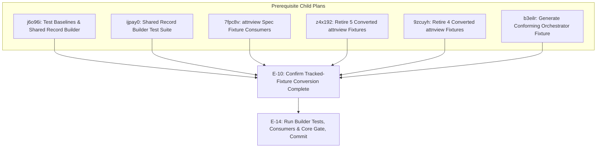

# IPD: Add the shared test record builder and convert the tracked record fixtures

- Date: 2026-11-07
- Kind: child
- Concern: Spec `4sd62s` section 6 requires that test data be written by ONE shared record builder in phase B, so that the cutover (Order 13) changes the builder and not hundreds of test files. Measured 2026-11-07 at `ac76110f4`: 323 Python files under `tests/` carry 6,820 F-01 legacy lines, 92 private record-building helpers live in 62 test modules, `support.ready_plan_text` has 30 calls in 15 modules, and 26 tracked `.md` fixtures carry `- Id:` or `- Status:` bullets. Part 1 of the split of `59aiyh` (Order 10): this part captures every baseline, builds and tests the builder, and converts the tracked fixtures; Orders 38 to 40 (`x05v02`, `7qxey9`, `nbfg7w`) move the test modules onto it in subsets of at most 25 modules each.
- Scope: FINISHING PART after the round-3 split (2026-11-09, research `nj8zdp` guidance): confirm the tracked-fixture conversion (E-10, reduced) and run, commit (E-14). The baselines and builder moved to `j6o96i`, the builder tests to `ijpay0`, the fixture conversions to `7fpc8v`, `z4x192`, `9zcuyh` and `b3eilr`. Before the round-3 split: `59aiyh` E-13 (baselines), E-01 (the builder), E-02 (its tests) and E-10 (tracked `.md` fixtures), carried verbatim with their original ids so their cross-references stay valid, plus a finishing commit item E-14. EXCLUDES: every test-module batch (Orders 38 to 40 and `59aiyh` E-09); the switch-point proof, the F-06 census and the full-suite comparison (`59aiyh` E-11, E-12); changing production code; the review-pilot corpus (`tests/fixtures/review-pilot/plans/`, kept literal); the log format (Order 13).
- Scope-Paths: .aw/records/plans/pending/20261107-metastore-37-9rgn2w-add-the-shared-test-record-builder-and-convert-the-tracked-r.ipd.md
- Item-Dependencies: executed:g5hpbb, executed:tve77h, executed:xexn45, executed:j6o96i, executed:ijpay0, executed:7fpc8v, executed:z4x192, executed:9zcuyh, executed:b3eilr
- Status: approved
- Readiness: go-pending-approval
- Review-Depth: complex
- From-Spec: 4sd62s
- Work-Kind: feature
- Priority: high
- Blocks-Release: next
- Set: metastore
- Order: 37
- Highest E allocated: 14
- Author: opencode its_direct/pt3-claude-opus-5.5-1m-us
- Id: 9rgn2w
- Approval: 2026-11-16, recorded via aw ipd set: status set to approved

## Workflow history
- 2026-11-16 approved (aw set): status set to approved

- 2026-11-14 reviewed (antigravity/gemini): APPROVE WITH REVISIONS APPLIED; PR-001..PR-003 FIXED
- 2026-11-09 note (opencode its_direct/pt3-claude-opus-5.5-1m-us): round-3 split per research nj8zdp; items E-13, E-01, E-02 and the conversions of E-10 moved to j6o96i, ijpay0, 7fpc8v, z4x192, 9zcuyh, b3eilr; E-10 reduced to the completeness check; Highest E allocated kept at 14.
- 2026-11-07 to-review (opencode its_direct/pt3-claude-opus-5.5-1m-us): split from 59aiyh per maintainer step-complexity rule (no single E/V item hides hundreds of steps).

## Goal

After the round-3 split this plan confirms that the family's builder, builder tests and fixture conversions (its six new parts) are complete. The family goal: One tested `tests/record_builder.py` exists that writes every record type through `artifact_meta`, `support.ready_plan_text` is a thin call into it with identical bytes, the tracked record fixtures that tests copy or lint are builder output, and every baseline the later parts compare against is captured before the first edit.

## Detailed Implementation Checklist (TODO)

Execution-state rule: mark an `E-*` item complete only after performing the action. That mark is not validation. Right-sizing rule: write for a modest executor that cannot hold much in its head. Each E-item is one step (one concern, about one file, executable in one focused pass) and its V-item names each unit it covers with its own check; a plan stays at about 5 E-items and 8 work Scope-Paths, else split it into more child plans (guidance, `IPD-Z603`). Accepted execution states: blocked, failed, pending, performed; terminal gate demands 'performed'.

Item ids E-01, E-02, E-10 and E-13 are the ids these items had in `59aiyh`; they are kept so that every reference between them (for example "E-13's `full-before.txt`", "the builder's `raw_fields=` escape (E-01)") still points at the right item. The batch-rule references to E-03 to E-09 inside the carried text mean the batch items of Orders 38 to 40 and `59aiyh` E-09. Round-3 split (2026-11-09, research `nj8zdp` guidance): E-13 and E-01 moved to Order 170 (`j6o96i`), E-02 to Order 171 (`ijpay0`), and the conversions of E-10 to Orders 174, 213, 214 and 217; their ids are unchanged there, so every cross-reference still resolves.

### Task group 1: confirm and finish

- [ ] E-10 (reduced by the round-3 split 2026-11-09, research `nj8zdp` guidance: the conversions moved to `7fpc8v`, `z4x192`, `9zcuyh` and `b3eilr`) Confirm the tracked-fixture conversion is complete. Re-derive the list with `git ls-files tests/fixtures tests/benchmark_fixtures | grep '\.md$' | xargs grep -l -E '^- (Id|Status):'` and require it to contain only the kept-literal sets: `tests/fixtures/attnview/violations/` (malformed legacy input, kept on purpose) and `tests/fixtures/review-pilot/plans/` (read by `tools/review_pilot.py` by `manifest.json` filename as a frozen corpus whose `defects.json` entries quote exact text, so its tracked files must exist and must not change; Order 13 decides its fate). Any other file is converted here by the recipe of its moving plan.
  - Depends on: none
  - Expected outcome: the re-derived list is exactly the 7 `violations` files that carry the bullets and the 9 `review-pilot/plans` files; the converted and kept lists, each with its reason, are pasted.
  - Execution state: pending

- [ ] E-14 Finish this part: run `python3 -m pytest -o addopts="" -n 0 -v tests/test_record_builder.py`, the consuming modules `tests/test_attention_contract.py`, `tests/test_specs_verbs.py`, `tests/test_specs_releases_unsafe_field.py`, `tests/test_ipd_lint.py`, `tests/test_ipd_schema.py`, and the bare core gate `python3 -m pytest`, and commit through `aw commit 9rgn2w -- <each changed path>`, never `git add -A`, a bare `git add` or `git commit -a`. Never push. (The original's full-suite comparison stays in `59aiyh` E-12.)
  - Depends on: E-10
  - Expected outcome: all runs pass; every commit is path-scoped to Scope-Paths (or justified at finalize).
  - Execution state: pending

Add further leaves as `- [ ] E-NEW <action>` and run `aw ipd sync` to assign ids.

## Project conventions discovered (Step 0)

- Interface names from Order 02 (`tve77h`): `artifact_meta.registry_fields(type)`, `artifact_meta.validate_event`, `artifact_meta.validate_new_events(type, events, *, records_root, migration_import=False)`, `artifact_meta.read(id6) -> State`, `artifact_meta.create(...)` and `artifact_meta.append(id6, events, *, expect_seq)`. Order 02's `create`/`append` write the log format; `2xwb9b` E-03 adds the phase-B legacy branch of `append` and `xexn45` E-01 routes the phase-B branch of `create` and `append` through `write_legacy`, with `render_legacy_text(text, events)` (`xexn45` E-11) as the same renderer over a string. In phase B the on-disk format is the bullet format; the legacy loader reads it into the cache.
- `review_findings.render_review` (pure) and `review_findings.write_review` render and write a `.review.md` record; no CLI calls `write_review` (`xexn45` Findings).
- The existing shared plan builder is `support.ready_plan_text`, which is "BUILT FROM THE REAL GENERATOR (`ipd_authoring.build_skeleton`)" and then fills the fields a draft leaves open; the builder keeps that approach for plans, so a scaffold change still reaches every fixture.
- Shared test plumbing lives in `tests/support.py` (`init_repo`, `git`, `run_cli`, `pinned_env`, `ready_plan_text`, `scope_drift_repo`); `tests/repo_template.py` (`copy_template_repo`) gives a pre-built repository; there is no `tests/conftest.py`, and the root `conftest.py` owns tier selection.
- Tests are behavioral (AGENTS.md "TEST OUTCOMES, NOT CODE STRUCTURE"); core modules set `pytestmark = pytest.mark.core`; `slow` tests are listed in `tests/slow_allowlist.txt`; `pyproject.toml` `addopts` deselects `slow` and `livecorpus`, so a complete comparison passes `-m ""`, and `pytest-randomly` is installed, so a deterministic order needs `-p no:randomly`.
- `tests/fixtures/review-pilot/` is the input corpus of `tools/review_pilot.py` (`manifest.json` names each plan file, `defects.json` quotes exact text to plant), and `tests/test_review_pilot.py` copies the whole directory into its fixture repository.
- Filenames come from `artifact_naming.build_clustered_name` and parse with `artifact_naming.parse_clustered`.
- Cite code by SYMBOL (`module.function`) or by a quoted content string, with a line number only appended to one of those and never alone: an offset expires before this plan executes (spec `ipd-structure-and-linting` Section 10.2; advisory `IPD-C801`).

## Findings

Measured 2026-11-07 at `ac76110f4` (the split measurement); F-04, F-05 and F-09 copied from `59aiyh` (measured at review).

| Id | Evidence | Finding |
|---|---|---|
| F-01 | `rg -c --glob '*.py' -e '- (Id\|Status\|Set\|Kind\|Blocks-Release\|Readiness\|Item-Dependencies\|Scope-Paths\|From-Backlog\|From-Spec\|Work-Kind\|Priority\|Order\|Date\|Gate-Kind\|Gate-Ref\|Approval\|Subject-Id\|Verdict\|Graduated-To):\|## Workflow history' tests` lists 323 files with 6,820 lines (318 batch files after the 5 EXCLUDED `tests/test_artifact_meta_*.py` files) | Batch input for Orders 38 to 40 and `59aiyh` E-09. |
| F-04 | 92 matches of the E-09 helper pattern in 62 modules at `ac76110f4` (89 at review); `support.ready_plan_text` has 30 calls in 15 modules | E-13 captures the helper count; E-02 (d) covers every captured `ready_plan_text` argument set. |
| F-05 | 26 tracked `.md` fixtures carry `^- (Id\|Status):` (`fixtures/attnview/specs-valid` 9, `fixtures/attnview/violations` 7, `fixtures/review-pilot/plans` 9, `fixtures/conforming-orchestrator.md` 1; unchanged at `ac76110f4`); 8 test modules contain `aw-prompt` (7 at review); 60 `ipd_lint.lint_text(` calls in 11 test modules | The builder needs a text form and a prompt form; the review-pilot corpus stays literal (E-10). |
| F-09 | At review, in an empty installed fixture repository: `aw find plans` 0.47 s, `aw attention --format json` 2.4 s, `aw check all --agent` 0.9 s; `aw install` into a fresh repository 4.6 s | E-02's bound is 10 s with a stated fallback. |
| F-10 | (written by E-13, now in `j6o96i`) baseline summary for later parts | Read by `59aiyh` E-11 and E-12. |

## Proposed changes (ordered, validatable)

1. Confirm only the kept-literal fixture sets still carry record bullets (E-10).
2. Run the builder tests, the consumers and the core gate, commit (E-14).

## Deferred / out of scope (with reason)

- Moved to j6o96i (round-3 split 2026-11-09 per research nj8zdp guidance): E-13 (baselines and F-10) and E-01 (the builder, split into E-01, E-15 and E-16).
  - Carrier: j6o96i
  - Carrier-Evidence: .aw/records/plans/executed/20261109-metastore-170-j6o96i-capture-the-test-baselines-and-build-the-shared-test-record.ipd.md
- Moved to ijpay0 (round-3 split 2026-11-09 per research nj8zdp guidance): E-02 (the builder's test module, split into E-02 and E-18 to E-21).
  - Carrier: ijpay0
  - Carrier-Evidence: .aw/records/plans/executed/20261109-metastore-171-ijpay0-test-the-shared-test-record-builder.ipd.md
- Moved to 7fpc8v (round-3 split 2026-11-09 per research nj8zdp guidance): the consumer conversions of E-10 (attnview `specs-valid` readers).
  - Carrier: 7fpc8v
  - Carrier-Evidence: .aw/records/plans/executed/20261109-metastore-174-7fpc8v-move-the-attnview-spec-fixture-consumers-onto-the-record-bui.ipd.md
- Moved to z4x192 (round-3 split 2026-11-09 per research nj8zdp guidance): the deletion of five converted `specs-valid` fixtures from E-10.
  - Carrier: z4x192
  - Carrier-Evidence: .aw/records/plans/executed/20261109-metastore-213-z4x192-retire-five-converted-attnview-spec-fixtures.ipd.md
- Moved to 9zcuyh (round-3 split 2026-11-09 per research nj8zdp guidance): the deletion of four converted `specs-valid` fixtures and the README update from E-10.
  - Carrier: 9zcuyh
  - Carrier-Evidence: .aw/records/plans/executed/20261109-metastore-214-9zcuyh-retire-four-converted-attnview-spec-fixtures-and-update-the.ipd.md
- Moved to b3eilr (round-3 split 2026-11-09 per research nj8zdp guidance): the `support.CONFORMING_ORCHESTRATOR` conversion and fixture deletion from E-10.
  - Carrier: b3eilr
  - Carrier-Evidence: .aw/records/plans/executed/20261109-metastore-217-b3eilr-generate-the-conforming-orchestrator-fixture-from-the-shared.ipd.md
- The test-module batches G1 to G6 and the first half of G7.
  - Carrier: x05v02
- The switch-point proof, the F-06 census, the second half of G7 with the shared helpers, and the full-suite comparison.
  - Carrier: 59aiyh
- The review-pilot corpus stays literal legacy input.
  - Carrier: cxxmyv

## Scope check

- Over-scope: none. No production module changes.
- Under-scope: none known. Size after the round-3 split: 2 E-items, 0 work Scope-Paths of its own (E-10 converts a file only if a moving plan missed one, justified at finalize).

## Required tests / validation

New core test module: `tests/test_record_builder.py`. CONTRIBUTES to AC-1b (owned by `cxxmyv`) by supplying the single switch point. Commands: `tests/test_record_builder.py`, the E-10 consuming modules, the bare core gate `python3 -m pytest`.

## Spec / documentation sync

No spec change; implements the builder half of `4sd62s` section 6 and section 7 step 6.

## Open questions

### OQ-01: Which prior Orders does the builder depend on?

- Blocking: no
- Status: resolved
- Owner: plan-review (round 1 of `59aiyh`, decision D-1)
- Resolution or deferral rationale: `tve77h` and `xexn45` (and `g5hpbb`, added 2026-11-07), carried from `59aiyh` OQ-02: only `xexn45` gives `artifact_meta.create` a phase-B legacy branch (`write_legacy`) and adds `render_legacy_text`, so depending only on `tve77h` would force the builder to carry its own renderer. Recommendation strength: strong.

## Validation and cross-check (verify before reporting done)

Validation-state rule: inspect evidence in a separate pass. Do not mark a `V-*` item complete from memory or from the matching execution checkmark. Accepted validation results: blocked, failed, pass, pending; terminal gate demands 'pass'. Runtime-demonstration reachability rule: for each `V-*` item demanding the software be observed acting (such as a run, a dispatch, or a transition), as distinct from items demanding a diff, a file's content, or a test result, which are reachable by construction, name the code path that produces the observation or the sibling `E-*` that creates it, else the demand is UNDER-SCOPE.

- [ ] V-10 validates E-10
  - Required evidence: paste `git ls-files tests/fixtures tests/benchmark_fixtures | grep '\.md$' | xargs grep -l -E '^- (Id|Status):'` output; the converted list (each path with the plan that converted it: `z4x192`, `9zcuyh`, `b3eilr`) and the kept list (each path with its reason: the `violations` set and `review-pilot/plans`); and `git status --short tests/fixtures/review-pilot` printing nothing.
  - Observed evidence:
  - Result: pending

- [ ] V-14 validates E-14
  - Required evidence: paste the PASSED/FAILED counts of `tests/test_record_builder.py`, `tests/test_attention_contract.py`, `tests/test_specs_verbs.py`, `tests/test_specs_releases_unsafe_field.py`, `tests/test_ipd_lint.py` and `tests/test_ipd_schema.py` each, the bare `python3 -m pytest` summary line and wall time beside F-10's `core-before.txt` line (F-10 now lives in `j6o96i`), and every `aw commit 9rgn2w` output listing only Scope-Paths.
  - Observed evidence:
  - Result: pending

## Approval and execution gate

- Size assessment: standard
- Cohesion rationale: not required

Execute only after human approval (`Status: approved`) and after `g5hpbb`, `tve77h`, `xexn45`, `j6o96i`, `ijpay0`, `7fpc8v`, `z4x192`, `9zcuyh`, `b3eilr` are executed. OQ-01 is resolved.

Scope fence: the paths in `- Scope-Paths:` are a declaration. A needed test-tree file outside the fence is edited and then justified at finalize (`--scope-reason`), and a declared path left unmodified is acknowledged (`--scope-ack`). Production code under `agent_workflows/` and `tools/` is out of this plan's purpose: if the builder cannot be written without a production change, stop and report the missing capability.

Honesty rule: run `tests/test_record_builder.py`, the consuming modules and the bare `python3 -m pytest` core gate, and paste the ACTUAL output; never claim a result you did not run.

Commits: commit only through `aw commit 9rgn2w -- <paths>`; never `git add -A`, a bare `git add` or `git commit -a`; never push.

Lifecycle transition: the plan moves to `.aw/records/plans/executed/` only through `aw ipd finalize`, never a hand `git mv`, and only after `aw ipd lint --phase pre-transition` conforms and every `V-*` reads `pass` with pasted evidence. When `aw oc run` or `aw agy run` executes the plan, the runner performs the finalize; a hand executor runs `aw ipd finalize 9rgn2w` itself.
