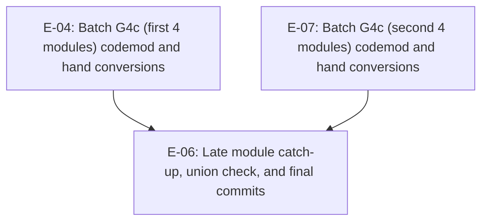

# IPD: Move spec, plan, lifecycle, orchestration and runner test data onto the record builder

- Date: 2026-11-07
- Kind: child
- Concern: Spec `4sd62s` section 6 requires that test data be written by ONE shared record builder in phase B, so that the cutover (Order 13) changes the builder and not hundreds of test files, and C10a requires the suite to pass at every commit. `59aiyh` (Order 10) carried the whole migration in seven batch items of 22 to 69 modules each, each hiding hundreds of edits. Measured 2026-11-07 at `ac76110f4`: this part's 81 test modules carry 1589 F-01 legacy lines and 26 private record-building helpers. Restructured 2026-11-08: each batch item runs the Order-49 codemod (`653ndz`) and hand-converts only the refusals its census (`653ndz` F-31) counts, so no item hides hundreds of hand edits. Part of the split of `59aiyh`; it uses the builder of Order 37 (`9rgn2w`).
- Scope: FINISHING PART after the round-3 split (2026-11-09, research `nj8zdp` guidance): 8 modules of subset G4c in two items of 4 (E-04, E-07) and the finishing item E-06, which also converts any module the partition now places in subsets G3b, G4a, G4b, G4c that no plan names. The other modules of subsets G3b, G4a, G4b, G4c moved to the chunk plans `jutivt`, `52rpc1`, `2zo3g5`, `qqaqw8`, `xxiou0`, `3k142n`, `2etvye`, `80p88l`, `qb3n9s`, `723ct1` (F-41). Before the round-3 split: Batch subsets G3b, G4a, G4b, G4c of `59aiyh`'s batch items, each a named list of at most 25 modules, plus a finishing item. Each subset runs the Order-49 codemod (`653ndz`) and hand-converts only its census-counted refusals. Every subset applies the batch rule below (the `59aiyh` batch rule restructured for the codemod). EXCLUDES: the builder and fixtures (Order 37, `9rgn2w`); every other subset (Orders 38 to 40 and `59aiyh`); the F-03 EXCLUDED modules; production code; the switch-point proof, census and full-suite comparison (`59aiyh` E-11, E-12).
- Scope-Paths: tests/test_orchestrator_shape_composed.py, tests/test_orchestrator_shape_gate.py, tests/test_orchestrator_status_gate.py, tests/test_partition.py, tests/test_partition_set_cohesion.py, tests/test_readiness_absence_invariant.py, tests/test_terminal_status_vocabulary.py, tests/test_unresolved_selector_near_match.py, .aw/records/plans/pending/20261107-metastore-39-7qxey9-move-spec-plan-lifecycle-orchestration-and-runner-test-data.ipd.md
- Item-Dependencies: executed:653ndz, executed:9rgn2w, executed:g5hpbb, executed:tve77h, executed:xexn45, executed:jutivt, executed:52rpc1, executed:2zo3g5, executed:qqaqw8, executed:xxiou0, executed:3k142n, executed:2etvye, executed:80p88l, executed:qb3n9s, executed:723ct1
- Status: approved
- Readiness: go-pending-approval
- Review-Depth: standard
- From-Spec: 4sd62s
- Work-Kind: feature
- Priority: high
- Blocks-Release: next
- Set: metastore
- Order: 39
- Highest E allocated: 07
- Author: opencode its_direct/pt3-claude-opus-5.5-1m-us
- Id: 7qxey9
- Approval: 2026-11-16, recorded via aw ipd set: status set to approved

> Written to .aw/system/workflows/technical-writing/technical-writing.md. Every obligation, exact identifier, quotation, evidence record, and lifecycle status is preserved.

## Workflow history
- 2026-11-16 approved (aw set): status set to approved

- 2026-11-14 /plan-review (antigravity/gemini-3.8-flash): APPROVE WITH REVISIONS APPLIED; PR-001..PR-005 FIXED; review record .aw/records/reviews/20261107-metastore-39-7qxey9-move-spec-plan-lifecycle-orchestration-and-runner-test-data.review.md
- 2026-11-14 reviewed (aw set): APPROVE WITH REVISIONS APPLIED; PR-001..PR-005 FIXED
- 2026-11-09 note (opencode its_direct/pt3-claude-opus-5.5-1m-us): round-3 split per research nj8zdp; items E-01, E-02, E-03 and 7 to 14 modules of E-04 moved to jutivt, 52rpc1, 2zo3g5, qqaqw8, xxiou0, 3k142n, 2etvye, 80p88l, qb3n9s, 723ct1; kept 8 modules of G4c as E-04 and E-07; Highest E allocated raised to 07.
- 2026-11-08 note (opencode its_direct/pt3-claude-opus-5.5-1m-us): restructured per maintainer decision 2026-11-07 ("Codemod first, then small runs"); batch items E-01 to E-04 now run the Order-49 codemod 653ndz and hand-convert only its census-counted refusals; item E-05 (subset G5a) moved to 1upea0; added executed:653ndz.
- 2026-11-07 to-review (opencode its_direct/pt3-claude-opus-5.5-1m-us): split from 59aiyh per maintainer step-complexity rule (no single E/V item hides hundreds of steps).

## Goal

After the round-3 split this plan converts 8 modules of subset G4c and closes subsets G3b, G4a, G4b, G4c once its chunk plans are executed. The family goal: Every hand-built record in this part's 81 test modules comes from `tests/record_builder.py`, with each module's per-test outcomes identical before and after and every remaining legacy string classified.

## Detailed Implementation Checklist (TODO)

Execution-state rule: mark an `E-*` item complete only after performing the action. That mark is not validation. Right-sizing rule: write for a modest executor that cannot hold much in its head. Each E-item is one step (one concern, about one file, executable in one focused pass) and its V-item names each unit it covers with its own check; a plan stays at about 5 E-items and 8 work Scope-Paths, else split it into more child plans (guidance, `IPD-Z603`). Accepted execution states: blocked, failed, pending, performed; terminal gate demands 'performed'.

Split note (round 3, 2026-11-09, research `nj8zdp` guidance): items E-01, E-02, E-03 and all but 8 modules of E-04 moved to the chunk plans named in F-41 and in `## Deferred / out of scope`; this plan keeps 8 modules of subset G4c as E-04 and E-07 (4 each) and the finishing item E-06.

Batch rule, applied to every batch E-item of this plan (the `59aiyh` batch rule, restructured 2026-11-08 for the Order-49 fixture codemod `653ndz` per maintainer decision 2026-11-07 "Codemod first, then small runs": the tool performs the mechanical rewrite, and the hand work is bounded by its measured refusals). In it, "E-13's `full-before.txt`" and "the builder's `raw_fields=` escape (E-01)" are items of Order 37 (`9rgn2w`), carried by the round-3 split into Order 170 (`j6o96i`) with the same ids; because `.aw/state/` does not travel between lane worktrees, step 2 always records a fresh before list here. Step 1's partition is restricted to the modules each batch item names (round-3 split 2026-11-09: a subset is now spread over several plans of at most 8 modules each): a module that the partition now places in the item's subset but that no plan names is NOT added here; it is reported, and the finishing item of `7qxey9` converts it; a named module that no longer matches F-01 is reported and skipped:
1. Before the batch, ensure directory `.aw/state/59aiyh/` exists (`mkdir -p .aw/state/59aiyh`), re-derive its file list with the F-03 first-match partition over the F-01 `rg -l` output at the current HEAD, minus the F-03 EXCLUDED list, and save it as `.aw/state/59aiyh/<batch>-files.txt`. The counts in each E-item are context measured at `0cbfcc706` or `ac76110f4`, not the bar.
2. Record the unmodified per-test outcome list (a batch whose files a previous batch did not touch may reuse the matching lines of E-13's `full-before.txt`): `python3 -m pytest -o addopts="" -m "" -p no:randomly -n 0 -rA $(cat .aw/state/59aiyh/<batch>-files.txt) | grep -E "^(PASSED|FAILED|ERROR|SKIPPED|XFAIL|XPASS) " | sed -E 's/ - .*//' | sort > .aw/state/59aiyh/<batch>-before.txt`. `-p no:randomly` and `-n 0` make the list deterministic; `-m ""` includes `slow` and `livecorpus` modules.
3. Run the codemod: `python3 tools/fixture_codemod.py --apply --format json $(cat .aw/state/59aiyh/<batch>-files.txt) > .aw/state/59aiyh/<batch>-codemod.json`. It rewrites only the sites whose module outcome list it proved identical (`653ndz` E-03, carried with the same id into Order 172, `y3uowx`, by the round-3 split) and lists every other site as a refusal with a reason code and a disposition (`hand` or `legacy-kept`, the `653ndz` reason-code table).
4. Hand-convert ONLY the refusals with disposition `hand`: the static count is the sum of the `653ndz` F-30 rows of the item's modules (round-3 split 2026-11-09: an item now carries part of a subset, so the subset's F-31 row is context only), and the codemod report adds any apply-time `not-equivalent` refusals; the item's hand count is their sum. If the hand count exceeds 25, stop after step 3 (the proved codemod rewrites may be committed), convert nothing by hand, and report the subset for re-splitting. A hand conversion uses builder calls; a test that deliberately writes an INVALID value (an unknown status, `- Status: EXECUTED`, `- Priority: bogus`, a malformed gate) gets it through the builder's `raw_fields=` escape (E-01) and is listed with reason class `invalid-input`. A refusal with disposition `legacy-kept` stays in legacy form on purpose and is listed with its F-06 reason class.
5. Re-run step 2's command into `<batch>-after.txt` and require `diff` to print nothing. A batch that would need any changed assertion other than a raw-byte metadata stand-in moved to `artifact_meta.read` (scope rule) stops and is reported; it does not weaken the assertion.
6. Count the remaining legacy strings with the F-01 `rg` pattern over the batch files, and give each remaining line one reason class from F-06: `legacy-format subject`, `displayed-output assertion`, `setter-byte assertion`, `invalid-input`, or `body prose` (for example open-question `- Status: open` rows, which N3 keeps in Markdown).
7. The builder never reads production source, and no test gains a source-reading assertion.

### Task group 1: kept batch items

- [ ] E-04 (kept from this plan's E-04, batch subset G4c, round-3 split 2026-11-09: its first 4 of the 8 modules this plan keeps; the other 14 modules of G4c moved to the chunk plans named in F-41) Batch G4c, 4 of its 22 modules (the orchestration, coverage, readiness and partition tests (`test_orchestrator*`, `test_coverage*`, `test_gradcover*`, `test_readiness*`, `test_partition*`, `test_unresolved*`, `test_terminal*`, `test_implementing*`)): `tests/test_orchestrator_shape_composed.py`, `tests/test_orchestrator_shape_gate.py`, `tests/test_orchestrator_status_gate.py`, `tests/test_partition.py`. F-01 legacy lines per module at `3d0ddb845` (context, not the bar): `test_orchestrator_shape_composed` 9, `test_orchestrator_shape_gate` 71, `test_orchestrator_status_gate` 29, `test_partition` 82. Run the codemod on these modules and apply the batch rule with `<batch>` = `G4c-7qxey9-04` (outcome lists identical); hand-convert ONLY the refusals that the `653ndz` F-30 rows of these modules list with disposition `hand`, plus the codemod's apply-time `not-equivalent` refusals, and state their count (at most 25, the batch rule's stop); leave each refusal the census marks `legacy-kept` in legacy form with its reason class. Open-question rows (`- Blocking:`, `- Status: open`, `- Carrier:`) are body prose (N3) and are written through the builder's `body=` or `open_questions=` argument, never as metadata. Then delete each private record-building helper in these modules that no longer has a caller (at the split: `tests/test_partition.py`: `make_item`); a surviving helper is listed with its reason.
  - Depends on: none
  - Expected outcome: an empty before/after `diff` for the `G4c-7qxey9-04` outcome lists; for each named module, its remaining legacy-string count and the reason class of every remaining line pasted; every deleted and surviving helper listed; the codemod report and the hand count (at most 25) pasted.
  - Execution state: pending

- [ ] E-07 (kept from this plan's E-04, batch subset G4c, round-3 split 2026-11-09: its second 4 of the 8 modules this plan keeps; the other 14 modules of G4c moved to the chunk plans named in F-41) Batch G4c, 4 of its 22 modules (the orchestration, coverage, readiness and partition tests (`test_orchestrator*`, `test_coverage*`, `test_gradcover*`, `test_readiness*`, `test_partition*`, `test_unresolved*`, `test_terminal*`, `test_implementing*`)): `tests/test_partition_set_cohesion.py`, `tests/test_readiness_absence_invariant.py`, `tests/test_terminal_status_vocabulary.py`, `tests/test_unresolved_selector_near_match.py`. F-01 legacy lines per module at `3d0ddb845` (context, not the bar): `test_partition_set_cohesion` 9, `test_readiness_absence_invariant` 24, `test_terminal_status_vocabulary` 1, `test_unresolved_selector_near_match` 1. Run the codemod on these modules and apply the batch rule with `<batch>` = `G4c-7qxey9-07` (outcome lists identical); hand-convert ONLY the refusals that the `653ndz` F-30 rows of these modules list with disposition `hand`, plus the codemod's apply-time `not-equivalent` refusals, and state their count (at most 25, the batch rule's stop); leave each refusal the census marks `legacy-kept` in legacy form with its reason class. Open-question rows (`- Blocking:`, `- Status: open`, `- Carrier:`) are body prose (N3) and are written through the builder's `body=` or `open_questions=` argument, never as metadata. These modules held no private record-building helper at the split; a helper found now is deleted when it has no caller, or listed with its reason.
  - Depends on: none
  - Expected outcome: an empty before/after `diff` for the `G4c-7qxey9-07` outcome lists; for each named module, its remaining legacy-string count and the reason class of every remaining line pasted; every deleted and surviving helper listed; the codemod report and the hand count (at most 25) pasted.
  - Execution state: pending

### Task group 2: finish

- [ ] E-06 Finish this part: (1) re-derive the F-03 first-match partition for subsets G3b, G4a, G4b, G4c over the F-01 `rg -l` output at the current HEAD, minus the F-03 EXCLUDED list, and compare it with the union of the module lists in F-41 (the chunk plans' items and this plan's E-04 and E-07); convert every module that the partition places in these subsets but that no list names under the batch rule with `<batch>` = `7qxey9-late` (if there are more than 8, stop and report them for re-splitting); (2) run the batch rule's step-2 command once over `$(cat .aw/state/59aiyh/G4c-7qxey9-04-files.txt .aw/state/59aiyh/G4c-7qxey9-07-files.txt)` into `.aw/state/59aiyh/7qxey9-union-after.txt` and confirm it equals the sorted concatenation of the two items' `-before.txt` lists; (3) run the bare core gate `python3 -m pytest` and `aw sanitize --agent`; commit through `aw commit 7qxey9 -- <each changed path>`, one commit per item allowed, never `git add -A`, a bare `git add` or `git commit -a`. Never push. (The cross-subset full-suite comparison stays in `59aiyh` E-12, because the chunk plans' `-before.txt` lists live in their own lane worktrees.)
  - Depends on: E-04, E-07
  - Expected outcome: the partition comparison lists every late module (or none) and each one converted; the union comparison is empty; all runs pass; every commit is path-scoped to Scope-Paths (or justified at finalize).
  - Execution state: pending

Add further leaves as `- [ ] E-NEW <action>` and run `aw ipd sync` to assign ids.

## Project conventions discovered (Step 0)

- Interface names from Order 02 (`tve77h`): `artifact_meta.registry_fields(type)`, `artifact_meta.validate_event`, `artifact_meta.validate_new_events(type, events, *, records_root, migration_import=False)`, `artifact_meta.read(id6) -> State`, `artifact_meta.create(...)` and `artifact_meta.append(id6, events, *, expect_seq)`. Order 02's `create`/`append` write the log format; `2xwb9b` E-03 adds the phase-B legacy branch of `append` and `xexn45` E-01 routes the phase-B branch of `create` and `append` through `write_legacy`, with `render_legacy_text(text, events)` (`xexn45` E-11) as the same renderer over a string. In phase B the on-disk format is the bullet format; the legacy loader reads it into the cache.
- `review_findings.render_review` (pure) and `review_findings.write_review` render and write a `.review.md` record; no CLI calls `write_review` (`xexn45` Findings).
- The existing shared plan builder is `support.ready_plan_text`, which is "BUILT FROM THE REAL GENERATOR (`ipd_authoring.build_skeleton`)" and then fills the fields a draft leaves open; the builder keeps that approach for plans, so a scaffold change still reaches every fixture.
- Shared test plumbing lives in `tests/support.py` (`init_repo`, `git`, `run_cli`, `pinned_env`, `ready_plan_text`, `scope_drift_repo`); `tests/repo_template.py` (`copy_template_repo`) gives a pre-built repository; there is no `tests/conftest.py`, and the root `conftest.py` owns tier selection.
- Tests are behavioral (AGENTS.md "TEST OUTCOMES, NOT CODE STRUCTURE"); core modules set `pytestmark = pytest.mark.core`; `slow` tests are listed in `tests/slow_allowlist.txt`; `pyproject.toml` `addopts` deselects `slow` and `livecorpus`, so a complete comparison passes `-m ""`, and `pytest-randomly` is installed, so a deterministic order needs `-p no:randomly`.
- `tests/fixtures/review-pilot/` is the input corpus of `tools/review_pilot.py` (`manifest.json` names each plan file, `defects.json` quotes exact text to plant), and `tests/test_review_pilot.py` copies the whole directory into its fixture repository.
- Filenames come from `artifact_naming.build_clustered_name` and parse with `artifact_naming.parse_clustered`.
- Cite code by SYMBOL (`module.function`) or by a quoted content string, with a line number only appended to one of those and never alone: an offset expires before this plan executes (spec `ipd-structure-and-linting` Section 10.2; advisory `IPD-C801`).

## Findings

Measured 2026-11-07 at `ac76110f4` for the subsets; F-01, F-03, F-06 and F-08 copied from `59aiyh` (measured at `0cbfcc706` and at review).

| Id | Evidence | Finding |
|---|---|---|
| F-01 | `rg -l --glob '*.py' -e '- (Id|Status|Set|Kind|Blocks-Release|Readiness|Item-Dependencies|Scope-Paths|From-Backlog|From-Spec|Work-Kind|Priority|Order|Date|Gate-Kind|Gate-Ref|Approval|Subject-Id|Verdict|Graduated-To):|## Workflow history' tests` lists 309 files (307 test modules, `support.py`, `conformance_matrix.py`) of 717 Python files; 6,638 matching lines. The narrower `- Id:`/`- Status:`/`## Workflow history` pattern: 300 files, 3,430 lines | Spec section 6 counted 268 of 680 files and 2,607 matches at round 2; the plan's pattern is broader (21 fields). |
| F-03 | Family split by filename prefix, re-measured at review (HEAD `4a7499289`, 311 files, 6,657 lines) with a FIRST-MATCH rule (a file goes to the first group, in order G1 to G6, whose pattern list matches its basename; unmatched files go to G7): G1 39 files, 1,568 lines; G2 22, 1,102; G3 28, 795; G4 63, 1,244; G5 46, 598; G6 69, 1,004; G7 44, 346. Six files match two groups and are assigned by that rule (`test_ipd_authoring` G3, `test_readiness_absence_invariant` G4, `test_runner_backlog_close_behavior` G1, `test_orchestrator_retire_closes_backlog` G1, `test_records_only_lane_rederive` G5, `test_ipdrunner_runagy_shim` G4). The authored counts (G6 99, G7 11) did not sum to the file total; the first-match rule makes the partition exhaustive and disjoint. EXCLUDED from every batch (literal legacy input is their subject; owned by other plans): `tests/test_artifact_meta_*.py` (`tve77h`, `2xwb9b`), `tests/test_artifact_meta_legacy_writer.py` and `tests/test_writers_*.py` (`xexn45`), `tests/test_m0001_*.py` and `tests/test_migrations_chain.py` (`dcerjg`, `ya4ee4`) | Seven batches (E-03 to E-09); G1, G4 and G6 carry a pre-measured split seam (OQ-01). |
| F-06 | (written by E-11) remaining legacy strings in `tests/` after the batches, each with one reason class: `legacy-format subject`, `displayed-output assertion`, `setter-byte assertion`, `invalid-input`, `body prose` | Order 13 changes the builder plus the F-06 rows of class `setter-byte assertion`; `invalid-input` rows already go through `raw_fields=` and need a decision at the cutover (an invalid bullet has no log-format equivalent); every other class is either a legacy-format test (moved to the migration tests at the cutover) or prose. |
| F-08 | At review, 15 test modules write a deliberately invalid metadata value (for example `tests/test_releases.py` "`- Status: bogus`", `tests/test_check_engine.py` "`- Status: EXECUTED`", `tests/test_specs_set_adapter.py` "`- Priority: bogus`") | A builder that validates every field cannot build these; E-01 adds `raw_fields=` and the batch rule lists them as `invalid-input`. |
| F-11 | Subsets of this part, by the F-03 first-match rule at `ac76110f4`, each split from its group by basename pattern so no item exceeds 25 modules | See the table below. |

| Subset | Modules | Count | F-01 lines | Helpers |
|---|---|---|---|---|
| G3b | spec tests (`test_spec*`, `test_specs*`) | 18 | 345 | 8 |
| G4a | plan, lint and IPD tests (`test_ipd*`, `test_plan*`, `test_plans*`) | 21 | 403 | 7 |
| G4b | finalize, lifecycle, scope, executed-gate, question and dependency tests (`test_finalize*`, `test_lifecycle*`, `test_scope*`, `test_executed*`, `test_exec*`, `test_question*`, `test_dependency*`) | 20 | 318 | 3 |
| G4c | orchestration, coverage, readiness and partition tests (`test_orchestrator*`, `test_coverage*`, `test_gradcover*`, `test_readiness*`, `test_partition*`, `test_unresolved*`, `test_terminal*`, `test_implementing*`) | 22 | 523 | 8 |

F-41 (round-3 split 2026-11-09, research `nj8zdp` guidance; module basenames under `tests/`, each `.py`): where each of this plan's 81 modules now lives. Every module is in exactly one row; the union is the module set of the 2026-11-07 split, checked by script.

| Plan | Subset | Count | Modules |
|---|---|---|---|
| `jutivt` (Order 182) | G3b | 8 | `test_spec_citation_anchors`, `test_spec_edit_ack_gate`, `test_spec_id6_filenames`, `test_spec_production`, `test_spec_review_attestation`, `test_spec_review_dispatch`, `test_spec_review_gate_kind`, `test_specs_date_containment` |
| `52rpc1` (Order 183) | G3b | 8 | `test_specs_evidence_gate_parity`, `test_specs_from_backlog`, `test_specs_metadata_duplicate_bullet`, `test_specs_recursive_read`, `test_specs_releases_descriptive_safety`, `test_specs_releases_unsafe_field`, `test_specs_set_adapter`, `test_specs_set_gate_parity` |
| `2zo3g5` (Order 184) | G3b | 2 | `test_specs_status_dirs`, `test_specs_verbs` |
| `2zo3g5` (Order 184) | G4a | 6 | `test_ipd_dependency_check`, `test_ipd_dependency_statement_gate`, `test_ipd_exec_finding_codes`, `test_ipd_lifecycle_backward_edges`, `test_ipd_lifecycle_cli`, `test_ipd_lint` |
| `qqaqw8` (Order 185) | G4a | 7 | `test_ipdrunner_runagy_shim`, `test_ipd_schema`, `test_ipd_set_executor`, `test_ipd_set_plan`, `test_plan_priority_required`, `test_plan_readiness_recheck`, `test_plans_archive` |
| `xxiou0` (Order 186) | G4a | 7 | `test_plans_archive_selectors`, `test_plans_board`, `test_plans_group_order_preservation`, `test_plans_index`, `test_plans_order_grammar`, `test_plans_rename_selectors`, `test_plan_status` |
| `3k142n` (Order 187) | G4a | 1 | `test_plan_transition_gate` |
| `3k142n` (Order 187) | G4b | 6 | `test_dependency_block_reporting`, `test_executed_transition_gate_e2e`, `test_executed_transition_gate`, `test_finalize_refusal_findings`, `test_finalize_sendback`, `test_finalize_stale_plan_path` |
| `2etvye` (Order 188) | G4b | 7 | `test_lifecycle_gate_coverage`, `test_lifecycle_holder_gate`, `test_lifecycle_style`, `test_question_carrier`, `test_question_drain`, `test_question_inbox`, `test_question_parking` |
| `80p88l` (Order 189) | G4b | 7 | `test_question_preflight`, `test_question_resume`, `test_question_visibility`, `test_scope_drift_lane_resolution`, `test_scope_match`, `test_scope_paths_status_agnostic`, `test_scope_path_target_stale` |
| `qb3n9s` (Order 190) | G4c | 7 | `test_coverage_not_written`, `test_coverage_record`, `test_gradcover_end_to_end`, `test_implementing_spec_replan`, `test_orchestrator_child_retired`, `test_orchestrator_kind_derivation`, `test_orchestrator_not_approved_reason` |
| `723ct1` (Order 191) | G4c | 7 | `test_orchestrator_probe_payload`, `test_orchestrator_probe_quotes`, `test_orchestrator_probe_scope`, `test_orchestrator_readiness`, `test_orchestrator_refusal_reason_translation`, `test_orchestrator_retirement`, `test_orchestrator_row_grammar_source` |
| this plan, E-04 | G4c | 4 | `test_orchestrator_shape_composed`, `test_orchestrator_shape_gate`, `test_orchestrator_status_gate`, `test_partition` |
| this plan, E-07 | G4c | 4 | `test_partition_set_cohesion`, `test_readiness_absence_invariant`, `test_terminal_status_vocabulary`, `test_unresolved_selector_near_match` |

## Proposed changes (ordered, validatable)

1. Convert batch G4c modules (E-04, E-07): Apply the batch rule to convert the 8 kept test modules using the fixture codemod `tools/fixture_codemod.py` and hand-converting census-counted refusals, verifying identical outcome lists and classifying remaining legacy lines.
2. Finish and assemble (E-06): Re-derive the F-03 partition across subsets G3b, G4a, G4b, and G4c to convert any late unassigned modules, verify the union of batch test outcomes, validate with pytest and leak sanitizer, and commit through `aw commit 7qxey9`.

## Deferred / out of scope (with reason)

- Moved to jutivt (round-3 split 2026-11-09 per research nj8zdp guidance): 8 modules of subset G3b (items E-01; F-41 names each module).
  - Carrier: jutivt
  - Carrier-Evidence: .aw/records/plans/executed/20261109-metastore-182-jutivt-move-spec-plan-lifecycle-and-orchestration-test-data-chunk-1.ipd.md
- Moved to 52rpc1 (round-3 split 2026-11-09 per research nj8zdp guidance): 8 modules of subset G3b (items E-01; F-41 names each module).
  - Carrier: 52rpc1
  - Carrier-Evidence: .aw/records/plans/executed/20261109-metastore-183-52rpc1-move-spec-plan-lifecycle-and-orchestration-test-data-chunk-2.ipd.md
- Moved to 2zo3g5 (round-3 split 2026-11-09 per research nj8zdp guidance): 8 modules of subsets G3b, G4a (items E-01, E-02; F-41 names each module).
  - Carrier: 2zo3g5
- Moved to qqaqw8 (round-3 split 2026-11-09 per research nj8zdp guidance): 7 modules of subset G4a (items E-02; F-41 names each module).
  - Carrier: qqaqw8
- Moved to xxiou0 (round-3 split 2026-11-09 per research nj8zdp guidance): 7 modules of subset G4a (items E-02; F-41 names each module).
  - Carrier: xxiou0
  - Carrier-Evidence: .aw/records/plans/executed/20261109-metastore-186-xxiou0-move-spec-plan-lifecycle-and-orchestration-test-data-chunk-5.ipd.md
- Moved to 3k142n (round-3 split 2026-11-09 per research nj8zdp guidance): 7 modules of subsets G4a, G4b (items E-02, E-03; F-41 names each module).
  - Carrier: 3k142n
- Moved to 2etvye (round-3 split 2026-11-09 per research nj8zdp guidance): 7 modules of subset G4b (items E-03; F-41 names each module).
  - Carrier: 2etvye
  - Carrier-Evidence: .aw/records/plans/executed/20261109-metastore-188-2etvye-move-spec-plan-lifecycle-and-orchestration-test-data-chunk-7.ipd.md
- Moved to 80p88l (round-3 split 2026-11-09 per research nj8zdp guidance): 7 modules of subset G4b (items E-03; F-41 names each module).
  - Carrier: 80p88l
  - Carrier-Evidence: .aw/records/plans/executed/20261109-metastore-189-80p88l-move-spec-plan-lifecycle-and-orchestration-test-data-chunk-8.ipd.md
- Moved to qb3n9s (round-3 split 2026-11-09 per research nj8zdp guidance): 7 modules of subset G4c (items E-04; F-41 names each module).
  - Carrier: qb3n9s
- Moved to 723ct1 (round-3 split 2026-11-09 per research nj8zdp guidance): 7 modules of subset G4c (items E-04; F-41 names each module).
  - Carrier: 723ct1
- Batch subset G5a (the runner, lane and merge tests, carried from `59aiyh` E-07): Moved to 1upea0 (restructuring 2026-11-08 per maintainer decision "Codemod first, then small runs"; at most 4 batch items per plan).
  - Carrier: 1upea0
- The fixture codemod and its census (F-30, F-31).
  - Carrier: 653ndz
  - Carrier-Evidence: .aw/records/plans/executed/20261108-metastore-49-653ndz-build-and-prove-the-test-fixture-codemod.ipd.md
- The builder, its tests, the baselines and the tracked fixtures.
  - Carrier: 9rgn2w
  - Carrier-Evidence: .aw/records/plans/executed/20261107-metastore-37-9rgn2w-add-the-shared-test-record-builder-and-convert-the-tracked-r.ipd.md
- The remaining subsets, the switch-point proof, the F-06 census and the full-suite comparison.
  - Carrier: 59aiyh
- Adding `RECORD_FORMAT = "log"` and converting setter-byte assertions (cutover commit).
  - Carrier: cxxmyv

## Scope check

- Over-scope: none. No production module changes; every work Scope-Paths entry is a module named in E-04 or E-07.
- Under-scope: none known. Size after the round-3 split: 3 E-items (two batch items of 4 modules each and the finish), 8 work Scope-Paths. The late-module catch-up in E-06 may touch a module outside Scope-Paths; it is justified at finalize (`--scope-reason`).

## Required tests / validation

Each subset is validated by an identical per-test result list before and after (the batch rule), which is behavioral by construction: the same tests, unchanged assertions, the same outcomes. Commands: the batch rule's command per subset, the bare core gate `python3 -m pytest`, `aw sanitize --agent`. CONTRIBUTES to AC-1b (owned by `cxxmyv`).

## Spec / documentation sync

No spec change; implements part of `4sd62s` section 6 and section 7 step 6.

## Open questions

### OQ-01: Can the subsets of this part run in any order?

- Blocking: no
- Status: resolved
- Owner: plan author
- Resolution or deferral rationale: Yes. The kept items and the chunk plans (F-41) are disjoint module lists, each needs only the builder (`9rgn2w`) and the codemod (`653ndz`), and none edits `tests/support.py` (that is `59aiyh` E-09). This plan depends on its chunk plans only so that E-06's late-module catch-up sees their conversions. Recommendation strength: strong.

## Validation and cross-check (verify before reporting done)

Validation-state rule: inspect evidence in a separate pass. Do not mark a `V-*` item complete from memory or from the matching execution checkmark. Accepted validation results: blocked, failed, pass, pending; terminal gate demands 'pass'. Runtime-demonstration reachability rule: for each `V-*` item demanding the software be observed acting (such as a run, a dispatch, or a transition), as distinct from items demanding a diff, a file's content, or a test result, which are reachable by construction, name the code path that produces the observation or the sibling `E-*` that creates it, else the demand is UNDER-SCOPE.

- [ ] V-04 validates E-04
  - Required evidence: paste `.aw/state/59aiyh/G4c-7qxey9-04-files.txt` and the empty `diff .aw/state/59aiyh/G4c-7qxey9-04-before.txt .aw/state/59aiyh/G4c-7qxey9-04-after.txt`; then, for each of `tests/test_orchestrator_shape_composed.py`, `tests/test_orchestrator_shape_gate.py`, `tests/test_orchestrator_status_gate.py`, `tests/test_partition.py` separately: its before and after F-01 `rg -c` count, the reason class of every remaining match, its rows of `.aw/state/59aiyh/G4c-7qxey9-04-codemod.json` (rewrites, refusals by reason code and disposition, before and after outcome-list hashes) and its `653ndz` F-30 row; the hand count with every hand-converted site listed (module, line, reason code); and the before and after helper census of the E-09 `rg` pattern over these modules with each deleted and surviving helper and its reason.
  - Observed evidence:
  - Result: pending

- [ ] V-07 validates E-07
  - Required evidence: paste `.aw/state/59aiyh/G4c-7qxey9-07-files.txt` and the empty `diff .aw/state/59aiyh/G4c-7qxey9-07-before.txt .aw/state/59aiyh/G4c-7qxey9-07-after.txt`; then, for each of `tests/test_partition_set_cohesion.py`, `tests/test_readiness_absence_invariant.py`, `tests/test_terminal_status_vocabulary.py`, `tests/test_unresolved_selector_near_match.py` separately: its before and after F-01 `rg -c` count, the reason class of every remaining match, its rows of `.aw/state/59aiyh/G4c-7qxey9-07-codemod.json` (rewrites, refusals by reason code and disposition, before and after outcome-list hashes) and its `653ndz` F-30 row; the hand count with every hand-converted site listed (module, line, reason code); and the before and after helper census of the E-09 `rg` pattern over these modules with each deleted and surviving helper and its reason.
  - Observed evidence:
  - Result: pending

- [ ] V-06 validates E-06
  - Required evidence: paste the re-derived partition for G3b, G4a, G4b, G4c beside the F-41 union (a `diff` of the two sorted lists), each late module with its own before/after outcome `diff` (empty) and codemod summary, or the line `no late modules`; the `diff` of the sorted concatenation of the two items' `-before.txt` lists against `.aw/state/59aiyh/7qxey9-union-after.txt` (empty); the bare `python3 -m pytest` summary line and wall time; the `aw sanitize --agent` result with zero `fail`; and every `aw commit 7qxey9` output listing only Scope-Paths.
  - Observed evidence:
  - Result: pending

## Approval and execution gate

- Size assessment: standard
- Cohesion rationale: not required

Execute only after human approval (`Status: approved`) and after `653ndz`, `9rgn2w`, `g5hpbb`, `tve77h`, `xexn45`, `jutivt`, `52rpc1`, `2zo3g5`, `qqaqw8`, `xxiou0`, `3k142n`, `2etvye`, `80p88l`, `qb3n9s`, `723ct1` are executed. OQ-01 is resolved. Stop condition: stop safely without modifying files if prerequisite metastore symbols from `653ndz` or `9rgn2w` are missing, or if an unresolvable concurrent-edit conflict occurs. Shared-checkout safety: this plan edits only its Scope-Paths; do not stage, edit, or commit any other file.

Scope fence: the paths in `- Scope-Paths:` are a declaration. A needed test-tree file outside the fence is edited and then justified at finalize (`--scope-reason`), and a declared path left unmodified is acknowledged (`--scope-ack`). Production code under `agent_workflows/` and `tools/` is out of this plan's purpose: if a subset cannot keep its outcome list identical without a production change, stop that subset and report the missing capability rather than changing production code or an assertion.

Honesty rule: run the batch comparisons and the bare `python3 -m pytest` core gate, and paste the ACTUAL output; never claim a result you did not run.

Commits: commit only through `aw commit 7qxey9 -- <paths>` (one commit per item allowed); never `git add -A`, a bare `git add` or `git commit -a`; never push.

Lifecycle transition: the plan moves to `.aw/records/plans/executed/` only through `aw ipd finalize 7qxey9` (or runner-automated retirement upon validation; never a hand `git mv`), after `aw ipd lint --phase pre-transition` conforms and every `V-*` reads `pass` with pasted evidence.
