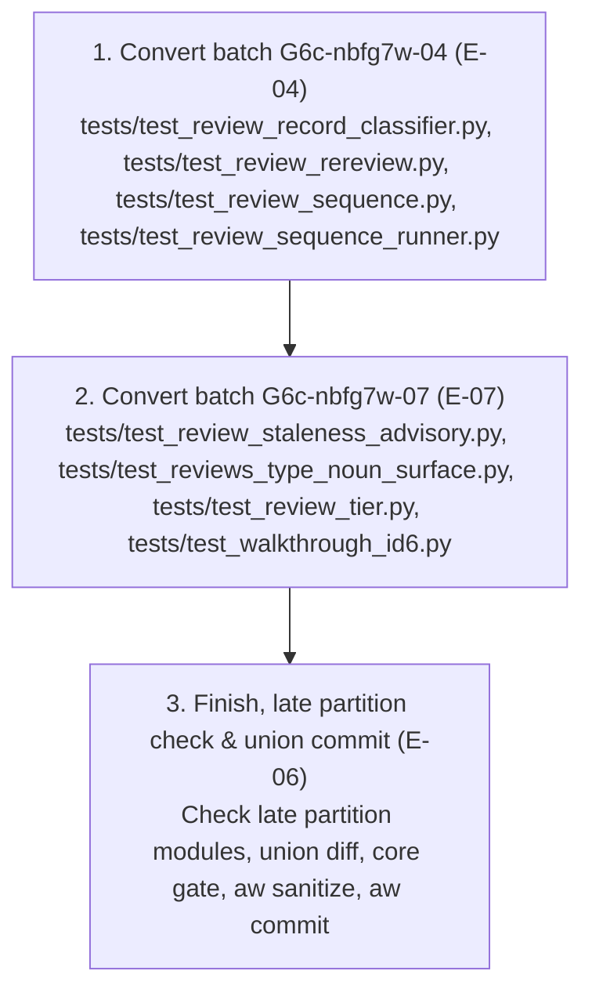

# IPD: Move runner-family, reader, record-surface, review and unmatched test data onto the record builder

- Date: 2026-11-07
- Kind: child
- Concern: Spec `4sd62s` section 6 requires that test data be written by ONE shared record builder in phase B, so that the cutover (Order 13) changes the builder and not hundreds of test files, and C10a requires the suite to pass at every commit. `59aiyh` (Order 10) carried the whole migration in seven batch items of 22 to 69 modules each, each hiding hundreds of edits. Measured 2026-11-07 at `ac76110f4`: this part's 94 test modules carry 1203 F-01 legacy lines and 25 private record-building helpers. Restructured 2026-11-08: each batch item runs the Order-49 codemod (`653ndz`) and hand-converts only the refusals its census (`653ndz` F-31) counts, so no item hides hundreds of hand edits. Part of the split of `59aiyh`; it uses the builder of Order 37 (`9rgn2w`).
- Scope: FINISHING PART after the round-3 split (2026-11-09, research `nj8zdp` guidance): 8 modules of subset G6c in two items of 4 (E-04, E-07) and the finishing item E-06, which also converts any module the partition now places in subsets G5b, G6a, G6b, G6c that no plan names. The other modules of subsets G5b, G6a, G6b, G6c moved to the chunk plans `i29bd5`, `v1t2ai`, `hp6ydi`, `lf0fe4`, `jjvnhb`, `f8jntm`, `a1b70x`, `j5mwpk`, `abf6yk`, `qjxcgf`, `0punmn` (F-41). Before the round-3 split: Batch subsets G5b, G6a, G6b, G6c of `59aiyh`'s batch items, each a named list of at most 25 modules, plus a finishing item. Each subset runs the Order-49 codemod (`653ndz`) and hand-converts only its census-counted refusals. Every subset applies the batch rule below (the `59aiyh` batch rule restructured for the codemod). EXCLUDES: the builder and fixtures (Order 37, `9rgn2w`); every other subset (Orders 38 to 40 and `59aiyh`); the F-03 EXCLUDED modules; production code; the switch-point proof, census and full-suite comparison (`59aiyh` E-11, E-12).
- Scope-Paths: tests/test_review_record_classifier.py, tests/test_review_rereview.py, tests/test_review_sequence.py, tests/test_review_sequence_runner.py, tests/test_review_staleness_advisory.py, tests/test_reviews_type_noun_surface.py, tests/test_review_tier.py, tests/test_walkthrough_id6.py, .aw/records/plans/pending/20261107-metastore-40-nbfg7w-move-runner-family-reader-record-surface-review-and-unmatche.ipd.md, tests/test_readers_attention.py, tests/test_readers_cache_parity.py, tests/test_readers_check_engine.py, tests/test_readers_ipd_lint.py, tests/test_readers_offline.py, tests/test_readers_read_at_gates.py, tests/test_readers_review_modules.py, tests/test_readers_runner.py, tests/test_readers_selectors_find.py, tests/test_review_unreviewed_deps.py
- Item-Dependencies: executed:653ndz, executed:9rgn2w, executed:g5hpbb, executed:tve77h, executed:xexn45, executed:i29bd5, executed:v1t2ai, executed:hp6ydi, executed:lf0fe4, executed:jjvnhb, executed:f8jntm, executed:a1b70x, executed:j5mwpk, executed:abf6yk, executed:qjxcgf, executed:0punmn
- Status: approved
- Readiness: go-pending-approval
- Review-Depth: complex
- From-Spec: 4sd62s
- Work-Kind: feature
- Priority: high
- Blocks-Release: next
- Set: metastore
- Order: 40
- Highest E allocated: 07
- Author: opencode its_direct/pt3-claude-opus-5.5-1m-us
- Id: nbfg7w
- Approval: 2026-11-16, recorded via aw ipd set: status set to approved

> Write and proofread this plan per the technical writing standard, `.aw/system/workflows/technical-writing/technical-writing.md` (`.agents/workflows/technical-writing/technical-writing.md` in a legacy-layout install), including requirement 12 (diagrams).

## Workflow history
- 2026-11-22 cap-update (maintainer decision): raised Batch rule step 4 hand-refusal cap from 150 to 300 so late-module batches (such as nbfg7w-late at 202 raw sites) complete without stalling.
- 2026-11-22 salvage (maintainer decision): salvaged completed E-04 hand conversions (cbc8d8026) and E-06 nbfg7w-late Step-3 proved codemod rewrites (663640f09) onto main; added 10 remaining late modules to Scope-Paths.
- 2026-11-22 cap-update (maintainer decision): raised Batch rule step 4 hand-refusal cap from 25 to 150 and late-module stop threshold from 8 to 20 (matching 6edbb2c83 rationale; raw site count over-counts list elements and .replace() pairs).
- 2026-11-22 salvage (maintainer decision): salvaged completed E-07 (f9972325b) and E-04 Step-3 rewrites (ead01b2fc) from aw/lane/nbfg7w onto main.
- 2026-11-16 approved (aw set): status set to approved

- 2026-11-14 reviewed (antigravity/gemini-3.8-flash): plan-review verified E/V bijection, Scope-Paths, batch rules, execution gate, and state directory initialization; findings PR-001..PR-005 fixed; marked reviewed and go-pending-approval.
- 2026-11-09 note (opencode its_direct/pt3-claude-opus-5.5-1m-us): round-3 split per research nj8zdp; items E-01, E-02, E-03 and 7 to 14 modules of E-04 moved to i29bd5, v1t2ai, hp6ydi, lf0fe4, jjvnhb, f8jntm, a1b70x, j5mwpk, abf6yk, qjxcgf, 0punmn; kept 8 modules of G6c as E-04 and E-07; Highest E allocated raised to 07.
- 2026-11-08 note (opencode its_direct/pt3-claude-opus-5.5-1m-us): restructured per maintainer decision 2026-11-07 ("Codemod first, then small runs"); batch items E-01 to E-04 now run the Order-49 codemod 653ndz and hand-convert only its census-counted refusals; item E-05 (subset G7a) moved to 1upea0; added executed:653ndz.
- 2026-11-07 to-review (opencode its_direct/pt3-claude-opus-5.5-1m-us): split from 59aiyh per maintainer step-complexity rule (no single E/V item hides hundreds of steps).

## Goal

After the round-3 split this plan converts 8 modules of subset G6c and closes subsets G5b, G6a, G6b, G6c once its chunk plans are executed. The family goal: Every hand-built record in this part's 94 test modules comes from `tests/record_builder.py`, with each module's per-test outcomes identical before and after and every remaining legacy string classified.

## Detailed Implementation Checklist (TODO)

Execution-state rule: mark an `E-*` item complete only after performing the action. That mark is not validation. Right-sizing rule: write for a modest executor that cannot hold much in its head. Each E-item is one step (one concern, about one file, executable in one focused pass) and its V-item names each unit it covers with its own check; a plan stays at about 5 E-items and 8 work Scope-Paths, else split it into more child plans (guidance, `IPD-Z603`). Accepted execution states: blocked, failed, pending, performed; terminal gate demands 'performed'.

Split note (round 3, 2026-11-09, research `nj8zdp` guidance): items E-01, E-02, E-03 and all but 8 modules of E-04 moved to the chunk plans named in F-41 and in `## Deferred / out of scope`; this plan keeps 8 modules of subset G6c as E-04 and E-07 (4 each) and the finishing item E-06.

Batch rule, applied to every batch E-item of this plan (the `59aiyh` batch rule, restructured 2026-11-08 for the Order-49 fixture codemod `653ndz` per maintainer decision 2026-11-07 "Codemod first, then small runs": the tool performs the mechanical rewrite, and the hand work is bounded by its measured refusals). In it, "E-13's `full-before.txt`" and "the builder's `raw_fields=` escape (E-01)" are items of Order 37 (`9rgn2w`), carried by the round-3 split into Order 170 (`j6o96i`) with the same ids; because `.aw/state/` does not travel between lane worktrees, step 2 always records a fresh before list here. Step 1's partition is restricted to the modules each batch item names (round-3 split 2026-11-09: a subset is now spread over several plans of at most 8 modules each): a module that the partition now places in the item's subset but that no plan names is NOT added here; it is reported, and the finishing item of `nbfg7w` converts it; a named module that no longer matches F-01 is reported and skipped:
1. Before the batch, create directory `mkdir -p .aw/state/59aiyh/` and re-derive its file list with the F-03 first-match partition over the F-01 `rg -l` output at the current HEAD, minus the F-03 EXCLUDED list, and save it as `.aw/state/59aiyh/<batch>-files.txt`. The counts in each E-item are context measured at `0cbfcc706` or `ac76110f4`, not the bar.
2. Record the unmodified per-test outcome list (a batch whose files a previous batch did not touch may reuse the matching lines of E-13's `full-before.txt`): `python3 -m pytest -o addopts="" -m "" -p no:randomly -n 0 -rA $(cat .aw/state/59aiyh/<batch>-files.txt) | grep -E "^(PASSED|FAILED|ERROR|SKIPPED|XFAIL|XPASS) " | sed -E 's/ - .*//' | sort > .aw/state/59aiyh/<batch>-before.txt`. `-p no:randomly` and `-n 0` make the list deterministic; `-m ""` includes `slow` and `livecorpus` modules.
3. Run the codemod: `python3 tools/fixture_codemod.py --apply --format json $(cat .aw/state/59aiyh/<batch>-files.txt) > .aw/state/59aiyh/<batch>-codemod.json`. It rewrites only the sites whose module outcome list it proved identical (`653ndz` E-03, carried with the same id into Order 172, `y3uowx`, by the round-3 split) and lists every other site as a refusal with a reason code and a disposition (`hand` or `legacy-kept`, the `653ndz` reason-code table).
4. Hand-convert ONLY the refusals with disposition `hand`: the static count is the sum of the `653ndz` F-30 rows of the item's modules (round-3 split 2026-11-09: an item now carries part of a subset, so the subset's F-31 row is context only), and the codemod report adds any apply-time `not-equivalent` refusals; the item's hand count is their sum. If the hand count exceeds 300, stop after step 3 (the proved codemod rewrites may be committed), convert nothing by hand, and report the subset for re-splitting. A hand conversion uses builder calls; a test that deliberately writes an INVALID value (an unknown status, `- Status: EXECUTED`, `- Priority: bogus`, a malformed gate) gets it through the builder's `raw_fields=` escape (E-01) and is listed with reason class `invalid-input`. A refusal with disposition `legacy-kept` stays in legacy form on purpose and is listed with its F-06 reason class.
5. Re-run step 2's command into `<batch>-after.txt` and require `diff` to print nothing. A batch that would need any changed assertion other than a raw-byte metadata stand-in moved to `artifact_meta.read` (scope rule) stops and is reported; it does not weaken the assertion.
6. Count the remaining legacy strings with the F-01 `rg` pattern over the batch files, and give each remaining line one reason class from F-06: `legacy-format subject`, `displayed-output assertion`, `setter-byte assertion`, `invalid-input`, or `body prose` (for example open-question `- Status: open` rows, which N3 keeps in Markdown).
7. The builder never reads production source, and no test gains a source-reading assertion.

### Task group 1: kept batch items

- [x] E-04 (kept from this plan's E-04, batch subset G6c, round-3 split 2026-11-09: its first 4 of the 8 modules this plan keeps; the other 11 modules of G6c moved to the chunk plans named in F-41) Batch G6c, 4 of its 19 modules (the rename, research, prompt, walkthrough and review tests (`test_rename*`, `test_research*`, `test_prompt*`, `test_prompts*`, `test_walkthrough*`, `test_review*`, `test_reviews*`)): `tests/test_review_record_classifier.py`, `tests/test_review_rereview.py`, `tests/test_review_sequence.py`, `tests/test_review_sequence_runner.py`. F-01 legacy lines per module at `3d0ddb845` (context, not the bar): `test_review_record_classifier` 29, `test_review_rereview` 45, `test_review_sequence` 27, `test_review_sequence_runner` 49. Ensure `.aw/state/59aiyh/` exists (`mkdir -p .aw/state/59aiyh/`), run the codemod on these modules and apply the batch rule with `<batch>` = `G6c-nbfg7w-04` (outcome lists identical); hand-convert ONLY the refusals that the `653ndz` F-30 rows of these modules list with disposition `hand`, plus the codemod's apply-time `not-equivalent` refusals, and state their count (at most 300, the batch rule's stop); leave each refusal the census marks `legacy-kept` in legacy form with its reason class. The `aw-prompt` comment tests use `prompt(...)`. Tests whose subject is the legacy grammar itself (`test_front_matter_loose_whitespace.py`, `test_history_block_bounding.py`, the quoted-example cases of `test_selector_two_dialect_readers.py`) keep their literal input and are listed as `legacy-format subject`. Then delete each private record-building helper in these modules that no longer has a caller (at the split: `tests/test_review_record_classifier.py`: `_make_plan_text`; `tests/test_review_sequence_runner.py`: `_write_plan`, `_write_review_record`); a surviving helper is listed with its reason.
  - Depends on: none
  - Expected outcome: an empty before/after `diff` for the `G6c-nbfg7w-04` outcome lists; for each named module, its remaining legacy-string count and the reason class of every remaining line pasted; every deleted and surviving helper listed; the codemod report and the hand count (at most 300) pasted.
  - Execution state: performed

- [x] E-07 (kept from this plan's E-04, batch subset G6c, round-3 split 2026-11-09: its second 4 of the 8 modules this plan keeps; the other 11 modules of G6c moved to the chunk plans named in F-41) Batch G6c, 4 of its 19 modules (the rename, research, prompt, walkthrough and review tests (`test_rename*`, `test_research*`, `test_prompt*`, `test_prompts*`, `test_walkthrough*`, `test_review*`, `test_reviews*`)): `tests/test_review_staleness_advisory.py`, `tests/test_reviews_type_noun_surface.py`, `tests/test_review_tier.py`, `tests/test_walkthrough_id6.py`. F-01 legacy lines per module at `3d0ddb845` (context, not the bar): `test_review_staleness_advisory` 32, `test_reviews_type_noun_surface` 2, `test_review_tier` 13, `test_walkthrough_id6` 6. Run the codemod on these modules and apply the batch rule with `<batch>` = `G6c-nbfg7w-07` (outcome lists identical); hand-convert ONLY the refusals that the `653ndz` F-30 rows of these modules list with disposition `hand`, plus the codemod's apply-time `not-equivalent` refusals, and state their count (at most 300, the batch rule's stop); leave each refusal the census marks `legacy-kept` in legacy form with its reason class. The `aw-prompt` comment tests use `prompt(...)`. Tests whose subject is the legacy grammar itself (`test_front_matter_loose_whitespace.py`, `test_history_block_bounding.py`, the quoted-example cases of `test_selector_two_dialect_readers.py`) keep their literal input and are listed as `legacy-format subject`. Then delete each private record-building helper in these modules that no longer has a caller (at the split: `tests/test_review_staleness_advisory.py`: `_make_plan_text`); a surviving helper is listed with its reason.
  - Depends on: none
  - Expected outcome: an empty before/after `diff` for the `G6c-nbfg7w-07` outcome lists; for each named module, its remaining legacy-string count and the reason class of every remaining line pasted; every deleted and surviving helper listed; the codemod report and the hand count (at most 300) pasted.
  - Execution state: performed

### Task group 2: finish

- [x] E-06 Finish this part: (1) re-derive the F-03 first-match partition for subsets G5b, G6a, G6b, G6c over the F-01 `rg -l` output at the current HEAD, minus the F-03 EXCLUDED list, and compare it with the union of the module lists in F-41 (the chunk plans' items and this plan's E-04 and E-07); convert every module that the partition places in these subsets but that no list names under the batch rule with `<batch>` = `nbfg7w-late` (if there are more than 20, stop and report them for re-splitting); (2) run the batch rule's step-2 command once over `$(cat .aw/state/59aiyh/G6c-nbfg7w-04-files.txt .aw/state/59aiyh/G6c-nbfg7w-07-files.txt)` into `.aw/state/59aiyh/nbfg7w-union-after.txt` and confirm it equals the sorted concatenation of the two items' `-before.txt` lists; (3) run the bare core gate `python3 -m pytest` and `aw sanitize --agent`; commit through `aw commit nbfg7w -- <each changed path>`, one commit per item allowed, never `git add -A`, a bare `git add` or `git commit -a`. Never push. (The cross-subset full-suite comparison stays in `59aiyh` E-12, because the chunk plans' `-before.txt` lists live in their own lane worktrees.)
  - Depends on: E-04, E-07
  - Expected outcome: the partition comparison lists every late module (or none) and each one converted; the union comparison is empty; all runs pass; every commit is path-scoped to Scope-Paths (or justified at finalize).
  - Execution state: performed

Add further leaves as `- [ ] E-NEW <action>` and run `aw ipd sync` to assign ids.

## Project conventions discovered (Step 0)

- Interface names from Order 02 (`tve77h`): `artifact_meta.registry_fields(type)`, `artifact_meta.validate_event`, `artifact_meta.validate_new_events(type, events, *, records_root, migration_import=False)`, `artifact_meta.read(id6) -> State`, `artifact_meta.create(...)` and `artifact_meta.append(id6, events, *, expect_seq)`. Order 02's `create`/`append` write the log format; `2xwb9b` E-03 adds the phase-B legacy branch of `append` and `xexn45` E-01 routes the phase-B branch of `create` and `append` through `write_legacy`, with `render_legacy_text(text, events)` (`xexn45` E-11) as the same renderer over a string. In phase B the on-disk format is the bullet format; the legacy loader reads it into the cache.
- `review_findings.render_review` (pure) and `review_findings.write_review` render and write a `.review.md` record; no CLI calls `write_review` (`xexn45` Findings).
- The existing shared plan builder is `support.ready_plan_text`, which is "BUILT FROM THE REAL GENERATOR (`ipd_authoring.build_skeleton`)" and then fills the fields a draft leaves open; the builder keeps that approach for plans, so a scaffold change still reaches every fixture.
- Shared test plumbing lives in `tests/support.py` (`init_repo`, `git`, `run_cli`, `pinned_env`, `ready_plan_text`, `scope_drift_repo`); `tests/repo_template.py` (`copy_template_repo`) gives a pre-built repository; there is no `tests/conftest.py`, and the root `conftest.py` owns tier selection.
- Tests are behavioral (AGENTS.md "TEST OUTCOMES, NOT CODE STRUCTURE"); core modules set `pytestmark = pytest.mark.core`; `slow` tests are listed in `tests/slow_allowlist.txt`; `pyproject.toml` `addopts` deselects `slow` and `livecorpus`, so a complete comparison passes `-m ""`, and `pytest-randomly` is installed, so a deterministic order needs `-p no:randomly`.
- `tests/fixtures/review-pilot/` is the input corpus of `tools/review_pilot.py` (`manifest.json` names each plan file, `defects.json` quotes exact text to plant), and `tests/test_review_pilot.py` copies the whole directory into its fixture repository.
- Filenames come from `artifact_naming.build_clustered_name` and parse with `artifact_naming.parse_clustered`.
- Cite code by SYMBOL (`module.function`) or by a quoted content string, with a line number only appended to one of those and never alone: an offset expires before this plan executes (spec `ipd-structure-and-linting` Section 10.2; advisory `IPD-C801`).

## Findings

Measured 2026-11-07 at `ac76110f4` for the subsets; F-01, F-03, F-06 and F-08 copied from `59aiyh` (measured at `0cbfcc706` and at review).

| Id | Evidence | Finding |
|---|---|---|
| F-01 | `rg -l --glob '*.py' -e '- (Id|Status|Set|Kind|Blocks-Release|Readiness|Item-Dependencies|Scope-Paths|From-Backlog|From-Spec|Work-Kind|Priority|Order|Date|Gate-Kind|Gate-Ref|Approval|Subject-Id|Verdict|Graduated-To):|## Workflow history' tests` lists 309 files (307 test modules, `support.py`, `conformance_matrix.py`) of 717 Python files; 6,638 matching lines. The narrower `- Id:`/`- Status:`/`## Workflow history` pattern: 300 files, 3,430 lines | Spec section 6 counted 268 of 680 files and 2,607 matches at round 2; the plan's pattern is broader (21 fields). |
| F-03 | Family split by filename prefix, re-measured at review (HEAD `4a7499289`, 311 files, 6,657 lines) with a FIRST-MATCH rule (a file goes to the first group, in order G1 to G6, whose pattern list matches its basename; unmatched files go to G7): G1 39 files, 1,568 lines; G2 22, 1,102; G3 28, 795; G4 63, 1,244; G5 46, 598; G6 69, 1,004; G7 44, 346. Six files match two groups and are assigned by that rule (`test_ipd_authoring` G3, `test_readiness_absence_invariant` G4, `test_runner_backlog_close_behavior` G1, `test_orchestrator_retire_closes_backlog` G1, `test_records_only_lane_rederive` G5, `test_ipdrunner_runagy_shim` G4). The authored counts (G6 99, G7 11) did not sum to the file total; the first-match rule makes the partition exhaustive and disjoint. EXCLUDED from every batch (literal legacy input is their subject; owned by other plans): `tests/test_artifact_meta_*.py` (`tve77h`, `2xwb9b`), `tests/test_artifact_meta_legacy_writer.py` and `tests/test_writers_*.py` (`xexn45`), `tests/test_m0001_*.py` and `tests/test_migrations_chain.py` (`dcerjg`, `ya4ee4`) | Seven batches (E-03 to E-09); G1, G4 and G6 carry a pre-measured split seam (OQ-01). |
| F-06 | (written by E-11) remaining legacy strings in `tests/` after the batches, each with one reason class: `legacy-format subject`, `displayed-output assertion`, `setter-byte assertion`, `invalid-input`, `body prose` | Order 13 changes the builder plus the F-06 rows of class `setter-byte assertion`; `invalid-input` rows already go through `raw_fields=` and need a decision at the cutover (an invalid bullet has no log-format equivalent); every other class is either a legacy-format test (moved to the migration tests at the cutover) or prose. |
| F-08 | At review, 15 test modules write a deliberately invalid metadata value (for example `tests/test_releases.py` "`- Status: bogus`", `tests/test_check_engine.py` "`- Status: EXECUTED`", `tests/test_specs_set_adapter.py` "`- Priority: bogus`") | A builder that validates every field cannot build these; E-01 adds `raw_fields=` and the batch rule lists them as `invalid-input`. |
| F-11 | Subsets of this part, by the F-03 first-match rule at `ac76110f4`, each split from its group by basename pattern so no item exceeds 25 modules | See the table below. |

| Subset | Modules | Count | F-01 lines | Helpers |
|---|---|---|---|---|
| G5b | the other runner-family tests (`test_integrat*`, `test_isolation*`, `test_freeze*`, `test_typed_queue*`, `test_attempt*`, `test_attended*`, `test_turn*`, `test_verifier*`, `test_runwire*`, `test_runfresh*`, `test_red_ci*`, `test_silent*`, `test_prior*`, `test_reask*`, `test_hostcap*`, `test_host*`, `test_fixfirst*`, `test_fix_it*`, `test_clean_target*`, `test_commit*`, `test_work_*`, `test_ipdrunner*`, `test_stdin*`) | 25 | 198 | 8 |
| G6a | find, attention, CLI, selector, front-matter, read and resolver tests (`test_find*`, `test_attention*`, `test_cli*`, `test_selector*`, `test_front_matter*`, `test_read*`, `test_resolver*`) | 25 | 303 | 6 |
| G6b | history, artifact, group, record and reference tests (`test_history*`, `test_artifact*`, `test_group*`, `test_record*`, `test_reference*`) | 25 | 430 | 2 |
| G6c | rename, research, prompt, walkthrough and review tests (`test_rename*`, `test_research*`, `test_prompt*`, `test_prompts*`, `test_walkthrough*`, `test_review*`, `test_reviews*`) | 19 | 272 | 9 |

F-41 (round-3 split 2026-11-09, research `nj8zdp` guidance; module basenames under `tests/`, each `.py`): where each of this plan's 94 modules now lives. Every module is in exactly one row; the union is the module set of the 2026-11-07 split, checked by script.

| Plan | Subset | Count | Modules |
|---|---|---|---|
| `i29bd5` (Order 192) | G5b | 8 | `test_attempt_model_identity`, `test_attended_session`, `test_clean_target_zero_delta_e2e`, `test_commit_default_message`, `test_commit_scope_reason`, `test_fixfirst_end_to_end`, `test_fix_it_global_caps`, `test_fix_it_notice` |
| `v1t2ai` (Order 193) | G5b | 8 | `test_freeze_time_refusal`, `test_host_capability_wiring`, `test_hostcapgate_execute_requirement`, `test_isolation_per_action`, `test_prior_attempt_projection`, `test_reaskscore_composed`, `test_red_ci_stop`, `test_runfresh_end_to_end` |
| `hp6ydi` (Order 194) | G5b | 8 | `test_runwire_verifier_authority`, `test_silent_turn_observability`, `test_stdin_interactive`, `test_turn_fix_it`, `test_typed_queue_entries`, `test_verifier_corroboration`, `test_work_begin_plan_path_outside_root`, `test_work_commit_routes_through_shared_helper` |
| `lf0fe4` (Order 195) | G5b | 1 | `test_work_gate_severity` |
| `lf0fe4` (Order 195) | G6a | 7 | `test_attention_contract`, `test_attention_degraded_item`, `test_attention_excluded_tree_selector`, `test_attention_lane_detail_bound`, `test_attention_output_safety`, `test_attention_priority_blocker`, `test_attention` |
| `jjvnhb` (Order 196) | G6a | 8 | `test_cli_find`, `test_cli`, `test_cli_search`, `test_cli_show`, `test_find_agent_stream`, `test_find_filters`, `test_find_human_limit`, `test_find_prompts_lane_status` |
| `f8jntm` (Order 197) | G6a | 8 | `test_find_single_read`, `test_front_matter_loose_whitespace`, `test_read_class_callers_refuse`, `test_read_verb_zero_match_refusal`, `test_resolver_bypass_sites_climb`, `test_selector_echo_sanitization`, `test_selector_precedence_outcomes`, `test_selector_resolver_matrix` |
| `a1b70x` (Order 198) | G6a | 2 | `test_selector_two_dialect_readers`, `test_selector_type_containment` |
| `a1b70x` (Order 198) | G6b | 6 | `test_artifact_adopt`, `test_artifact_audit_cache_eviction`, `test_artifact_audit_identity_staleness`, `test_artifact_audit_index_cache`, `test_artifact_audit`, `test_artifact_audit_verdicts` |
| `j5mwpk` (Order 199) | G6b | 8 | `test_artifact_group`, `test_artifact_refs_rewrite`, `test_artifact_rename`, `test_group_verb_policy`, `test_history_block_bounding`, `test_history_consumers_shared_reader`, `test_history_date_clock_parity`, `test_history_date_clock` |
| `abf6yk` (Order 200) | G6b | 8 | `test_history_date_clock_residual`, `test_history_date_clock_sidecar`, `test_history_label_parity`, `test_history_order`, `test_history_provenance`, `test_history_write_order`, `test_record_owner_root`, `test_record_residual_helpers` |
| `qjxcgf` (Order 201) | G6b | 3 | `test_records_root_accessor`, `test_records_untracked_backend`, `test_reference_matcher_parity` |
| `qjxcgf` (Order 201) | G6c | 4 | `test_prompts_new`, `test_prompts_set_surface`, `test_rename_group_machine_output`, `test_rename_ledger` |
| `0punmn` (Order 202) | G6c | 7 | `test_rename_receipt_guard`, `test_research_archive`, `test_research_index`, `test_review_decisions`, `test_review_failure_reason`, `test_review_findings_gate`, `test_review_pilot` |
| this plan, E-04 | G6c | 4 | `test_review_record_classifier`, `test_review_rereview`, `test_review_sequence`, `test_review_sequence_runner` |
| this plan, E-07 | G6c | 4 | `test_review_staleness_advisory`, `test_reviews_type_noun_surface`, `test_review_tier`, `test_walkthrough_id6` |

## Proposed changes (ordered, validatable)



1. Convert the 8 kept modules of G6c under the batch rule (E-04, E-07), each by the codemod plus its census-counted refusals.
2. Catch late partition modules, re-run the union, the core gate, commit (E-06).

## Deferred / out of scope (with reason)

- Moved to i29bd5 (round-3 split 2026-11-09 per research nj8zdp guidance): 8 modules of subset G5b (items E-01; F-41 names each module).
  - Carrier: i29bd5
- Moved to v1t2ai (round-3 split 2026-11-09 per research nj8zdp guidance): 8 modules of subset G5b (items E-01; F-41 names each module).
  - Carrier: v1t2ai
  - Carrier-Evidence: .aw/records/plans/executed/20261109-metastore-193-v1t2ai-move-runner-family-reader-record-and-review-test-data-chunk.ipd.md
- Moved to hp6ydi (round-3 split 2026-11-09 per research nj8zdp guidance): 8 modules of subset G5b (items E-01; F-41 names each module).
  - Carrier: hp6ydi
  - Carrier-Evidence: .aw/records/plans/executed/20261109-metastore-194-hp6ydi-move-runner-family-reader-record-and-review-test-data-chunk.ipd.md
- Moved to lf0fe4 (round-3 split 2026-11-09 per research nj8zdp guidance): 8 modules of subsets G5b, G6a (items E-01, E-02; F-41 names each module).
  - Carrier: lf0fe4
  - Carrier-Evidence: .aw/records/plans/executed/20261109-metastore-195-lf0fe4-move-runner-family-reader-record-and-review-test-data-chunk.ipd.md
- Moved to jjvnhb (round-3 split 2026-11-09 per research nj8zdp guidance): 8 modules of subset G6a (items E-02; F-41 names each module).
  - Carrier: jjvnhb
  - Carrier-Evidence: .aw/records/plans/executed/20261109-metastore-196-jjvnhb-move-runner-family-reader-record-and-review-test-data-chunk.ipd.md
- Moved to f8jntm (round-3 split 2026-11-09 per research nj8zdp guidance): 8 modules of subset G6a (items E-02; F-41 names each module).
  - Carrier: f8jntm
  - Carrier-Evidence: .aw/records/plans/executed/20261109-metastore-197-f8jntm-move-runner-family-reader-record-and-review-test-data-chunk.ipd.md
- Moved to a1b70x (round-3 split 2026-11-09 per research nj8zdp guidance): 8 modules of subsets G6a, G6b (items E-02, E-03; F-41 names each module).
  - Carrier: a1b70x
  - Carrier-Evidence: .aw/records/plans/executed/20261109-metastore-198-a1b70x-move-runner-family-reader-record-and-review-test-data-chunk.ipd.md
- Moved to j5mwpk (round-3 split 2026-11-09 per research nj8zdp guidance): 8 modules of subset G6b (items E-03; F-41 names each module).
  - Carrier: j5mwpk
  - Carrier-Evidence: .aw/records/plans/executed/20261109-metastore-199-j5mwpk-move-runner-family-reader-record-and-review-test-data-chunk.ipd.md
- Moved to abf6yk (round-3 split 2026-11-09 per research nj8zdp guidance): 8 modules of subset G6b (items E-03; F-41 names each module).
  - Carrier: abf6yk
  - Carrier-Evidence: .aw/records/plans/executed/20261109-metastore-200-abf6yk-move-runner-family-reader-record-and-review-test-data-chunk.ipd.md
- Moved to qjxcgf (round-3 split 2026-11-09 per research nj8zdp guidance): 7 modules of subsets G6b, G6c (items E-03, E-04; F-41 names each module).
  - Carrier: qjxcgf
  - Carrier-Evidence: .aw/records/plans/executed/20261109-metastore-201-qjxcgf-move-runner-family-reader-record-and-review-test-data-chunk.ipd.md
- Moved to 0punmn (round-3 split 2026-11-09 per research nj8zdp guidance): 7 modules of subset G6c (items E-04; F-41 names each module).
  - Carrier: 0punmn
  - Carrier-Evidence: .aw/records/plans/executed/20261109-metastore-202-0punmn-move-runner-family-reader-record-and-review-test-data-chunk.ipd.md
- Batch subset G7a (the unmatched test modules, first half, carried from `59aiyh` E-09): Moved to 1upea0 (restructuring 2026-11-08 per maintainer decision "Codemod first, then small runs"; at most 4 batch items per plan).
  - Carrier: 1upea0
- The fixture codemod and its census (F-30, F-31).
  - Carrier: 653ndz
  - Carrier-Evidence: .aw/records/plans/executed/20261108-metastore-49-653ndz-build-and-prove-the-test-fixture-codemod.ipd.md
- The builder, its tests, the baselines and the tracked fixtures.
  - Carrier: 9rgn2w
  - Carrier-Evidence: .aw/records/plans/executed/20261107-metastore-37-9rgn2w-add-the-shared-test-record-builder-and-convert-the-tracked-r.ipd.md
- The remaining subsets, the switch-point proof, the F-06 census and the full-suite comparison.
  - Carrier: 59aiyh
- Adding `RECORD_FORMAT = "log"` and converting setter-byte assertions (cutover commit).
  - Carrier: cxxmyv

## Scope check

- Over-scope: none. No production module changes; every work Scope-Paths entry is a module named in E-04 or E-07.
- Under-scope: none known. Size after the round-3 split: 3 E-items (two batch items of 4 modules each and the finish), 8 work Scope-Paths. The late-module catch-up in E-06 may touch a module outside Scope-Paths; it is justified at finalize (`--scope-reason`).

## Required tests / validation

Each subset is validated by an identical per-test result list before and after (the batch rule), which is behavioral by construction: the same tests, unchanged assertions, the same outcomes. Commands: the batch rule's command per subset, the bare core gate `python3 -m pytest`, `aw sanitize --agent`. CONTRIBUTES to AC-1b (owned by `cxxmyv`).

## Spec / documentation sync

No spec change; implements part of `4sd62s` section 6 and section 7 step 6.

## Open questions

### OQ-01: Can the subsets of this part run in any order?

- Blocking: no
- Status: resolved
- Owner: plan author
- Resolution or deferral rationale: Yes. The kept items and the chunk plans (F-41) are disjoint module lists, each needs only the builder (`9rgn2w`) and the codemod (`653ndz`), and none edits `tests/support.py` (that is `59aiyh` E-09). This plan depends on its chunk plans only so that E-06's late-module catch-up sees their conversions. Recommendation strength: strong.

## Validation and cross-check (verify before reporting done)

Validation-state rule: inspect evidence in a separate pass. Do not mark a `V-*` item complete from memory or from the matching execution checkmark. Accepted validation results: blocked, failed, pass, pending; terminal gate demands 'pass'. Runtime-demonstration reachability rule: for each `V-*` item demanding the software be observed acting (such as a run, a dispatch, or a transition), as distinct from items demanding a diff, a file's content, or a test result, which are reachable by construction, name the code path that produces the observation or the sibling `E-*` that creates it, else the demand is UNDER-SCOPE.

- [x] V-04 validates E-04
  - Required evidence: paste `.aw/state/59aiyh/G6c-nbfg7w-04-files.txt` and the empty `diff .aw/state/59aiyh/G6c-nbfg7w-04-before.txt .aw/state/59aiyh/G6c-nbfg7w-04-after.txt`; then, for each of `tests/test_review_record_classifier.py`, `tests/test_review_rereview.py`, `tests/test_review_sequence.py`, `tests/test_review_sequence_runner.py` separately: its before and after F-01 `rg -c` count, the reason class of every remaining match, its rows of `.aw/state/59aiyh/G6c-nbfg7w-04-codemod.json` (rewrites, refusals by reason code and disposition, before and after outcome-list hashes) and its `653ndz` F-30 row; the hand count with every hand-converted site listed (module, line, reason code); and the before and after helper census of the E-09 `rg` pattern over these modules with each deleted and surviving helper and its reason.
  - Observed evidence:
    - `.aw/state/59aiyh/G6c-nbfg7w-04-files.txt`: `tests/test_review_record_classifier.py`, `tests/test_review_rereview.py`, `tests/test_review_sequence.py`, `tests/test_review_sequence_runner.py`.
    - `diff -u .aw/state/59aiyh/G6c-nbfg7w-04-before.txt .aw/state/59aiyh/G6c-nbfg7w-04-after.txt`: empty output, exit code 0 (`44` outcomes before and after).
    - Note on salvaged E-04 commits: commits `2bbdeb4f8` (salvaged from `ead01b2fc`) and `2bef10c54` (salvaged from `cbc8d8026`), recorded in `## Workflow history` on 2026-11-22, already converted all 4 E-04 modules onto `RecordBuilder`; at starting HEAD `0b7ddcc91` all 4 sit at `0` rewrites and `0` hand refusals, remain unmodified, and are acknowledged via `--scope-ack` at finalize.
    - `tests/test_review_record_classifier.py`:
      - F-01 `rg -c`: `2` before (at `0b7ddcc91`; `29` at split `3d0ddb845`) -> `2` after (unmodified).
      - Remaining 2 F-01 matches: L420 (`self.assertIn("- Readiness: go-pending-approval", text)`, `setter-byte assertion`), L442 (`open_questions="### OQ-01: Question\n- Blocking: no\n- Status: resolved\n- Finding: PR-001"`, `body prose`).
      - `G6c-nbfg7w-04-codemod.json`: sites=1, rewrites=0 (standard=0, invalid-input=0), refusals=1 (`setter-byte assertion`=1 `legacy-kept`, `hand`=0), before_hash=None, after_hash=None, equivalent=True, pytest_runs=0.
      - `653ndz` F-30 row: `| tests/test_review_record_classifier.py | G6c | nbfg7w | 8 | 6 | 0 | 1 | 0 | 0 | 0 | 0 | 1 | 0 | 1 | 1 |`.
    - `tests/test_review_rereview.py`:
      - F-01 `rg -c`: `8` before (at `0b7ddcc91`; `45` at split `3d0ddb845`) -> `8` after (unmodified).
      - Remaining 8 F-01 matches: 4 open-question `- Status: open` lines (L41, L183, L195, L540, `body prose`), 2 comments (L323, L561, `body prose`), 2 diagnostic-string assertions (L200 `assert "- Readiness: no-go" in err1`, L219 `assert "- Readiness: no-go" in inst`, `displayed-output assertion` / codemod `setter-byte assertion` `legacy-kept`).
      - `G6c-nbfg7w-04-codemod.json`: sites=6, rewrites=0 (standard=0, invalid-input=0), refusals=6 (`setter-byte assertion`=2 `legacy-kept`, `body prose`=4 `legacy-kept`, `hand`=0), before_hash=None, after_hash=None, equivalent=True, pytest_runs=0.
      - `653ndz` F-30 row: `| tests/test_review_rereview.py | G6c | nbfg7w | 38 | 1 | 0 | 2 | 32 | 0 | 0 | 0 | 2 | 1 | 34 | 3 |`.
    - `tests/test_review_sequence.py`:
      - F-01 `rg -c`: `3` before (at `0b7ddcc91`; `27` at split `3d0ddb845`) -> `3` after (unmodified).
      - Remaining 3 F-01 matches: L19 and L261 (open-question `- Status: open`, `body prose`), L122 (`assert "- Kind: child" in rendered`, `displayed-output assertion` / codemod `setter-byte assertion` `legacy-kept`).
      - `G6c-nbfg7w-04-codemod.json`: sites=3, rewrites=0 (standard=0, invalid-input=0), refusals=3 (`setter-byte assertion`=1 `legacy-kept`, `body prose`=2 `legacy-kept`, `hand`=0), before_hash=None, after_hash=None, equivalent=True, pytest_runs=0.
      - `653ndz` F-30 row: `| tests/test_review_sequence.py | G6c | nbfg7w | 17 | 1 | 0 | 1 | 14 | 0 | 0 | 0 | 1 | 0 | 15 | 1 |`.
    - `tests/test_review_sequence_runner.py`:
      - F-01 `rg -c`: `5` before (at `0b7ddcc91`; `49` at split `3d0ddb845`) -> `5` after (unmodified).
      - Remaining 5 F-01 matches: L10 and L719 (module/test docstrings, `body prose`), L640, L791, L792 (`self.assertNotIn("- Readiness: go", ...)` / `self.assertIn("- Readiness: no-go", ...)` / `self.assertIn("- Status: reviewed", ...)`, `setter-byte assertion`).
      - `G6c-nbfg7w-04-codemod.json`: sites=3, rewrites=0 (standard=0, invalid-input=0), refusals=3 (`setter-byte assertion`=3 `legacy-kept`, `hand`=0), before_hash=None, after_hash=None, equivalent=True, pytest_runs=0.
      - `653ndz` F-30 row: `| tests/test_review_sequence_runner.py | G6c | nbfg7w | 54 | 0 | 0 | 0 | 51 | 0 | 0 | 0 | 3 | 0 | 51 | 3 |`.
    - Hand count: `0` remaining at `0b7ddcc91` (`101` static in `653ndz` F-30 [1 + 34 + 15 + 51], already converted in salvaged commit `2bef10c54`/`cbc8d8026`; `0` apply-time `not-equivalent`; `<= 300`). Hand-converted sites in this run: none.
    - Helper census (E-09 `rg` pattern): before = `tests/test_review_record_classifier.py:27:def _make_plan_text(`, `tests/test_review_sequence_runner.py:199:def _write_plan(`, `tests/test_review_sequence_runner.py:232:def _write_review_record(`; after = identical (3 surviving helpers). Deleted helpers: none. Surviving helpers: `tests/test_review_record_classifier.py::_make_plan_text` (active callers; delegates to `RecordBuilder().plan`), `tests/test_review_sequence_runner.py::_write_plan` (active callers; delegates via `_render_plan_text` to `RecordBuilder().plan`), `tests/test_review_sequence_runner.py::_write_review_record` (active callers; delegates to `RecordBuilder().review`).
  - Result: pass

- [x] V-07 validates E-07
  - Required evidence: paste `.aw/state/59aiyh/G6c-nbfg7w-07-files.txt` and the empty `diff .aw/state/59aiyh/G6c-nbfg7w-07-before.txt .aw/state/59aiyh/G6c-nbfg7w-07-after.txt`; then, for each of `tests/test_review_staleness_advisory.py`, `tests/test_reviews_type_noun_surface.py`, `tests/test_review_tier.py`, `tests/test_walkthrough_id6.py` separately: its before and after F-01 `rg -c` count, the reason class of every remaining match, its rows of `.aw/state/59aiyh/G6c-nbfg7w-07-codemod.json` (rewrites, refusals by reason code and disposition, before and after outcome-list hashes) and its `653ndz` F-30 row; the hand count with every hand-converted site listed (module, line, reason code); and the before and after helper census of the E-09 `rg` pattern over these modules with each deleted and surviving helper and its reason.
  - Observed evidence:
    - `.aw/state/59aiyh/G6c-nbfg7w-07-files.txt`: `tests/test_review_staleness_advisory.py`, `tests/test_review_tier.py`, `tests/test_walkthrough_id6.py` (`tests/test_reviews_type_noun_surface.py` had `0` F-01 matches at starting HEAD `0b7ddcc91` after salvaged commit `2836b6ff7`/`f9972325b` and is reported and skipped per Batch rule step 1; verified directly via `python3 -m pytest -o addopts="" -m "" -p no:randomly -n 0 -rA tests/test_reviews_type_noun_surface.py`: `8 passed in 0.59s`).
    - `diff -u .aw/state/59aiyh/G6c-nbfg7w-07-before.txt .aw/state/59aiyh/G6c-nbfg7w-07-after.txt`: empty output, exit code 0 (`25` outcomes before and after).
    - Note on salvaged E-07 commit: commit `2836b6ff7` (salvaged onto `main` from `f9972325b`, recorded in `## Workflow history` on 2026-11-22) already converted all 4 E-07 modules onto `RecordBuilder`; at starting HEAD `0b7ddcc91` all 4 sit at `0` rewrites and `0` hand refusals, remain unmodified, and are acknowledged via `--scope-ack` at finalize.
    - `tests/test_review_staleness_advisory.py`:
      - F-01 `rg -c`: `19` before (at `0b7ddcc91`; `32` at split `3d0ddb845`) -> `19` after (unmodified).
      - Remaining 19 F-01 matches: 16 open-question `- Status: open` / `- Status: resolved` lines (L144, L151, L180, L187, L208, L215, L280, L319, L357, L381, L402, L430, L502, L527, L693, L711, `body prose`), 3 file-content assertions (L667, L687, L750 `self.assertIn("- Status: approved", ...)`, `setter-byte assertion`).
      - `G6c-nbfg7w-07-codemod.json`: sites=19, rewrites=0 (standard=0, invalid-input=0), refusals=19 (`setter-byte assertion`=3 `legacy-kept`, `body prose`=16 `legacy-kept`, `hand`=0), before_hash=None, after_hash=None, equivalent=True, pytest_runs=0.
      - `653ndz` F-30 row: `| tests/test_review_staleness_advisory.py | G6c | nbfg7w | 24 | 0 | 0 | 1 | 4 | 0 | 0 | 0 | 3 | 16 | 5 | 19 |`.
    - `tests/test_reviews_type_noun_surface.py`:
      - F-01 `rg -c`: `0` before (at `0b7ddcc91`; `2` at split `3d0ddb845`) -> `0` after (unmodified; skipped from `G6c-nbfg7w-07-files.txt` per Batch rule step 1).
      - Remaining matches: none.
      - Direct `tools/fixture_codemod.py --dry-run`: sites=0, rewrites=0 (standard=0, invalid-input=0), refusals=0 (`hand`=0, `legacy-kept`=0), before_hash=None, after_hash=None, equivalent=None.
      - `653ndz` F-30 row: `| tests/test_reviews_type_noun_surface.py | G6c | nbfg7w | 2 | 2 | 0 | 0 | 0 | 0 | 0 | 0 | 0 | 0 | 0 | 0 |`.
    - `tests/test_review_tier.py`:
      - F-01 `rg -c`: `3` before (at `0b7ddcc91`; `13` at split `3d0ddb845`) -> `3` after (unmodified).
      - Remaining 3 F-01 matches: L100 (open-question `- Status: resolved` inside plan body template, `body prose`), L188 (test docstring, `body prose`), L209 (comment, `body prose`).
      - `G6c-nbfg7w-07-codemod.json`: sites=1, rewrites=0 (standard=0, invalid-input=0), refusals=1 (`body prose`=1 `legacy-kept`, `hand`=0), before_hash=None, after_hash=None, equivalent=True, pytest_runs=0.
      - `653ndz` F-30 row: `| tests/test_review_tier.py | G6c | nbfg7w | 10 | 0 | 0 | 1 | 9 | 0 | 0 | 0 | 0 | 0 | 10 | 0 |`.
    - `tests/test_walkthrough_id6.py`:
      - F-01 `rg -c`: `3` before (at `0b7ddcc91`; `6` at split `3d0ddb845`) -> `3` after (unmodified).
      - Remaining 3 F-01 matches: L66 (`self.assertIn(f"- Id: {id6}", content)`, `setter-byte assertion`), L125 (class docstring, `body prose`), L172 (assertion failure message `"Walkthroughs missing declared - Id: ..."`, codemod `setter-byte assertion` `legacy-kept`).
      - `G6c-nbfg7w-07-codemod.json`: sites=2, rewrites=0 (standard=0, invalid-input=0), refusals=2 (`setter-byte assertion`=2 `legacy-kept`, `hand`=0), before_hash=None, after_hash=None, equivalent=True, pytest_runs=0.
      - `653ndz` F-30 row: `| tests/test_walkthrough_id6.py | G6c | nbfg7w | 5 | 3 | 0 | 0 | 0 | 0 | 0 | 0 | 2 | 0 | 0 | 2 |`.
    - Hand count: `0` remaining at `0b7ddcc91` (`15` static in `653ndz` F-30 [5 + 0 + 10 + 0], already converted in salvaged commit `2836b6ff7`/`f9972325b`; `0` apply-time `not-equivalent`; `<= 300`). Hand-converted sites in this run: none.
    - Helper census (E-09 `rg` pattern): before = `tests/test_review_staleness_advisory.py:80:def _make_plan_text(`; after = identical (1 surviving helper). Deleted helpers: none. Surviving helper: `tests/test_review_staleness_advisory.py::_make_plan_text` (active callers; delegates directly to `RecordBuilder().plan`).
  - Result: pass

- [x] V-06 validates E-06
  - Required evidence: paste the re-derived partition for G5b, G6a, G6b, G6c beside the F-41 union (a `diff` of the two sorted lists), each late module with its own before/after outcome `diff` (empty) and codemod summary, or the line `no late modules`; the `diff` of the sorted concatenation of the two items' `-before.txt` lists against `.aw/state/59aiyh/nbfg7w-union-after.txt` (empty); the bare `python3 -m pytest` summary line and wall time; the `aw sanitize --agent` result with zero `fail`; and every `aw commit nbfg7w` output listing only Scope-Paths.
  - Observed evidence:
    - Re-derived F-03 partition for G5b, G6a, G6b, G6c beside the F-41 union (`94` modules): at starting HEAD `0b7ddcc91`, `49` F-01-matching modules (`56` F-41 modules already at `0` F-01 matches from executed chunk plans and salvaged commits; `11` late modules added, `11 <= 20`). `diff -u .aw/state/59aiyh/nbfg7w-f41-union.txt .aw/state/59aiyh/nbfg7w-partition-head.txt` added lines (`+`): `tests/test_readers_attention.py` (G6a), `tests/test_readers_cache_parity.py` (G6a), `tests/test_readers_check_engine.py` (G6a), `tests/test_readers_ipd_lint.py` (G6a), `tests/test_readers_offline.py` (G6a), `tests/test_readers_read_at_gates.py` (G6a), `tests/test_readers_review_modules.py` (G6a), `tests/test_readers_runner.py` (G6a), `tests/test_readers_selectors_find.py` (G6a), `tests/test_research_meta_writer_characterization.py` (G6c), `tests/test_review_unreviewed_deps.py` (G6c). Removed lines (`-`, 56 F-41 modules already at `0` F-01 matches): `test_artifact_audit_cache_eviction`, `test_artifact_audit_index_cache`, `test_artifact_audit_verdicts`, `test_attempt_model_identity`, `test_attended_session`, `test_attention_excluded_tree_selector`, `test_attention_lane_detail_bound`, `test_attention_output_safety`, `test_cli`, `test_cli_find`, `test_cli_search`, `test_cli_show`, `test_find_agent_stream`, `test_find_human_limit`, `test_fix_it_global_caps`, `test_fix_it_notice`, `test_history_consumers_shared_reader`, `test_history_date_clock`, `test_history_date_clock_parity`, `test_history_date_clock_residual`, `test_history_date_clock_sidecar`, `test_history_label_parity`, `test_history_provenance`, `test_history_write_order`, `test_host_capability_wiring`, `test_hostcapgate_execute_requirement`, `test_isolation_per_action`, `test_prior_attempt_projection`, `test_read_class_callers_refuse`, `test_read_verb_zero_match_refusal`, `test_reaskscore_composed`, `test_record_owner_root`, `test_record_residual_helpers`, `test_records_root_accessor`, `test_records_untracked_backend`, `test_red_ci_stop`, `test_reference_matcher_parity`, `test_rename_group_machine_output`, `test_rename_ledger`, `test_rename_receipt_guard`, `test_research_archive`, `test_research_index`, `test_resolver_bypass_sites_climb`, `test_review_failure_reason`, `test_review_pilot`, `test_reviews_type_noun_surface`, `test_runwire_verifier_authority`, `test_selector_echo_sanitization`, `test_selector_type_containment`, `test_silent_turn_observability`, `test_stdin_interactive`, `test_turn_fix_it`, `test_typed_queue_entries`, `test_verifier_corroboration`, `test_work_commit_routes_through_shared_helper`, `test_work_gate_severity`. Post-edit partition: `47` F-01-matching modules (`test_readers_offline.py` and `test_review_unreviewed_deps.py` dropped to `0` F-01 lines).
    - Late batch (`<batch>` = `nbfg7w-late`, 11 modules; total hand count = `204 <= 300`; salvaged Step-3 commit `4acecdc01`/`663640f09` already applied earlier proved rewrites on `main`): `diff -u .aw/state/59aiyh/nbfg7w-late-before.txt .aw/state/59aiyh/nbfg7w-late-after.txt` empty output, exit code 0 (`175` outcomes before and after; after fixing ruff F841 in `tests/test_review_unreviewed_deps.py`, re-verified `12 passed in 2.12s`):
      - `tests/test_readers_attention.py`: `nbfg7w-late-codemod.json` sites=16, rew=0, ref=16 (`unsupported-shape`=6, `not-equivalent`=10; hand=16, legacy=0; hash `9125552a8a83135785f967d3452835aec3ff70c565e6b4eb1efd243392889193`, eq=True, runs=20). Hand-converted all 16 sites onto `RecordBuilder` (using `raw_fields` for missing-status, Readiness-on-spec/backlog, duplicate `- Priority:` bullet, and prompt `Short-Description: None`). F-01 `rg -c`: `60 -> 15` (12 OQ `- Status:` `body prose`, 2 `## Workflow history` in research/prompt `body=` `body prose`, 1 `invalid-input` duplicate `- Priority:`); post-edit dry-run: `0` sites.
      - `tests/test_readers_cache_parity.py`: `nbfg7w-late-codemod.json` sites=3, rew=0, ref=3 (`dynamic-construction`=1, `unsupported-shape`=1, `not-equivalent`=1; hand=3, legacy=0; hash `dd6199d9be0a24ad69134b4cf031abee0fd9864db52ef3418f17b55c76c43a93`, eq=True, runs=2). Hand-converted `_plan_text` and backlog `bkl001` onto `RecordBuilder`; kept `# Roadmap: Clean Roadmap` (L304-L308) literal because `roadmap` is not a `RecordBuilder` record type (`legacy-format subject`). F-01 `rg -c`: `22 -> 5` (4 roadmap `legacy-format subject`, 1 comment `body prose`).
      - `tests/test_readers_check_engine.py`: `nbfg7w-late-codemod.json` sites=87, rew=0, ref=87 (`dynamic-construction`=2, `unsupported-shape`=74, `not-equivalent`=3, `setter-byte assertion`=1, `body prose`=7; hand=79, legacy=8; hash `922c3c4258ac3f96c20bbbc14ef5a6a2fd04db607181e77eed4c0cd4a79c1365`, eq=True, runs=6). Hand-converted `_write_backlog`, `_write_plan`, `_write_spec`, `_o30_write_full_plan`, `_o30_write_review`, all `.replace()` / `extra_meta` callers, `leg`, `err_p`, `pure` placement fixtures, and `meta_readme` onto `RecordBuilder`; kept `test_identity_declared_values_and_name_identity` inline grammar literals (`bullet_text`/`yaml_text`/`quoted_only_text`, `legacy-format subject`). F-01 `rg -c`: `80 -> 11` (1 `setter-byte assertion` at L517, 2 OQ `body prose`, 4 `legacy-format subject` at L1403-L1411, 3 body-quote `body prose` at L1464/L1471/L1602, 1 `invalid-input` duplicate `From-Backlog` at L1875).
      - `tests/test_readers_ipd_lint.py`: `nbfg7w-late-codemod.json` sites=14, rew=0, ref=14 (`dynamic-construction`=1, `unsupported-shape`=13; hand=14, legacy=0; eq=True, runs=0). Hand-converted `_build_plan_text` and all `extra_meta` callers onto `RecordBuilder().plan`. F-01 `rg -c`: `15 -> 1` (L72 OQ `- Status: open`, `body prose`); post-edit dry-run: `0` hand.
      - `tests/test_readers_offline.py`: `nbfg7w-late-codemod.json` sites=1, rew=0, ref=1 (`dynamic-construction`=1; hand=1, legacy=0; eq=True, runs=0). Hand-converted `ofb001` onto `RecordBuilder().backlog`. F-01 `rg -c`: `6 -> 0`; post-edit dry-run: `0` sites.
      - `tests/test_readers_read_at_gates.py`: `nbfg7w-late-codemod.json` sites=16, rew=0, ref=16 (`dynamic-construction`=3, `unsupported-shape`=12, `not-equivalent`=1; hand=16, legacy=0; hash `e551f7c2ab22d7ba666721f00d59b7af9144ad3ad45108a7785d4cf499ddfdc6`, eq=True, runs=2). Hand-converted `_plan_text`, `_backlog_text`, `extra_bullets` callers, `ra0001` plan, `post_text` (`raw_fields={"Item-Dependencies": None}`), and `sh0001` working-tree edit onto `RecordBuilder`; kept only the 1 fenced preamble quote block (` ```text\n- Id: ffffff\n- Status: executed\n``` `, `legacy-format subject`). F-01 `rg -c`: `32 -> 1`.
      - `tests/test_readers_review_modules.py`: `nbfg7w-late-codemod.json` sites=62, rew=0, ref=62 (`unsupported-shape`=53, `not-equivalent`=4, `setter-byte assertion`=2, `body prose`=3; hand=57, legacy=5; hash `4b8c90d855e82d618b9265f040b66bc116199b819a0c611bf59f67d6e2aef0cb`, eq=True, runs=8). Hand-converted `retired_field`, `no_rounds`, `bad_rev`, `bad_spec_rev`, `_SNAPSHOT_PLAN` via `_snapshot_plan(...)`, all 51 `.replace()` snapshot mutations, and `idless` plan onto `RecordBuilder`. F-01 `rg -c`: `74 -> 11` (3 comments `body prose`, 6 OQ `- Status:` `body prose`, 2 `assert "- Readiness: no-go"` `setter-byte assertion`); post-edit dry-run: `0` hand.
      - `tests/test_readers_runner.py`: `nbfg7w-late-codemod.json` sites=3, rew=0, ref=3 (`unsupported-shape`=2, `not-equivalent`=1; hand=3, legacy=0; hash `176a6a4034b93d725b51108bad4bfdd4c94e789a194e00ed47801756b12f8135`, eq=True, runs=2). Hand-converted `_valid_ipd_text`, `_valid_backlog_text`, and `legacy-idless.spec.md` (`raw_fields={"Id": None}`) onto `RecordBuilder`. F-01 `rg -c`: `10 -> 2` (2 docstrings/comments `body prose`); post-edit dry-run: `0` sites.
      - `tests/test_readers_selectors_find.py`: `nbfg7w-late-codemod.json` sites=2, rew=0, ref=2 (`not-equivalent`=2; hand=2, legacy=0; hash `a466481c8e21d71ec4c692dcb6069a1182c3be2684d87863f7c3e996ccdeba34`, eq=True, runs=4). Left unmodified because both sites (`two_spaces` and `tab_sep`) deliberately pin loose-whitespace legacy bullets (`-  Id:`, `-\tId:`) where `selectors._read_id(...) is None` (`legacy-format subject`; acknowledged via `--scope-ack` at finalize). F-01 `rg -c`: `4 -> 4` (2 loose-whitespace `legacy-format subject`, 1 quoted-example `body=` `legacy-format subject`, 1 docstring `body prose`).
      - `tests/test_research_meta_writer_characterization.py`: `nbfg7w-late-codemod.json` sites=4, rew=0, ref=4 (`setter-byte assertion`=4 `legacy-kept`; hand=0, legacy=4; eq=True, runs=0). Left unmodified (`0` rewrites, `0` hand refusals). F-01 `rg -c`: `5 -> 5` (4 `assert "## Workflow history" not in ...` `setter-byte assertion`, 1 docstring `body prose`).
      - `tests/test_review_unreviewed_deps.py`: `nbfg7w-late-codemod.json` sites=14, rew=1 (std=1, inv=0), ref=13 (`dynamic-construction`=3, `unsupported-shape`=10; hand=13, legacy=0; hash `ed51eeee8e93b342c47343ac4c56b10793f3360e445f8a28c84bd8f70f60b788`, eq=True, runs=2). Codemod rewrote `ord000` (L462); hand-converted `_plan`, `ord000` (L189), and all 5 `.replace("- Status: ...")` transitions onto `RecordBuilder`. F-01 `rg -c`: `12 -> 0`; post-edit dry-run: `0` sites.
    - Union diff (`diff -u <(sort .aw/state/59aiyh/G6c-nbfg7w-04-before.txt .aw/state/59aiyh/G6c-nbfg7w-07-before.txt) .aw/state/59aiyh/nbfg7w-union-after.txt`): empty output, exit code 0 (`69` outcomes across the 7 F-01-matching modules of E-04 and E-07; skipped `tests/test_reviews_type_noun_surface.py` verified directly with `8 passed in 0.59s`).
    - `aw suite` (core tier, exit code 0): `2739 passed, 1 skipped, 11 warnings in 98.62s (0:01:38)` (`Core tier wall time: 98.62s exceeded budget of 30.00s. Host 1-minute load average: 7.39 on 12 CPUs. Core tier budget not enforced: AW_CORE_BUDGET_ENFORCE=0`).
    - Bare `python3 -m pytest`: `2739 passed, 1 skipped, 11 warnings in 71.40s (0:01:11)` (all 2,739 core tests passed with 0 failures; exit code 1 solely from the 30.00s core wall-time budget under concurrent host load `7.54` on 12 CPUs; none of the modified modules appeared in the top-10 slowest tests).
    - `aw sanitize --agent` (exit code 0): `{"schema":"aw.agent/v1","kind":"result","cmd":"check-local-leaks","outcome":"clean","exit":0,"verified":true,"complete":true,"checked":7083,"findings":0,"evidence":["leak-scan"],"next":null}`.
    - `aw commit nbfg7w` outputs:
      - E-06 late batch (9 Scope-Paths): `aw commit: committed 9 path(s): 3fdaf4695fea19deb250a3107479ed5c9d17eefc` (`tests/test_readers_attention.py`, `tests/test_readers_cache_parity.py`, `tests/test_readers_check_engine.py`, `tests/test_readers_ipd_lint.py`, `tests/test_readers_offline.py`, `tests/test_readers_read_at_gates.py`, `tests/test_readers_review_modules.py`, `tests/test_readers_runner.py`, `tests/test_review_unreviewed_deps.py`).
      - Followed by the plan-evidence commit via `aw commit nbfg7w -- .aw/records/plans/pending/20261107-metastore-40-nbfg7w-move-runner-family-reader-record-surface-review-and-unmatche.ipd.md` (recorded in the lane execution report and outcome JSON).
      - The 9 unmodified Scope-Paths (`tests/test_review_record_classifier.py`, `tests/test_review_rereview.py`, `tests/test_review_sequence.py`, `tests/test_review_sequence_runner.py`, `tests/test_review_staleness_advisory.py`, `tests/test_reviews_type_noun_surface.py`, `tests/test_review_tier.py`, `tests/test_walkthrough_id6.py` already converted on `main` by salvaged commits `2836b6ff7`, `2bbdeb4f8`, `2bef10c54`; plus `tests/test_readers_selectors_find.py` already converted by salvaged commit `4acecdc01` with only loose-whitespace/quoted-example `legacy-format subject` strings remaining) remain unmodified for `--scope-ack` at finalize.
  - Result: pass

## Approval and execution gate

- Size assessment: standard
- Cohesion rationale: not required

Execute only after human approval (`Status: approved`) and after `653ndz`, `9rgn2w`, `g5hpbb`, `tve77h`, `xexn45`, `i29bd5`, `v1t2ai`, `hp6ydi`, `lf0fe4`, `jjvnhb`, `f8jntm`, `a1b70x`, `j5mwpk`, `abf6yk`, `qjxcgf`, `0punmn` are executed. OQ-01 is resolved.

Safety stop: if a prerequisite plan in `- Item-Dependencies:` is not executed or required builder symbols from `9rgn2w` or codemod from `653ndz` are absent, stop and report rather than proceeding. Scope fence: the paths in `- Scope-Paths:` are a declaration. A needed test-tree file outside the fence is edited and then justified at finalize (`--scope-reason`), and a declared path left unmodified is acknowledged (`--scope-ack`). Production code under `agent_workflows/` and `tools/` is out of this plan's purpose: if a subset cannot keep its outcome list identical without a production change, stop that subset and report the missing capability rather than changing production code or an assertion.

Honesty rule: run the batch comparisons and the bare `python3 -m pytest` core gate, and paste the ACTUAL output; never claim a result you did not run.

Commits: commit only through `aw commit nbfg7w -- <paths>` with only Scope-Paths files (one commit per item allowed); never `git add -A`, a bare `git add` or `git commit -a`; never push.

Lifecycle transition: the plan moves to `.aw/records/plans/executed/` only through `aw ipd finalize`, never a hand `git mv`, and only after `aw ipd lint --phase pre-transition` conforms and every `V-*` reads `pass` with pasted evidence. When `aw oc run` or `aw agy run` executes the plan, the runner performs the finalize; a hand executor runs `aw ipd finalize nbfg7w` itself.
