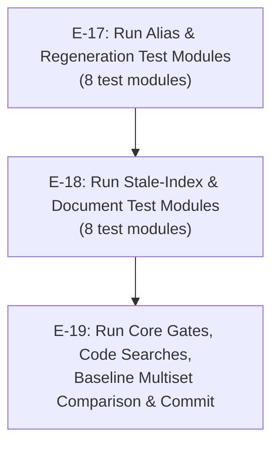

# IPD: Make the typed aw index spellings aliases and stop INDEX regeneration and the stale-index rules

- Date: 2026-11-08
- Kind: child
- Concern: Spec `4sd62s` 4.5 says the SQLite cache REPLACES the `INDEX.{json,md}` files, with `aw index plans|research|prompts` kept only as informational aliases of `aw index rebuild` and `check.stale-index-*` deleted. Today every typed `aw index` spelling still writes INDEX files, eleven production call sites regenerate them after a mutation, and two registered rules report a missing or stale INDEX. Measured 2026-11-07 at `ac76110f4`: `rg -n "run_index|_auto_index_types|_refresh_plans_index_fail_loud|_default_refresh_index" agent_workflows` prints 44 lines in 14 files, of which 21 are call sites or definitions in production code; `rg -n "stale-index" agent_workflows` prints 36 lines in 7 modules (`check_engine` 18, `doctor` 8, `ipd_lifecycle` 3, the three `*_index` modules 2 each, `engine` 1). Part 1 of the split of `9o83cr` (Order 11).
- Scope: FINISHING PART after the round-3 split (2026-11-09). The work of `9o83cr` E-02 (aliases), E-04 (regeneration calls), E-05 (stale-index rules) and E-15 (the INDEX statements in user documents), and this plan's own baseline E-01, now run in nine earlier parts: baseline `sdzcur` (Order 228); aliases `tqknnc` (220); regeneration callers `lywgzs` (221), `mv0j4k` (222), `9eqgcl` (223); stale-index rules `w819as` (224), `6qh68x` (229), `f1yjlx` (225); documents `m8dblq` (226), `kkftwj` (227). This plan keeps only E-17 (split into E-17 to E-19): the family-wide re-run and comparison against the `sdzcur` baseline. EXCLUDES: deleting the INDEX writers (Order 42, `snin8q`), the STATUS code and `_INDEX_CACHE`, the value writers and parsers (other parts of the `9o83cr` split), and the on-disk INDEX files and ignore lines (`cxxmyv`).
- Scope-Paths: .aw/records/plans/pending/20261108-metastore-41-q6epwc-make-the-typed-aw-index-spellings-aliases-and-stop-index-reg.ipd.md
- Item-Dependencies: executed:1ajqaa, executed:59aiyh, executed:6qh68x, executed:9eqgcl, executed:dcerjg, executed:f1yjlx, executed:ffceq0, executed:g5hpbb, executed:kkftwj, executed:lywgzs, executed:m8dblq, executed:mv0j4k, executed:sdzcur, executed:t4gl15, executed:tqknnc, executed:w819as
- Status: approved
- Readiness: go-pending-approval
- Review-Depth: standard
- From-Spec: 4sd62s
- Work-Kind: feature
- Priority: high
- Blocks-Release: next
- Set: metastore
- Order: 41
- Highest E allocated: 19
- Author: opencode its_direct/pt3-claude-opus-5.5-1m-us
- Id: q6epwc
- Approval: 2026-11-16, recorded via aw ipd set: status set to approved

> Write and proofread this plan per the technical writing standard, `.aw/system/workflows/technical-writing/technical-writing.md` (`.agents/workflows/technical-writing/technical-writing.md` in a legacy-layout install), including requirement 12 (diagrams).

## Workflow history
- 2026-11-16 approved (aw set): status set to approved

- 2026-11-14 reviewed (antigravity/gemini-3.8-flash): /plan-review (antigravity/gemini-3.8-flash): APPROVE WITH REVISIONS APPLIED; PR-001, PR-002, PR-003.
- 2026-11-09 note (opencode its_direct/pt3-claude-opus-5.5-1m-us): round-3 split per research nj8zdp; items E-01 moved to sdzcur; E-17 split in place into E-17, E-18, E-19; E-02 to tqknnc; E-04 split across lywgzs, mv0j4k, 9eqgcl; E-05 split across w819as, 6qh68x, f1yjlx; E-15 split across m8dblq, kkftwj.
- 2026-11-07 to-review (opencode its_direct/pt3-claude-opus-5.5-1m-us): split from 9o83cr per maintainer step-complexity rule (no single E/V item hides hundreds of steps).

## Goal

Prove, after the nine split parts have executed, that no `aw` command writes an `INDEX.json` or `INDEX.md` file and no rule reports on one: the `aw check all` rule multisets differ from the `sdzcur` baseline only by the removed `check.stale-index-*` findings.

## Detailed Implementation Checklist (TODO)

Execution-state rule: mark an `E-*` item complete only after performing the action. That mark is not validation. Right-sizing rule: each E-item must address one concern and be executable in one focused pass; split when an E-item names multiple distinct deliverables or independent test-surfaces. Accepted execution states: blocked, failed, pending, performed; terminal gate demands 'performed'.

Item ids E-01, E-02, E-04, E-05 and E-15 moved to the split parts named in `## Deferred` (round-3 split 2026-11-09). E-17 is kept and split into E-17 to E-19 (new ids E-18 and E-19); "the E-01 baseline" in the finishing text now means table F-28 of `sdzcur`, committed in that plan because `.aw/state/` does not travel between lane worktrees.

This plan deletes nothing; the PIN RULE lives in each split part.

### Task group 1: finish

- [x] E-17 Finish, part 1: run the alias and regeneration-caller test modules of the split parts together on the merged tree: `tests/test_index_aliases.py`, `tests/test_ipd_lifecycle_cli.py`, `tests/test_orchestrator_retirement.py`, `tests/test_rename_group_machine_output.py`, `tests/test_research_rename_frontmatter.py`, `tests/test_group_verb_policy.py`, `tests/test_artifact_refs_rewrite.py`, `tests/test_artifact_adopt.py`.
  - Depends on: none
  - Expected outcome: all eight modules pass.
  - Execution state: performed

- [x] E-18 Finish, part 2: run the stale-index and document test modules of the split parts together on the merged tree: `tests/test_plans_index.py`, `tests/test_prompts_index.py`, `tests/test_nv_backend_args_climb.py`, `tests/test_drift_rule_registration.py`, `tests/test_research_index.py`, `tests/test_index_check_agent_records.py`, `tests/test_doctor.py`, `tests/test_installed_text_current.py`.
  - Depends on: E-17
  - Expected outcome: all eight modules pass.
  - Execution state: performed

- [x] E-19 Finish, part 3: run the bare core gate `python3 -m pytest`, `aw check all --agent` and `aw check all --all --agent` (rule multisets equal the `sdzcur` F-28 baselines minus the `check.stale-index-*` findings; any other difference traced to a record changed in between), the two family searches `rg -n "run_index\(|_auto_index_types|_refresh_plans_index_fail_loud|_default_refresh_index" agent_workflows` and `rg -n "stale-index" agent_workflows`, `aw ipd lint` on this plan, and `aw sanitize --agent`; commit through `aw commit q6epwc -- <paths>` with only Scope-Paths files, never `git add -A`, a bare `git add` or `git commit -a`; never push.
  - Depends on: E-18
  - Expected outcome: all runs pass; the first search prints only the three `run_index` definitions and the archive callers `snin8q` deletes; the second prints only the `engine.py` `.aw/.gitignore` template comment; every commit's `git show --stat` lists only Scope-Paths files (or paths justified at finalize).
  - Execution state: performed

## Project conventions discovered (Step 0)

- Typed verbs route through `artifact_types.TYPE_BACKENDS` (`"index": "plans_index.run_index"`, `"research_index.run_index"`, `"prompts_index.run_index"`) and `artifact_types.resolve_backend`, dispatched by `cli._run_noun_verb`; `aw research index` has its own branch in `cli.py` (`if research_cmd == "index":`). `aw index rebuild` is added by `1ajqaa` as `meta_cli.index_rebuild(repo_root) -> CommandResult`, routed before type normalization.
- Drift findings are `artifact_core.Drift(location, rule, detail)`; severities come from `check_engine.RULE_REGISTRY` (`RuleSpec`), and an unregistered rule falls through to `check_engine._DEFAULT_RULESPEC` (severity `error`), so deleting a rule's emitter and its registry entry must happen together.
- `doctor.build_remediation` matches `"stale-index" in rule` by substring, and its comment states the five `doctor` sites must change together.
- `check_engine.check_content` calls `plans_index.check_drift` and `research_index.check_drift` only when `include_retired` is set (the `--all` path), and those functions host non-INDEX rules (F-04), so they survive with their INDEX classes removed.
- Test data comes from ONE builder, `tests/record_builder.py` (`59aiyh`); core tests carry `pytestmark = pytest.mark.core`.
- Cite code by SYMBOL (`module.function`) or by a quoted content string, with a line number only appended to one of those and never alone (advisory `IPD-C801`).

## Findings

Measured 2026-11-07 at `ac76110f4`. F-03 and F-04 are copied from `9o83cr` (measured at `0cbfcc706`, re-checked here).

| Id | Evidence | Finding |
|---|---|---|
| F-03 | `run_index` and refresh callers: `artifact_rename.run_rename_generic` (4), `status_set._auto_index_types` (2 calls), `research_cmd` (2), `research_refs` (1), `plans_refs.apply_renames` (1), `artifact_adopt._default_refresh_index`, `ipd_lifecycle._refresh_plans_index_fail_loud` (called from `_finalize_transaction`), `cli` research branch, `artifact_types.TYPE_BACKENDS` (3). Re-measured: `rg -n "run_index|_auto_index_types|_refresh_plans_index_fail_loud|_default_refresh_index" agent_workflows` 44 lines in 14 files. | E-02, E-04. |
| F-04 | Non-INDEX drift rules inside `check_drift`: `plans_index` emits `name-metadata-mismatch` and `dangling-citation`; `research_index` emits `stale-state-to-promote`, `dangling-consumed-by`, `adopted-without-consumer`, `unrecognized-model`, `research.frontmatter-key-repeated`, `status-tier-mismatch`, `check.research-companion-orphaned`; `prompts_index` emits `name-metadata-mismatch`. | Kept; E-02 `--check` reports them. |
| F-22 | `rg -c "stale-index" agent_workflows`: `check_engine` 18, `doctor` 8, `ipd_lifecycle` 3, `plans_index` 2, `research_index` 2, `prompts_index` 2, `engine` 1; tests naming it: `test_plans_index`, `test_research_index`, `test_prompts_index`, `test_index_check_agent_records`, `test_installed_text_current`, `test_doctor`, `test_nv_backend_args_climb`. | E-05 owns all but `engine.py` (cutover) and the INDEX-byte test modules (Order 42). |

## Proposed changes (ordered, validatable)



1. After the nine split parts, re-run their test modules (E-17, E-18), compare against the `sdzcur` baseline and commit (E-19).

## Deferred / out of scope (with reason)

- Moved to sdzcur (round-3 split 2026-11-09 per research nj8zdp guidance): E-01 (baseline), committed as table F-28.
  - Carrier: sdzcur
  - Carrier-Evidence: .aw/records/plans/executed/20261109-metastore-228-sdzcur-record-the-baseline-for-the-index-alias-and-stale-index-fami.ipd.md
- Moved to tqknnc (round-3 split 2026-11-09 per research nj8zdp guidance): E-02 (aliases), split there into E-01 to E-05; the `producers` case of V-04 moved to 9eqgcl.
  - Carrier: tqknnc
  - Carrier-Evidence: .aw/records/plans/executed/20261109-metastore-220-tqknnc-make-the-typed-aw-index-spellings-aliases-of-aw-index-rebuil.ipd.md
- Moved to lywgzs (round-3 split 2026-11-09 per research nj8zdp guidance): E-04 subset 1, `ipd_lifecycle._refresh_plans_index_fail_loud`, its call in `_finalize_transaction`, its five `ipd_lifecycle` comment sites and the `lane_containment.inventory_lane` comment, with `tests/test_orchestrator_retirement.py`.
  - Carrier: lywgzs
  - Carrier-Evidence: .aw/records/plans/executed/20261109-metastore-221-lywgzs-stop-the-finalize-transaction-regenerating-the-plans-index.ipd.md
- Moved to mv0j4k (round-3 split 2026-11-09 per research nj8zdp guidance): E-04 subset 2, `status_set._auto_index_types` and its two calls, the four `artifact_rename` sites, with `tests/test_rename_group_machine_output.py`, `tests/test_research_rename_frontmatter.py`, `tests/test_group_verb_policy.py`.
  - Carrier: mv0j4k
  - Carrier-Evidence: .aw/records/plans/executed/20261109-metastore-222-mv0j4k-stop-status-set-and-the-generic-rename-and-group-regeneratin.ipd.md
- Moved to 9eqgcl (round-3 split 2026-11-09 per research nj8zdp guidance): E-04 subset 3, `research_cmd` (two sites), `research_refs` (with the "manifest was not regenerated" note), `plans_refs.apply_renames`, `artifact_adopt._default_refresh_index`, with `tests/test_artifact_refs_rewrite.py`, and E-04's whole-family expected outcome and V-04's `producers` test. Subsets 1 to 3 equal E-04's list.
  - Carrier: 9eqgcl
  - Carrier-Evidence: .aw/records/plans/executed/20261109-metastore-223-9eqgcl-stop-research-commands-plan-renames-and-adopt-regenerating-i.ipd.md
- Moved to w819as (round-3 split 2026-11-09 per research nj8zdp guidance): E-05 subset 1, the emitters in `plans_index.check_drift` and `prompts_index.check_drift`, the three `ipd_lifecycle` comments, with `tests/test_nv_backend_args_climb.py` and the stale-index cases of `tests/test_plans_index.py` and `tests/test_prompts_index.py`.
  - Carrier: w819as
  - Carrier-Evidence: .aw/records/plans/executed/20261109-metastore-224-w819as-delete-the-stale-index-rules-from-the-registry-and-the-check.ipd.md
- Moved to 6qh68x (round-3 split 2026-11-09 per research nj8zdp guidance): E-05 subset 2, the two `check_engine.RULE_REGISTRY` entries, the `research_index.check_drift` emitter, the 16 `check_engine` comment lines, with `tests/test_drift_rule_registration.py` and the stale-index cases of `tests/test_research_index.py` and `tests/test_index_check_agent_records.py`.
  - Carrier: 6qh68x
  - Carrier-Evidence: .aw/records/plans/executed/20261109-metastore-229-6qh68x-delete-the-research-stale-index-emitter-and-the-two-stale-in.ipd.md
- Moved to f1yjlx (round-3 split 2026-11-09 per research nj8zdp guidance): E-05 subset 3, the eight `doctor` sites, with `tests/test_doctor.py`. Subsets 1 to 3 equal E-05's list.
  - Carrier: f1yjlx
  - Carrier-Evidence: .aw/records/plans/executed/20261109-metastore-225-f1yjlx-delete-the-stale-index-remediation-from-doctor.ipd.md
- Moved to m8dblq (round-3 split 2026-11-09 per research nj8zdp guidance): E-15 subset 1, `docs/cli-output-contract.md`, `docs/cli-agent-protocol.md`, `CONTRIBUTING.md`, `README.md` and the `CHANGELOG.md` line.
  - Carrier: m8dblq
  - Carrier-Evidence: .aw/records/plans/executed/20261109-metastore-226-m8dblq-update-the-index-statements-in-the-user-documents-and-the-ch.ipd.md
- Moved to kkftwj (round-3 split 2026-11-09 per research nj8zdp guidance): E-15 subset 2, `.aw/records/plans/README.md`, `.aw/records/research/README.md` and `.aw/system/workflows/templates/agents-docs-research-README.md`, keeping `tests/test_installed_text_current.py` green. Subsets 1 and 2 equal E-15's list.
  - Carrier: kkftwj
  - Carrier-Evidence: .aw/records/plans/executed/20261109-metastore-227-kkftwj-update-the-index-paragraphs-in-the-plans-and-research-readme.ipd.md
- Deleting the INDEX writers (`build_index_json`, `build_index_md`, `_set_last_touched`, the write path of `run_index`, `DEFAULT_INDEX_LIMIT`, `artifact_core.emit_index_*`, the `record_producers` entries) and the INDEX-byte tests: `9o83cr` E-03, a separate deletion over a different file set.
  - Carrier: snin8q
- The STATUS code, `_INDEX_CACHE`, value writers, adapters, parsers, and the AC-1 test and audit: other parts of the `9o83cr` split, and `9o83cr` itself.
  - Carrier: 9o83cr
- Deleting the on-disk INDEX files and the INDEX ignore lines and skip names: they protect unmigrated repositories until `m0001` step 5 deletes the files.
  - Carrier: cxxmyv

## Scope check

- Over-scope: none.
- Under-scope: none known. Size after the round-3 split: 3 E-items, 0 work Scope-Paths (this plan file); the work and its units live in the nine parts named in `## Deferred`.

## Required tests / validation

No new test here. E-17 and E-18 re-run the modules the parts created or retargeted (listed there), `python3 -m pytest` (core gate), `aw check all --agent`, `aw check all --all --agent`, `aw sanitize --agent`. CONTRIBUTES to AC-9 (owned by `9o83cr`; final proof `cxxmyv`) and AC-26 (owned by `tve77h`).

## Spec / documentation sync

No spec change; implements part of `4sd62s` 4.5 and section 7 step 7. Documentation: updated by `m8dblq` and `kkftwj`.

## Open questions

### OQ-01: What does `aw index <type> --check` do once INDEX drift is gone?

- Blocking: no
- Status: resolved
- Owner: plan author
- Resolution or deferral rationale: Carried from `9o83cr` OQ-01. It runs the non-INDEX drift classes that the same `check_drift` reported before (F-04) and exits as `aw check <type>` would, after printing the alias information line. Reason: those classes were part of what `--check` gated, so silently passing would weaken a check a user may rely on, while refusing the flag would break scripts; no CI in this repository uses it (`9o83cr` F-05). Recommendation strength: strong.

## Validation and cross-check (verify before reporting done)

Validation-state rule: inspect evidence in a separate pass. Do not mark a `V-*` item complete from memory or from the matching execution checkmark. Accepted validation results: blocked, failed, pass, pending; terminal gate demands 'pass'. Runtime-demonstration reachability rule: for each `V-*` item demanding the software be observed acting (such as a run, a dispatch, or a transition), as distinct from items demanding a diff, a file's content, or a test result, which are reachable by construction, name the code path that produces the observation or the sibling `E-*` that creates it, else the demand is UNDER-SCOPE.

- [x] V-17 validates E-17
  - Required evidence: paste `python3 -m pytest -o addopts="" -p no:randomly -rA` over the eight modules named in E-17, with the per-module pass count for each of `tests/test_index_aliases.py`, `tests/test_ipd_lifecycle_cli.py`, `tests/test_orchestrator_retirement.py`, `tests/test_rename_group_machine_output.py`, `tests/test_research_rename_frontmatter.py`, `tests/test_group_verb_policy.py`, `tests/test_artifact_refs_rewrite.py`, `tests/test_artifact_adopt.py` (one line per module), and its summary line.
  - Observed evidence:
    ```
$ python3 -m pytest -o addopts="" -p no:randomly -n 6 -rA <the eight E-17 modules>
     40 PASSED tests/test_artifact_adopt.py
     28 PASSED tests/test_artifact_refs_rewrite.py
     41 PASSED tests/test_group_verb_policy.py
      8 PASSED tests/test_index_aliases.py
     72 PASSED tests/test_ipd_lifecycle_cli.py
     43 PASSED tests/test_orchestrator_retirement.py
     14 PASSED tests/test_rename_group_machine_output.py
     17 PASSED tests/test_research_rename_frontmatter.py
============================= 263 passed in 33.71s =============================
```
    First run (before fixing) printed `1 failed, 262 passed in 41.87s`: `tests/test_research_rename_frontmatter.py::test_gate_agreement_on_all_four_fields` read `.aw/records/research/INDEX.json`, which `9eqgcl` stopped writing (`FileNotFoundError`). The case is not in the core tier, so the core gate of `mv0j4k` and `9eqgcl` never ran it. Retargeted to `aw show k7m2xq --format json` (same fixture and regroup; asserts path, `set`, `order`, `fields.model`, `fields.research_kind`, and that no `INDEX.json` exists) in attempt-1 commit `cdfe0cd53` on `aw/lane/q6epwc`, carried forward in attempt 2 as commit `87bf228e2` (decision 42-q6epwc-D1). Attempt 2 re-ran the eight modules after carrying it forward; the output above is that re-run.
  - Result: pass

- [x] V-18 validates E-18
  - Required evidence: paste `python3 -m pytest -o addopts="" -p no:randomly -rA` over the eight modules named in E-18, with the per-module pass count for each of `tests/test_plans_index.py`, `tests/test_prompts_index.py`, `tests/test_nv_backend_args_climb.py`, `tests/test_drift_rule_registration.py`, `tests/test_research_index.py`, `tests/test_index_check_agent_records.py`, `tests/test_doctor.py`, `tests/test_installed_text_current.py` (one line per module), and its summary line.
  - Observed evidence:
    ```
$ python3 -m pytest -o addopts="" -p no:randomly -n 6 -rA <the eight E-18 modules>
     38 PASSED tests/test_doctor.py
      6 PASSED tests/test_drift_rule_registration.py
     16 PASSED tests/test_index_check_agent_records.py
      6 PASSED tests/test_installed_text_current.py
      4 PASSED tests/test_nv_backend_args_climb.py
     19 PASSED tests/test_plans_index.py
     15 PASSED tests/test_prompts_index.py
     52 PASSED tests/test_research_index.py
============================= 156 passed in 17.93s =============================
```
  - Result: pass

- [x] V-19 validates E-19
  - Required evidence: paste the output of `rg -n "run_index\(|_auto_index_types|_refresh_plans_index_fail_loud|_default_refresh_index" agent_workflows` (only the three `run_index` definitions and the archive callers) and of `rg -n "stale-index" agent_workflows` (only the `engine.py` template comment); the `aw check all --agent` and `aw check all --all --agent` rule multiset diffs against `sdzcur` F-28 (only `check.stale-index-*` removed, any other difference traced); beside those, the bare `python3 -m pytest` summary line; `aw sanitize --agent` with zero `fail`; and `git show --stat` of every `aw commit q6epwc` commit listing only Scope-Paths files.
  - Observed evidence:
    ```
$ rg -n "run_index\(|_auto_index_types|_refresh_plans_index_fail_loud|_default_refresh_index" agent_workflows
agent_workflows/prompts_index.py:364:def run_index(args: argparse.Namespace) -> int:
agent_workflows/plans_index.py:560:def run_index(args: argparse.Namespace) -> int:
agent_workflows/research_index.py:1201:def run_index(args: argparse.Namespace) -> int:
$ rg -n "stale-index" agent_workflows
agent_workflows/engine.py:6522:# `aw index research`; a fresh clone has none until then, which `check.stale-index-missing` reports
```
    Only the three definitions remain (no archive caller calls `run_index(` any more); the second search prints only the `engine.py` template comment.
    Rule multiset diff, `aw check all --agent` (exit 1) against `sdzcur` F-28:
    ```
3,4c3
<       1 check.ipd-uncarried-obligation
<      33 check.lifecycle-transition-unvalidated
---
>      41 check.lifecycle-transition-unvalidated
7a7
>       1 check.scope-drift
```
    `aw check all --all --agent` (exit 1) against `sdzcur` F-28:
    ```
5,6c5
<       1 check.ipd-uncarried-obligation
<      33 check.lifecycle-transition-unvalidated
---
>      41 check.lifecycle-transition-unvalidated
9a9
>       1 check.scope-drift
12d11
<       2 check.stale-index-missing
14c13
<     355 dangling-citation
---
>     358 dangling-citation
```
    Tracing (per-finding diff against a scratch worktree at baseline `28f1c587f`, which reproduced F-28 exactly for `check all`): `check.stale-index-missing` 2 to 0 is the intended removal. `check.lifecycle-transition-unvalidated` +8: the eight `20261122-cliverbs-*` and `20261122-selectors-*` plans, absent at the baseline tree. `check.ipd-uncarried-obligation` -1: `20261121-dogfood-bugs-04-p0hq1k` fixed by commit `c1e4428e0`. `dangling-citation` +3: lines 153, 155, 157 of the executed `6qh68x` plan's evidence (it cites fixture paths). `check.scope-drift` +1: this plan, from the two out-of-fence paths justified below. The three `check.source-test-citation-dangling` rows moved line numbers only (`oc_runipd.py`, `runner_shared.py` edits).
    ```
$ aw suite
2898 passed, 1 skipped, 11 warnings in 143.76s (0:02:23)
$ aw sanitize --agent
{"schema":"aw.agent/v1","kind":"result","cmd":"check-local-leaks","outcome":"clean","exit":0,"verified":true,"complete":true,"checked":7133,"findings":0,"evidence":["leak-scan"],"next":null}
$ git show --stat 87bf228e2
 tests/test_research_rename_frontmatter.py | 24 +++++++++++++++---------
$ git show --stat 88d948076
 agent_workflows/doctor.py | 2 ++
$ git show --stat 9592b3fc5
 ...t-metastore-parts-integrated-thorough-tier-reg.backlog.md | 12 ++++++++++++
 ...cuted-plan-6qh68x-evidence-block-cites-fixture.backlog.md | 12 ++++++++++++
```
    Attempt 2 (recovery) re-ran every command above on its own lane after carrying the attempt-1 commits forward (`cdfe0cd53` as `87bf228e2`, `136013628` as `88d948076`, `7cf601ee5` and `14c5f7007` as `9592b3fc5`); the two `rg` searches and both multiset diffs printed byte-identical results to attempt 1.
    In attempt 1 the bare `python3 -m pytest` printed `2898 passed, 1 skipped, 11 warnings in 139.40s` but exited 1 on the 30 s core-tier wall-time budget (host load 8.33 on 12 CPUs); `aw suite` (same tests, budget not enforced) exited 0. All three commits are outside Scope-Paths and carry `--scope-reason` justifications recorded through `aw commit q6epwc --scope-reason` (the two backlog files are the defect carriers for the findings this re-run made, filed with `aw backlog new`): `doctor.py` adds `.aw/state/index.db` to `_DANGLING_REF_ALLOWLIST`, because the `kkftwj` research README cites that on-demand cache and three thorough-tier fresh-install doctor tests reported it dangling (decision 42-q6epwc-D2). The other 21 thorough-tier failures belong to pending carriers (`f6y2yy`: `tests/test_index_write_agent_records.py`; `6966zq`: `tests/test_research_set_assign_date_containment.py`) or are the driver-environment leak of `AW_INVOCATION_START_WALL` into `tests/test_runner_resume_clears_stop.py` (pending `z6wodh`; 13 passed with that variable unset). The plan commit carries this evidence.
  - Result: pass

## Approval and execution gate

- Size assessment: standard
- Cohesion rationale: not required

Execute only after human approval (`Status: approved`) and after every plan in `- Item-Dependencies:` is executed. This plan deletes nothing; each part is pin-first. Scope fence: the paths in `- Scope-Paths:` are a declaration; a needed file outside the fence is edited and then justified at finalize (`--scope-reason`), and a declared path left unmodified is acknowledged (`--scope-ack`). Safety stop: if prerequisite test modules from `tqknnc` or baseline table F-28 in `sdzcur` are absent upon starting, stop and report rather than proceeding on an incomplete tree. Honesty rule: paste the ACTUAL summary lines; never claim a result you did not run. Commits: only through `aw commit q6epwc -- <paths>`; never push. Lifecycle: the plan moves to `.aw/records/plans/executed/` only through finalize; when `aw oc run` or `aw agy run` executes the plan, the runner performs the finalize; a hand executor runs `aw ipd finalize q6epwc` itself; never a hand `git mv` to `executed/`.
