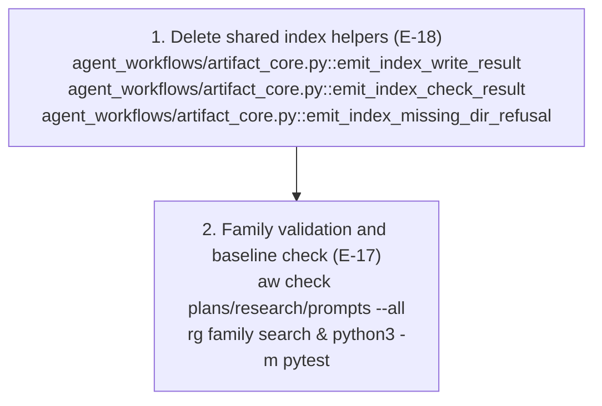

# IPD: Delete the INDEX writers, the STATUS code and the audit index cache

- Date: 2026-11-08
- Kind: child
- Concern: Spec `4sd62s` 4.5 says the SQLite cache REPLACES the `INDEX.{json,md}` files, `plans/STATUS.md` and `artifact_audit._INDEX_CACHE`. Once Order 41 (`q6epwc`) has removed every caller of the INDEX write path, the writers themselves, the dead STATUS renderer and the in-process audit cache are still in the package. Measured 2026-11-07 at `ac76110f4`: `rg -n "build_index_(json|md)|emit_index_(write|check)_result|DEFAULT_INDEX_LIMIT|_set_last_touched" agent_workflows` prints 50 lines in 7 files; 11 test modules import one of those symbols or `run_index`; `rg -n "render_status_index|write_index" agent_workflows` prints 6 lines; `rg -n "_INDEX_CACHE" agent_workflows tests` prints 29 lines (10 in `artifact_audit`, 19 in three test modules). Part 2 of the split of `9o83cr` (Order 11).
- Scope: FINISHING PART after the round-3 split (2026-11-09). `9o83cr` E-03 (INDEX writers), E-06 (STATUS code), E-07 (`_INDEX_CACHE`) and this plan's baseline E-01 now run in eight earlier parts: baseline `54a80m` (Order 230); test retargets `f6y2yy` (231) and `6966zq` (232); plans, research and prompts writers `uopi8z` (233), `s6k01k` (234), `drav0u` (235); STATUS renderer `3v2ew2` (236); audit cache `h3jp4e` (237). This plan keeps the one E-03 member shared by all three index modules, the `artifact_core.emit_index_write_result` and `emit_index_check_result` helpers (new id E-18), and the family-wide finish E-17. EXCLUDES: the aliases, regeneration calls and stale-index rules (Order 41, `q6epwc`); value writers, adapters and parsers (Orders 43 to 46); the AC-1 test, audit and documents (`9o83cr`); on-disk INDEX files and skip names (`cxxmyv`).
- Scope-Paths: agent_workflows/artifact_core.py, .aw/records/plans/pending/20261108-metastore-42-snin8q-delete-the-index-writers-the-status-code-and-the-audit-index.ipd.md
- Item-Dependencies: executed:1ajqaa, executed:3v2ew2, executed:54a80m, executed:59aiyh, executed:6966zq, executed:dcerjg, executed:drav0u, executed:f6y2yy, executed:ffceq0, executed:g5hpbb, executed:h3jp4e, executed:q6epwc, executed:s6k01k, executed:t4gl15, executed:uopi8z
- Status: approved
- Readiness: go-pending-approval
- Review-Depth: standard
- From-Spec: 4sd62s
- Work-Kind: feature
- Priority: high
- Blocks-Release: next
- Set: metastore
- Order: 42
- Highest E allocated: 18
- Author: opencode its_direct/pt3-claude-opus-5.5-1m-us
- Id: snin8q
- Approval: 2026-11-16, recorded via aw ipd set: status set to approved

> Written to .aw/system/workflows/technical-writing/technical-writing.md. Every obligation, exact identifier, quotation, evidence record, and lifecycle status is preserved.

## Workflow history
- 2026-11-16 approved (aw set): status set to approved

- 2026-11-14 reviewed (antigravity/gemini-3.8-flash): /plan-review (antigravity/gemini-3.8-flash): APPROVE WITH REVISIONS APPLIED; PR-001..PR-005; review record .aw/records/reviews/20261108-metastore-42-snin8q-delete-the-index-writers-the-status-code-and-the-audit-index.review.md

- 2026-11-09 note (opencode its_direct/pt3-claude-opus-5.5-1m-us): round-3 split per research nj8zdp; items E-01 moved to 54a80m; E-03 split across f6y2yy, 6966zq, uopi8z, s6k01k, drav0u, with its shared `artifact_core.emit_index_*` member kept here as new E-18; E-06 moved to 3v2ew2; E-07 moved to h3jp4e.
- 2026-11-07 to-review (opencode its_direct/pt3-claude-opus-5.5-1m-us): split from 9o83cr per maintainer step-complexity rule (no single E/V item hides hundreds of steps).

## Goal

After the eight split parts, delete the last shared INDEX helpers in `artifact_core` and prove the family left no INDEX writer, STATUS renderer or audit index cache: `aw find` and the content drift rules keep working, and `aw check <type> --all` matches the `54a80m` baseline.

## Detailed Implementation Checklist (TODO)

Execution-state rule: mark an `E-*` item complete only after performing the action. That mark is not validation. Right-sizing rule: each E-item must address one concern and be executable in one focused pass; split when an E-item names multiple distinct deliverables or independent test-surfaces. Accepted execution states: blocked, failed, pending, performed; terminal gate demands 'performed'.

Item ids E-01, E-03, E-06 and E-07 moved to the split parts named in `## Deferred` (round-3 split 2026-11-09). E-17 is kept; E-18 is new and carries E-03's `artifact_core` member. "The E-01 baseline" now means table F-29 of `54a80m`, committed there because `.aw/state/` does not travel between lane worktrees.

PIN RULE (carried from `9o83cr`): E-18 deletes two helpers whose only callers were the three `run_index` functions; no test calls them directly (measured: `rg -n "emit_index_(write|check)_result" tests` prints nothing), so no module is pinned here.

### Task group 1: shared helpers and finish

- [ ] E-18 In `agent_workflows/artifact_core.py`, delete `artifact_core.emit_index_write_result` and `artifact_core.emit_index_check_result`, whose only callers were the three `run_index` functions deleted by `uopi8z`, `s6k01k` and `drav0u`. Keep `artifact_core.emit_index_missing_dir_refusal` only if `rg -n "emit_index_missing_dir_refusal" agent_workflows` still shows a caller; otherwise delete it too.
  - Depends on: none
  - Expected outcome: `rg -n "emit_index_(write|check)_result" agent_workflows tests` prints nothing.
  - Execution state: pending

- [ ] E-17 Finish: run `aw check plans --all --agent`, `aw check research --all --agent` and `aw check prompts --all --agent` (rule multisets equal the `54a80m` F-29 baselines; any difference traced to a record changed in between), the family search `rg -n "build_index_(json|md)|emit_index_(write|check)_result|DEFAULT_INDEX_LIMIT|_set_last_touched|render_status_index|_INDEX_CACHE" agent_workflows tests`, the bare core gate `python3 -m pytest`, `aw ipd lint` on this plan, and `aw sanitize --agent`; commit through `aw commit snin8q -- <paths>` with only Scope-Paths files, never `git add -A`, a bare `git add` or `git commit -a`; never push.
  - Depends on: E-18
  - Expected outcome: all runs pass; the family search prints nothing; every commit's `git show --stat` lists only Scope-Paths files (or paths justified at finalize).
  - Execution state: pending

## Project conventions discovered (Step 0)

- `agent_workflows/check_engine.py::check_content` calls `agent_workflows/plans_index.py::check_drift` and `agent_workflows/research_index.py::check_drift` (and, after Order 41, `agent_workflows/prompts_index.py::check_drift`), which host non-INDEX rules (F-04), so those functions survive with their INDEX classes removed.
- `agent_workflows/artifact_core.py::emit_index_check_result` and `agent_workflows/artifact_core.py::emit_index_write_result` are called only from the three `run_index` functions; `agent_workflows/artifact_core.py::emit_index_missing_dir_refusal` is a separate refusal helper and stays if any caller remains (check at execution).
- `agent_workflows/run_cli.py::write_index` writes the run ledger projection and is unrelated to INDEX manifests.
- Test data comes from ONE builder, `tests/record_builder.py` (`59aiyh`); core tests carry `pytestmark = pytest.mark.core`.
- Cite code by SYMBOL (`agent_workflows/module.py::function_or_symbol`) or by a quoted content string, with a line number only appended to one of those and never alone (advisory `IPD-C801`).

## Findings

Measured 2026-11-07 at `ac76110f4`. F-02, F-04 and F-10 are copied from `9o83cr`.

| Id | Evidence | Finding |
|---|---|---|
| F-02 | Writers: `plans_index.run_index` (`json_path.write_text`, `md_path.write_text`), `research_index.run_index`, `prompts_index.run_index`, `artifact_core.emit_index_write_result`. `plans.render_status_index` is reached only from `cli._run_plans` `if getattr(args, "write_index", False)`, and no parser defines `--write-index`. | E-03, E-06. |
| F-04 | Non-INDEX drift rules inside `check_drift` (see `q6epwc` F-04). | Kept by E-03. |
| F-10 | `artifact_audit._INDEX_CACHE: OrderedDict` with `_INDEX_CACHE_MAX = 8` inside `artifact_audit.build_index`; tests `tests/test_artifact_audit_index_cache.py` (6 lines), `tests/test_artifact_audit_cache_eviction.py` (7), `tests/test_artifact_audit_identity_staleness.py` (6). | E-07. |
| F-23 | `rg -c "build_index_(json|md)|emit_index_(write|check)_result|DEFAULT_INDEX_LIMIT|_set_last_touched" agent_workflows`: `plans_index` 14, `research_index` 15, `prompts_index` 14, `artifact_core` 2, `plans_archive` 2, `research_archive` 2, `ipd_lifecycle` 1. Test modules naming one of them or `run_index`: 11 (listed in E-03; `tests/test_orchestrator_retirement.py` names only `_refresh_plans_index_fail_loud`, owned by Order 41). | The archive writers were not in the original E-03 list; added here so no writer survives. |

## Proposed changes (ordered, validatable)

1. After the eight split parts, delete the shared `artifact_core` helpers (E-18).
2. Validate the family against the `54a80m` baseline and commit (E-17).

## Deferred / out of scope (with reason)

- Moved to 54a80m (round-3 split 2026-11-09 per research nj8zdp guidance): E-01 (baseline), committed as table F-29.
  - Carrier: 54a80m
  - Carrier-Evidence: .aw/records/plans/executed/20261109-metastore-230-54a80m-record-the-baseline-for-the-index-writer-deletion-family.ipd.md
- Moved to f6y2yy (round-3 split 2026-11-09 per research nj8zdp guidance): E-03 test subset 1, `tests/test_index_write_agent_records.py` and `tests/test_index_check_agent_records.py`.
  - Carrier: f6y2yy
- Moved to 6966zq (round-3 split 2026-11-09 per research nj8zdp guidance): E-03 test subset 2, `tests/test_drift_rule_registration.py`, `tests/test_model_vocab.py`, `tests/test_research_priority.py`, `tests/test_research_unsafe_field.py`, `tests/test_research_set_assign_date_containment.py`.
  - Carrier: 6966zq
- Moved to uopi8z (round-3 split 2026-11-09 per research nj8zdp guidance): E-03 plans subset, `build_index_json`, `build_index_md`, `_set_last_touched`, `DEFAULT_INDEX_LIMIT` and `run_index` in `plans_index`, `plans_archive._refresh_index`, the `plans_index` `record_producers` entry, `tests/test_plans_index.py`.
  - Carrier: uopi8z
- Moved to s6k01k (round-3 split 2026-11-09 per research nj8zdp guidance): E-03 research subset, the same five symbols in `research_index`, the post-move refresh in `research_archive`, the `research_index` `record_producers` entry, `tests/test_research_index.py`.
  - Carrier: s6k01k
- Moved to drav0u (round-3 split 2026-11-09 per research nj8zdp guidance): E-03 prompts subset, the same five symbols in `prompts_index`, `tests/test_prompts_index.py`. With the two test subsets, the three module subsets and E-18 here, this equals E-03's list.
  - Carrier: drav0u
- Moved to 3v2ew2 (round-3 split 2026-11-09 per research nj8zdp guidance): E-06 (STATUS code).
  - Carrier: 3v2ew2
- Moved to h3jp4e (round-3 split 2026-11-09 per research nj8zdp guidance): E-07 (`_INDEX_CACHE`).
  - Carrier: h3jp4e
- Aliases, regeneration calls and stale-index rules.
  - Carrier: q6epwc
  - Carrier-Evidence: .aw/records/plans/executed/20261108-metastore-41-q6epwc-make-the-typed-aw-index-spellings-aliases-and-stop-index-reg.ipd.md
- The residual inventory, the AC-1 test and audit, and the INDEX documents.
  - Carrier: 9o83cr
- Deleting the on-disk INDEX files and `plans/STATUS.md`, and the skip-name entries that protect scans from them.
  - Carrier: cxxmyv

## Scope check

- Over-scope: none.
- Under-scope: none known. Size after the round-3 split: 2 E-items, 1 work Scope-Path; the deletions live in the eight parts named in `## Deferred`.

## Required tests / validation

No module is retargeted here; the parts own their modules. Commands: `aw check <type> --all --agent`, the E-17 family search, `python3 -m pytest` (core gate), `aw sanitize --agent`. CONTRIBUTES to AC-9 (owned by `9o83cr`; final proof `cxxmyv`).

## Spec / documentation sync

No spec change; implements part of `4sd62s` 4.5 and section 7 step 7.

## Open questions

### OQ-01: Should `plans_index`, `research_index` and `prompts_index` be renamed once they write no index?

- Blocking: no
- Status: resolved
- Owner: plan author
- Resolution or deferral rationale: Carried from `9o83cr` OQ-02. No. They still host `aw find` backends (`run_find`, `query`) and the F-04 content rules; renaming is churn the spec does not ask for and would widen this plan's diff across 17 importing modules. Recommendation strength: strong.

## Validation and cross-check (verify before reporting done)

Validation-state rule: inspect evidence in a separate pass. Do not mark a `V-*` item complete from memory or from the matching execution checkmark. Accepted validation results: blocked, failed, pass, pending; terminal gate demands 'pass'. Runtime-demonstration reachability rule: for each `V-*` item demanding the software be observed acting (such as a run, a dispatch, or a transition), as distinct from items demanding a diff, a file's content, or a test result, which are reachable by construction, name the code path that produces the observation or the sibling `E-*` that creates it, else the demand is UNDER-SCOPE.

- [ ] V-18 validates E-18
  - Required evidence: paste `rg -n "emit_index_(write|check)_result" agent_workflows tests` printing nothing, `rg -n "emit_index_missing_dir_refusal" agent_workflows` with its result (callers listed, or nothing and the function deleted), and the `git diff` hunk of `agent_workflows/artifact_core.py`.
  - Observed evidence:
  - Result: pending

- [ ] V-17 validates E-17
  - Required evidence: paste the output of `rg -n "build_index_(json|md)|emit_index_(write|check)_result|DEFAULT_INDEX_LIMIT|_set_last_touched|render_status_index|_INDEX_CACHE" agent_workflows tests` (empty); the three `aw check <type> --all --agent` rule multiset diffs against `54a80m` F-29 (empty, or each difference traced); beside those, the bare `python3 -m pytest` summary line; `aw sanitize --agent` with zero `fail`; and `git show --stat` of every `aw commit snin8q` commit listing only Scope-Paths files.
  - Observed evidence:
  - Result: pending

## Approval and execution gate

- Size assessment: standard
- Cohesion rationale: not required

Execute only after human approval (`Status: approved`) and after every plan in `- Item-Dependencies:` is executed. Every deletion in the parts is pin-first. Stop safely if prerequisite index-writer deletions from `uopi8z` (plans), `s6k01k` (research), or `drav0u` (prompts) are absent or if callers of `emit_index_*` remain in `plans_index`, `research_index`, or `prompts_index`.

Safety rule: uncommitted changes and untracked files you did not create are not yours; never revert, stage, commit, discard, reformat, or "clean up" another party's work.

Scope fence: the paths in `- Scope-Paths:` are a declaration; a needed file outside the fence is edited and then justified at finalize (`--scope-reason`), and a declared path left unmodified is acknowledged (`--scope-ack`).

Honesty rule: paste the ACTUAL summary lines; never claim a result you did not run.

Commits: only through `aw commit snin8q -- <paths>` with only Scope-Paths files; never `git add -A`, a bare `git add` or `git commit -a`; never push.

Lifecycle transition: the plan moves to `.aw/records/plans/executed/` only through `aw ipd finalize snin8q` (never a hand git mv), after `aw ipd lint --phase pre-transition` conforms and every `V-*` reads `pass` with pasted evidence. When aw oc run or aw agy run executes the plan, the runner performs the finalize; a hand executor runs aw ipd finalize snin8q itself.
