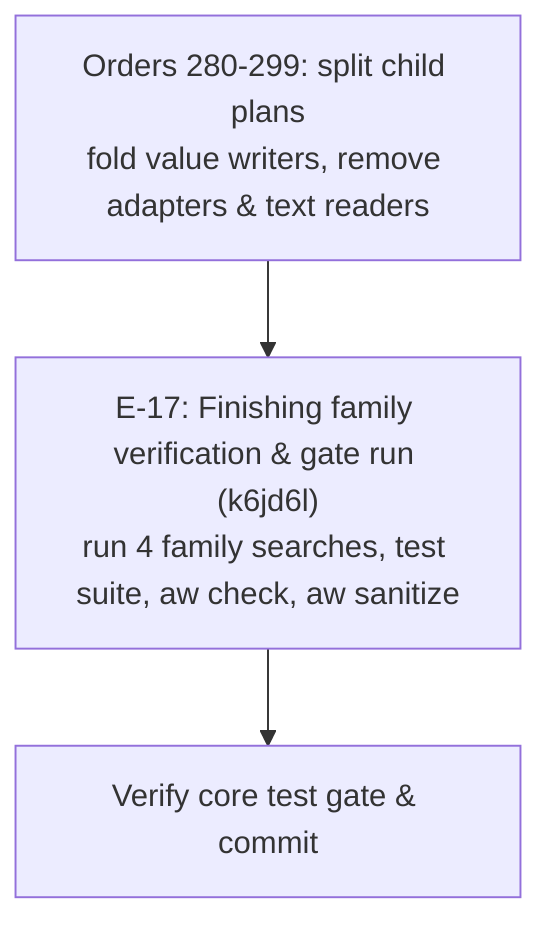

# IPD: Fold the value writers into artifact_meta, delete the writer adapters and record text readers, and move the borrowed grammars

- Date: 2026-11-08
- Kind: child
- Concern: Spec `4sd62s` C5 allows exactly one metadata reader and writer (`artifact_meta`). After phase B, four groups of metadata code still live outside it: the record and selector modules' public text readers (`selectors.read_front_matter_*`, `plans.read_status`, `prompts.read_metadata_*`, `specs._read_*`, `backlog.parse_item`), twelve pure value writers that rewrite one bullet line (`releases.set_*_line`, `backlog.set_*_line`, `research_cmd._set_priority_line`), four thin adapters that `xexn45` kept between a caller and `artifact_meta` (`xexn45` F-08), and seven grammars that `artifact_meta`'s legacy loader still borrows from other modules. Measured 2026-11-07 at `ac76110f4`: `rg -n "def set_[a-z_]+_line|def _in_metadata_region|def _set_priority_line" agent_workflows` prints 12 definitions in 3 files with 18 production call sites; 10 test modules call them; the adapters have 16 lines in 4 files and 13 lines in 4 test modules; the seven grammars have 7 definitions and 102 production references, of which 85 sit in modules a phase-B reader plan already moves and 17 remain; the text readers have 170 references, of which 56 remain (F-25). Part 3 of the split of `9o83cr` (Order 11).
- Scope: The finishing gate of `9o83cr` E-08, E-09, E-10, E-11 and E-18 (originally carried here verbatim with their ids): E-17 checks, on the whole family's result, every expected outcome those items stated, then runs the gates. Every work item moved in the round-3 split (2026-11-09, research `nj8zdp` guidance) to Orders 280 to 299; see Deferred. EXCLUDES: every other parser and regex literal (`9o83cr` E-12, Orders 45, 46 and 238 to 249); the INDEX and STATUS code (Orders 41 and 42); switching `write_legacy` off and removing the folded value writers again at the cutover (`cxxmyv`).
- Scope-Paths: .aw/records/plans/pending/20261108-metastore-43-k6jd6l-fold-the-value-writers-into-artifact-meta-delete-the-writer.ipd.md
- Item-Dependencies: executed:1ajqaa, executed:59aiyh, executed:5lgpix, executed:6bxlzb, executed:6v4uao, executed:71ewpn, executed:8fxic1, executed:8ysz6b, executed:ad86ym, executed:ay6sxp, executed:bxupy8, executed:csobg7, executed:dcerjg, executed:ffceq0, executed:g5hpbb, executed:h1kfyp, executed:hrbbhy, executed:iup4lp, executed:po3o1c, executed:sq6v7i, executed:t4gl15, executed:tfvby1, executed:um2kvx, executed:v0ucnz, executed:vw88h0, executed:zs7a45
- Status: approved
- Readiness: go-pending-approval
- Review-Depth: standard
- From-Spec: 4sd62s
- Work-Kind: feature
- Priority: high
- Blocks-Release: next
- Set: metastore
- Order: 43
- Highest E allocated: 18
- Author: opencode its_direct/pt3-claude-opus-5.5-1m-us
- Id: k6jd6l
- Approval: 2026-11-16, recorded via aw ipd set: status set to approved

> Write and proofread this plan per the technical writing standard, `.aw/system/workflows/technical-writing/technical-writing.md` (`.agents/workflows/technical-writing/technical-writing.md` in a legacy-layout install), including requirement 12 (diagrams).

## Workflow history
- 2026-11-16 approved (aw set): status set to approved

- 2026-11-14 reviewed (antigravity/gemini-3.8-flash): plan-review verified E/V bijection, Scope-Paths, finishing gate targets, execution gate, and state directory initialization; findings PR-001..PR-005 fixed; marked reviewed and go-pending-approval.
- 2026-11-09 note (opencode its_direct/pt3-claude-opus-5.5-1m-us): round-3 split per research nj8zdp; items E-01, E-08, E-09, E-10, E-11, E-18 moved to 6bxlzb, h1kfyp, tfvby1, 6v4uao, zs7a45, v0ucnz, 8fxic1, ad86ym, sq6v7i, 5lgpix, bxupy8, ay6sxp, csobg7, 71ewpn, 8ysz6b, iup4lp, hrbbhy, um2kvx, po3o1c, vw88h0.
- 2026-11-09 note (opencode its_direct/pt3-claude-opus-5.5-1m-us): round-3 check per research nj8zdp: over guidance (7 E-items, 58 work Scope-Paths, E-08/E-09/E-10/E-11/E-18 over 8 units each) but NOT split, because the Orders assigned for new plans (220 to 249) were used up by the q6epwc, snin8q, e8420v and 0xsx2n splits; V-17 evidence now names units. Needs a further split with new Orders.
- 2026-11-07 to-review (opencode its_direct/pt3-claude-opus-5.5-1m-us): split from 9o83cr per maintainer step-complexity rule (no single E/V item hides hundreds of steps).

## Goal

Confirm, after Orders 280 to 299 have run, that every bullet-line value writer and every grammar the legacy loader needs lives privately inside `artifact_meta`, that no adapter stands between a caller and `artifact_meta`, and that no record or selector module defines a metadata text reader, so the regex literals deleted by Orders 45, 46 and 238 to 249 have nothing left to serve; `aw find`, `aw attention` and `aw check` give the same results as the Order 280 baseline. A plan depending on `executed:k6jd6l` therefore still means the whole family is done.

## Detailed Implementation Checklist (TODO)

Execution-state rule: mark an `E-*` item complete only after performing the action. That mark is not validation. Right-sizing rule: each E-item must address one concern and be executable in one focused pass; split when an E-item names multiple distinct deliverables or independent test-surfaces. Accepted execution states: blocked, failed, pending, performed; terminal gate demands 'performed'.

Item ids E-01, E-08, E-09, E-10, E-11 and E-18 moved to Orders 280 to 299 in the round-3 split; E-17 keeps its id, and `- Highest E allocated:` stays 18. The baseline files under `.aw/state/k6jd6l/` are written by Order 280 (`6bxlzb`) (ensure `.aw/state/k6jd6l/` exists via `mkdir -p .aw/state/k6jd6l/before/`).

### Task group 5: finish

- [ ] E-17 Finish: before running checks, ensure `.aw/state/k6jd6l/` exists (`mkdir -p .aw/state/k6jd6l/before/`). Run the four family searches (`rg -n "def set_[a-z_]+_line|def _in_metadata_region|def _set_priority_line" agent_workflows`, `rg -n "_set_metadata\b|_update_frontmatter_metadata|render_metadata_comment|rederive_front_matter" agent_workflows tests`, `rg -n "def (parse_metadata_block|parse_frontmatter|_parse_metadata_comment|history_block|last_history_at|newest_history_record)\b|SPEC_STATUS_RE\s*=" agent_workflows`, and the subset-1 and subset-2 reader searches of Orders 296 and 299), `python3 -m pytest -o addopts="" -v tests/test_runner_shared.py -k CrossHostReadIdReExport` unchanged, the bare core gate `python3 -m pytest` (compare with `.aw/state/k6jd6l/core-before.txt`), `aw check all --agent`, `aw ipd lint` on this plan, and `aw sanitize --agent`; commit this plan's own record update through `aw commit k6jd6l -- <paths>` with only Scope-Paths files, never `git add -A`, a bare `git add` or `git commit -a`; never push.
  - Depends on: none
  - Expected outcome: the first two searches list only `agent_workflows/artifact_meta.py` or print nothing, the grammar search lists only `artifact_meta.py`, the reader searches print nothing; all runs pass.
  - Execution state: pending

## Project conventions discovered (Step 0)

- The `artifact_meta` interface (names from `tve77h`, `ffceq0`, `xexn45`): `read(id6) -> State`, `query(...)`, `history(id6)`, `resolve(path_or_id6)`, `read_at(id6, rev)`, `read_text(text, *, record_type=None) -> State`, `create(...)`, `append(id6, events, *, expect_seq)` with `dry_run`, the phase-B legacy writer (`append_legacy`, `render_legacy`, `LegacyRender`, `LegacyTarget`), and the legacy loader (`load_legacy_artifact`, `load_legacy_review`, `_parse_bullet_metadata`, `_parse_yaml_front_matter`).
- `artifact_meta.append_legacy` already calls `backlog.set_close_evidence_line` (one of the E-08 call sites), which is why the fold target is the legacy writer.
- Test data comes from ONE builder, `tests/record_builder.py` (`59aiyh`).
- `selectors.read_front_matter_id` and `read_front_matter_status` are the loose-spelling readers (`^-\s*Id:`), and `oc_runipd`/`agy_runipd` re-export them as `_read_id`; `tests/test_runner_shared.py::CrossHostReadIdReExportTests` pins that behavior.
- `backlog.parse_item` returns a `BacklogItem` with metadata fields and body sections; its body parsing (N3) may stay, its metadata fields come from `artifact_meta`.
- Cite code by SYMBOL (`module.function`) or by a quoted content string, with a line number only appended to one of those and never alone (advisory `IPD-C801`).

## Findings

Measured 2026-11-07 at `ac76110f4`. F-08 and F-09 are copied from `9o83cr`.

| Id | Evidence | Finding |
|---|---|---|
| F-08 | Value writers: 7 `releases.set_*_line`, 3 `backlog` (`set_release_exempt_kind_line`, `set_release_exempt_ref_line`, `set_close_evidence_line`), `research_cmd._set_priority_line`; callers re-measured: `status_set` 4, `backlog` 5, `research_cmd` 1, `artifact_meta` 1, plus 7 internal `releases._in_metadata_region` calls. | E-08. |
| F-09 | `xexn45` F-08 adapters: `plans_refs._set_metadata` (caller `apply_renames`), `artifact_rename._update_frontmatter_metadata` (caller `run_rename_generic`), `prompts.render_metadata_comment` (caller `run_new`), `runner_shared.rederive_front_matter` (caller `apply_records_only_rederivation`); 16 production lines in 4 files, 13 test lines in 4 files. | E-09. |
| F-24 | Borrowed-grammar references, `rg` of the seven names over `agent_workflows` and `tools`, comments excluded: 102 total, 85 in a module that a phase-B reader plan names in Scope-Paths, 17 not (listed in E-10). Re-derived by E-01. | E-10 is bounded by what phase B leaves; E-01 re-measures. |
| F-25 | `rg -n "\b<symbol>\b" agent_workflows tools`, comments excluded, at `ac76110f4`, classed by whether the file is in a phase-B reader plan's Scope-Paths (Orders 27 to 36): `selectors` readers 63 references, 9 left; `plans`/`prompts`/`attention` readers 19, 12 left; `specs._read_*` 51, 20 left; `backlog.parse_item` 37, 15 left. Re-derived by E-01. | E-11 owns subset 1, E-18 subset 2; each about 25 units at the split. |
| F-32 | Round-3 split (2026-11-09) per research `nj8zdp`: 7 E-items, 58 work Scope-Paths and five items naming 11 to 15 units each were over guidance. | E-01 and E-08 to E-18 moved to Orders 280 to 299 (see Deferred); each new part has at most 5 E-items and 8 work Scope-Paths. |

## Proposed changes (ordered, validatable)

1. After Orders 280 to 299, verify the family and run the gates (E-17).

## Deferred / out of scope (with reason)

- `9o83cr` E-01-style baseline (this plan's E-01) and the copy of the seven `releases` value writers (first half of E-08): Moved to 6bxlzb (round-3 split 2026-11-09 per research nj8zdp guidance).
  - Carrier: 6bxlzb
  - Carrier-Evidence: .aw/records/plans/executed/20261109-metastore-280-6bxlzb-baseline-the-k6jd6l-family-and-copy-the-releases-value-write.ipd.md
- E-08: copy of the `backlog` and `research_cmd` writers and the production caller retargets: Moved to h1kfyp (round-3 split 2026-11-09 per research nj8zdp guidance).
  - Carrier: h1kfyp
  - Carrier-Evidence: .aw/records/plans/executed/20261109-metastore-281-h1kfyp-copy-the-backlog-and-research-value-writers-and-retarget-the.ipd.md
- E-08: test retargets, first five modules: Moved to tfvby1 (round-3 split 2026-11-09 per research nj8zdp guidance).
  - Carrier: tfvby1
- E-08: test retargets, last five modules: Moved to 6v4uao (round-3 split 2026-11-09 per research nj8zdp guidance).
  - Carrier: 6v4uao
- E-08: deleting the original writers and the comment sites: Moved to zs7a45 (round-3 split 2026-11-09 per research nj8zdp guidance).
  - Carrier: zs7a45
- E-09: `plans_refs` and `artifact_rename` adapters: Moved to v0ucnz (round-3 split 2026-11-09 per research nj8zdp guidance).
  - Carrier: v0ucnz
- E-09: `prompts` and `runner_shared` adapters: Moved to 8fxic1 (round-3 split 2026-11-09 per research nj8zdp guidance).
  - Carrier: 8fxic1
- E-10: `ipd_schema.parse_metadata_block` and `prompts_index._parse_metadata_comment`: Moved to ad86ym (round-3 split 2026-11-09 per research nj8zdp guidance).
  - Carrier: ad86ym
- E-10: `research_contract.parse_frontmatter` copy and production readers: Moved to sq6v7i (round-3 split 2026-11-09 per research nj8zdp guidance).
  - Carrier: sq6v7i
- E-10: `parse_frontmatter` test retargets: Moved to 5lgpix (round-3 split 2026-11-09 per research nj8zdp guidance).
  - Carrier: 5lgpix
- E-10: deleting `parse_frontmatter`, the history grammar copy and the migration retarget: Moved to bxupy8 (round-3 split 2026-11-09 per research nj8zdp guidance).
  - Carrier: bxupy8
- E-10: history readers in `plan_readiness`, `review_sequence`, `backlog`, `set_records`, `status_set`: Moved to ay6sxp (round-3 split 2026-11-09 per research nj8zdp guidance).
  - Carrier: ay6sxp
- E-10: history readers in `attention` and `check_engine`, `SPEC_STATUS_RE`, deleting the originals: Moved to csobg7 (round-3 split 2026-11-09 per research nj8zdp guidance).
  - Carrier: csobg7
- E-11: `metadata_region` move and its non-`selectors` callers: Moved to 71ewpn (round-3 split 2026-11-09 per research nj8zdp guidance).
  - Carrier: 71ewpn
- E-11: the `selectors` readers and patterns and the runner re-exports: Moved to 8ysz6b (round-3 split 2026-11-09 per research nj8zdp guidance).
  - Carrier: 8ysz6b
- E-11: the `prompts` readers and `attention._frontmatter_block`: Moved to iup4lp (round-3 split 2026-11-09 per research nj8zdp guidance).
  - Carrier: iup4lp
- E-11: the `plans` readers, deleting `selectors.metadata_region`, and the subset-1 check (V-11): Moved to hrbbhy (round-3 split 2026-11-09 per research nj8zdp guidance).
  - Carrier: hrbbhy
- E-18: the `specs._read_*` readers: Moved to um2kvx (round-3 split 2026-11-09 per research nj8zdp guidance).
  - Carrier: um2kvx
- E-18: the `backlog.parse_item` metadata callers: Moved to po3o1c (round-3 split 2026-11-09 per research nj8zdp guidance).
  - Carrier: po3o1c
- E-18: removing the metadata part of `backlog.parse_item` and the subset-2 check (V-18): Moved to vw88h0 (round-3 split 2026-11-09 per research nj8zdp guidance).
  - Carrier: vw88h0
- The `check_engine`, runner, setter and release parsers and regex literals of `9o83cr` E-12.
  - Carrier: e8420v
- The remaining module regex literals of `9o83cr` E-12.
  - Carrier: 0xsx2n
- Switching `write_legacy` off and removing the value writers this plan folds into it: they need the log format.
  - Carrier: cxxmyv
- Moving the legacy loader, with the grammars E-10 moves into it, from `artifact_meta` into `migrations/m0001_metadata_v2.py`.
  - Carrier: cxxmyv

## Scope check

- Over-scope: none.
- Under-scope: none known; Order 280's F-24 and F-25 catch residue. Size: 1 E-item, 0 work Scope-Paths (verification only).

## Required tests / validation

The four family searches, `tests/test_runner_shared.py -k CrossHostReadIdReExport`, `python3 -m pytest` (core gate, compared with the Order 280 baseline), `aw check all --agent`, `aw sanitize --agent`. Each new part runs its own named test modules. CONTRIBUTES to AC-1 (owned by `9o83cr`).

## Spec / documentation sync

No spec change; implements part of `4sd62s` 4.3 and section 7 step 7.

## Open questions

### OQ-01: Must every module that imports a moved grammar be edited here?

- Blocking: no
- Status: resolved
- Owner: plan author
- Resolution or deferral rationale: No. Orders 27 to 36 move the readers of 85 of the 102 measured references onto `artifact_meta` before this plan runs (each lists the module in its Scope-Paths); the parts at Orders 280 to 299 edit only the references Order 280 finds still live. Recommendation strength: strong.

### OQ-02: Does `backlog.parse_item` disappear entirely?

- Blocking: no
- Status: resolved
- Owner: plan author
- Resolution or deferral rationale: `9o83cr` E-11 deletes only "the metadata part of `backlog.parse_item`". Body sections are Markdown prose that N3 keeps, so a body-only parser may survive under the same or a narrower name; Order 299 (`vw88h0`) decides by whether any caller still needs body sections, and records the choice. Recommendation strength: medium.

## Validation and cross-check (verify before reporting done)

Validation-state rule: inspect evidence in a separate pass. Do not mark a `V-*` item complete from memory or from the matching execution checkmark. Accepted validation results: blocked, failed, pass, pending; terminal gate demands 'pass'. Runtime-demonstration reachability rule: for each `V-*` item demanding the software be observed acting (such as a run, a dispatch, or a transition), as distinct from items demanding a diff, a file's content, or a test result, which are reachable by construction, name the code path that produces the observation or the sibling `E-*` that creates it, else the demand is UNDER-SCOPE.

- [ ] V-17 validates E-17
  - Required evidence: paste each of the four family `rg` searches with its output (only `agent_workflows/artifact_meta.py`, or nothing), `python3 -m pytest -o addopts="" -v tests/test_runner_shared.py -k CrossHostReadIdReExport` with every test PASSED, the `aw check all --agent` rule-id multiset diff against the Order 280 baseline in `.aw/state/k6jd6l/before/` (empty, or each difference traced), then beside that specific evidence the bare `python3 -m pytest` summary line next to `.aw/state/k6jd6l/core-before.txt`, `aw sanitize --agent` with zero `fail`, and `git show --stat` of the `aw commit k6jd6l` commit listing only Scope-Paths files.
  - Observed evidence:
  - Result: pending

## Approval and execution gate

- Size assessment: standard
- Cohesion rationale: not required

Execute only after human approval (`Status: approved`) and after every plan in `- Item-Dependencies:` is executed. Scope fence: the paths in `- Scope-Paths:` are a declaration; a needed file outside the fence is edited and then justified at finalize (`--scope-reason`), and a declared path left unmodified is acknowledged (`--scope-ack`). Safety stop: if prerequisite metastore symbols from any of the child plans or dependencies in `- Item-Dependencies:` are absent upon starting, stop and report rather than creating conflicting implementations. Honesty rule: paste the ACTUAL summary lines; never claim a result you did not run. Commits: only through `aw commit k6jd6l -- <paths>`; never push. Lifecycle: the plan moves to `.aw/records/plans/executed/` only through finalize; when `aw oc run` or `aw agy run` executes the plan, the runner performs the finalize; a hand executor runs `aw ipd finalize k6jd6l` itself; never a hand `git mv` to `executed/`.
