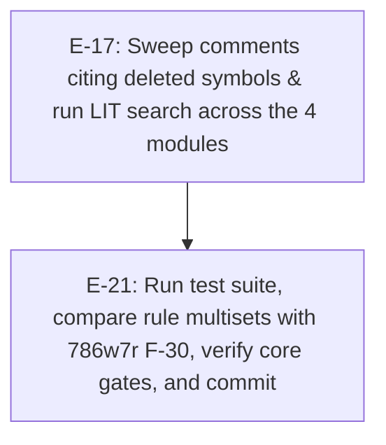

# IPD: Delete the check_engine, runner, setter and release metadata parsers and regular expressions

- Date: 2026-11-08
- Kind: child
- Concern: Spec `4sd62s` 4.3 requires deleting every metadata parser and `^-` metadata regular expression outside `artifact_meta`, and AC-1 audits for them. Measured 2026-11-07 at `ac76110f4`: `rg -n "re\.(compile|search|match|finditer|findall|sub|fullmatch)\(\s*r?[\"'](\(\?m\))?\^-" agent_workflows` prints 211 literals in 36 files; excluding `artifact_meta.py`, the E/V and open-question checklist fields (N3), and the 18 literals that Order 43 deletes with their writers and readers, 168 remain in 34 files. Four files hold 62 of them: `check_engine` 30, `runner_shared` 16, `status_set` 10 and `releases` 6; `check_engine` also defines the named parsers `_blob_text`, `_status_meta` and `_metadata_status` (51 references, 50 of them in modules a phase-B reader plan already moves). Part 5 of the split of `9o83cr` (Order 11).
- Scope: FINISHING PART after the round-3 split (2026-11-09). The `check_engine`, runner and setter/release subsets of `9o83cr` E-12 and this plan's baseline now run in six earlier parts: shared baseline and site table F-26 `786w7r` (Order 238); `check_engine` parsers and their external callers `7uq6xg` (239), named patterns `js35bz` (240), inline literals `bcrko1` (241); runner `k6nukd` (242); setter and release `kmf6w4` (243). This plan keeps only E-17 (split into E-17 and new E-21): the family re-run, a final sweep of comments citing a deleted symbol, and the comparison against the `786w7r` baseline. EXCLUDES: every other module's literals (Order 46, `0xsx2n`), the record text readers and grammars (Order 43, `k6jd6l`), and the AC-1 audit (`9o83cr`).
- Scope-Paths: agent_workflows/check_engine.py, agent_workflows/runner_shared.py, agent_workflows/status_set.py, agent_workflows/releases.py, .aw/records/plans/pending/20261108-metastore-45-e8420v-delete-the-check-engine-runner-setter-and-release-metadata-p.ipd.md
- Item-Dependencies: executed:1ajqaa, executed:59aiyh, executed:786w7r, executed:7uq6xg, executed:bcrko1, executed:dcerjg, executed:ffceq0, executed:g5hpbb, executed:js35bz, executed:k6jd6l, executed:k6nukd, executed:kmf6w4, executed:t4gl15
- Status: approved
- Readiness: go-pending-approval
- Review-Depth: standard
- From-Spec: 4sd62s
- Work-Kind: feature
- Priority: high
- Blocks-Release: next
- Set: metastore
- Order: 45
- Highest E allocated: 21
- Author: opencode its_direct/pt3-claude-opus-5.5-1m-us
- Id: e8420v
- Approval: 2026-11-16, recorded via aw ipd set: status set to approved

> Written to .aw/system/workflows/technical-writing/technical-writing.md. Every obligation, exact identifier, quotation, evidence record, and lifecycle status is preserved.

## Workflow history
- 2026-11-16 approved (aw set): status set to approved

- 2026-11-14 reviewed (antigravity/gemini-3.8-flash): /plan-review APPROVE WITH REVISIONS APPLIED; PR-001..PR-005 FIXED; review record .aw/records/reviews/20261108-metastore-45-e8420v-delete-the-check-engine-runner-setter-and-release-metadata-p.review.md
- 2026-11-09 note (opencode its_direct/pt3-claude-opus-5.5-1m-us): round-3 split per research nj8zdp; items E-01 moved to 786w7r; E-12 split across 7uq6xg, js35bz, bcrko1; E-19 moved to k6nukd; E-20 moved to kmf6w4 (its `tools/gate_drop_audit.py` `_status_meta` retarget to 7uq6xg); E-17 kept and split in place into E-17 and E-21.
- 2026-11-07 to-review (opencode its_direct/pt3-claude-opus-5.5-1m-us): split from 9o83cr per maintainer step-complexity rule (no single E/V item hides hundreds of steps).

## Goal

`check_engine`, `runner_shared`, `status_set` and `releases` contain no metadata parser and no `^-` metadata regular expression: each rule, runner step and setter reads metadata through `artifact_meta`, and every rule finding is unchanged.

## Detailed Implementation Checklist (TODO)

Execution-state rule: mark an `E-*` item complete only after performing the action. That mark is not validation. Right-sizing rule: each E-item must address one concern and be executable in one focused pass; split when an E-item names multiple distinct deliverables or independent test-surfaces. Accepted execution states: blocked, failed, pending, performed; terminal gate demands 'performed'.

The original `9o83cr` E-12 text is: "Delete the remaining parsers and regular expressions classed `delete` in F-20, at least: `check_engine._blob_text`, `_status_meta` and `_metadata_status`; `runner_shared._front_matter_bullets` and its re-exports in `oc_runipd`/`agy_runipd`; `review_findings._META_RE` (the round and finding grammar stays, N3); `plans_index._META_RE` and `plans_index._meta`; `status_set._STATUS_RE` and its `finditer` loop; `releases._STATUS_RE`; `plan_readiness._STATUS_RE`; `artifact_audit._STATUS_LINE_RE`; and every other `^-` metadata regex literal in F-20. Update code comments in the touched modules that cite a deleted symbol. Retarget `tools/gate_drop_audit.py` (`check_engine._status_meta`, `backlog.parse_item`) to `artifact_meta.read`/`read_at`, keeping `tests/test_gate_drop_audit.py` green." This plan carries it for the modules named in its Scope; each item below names its exact site subset (measured at `ac76110f4`, re-derived by E-01). After the round-3 split (2026-11-09) E-01, E-12, E-19 and E-20 live in the parts named in `## Deferred`; E-17 stays here. Each site is deleted by reading the value through `artifact_meta.read`, `read_text` or `read_at` at its caller; a literal that matches body prose (N3) is NOT a metadata parser and is classed `body prose`, not deleted.

This plan deletes nothing; the PIN RULE lives in each part.

### Task group 1: finish

- [ ] E-17 Finish, part 1: update code comments in `check_engine`, `runner_shared`, `status_set` and `releases` that still cite a deleted symbol (`rg -n "_blob_text|_status_meta|_metadata_status|_front_matter_bullets|_STATUS_RE|_STATUS_META_RE" agent_workflows/check_engine.py agent_workflows/runner_shared.py agent_workflows/status_set.py agent_workflows/releases.py`), then run the `LIT` search of `786w7r` (using `LIT='re\.(compile|search|match|finditer|findall|sub|fullmatch)\(\s*r?["'"'"'](\(\?m\))?\^-'`) over those four modules.
  - Depends on: none
  - Expected outcome: the comment search prints nothing; the `LIT` search shows only F-26 `body prose` rows.
  - Execution state: pending

- [ ] E-21 Finish, part 2: run `tests/test_check_engine_status_meta.py`, `tests/test_gate_drop_audit.py`, `tests/test_runner_shared.py`, `tests/test_status_set.py`, `tests/test_releases.py` and the `tests/test_check_engine*.py` modules; compare `aw check all --agent` and `aw check all --all --agent` rule multisets with `786w7r` F-30; run the bare core gate `python3 -m pytest`, `aw ipd lint` on this plan and `aw sanitize --agent`; commit through `aw commit e8420v -- <paths>` with only Scope-Paths files, never `git add -A`, a bare `git add` or `git commit -a`; never push.
  - Depends on: E-17
  - Expected outcome: all runs pass; both multisets equal F-30.
  - Execution state: pending

## Project conventions discovered (Step 0)

- `check_engine._status_meta` and `_blob_text` read a git blob's text and its status bullet; their callers reach `artifact_meta.read_at(id6, rev)` or `read_text(blob_text)` after phase B.
- `runner_shared.run_review_sequence` rewrites a plan's `- Status:` line with `re.sub`; that is a WRITE and moves to `artifact_meta.append` (a `set` event of `status`), not to a reader.
- N3 keeps Markdown body bullets (open-question rows, E/V checklist fields, prose targets) out of `artifact_meta`; their patterns are `body prose` and stay.
- Cite code by SYMBOL (`module.function`) or by a quoted content string, with a line number only appended to one of those and never alone (advisory `IPD-C801`).

## Findings

| Id | Evidence | Finding |
|---|---|---|
| F-26 | `^-` literal census at `ac76110f4`: 211 in 36 files; minus `artifact_meta.py` (16), minus E/V and open-question field literals, minus the 18 literals Order 43 deletes with their writers and readers: 168 in 34 files. This plan: `check_engine` 30, `runner_shared` 16, `status_set` 10, `releases` 6 (62). Order 46: the other 106 in 30 files. Named parsers: `_blob_text` 18, `_status_meta` 23, `_metadata_status` 5, `_front_matter_bullets` 5 references. Re-derived by E-01. | Split by module so no item exceeds about 25 sites. |

## Proposed changes (ordered, validatable)

1. Comment sweep and literal check (E-17): Update obsolete code comments in `agent_workflows/check_engine.py`, `agent_workflows/runner_shared.py`, `agent_workflows/status_set.py`, and `agent_workflows/releases.py` that still cite deleted symbols (`_blob_text`, `_status_meta`, `_metadata_status`, `_front_matter_bullets`, `_STATUS_RE`, `_STATUS_META_RE`), ensuring the search returns clean, and run the `LIT` regex pattern over those modules to confirm only F-26 `body prose` rows remain.
2. Verification, baseline comparison, and commit (E-21): Run the relevant unit tests (`tests/test_check_engine_status_meta.py`, `tests/test_gate_drop_audit.py`, `tests/test_runner_shared.py`, `tests/test_status_set.py`, `tests/test_releases.py`, and `tests/test_check_engine*.py`), compare `aw check all --agent` and `aw check all --all --agent` rule multisets against `786w7r` F-30, pass the core test gate (`python3 -m pytest`), `aw ipd lint`, and `aw sanitize --agent`, then commit Scope-Paths changes through `aw commit e8420v`.

## Deferred / out of scope (with reason)

- Moved to 786w7r (round-3 split 2026-11-09 per research nj8zdp guidance): E-01 (baseline and F-26), shared with `0xsx2n`.
  - Carrier: 786w7r
  - Carrier-Evidence: .aw/records/plans/executed/20261109-metastore-238-786w7r-record-the-baseline-for-the-remaining-metadata-regex-deletio.ipd.md
- Moved to 7uq6xg (round-3 split 2026-11-09 per research nj8zdp guidance): E-12 subset 1, `check_engine._blob_text`, `_status_meta`, `_metadata_status`, their callers in `hooks/ipd_dependency_statement_gate.py`, `status_set`, `runner_shared`, and `tests/test_check_engine_status_meta.py`; plus E-20's `tools/gate_drop_audit.py` `_status_meta` retarget.
  - Carrier: 7uq6xg
  - Carrier-Evidence: .aw/records/plans/executed/20261109-metastore-239-7uq6xg-delete-the-check-engine-blob-and-status-parsers-and-retarget.ipd.md
- Moved to js35bz (round-3 split 2026-11-09 per research nj8zdp guidance): E-12 subset 2, the 19 named `check_engine` patterns.
  - Carrier: js35bz
  - Carrier-Evidence: .aw/records/plans/executed/20261109-metastore-240-js35bz-delete-the-named-check-engine-metadata-regex-patterns.ipd.md
- Moved to bcrko1 (round-3 split 2026-11-09 per research nj8zdp guidance): E-12 subset 3, the inline literals in six `check_engine` functions and the two `body prose` confirmations. Subsets 1 to 3 equal E-12's list.
  - Carrier: bcrko1
- Moved to k6nukd (round-3 split 2026-11-09 per research nj8zdp guidance): E-19 (runner).
  - Carrier: k6nukd
  - Carrier-Evidence: .aw/records/plans/executed/20261109-metastore-242-k6nukd-delete-the-runner-shared-metadata-parsers-and-regex-literals.ipd.md
- Moved to kmf6w4 (round-3 split 2026-11-09 per research nj8zdp guidance): E-20 (setter and release) without its `tools/gate_drop_audit.py` retargets.
  - Carrier: kmf6w4
- The remaining modules' regex literals (`9o83cr` E-12 for every module not named here).
  - Carrier: 0xsx2n
- The residual inventory F-20, the AC-1 test and audit.
  - Carrier: 9o83cr

## Scope check

- Over-scope: none.
- Under-scope: none known. Size after the round-3 split: 2 E-items, 4 work Scope-Paths (comment edits only).

## Required tests / validation

Named test modules of each touched module (at least `tests/test_runner_shared.py`, `tests/test_status_set*.py`, `tests/test_check_engine*.py`, `tests/test_gate_drop_audit.py`, `tests/test_releases.py`). Commands: `python3 -m pytest` (core gate), `aw check all --agent`, `aw check all --all --agent`, `aw sanitize --agent`. CONTRIBUTES to AC-1 (owned by `9o83cr`).

## Spec / documentation sync

No spec change; implements part of `4sd62s` 4.3 and section 7 step 7.

## Open questions

### OQ-01: Is the split of `9o83cr` E-12 by module safe?

- Blocking: no
- Status: resolved
- Owner: plan author
- Resolution or deferral rationale: Yes. Each literal is private to its module (none of the 62 sites here is imported elsewhere except `_status_meta`, `_blob_text`, `_metadata_status` and `_front_matter_bullets`, whose external callers this plan retargets), so the two parts can merge in either order and each leaves `main` green. Recommendation strength: strong.

## Validation and cross-check (verify before reporting done)

Validation-state rule: inspect evidence in a separate pass. Do not mark a `V-*` item complete from memory or from the matching execution checkmark. Accepted validation results: blocked, failed, pass, pending; terminal gate demands 'pass'. Runtime-demonstration reachability rule: for each `V-*` item demanding the software be observed acting (such as a run, a dispatch, or a transition), as distinct from items demanding a diff, a file's content, or a test result, which are reachable by construction, name the code path that produces the observation or the sibling `E-*` that creates it, else the demand is UNDER-SCOPE.

- [ ] V-17 validates E-17
  - Required evidence: paste the E-17 comment search printing nothing, the `git diff` hunks of any comment edits, and the `LIT` search over the four modules listing only F-26 `body prose` rows.
  - Observed evidence:
  - Result: pending

- [ ] V-21 validates E-21
  - Required evidence: paste the per-module summary of `python3 -m pytest -o addopts="" -rA` over `tests/test_check_engine_status_meta.py`, `tests/test_gate_drop_audit.py`, `tests/test_runner_shared.py`, `tests/test_status_set.py`, `tests/test_releases.py` and `tests/test_check_engine*.py` (one pass count per module); the two rule-id multiset diffs against `786w7r` F-30 (empty, or each difference traced); beside those, the bare `python3 -m pytest` summary line; `aw sanitize --agent` with zero `fail`; and `git show --stat` of every `aw commit e8420v` commit listing only Scope-Paths files.
  - Observed evidence:
  - Result: pending

## Approval and execution gate

- Size assessment: standard
- Cohesion rationale: not required

Execute only after human approval (`Status: approved`) and after every plan in `- Item-Dependencies:` is executed. Every deletion in the parts is pin-first. Scope fence: the paths in `- Scope-Paths:` are a declaration; a needed file outside the fence is edited and then justified at finalize (`--scope-reason`), and a declared path left unmodified is acknowledged (`--scope-ack`). Safety stop: if any prerequisite plan in `- Item-Dependencies:` is unexecuted, or prerequisite metastore reader symbols or baseline F-30 tables are missing, or tests fail, stop and report rather than continuing. Honesty rule: paste the ACTUAL summary lines; never claim a result you did not run. Commits: only through `aw commit e8420v -- <paths>`; never push. Lifecycle transition: the plan moves to `.aw/records/plans/executed/` through `aw ipd finalize <id6>` (invoked by the runner in automated execution, or by the operator when executing standalone; never a hand `git mv`), only after `aw ipd lint --phase pre-transition` conforms and every `V-*` item reads `pass` with pasted evidence.
