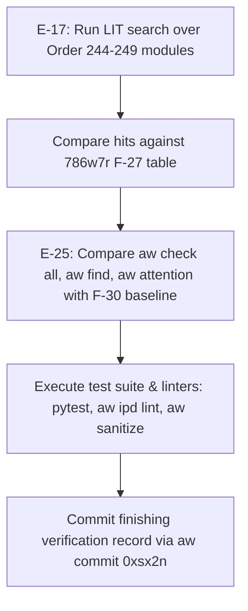

# IPD: Delete the remaining plans-family, ipd-family and module metadata regular expressions

- Date: 2026-11-08
- Kind: child
- Concern: Spec `4sd62s` 4.3 requires deleting every `^-` metadata regular expression outside `artifact_meta`, and AC-1 audits for them. Measured 2026-11-07 at `ac76110f4` (see `e8420v` F-26 for the census method): after Orders 43 to 45, 106 literals remain in 30 modules other than `check_engine`, `runner_shared`, `status_set` and `releases`. Of these, 24 are the patterns of readers that Order 43 (`k6jd6l`) deletes (`backlog` 10, `specs` 9, `selectors` 5) and should already be gone; the other 82 are spread over 27 modules with one to eight literals each. Part 6 of the split of `9o83cr` (Order 11).
- Scope: FINISHING PART after the round-3 split (2026-11-09). The four module-family subsets of `9o83cr` E-12 and this plan's baseline now run in seven earlier parts: shared baseline and site table F-27 `786w7r` (Order 238); plans modules `tbvx4r` (244); artifact modules `qttoyc` (245); ipd modules `nx7fws` (246); readiness modules `akhrp5` (247); attention, review and research `tdhav3` (248); remaining modules `n2cvf0` (249). This plan keeps only E-17 (split into E-17 and new E-25): the family-wide search and comment sweep, and the comparison with the `786w7r` baseline. EXCLUDES: `check_engine`, `runner_shared`, `status_set` and `releases` (Order 45, `e8420v`), the record text readers and grammars (Order 43, `k6jd6l`), and the AC-1 audit (`9o83cr`).
- Scope-Paths: .aw/records/plans/pending/20261108-metastore-46-0xsx2n-delete-the-remaining-plans-family-ipd-family-and-module-meta.ipd.md
- Item-Dependencies: executed:1ajqaa, executed:59aiyh, executed:786w7r, executed:akhrp5, executed:dcerjg, executed:ffceq0, executed:g5hpbb, executed:k6jd6l, executed:n2cvf0, executed:nx7fws, executed:qttoyc, executed:t4gl15, executed:tbvx4r, executed:tdhav3
- Status: approved
- Review-Depth: standard
- Readiness: go-pending-approval
- From-Spec: 4sd62s
- Work-Kind: feature
- Priority: high
- Blocks-Release: next
- Set: metastore
- Order: 46
- Highest E allocated: 25
- Author: opencode its_direct/pt3-claude-opus-5.5-1m-us
- Id: 0xsx2n
- Approval: 2026-11-16, recorded via aw ipd set: status set to approved

> Reviewed and proofread per the technical writing standard, `.aw/system/workflows/technical-writing/technical-writing.md`, including requirement 12 (diagrams).

## Workflow history
- 2026-11-16 approved (aw set): status set to approved

- 2026-11-14 reviewed (antigravity/gemini-3.8-flash): /plan-review (antigravity/gemini-3.8-flash): APPROVE WITH REVISIONS APPLIED; PR-001, PR-002, PR-003, PR-004.
- 2026-11-09 note (opencode its_direct/pt3-claude-opus-5.5-1m-us): round-3 split per research nj8zdp; items E-01 moved to 786w7r; E-21 split across tbvx4r, qttoyc; E-22 split across nx7fws, akhrp5; E-23 moved to tdhav3; E-24 moved to n2cvf0; E-17 kept and split in place into E-17 and E-25.
- 2026-11-07 to-review (opencode its_direct/pt3-claude-opus-5.5-1m-us): split from 9o83cr per maintainer step-complexity rule (no single E/V item hides hundreds of steps).

## Goal

After the seven split parts, prove that the `^-` metadata literals of the 30 modules are gone (only `body prose` and `non-metadata` rows of `786w7r` F-27 remain), and that `aw check all`, `aw find plans` and `aw attention` match the `786w7r` F-30 baseline.

## Detailed Implementation Checklist (TODO)

Execution-state rule: mark an `E-*` item complete only after performing the action. That mark is not validation. Right-sizing rule: each E-item must address one concern and be executable in one focused pass; split when an E-item names multiple distinct deliverables or independent test-surfaces. Accepted execution states: blocked, failed, pending, performed; terminal gate demands 'performed'.

The original `9o83cr` E-12 text is quoted in full in `e8420v` (Order 45). This plan carries it for the modules named in its Scope, including the named E-12 sites `review_findings._META_RE` (the round and finding grammar stays, N3), `plans_index._META_RE` and `plans_index._meta`, `plan_readiness._STATUS_RE` and `artifact_audit._STATUS_LINE_RE`, and "every other `^-` metadata regex literal in F-20" for these modules. Each site is deleted by reading the value through `artifact_meta.read`, `read_text` or `read_at` at its caller; a literal that matches body prose (N3) or a non-metadata grammar is classed and kept, not deleted. Update code comments in the touched modules that cite a deleted symbol. After the round-3 split (2026-11-09) E-01 and E-21 to E-24 live in the parts named in `## Deferred`; E-17 stays here, split into E-17 and E-25.

This plan deletes nothing; the PIN RULE lives in each part.

### Task group 1: finish

- [x] E-17 Finish, part 1: run the `LIT` search of `786w7r` over every module of Orders 244 to 249 (their Scope-Paths) and compare each hit with `786w7r` F-27: only `body prose (N3)` and `non-metadata` rows may remain; any surviving `delete` row is reported as `delete (follow-on)` naming the part that owned it, not fixed here.
  - Depends on: none
  - Expected outcome: every remaining hit matches a kept F-27 row.
  - Execution state: performed

- [x] E-25 Finish, part 2: compare `aw check all --agent`, `aw check all --all --agent` (rule-id multisets), `aw find plans --agent` and `aw attention --format json` (hashes) with `786w7r` F-30; run the bare core gate `python3 -m pytest`, `aw ipd lint` on this plan and `aw sanitize --agent`; commit through `aw commit 0xsx2n -- <paths>` with only Scope-Paths files, never `git add -A`, a bare `git add` or `git commit -a`; never push.
  - Depends on: E-17
  - Expected outcome: every comparison equals F-30 (or each difference is traced); all runs pass.
  - Execution state: performed

## Project conventions discovered (Step 0)

- N3 keeps Markdown body bullets (open-question rows such as `plan_readiness._OQ_FIELD_RE` and `attention._OQ_STATUS_RE`, E/V checklist fields, review rounds and findings) outside `artifact_meta`; their patterns are `body prose` and stay, and `9o83cr` E-14 lists them in its exclusion file.
- A literal inside a function that REWRITES a bullet (`ipd_lifecycle._insert_scope_exceeded_metadata`, `review_sequence.restore_pre_s7_plan`) is a writer; its replacement is an `artifact_meta.append` event, not a read.
- Cite code by SYMBOL (`module.function`) or by a quoted content string, with a line number only appended to one of those and never alone (advisory `IPD-C801`).

## Findings

| Id | Evidence | Finding |
|---|---|---|
| F-27 | Site census at `ac76110f4` (method in `e8420v` F-26): 106 literals in 30 modules outside Order 45's four. Families: plans and artifact 24; ipd and readiness 27 (2 of them body prose); attention, review and research 18 (1 body prose); remaining modules 37 (24 expected gone with Order 43, 6 non-metadata). Re-derived by E-01. | Four items, each at or under about 25 delete sites. |

## Proposed changes (ordered, validatable)



1. After the seven parts, re-run the site search against F-27 (E-17).
2. Compare with the F-30 baseline and commit (E-25).

## Deferred / out of scope (with reason)

- Moved to 786w7r (round-3 split 2026-11-09 per research nj8zdp guidance): E-01 (baseline and F-27), shared with `e8420v`.
  - Carrier: 786w7r
  - Carrier-Evidence: .aw/records/plans/executed/20261109-metastore-238-786w7r-record-the-baseline-for-the-remaining-metadata-regex-deletio.ipd.md
- Moved to tbvx4r (round-3 split 2026-11-09 per research nj8zdp guidance): E-21 subset 1, `plans_index` (6, with `_META_RE` and `_meta`), `plans_refs` (5), `plans_archive` (5), and `tests/test_plans_archive.py`.
  - Carrier: tbvx4r
  - Carrier-Evidence: .aw/records/plans/executed/20261109-metastore-244-tbvx4r-delete-the-plans-index-plans-refs-and-plans-archive-metadata.ipd.md
- Moved to qttoyc (round-3 split 2026-11-09 per research nj8zdp guidance): E-21 subset 2, `artifact_rename` (5), `artifact_refs` (1), `artifact_adopt` (1), `artifact_audit` (1, `_STATUS_LINE_RE`), and `tests/test_artifact_audit.py`. Subsets 1 and 2 equal E-21's list.
  - Carrier: qttoyc
  - Carrier-Evidence: .aw/records/plans/executed/20261109-metastore-245-qttoyc-delete-the-artifact-family-metadata-regex-literals.ipd.md
- Moved to nx7fws (round-3 split 2026-11-09 per research nj8zdp guidance): E-22 subset 1, `ipd_lint` (4), `ipd_lifecycle` (4, writer), `ipd_schema` (3), `ipd_authoring` (2).
  - Carrier: nx7fws
  - Carrier-Evidence: .aw/records/plans/executed/20261109-metastore-246-nx7fws-delete-the-ipd-module-metadata-regex-literals.ipd.md
- Moved to akhrp5 (round-3 split 2026-11-09 per research nj8zdp guidance): E-22 subset 2, `plan_readiness` (6, with `_STATUS_RE`), `readiness_recheck` (1), `coverage_record` (4), `orchestrator_readiness` (1), and `tests/test_coverage_record.py`. Subsets 1 and 2 equal E-22's list.
  - Carrier: akhrp5
  - Carrier-Evidence: .aw/records/plans/executed/20261109-metastore-247-akhrp5-delete-the-readiness-and-coverage-metadata-regex-literals.ipd.md
- Moved to tdhav3 (round-3 split 2026-11-09 per research nj8zdp guidance): E-23 (attention, review and research).
  - Carrier: tdhav3
  - Carrier-Evidence: .aw/records/plans/executed/20261109-metastore-248-tdhav3-delete-the-attention-review-and-research-metadata-regex-lite.ipd.md
- Moved to n2cvf0 (round-3 split 2026-11-09 per research nj8zdp guidance): E-24 (remaining modules and the `non-metadata` classification).
  - Carrier: n2cvf0
  - Carrier-Evidence: .aw/records/plans/executed/20261109-metastore-249-n2cvf0-delete-the-remaining-module-metadata-regex-literals.ipd.md
- `check_engine`, `runner_shared`, `status_set` and `releases` literals and parsers.
  - Carrier: e8420v
- The residual inventory F-20, the AC-1 test and the AC-1 audit with its exclusion file.
  - Carrier: 9o83cr

## Scope check

- Over-scope: none.
- Under-scope: none known. Size after the round-3 split: 2 E-items, 0 work Scope-Paths (this plan file).

## Required tests / validation

No module is retargeted here; the parts own their tests. Commands: the `LIT` search, `aw check all --agent`, `aw check all --all --agent`, `aw find plans --agent`, `aw attention --format json`, `python3 -m pytest` (core gate), `aw sanitize --agent`. CONTRIBUTES to AC-1 (owned by `9o83cr`).

## Spec / documentation sync

No spec change; implements part of `4sd62s` 4.3 and section 7 step 7.

## Open questions

### OQ-01: Are run-report and commit-message bullets metadata?

- Blocking: no
- Status: resolved
- Owner: plan author
- Resolution or deferral rationale: No. `run_viewer.load_run_summary` parses a run report's `Created:`/`Updated:`/`Selectors:` lines and `git_commit_helper._DIVIDER_RE` parses a commit-message divider; neither is artifact metadata in the sense of spec 4.3 section 1, so both are classed `non-metadata` and listed in the `9o83cr` E-14 exclusion file, which is where AC-1 allows explicit exclusions. Recommendation strength: medium.

## Validation and cross-check (verify before reporting done)

Validation-state rule: inspect evidence in a separate pass. Do not mark a `V-*` item complete from memory or from the matching execution checkmark. Accepted validation results: blocked, failed, pass, pending; terminal gate demands 'pass'. Runtime-demonstration reachability rule: for each `V-*` item demanding the software be observed acting (such as a run, a dispatch, or a transition), as distinct from items demanding a diff, a file's content, or a test result, which are reachable by construction, name the code path that produces the observation or the sibling `E-*` that creates it, else the demand is UNDER-SCOPE.

- [x] V-17 validates E-17
  - Required evidence: paste the `LIT` search output over the Order 244 to 249 modules, with each remaining hit matched to its `786w7r` F-27 row (class `body prose (N3)` or `non-metadata`), and any `delete (follow-on)` row named with its owning part.
  - Observed evidence:
    Run 2026-11-24 in lane worktree `0xsx2n` at HEAD `157271cf3` (all fourteen `- Item-Dependencies:` plans executed). `LIT` is the `786w7r` regex; the path list is the 39 non-`.aw/` Scope-Paths of `tbvx4r`, `qttoyc`, `nx7fws`, `akhrp5`, `tdhav3` and `n2cvf0` (the same 39 files `786w7r` searched).
    ```text
    $ xargs rg -n "$LIT" < paths.txt | wc -l
    14
    agent_workflows/cli.py:17673:    _YAML_FENCE_CLOSE_RE = re.compile(r"(?m)^---[ \t]*\r?$")
    tests/test_ipd_authoring.py:167:            m = _re.search(r"(?m)^- Id: ([0-9a-z]{6})$", target.read_text())
    tests/test_ipd_authoring.py:419:        m0 = _re.search(r"(?m)^- Id: ([0-9a-z]{6})$", t)
    tests/test_ipd_authoring.py:422:        t_noid = _re.sub(r"(?m)^- Id: [0-9a-z]{6}\n", "", t)
    tests/test_ipd_authoring.py:427:        m1 = _re.search(r"(?m)^- Id: ([0-9a-z]{6})$", t_after)
    tests/test_ipd_authoring.py:432:        ids = _re.findall(r"(?m)^- Id: ([0-9a-z]{6})$", self.path.read_text())
    tests/test_ipd_authoring.py:454:        m = _re.search(r"(?m)^- Id: ([0-9a-z]{6})\n", after)
    agent_workflows/plan_readiness.py:283:_OQ_FIELD_RE = re.compile(r"^-[ \t]*([A-Za-z][A-Za-z /-]*?):[ \t]?(.*)$")
    agent_workflows/attention.py:156:_OQ_STATUS_RE = re.compile(r"^-[ \t]*Status:[ \t]*(\S+)", re.IGNORECASE)
    agent_workflows/attention.py:231:                if re.search(r"^-[ \t]*Blocking:.*\(resolved\)", line, re.IGNORECASE):
    agent_workflows/attention.py:374:_EV_LEAF_RE = re.compile(r"^-\s*\[([ xX])\]\s*([EV])-[0-9]{2,}\b", re.MULTILINE)
    agent_workflows/ipd_schema.py:1127:V_ROW_RE = re.compile(r"^- \[[ x]\] (V-[0-9]{2,}) validates (E-[0-9]{2,})\b")
    agent_workflows/ipd_schema.py:1129:E_ROW_RE = re.compile(r"^- \[[ x]\] (E-[0-9]{2,})\b")
    agent_workflows/ipd_lint.py:229:_LEAF_RE = re.compile(r"^- \[([ x])\]\s+(.*)$")
    ```
    Per-module counts: `ipd_lint` 1, `ipd_schema` 2, `tests/test_ipd_authoring` 6, `plan_readiness` 1, `attention` 3, `cli` 1; the other 33 files 0.
    Match to `786w7r` F-27 (by symbol; line numbers drifted where the parts edited the module):
    | Hit | F-27 row | Class |
    |---|---|---|
    | `cli._run_search` `_YAML_FENCE_CLOSE_RE` | F27-24 | non-metadata |
    | `tests/test_ipd_authoring.py` 167 | F27-15 | non-metadata |
    | `tests/test_ipd_authoring.py` 419, 422, 427, 432 | F27-16 to F27-19 | non-metadata |
    | `tests/test_ipd_authoring.py` 454 | F27-20 | non-metadata |
    | `plan_readiness._OQ_FIELD_RE` (was 262) | F27-32 | body prose (N3) |
    | `attention._OQ_STATUS_RE` | F27-21 | body prose (N3) |
    | `attention.count_question_stats` | F27-22 | body prose (N3) |
    | `attention._EV_LEAF_RE` | F27-23 | body prose (N3) |
    | `ipd_schema.V_ROW_RE` (was 1124) | F27-8 | body prose (N3) |
    | `ipd_schema.E_ROW_RE` (was 1126) | F27-9 | body prose (N3) |
    | `ipd_lint._LEAF_RE` | F27-39 | body prose (N3) |
    14 hits, 14 kept rows; all 24 `delete (244)` to `delete (248)` rows of F-27 have no hit. F27-14 (`plans_refs._SIGNED_INT_RE`, non-metadata) no longer matches `LIT` because `tbvx4r` rewrote it as `re.compile(r"-?\d+")` used with `fullmatch`; it is still a kept non-metadata row. No `delete (follow-on)` row exists in the Order 244 to 249 modules.
    Outside those modules, the F-27 notes named five more literals: `rg -n "$LIT" agent_workflows/specs.py agent_workflows/backlog.py` still prints `specs._SPEC_ID_RE`, `specs._TOP_KEY_RE`, the `^- Status:` match in `specs.run_migrate`, `specs._SPEC_ID_BULLET_RE` and `backlog._TOP_KEY_RE`. These are `delete (follow-on)` owned by Order 43 (`k6jd6l`), already carried by backlog `ebbfmn`; not fixed here. `run_viewer.load_run_summary` (3) and `git_commit_helper._DIVIDER_RE` (1) remain and are `non-metadata` per OQ-01.
  - Result: pass

- [x] V-25 validates E-25
  - Required evidence: paste the two `aw check all` rule-id multiset diffs and the `aw find plans --agent` and `aw attention --format json` hash comparisons against `786w7r` F-30 (equal, or each difference traced); beside those, the bare `python3 -m pytest` summary line; `aw sanitize --agent` with zero `fail`; and `git show --stat` of every `aw commit 0xsx2n` commit listing only Scope-Paths files.
  - Observed evidence:
    Run 2026-11-24 in lane worktree `0xsx2n` at HEAD `157271cf3`. The "before" multisets are extracted from the F-30 code blocks of the executed `786w7r` plan.
    ```text
    $ cat check_all.exit check_all_all.exit find_plans.exit attention.exit
    1
    1
    0
    0
    $ jq -r '.diagnostics[].rule' check_all.json | sort | uniq -c > check_all.rules; diff before_check_all.rules check_all.rules && echo SAME1
    SAME1
    $ jq -r '.diagnostics[].rule' check_all_all.json | sort | uniq -c > check_all_all.rules; diff before_check_all_all.rules check_all_all.rules && echo SAME2
    SAME2
    $ jq -c '.findings_by_severity' check_all.json check_all_all.json
    {"error":11,"warning":2,"info":80}
    {"error":16,"warning":15,"info":509}
    $ for f in find_plans.out attention.json; do echo "$f $(wc -l < $f) $(sha256sum < $f)"; done
    find_plans.out 1986 f78fdd17f853eb647a2ef75a217ace2a3917928f6edea76b7ac0575282827f35  -
    attention.json 59950 a3bb2808e0f56695612b7208d23143991b0ad1bedddda7439a3a480bee93b806  -
    $ tail -1 find_plans.out
    {"schema":"aw.agent/v1","kind":"summary","cmd":"find","outcome":"clean","exit":0,"total":1985,"emitted":1985,"omitted":0,"complete":true}
    ```
    Exit codes, both rule-id multisets and both `findings_by_severity` counts equal F-30. The `aw find plans` count equals F-30 (1986 lines, total 1985) but the sha256 differs (F-30 `0f626c69...`); the `aw attention` output differs (F-30 59797 lines, 3515 items; now 59950 lines, 3524 items).
    Trace of the two hash differences: `git diff --stat 56e9d649f HEAD -- .aw/records` reports 24 record files changed since the baseline (the parts' plan moves, workflow-history lines and new backlog items), so the records input changed. To separate record drift from a behavior change, the baseline code (`git archive 56e9d649f agent_workflows`, run with `PYTHONSAFEPATH=1 AW_NO_REEXEC=1 PYTHONPATH=<extract>`) was run over the SAME current tree:
    ```text
    find_plans.out 1986 f78fdd17f853eb647a2ef75a217ace2a3917928f6edea76b7ac0575282827f35  -
    attention.json 59950 a3bb2808e0f56695612b7208d23143991b0ad1bedddda7439a3a480bee93b806  -
    $ cmp basecode/find_plans.out after/find_plans.out && echo FIND_SAME
    FIND_SAME
    $ cmp basecode/attention.json after/attention.json && echo ATT_SAME
    ATT_SAME
    ```
    The pre-deletion code and the post-deletion code produce byte-identical `aw find plans --agent` and `aw attention --format json` output on one tree, so every hash difference against F-30 is record drift, not a reader change (backlogs `rlugex` and `p1gshz` already carry the drift of the F-30 hash as a comparison key).
    Core gate, bare `python3 -m pytest`:
    ```text
    2894 passed, 1 skipped, 11 warnings in 154.04s (0:02:34)
    ```
    A second run printed `Core tier wall time: 77.65s exceeded budget of 30.00s.` and exited 1; no test failed. The exit 1 is the `conftest.py` wall-time budget only, as in `786w7r` F-30 (backlog `6o5aan`).
    ```text
    $ aw sanitize --agent
    {"schema":"aw.agent/v1","kind":"result","cmd":"check-local-leaks","outcome":"clean","exit":0,"verified":true,"complete":true,"checked":7168,"findings":0,"evidence":["leak-scan"],"next":null}
    ```
    `aw ipd lint` on this plan and the `git show --stat` of the `aw commit 0xsx2n` commit are recorded in the lane execution report (`.aw/state/lane-submissions/run-20261124T050731Z-1001505/26-0xsx2n/attempt-1/execution-report.md`), because a commit cannot contain its own hash or the lint of its own final text; the commit lists only this plan file.
  - Result: pass

## Approval and execution gate

- Size assessment: standard
- Cohesion rationale: not required

Execute only after human approval (`Status: approved`) and after every plan in `- Item-Dependencies:` is executed. Every deletion in the parts is pin-first. Scope fence: the paths in `- Scope-Paths:` are a declaration; a needed file outside the fence is edited and then justified at finalize (`--scope-reason`), and a declared path left unmodified is acknowledged (`--scope-ack`). Safety stop: if a prerequisite plan in `- Item-Dependencies:` is not executed, required metastore symbols from dependencies are absent, or table F-27 in `786w7r` has not been populated, stop and report rather than proceeding. Honesty rule: paste the ACTUAL summary lines; never claim a result you did not run. Commits: only through `aw commit 0xsx2n -- <paths>`; never push. Lifecycle: the plan moves to `.aw/records/plans/executed/` only through `aw ipd finalize`, never a hand `git mv`, after `aw ipd lint --phase pre-transition` conforms and every `V-*` reads `pass` with pasted evidence. When `aw oc run` or `aw agy run` executes the plan, the runner performs the finalize; a hand executor runs `aw ipd finalize 0xsx2n` itself.
