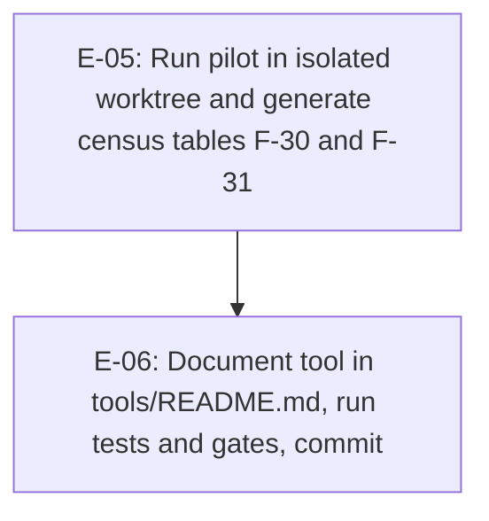

# IPD: Build and prove the test-fixture codemod

- Date: 2026-11-08
- Kind: child
- Concern: Spec `4sd62s` section 6 requires that test data be written by ONE shared record builder (`tests/record_builder.py`, built by `9rgn2w`, Order 37) in phase B, so that the cutover (Order 13, `cxxmyv`) changes the builder and not hundreds of test files. Measured 2026-11-08 at `ac76110f4`: the F-01 `rg -c` pattern matches 6,747 lines in 318 batch modules (323 files minus the 5 EXCLUDED `tests/test_artifact_meta_*.py`); a Python `ast` walk over the same 318 files finds 3,272 string-literal sites (2,636 plain constants, 636 f-strings) that carry at least one legacy bullet or `## Workflow history`, of which 867 are the argument of a `write_text` call, 882 are assigned or returned, 930 are passed to another call and 535 sit inside an assertion. The batch plans (`x05v02`, `7qxey9`, `nbfg7w`, `1upea0`) each held items such as "convert these 17 modules, 738 lines" that hide hundreds of hand edits. Maintainer decision 2026-11-07 ("Codemod first, then small runs"): build a tested tool that performs the mechanical rewrite, and size each batch item by the tool's measured refusals, not by line counts.
- Scope: FINISHING PART after the round-3 split (2026-11-09, research `nj8zdp` guidance): the pilot and the census tables F-30 and F-31 (E-05) and the README section, gates and commit (E-06). The tool moved to `y3uowx`, its tests to `j2xjtt` and `n0li9v`. Before the round-3 split: A standalone tool `tools/fixture_codemod.py` with a static site detector, a dry run, an apply mode that rewrites only sites whose module outcome list it proved unchanged, its behavioral test module and fixtures, a throwaway pilot on three real modules, and a census over all 318 batch modules recorded as tracked Findings tables F-30 (per module) and F-31 (per batch subset) that the batch plans cite. EXCLUDES: converting any test module on `main` (the batch plans Orders 38 to 40, 50, and `59aiyh` E-09); the builder itself (`9rgn2w`); setter-byte assertion conversion (`iog3cw`, `w13bkp`, Orders 59 to 62); production code under `agent_workflows/`.
- Scope-Paths: tools/README.md, .aw/records/plans/pending/20261108-metastore-49-653ndz-build-and-prove-the-test-fixture-codemod.ipd.md
- Item-Dependencies: executed:9rgn2w, executed:g5hpbb, executed:tve77h, executed:xexn45, executed:y3uowx, executed:j2xjtt, executed:n0li9v
- Status: approved
- Readiness: go-pending-approval
- Review-Depth: standard
- From-Spec: 4sd62s
- Work-Kind: feature
- Priority: high
- Blocks-Release: next
- Set: metastore
- Order: 49
- Highest E allocated: 06
- Author: opencode its_direct/pt3-claude-opus-5.5-1m-us
- Id: 653ndz
- Approval: 2026-11-16, recorded via aw ipd set: status set to approved

> Write and proofread this plan per the technical writing standard, `.aw/system/workflows/technical-writing/technical-writing.md` (`.agents/workflows/technical-writing/technical-writing.md` in a legacy-layout install), including requirement 12 (diagrams).

## Workflow history
- 2026-11-16 approved (aw set): status set to approved

- 2026-11-14 reviewed (antigravity/gemini-3.8-flash): /plan-review (antigravity/gemini-3.8-flash): APPROVE WITH REVISIONS APPLIED; PR-001, PR-002, PR-003
- 2026-11-09 note (opencode its_direct/pt3-claude-opus-5.5-1m-us): round-3 split per research nj8zdp; items E-01, E-02, E-03 moved to y3uowx; E-04 moved to j2xjtt (cases a, b, c, e, f, g, h) and n0li9v (case d); kept E-05 and E-06.
- 2026-11-08 to-review (opencode its_direct/pt3-claude-opus-5.5-1m-us): created per maintainer decision 2026-11-07 ("Codemod first, then small runs"); the batch plans x05v02, 7qxey9, nbfg7w and 1upea0 run this tool and hand-convert only its census refusals.

## Goal

After the round-3 split this plan pilots the finished tool and writes the census. The family goal: A tested `tools/fixture_codemod.py` rewrites inline legacy fixture text in test modules into `tests/record_builder.py` calls, never rewrites a site whose module outcome list it has not proved unchanged, and a tracked census tells each batch item exactly how many refusals it must convert by hand.

## Detailed Implementation Checklist (TODO)

Execution-state rule: mark an `E-*` item complete only after performing the action. That mark is not validation. Right-sizing rule: write for a modest executor that cannot hold much in its head. Each E-item is one step (one concern, about one file, executable in one focused pass) and its V-item names each unit it covers with its own check; a plan stays at about 5 E-items and 8 work Scope-Paths, else split it into more child plans (guidance, `IPD-Z603`). Accepted execution states: blocked, failed, pending, performed; terminal gate demands 'performed'.

Split note (round 3, 2026-11-09, research `nj8zdp` guidance): items E-01, E-02 and E-03 moved to Order 172 (`y3uowx`) and E-04 to Orders 173 (`j2xjtt`) and 216 (`n0li9v`) with their ids; this plan keeps the pilot and census (E-05) and the finish (E-06).

Terms used below. A SITE is one Python string literal (a constant or an f-string, found with `ast`) in a test module whose text matches the F-01 pattern. A REWRITE replaces the site's expression in place, and nothing else in the module, with the builder's text form (`RecordBuilder(...).<type>(..., text_only=True)`, `9rgn2w` E-01). A REFUSAL is a site the tool leaves untouched, with one reason code. Each reason code has one DISPOSITION: `hand` (a batch item converts it by hand) or `legacy-kept` (the site stays in legacy form on purpose and is listed with its F-06 reason class).

| Reason code | Disposition | Meaning |
|---|---|---|
| `dynamic-construction` | hand | The text is built by concatenation, a conditional, or an f-string placeholder that holds a whole line (for example `f"{br_line}"`), so no field-by-field mapping is statically known. |
| `unsupported-shape` | hand | The record type cannot be inferred from the heading or the written path, a field is unknown to the registry, or the builder's text form needs a repository root the site's scope does not provide by a simple name. |
| `not-equivalent` | hand | Apply mode rewrote the site and the module's outcome list changed; the tool reverted it (E-03). |
| `legacy-format subject` | legacy-kept | The module or test's subject is the legacy grammar (F-03 EXCLUDED list, `*legacy*`, `*m0001*`, `*migrat*`, `test_front_matter_loose*`, `test_selector_two_dialect*`, `test_history_block_bounding*`). |
| `displayed-output assertion` | legacy-kept | The site is the expected text of an assertion over command output. |
| `setter-byte assertion` | legacy-kept | The site is the expected text of an assertion over a record file's bytes (converted later by `iog3cw`, `w13bkp` and Orders 59 to 62). |
| `body prose` | legacy-kept | The bullets are body text (for example open-question `- Status: open` rows, N3). |

A deliberately invalid value (F-08, for example `- Status: EXECUTED`) is NOT a refusal: the tool writes it through the builder's `raw_fields=` escape and lists the site as a rewrite with class `invalid-input`.

### Task group 2: pilot, census and finish

- [x] E-05 Pilot and census. Ensure directory `.aw/state/653ndz/` exists (`mkdir -p .aw/state/653ndz`). PILOT: in a throwaway `git worktree add .aw/state/653ndz/pilot HEAD`, run `--apply` on `tests/test_backlog_handoff_close.py`, `tests/test_check_engine.py` and `tests/test_status_set.py` (three families, chosen because F-01 ranks them among the densest), paste each module's before and after outcome-list hash (identical) and its rewrite and refusal totals, then remove the worktree; nothing from the pilot is committed. CENSUS: run `--dry-run --format json` over all 318 batch modules (the F-01 `rg -l` list minus the 5 EXCLUDED files, saved as `.aw/state/653ndz/census-files.txt`) and write two tracked tables into this plan's Findings: F-30, one row per module (module, batch subset id and converting plan id6 from F-32, sites, rewrites, `invalid-input` rewrites, refusals by reason code, `hand` total, `legacy-kept` total), generated by the tool's `--census-markdown` output rather than typed; and F-31, one row per batch subset (G1a, G1b, G2a, G2b, G3a, G3b, G4a, G4b, G4c, G5a, G5b, G6a, G6b, G6c, G7a, G7b) with the same totals summed and the carrying plan's id6. The dry run is static, so F-31 cannot contain apply-time `not-equivalent` refusals; each batch item adds those to its own `hand` count. Any subset whose F-31 `hand` total exceeds 25 is named in F-31's last column as "re-split before approval". (Measured units: 3 pilot modules, 1 census run over 318 modules generated mechanically, 2 tables.)
  - Depends on: none
  - Expected outcome: three identical pilot hash pairs; F-30 has 318 rows and F-31 has 16 rows whose site totals equal F-30's; every over-25 subset is flagged.
  - Execution state: performed

- [x] E-06 Finish: add a `tools/fixture_codemod.py` section to `tools/README.md` (purpose, the three modes, the reason-code table, the rule that `--apply` always proves); run `tests/test_fixture_codemod.py` (written by Orders 173 and 216) and the bare core gate `python3 -m pytest`, and `aw sanitize --agent`; commit through `aw commit 653ndz -- <each changed path>`, never `git add -A`, a bare `git add` or `git commit -a`. Never push.
  - Depends on: E-05
  - Expected outcome: all runs pass; F-30 and F-31 are committed in this plan; every commit is path-scoped to Scope-Paths (or justified at finalize).
  - Execution state: performed

## Project conventions discovered (Step 0)

- Standalone maintenance tools live in `tools/` and are described in `tools/README.md`; their behavioral tests drive them as subprocesses by path (for example `tests/test_gate_drop_audit.py` sets `AUDITOR_PATH` to `tools/gate_drop_audit.py`).
- The builder interface (`9rgn2w` E-01): `RecordBuilder(repo_root)` with one method per record type, registry-named keyword fields, `raw_fields={legacy_name: text}` for deliberately invalid input, and `text_only=True` returning the string.
- `artifact_meta.registry_fields(type)` names each type's fields; `artifact_meta.read_text(text, *, record_type=None)` parses a record's text.
- Tests are behavioral (AGENTS.md "TEST OUTCOMES, NOT CODE STRUCTURE"); the codemod reads TEST source because rewriting it is its job, and no test of the codemod reads production source. Core modules set `pytestmark = pytest.mark.core`; `slow` tests are listed in `tests/slow_allowlist.txt`; a complete comparison passes `-m ""`, and a deterministic order needs `-p no:randomly`.
- Cite code by SYMBOL (`module.function`) or by a quoted content string, with a line number only appended to one of those and never alone (advisory `IPD-C801`).

## Findings

Measured 2026-11-08 at `ac76110f4`.

| Id | Evidence | Finding |
|---|---|---|
| F-01 | `rg -c --glob '*.py' -e '- (Id\|Status\|Set\|Kind\|Blocks-Release\|Readiness\|Item-Dependencies\|Scope-Paths\|From-Backlog\|From-Spec\|Work-Kind\|Priority\|Order\|Date\|Gate-Kind\|Gate-Ref\|Approval\|Subject-Id\|Verdict\|Graduated-To):\|## Workflow history' tests`: 323 files; minus the 5 EXCLUDED `tests/test_artifact_meta_*.py` files, 318 modules with 6,747 matching lines | The census input. It includes `tests/support.py` and `tests/conformance_matrix.py` (subset G7b, `59aiyh` E-09). |
| F-29 | An `ast` walk over the 318 modules (string constants and f-strings whose text matches F-01, nested f-string parts not double-counted): 3,272 sites in 313 modules; by context: `write_text` argument 867, assigned or returned 882, argument of another call 930, inside an assertion 535, other 58 | About 1,750 sites sit in a write or an assignment, the shapes a rewrite handles; the 535 assertion sites are refusals by construction (`displayed-output` or `setter-byte`). The number of `dynamic-construction` refusals is unknown until E-05. |
| F-30 | Generated mechanically by `tools/fixture_codemod.py --census-markdown` and verified against `--dry-run --format json` over the 318 batch modules (`.aw/state/653ndz/census-files.txt`, exact union of F-41 tables across `x05v02`, `7qxey9`, `nbfg7w`, `1upea0`, `59aiyh`) at HEAD `284fc40a7`, with `Subset` and converting `Plan` columns spliced from F-32/F-41: 318 modules, 3,402 sites, 1,053 rewrites (952 standard, 101 `invalid-input`), 2,349 refusals (1,552 `hand`, 797 `legacy-kept`) | See table F-30 below; cited by every batch item. |
| F-31 | Mechanically summed from F-30 across all 16 batch subsets (`G1a`..`G7b`): 318 modules, 3,402 sites, 1,053 rewrites (101 `invalid-input`), 1,552 `hand`, 797 `legacy-kept`; 15 of 16 subsets exceed 25 `hand` refusals and are flagged `re-split before approval` (all except `G6a` at 19) | See table F-31 below; cited by every batch item as its `hand` count (context after the round-3 chunk split). |
| F-32 | Batch subsets and their carrying plans after the 2026-11-08 restructuring: G1a, G1b, G2a, G2b `x05v02`; G3b, G4a, G4b, G4c `7qxey9`; G5b, G6a, G6b, G6c `nbfg7w`; G3a, G5a, G7a `1upea0`; G7b `59aiyh` E-09. Round-3 split 2026-11-09: each of those plans now keeps at most 8 of its modules and names the chunk plan (Orders 175 to 212) of every other module in its own table F-41; F-30 labels each row with the subset AND the plan that converts it, read from those F-41 tables | E-05 labels each F-30 row with its subset from the module lists named in those items. |

Note on post-`ac76110f4` test modules at HEAD `284fc40a7`: running the F-01 `rg -l` pattern over `tests/` now returns 364 files (22 in the F-03 EXCLUDED list, the exact 318 F-41 batch modules enumerated in F-30 below, and 24 newer files added after `ac76110f4` including `tests/record_builder.py`, `tests/test_fixture_codemod.py`, `tests/test_fixture_codemod_slow.py`, `tests/migration_corpus.py`, `tests/test_readers_*.py`, and other post-split test modules). F-30 and F-31 cover the exact 318 F-41 batch modules so every row carries an F-32/F-41 subset and converting plan.

### F-30: Per-module static census (318 batch modules)

Generated mechanically from `python3 tools/fixture_codemod.py --census-markdown $(cat .aw/state/653ndz/census-files.txt)` at HEAD `284fc40a7`, with `Subset` and converting `Plan` columns spliced from the F-41 tables of `x05v02`, `7qxey9`, `nbfg7w`, `1upea0`, and `59aiyh`.

| Module | Subset | Plan | Sites | Rewrites | Invalid-Input | dynamic-construction | unsupported-shape | not-equivalent | legacy-format subject | displayed-output assertion | setter-byte assertion | body prose | Hand | Legacy-Kept |
|---|---|---|---:|---:|---:|---:|---:|---:|---:|---:|---:|---:|---:|---:|
| `tests/conformance_matrix.py` | G7b | `59aiyh` | 5 | 3 | 0 | 0 | 2 | 0 | 0 | 0 | 0 | 0 | 2 | 0 |
| `tests/support.py` | G7b | `59aiyh` | 0 | 0 | 0 | 0 | 0 | 0 | 0 | 0 | 0 | 0 | 0 | 0 |
| `tests/test_action_table_runner_parity.py` | G7a | `z8hu7r` | 15 | 0 | 0 | 0 | 15 | 0 | 0 | 0 | 0 | 0 | 15 | 0 |
| `tests/test_agy_run_resolve_ipd_recursive.py` | G5a | `9hk3rh` | 6 | 6 | 3 | 0 | 0 | 0 | 0 | 0 | 0 | 0 | 0 | 0 |
| `tests/test_agy_runipd_cli.py` | G5a | `9hk3rh` | 14 | 6 | 0 | 0 | 7 | 0 | 0 | 0 | 1 | 0 | 7 | 1 |
| `tests/test_agy_skip_permissions_default.py` | G5a | `5mg9g1` | 1 | 1 | 1 | 0 | 0 | 0 | 0 | 0 | 0 | 0 | 0 | 0 |
| `tests/test_already_landed_dispatch.py` | G7a | `z8hu7r` | 1 | 1 | 0 | 0 | 0 | 0 | 0 | 0 | 0 | 0 | 0 | 0 |
| `tests/test_artifact_adopt.py` | G6b | `a1b70x` | 10 | 5 | 0 | 1 | 4 | 0 | 0 | 0 | 0 | 0 | 5 | 0 |
| `tests/test_artifact_audit.py` | G6b | `a1b70x` | 21 | 7 | 0 | 1 | 13 | 0 | 0 | 0 | 0 | 0 | 14 | 0 |
| `tests/test_artifact_audit_cache_eviction.py` | G6b | `a1b70x` | 6 | 6 | 0 | 0 | 0 | 0 | 0 | 0 | 0 | 0 | 0 | 0 |
| `tests/test_artifact_audit_identity_staleness.py` | G6b | `a1b70x` | 13 | 13 | 0 | 0 | 0 | 0 | 0 | 0 | 0 | 0 | 0 | 0 |
| `tests/test_artifact_audit_index_cache.py` | G6b | `a1b70x` | 12 | 8 | 4 | 0 | 4 | 0 | 0 | 0 | 0 | 0 | 4 | 0 |
| `tests/test_artifact_audit_verdicts.py` | G6b | `a1b70x` | 6 | 4 | 0 | 0 | 2 | 0 | 0 | 0 | 0 | 0 | 2 | 0 |
| `tests/test_artifact_group.py` | G6b | `j5mwpk` | 20 | 5 | 0 | 0 | 3 | 0 | 0 | 0 | 12 | 0 | 3 | 12 |
| `tests/test_artifact_refs_rewrite.py` | G6b | `j5mwpk` | 24 | 19 | 1 | 1 | 2 | 0 | 0 | 0 | 2 | 0 | 3 | 2 |
| `tests/test_artifact_rename.py` | G6b | `j5mwpk` | 5 | 3 | 0 | 0 | 1 | 0 | 0 | 0 | 1 | 0 | 1 | 1 |
| `tests/test_attempt_model_identity.py` | G5b | `i29bd5` | 2 | 2 | 0 | 0 | 0 | 0 | 0 | 0 | 0 | 0 | 0 | 0 |
| `tests/test_attended_session.py` | G5b | `i29bd5` | 2 | 0 | 0 | 0 | 2 | 0 | 0 | 0 | 0 | 0 | 2 | 0 |
| `tests/test_attention.py` | G6a | `lf0fe4` | 42 | 33 | 4 | 2 | 3 | 0 | 0 | 0 | 1 | 3 | 5 | 4 |
| `tests/test_attention_contract.py` | G6a | `lf0fe4` | 9 | 5 | 4 | 0 | 3 | 0 | 0 | 0 | 1 | 0 | 3 | 1 |
| `tests/test_attention_degraded_item.py` | G6a | `lf0fe4` | 3 | 3 | 1 | 0 | 0 | 0 | 0 | 0 | 0 | 0 | 0 | 0 |
| `tests/test_attention_excluded_tree_selector.py` | G6a | `lf0fe4` | 1 | 1 | 0 | 0 | 0 | 0 | 0 | 0 | 0 | 0 | 0 | 0 |
| `tests/test_attention_lane_detail_bound.py` | G6a | `lf0fe4` | 3 | 3 | 0 | 0 | 0 | 0 | 0 | 0 | 0 | 0 | 0 | 0 |
| `tests/test_attention_output_safety.py` | G6a | `lf0fe4` | 4 | 4 | 0 | 0 | 0 | 0 | 0 | 0 | 0 | 0 | 0 | 0 |
| `tests/test_attention_priority_blocker.py` | G6a | `lf0fe4` | 11 | 2 | 0 | 0 | 1 | 0 | 0 | 0 | 6 | 2 | 1 | 8 |
| `tests/test_authoring_coverage_guidance.py` | G7a | `tsonlq` | 2 | 2 | 0 | 0 | 0 | 0 | 0 | 0 | 0 | 0 | 0 | 0 |
| `tests/test_awcmdsurf_mutation_verbs.py` | G7a | `tsonlq` | 3 | 1 | 0 | 0 | 0 | 0 | 0 | 0 | 2 | 0 | 0 | 2 |
| `tests/test_awmigrename.py` | G7a | `tsonlq` | 2 | 2 | 0 | 0 | 0 | 0 | 0 | 0 | 0 | 0 | 0 | 0 |
| `tests/test_awphysical_tools.py` | G7a | `tsonlq` | 1 | 1 | 1 | 0 | 0 | 0 | 0 | 0 | 0 | 0 | 0 | 0 |
| `tests/test_backlog.py` | G1a | `2fn0vd` | 71 | 24 | 0 | 3 | 20 | 0 | 0 | 0 | 24 | 0 | 23 | 24 |
| `tests/test_backlog_already_complete.py` | G1a | `id2pdx` | 4 | 0 | 0 | 3 | 0 | 0 | 0 | 0 | 1 | 0 | 3 | 1 |
| `tests/test_backlog_close_evidence_plan_disposition.py` | G1a | `id2pdx` | 10 | 2 | 0 | 0 | 8 | 0 | 0 | 0 | 0 | 0 | 8 | 0 |
| `tests/test_backlog_close_host_label.py` | G1a | `id2pdx` | 2 | 2 | 0 | 0 | 0 | 0 | 0 | 0 | 0 | 0 | 0 | 0 |
| `tests/test_backlog_descriptive_safety.py` | G1a | `id2pdx` | 7 | 0 | 0 | 0 | 1 | 0 | 0 | 0 | 0 | 6 | 1 | 6 |
| `tests/test_backlog_duplicate_guard.py` | G1a | `id2pdx` | 14 | 0 | 0 | 0 | 14 | 0 | 0 | 0 | 0 | 0 | 14 | 0 |
| `tests/test_backlog_gate_follows_status.py` | G1a | `id2pdx` | 23 | 2 | 0 | 0 | 7 | 0 | 0 | 0 | 14 | 0 | 7 | 14 |
| `tests/test_backlog_handoff_close.py` | G1a | `id2pdx` | 23 | 10 | 0 | 10 | 3 | 0 | 0 | 0 | 0 | 0 | 13 | 0 |
| `tests/test_backlog_history_dedup_parity.py` | G1a | `id2pdx` | 9 | 1 | 0 | 8 | 0 | 0 | 0 | 0 | 0 | 0 | 8 | 0 |
| `tests/test_backlog_history_empty_rule.py` | G1a | `2fn0vd` | 9 | 3 | 0 | 0 | 5 | 0 | 0 | 0 | 1 | 0 | 5 | 1 |
| `tests/test_backlog_metadata_duplicate_and_gate_summary.py` | G1a | `2fn0vd` | 31 | 1 | 0 | 0 | 28 | 0 | 0 | 0 | 2 | 0 | 28 | 2 |
| `tests/test_backlog_new_gate_vocabulary.py` | G1a | `2fn0vd` | 4 | 0 | 0 | 0 | 0 | 0 | 0 | 0 | 4 | 0 | 0 | 4 |
| `tests/test_backlog_positional_close_gate.py` | G1a | `2fn0vd` | 19 | 2 | 0 | 0 | 7 | 0 | 0 | 0 | 10 | 0 | 7 | 10 |
| `tests/test_backlog_production.py` | G1a | `2fn0vd` | 18 | 5 | 1 | 6 | 4 | 0 | 0 | 0 | 3 | 0 | 10 | 3 |
| `tests/test_backlog_set_adapter.py` | G1a | `2fn0vd` | 4 | 1 | 0 | 2 | 0 | 0 | 0 | 0 | 1 | 0 | 2 | 1 |
| `tests/test_backlog_transition_authority.py` | G1a | `2fn0vd` | 16 | 1 | 0 | 0 | 7 | 0 | 0 | 0 | 8 | 0 | 7 | 8 |
| `tests/test_backlog_transition_gate.py` | G1a | `isj48z` | 15 | 3 | 0 | 1 | 9 | 0 | 0 | 0 | 2 | 0 | 10 | 2 |
| `tests/test_bidi_control_rejection.py` | G3a | `2ll84l` | 1 | 0 | 0 | 0 | 1 | 0 | 0 | 0 | 0 | 0 | 1 | 0 |
| `tests/test_blocks_release_reader_bounding.py` | G1b | `dg43sc` | 21 | 12 | 0 | 0 | 5 | 0 | 0 | 0 | 4 | 0 | 5 | 4 |
| `tests/test_carrier_detail_descriptive_bound.py` | G1b | `dg43sc` | 7 | 6 | 4 | 1 | 0 | 0 | 0 | 0 | 0 | 0 | 1 | 0 |
| `tests/test_carrier_reverse_lookup.py` | G1b | `dg43sc` | 1 | 1 | 0 | 0 | 0 | 0 | 0 | 0 | 0 | 0 | 0 | 0 |
| `tests/test_carrier_ungated_rule.py` | G1b | `dg43sc` | 3 | 0 | 0 | 1 | 2 | 0 | 0 | 0 | 0 | 0 | 3 | 0 |
| `tests/test_check_ci_local_parity.py` | G2b | `zl2pki` | 4 | 4 | 2 | 0 | 0 | 0 | 0 | 0 | 0 | 0 | 0 | 0 |
| `tests/test_check_engine.py` | G2a | `872zd9` | 81 | 58 | 7 | 7 | 14 | 0 | 0 | 0 | 0 | 2 | 21 | 2 |
| `tests/test_check_engine_from_spec_missing.py` | G2a | `wirc2e` | 33 | 1 | 0 | 0 | 21 | 0 | 0 | 0 | 11 | 0 | 21 | 11 |
| `tests/test_check_engine_metadata_region.py` | G2a | `872zd9` | 3 | 1 | 0 | 0 | 2 | 0 | 0 | 0 | 0 | 0 | 2 | 0 |
| `tests/test_check_engine_plan_date_filename.py` | G2a | `872zd9` | 12 | 0 | 0 | 0 | 12 | 0 | 0 | 0 | 0 | 0 | 12 | 0 |
| `tests/test_check_engine_release_gate.py` | G2a | `872zd9` | 85 | 85 | 4 | 0 | 0 | 0 | 0 | 0 | 0 | 0 | 0 | 0 |
| `tests/test_check_engine_spec_criteria.py` | G2a | `872zd9` | 3 | 1 | 0 | 1 | 0 | 0 | 0 | 0 | 0 | 1 | 1 | 1 |
| `tests/test_check_engine_status_meta.py` | G2a | `872zd9` | 6 | 3 | 0 | 1 | 2 | 0 | 0 | 0 | 0 | 0 | 3 | 0 |
| `tests/test_check_engine_test_citation.py` | G2a | `872zd9` | 3 | 0 | 0 | 1 | 1 | 0 | 0 | 0 | 1 | 0 | 2 | 1 |
| `tests/test_check_finding_path_relativity.py` | G2b | `zl2pki` | 7 | 5 | 5 | 0 | 2 | 0 | 0 | 0 | 0 | 0 | 2 | 0 |
| `tests/test_check_recovery_fidelity.py` | G2b | `zl2pki` | 3 | 3 | 0 | 0 | 0 | 0 | 0 | 0 | 0 | 0 | 0 | 0 |
| `tests/test_check_severity_tally.py` | G2b | `zl2pki` | 2 | 2 | 0 | 0 | 0 | 0 | 0 | 0 | 0 | 0 | 0 | 0 |
| `tests/test_clean_target_zero_delta_e2e.py` | G5b | `i29bd5` | 2 | 0 | 0 | 0 | 0 | 0 | 0 | 0 | 1 | 1 | 0 | 2 |
| `tests/test_cli.py` | G6a | `jjvnhb` | 1 | 1 | 0 | 0 | 0 | 0 | 0 | 0 | 0 | 0 | 0 | 0 |
| `tests/test_cli_find.py` | G6a | `jjvnhb` | 4 | 4 | 0 | 0 | 0 | 0 | 0 | 0 | 0 | 0 | 0 | 0 |
| `tests/test_cli_search.py` | G6a | `jjvnhb` | 8 | 8 | 1 | 0 | 0 | 0 | 0 | 0 | 0 | 0 | 0 | 0 |
| `tests/test_cli_show.py` | G6a | `jjvnhb` | 4 | 0 | 0 | 1 | 3 | 0 | 0 | 0 | 0 | 0 | 4 | 0 |
| `tests/test_collision_population_parity.py` | G7a | `tsonlq` | 0 | 0 | 0 | 0 | 0 | 0 | 0 | 0 | 0 | 0 | 0 | 0 |
| `tests/test_commit_default_message.py` | G5b | `i29bd5` | 1 | 1 | 0 | 0 | 0 | 0 | 0 | 0 | 0 | 0 | 0 | 0 |
| `tests/test_commit_scope_reason.py` | G5b | `i29bd5` | 0 | 0 | 0 | 0 | 0 | 0 | 0 | 0 | 0 | 0 | 0 | 0 |
| `tests/test_companion_record_owner_root.py` | G7a | `tsonlq` | 9 | 1 | 0 | 0 | 6 | 0 | 0 | 0 | 0 | 2 | 6 | 2 |
| `tests/test_completion.py` | G7a | `tsonlq` | 7 | 5 | 0 | 0 | 1 | 0 | 0 | 0 | 0 | 1 | 1 | 1 |
| `tests/test_coverage_not_written.py` | G4c | `qb3n9s` | 20 | 0 | 0 | 0 | 20 | 0 | 0 | 0 | 0 | 0 | 20 | 0 |
| `tests/test_coverage_record.py` | G4c | `qb3n9s` | 1 | 0 | 0 | 0 | 1 | 0 | 0 | 0 | 0 | 0 | 1 | 0 |
| `tests/test_cross_tree_session_refusal.py` | G7a | `erulw3` | 1 | 1 | 0 | 0 | 0 | 0 | 0 | 0 | 0 | 0 | 0 | 0 |
| `tests/test_decision_ref_resolution.py` | G2b | `zl2pki` | 6 | 0 | 0 | 6 | 0 | 0 | 0 | 0 | 0 | 0 | 6 | 0 |
| `tests/test_defect_report.py` | G7a | `erulw3` | 2 | 2 | 0 | 0 | 0 | 0 | 0 | 0 | 0 | 0 | 0 | 0 |
| `tests/test_dependency_block_reporting.py` | G4b | `3k142n` | 4 | 4 | 0 | 0 | 0 | 0 | 0 | 0 | 0 | 0 | 0 | 0 |
| `tests/test_descriptive_length_classes.py` | G3a | `2ll84l` | 1 | 0 | 0 | 0 | 1 | 0 | 0 | 0 | 0 | 0 | 1 | 0 |
| `tests/test_doctor.py` | G7a | `erulw3` | 3 | 1 | 0 | 0 | 1 | 0 | 0 | 0 | 1 | 0 | 1 | 1 |
| `tests/test_drift_detail_escaping.py` | G7a | `erulw3` | 15 | 11 | 1 | 0 | 4 | 0 | 0 | 0 | 0 | 0 | 4 | 0 |
| `tests/test_durable_carrier_shared_predicate.py` | G1b | `dg43sc` | 1 | 1 | 0 | 0 | 0 | 0 | 0 | 0 | 0 | 0 | 0 | 0 |
| `tests/test_empty_result_convention_doc.py` | G7a | `erulw3` | 2 | 1 | 0 | 0 | 1 | 0 | 0 | 0 | 0 | 0 | 1 | 0 |
| `tests/test_executed_transition_gate.py` | G4b | `3k142n` | 16 | 9 | 1 | 0 | 7 | 0 | 0 | 0 | 0 | 0 | 7 | 0 |
| `tests/test_executed_transition_gate_e2e.py` | G4b | `3k142n` | 29 | 0 | 0 | 0 | 20 | 0 | 0 | 0 | 2 | 7 | 20 | 9 |
| `tests/test_explicit_dir_non_project.py` | G7a | `erulw3` | 1 | 1 | 0 | 0 | 0 | 0 | 0 | 0 | 0 | 0 | 0 | 0 |
| `tests/test_explicit_dir_subdir_resolution.py` | G7a | `erulw3` | 1 | 1 | 0 | 0 | 0 | 0 | 0 | 0 | 0 | 0 | 0 | 0 |
| `tests/test_finalize_refusal_findings.py` | G4b | `3k142n` | 2 | 0 | 0 | 0 | 2 | 0 | 0 | 0 | 0 | 0 | 2 | 0 |
| `tests/test_finalize_sendback.py` | G4b | `3k142n` | 19 | 9 | 0 | 0 | 10 | 0 | 0 | 0 | 0 | 0 | 10 | 0 |
| `tests/test_finalize_stale_plan_path.py` | G4b | `3k142n` | 4 | 4 | 0 | 0 | 0 | 0 | 0 | 0 | 0 | 0 | 0 | 0 |
| `tests/test_find_agent_stream.py` | G6a | `jjvnhb` | 9 | 9 | 0 | 0 | 0 | 0 | 0 | 0 | 0 | 0 | 0 | 0 |
| `tests/test_find_filters.py` | G6a | `jjvnhb` | 8 | 8 | 0 | 0 | 0 | 0 | 0 | 0 | 0 | 0 | 0 | 0 |
| `tests/test_find_human_limit.py` | G6a | `jjvnhb` | 9 | 9 | 0 | 0 | 0 | 0 | 0 | 0 | 0 | 0 | 0 | 0 |
| `tests/test_find_prompts_lane_status.py` | G6a | `jjvnhb` | 6 | 6 | 0 | 0 | 0 | 0 | 0 | 0 | 0 | 0 | 0 | 0 |
| `tests/test_find_single_read.py` | G6a | `f8jntm` | 2 | 2 | 2 | 0 | 0 | 0 | 0 | 0 | 0 | 0 | 0 | 0 |
| `tests/test_fix_it_global_caps.py` | G5b | `i29bd5` | 4 | 0 | 0 | 0 | 4 | 0 | 0 | 0 | 0 | 0 | 4 | 0 |
| `tests/test_fix_it_notice.py` | G5b | `i29bd5` | 1 | 1 | 0 | 0 | 0 | 0 | 0 | 0 | 0 | 0 | 0 | 0 |
| `tests/test_fixfirst_end_to_end.py` | G5b | `i29bd5` | 6 | 0 | 0 | 0 | 4 | 0 | 0 | 0 | 0 | 2 | 4 | 2 |
| `tests/test_freeze_time_refusal.py` | G5b | `v1t2ai` | 10 | 4 | 0 | 5 | 1 | 0 | 0 | 0 | 0 | 0 | 6 | 0 |
| `tests/test_from_backlog_cardinality.py` | G1b | `dg43sc` | 14 | 8 | 1 | 0 | 1 | 0 | 0 | 0 | 5 | 0 | 1 | 5 |
| `tests/test_front_matter_loose_whitespace.py` | G6a | `f8jntm` | 2 | 0 | 0 | 0 | 0 | 0 | 2 | 0 | 0 | 0 | 0 | 2 |
| `tests/test_gate_answer_wiring.py` | G1b | `dg43sc` | 1 | 1 | 0 | 0 | 0 | 0 | 0 | 0 | 0 | 0 | 0 | 0 |
| `tests/test_gate_drop_audit.py` | G1b | `dg43sc` | 14 | 14 | 2 | 0 | 0 | 0 | 0 | 0 | 0 | 0 | 0 | 0 |
| `tests/test_gate_pair_validation_parity.py` | G1b | `wirc2e` | 31 | 1 | 0 | 0 | 14 | 0 | 0 | 0 | 16 | 0 | 14 | 16 |
| `tests/test_gate_ref_resolution.py` | G1b | `wirc2e` | 7 | 0 | 0 | 3 | 4 | 0 | 0 | 0 | 0 | 0 | 7 | 0 |
| `tests/test_generators_writing_standard_pointer.py` | G7a | `1upea0` | 4 | 0 | 0 | 0 | 1 | 0 | 0 | 0 | 3 | 0 | 1 | 3 |
| `tests/test_generic_color_depth.py` | G7a | `1upea0` | 1 | 1 | 0 | 0 | 0 | 0 | 0 | 0 | 0 | 0 | 0 | 0 |
| `tests/test_gradcover_end_to_end.py` | G4c | `qb3n9s` | 20 | 4 | 0 | 0 | 8 | 0 | 0 | 0 | 6 | 2 | 8 | 8 |
| `tests/test_graduated_closable_warning.py` | G1b | `wirc2e` | 29 | 29 | 0 | 0 | 0 | 0 | 0 | 0 | 0 | 0 | 0 | 0 |
| `tests/test_graduation_forward_links.py` | G1b | `wirc2e` | 19 | 17 | 8 | 0 | 2 | 0 | 0 | 0 | 0 | 0 | 2 | 0 |
| `tests/test_group_verb_policy.py` | G6b | `j5mwpk` | 34 | 1 | 0 | 0 | 6 | 0 | 0 | 0 | 27 | 0 | 6 | 27 |
| `tests/test_handoff_ready_gate.py` | G1b | `wirc2e` | 30 | 0 | 0 | 7 | 19 | 0 | 0 | 0 | 4 | 0 | 26 | 4 |
| `tests/test_history_block_bounding.py` | G6b | `j5mwpk` | 15 | 0 | 0 | 0 | 0 | 0 | 15 | 0 | 0 | 0 | 0 | 15 |
| `tests/test_history_consumers_shared_reader.py` | G6b | `j5mwpk` | 6 | 1 | 0 | 4 | 1 | 0 | 0 | 0 | 0 | 0 | 5 | 0 |
| `tests/test_history_date_clock.py` | G6b | `j5mwpk` | 3 | 2 | 0 | 0 | 1 | 0 | 0 | 0 | 0 | 0 | 1 | 0 |
| `tests/test_history_date_clock_parity.py` | G6b | `j5mwpk` | 14 | 7 | 0 | 0 | 7 | 0 | 0 | 0 | 0 | 0 | 7 | 0 |
| `tests/test_history_date_clock_residual.py` | G6b | `abf6yk` | 1 | 1 | 0 | 0 | 0 | 0 | 0 | 0 | 0 | 0 | 0 | 0 |
| `tests/test_history_date_clock_sidecar.py` | G6b | `abf6yk` | 1 | 1 | 0 | 0 | 0 | 0 | 0 | 0 | 0 | 0 | 0 | 0 |
| `tests/test_history_label_parity.py` | G6b | `abf6yk` | 9 | 1 | 0 | 7 | 1 | 0 | 0 | 0 | 0 | 0 | 8 | 0 |
| `tests/test_history_order.py` | G6b | `abf6yk` | 4 | 0 | 0 | 2 | 0 | 0 | 0 | 0 | 2 | 0 | 2 | 2 |
| `tests/test_history_provenance.py` | G6b | `abf6yk` | 5 | 5 | 0 | 0 | 0 | 0 | 0 | 0 | 0 | 0 | 0 | 0 |
| `tests/test_history_write_order.py` | G6b | `abf6yk` | 8 | 8 | 0 | 0 | 0 | 0 | 0 | 0 | 0 | 0 | 0 | 0 |
| `tests/test_host_capability_wiring.py` | G5b | `v1t2ai` | 1 | 1 | 0 | 0 | 0 | 0 | 0 | 0 | 0 | 0 | 0 | 0 |
| `tests/test_hostcapgate_execute_requirement.py` | G5b | `v1t2ai` | 2 | 0 | 0 | 0 | 2 | 0 | 0 | 0 | 0 | 0 | 2 | 0 |
| `tests/test_id6_global_mint.py` | G7a | `1upea0` | 2 | 2 | 0 | 0 | 0 | 0 | 0 | 0 | 0 | 0 | 0 | 0 |
| `tests/test_identity_rename_hint.py` | G7a | `1upea0` | 12 | 8 | 2 | 0 | 4 | 0 | 0 | 0 | 0 | 0 | 4 | 0 |
| `tests/test_implementing_spec_replan.py` | G4c | `qb3n9s` | 6 | 0 | 0 | 4 | 0 | 0 | 0 | 0 | 2 | 0 | 4 | 2 |
| `tests/test_index_check_agent_records.py` | G7a | `1upea0` | 3 | 1 | 1 | 0 | 2 | 0 | 0 | 0 | 0 | 0 | 2 | 0 |
| `tests/test_index_rebuild.py` | G7a | `1upea0` | 3 | 2 | 0 | 0 | 1 | 0 | 0 | 0 | 0 | 0 | 1 | 0 |
| `tests/test_index_write_agent_records.py` | G7a | `1upea0` | 1 | 1 | 1 | 0 | 0 | 0 | 0 | 0 | 0 | 0 | 0 | 0 |
| `tests/test_inlane_retirement_lands.py` | G7a | `1upea0` | 13 | 1 | 0 | 0 | 12 | 0 | 0 | 0 | 0 | 0 | 12 | 0 |
| `tests/test_ipd_authoring.py` | G3a | `2ll84l` | 13 | 0 | 0 | 0 | 4 | 0 | 0 | 0 | 1 | 8 | 4 | 9 |
| `tests/test_ipd_dependency_check.py` | G4a | `2zo3g5` | 7 | 3 | 0 | 4 | 0 | 0 | 0 | 0 | 0 | 0 | 4 | 0 |
| `tests/test_ipd_dependency_statement_gate.py` | G4a | `2zo3g5` | 1 | 1 | 0 | 0 | 0 | 0 | 0 | 0 | 0 | 0 | 0 | 0 |
| `tests/test_ipd_exec_finding_codes.py` | G4a | `2zo3g5` | 3 | 3 | 0 | 0 | 0 | 0 | 0 | 0 | 0 | 0 | 0 | 0 |
| `tests/test_ipd_lifecycle_backward_edges.py` | G4a | `2zo3g5` | 2 | 2 | 0 | 0 | 0 | 0 | 0 | 0 | 0 | 0 | 0 | 0 |
| `tests/test_ipd_lifecycle_cli.py` | G4a | `2zo3g5` | 27 | 0 | 0 | 1 | 22 | 0 | 0 | 0 | 4 | 0 | 23 | 4 |
| `tests/test_ipd_lint.py` | G4a | `2zo3g5` | 79 | 3 | 0 | 3 | 61 | 0 | 0 | 0 | 0 | 12 | 64 | 12 |
| `tests/test_ipd_schema.py` | G4a | `qqaqw8` | 7 | 0 | 0 | 0 | 6 | 0 | 0 | 0 | 0 | 1 | 6 | 1 |
| `tests/test_ipd_set_executor.py` | G4a | `qqaqw8` | 8 | 0 | 0 | 0 | 8 | 0 | 0 | 0 | 0 | 0 | 8 | 0 |
| `tests/test_ipd_set_plan.py` | G4a | `qqaqw8` | 8 | 0 | 0 | 0 | 8 | 0 | 0 | 0 | 0 | 0 | 8 | 0 |
| `tests/test_ipdrunner_runagy_shim.py` | G4a | `qqaqw8` | 4 | 0 | 0 | 0 | 3 | 0 | 0 | 0 | 0 | 1 | 3 | 1 |
| `tests/test_isolation_per_action.py` | G5b | `v1t2ai` | 3 | 3 | 0 | 0 | 0 | 0 | 0 | 0 | 0 | 0 | 0 | 0 |
| `tests/test_lane_rule_break_detection.py` | G5a | `5mg9g1` | 16 | 0 | 0 | 0 | 16 | 0 | 0 | 0 | 0 | 0 | 16 | 0 |
| `tests/test_legacy_finalize.py` | G7b | `vaqtii` | 22 | 0 | 0 | 0 | 0 | 0 | 22 | 0 | 0 | 0 | 0 | 22 |
| `tests/test_lifecycle_gate_coverage.py` | G4b | `2etvye` | 2 | 0 | 0 | 2 | 0 | 0 | 0 | 0 | 0 | 0 | 2 | 0 |
| `tests/test_lifecycle_holder_gate.py` | G4b | `2etvye` | 1 | 1 | 0 | 0 | 0 | 0 | 0 | 0 | 0 | 0 | 0 | 0 |
| `tests/test_lifecycle_style.py` | G4b | `2etvye` | 2 | 2 | 0 | 0 | 0 | 0 | 0 | 0 | 0 | 0 | 0 | 0 |
| `tests/test_limit_reach_check_search.py` | G7b | `vaqtii` | 1 | 1 | 0 | 0 | 0 | 0 | 0 | 0 | 0 | 0 | 0 | 0 |
| `tests/test_live_conformance_sweep.py` | G7b | `vaqtii` | 1 | 1 | 0 | 0 | 0 | 0 | 0 | 0 | 0 | 0 | 0 | 0 |
| `tests/test_merge_gate_spec_anchors.py` | G5a | `5mg9g1` | 1 | 1 | 0 | 0 | 0 | 0 | 0 | 0 | 0 | 0 | 0 | 0 |
| `tests/test_migrate_layout_cli.py` | G7b | `vaqtii` | 7 | 0 | 0 | 0 | 0 | 0 | 7 | 0 | 0 | 0 | 0 | 7 |
| `tests/test_mutation_result_facts.py` | G7b | `vaqtii` | 11 | 11 | 0 | 0 | 0 | 0 | 0 | 0 | 0 | 0 | 0 | 0 |
| `tests/test_notify_cli.py` | G7b | `vaqtii` | 1 | 1 | 0 | 0 | 0 | 0 | 0 | 0 | 0 | 0 | 0 | 0 |
| `tests/test_notify_core.py` | G7b | `vaqtii` | 1 | 1 | 0 | 0 | 0 | 0 | 0 | 0 | 0 | 0 | 0 | 0 |
| `tests/test_notify_groups.py` | G7b | `vaqtii` | 1 | 1 | 0 | 0 | 0 | 0 | 0 | 0 | 0 | 0 | 0 | 0 |
| `tests/test_notify_telegram.py` | G7b | `30zur4` | 5 | 5 | 0 | 0 | 0 | 0 | 0 | 0 | 0 | 0 | 0 | 0 |
| `tests/test_nv_backend_args_climb.py` | G7b | `30zur4` | 3 | 3 | 2 | 0 | 0 | 0 | 0 | 0 | 0 | 0 | 0 | 0 |
| `tests/test_oc_runipd.py` | G5a | `5mg9g1` | 56 | 12 | 1 | 0 | 36 | 0 | 0 | 0 | 3 | 5 | 36 | 8 |
| `tests/test_orchestrator_child_retired.py` | G4c | `qb3n9s` | 27 | 1 | 0 | 0 | 26 | 0 | 0 | 0 | 0 | 0 | 26 | 0 |
| `tests/test_orchestrator_kind_derivation.py` | G4c | `qb3n9s` | 3 | 3 | 0 | 0 | 0 | 0 | 0 | 0 | 0 | 0 | 0 | 0 |
| `tests/test_orchestrator_not_approved_reason.py` | G4c | `qb3n9s` | 3 | 1 | 0 | 2 | 0 | 0 | 0 | 0 | 0 | 0 | 2 | 0 |
| `tests/test_orchestrator_probe_payload.py` | G4c | `723ct1` | 11 | 0 | 0 | 0 | 7 | 0 | 0 | 0 | 0 | 4 | 7 | 4 |
| `tests/test_orchestrator_probe_quotes.py` | G4c | `723ct1` | 2 | 2 | 0 | 0 | 0 | 0 | 0 | 0 | 0 | 0 | 0 | 0 |
| `tests/test_orchestrator_probe_scope.py` | G4c | `723ct1` | 2 | 1 | 0 | 0 | 1 | 0 | 0 | 0 | 0 | 0 | 1 | 0 |
| `tests/test_orchestrator_readiness.py` | G4c | `723ct1` | 34 | 0 | 0 | 0 | 34 | 0 | 0 | 0 | 0 | 0 | 34 | 0 |
| `tests/test_orchestrator_refusal_reason_translation.py` | G4c | `723ct1` | 2 | 2 | 0 | 0 | 0 | 0 | 0 | 0 | 0 | 0 | 0 | 0 |
| `tests/test_orchestrator_retire_closes_backlog.py` | G1b | `wirc2e` | 8 | 2 | 0 | 0 | 6 | 0 | 0 | 0 | 0 | 0 | 6 | 0 |
| `tests/test_orchestrator_retirement.py` | G4c | `723ct1` | 22 | 4 | 1 | 1 | 12 | 0 | 0 | 0 | 3 | 2 | 13 | 5 |
| `tests/test_orchestrator_row_grammar_source.py` | G4c | `723ct1` | 1 | 1 | 0 | 0 | 0 | 0 | 0 | 0 | 0 | 0 | 0 | 0 |
| `tests/test_orchestrator_shape_composed.py` | G4c | `7qxey9` | 1 | 1 | 0 | 0 | 0 | 0 | 0 | 0 | 0 | 0 | 0 | 0 |
| `tests/test_orchestrator_shape_gate.py` | G4c | `7qxey9` | 17 | 5 | 0 | 0 | 12 | 0 | 0 | 0 | 0 | 0 | 12 | 0 |
| `tests/test_orchestrator_status_gate.py` | G4c | `7qxey9` | 32 | 1 | 0 | 0 | 21 | 0 | 0 | 1 | 9 | 0 | 21 | 10 |
| `tests/test_partition.py` | G4c | `7qxey9` | 21 | 12 | 0 | 0 | 9 | 0 | 0 | 0 | 0 | 0 | 9 | 0 |
| `tests/test_partition_set_cohesion.py` | G4c | `7qxey9` | 10 | 1 | 0 | 0 | 9 | 0 | 0 | 0 | 0 | 0 | 9 | 0 |
| `tests/test_plan_priority_required.py` | G4a | `qqaqw8` | 37 | 1 | 0 | 0 | 16 | 0 | 0 | 0 | 18 | 2 | 16 | 20 |
| `tests/test_plan_readiness_recheck.py` | G4a | `qqaqw8` | 14 | 0 | 0 | 1 | 11 | 0 | 0 | 0 | 2 | 0 | 12 | 2 |
| `tests/test_plan_status.py` | G4a | `xxiou0` | 1 | 0 | 0 | 0 | 1 | 0 | 0 | 0 | 0 | 0 | 1 | 0 |
| `tests/test_plan_transition_gate.py` | G4a | `3k142n` | 13 | 1 | 0 | 0 | 0 | 0 | 0 | 0 | 12 | 0 | 0 | 12 |
| `tests/test_plans_archive.py` | G4a | `qqaqw8` | 7 | 0 | 0 | 1 | 5 | 0 | 0 | 0 | 1 | 0 | 6 | 1 |
| `tests/test_plans_archive_selectors.py` | G4a | `xxiou0` | 7 | 1 | 0 | 0 | 6 | 0 | 0 | 0 | 0 | 0 | 6 | 0 |
| `tests/test_plans_board.py` | G4a | `xxiou0` | 3 | 0 | 0 | 0 | 3 | 0 | 0 | 0 | 0 | 0 | 3 | 0 |
| `tests/test_plans_group_order_preservation.py` | G4a | `xxiou0` | 17 | 0 | 0 | 0 | 6 | 0 | 0 | 0 | 11 | 0 | 6 | 11 |
| `tests/test_plans_index.py` | G4a | `xxiou0` | 6 | 0 | 0 | 0 | 6 | 0 | 0 | 0 | 0 | 0 | 6 | 0 |
| `tests/test_plans_order_grammar.py` | G4a | `xxiou0` | 23 | 2 | 2 | 0 | 13 | 0 | 0 | 0 | 8 | 0 | 13 | 8 |
| `tests/test_plans_rename_selectors.py` | G4a | `xxiou0` | 11 | 7 | 7 | 0 | 1 | 0 | 0 | 0 | 3 | 0 | 1 | 3 |
| `tests/test_prior_attempt_projection.py` | G5b | `v1t2ai` | 1 | 1 | 0 | 0 | 0 | 0 | 0 | 0 | 0 | 0 | 0 | 0 |
| `tests/test_production_baseline_same_commit.py` | G2b | `zl2pki` | 2 | 0 | 0 | 0 | 0 | 0 | 0 | 0 | 2 | 0 | 0 | 2 |
| `tests/test_production_checks_trace.py` | G2b | `zl2pki` | 20 | 3 | 0 | 0 | 16 | 0 | 0 | 0 | 1 | 0 | 16 | 1 |
| `tests/test_production_correction_turn.py` | G2b | `x05v02` | 31 | 0 | 0 | 12 | 14 | 0 | 0 | 0 | 4 | 1 | 26 | 5 |
| `tests/test_production_fix_it.py` | G2b | `x05v02` | 20 | 1 | 0 | 8 | 10 | 0 | 0 | 0 | 0 | 1 | 18 | 1 |
| `tests/test_production_prompt_writing_standard.py` | G2b | `x05v02` | 7 | 7 | 0 | 0 | 0 | 0 | 0 | 0 | 0 | 0 | 0 | 0 |
| `tests/test_production_resume_handoff.py` | G2b | `x05v02` | 35 | 0 | 0 | 12 | 17 | 0 | 0 | 0 | 5 | 1 | 29 | 6 |
| `tests/test_production_set_check.py` | G2b | `x05v02` | 27 | 0 | 0 | 11 | 10 | 0 | 0 | 0 | 5 | 1 | 21 | 6 |
| `tests/test_prompts_new.py` | G6c | `qjxcgf` | 5 | 2 | 0 | 0 | 0 | 0 | 0 | 0 | 3 | 0 | 0 | 3 |
| `tests/test_prompts_set_surface.py` | G6c | `qjxcgf` | 5 | 0 | 0 | 0 | 2 | 0 | 0 | 0 | 3 | 0 | 2 | 3 |
| `tests/test_prose_dash_advisory.py` | G7b | `30zur4` | 4 | 1 | 1 | 0 | 3 | 0 | 0 | 0 | 0 | 0 | 3 | 0 |
| `tests/test_question_carrier.py` | G4b | `2etvye` | 7 | 1 | 0 | 0 | 1 | 0 | 0 | 0 | 4 | 1 | 1 | 5 |
| `tests/test_question_drain.py` | G4b | `2etvye` | 7 | 1 | 0 | 0 | 2 | 0 | 0 | 0 | 3 | 1 | 2 | 4 |
| `tests/test_question_inbox.py` | G4b | `2etvye` | 1 | 1 | 0 | 0 | 0 | 0 | 0 | 0 | 0 | 0 | 0 | 0 |
| `tests/test_question_parking.py` | G4b | `2etvye` | 4 | 0 | 0 | 2 | 0 | 0 | 0 | 0 | 1 | 1 | 2 | 2 |
| `tests/test_question_preflight.py` | G4b | `80p88l` | 9 | 1 | 0 | 0 | 0 | 0 | 0 | 0 | 7 | 1 | 0 | 8 |
| `tests/test_question_resume.py` | G4b | `80p88l` | 3 | 1 | 0 | 0 | 2 | 0 | 0 | 0 | 0 | 0 | 2 | 0 |
| `tests/test_question_visibility.py` | G4b | `80p88l` | 2 | 1 | 0 | 0 | 0 | 0 | 0 | 0 | 1 | 0 | 0 | 1 |
| `tests/test_read_class_callers_refuse.py` | G6a | `f8jntm` | 4 | 3 | 0 | 0 | 1 | 0 | 0 | 0 | 0 | 0 | 1 | 0 |
| `tests/test_read_verb_zero_match_refusal.py` | G6a | `f8jntm` | 5 | 2 | 0 | 0 | 3 | 0 | 0 | 0 | 0 | 0 | 3 | 0 |
| `tests/test_readiness_absence_invariant.py` | G4c | `7qxey9` | 10 | 1 | 0 | 0 | 4 | 0 | 0 | 0 | 2 | 3 | 4 | 5 |
| `tests/test_reaskscore_composed.py` | G5b | `v1t2ai` | 3 | 3 | 0 | 0 | 0 | 0 | 0 | 0 | 0 | 0 | 0 | 0 |
| `tests/test_receipt_lane_record.py` | G7b | `30zur4` | 2 | 2 | 0 | 0 | 0 | 0 | 0 | 0 | 0 | 0 | 0 | 0 |
| `tests/test_record_owner_root.py` | G6b | `abf6yk` | 10 | 0 | 0 | 0 | 10 | 0 | 0 | 0 | 0 | 0 | 10 | 0 |
| `tests/test_record_residual_helpers.py` | G6b | `abf6yk` | 2 | 2 | 0 | 0 | 0 | 0 | 0 | 0 | 0 | 0 | 0 | 0 |
| `tests/test_records_only_lane_rederive.py` | G5a | `5mg9g1` | 51 | 1 | 0 | 0 | 40 | 0 | 0 | 6 | 4 | 0 | 40 | 10 |
| `tests/test_records_root_accessor.py` | G6b | `qjxcgf` | 2 | 2 | 1 | 0 | 0 | 0 | 0 | 0 | 0 | 0 | 0 | 0 |
| `tests/test_records_untracked_backend.py` | G6b | `qjxcgf` | 1 | 1 | 0 | 0 | 0 | 0 | 0 | 0 | 0 | 0 | 0 | 0 |
| `tests/test_red_ci_stop.py` | G5b | `v1t2ai` | 1 | 1 | 1 | 0 | 0 | 0 | 0 | 0 | 0 | 0 | 0 | 0 |
| `tests/test_reference_matcher_parity.py` | G6b | `qjxcgf` | 1 | 1 | 0 | 0 | 0 | 0 | 0 | 0 | 0 | 0 | 0 | 0 |
| `tests/test_release_gate_one_way_mismatch.py` | G1b | `isj48z` | 7 | 1 | 0 | 3 | 3 | 0 | 0 | 0 | 0 | 0 | 6 | 0 |
| `tests/test_release_readiness.py` | G1b | `isj48z` | 1 | 1 | 0 | 0 | 0 | 0 | 0 | 0 | 0 | 0 | 0 | 0 |
| `tests/test_release_sentinel_succession.py` | G1b | `isj48z` | 17 | 13 | 0 | 0 | 0 | 0 | 0 | 0 | 4 | 0 | 0 | 4 |
| `tests/test_releases.py` | G1b | `isj48z` | 11 | 4 | 0 | 0 | 5 | 0 | 0 | 0 | 1 | 1 | 5 | 2 |
| `tests/test_releases_cli.py` | G1b | `isj48z` | 7 | 2 | 0 | 0 | 4 | 0 | 0 | 0 | 1 | 0 | 4 | 1 |
| `tests/test_releases_line_writers.py` | G1b | `isj48z` | 67 | 4 | 0 | 0 | 28 | 0 | 0 | 2 | 33 | 0 | 28 | 35 |
| `tests/test_releases_sibling_line_writers_bounding.py` | G1b | `isj48z` | 16 | 3 | 0 | 0 | 5 | 0 | 0 | 0 | 8 | 0 | 5 | 8 |
| `tests/test_rename_group_machine_output.py` | G6c | `qjxcgf` | 20 | 19 | 0 | 0 | 1 | 0 | 0 | 0 | 0 | 0 | 1 | 0 |
| `tests/test_rename_ledger.py` | G6c | `qjxcgf` | 1 | 1 | 1 | 0 | 0 | 0 | 0 | 0 | 0 | 0 | 0 | 0 |
| `tests/test_rename_receipt_guard.py` | G6c | `0punmn` | 6 | 4 | 0 | 0 | 2 | 0 | 0 | 0 | 0 | 0 | 2 | 0 |
| `tests/test_repo_relative_posix.py` | G7b | `30zur4` | 1 | 1 | 1 | 0 | 0 | 0 | 0 | 0 | 0 | 0 | 0 | 0 |
| `tests/test_rereview_reviewed_plan.py` | G7b | `30zur4` | 31 | 0 | 0 | 0 | 27 | 0 | 0 | 0 | 4 | 0 | 27 | 4 |
| `tests/test_research_archive.py` | G6c | `0punmn` | 1 | 0 | 0 | 0 | 1 | 0 | 0 | 0 | 0 | 0 | 1 | 0 |
| `tests/test_research_index.py` | G6c | `0punmn` | 7 | 3 | 1 | 1 | 3 | 0 | 0 | 0 | 0 | 0 | 4 | 0 |
| `tests/test_resolve_plan_path_typed.py` | G7b | `30zur4` | 14 | 3 | 0 | 0 | 11 | 0 | 0 | 0 | 0 | 0 | 11 | 0 |
| `tests/test_resolver_bypass_sites_climb.py` | G6a | `f8jntm` | 3 | 3 | 1 | 0 | 0 | 0 | 0 | 0 | 0 | 0 | 0 | 0 |
| `tests/test_review_decisions.py` | G6c | `0punmn` | 3 | 0 | 0 | 2 | 0 | 0 | 0 | 0 | 0 | 1 | 2 | 1 |
| `tests/test_review_failure_reason.py` | G6c | `0punmn` | 1 | 1 | 0 | 0 | 0 | 0 | 0 | 0 | 0 | 0 | 0 | 0 |
| `tests/test_review_findings_gate.py` | G6c | `0punmn` | 8 | 1 | 0 | 0 | 5 | 0 | 0 | 0 | 1 | 1 | 5 | 2 |
| `tests/test_review_pilot.py` | G6c | `0punmn` | 1 | 0 | 0 | 0 | 1 | 0 | 0 | 0 | 0 | 0 | 1 | 0 |
| `tests/test_review_record_classifier.py` | G6c | `nbfg7w` | 8 | 6 | 0 | 1 | 0 | 0 | 0 | 0 | 1 | 0 | 1 | 1 |
| `tests/test_review_rereview.py` | G6c | `nbfg7w` | 38 | 1 | 0 | 2 | 32 | 0 | 0 | 0 | 2 | 1 | 34 | 3 |
| `tests/test_review_sequence.py` | G6c | `nbfg7w` | 17 | 1 | 0 | 1 | 14 | 0 | 0 | 0 | 1 | 0 | 15 | 1 |
| `tests/test_review_sequence_runner.py` | G6c | `nbfg7w` | 54 | 0 | 0 | 0 | 51 | 0 | 0 | 0 | 3 | 0 | 51 | 3 |
| `tests/test_review_staleness_advisory.py` | G6c | `nbfg7w` | 24 | 0 | 0 | 1 | 4 | 0 | 0 | 0 | 3 | 16 | 5 | 19 |
| `tests/test_review_tier.py` | G6c | `nbfg7w` | 10 | 0 | 0 | 1 | 9 | 0 | 0 | 0 | 0 | 0 | 10 | 0 |
| `tests/test_reviews_type_noun_surface.py` | G6c | `nbfg7w` | 2 | 2 | 0 | 0 | 0 | 0 | 0 | 0 | 0 | 0 | 0 | 0 |
| `tests/test_run_analytics_review_cost.py` | G5a | `5mg9g1` | 10 | 2 | 0 | 0 | 8 | 0 | 0 | 0 | 0 | 0 | 8 | 0 |
| `tests/test_run_dir_parents_are_guaranteed.py` | G5a | `5mg9g1` | 1 | 1 | 0 | 0 | 0 | 0 | 0 | 0 | 0 | 0 | 0 | 0 |
| `tests/test_run_proposal_channel.py` | G5a | `z8hu7r` | 22 | 2 | 0 | 0 | 8 | 0 | 0 | 0 | 9 | 3 | 8 | 12 |
| `tests/test_run_selection_policy.py` | G5a | `z8hu7r` | 11 | 6 | 1 | 0 | 4 | 0 | 0 | 0 | 0 | 1 | 4 | 1 |
| `tests/test_run_summary_table.py` | G5a | `z8hu7r` | 4 | 4 | 0 | 0 | 0 | 0 | 0 | 0 | 0 | 0 | 0 | 0 |
| `tests/test_run_viewer.py` | G5a | `z8hu7r` | 14 | 14 | 0 | 0 | 0 | 0 | 0 | 0 | 0 | 0 | 0 | 0 |
| `tests/test_runfresh_end_to_end.py` | G5b | `v1t2ai` | 9 | 2 | 2 | 0 | 4 | 0 | 0 | 0 | 1 | 2 | 4 | 3 |
| `tests/test_runner_backlog_close_behavior.py` | G1b | `wirc2e` | 14 | 0 | 0 | 3 | 9 | 0 | 0 | 0 | 2 | 0 | 12 | 2 |
| `tests/test_runner_bare_verb_shim.py` | G5a | `1cgrgp` | 2 | 0 | 0 | 0 | 2 | 0 | 0 | 0 | 0 | 0 | 2 | 0 |
| `tests/test_runner_fallback_bindings.py` | G5a | `1cgrgp` | 15 | 0 | 0 | 0 | 15 | 0 | 0 | 0 | 0 | 0 | 15 | 0 |
| `tests/test_runner_findings_dependency_gate.py` | G5a | `1cgrgp` | 1 | 1 | 0 | 0 | 0 | 0 | 0 | 0 | 0 | 0 | 0 | 0 |
| `tests/test_runner_peer_dependency.py` | G5a | `1cgrgp` | 6 | 6 | 0 | 0 | 0 | 0 | 0 | 0 | 0 | 0 | 0 | 0 |
| `tests/test_runner_shared.py` | G5a | `1cgrgp` | 20 | 9 | 1 | 4 | 5 | 0 | 0 | 0 | 2 | 0 | 9 | 2 |
| `tests/test_runner_shared_restored_behavior.py` | G5a | `1cgrgp` | 1 | 1 | 1 | 0 | 0 | 0 | 0 | 0 | 0 | 0 | 0 | 0 |
| `tests/test_runner_stop_triggers_e2e.py` | G5a | `1cgrgp` | 4 | 0 | 0 | 0 | 2 | 0 | 0 | 0 | 0 | 2 | 2 | 2 |
| `tests/test_runs_answer.py` | G5a | `z8hu7r` | 1 | 1 | 0 | 0 | 0 | 0 | 0 | 0 | 0 | 0 | 0 | 0 |
| `tests/test_runwire_verifier_authority.py` | G5b | `hp6ydi` | 1 | 1 | 0 | 0 | 0 | 0 | 0 | 0 | 0 | 0 | 0 | 0 |
| `tests/test_scaffold_history_clock.py` | G3a | `2ll84l` | 3 | 0 | 0 | 0 | 2 | 0 | 0 | 0 | 1 | 0 | 2 | 1 |
| `tests/test_scope_drift_lane_resolution.py` | G4b | `80p88l` | 1 | 1 | 0 | 0 | 0 | 0 | 0 | 0 | 0 | 0 | 0 | 0 |
| `tests/test_scope_match.py` | G4b | `80p88l` | 2 | 2 | 0 | 0 | 0 | 0 | 0 | 0 | 0 | 0 | 0 | 0 |
| `tests/test_scope_path_target_stale.py` | G4b | `80p88l` | 50 | 36 | 0 | 0 | 14 | 0 | 0 | 0 | 0 | 0 | 14 | 0 |
| `tests/test_scope_paths_status_agnostic.py` | G4b | `80p88l` | 8 | 8 | 0 | 0 | 0 | 0 | 0 | 0 | 0 | 0 | 0 | 0 |
| `tests/test_selector_echo_sanitization.py` | G6a | `f8jntm` | 1 | 1 | 0 | 0 | 0 | 0 | 0 | 0 | 0 | 0 | 0 | 0 |
| `tests/test_selector_precedence_outcomes.py` | G6a | `f8jntm` | 6 | 6 | 0 | 0 | 0 | 0 | 0 | 0 | 0 | 0 | 0 | 0 |
| `tests/test_selector_resolver_matrix.py` | G6a | `f8jntm` | 7 | 6 | 0 | 0 | 1 | 0 | 0 | 0 | 0 | 0 | 1 | 0 |
| `tests/test_selector_two_dialect_readers.py` | G6a | `a1b70x` | 5 | 0 | 0 | 0 | 0 | 0 | 5 | 0 | 0 | 0 | 0 | 5 |
| `tests/test_selector_type_containment.py` | G6a | `a1b70x` | 14 | 13 | 7 | 0 | 1 | 0 | 0 | 0 | 0 | 0 | 1 | 0 |
| `tests/test_set_dispatch_dedup.py` | G3a | `2ll84l` | 30 | 4 | 0 | 1 | 0 | 0 | 0 | 9 | 16 | 0 | 1 | 25 |
| `tests/test_set_dispatch_parity.py` | G3a | `2ll84l` | 35 | 2 | 0 | 0 | 19 | 0 | 0 | 0 | 14 | 0 | 19 | 14 |
| `tests/test_set_refuses_review_record.py` | G3a | `2ll84l` | 3 | 2 | 0 | 0 | 0 | 0 | 0 | 0 | 1 | 0 | 0 | 1 |
| `tests/test_severity_truth_surfaces.py` | G2b | `x05v02` | 2 | 2 | 0 | 0 | 0 | 0 | 0 | 0 | 0 | 0 | 0 | 0 |
| `tests/test_show_history.py` | G7b | `9jmt3w` | 4 | 3 | 1 | 1 | 0 | 0 | 0 | 0 | 0 | 0 | 1 | 0 |
| `tests/test_silent_turn_observability.py` | G5b | `hp6ydi` | 3 | 3 | 0 | 0 | 0 | 0 | 0 | 0 | 0 | 0 | 0 | 0 |
| `tests/test_source_citation_scan.py` | G2b | `x05v02` | 1 | 1 | 0 | 0 | 0 | 0 | 0 | 0 | 0 | 0 | 0 | 0 |
| `tests/test_spec_citation_anchors.py` | G3b | `jutivt` | 3 | 2 | 0 | 1 | 0 | 0 | 0 | 0 | 0 | 0 | 1 | 0 |
| `tests/test_spec_edit_ack_gate.py` | G3b | `jutivt` | 2 | 2 | 0 | 0 | 0 | 0 | 0 | 0 | 0 | 0 | 0 | 0 |
| `tests/test_spec_id6_filenames.py` | G3b | `jutivt` | 11 | 6 | 0 | 0 | 1 | 0 | 0 | 0 | 1 | 3 | 1 | 4 |
| `tests/test_spec_production.py` | G3b | `jutivt` | 12 | 0 | 0 | 5 | 0 | 0 | 0 | 0 | 7 | 0 | 5 | 7 |
| `tests/test_spec_review_attestation.py` | G3b | `jutivt` | 14 | 2 | 0 | 0 | 4 | 0 | 0 | 0 | 2 | 6 | 4 | 8 |
| `tests/test_spec_review_dispatch.py` | G3b | `jutivt` | 6 | 1 | 0 | 2 | 3 | 0 | 0 | 0 | 0 | 0 | 5 | 0 |
| `tests/test_spec_review_gate_kind.py` | G3b | `jutivt` | 2 | 1 | 0 | 0 | 0 | 0 | 0 | 0 | 1 | 0 | 0 | 1 |
| `tests/test_specs_date_containment.py` | G3b | `jutivt` | 3 | 0 | 0 | 1 | 2 | 0 | 0 | 0 | 0 | 0 | 3 | 0 |
| `tests/test_specs_evidence_gate_parity.py` | G3b | `52rpc1` | 16 | 3 | 0 | 0 | 6 | 0 | 0 | 0 | 7 | 0 | 6 | 7 |
| `tests/test_specs_from_backlog.py` | G3b | `52rpc1` | 33 | 0 | 0 | 0 | 9 | 0 | 0 | 0 | 24 | 0 | 9 | 24 |
| `tests/test_specs_metadata_duplicate_bullet.py` | G3b | `52rpc1` | 8 | 2 | 0 | 0 | 4 | 0 | 0 | 0 | 2 | 0 | 4 | 2 |
| `tests/test_specs_recursive_read.py` | G3b | `52rpc1` | 3 | 3 | 2 | 0 | 0 | 0 | 0 | 0 | 0 | 0 | 0 | 0 |
| `tests/test_specs_releases_descriptive_safety.py` | G3b | `52rpc1` | 17 | 0 | 0 | 0 | 2 | 0 | 0 | 0 | 1 | 14 | 2 | 15 |
| `tests/test_specs_releases_unsafe_field.py` | G3b | `52rpc1` | 4 | 1 | 0 | 0 | 3 | 0 | 0 | 0 | 0 | 0 | 3 | 0 |
| `tests/test_specs_set_adapter.py` | G3b | `52rpc1` | 6 | 0 | 0 | 1 | 1 | 0 | 0 | 0 | 4 | 0 | 2 | 4 |
| `tests/test_specs_set_gate_parity.py` | G3b | `52rpc1` | 5 | 3 | 0 | 0 | 0 | 0 | 0 | 0 | 2 | 0 | 0 | 2 |
| `tests/test_specs_status_dirs.py` | G3b | `2zo3g5` | 8 | 5 | 0 | 0 | 0 | 0 | 0 | 0 | 3 | 0 | 0 | 3 |
| `tests/test_specs_verbs.py` | G3b | `2zo3g5` | 32 | 4 | 3 | 1 | 16 | 0 | 0 | 0 | 11 | 0 | 17 | 11 |
| `tests/test_staged_illegal_backlog_transition_gate.py` | G7b | `9jmt3w` | 3 | 0 | 0 | 2 | 1 | 0 | 0 | 0 | 0 | 0 | 3 | 0 |
| `tests/test_status_set.py` | G3a | `9hk3rh` | 131 | 19 | 0 | 5 | 22 | 0 | 0 | 0 | 80 | 5 | 27 | 85 |
| `tests/test_status_set_descriptive_safety.py` | G3a | `9hk3rh` | 15 | 8 | 0 | 0 | 0 | 0 | 0 | 0 | 0 | 7 | 0 | 7 |
| `tests/test_status_set_meta_writer.py` | G3a | `9hk3rh` | 18 | 7 | 0 | 0 | 4 | 0 | 0 | 0 | 7 | 0 | 4 | 7 |
| `tests/test_status_set_metadata_region.py` | G3a | `9hk3rh` | 3 | 1 | 0 | 0 | 2 | 0 | 0 | 0 | 0 | 0 | 2 | 0 |
| `tests/test_status_set_partial_batch.py` | G3a | `9hk3rh` | 50 | 1 | 1 | 0 | 33 | 0 | 0 | 0 | 16 | 0 | 33 | 16 |
| `tests/test_stdin_interactive.py` | G5b | `hp6ydi` | 1 | 1 | 0 | 0 | 0 | 0 | 0 | 0 | 0 | 0 | 0 | 0 |
| `tests/test_support_section.py` | G7b | `9jmt3w` | 22 | 2 | 0 | 0 | 13 | 0 | 0 | 0 | 6 | 1 | 13 | 7 |
| `tests/test_suppress_narrowing.py` | G2b | `x05v02` | 1 | 1 | 0 | 0 | 0 | 0 | 0 | 0 | 0 | 0 | 0 | 0 |
| `tests/test_term.py` | G7b | `9jmt3w` | 1 | 1 | 0 | 0 | 0 | 0 | 0 | 0 | 0 | 0 | 0 | 0 |
| `tests/test_term_components.py` | G7b | `9jmt3w` | 0 | 0 | 0 | 0 | 0 | 0 | 0 | 0 | 0 | 0 | 0 | 0 |
| `tests/test_terminal_status_vocabulary.py` | G4c | `7qxey9` | 1 | 0 | 0 | 0 | 1 | 0 | 0 | 0 | 0 | 0 | 1 | 0 |
| `tests/test_turn_fix_it.py` | G5b | `hp6ydi` | 1 | 1 | 0 | 0 | 0 | 0 | 0 | 0 | 0 | 0 | 0 | 0 |
| `tests/test_typed_queue_entries.py` | G5b | `hp6ydi` | 24 | 0 | 0 | 0 | 24 | 0 | 0 | 0 | 0 | 0 | 24 | 0 |
| `tests/test_unresolved_selector_near_match.py` | G4c | `7qxey9` | 1 | 1 | 0 | 0 | 0 | 0 | 0 | 0 | 0 | 0 | 0 | 0 |
| `tests/test_validator_nonsurveyable_dir.py` | G7b | `9jmt3w` | 2 | 2 | 0 | 0 | 0 | 0 | 0 | 0 | 0 | 0 | 0 | 0 |
| `tests/test_verifier_corroboration.py` | G5b | `hp6ydi` | 1 | 1 | 0 | 0 | 0 | 0 | 0 | 0 | 0 | 0 | 0 | 0 |
| `tests/test_walkthrough_id6.py` | G6c | `nbfg7w` | 5 | 3 | 0 | 0 | 0 | 0 | 0 | 0 | 2 | 0 | 0 | 2 |
| `tests/test_work_begin_plan_path_outside_root.py` | G5b | `hp6ydi` | 4 | 0 | 0 | 0 | 0 | 0 | 0 | 0 | 2 | 2 | 0 | 4 |
| `tests/test_work_commit_routes_through_shared_helper.py` | G5b | `hp6ydi` | 1 | 1 | 0 | 0 | 0 | 0 | 0 | 0 | 0 | 0 | 0 | 0 |
| `tests/test_work_gate_severity.py` | G5b | `lf0fe4` | 2 | 2 | 0 | 0 | 0 | 0 | 0 | 0 | 0 | 0 | 0 | 0 |
| `tests/test_workflow_artifacts_prune.py` | G7b | `9jmt3w` | 1 | 1 | 0 | 0 | 0 | 0 | 0 | 0 | 0 | 0 | 0 | 0 |
| **Total (318 modules)** | 16 subsets | - | 3402 | 1053 | 101 | 188 | 1364 | 0 | 51 | 18 | 587 | 141 | 1552 | 797 |

### F-31: Per-subset static census (16 batch subsets)

Summed mechanically from F-30 across the 16 batch subsets. Static dry-run counts exclude apply-time `not-equivalent` refusals (each batch item adds its apply-time `not-equivalent` count to its `hand` total). Every subset with `Hand > 25` is flagged `re-split before approval`.

| Subset | Carrying Plan | Modules | Sites | Rewrites | Invalid-Input | dynamic-construction | unsupported-shape | not-equivalent | legacy-format subject | displayed-output assertion | setter-byte assertion | body prose | Hand | Legacy-Kept | Re-split Flag |
|---|---|---:|---:|---:|---:|---:|---:|---:|---:|---:|---:|---:|---:|---:|---|
| G1a | `x05v02` | 17 | 279 | 57 | 1 | 33 | 113 | 0 | 0 | 0 | 70 | 6 | 146 | 76 | re-split before approval |
| G1b | `x05v02` | 22 | 326 | 120 | 15 | 18 | 107 | 0 | 0 | 2 | 78 | 1 | 125 | 81 | re-split before approval |
| G2a | `x05v02` | 8 | 226 | 149 | 11 | 10 | 52 | 0 | 0 | 0 | 12 | 3 | 62 | 15 | re-split before approval |
| G2b | `x05v02` | 15 | 168 | 29 | 7 | 49 | 69 | 0 | 0 | 0 | 17 | 4 | 118 | 21 | re-split before approval |
| G3a | `1upea0` | 12 | 303 | 44 | 1 | 6 | 88 | 0 | 0 | 9 | 136 | 20 | 94 | 165 | re-split before approval |
| G3b | `7qxey9` | 18 | 185 | 35 | 5 | 11 | 51 | 0 | 0 | 0 | 65 | 23 | 62 | 88 | re-split before approval |
| G4a | `7qxey9` | 21 | 285 | 24 | 9 | 10 | 176 | 0 | 0 | 0 | 59 | 16 | 186 | 75 | re-split before approval |
| G4b | `7qxey9` | 20 | 173 | 82 | 1 | 4 | 58 | 0 | 0 | 0 | 18 | 11 | 62 | 29 | re-split before approval |
| G4c | `7qxey9` | 22 | 247 | 41 | 1 | 7 | 165 | 0 | 0 | 1 | 22 | 11 | 172 | 34 | re-split before approval |
| G5a | `1upea0` | 21 | 257 | 74 | 8 | 4 | 143 | 0 | 0 | 6 | 19 | 11 | 147 | 36 | re-split before approval |
| G5b | `nbfg7w` | 25 | 86 | 29 | 3 | 5 | 41 | 0 | 0 | 0 | 4 | 7 | 46 | 11 | re-split before approval |
| G6a | `nbfg7w` | 25 | 171 | 132 | 20 | 3 | 16 | 0 | 7 | 0 | 8 | 5 | 19 | 20 | - |
| G6b | `nbfg7w` | 25 | 233 | 103 | 6 | 16 | 55 | 0 | 15 | 0 | 44 | 0 | 71 | 59 | re-split before approval |
| G6c | `nbfg7w` | 19 | 216 | 44 | 2 | 9 | 125 | 0 | 0 | 0 | 19 | 19 | 134 | 38 | re-split before approval |
| G7a | `1upea0` | 24 | 104 | 47 | 6 | 0 | 48 | 0 | 0 | 0 | 6 | 3 | 48 | 9 | re-split before approval |
| G7b | `59aiyh` | 24 | 143 | 43 | 5 | 3 | 57 | 0 | 29 | 0 | 10 | 1 | 60 | 40 | re-split before approval |
| **Total (16 subsets)** | - | 318 | 3402 | 1053 | 101 | 188 | 1364 | 0 | 51 | 18 | 587 | 141 | 1552 | 797 | 15/16 flagged |

## Proposed changes (ordered, validatable)

1. Pilot on three real modules in an isolated worktree, then run the census (E-05).
2. Document `tools/fixture_codemod.py` in `tools/README.md`, run the test gates, commit (E-06).



## Deferred / out of scope (with reason)

- Moved to y3uowx (round-3 split 2026-11-09 per research nj8zdp guidance): E-01 (detector and dry run), E-02 (rewriter), E-03 (equivalence proof).
  - Carrier: y3uowx
  - Carrier-Evidence: .aw/records/plans/executed/20261109-metastore-172-y3uowx-build-the-fixture-codemod-detector-rewriter-and-equivalence.ipd.md
- Moved to j2xjtt (round-3 split 2026-11-09 per research nj8zdp guidance): E-04 test cases (a), (b), (c), (e), (f), (g), (h) and the 10 s bound.
  - Carrier: j2xjtt
  - Carrier-Evidence: .aw/records/plans/executed/20261109-metastore-173-j2xjtt-test-the-fixture-codemod-rewrite-invalid-input-dry-run-idemp.ipd.md
- Moved to n0li9v (round-3 split 2026-11-09 per research nj8zdp guidance): E-04 test case (d), one fixture per refusal reason code.
  - Carrier: n0li9v
  - Carrier-Evidence: .aw/records/plans/executed/20261109-metastore-216-n0li9v-test-that-the-fixture-codemod-refuses-each-static-reason-cod.ipd.md
- Converting the batch modules on `main`: the batch plans run this tool.
  - Carrier: x05v02
- The setter-byte assertion helper and its conversions.
  - Carrier: iog3cw

## Scope check

- Over-scope: none. No production module under `agent_workflows/` changes; the pilot's conversions are discarded.
- Under-scope: none known. Size after the round-3 split: 2 E-items, 1 work Scope-Path (`tools/README.md`).

## Required tests / validation

New test module `tests/test_fixture_codemod.py` (behavioral: subprocess runs over fixture modules, asserting output and rewritten bytes). The pilot proves equivalence on real modules by outcome-list identity. Commands: `tests/test_fixture_codemod.py`, the bare core gate `python3 -m pytest`, `aw sanitize --agent`.

## Spec / documentation sync

No spec change; `tools/README.md` gains the tool's section (E-06). Implements the tooling half of `4sd62s` section 7 step 6.

## Open questions

### OQ-01: Why is the proof per module and not per site?

- Blocking: no
- Status: resolved
- Owner: none
- Resolution or deferral rationale: The batch rule already defines equivalence as an identical per-test outcome list, and a site's effect is only observable through the tests that use it. Per-module proof with halving on failure costs one pytest run per module when every rewrite holds and about two times the logarithm of the site count when one does not, while a per-site run would cost one run per site (3,272 at F-29). Recommendation strength: strong.

### OQ-02: Why is the census static?

- Blocking: no
- Status: resolved
- Owner: none
- Resolution or deferral rationale: A proved census would be a serial run of every batch module's tests, which is the work the batch plans spread across turns. The static census bounds the known refusals; each batch item adds its apply-time `not-equivalent` refusals to its `hand` count and stops at 25. Recommendation strength: strong.

## Validation and cross-check (verify before reporting done)

Validation-state rule: inspect evidence in a separate pass. Do not mark a `V-*` item complete from memory or from the matching execution checkmark. Accepted validation results: blocked, failed, pass, pending; terminal gate demands 'pass'. Runtime-demonstration reachability rule: for each `V-*` item demanding the software be observed acting (such as a run, a dispatch, or a transition), as distinct from items demanding a diff, a file's content, or a test result, which are reachable by construction, name the code path that produces the observation or the sibling `E-*` that creates it, else the demand is UNDER-SCOPE.

- [x] V-05 validates E-05
  - Required evidence: paste the three pilot modules' before and after outcome-list hashes (each pair identical) with their rewrite and refusal totals and `git worktree list` showing the pilot worktree removed; `wc -l .aw/state/653ndz/census-files.txt` printing 318; F-30 (318 rows) and F-31 (16 rows) as written, with a one-line check that F-31's site total equals the sum of F-30's; and every subset flagged "re-split before approval".
  - Observed evidence:
    ```text
    # Pilot in throwaway worktree (.aw/state/653ndz/pilot at HEAD 284fc40a7), exit 0:
    # (cd .aw/state/653ndz/pilot && python3 tools/fixture_codemod.py --apply --format json tests/test_backlog_handoff_close.py tests/test_check_engine.py tests/test_status_set.py)
    PILOT_RC=0
    MODULE: tests/test_backlog_handoff_close.py
      before_hash=e21e5d63195b1f41e023e25e1ee95b09a155c230f3b63c710caef40deb3d7181
      after_hash=e21e5d63195b1f41e023e25e1ee95b09a155c230f3b63c710caef40deb3d7181 (identical, equivalent=True, pytest_runs=2, changed=True)
      totals: sites=23 rewrites=10 (std=10, inv=0) refusals=13 [dynamic-construction=10, unsupported-shape=3] hand=13 legacy-kept=0
    MODULE: tests/test_check_engine.py
      before_hash=0316985909f089c9cfba07156a6e57c6dbb1a756ecac84b97ff352ce50e3f6aa
      after_hash=0316985909f089c9cfba07156a6e57c6dbb1a756ecac84b97ff352ce50e3f6aa (identical, equivalent=True, pytest_runs=32, changed=True)
      totals: sites=81 rewrites=54 (std=47, inv=7) refusals=27 [dynamic-construction=7, unsupported-shape=14, not-equivalent=4, body prose=2] hand=25 legacy-kept=2
    MODULE: tests/test_status_set.py
      before_hash=b6763473f239926740d2a660c61abcc1089b60805643c5bfc3c029ba09e129c9
      after_hash=b6763473f239926740d2a660c61abcc1089b60805643c5bfc3c029ba09e129c9 (identical, equivalent=True, pytest_runs=18, changed=True)
      totals: sites=131 rewrites=16 (std=16, inv=0) refusals=115 [dynamic-construction=5, unsupported-shape=22, not-equivalent=3, setter-byte assertion=80, body prose=5] hand=30 legacy-kept=85

    # Pilot worktree removed (git worktree remove --force .aw/state/653ndz/pilot):
    # git worktree list | grep -E "653ndz/pilot|pilot"
    CONFIRMED: pilot worktree absent from git worktree list
    # git worktree list (repo prefix redacted to <repo>):
    <repo>                                                          74512e227 [main]
    <repo>/.aw/worktrees/653ndz                                     284fc40a7 [aw/lane/653ndz]
    (plus 26 other concurrent lane/sweep worktrees; no .aw/state/653ndz/pilot entry)

    # wc -l .aw/state/653ndz/census-files.txt
    318 .aw/state/653ndz/census-files.txt

    # One-line cross-check over tracked Findings tables F-30 (318 rows) and F-31 (16 rows):
    OK: f30_rows=318 f31_rows=16 f30_sites=3402 == f31_sites=3402 f30_hand=1552 == f31_hand=1552

    # Subsets flagged "re-split before approval" in F-31 (15 of 16; only G6a at hand=19 is <= 25):
      G1a (x05v02): hand=146
      G1b (x05v02): hand=125
      G2a (x05v02): hand=62
      G2b (x05v02): hand=118
      G3a (1upea0): hand=94
      G3b (7qxey9): hand=62
      G4a (7qxey9): hand=186
      G4b (7qxey9): hand=62
      G4c (7qxey9): hand=172
      G5a (1upea0): hand=147
      G5b (nbfg7w): hand=46
      G6b (nbfg7w): hand=71
      G6c (nbfg7w): hand=134
      G7a (1upea0): hand=48
      G7b (59aiyh): hand=60
    ```
  - Result: pass

- [x] V-06 validates E-06
  - Required evidence: paste the `tools/README.md` diff, the `tests/test_fixture_codemod.py` run, the bare `python3 -m pytest` summary line and wall time, the `aw sanitize --agent` result with zero `fail`, and every `aw commit 653ndz` output listing only Scope-Paths.
  - Observed evidence:
    ```diff
    diff --git a/tools/README.md b/tools/README.md
    index 2ddfdd15d..2dc043cdb 100644
    --- a/tools/README.md
    +++ b/tools/README.md
    @@ -506,0 +507,59 @@ python3 -m tools.regen_agents_block --dir /path/to/repo --check
    +
    +## `fixture_codemod.py`
    +
    +`tools/fixture_codemod.py` is a standalone maintenance tool that converts inline legacy metadata fixtures in Python test modules into calls to the shared record builder (`tests/record_builder.py::RecordBuilder(..., text_only=True)`).
    +
    +### Purpose
    +
    +During Phase B of the metadata-store migration (spec `4sd62s`, section 6), test fixtures must be produced by one shared record builder so that switching the on-disk record format later requires changing only the builder. Manually editing hundreds of test modules is slow and error-prone. `tools/fixture_codemod.py` parses Python test modules with `ast`, locates string-literal sites matching the F-01 legacy metadata pattern (bullet fields such as `- Id:` and `- Status:`, `## Workflow history`, `aw-prompt` comments, and YAML research headers), classifies every site as either a planned rewrite or a refusal with a disposition (`hand` or `legacy-kept`), and rewrites planned sites in place without altering surrounding source bytes.
    +
    +Deliberately invalid metadata values (for example `- Status: EXECUTED` or `- Priority: bogus`) are not refused. The tool routes them through `RecordBuilder`'s `raw_fields=` argument and classifies those rewrites as `invalid-input`.
    +
    +### Modes
    +
    +The tool requires one of three mutually exclusive mode flags:
    +
    +1. **Dry run (`--dry-run [--format table|json] <paths...>`)**:
    +   Parses each target module or directory of `.py` files, plans rewrites and refusals, and prints either a human-readable table (default) or a JSON report. Writes nothing to disk.
    +2. **Apply (`--apply [--format table|json] <paths...>`)**:
    +   Rewrites each planned site in place using exact AST byte offsets, inserts `from tests.record_builder import RecordBuilder` once if absent, proves per-module behavioral equivalence, and emits the report with before and after outcome-list hashes per module. Running `--apply` a second time over already-rewritten modules makes zero changes (idempotent).
    +3. **Census Markdown (`--census-markdown <paths...>`)**:
    +   Runs static dry-run analysis over the target modules and prints a Markdown summary table with one row per module and a totals row, counting sites, rewrites, `invalid-input` rewrites, each refusal reason code, `hand` totals, and `legacy-kept` totals.
    +
    +```bash
    +# Inspect planned rewrites and refusals without modifying files:
    +python3 tools/fixture_codemod.py --dry-run --format table tests/test_backlog_handoff_close.py
    +
    +# Emit machine-readable JSON dry-run output:
    +python3 tools/fixture_codemod.py --dry-run --format json tests/test_backlog_handoff_close.py
    +
    +# Apply rewrites with mandatory per-module equivalence proof:
    +python3 tools/fixture_codemod.py --apply --format json tests/test_backlog_handoff_close.py
    +
    +# Generate a Markdown census table across multiple test modules:
    +python3 tools/fixture_codemod.py --census-markdown tests/test_backlog_handoff_close.py tests/test_check_engine.py
    +```
    +
    +### Refusal Reason Codes
    +
    +Every site the tool leaves untouched receives one of seven reason codes and one disposition (`hand` for manual conversion in a batch item, or `legacy-kept` for sites that stay in legacy form on purpose):
    +
    +| Reason code | Disposition | Meaning |
    +|---|---|---|
    +| `dynamic-construction` | `hand` | The text is built by concatenation, a conditional expression, formatting, `.join(...)`, or an f-string placeholder that holds a whole line (for example `f"{br_line}"`), so no field-by-field mapping is statically known. |
    +| `unsupported-shape` | `hand` | The record type cannot be inferred from the heading or written path, a field is unknown to the registry, or the builder call requires a repository root not bound by a simple name in scope. |
    +| `not-equivalent` | `hand` | Apply mode rewrote the site and the module's pytest outcome list changed, so the tool reverted the site during equivalence bisection. |
    +| `legacy-format subject` | `legacy-kept` | The module or test function exercises legacy grammar directly (the F-03 excluded list, `*legacy*`, `*m0001*`, `*migrat*`, `test_front_matter_loose*`, `test_selector_two_dialect*`, or `test_history_block_bounding*`). |
    +| `displayed-output assertion` | `legacy-kept` | The site is the expected text in an assertion over command output (such as `stdout`, `stderr`, or captured CLI output). |
    +| `setter-byte assertion` | `legacy-kept` | The site is the expected text in an assertion over a record file's on-disk bytes. |
    +| `body prose` | `legacy-kept` | The matching bullets appear in body prose rather than record metadata (for example open-question `- Status: open` rows). |
    +
    +### Mandatory Equivalence Proof in `--apply` Mode
    +
    +The equivalence proof in `--apply` mode is always enabled and cannot be turned off. For each module with at least one planned rewrite, `--apply` enforces the following rule:
    +
    +1. Before editing the file, run pytest deterministically with the batch-rule flags (`python3 -m pytest -o addopts="" -m "" -p no:randomly -n 0 -rA <module>`), extract and sort every per-test outcome line (`PASSED`, `FAILED`, `ERROR`, `SKIPPED`, `XFAIL`, `XPASS`, stripping trailing failure summaries), and compute its SHA-256 hash.
    +2. Apply all planned rewrites to the module and run the same pytest command again.
    +3. If the sorted outcome list matches the baseline, keep the rewrites and record identical `before_hash` and `after_hash` values.
    +4. If the sorted outcome list differs, restore the original file bytes and bisect the planned rewrites by halving. Keep only subsets that preserve the exact baseline outcome list, isolate each breaking site, revert it, and classify it as `not-equivalent` (`hand`).
    +5. Fail closed: if an unexpected error or interruption occurs, or if a final verification pass does not match the baseline, restore the original file bytes so no unproved edit remains on disk.
    ```
    ```text
    # python3 -m pytest -v tests/test_fixture_codemod.py
    6 workers [11 items]
    ...........                                                              [100%]
    ============================== 11 passed in 7.07s ==============================

    # Bare core gate (aw suite, running bare python3 -m pytest on the core tier with bounded workers):
    2636 passed, 11 warnings in 202.08s (0:03:22)

    # aw sanitize --agent
    {"schema":"aw.agent/v1","kind":"result","cmd":"check-local-leaks","outcome":"clean","exit":0,"verified":true,"complete":true,"checked":6826,"findings":0,"evidence":["leak-scan"],"next":null}

    # aw commit 653ndz -m "docs(653ndz): document fixture_codemod.py in tools/README.md" -- tools/README.md
    aw commit: committed 1 path(s): a97ca005fc9ee3c1735537e9195108700be5d9b3
    commit a97ca005fc9ee3c1735537e9195108700be5d9b3 (HEAD -> aw/lane/653ndz)
     tools/README.md | 59 +++++++++++++++++++++++++++++++++++++++++++++++++++++++++
     1 file changed, 59 insertions(+)

    # Plan-evidence commit follows via aw commit 653ndz scoped exclusively to .aw/records/plans/pending/20261108-metastore-49-653ndz-build-and-prove-the-test-fixture-codemod.ipd.md (both paths within Scope-Paths).
    ```
  - Result: pass

## Approval and execution gate

- Size assessment: standard
- Cohesion rationale: not required

Execute only after human approval (`Status: approved`) and after every plan in `- Item-Dependencies:` is executed (`9rgn2w`, `g5hpbb`, `tve77h`, `xexn45`, `y3uowx`, `j2xjtt`, `n0li9v`). OQ-01 and OQ-02 are resolved.

Scope fence: the paths in `- Scope-Paths:` are a declaration. A needed file outside the fence is edited and then justified at finalize (`--scope-reason`), and a declared path left unmodified is acknowledged (`--scope-ack`). Production code under `agent_workflows/` is out of this plan's purpose: if the builder's text form cannot express a shape, the site is refused, and the builder is not changed here.

Safety: if prerequisite tool `tools/fixture_codemod.py` from `y3uowx` or test module `tests/test_fixture_codemod.py` from `j2xjtt`/`n0li9v` is absent, stop and report immediately: that is an unsafe condition, not a scope question.

Honesty rule: run the tool, its tests, the pilot and the bare `python3 -m pytest` core gate, and paste the ACTUAL output; never claim a result you did not run.

Commits: commit only through `aw commit 653ndz -- <paths>`; never `git add -A`, a bare `git add` or `git commit -a`; never push.

Lifecycle transition: the plan moves to `.aw/records/plans/executed/` only through `aw ipd finalize`, never a hand `git mv`, and only after `aw ipd lint --phase pre-transition` conforms and every `V-*` reads `pass` with pasted evidence. When `aw oc run` or `aw agy run` executes the plan, the runner performs the finalize; a hand executor runs `aw ipd finalize 653ndz` itself.
