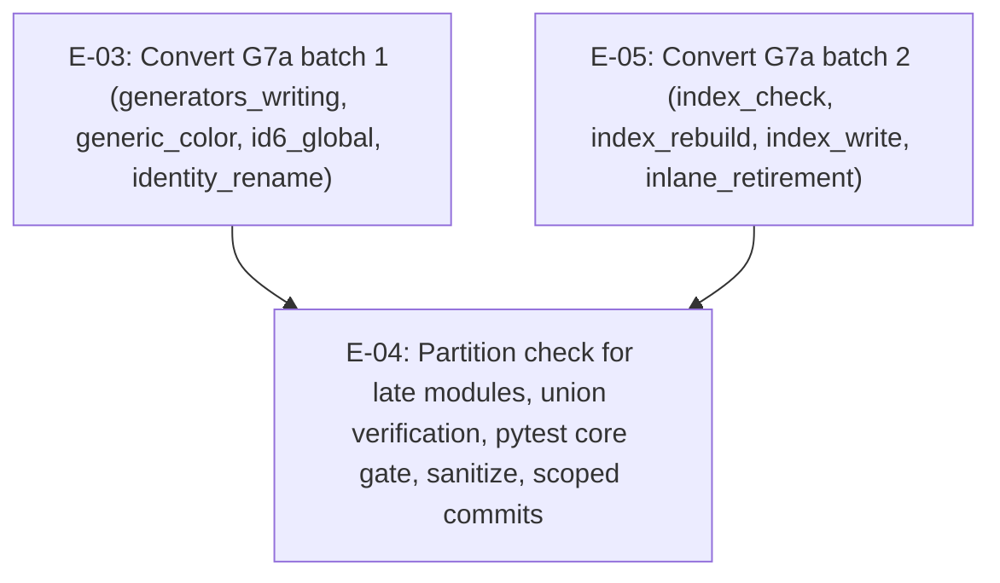

# IPD: Move setter, runner-lane and first-half unmatched test data onto the record builder with the fixture codemod

- Date: 2026-11-08
- Kind: child
- Concern: Spec `4sd62s` section 6 requires that test data be written by ONE shared record builder in phase B, so that the cutover (Order 13) changes the builder and not hundreds of test files, and C10a requires the suite to pass at every commit. The batch parts `x05v02`, `7qxey9` and `nbfg7w` (Orders 38 to 40) each carried five batch subsets; under the maintainer decision 2026-11-07 ("Codemod first, then small runs") every batch item runs the Order-49 codemod (`653ndz`) and hand-converts only its census-counted refusals, and each batch plan holds at most four batch items. This part carries the fifth subset of each: G3a (from `x05v02`), G5a (from `7qxey9`) and G7a (from `nbfg7w`). Measured 2026-11-07 at `ac76110f4`: 57 test modules, 1,044 F-01 legacy lines, 3 private record-building helpers.
- Scope: FINISHING PART after the round-3 split (2026-11-09, research `nj8zdp` guidance): 8 modules of subset G7a in two items of 4 (E-03, E-05) and the finishing item E-04, which also converts any module the partition now places in subsets G3a, G5a, G7a that no plan names. The other modules of subsets G3a, G5a, G7a moved to the chunk plans `2ll84l`, `9hk3rh`, `5mg9g1`, `1cgrgp`, `z8hu7r`, `tsonlq`, `erulw3` (F-41). Before the round-3 split: Batch subsets G3a, G5a, G7a, moved verbatim (module lists unchanged) from `x05v02` E-05, `7qxey9` E-05 and `nbfg7w` E-05, plus a finishing item. Each subset runs the codemod and hand-converts only its census-counted refusals under the batch rule below. EXCLUDES: the builder and fixtures (`9rgn2w`); the codemod and its census (`653ndz`); every other subset (Orders 38 to 40 and `59aiyh`); the F-03 EXCLUDED modules; production code; the switch-point proof, census and full-suite comparison (`59aiyh` E-11, E-12).
- Scope-Paths: tests/test_generators_writing_standard_pointer.py, tests/test_generic_color_depth.py, tests/test_id6_global_mint.py, tests/test_identity_rename_hint.py, tests/test_index_check_agent_records.py, tests/test_index_rebuild.py, tests/test_index_write_agent_records.py, tests/test_inlane_retirement_lands.py, .aw/records/plans/pending/20261108-metastore-50-1upea0-move-setter-runner-lane-and-first-half-unmatched-test-data-o.ipd.md
- Item-Dependencies: executed:653ndz, executed:9rgn2w, executed:g5hpbb, executed:tve77h, executed:xexn45, executed:2ll84l, executed:9hk3rh, executed:5mg9g1, executed:1cgrgp, executed:z8hu7r, executed:tsonlq, executed:erulw3
- Status: reviewed
- Readiness: go-pending-approval
- Review-Depth: complex
- From-Spec: 4sd62s
- Work-Kind: feature
- Priority: high
- Blocks-Release: next
- Set: metastore
- Order: 50
- Highest E allocated: 05
- Author: opencode its_direct/pt3-claude-opus-5.5-1m-us
- Id: 1upea0

> Written to .aw/system/workflows/technical-writing/technical-writing.md. Every obligation, exact identifier, quotation, evidence record, and lifecycle status is preserved.

## Workflow history

- 2026-11-14 reviewed (aw set): APPROVE WITH REVISIONS APPLIED; PR-001..PR-006 FIXED
- 2026-11-14 /plan-review (antigravity/gemini): APPROVE WITH REVISIONS APPLIED; PR-001..PR-006 FIXED; review record .aw/records/reviews/20261108-metastore-50-1upea0-move-setter-runner-lane-and-first-half-unmatched-test-data-o.review.md
- 2026-11-09 note (opencode its_direct/pt3-claude-opus-5.5-1m-us): round-3 split per research nj8zdp; items E-01, E-02 and 7 to 14 modules of E-03 moved to 2ll84l, 9hk3rh, 5mg9g1, 1cgrgp, z8hu7r, tsonlq, erulw3; kept 8 modules of G7a as E-03 and E-05; Highest E allocated raised to 05.
- 2026-11-08 to-review (opencode its_direct/pt3-claude-opus-5.5-1m-us): split from x05v02, 7qxey9 and nbfg7w (their E-05 subsets G3a, G5a, G7a) per maintainer decision 2026-11-07 ("Codemod first, then small runs"; at most 4 batch items per plan; no single E/V item hides hundreds of steps).

## Goal

After the round-3 split this plan converts 8 modules of subset G7a and closes subsets G3a, G5a, G7a once its chunk plans are executed. The family goal: Every hand-built record in this part's 57 test modules comes from `tests/record_builder.py`, written by the Order-49 codemod or, for its census-counted refusals only, by hand, with each module's per-test outcomes identical before and after and every remaining legacy string classified.

## Detailed Implementation Checklist (TODO)

Execution-state rule: mark an `E-*` item complete only after performing the action. That mark is not validation. Right-sizing rule: write for a modest executor that cannot hold much in its head. Each E-item is one step (one concern, about one file, executable in one focused pass) and its V-item names each unit it covers with its own check; a plan stays at about 5 E-items and 8 work Scope-Paths, else split it into more child plans (guidance, `IPD-Z603`). Accepted execution states: blocked, failed, pending, performed; terminal gate demands 'performed'.

Split note (round 3, 2026-11-09, research `nj8zdp` guidance): items E-01, E-02 and all but 8 modules of E-03 moved to the chunk plans named in F-41 and in `## Deferred / out of scope`; this plan keeps 8 modules of subset G7a as E-03 and E-05 (4 each) and the finishing item E-04.

Batch rule, applied to every batch E-item of this plan (the `59aiyh` batch rule, restructured 2026-11-08 for the Order-49 fixture codemod `653ndz` per maintainer decision 2026-11-07 "Codemod first, then small runs": the tool performs the mechanical rewrite, and the hand work is bounded by its measured refusals). In it, "E-13's `full-before.txt`" and "the builder's `raw_fields=` escape (E-01)" are items of Order 37 (`9rgn2w`), carried by the round-3 split into Order 170 (`j6o96i`) with the same ids; because `.aw/state/` does not travel between lane worktrees, step 2 always records a fresh before list here. Step 1's partition is restricted to the modules each batch item names (round-3 split 2026-11-09: a subset is now spread over several plans of at most 8 modules each): a module that the partition now places in the item's subset but that no plan names is NOT added here; it is reported, and the finishing item of `1upea0` converts it; a named module that no longer matches F-01 is reported and skipped:
1. Before the batch, ensure the state directory exists (`mkdir -p .aw/state/59aiyh`), re-derive its file list with the F-03 first-match partition over the F-01 `rg -l` output at the current HEAD, minus the F-03 EXCLUDED list, and save it as `.aw/state/59aiyh/<batch>-files.txt`. The counts in each E-item are context measured at `0cbfcc706` or `ac76110f4`, not the bar.
2. Record the unmodified per-test outcome list (a batch whose files a previous batch did not touch may reuse the matching lines of E-13's `full-before.txt`): `python3 -m pytest -o addopts="" -m "" -p no:randomly -n 0 -rA $(cat .aw/state/59aiyh/<batch>-files.txt) | grep -E "^(PASSED|FAILED|ERROR|SKIPPED|XFAIL|XPASS) " | sed -E 's/ - .*//' | sort > .aw/state/59aiyh/<batch>-before.txt`. `-p no:randomly` and `-n 0` make the list deterministic; `-m ""` includes `slow` and `livecorpus` modules.
3. Run the codemod: `python3 tools/fixture_codemod.py --apply --format json $(cat .aw/state/59aiyh/<batch>-files.txt) > .aw/state/59aiyh/<batch>-codemod.json`. It rewrites only the sites whose module outcome list it proved identical (`653ndz` E-03, carried with the same id into Order 172, `y3uowx`, by the round-3 split) and lists every other site as a refusal with a reason code and a disposition (`hand` or `legacy-kept`, the `653ndz` reason-code table).
4. Hand-convert ONLY the refusals with disposition `hand`: the static count is the sum of the `653ndz` F-30 rows of the item's modules (round-3 split 2026-11-09: an item now carries part of a subset, so the subset's F-31 row is context only), and the codemod report adds any apply-time `not-equivalent` refusals; the item's hand count is their sum. If the hand count exceeds 25, stop after step 3 (the proved codemod rewrites may be committed), convert nothing by hand, and report the subset for re-splitting. A hand conversion uses builder calls; a test that deliberately writes an INVALID value (an unknown status, `- Status: EXECUTED`, `- Priority: bogus`, a malformed gate) gets it through the builder's `raw_fields=` escape (E-01) and is listed with reason class `invalid-input`. A refusal with disposition `legacy-kept` stays in legacy form on purpose and is listed with its F-06 reason class.
5. Re-run step 2's command into `<batch>-after.txt` and require `diff` to print nothing. A batch that would need any changed assertion other than a raw-byte metadata stand-in moved to `artifact_meta.read` (scope rule) stops and is reported; it does not weaken the assertion.
6. Count the remaining legacy strings with the F-01 `rg` pattern over the batch files, and give each remaining line one reason class from F-06: `legacy-format subject`, `displayed-output assertion`, `setter-byte assertion`, `invalid-input`, or `body prose` (for example open-question `- Status: open` rows, which N3 keeps in Markdown).
7. The builder never reads production source, and no test gains a source-reading assertion.

### Task group 1: kept batch items

- [ ] E-03 (kept from this plan's E-03, batch subset G7a, round-3 split 2026-11-09: its first 4 of the 8 modules this plan keeps; the other 16 modules of G7a moved to the chunk plans named in F-41) Batch G7a, 4 of its 24 modules (the unmatched test modules, first half (basename sorts before `test_l`)): `tests/test_generators_writing_standard_pointer.py`, `tests/test_generic_color_depth.py`, `tests/test_id6_global_mint.py`, `tests/test_identity_rename_hint.py`. F-01 legacy lines per module at `3d0ddb845` (context, not the bar): `test_generators_writing_standard_pointer` 4, `test_generic_color_depth` 1, `test_id6_global_mint` 2, `test_identity_rename_hint` 19. Run the codemod on these modules and apply the batch rule with `<batch>` = `G7a-1upea0-03` (outcome lists identical); hand-convert ONLY the refusals that the `653ndz` F-30 rows of these modules list with disposition `hand`, plus the codemod's apply-time `not-equivalent` refusals, and state their count (at most 25, the batch rule's stop); leave each refusal the census marks `legacy-kept` in legacy form with its reason class. These modules held no private record-building helper at the split; a helper found now is deleted when it has no caller, or listed with its reason.
  - Depends on: none
  - Expected outcome: an empty before/after `diff` for the `G7a-1upea0-03` outcome lists; for each named module, its remaining legacy-string count and the reason class of every remaining line pasted; every deleted and surviving helper listed; the codemod report and the hand count (at most 25) pasted.
  - Execution state: pending

- [ ] E-05 (kept from this plan's E-03, batch subset G7a, round-3 split 2026-11-09: its second 4 of the 8 modules this plan keeps; the other 16 modules of G7a moved to the chunk plans named in F-41) Batch G7a, 4 of its 24 modules (the unmatched test modules, first half (basename sorts before `test_l`)): `tests/test_index_check_agent_records.py`, `tests/test_index_rebuild.py`, `tests/test_index_write_agent_records.py`, `tests/test_inlane_retirement_lands.py`. F-01 legacy lines per module at `3d0ddb845` (context, not the bar): `test_index_check_agent_records` 11, `test_index_rebuild` 4, `test_index_write_agent_records` 6, `test_inlane_retirement_lands` 11. Run the codemod on these modules and apply the batch rule with `<batch>` = `G7a-1upea0-05` (outcome lists identical); hand-convert ONLY the refusals that the `653ndz` F-30 rows of these modules list with disposition `hand`, plus the codemod's apply-time `not-equivalent` refusals, and state their count (at most 25, the batch rule's stop); leave each refusal the census marks `legacy-kept` in legacy form with its reason class. These modules held no private record-building helper at the split; a helper found now is deleted when it has no caller, or listed with its reason.
  - Depends on: none
  - Expected outcome: an empty before/after `diff` for the `G7a-1upea0-05` outcome lists; for each named module, its remaining legacy-string count and the reason class of every remaining line pasted; every deleted and surviving helper listed; the codemod report and the hand count (at most 25) pasted.
  - Execution state: pending

### Task group 2: finish

- [ ] E-04 Finish this part: (1) re-derive the F-03 first-match partition for subsets G3a, G5a, G7a over the F-01 `rg -l` output at the current HEAD, minus the F-03 EXCLUDED list, and compare it with the union of the module lists in F-41 (the chunk plans' items and this plan's E-03 and E-05); convert every module that the partition places in these subsets but that no list names under the batch rule with `<batch>` = `1upea0-late` (if there are more than 8, stop and report them for re-splitting); (2) run the batch rule's step-2 command once over `$(cat .aw/state/59aiyh/G7a-1upea0-03-files.txt .aw/state/59aiyh/G7a-1upea0-05-files.txt)` into `.aw/state/59aiyh/1upea0-union-after.txt` and confirm it equals the sorted concatenation of the two items' `-before.txt` lists; (3) run the bare core gate `python3 -m pytest` and `aw sanitize --agent`; commit through `aw commit 1upea0 -- <each changed path>`, one commit per item allowed, never `git add -A`, a bare `git add` or `git commit -a`. Never push. (The cross-subset full-suite comparison stays in `59aiyh` E-12, because the chunk plans' `-before.txt` lists live in their own lane worktrees.)
  - Depends on: E-03, E-05
  - Expected outcome: the partition comparison lists every late module (or none) and each one converted; the union comparison is empty; all runs pass; every commit is path-scoped to Scope-Paths (or justified at finalize).
  - Execution state: pending

Add further leaves as `- [ ] E-NEW <action>` and run `aw ipd sync` to assign ids.

## Project conventions discovered (Step 0)

- Interface names from Order 02 (`tve77h`): `artifact_meta.registry_fields(type)`, `artifact_meta.validate_event`, `artifact_meta.validate_new_events(type, events, *, records_root, migration_import=False)`, `artifact_meta.read(id6) -> State`, `artifact_meta.create(...)` and `artifact_meta.append(id6, events, *, expect_seq)`. Order 02's `create`/`append` write the log format; `2xwb9b` E-03 adds the phase-B legacy branch of `append` and `xexn45` E-01 routes the phase-B branch of `create` and `append` through `write_legacy`, with `render_legacy_text(text, events)` (`xexn45` E-11) as the same renderer over a string. In phase B the on-disk format is the bullet format; the legacy loader reads it into the cache.
- `review_findings.render_review` (pure) and `review_findings.write_review` render and write a `.review.md` record; no CLI calls `write_review` (`xexn45` Findings).
- The existing shared plan builder is `support.ready_plan_text`, which is "BUILT FROM THE REAL GENERATOR (`ipd_authoring.build_skeleton`)" and then fills the fields a draft leaves open; the builder keeps that approach for plans, so a scaffold change still reaches every fixture.
- Shared test plumbing lives in `tests/support.py` (`init_repo`, `git`, `run_cli`, `pinned_env`, `ready_plan_text`, `scope_drift_repo`); `tests/repo_template.py` (`copy_template_repo`) gives a pre-built repository; there is no `tests/conftest.py`, and the root `conftest.py` owns tier selection.
- Tests are behavioral (AGENTS.md "TEST OUTCOMES, NOT CODE STRUCTURE"); core modules set `pytestmark = pytest.mark.core`; `slow` tests are listed in `tests/slow_allowlist.txt`; `pyproject.toml` `addopts` deselects `slow` and `livecorpus`, so a complete comparison passes `-m ""`, and `pytest-randomly` is installed, so a deterministic order needs `-p no:randomly`.
- `tests/fixtures/review-pilot/` is the input corpus of `tools/review_pilot.py` (`manifest.json` names each plan file, `defects.json` quotes exact text to plant), and `tests/test_review_pilot.py` copies the whole directory into its fixture repository.
- Filenames come from `artifact_naming.build_clustered_name` and parse with `artifact_naming.parse_clustered`.
- Cite code by SYMBOL (`module.function`) or by a quoted content string, with a line number only appended to one of those and never alone: an offset expires before this plan executes (spec `ipd-structure-and-linting` Section 10.2; advisory `IPD-C801`).

## Findings

Measured 2026-11-07 at `ac76110f4` for the subsets; F-01, F-03, F-06 and F-08 copied from `59aiyh` (measured at `0cbfcc706` and at review).

| Id | Evidence | Finding |
|---|---|---|
| F-01 | `rg -l --glob '*.py' -e '- (Id|Status|Set|Kind|Blocks-Release|Readiness|Item-Dependencies|Scope-Paths|From-Backlog|From-Spec|Work-Kind|Priority|Order|Date|Gate-Kind|Gate-Ref|Approval|Subject-Id|Verdict|Graduated-To):|## Workflow history' tests` lists 309 files (307 test modules, `support.py`, `conformance_matrix.py`) of 717 Python files; 6,638 matching lines. The narrower `- Id:`/`- Status:`/`## Workflow history` pattern: 300 files, 3,430 lines | Spec section 6 counted 268 of 680 files and 2,607 matches at round 2; the plan's pattern is broader (21 fields). |
| F-03 | Family split by filename prefix, re-measured at review (HEAD `4a7499289`, 311 files, 6,657 lines) with a FIRST-MATCH rule (a file goes to the first group, in order G1 to G6, whose pattern list matches its basename; unmatched files go to G7): G1 39 files, 1,568 lines; G2 22, 1,102; G3 28, 795; G4 63, 1,244; G5 46, 598; G6 69, 1,004; G7 44, 346. Six files match two groups and are assigned by that rule (`test_ipd_authoring` G3, `test_readiness_absence_invariant` G4, `test_runner_backlog_close_behavior` G1, `test_orchestrator_retire_closes_backlog` G1, `test_records_only_lane_rederive` G5, `test_ipdrunner_runagy_shim` G4). The authored counts (G6 99, G7 11) did not sum to the file total; the first-match rule makes the partition exhaustive and disjoint. EXCLUDED from every batch (literal legacy input is their subject; owned by other plans): `tests/test_artifact_meta_*.py` (`tve77h`, `2xwb9b`), `tests/test_artifact_meta_legacy_writer.py` and `tests/test_writers_*.py` (`xexn45`), `tests/test_m0001_*.py` and `tests/test_migrations_chain.py` (`dcerjg`, `ya4ee4`) | Seven batches (E-03 to E-09); G1, G4 and G6 carry a pre-measured split seam (OQ-01). |
| F-06 | (written by E-11) remaining legacy strings in `tests/` after the batches, each with one reason class: `legacy-format subject`, `displayed-output assertion`, `setter-byte assertion`, `invalid-input`, `body prose` | Order 13 changes the builder plus the F-06 rows of class `setter-byte assertion`; `invalid-input` rows already go through `raw_fields=` and need a decision at the cutover (an invalid bullet has no log-format equivalent); every other class is either a legacy-format test (moved to the migration tests at the cutover) or prose. |
| F-08 | At review, 15 test modules write a deliberately invalid metadata value (for example `tests/test_releases.py` "`- Status: bogus`", `tests/test_check_engine.py` "`- Status: EXECUTED`", `tests/test_specs_set_adapter.py` "`- Priority: bogus`") | A builder that validates every field cannot build these; E-01 adds `raw_fields=` and the batch rule lists them as `invalid-input`. |
| F-11 | Subsets of this part, by the F-03 first-match rule at `ac76110f4`, moved unchanged from the three earlier batch parts | See the table below; each item's hand count comes from `653ndz` F-31. |
| F-42 | Measured 2026-11-14 at HEAD `2f210f95f` across all 8 target test modules: 73 passed in 15.79s (`test_generators_writing_standard_pointer` 4, `test_generic_color_depth` 11, `test_id6_global_mint` 2, `test_identity_rename_hint` 4, `test_index_check_agent_records` 16, `test_index_rebuild` 7, `test_index_write_agent_records` 19, `test_inlane_retirement_lands` 10) | Baseline suite passes before codemod application; serves as the pre-conversion regression baseline for E-03 and E-05. |

| Subset | Modules | Count | F-01 lines | Helpers | Moved from |
|---|---|---|---|---|---|
| G3a | setter, scaffold and authoring tests (`test_status*`, `test_set_*`, `test_scaffold*`, `test_ipd_authoring*`, `test_descriptive*`, `test_bidi*`) | 12 | 490 | 1 | `x05v02` E-05 |
| G5a | runner, lane and merge tests (`test_oc_*`, `test_agy*`, `test_runner*`, `test_run_*`, `test_runs_*`, `test_lane*`, `test_records_only*`, `test_merge*`) | 21 | 400 | 1 | `7qxey9` E-05 |
| G7a | unmatched test modules, first half (basename sorts before `test_l`) | 24 | 154 | 1 | `nbfg7w` E-05 |

F-41 (round-3 split 2026-11-09, research `nj8zdp` guidance; module basenames under `tests/`, each `.py`): where each of this plan's 57 modules now lives. Every module is in exactly one row; the union is the module set of the 2026-11-07 split, checked by script.

| Plan | Subset | Count | Modules |
|---|---|---|---|
| `2ll84l` (Order 203) | G3a | 7 | `test_bidi_control_rejection`, `test_descriptive_length_classes`, `test_ipd_authoring`, `test_scaffold_history_clock`, `test_set_dispatch_dedup`, `test_set_dispatch_parity`, `test_set_refuses_review_record` |
| `9hk3rh` (Order 204) | G3a | 5 | `test_status_set_descriptive_safety`, `test_status_set_metadata_region`, `test_status_set_meta_writer`, `test_status_set_partial_batch`, `test_status_set` |
| `9hk3rh` (Order 204) | G5a | 2 | `test_agy_runipd_cli`, `test_agy_run_resolve_ipd_recursive` |
| `5mg9g1` (Order 205) | G5a | 7 | `test_agy_skip_permissions_default`, `test_lane_rule_break_detection`, `test_merge_gate_spec_anchors`, `test_oc_runipd`, `test_records_only_lane_rederive`, `test_run_analytics_review_cost`, `test_run_dir_parents_are_guaranteed` |
| `1cgrgp` (Order 206) | G5a | 7 | `test_runner_bare_verb_shim`, `test_runner_fallback_bindings`, `test_runner_findings_dependency_gate`, `test_runner_peer_dependency`, `test_runner_shared`, `test_runner_shared_restored_behavior`, `test_runner_stop_triggers_e2e` |
| `z8hu7r` (Order 207) | G5a | 5 | `test_run_proposal_channel`, `test_runs_answer`, `test_run_selection_policy`, `test_run_summary_table`, `test_run_viewer` |
| `z8hu7r` (Order 207) | G7a | 2 | `test_action_table_runner_parity`, `test_already_landed_dispatch` |
| `tsonlq` (Order 208) | G7a | 7 | `test_authoring_coverage_guidance`, `test_awcmdsurf_mutation_verbs`, `test_awmigrename`, `test_awphysical_tools`, `test_collision_population_parity`, `test_companion_record_owner_root`, `test_completion` |
| `erulw3` (Order 209) | G7a | 7 | `test_cross_tree_session_refusal`, `test_defect_report`, `test_doctor`, `test_drift_detail_escaping`, `test_empty_result_convention_doc`, `test_explicit_dir_non_project`, `test_explicit_dir_subdir_resolution` |
| this plan, E-03 | G7a | 4 | `test_generators_writing_standard_pointer`, `test_generic_color_depth`, `test_id6_global_mint`, `test_identity_rename_hint` |
| this plan, E-05 | G7a | 4 | `test_index_check_agent_records`, `test_index_rebuild`, `test_index_write_agent_records`, `test_inlane_retirement_lands` |

## Proposed changes (ordered, validatable)

1. Convert the 8 kept modules of G7a under the batch rule (E-03, E-05), each by the codemod plus its census-counted refusals.
2. Catch late partition modules, re-run the union, the core gate, commit (E-04).

## Deferred / out of scope (with reason)

- Moved to 2ll84l (round-3 split 2026-11-09 per research nj8zdp guidance): 7 modules of subset G3a (items E-01; F-41 names each module).
  - Carrier: 2ll84l
- Moved to 9hk3rh (round-3 split 2026-11-09 per research nj8zdp guidance): 7 modules of subsets G3a, G5a (items E-01, E-02; F-41 names each module).
  - Carrier: 9hk3rh
- Moved to 5mg9g1 (round-3 split 2026-11-09 per research nj8zdp guidance): 7 modules of subset G5a (items E-02; F-41 names each module).
  - Carrier: 5mg9g1
- Moved to 1cgrgp (round-3 split 2026-11-09 per research nj8zdp guidance): 7 modules of subset G5a (items E-02; F-41 names each module).
  - Carrier: 1cgrgp
- Moved to z8hu7r (round-3 split 2026-11-09 per research nj8zdp guidance): 7 modules of subsets G5a, G7a (items E-02, E-03; F-41 names each module).
  - Carrier: z8hu7r
- Moved to tsonlq (round-3 split 2026-11-09 per research nj8zdp guidance): 7 modules of subset G7a (items E-03; F-41 names each module).
  - Carrier: tsonlq
- Moved to erulw3 (round-3 split 2026-11-09 per research nj8zdp guidance): 7 modules of subset G7a (items E-03; F-41 names each module).
  - Carrier: erulw3
- The builder, its tests, the baselines and the tracked fixtures.
  - Carrier: 9rgn2w
- The fixture codemod and its census (F-30, F-31).
  - Carrier: 653ndz
- The remaining subsets, the switch-point proof, the F-06 census and the full-suite comparison.
  - Carrier: 59aiyh
- Adding `RECORD_FORMAT = "log"` and converting setter-byte assertions (cutover commit).
  - Carrier: cxxmyv

## Scope check

- Over-scope: none. No production module changes; every work Scope-Paths entry is a module named in E-03 or E-05.
- Under-scope: none known. Size after the round-3 split: 3 E-items (two batch items of 4 modules each and the finish), 8 work Scope-Paths. The late-module catch-up in E-04 may touch a module outside Scope-Paths; it is justified at finalize (`--scope-reason`).

## Required tests / validation

Each subset is validated by an identical per-test result list before and after (the batch rule), which is behavioral by construction: the same tests, unchanged assertions, the same outcomes. Baseline measured at HEAD `2f210f95f`: 73 tests passing across the 8 target test modules (`test_generators_writing_standard_pointer.py`: 4, `test_generic_color_depth.py`: 11, `test_id6_global_mint.py`: 2, `test_identity_rename_hint.py`: 4, `test_index_check_agent_records.py`: 16, `test_index_rebuild.py`: 7, `test_index_write_agent_records.py`: 19, `test_inlane_retirement_lands.py`: 10). Commands: the batch rule's command per subset, the codemod's `--apply` report, the bare core gate `python3 -m pytest`, `aw sanitize --agent`. CONTRIBUTES to AC-1b (owned by `cxxmyv`).

## Spec / documentation sync

No spec change; implements part of `4sd62s` section 6 and section 7 step 6.

## Open questions

### OQ-01: Can the subsets of this part run in any order, and alongside Orders 38 to 40?

- Blocking: no
- Status: resolved
- Owner: plan author
- Resolution or deferral rationale: Yes. The kept items and the chunk plans (F-41) are disjoint module lists, each needs only the builder (`9rgn2w`) and the codemod (`653ndz`), and none edits `tests/support.py` (that is `59aiyh` E-09). This plan depends on its chunk plans only so that E-04's late-module catch-up sees their conversions. Recommendation strength: strong.

## Validation and cross-check (verify before reporting done)

Validation-state rule: inspect evidence in a separate pass. Do not mark a `V-*` item complete from memory or from the matching execution checkmark. Accepted validation results: blocked, failed, pass, pending; terminal gate demands 'pass'. Runtime-demonstration reachability rule: for each `V-*` item demanding the software be observed acting (such as a run, a dispatch, or a transition), as distinct from items demanding a diff, a file's content, or a test result, which are reachable by construction, name the code path that produces the observation or the sibling `E-*` that creates it, else the demand is UNDER-SCOPE.

- [ ] V-03 validates E-03
  - Required evidence: paste `.aw/state/59aiyh/G7a-1upea0-03-files.txt` and the empty `diff .aw/state/59aiyh/G7a-1upea0-03-before.txt .aw/state/59aiyh/G7a-1upea0-03-after.txt`; then, for each of `tests/test_generators_writing_standard_pointer.py`, `tests/test_generic_color_depth.py`, `tests/test_id6_global_mint.py`, `tests/test_identity_rename_hint.py` separately: its before and after F-01 `rg -c` count, the reason class of every remaining match, its rows of `.aw/state/59aiyh/G7a-1upea0-03-codemod.json` (rewrites, refusals by reason code and disposition, before and after outcome-list hashes) and its `653ndz` F-30 row; the hand count with every hand-converted site listed (module, line, reason code); and the before and after helper census of the E-09 `rg` pattern over these modules with each deleted and surviving helper and its reason.
  - Observed evidence:
  - Result: pending

- [ ] V-05 validates E-05
  - Required evidence: paste `.aw/state/59aiyh/G7a-1upea0-05-files.txt` and the empty `diff .aw/state/59aiyh/G7a-1upea0-05-before.txt .aw/state/59aiyh/G7a-1upea0-05-after.txt`; then, for each of `tests/test_index_check_agent_records.py`, `tests/test_index_rebuild.py`, `tests/test_index_write_agent_records.py`, `tests/test_inlane_retirement_lands.py` separately: its before and after F-01 `rg -c` count, the reason class of every remaining match, its rows of `.aw/state/59aiyh/G7a-1upea0-05-codemod.json` (rewrites, refusals by reason code and disposition, before and after outcome-list hashes) and its `653ndz` F-30 row; the hand count with every hand-converted site listed (module, line, reason code); and the before and after helper census of the E-09 `rg` pattern over these modules with each deleted and surviving helper and its reason.
  - Observed evidence:
  - Result: pending

- [ ] V-04 validates E-04
  - Required evidence: paste the re-derived partition for G3a, G5a, G7a beside the F-41 union (a `diff` of the two sorted lists), each late module with its own before/after outcome `diff` (empty) and codemod summary, or the line `no late modules`; the `diff` of the sorted concatenation of the two items' `-before.txt` lists against `.aw/state/59aiyh/1upea0-union-after.txt` (empty); the bare `python3 -m pytest` summary line and wall time; the `aw sanitize --agent` result with zero `fail`; and every `aw commit 1upea0` output listing only Scope-Paths.
  - Observed evidence:
  - Result: pending

## Approval and execution gate

- Size assessment: standard
- Cohesion rationale: not required

Execute only after human approval (`Status: approved`) and after `653ndz`, `9rgn2w`, `g5hpbb`, `tve77h`, `xexn45`, `2ll84l`, `9hk3rh`, `5mg9g1`, `1cgrgp`, `z8hu7r`, `tsonlq`, `erulw3` are executed. OQ-01 is resolved.

Scope fence: the paths in `- Scope-Paths:` are a declaration. A needed test-tree file outside the fence is edited and then justified at finalize (`--scope-reason`), and a declared path left unmodified is acknowledged (`--scope-ack`). Production code under `agent_workflows/` and `tools/` is out of this plan's purpose: if a subset cannot keep its outcome list identical without a production change, stop that subset and report the missing capability rather than changing production code or an assertion.

Honesty rule: run the batch comparisons and the bare `python3 -m pytest` core gate, and paste the ACTUAL output; never claim a result you did not run.

Commits: commit only through `aw commit 1upea0 -- <paths>` (one commit per item allowed); never `git add -A`, a bare `git add` or `git commit -a`; never push.

Safety rule: uncommitted changes and untracked files you did not create are not yours; never revert, stage, commit, discard, reformat, or clean up another party's work. If a file you must edit is being changed under you and the two sets of changes cannot be safely combined, STOP and report rather than overwriting.

Lifecycle transition: the plan moves to `.aw/records/plans/executed/` only when execution completes (by the runner automatically or via `aw ipd finalize`), and only after `aw ipd lint --phase pre-transition` conforms and every `V-*` reads `pass` with pasted evidence. Never a hand `git mv`.
