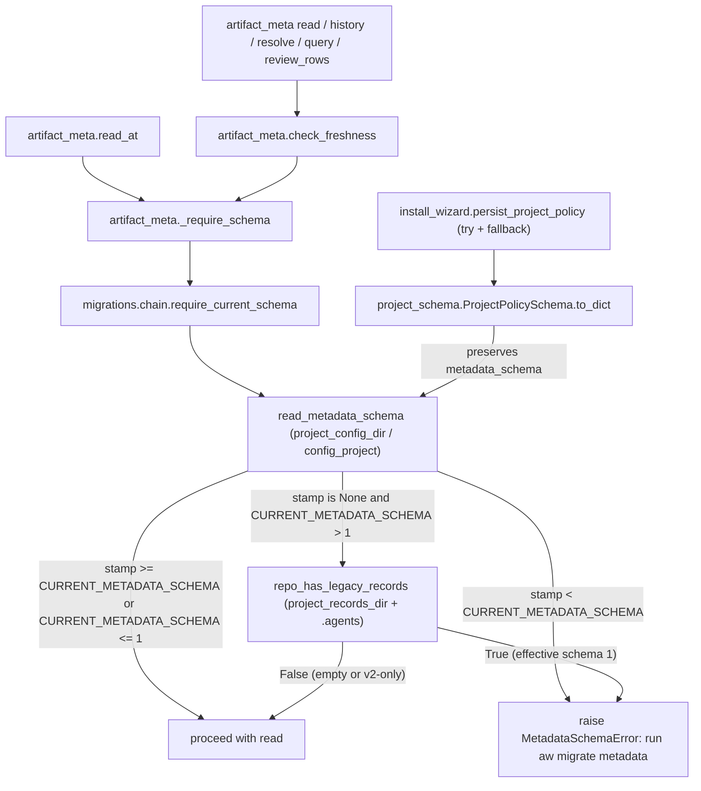

# IPD: Build the migration chain, the metadata_schema stamp and the read-path schema check

- Date: 2026-11-09
- Kind: child
- Concern: Spec `4sd62s` 5.1 makes the cutover a numbered migration chain with a `metadata_schema` stamp, and 5.3 makes every metadata read refuse an unmigrated repository. None of it exists (`ls agent_workflows/migrations` fails; `project_schema.parse_portable_policy` knows no `metadata_schema` key). Plan `vxevph` owned this as its E-01, one item naming 11 distinct units across five files; research `nj8zdp` guidance (at most about 8 units per item, 8 work Scope-Paths per plan) splits that item into three one-file steps here, in round 3 on 2026-11-09.
- Scope: (1) the `aw check --agent` baseline for `dcerjg` V-16 (plus tracked SHA and count in `F-03` for cross-lane replay) and the chain module (`agent_workflows/migrations/__init__.py`, `agent_workflows/migrations/chain.py`); (2) the read-path schema gate in `agent_workflows/artifact_meta.py` covering `check_freshness` and `read_at`; (3) `metadata_schema` as a round-tripped portable-policy key in `project_schema` and `install_wizard` (both normal and fallback rebuild paths); (4) the stamp-and-schema suite `tests/test_migrations_chain.py` (from `vxevph` E-05). Everything runs only on test fixtures. EXCLUDES: preflight, journal, sidecar and their tests (`vxevph`); the `aw migrate` CLI (`1vfqdu`); every later step (`dky26u`, `ghhzb6`, `hpedmn`, `o19353`, `dcerjg`).
- Scope-Paths: agent_workflows/migrations/__init__.py, agent_workflows/migrations/chain.py, agent_workflows/artifact_meta.py, agent_workflows/project_schema.py, agent_workflows/install_wizard.py, tests/test_migrations_chain.py, .aw/records/plans/pending/20261109-metastore-101-g8na48-build-the-migration-chain-the-metadata-schema-stamp-and-the.ipd.md
- Item-Dependencies: executed:tve77h
- Status: reviewed
- Readiness: go-pending-approval
- Review-Depth: complex
- From-Spec: 4sd62s
- Work-Kind: feature
- Priority: high
- Blocks-Release: next
- Set: metastore
- Order: 101
- Highest E allocated: 05
- Author: opencode its_direct/pt3-claude-opus-5.5-1m-us
- Id: g8na48

> Write and proofread this plan per the technical writing standard, `.aw/system/workflows/technical-writing/technical-writing.md` (`.agents/workflows/technical-writing/technical-writing.md` in a legacy-layout install), including requirement 12 (diagrams).

## Workflow history
- 2026-11-12 reviewed (aw set): APPROVE WITH REVISIONS APPLIED; PR-001..PR-006 FIXED

- 2026-11-12 /plan-review (antigravity/gemini): APPROVE WITH REVISIONS APPLIED; PR-001..PR-006 FIXED; review record .aw/records/reviews/20261109-metastore-101-g8na48-build-the-migration-chain-the-metadata-schema-stamp-and-the.review.md
- 2026-11-09 to-review (opencode its_direct/pt3-claude-opus-5.5-1m-us): split from vxevph (round 3, research nj8zdp guidance).
- 2026-11-09 draft (opencode its_direct/pt3-claude-opus-5.5-1m-us): created.

## Goal

The migration chain module and the `metadata_schema` stamp exist, the stamp survives a reinstall, and every `artifact_meta` read checks it, proven on fixtures, so `vxevph` and every later `m0001` part add steps to an existing chain.

## Detailed Implementation Checklist (TODO)

Execution-state rule: mark an `E-*` item complete only after performing the action. That mark is not validation. Right-sizing rule: write for a modest executor that cannot hold much in its head. Each E-item is one step (one concern, about one file, executable in one focused pass) and its V-item names each unit it covers with its own check; a plan stays at about 5 E-items and 8 work Scope-Paths, else split it into more child plans (guidance, `IPD-Z603`). Accepted execution states: blocked, failed, pending, performed; terminal gate demands 'performed'.

The four items E-01, E-02, E-03, and E-05 together cover `vxevph` E-01 partitioned one module per step: E-01 owns the baseline and `chain.py`, E-02 owns the `artifact_meta.py` read-path hook, E-03 owns `project_schema.py`, and E-05 owns `install_wizard.py`.

### Task group 1: the chain module

- [ ] E-01 Save pre-edit `aw check --agent` output to `.aw/state/dcerjg/check-before.jsonl` and record the pre-edit `HEAD` commit SHA and `(location, rule)` pair count in `F-03` so `dcerjg` V-16 can regenerate the baseline if executed in a separate worktree lane. Create `agent_workflows/migrations/__init__.py` and `agent_workflows/migrations/chain.py` defining:
  - `MetadataSchemaError(RuntimeError)` for repository-level schema refusals (distinct from `ValueError` so `meta_cli._collect` never misclassifies a schema refusal as an `invalid-record` defect).
  - `Migration` dataclass (`number: int`, `name: str`, `target_schema: int`, `is_pending(repo) -> bool`, `run(repo, *, apply=False, force=False, force_worktree=False, describer=None)`), `MIGRATIONS` tuple holding `m0001` (`number=1`, `name="metadata-v2"`, `target_schema=2`), where `m0001.is_pending(repo)` evaluates `(read_metadata_schema(repo) or (1 if repo_has_legacy_records(repo) else 2)) < 2` and `m0001.run(...)` lazily imports `agent_workflows.migrations.m0001_metadata_v2` and delegates to `m0001_metadata_v2.run(...)` (created by `vxevph`).
  - `CURRENT_METADATA_SCHEMA = 1` (Order 13 `dcerjg` flips it to `2` in the cutover commit).
  - `read_metadata_schema(repo, *, config_project=None) -> Optional[int]` and `write_metadata_schema(repo, value: int, *, config_project=None) -> Path`, resolving `project.json` from `config_project` when supplied or `project_context.project_config_dir(repo) / "project.json"` (honoring repo config, home `clean-delta` config, and unconfigured repositories without hard-coding `.aw/config/project.json`), rejecting booleans, non-integers, and integers `< 1` with `ValueError`, and writing atomically via a sibling temporary file plus `os.replace` (`json.dumps(..., indent=2) + "\n"`, preserving every existing key and value, initializing `"schema_version": project_schema.SCHEMA_VERSION` only when creating a new file).
  - `repo_has_legacy_records(repo, *, records_root=None) -> bool`, scanning candidate `.md` files across the de-duplicated existing directories `[Path(records_root) if records_root is not None else project_context.project_records_dir(repo), Path(repo) / ".agents"]` (covering `4sd62s` C12 shapes (a)-(e) and `tmp_path` stubs without inspecting `<AW_HOME>` on unconfigured repositories), excluding `README.md`, `INDEX.*`, `STATUS.md`, `comms/`, `<stem>.data/`, `prompt-library/`, `conformance-results-template.md`, and `20260712-0156-14-chatgpt-modular-report-template.md`; returning `True` immediately if `Path(repo) / ".agents"` holds any candidate `.md` file or if any candidate `.md` file carries a `## Workflow history` heading or fails all three v2 mirror parsers (`artifact_meta.parse_artifact_mirror`, `artifact_meta.parse_review_mirror`, `artifact_meta.parse_staged_prompt_mirror`), and `False` on an empty or v2-only tree.
  - `require_current_schema(repo, *, config_project=None, records_root=None) -> None`, reading `stamp = read_metadata_schema(repo, config_project=config_project)`, returning immediately when `stamp is not None and stamp >= CURRENT_METADATA_SCHEMA` or when `stamp is None and CURRENT_METADATA_SCHEMA <= 1`, otherwise computing effective schema `stamp if stamp is not None else (1 if repo_has_legacy_records(repo, records_root=records_root) else CURRENT_METADATA_SCHEMA)` and raising `MetadataSchemaError` containing the exact substring ``run `aw migrate metadata` `` when effective schema `< CURRENT_METADATA_SCHEMA`.
  - Depends on: none
  - Expected outcome: in `tmp_path` repositories, `write_metadata_schema(repo, 2)` adds `"metadata_schema": 2` to the resolved `project.json` while keeping `schema_version`, every other key, and the trailing newline unchanged; `require_current_schema` returns silently under `CURRENT_METADATA_SCHEMA == 1`, returns silently under `CURRENT_METADATA_SCHEMA == 2` on an empty repository (AC-11 case 3) or a stamped v2 repository, and raises `MetadataSchemaError` containing ``run `aw migrate metadata` `` on unstamped legacy `.aw/records/` or `.agents/` repositories (AC-11 case 1) and on repositories stamped `1` (AC-11 case 2).
  - Execution state: pending

### Task group 2: the read-path hook

- [ ] E-02 Add a private helper `_require_schema(project_context, records_root)` in `agent_workflows/artifact_meta.py` and invoke it at the top of `check_freshness` (before the `if not records_root.exists(): return` early return, forwarding `project_context=ctx` from `read`, `history`, `resolve`, `query`, and `review_rows`) and in `read_at` (after resolving `ctx` and `records_root`, because `read_at` does not call `check_freshness`). Derive `repo` from `getattr(project_context, "target_repo", None) or getattr(project_context, "repo_root", None)`, else `project_context_mod.record_owner_root(records_root)` when non-`None`, else `records_root.parent.parent` when `records_root.name == "records" and records_root.parent.name in (".aw", ".agents")`, else `records_root` (never falling back to `os.getcwd()` when `project_context` or `records_root` is supplied, so bare `logical_roots`-only test stubs stay isolated to `tmp_path`), and pass `config_project=(getattr(project_context, "physical_classes", None) or {}).get("config_project")` and `records_root=records_root` unconditionally to `chain.require_current_schema`. Commands `aw migrate`, `aw install`, `aw setup`, `aw doctor`, and `aw --help` do not read metadata through `artifact_meta` and therefore never refuse.
  - Depends on: E-01
  - Expected outcome: no command refuses while `CURRENT_METADATA_SCHEMA == 1`, `tests/test_artifact_meta_read.py` still passes, and with `chain.CURRENT_METADATA_SCHEMA` monkeypatched to `2` both `artifact_meta.read` and `artifact_meta.read_at` on a legacy fixture raise `MetadataSchemaError` naming `aw migrate metadata` (AC-11 case 1 at the `artifact_meta` interface; note `meta_cli` already serves `aw show --history`, `aw show --format json`, and `aw index rebuild` over `artifact_meta` from executed plan `1ajqaa`, while full CLI reader cutover is verified by `cxxmyv` after Orders 08 and 09).
  - Execution state: pending

### Task group 3: the stamp survives a reinstall

- [ ] E-03 Add `"metadata_schema"` to `known_keys` in `agent_workflows/project_schema.py` (`parse_portable_policy`) with fail-closed validation (`isinstance(val, int) and not isinstance(val, bool) and val >= 1`, raising `ValueError` otherwise), add `metadata_schema: Optional[int] = None` to `ProjectPolicySchema`, and emit `"metadata_schema": self.metadata_schema` in `ProjectPolicySchema.to_dict` when not `None`. Leave `parse_local_binding` unchanged because `metadata_schema` lives only in portable `project.json`.
  - Depends on: E-01
  - Expected outcome: `parse_portable_policy` round-trips `"metadata_schema": 2` through `ProjectPolicySchema.to_dict()` and raises `ValueError` on boolean, string, and `< 1` values.
  - Execution state: pending

- [ ] E-05 Preserve `metadata_schema` across reinstalls in `agent_workflows/install_wizard.py` (`persist_project_policy`): add `"metadata_schema"` to `known_proj_keys`, extract `existing_metadata_schema` in both the `parse_portable_policy` `try` branch (`parsed_proj.metadata_schema`) and the `except ValueError:` fallback branch (`raw_proj.get("metadata_schema")` when `isinstance(val, int) and not isinstance(val, bool) and val >= 1`), and pass `metadata_schema=existing_metadata_schema` to `ProjectPolicySchema(...)` while preserving the trailing newline (`tests/test_install_config_trailing_newline.py`).
  - Depends on: E-03
  - Expected outcome: `persist_project_policy` and `aw install` into a repository stamped with `"metadata_schema": 2` keep `"metadata_schema": 2` on both normal and fallback policy rebuilds, and `tests/test_install_config_trailing_newline.py` passes.
  - Execution state: pending

### Task group 4: tests

- [ ] E-04 Create `tests/test_migrations_chain.py` exercising the stamp, schema check, read-path hook, and reinstall preservation on `tmp_path` fixture repositories initialized with `git init`, calling the real production functions and asserting on return values, raised exceptions, and written file bytes (zero source inspection):
  - `read_metadata_schema` / `write_metadata_schema` round trip (preserving `schema_version`, sibling keys, and trailing newline, across repo-local and home `config_project` paths, plus `ValueError` on bool/str/`0`).
  - `repo_has_legacy_records`, `m0001.is_pending`, and `require_current_schema` under patched `CURRENT_METADATA_SCHEMA = 2`: unstamped `.aw/records/` legacy fixture refuses with exact ``run `aw migrate metadata` `` text (AC-11 case 1), unstamped `.agents/` legacy fixture refuses (`C12` shape (a)/(c)), stamped `"metadata_schema": 1` refuses (AC-11 case 2), empty repository passes (AC-11 case 3), and stamped `"metadata_schema": 2` passes.
  - `artifact_meta.read` and `artifact_meta.read_at` refusal with `CURRENT_METADATA_SCHEMA = 2` on a legacy `tmp_path` fixture, plus non-refusal on a bare `logical_roots` v2 log-only `tmp_path` stub.
  - `project_schema.parse_portable_policy` and `install_wizard.persist_project_policy` keeping `"metadata_schema": 2` across both normal and `except ValueError` fallback reinstalls (`dcerjg` review finding `PR-001`).
  Set `pytestmark = pytest.mark.core`, or `pytest.mark.slow` if its slowest test exceeds 2 s in `--durations=10`, recorded in V-04.
  - Depends on: E-01, E-02, E-03, E-05
  - Expected outcome: `python3 -m pytest -o addopts="" -v tests/test_migrations_chain.py` passes every test.
  - Execution state: pending

## Project conventions discovered (Step 0)

- Path roots come from `project_context` (`ctx.physical_classes["config_project"]` or `project_context.project_config_dir(repo) / "project.json"` for portable policy, `project_context.project_records_dir(repo)` plus `Path(repo) / ".agents"` for legacy record detection, and `ctx.logical_roots["state"]` for durable state), never hard-coded `<repo>/.aw/...` literals alone (`4sd62s` 4.5, 5.1, C12; note `resolve_project_context.logical_roots["records"]` defaults to `<AW_HOME>/projects/<pid>/records` on unconfigured repositories, so `project_records_dir` is required to see unconfigured `<repo>/.aw/records`).
- Tests exercise code and assert on outputs (AGENTS.md "TEST OUTCOMES, NOT CODE STRUCTURE").
- Cite code by SYMBOL (`module.function`) or by a quoted content string, with a line number only appended to one of those and never alone: an offset expires before this plan executes (advisory `IPD-C801`).

## Findings

| Id | Evidence | Finding |
|---|---|---|
| F-01 | `vxevph` F-02: `rg -n "known_keys\|known_proj_keys\|ProjectPolicySchema\(" agent_workflows/project_schema.py agent_workflows/install_wizard.py`: 8 hits (`parse_portable_policy` and `parse_local_binding` `known_keys` in `project_schema.py`, `known_proj_keys` and rebuild in `install_wizard.py`) | E-03 owns `project_schema.py` (`parse_portable_policy` + `ProjectPolicySchema`) and E-05 owns `install_wizard.py` (normal + fallback `persist_project_policy`), while leaving `parse_local_binding` unchanged. |
| F-02 | `ipd_lint` IPD-Z603 on `vxevph` (2026-11-09, cutover patched): "E-01 names 11 distinct units" and "plan declares 10 work Scope-Paths" | Splitting E-01 into one-module items (`E-01`, `E-02`, `E-03`, `E-05`) and moving them here brings both plans under the guidance. |
| F-03 | Recorded by E-01 at execution start (`git rev-parse HEAD` and `aw check --agent > .aw/state/dcerjg/check-before.jsonl`): `HEAD=<pending-execution>`, `pairs=<pending-execution>` | Persists the pre-edit `aw check --agent` baseline SHA and `(location, rule)` pair count in tracked plan text because `.aw/state/` is gitignored across isolated runner worktree lanes (`dcerjg` V-16). |

## Proposed changes (ordered, validatable)

1. E-01: capture `aw check --agent` baseline (`check-before.jsonl` + `F-03`) and create `agent_workflows/migrations/__init__.py` and `agent_workflows/migrations/chain.py`.
2. E-02: wire `_require_schema` into `artifact_meta.check_freshness` and `artifact_meta.read_at`.
3. E-03: add and validate `metadata_schema` in `agent_workflows/project_schema.py`.
4. E-05: preserve `metadata_schema` across normal and fallback policy rebuilds in `agent_workflows/install_wizard.py`.
5. E-04: add outcome-based fixture tests in `tests/test_migrations_chain.py`.

## Deferred / out of scope (with reason)

- Preflight, journal, sidecar import, and their test modules.
  - Carrier: vxevph

## Scope check

- Over-scope: none. The `artifact_meta.py` edit is scoped strictly to invoking `require_current_schema` across the public read entry points (`check_freshness` and `read_at`).
- Under-scope: none for `vxevph` E-01 and the stamp-and-schema half of its E-05.

## Required tests / validation

New module: `tests/test_migrations_chain.py` (`core`, stamp-and-schema suite; `1vfqdu` adds CLI cases in `tests/test_migrate_cli.py` and `tests/test_install_migrate_prompt.py`). Existing regression pins: `tests/test_install_config_trailing_newline.py` and `tests/test_artifact_meta_read.py`. Gate: bare `python3 -m pytest`, beside the named runs.

## Spec / documentation sync

No spec change; implements `4sd62s` 5.1 (chain, stamp) and the 5.3 refusal mechanism. The CHANGELOG line is written once by `dcerjg` E-16.

## Open questions

### OQ-03: How can `metadata_schema` and the AC-11 refusal ship in phase A without refusing this unmigrated repository?

- Blocking: no
- Status: resolved
- Owner: none
- Resolution or deferral rationale: Carried from `vxevph` OQ-03 (from `dcerjg` OQ-03): `require_current_schema` compares against `CURRENT_METADATA_SCHEMA`, which is `1` while an absent stamp on a legacy repository counts as `1`, so nothing refuses before the cutover; Order 13 (`dcerjg`) flips `CURRENT_METADATA_SCHEMA` to `2` in the cutover commit, and unit tests monkeypatch the constant to `2`. Recommendation strength: strong.

## Validation and cross-check (verify before reporting done)

Validation-state rule: inspect evidence in a separate pass. Do not mark a `V-*` item complete from memory or from the matching execution checkmark. Accepted validation results: blocked, failed, pass, pending; terminal gate demands 'pass'. Runtime-demonstration reachability rule: for each `V-*` item demanding the software be observed acting (such as a run, a dispatch, or a transition), as distinct from items demanding a diff, a file's content, or a test result, which are reachable by construction, name the code path that produces the observation or the sibling `E-*` that creates it, else the demand is UNDER-SCOPE.

- [ ] V-01 validates E-01
  - Required evidence: paste `ls -l .aw/state/dcerjg/check-before.jsonl` (exists, nonzero), the populated `F-03` baseline SHA and pair count, `rg -n "^(class (MetadataSchemaError|Migration)|MIGRATIONS|CURRENT_METADATA_SCHEMA|def (read_metadata_schema|write_metadata_schema|repo_has_legacy_records|require_current_schema))" agent_workflows/migrations/chain.py` showing each of the eight names once, and the PASSED node ids from `python3 -m pytest -o addopts="" -v tests/test_migrations_chain.py -k "stamp or refusal or legacy"`.
  - Observed evidence:
  - Result: pending
- [ ] V-02 validates E-02
  - Required evidence: paste the `git diff` hunks of `agent_workflows/artifact_meta.py` showing `_require_schema` wired into `check_freshness` and `read_at`, the PASSED node ids from `tests/test_migrations_chain.py` showing `artifact_meta.read` and `artifact_meta.read_at` raise `MetadataSchemaError` naming `aw migrate metadata` when `CURRENT_METADATA_SCHEMA` is patched to `2`, and `python3 -m pytest -o addopts="" -v tests/test_artifact_meta_read.py` with every node id PASSED.
  - Observed evidence:
  - Result: pending
- [ ] V-03 validates E-03
  - Required evidence: paste the `git diff` hunks adding `metadata_schema` in `agent_workflows/project_schema.py` (`known_keys` + positive-integer validation, `ProjectPolicySchema` field, `to_dict`), and the PASSED node ids from `tests/test_migrations_chain.py` for `parse_portable_policy` round trip and invalid-type (`bool`/string/`0`) `ValueError` rejection.
  - Observed evidence:
  - Result: pending
- [ ] V-04 validates E-04
  - Required evidence: paste `python3 -m pytest -o addopts="" -v tests/test_migrations_chain.py --durations=10` with every node id PASSED and the durations table, naming the module `core` or `slow`; and, beside it, the bare `python3 -m pytest` summary line inside the 30 s budget.
  - Observed evidence:
  - Result: pending
- [ ] V-05 validates E-05
  - Required evidence: paste the `git diff` hunks in `agent_workflows/install_wizard.py` (`known_proj_keys` plus normal and `except ValueError` fallback `existing_metadata_schema` preservation), the PASSED node ids of the normal and fallback reinstall-keeps-stamp tests in `tests/test_migrations_chain.py`, and `python3 -m pytest -o addopts="" -v tests/test_install_config_trailing_newline.py` with every node id PASSED.
  - Observed evidence:
  - Result: pending

## Approval and execution gate

- Size assessment: standard
- Cohesion rationale: not required

Execute only after human approval (`Status: approved`) and after every plan in `- Item-Dependencies:` is executed. All open questions are resolved. Stop and report without overwriting if a concurrent edit modifies any declared `- Scope-Paths:` file incompatibly or if an expected `artifact_meta` or `project_schema` symbol is absent.

Scope fence: the paths in `- Scope-Paths:` are a declaration; a needed file outside the fence is edited and then justified at finalize (`--scope-reason`), and a declared path left unmodified is acknowledged (`--scope-ack`).

Safety: this plan never runs `aw migrate metadata --apply` in this checkout; every test uses a `tmp_path` fixture.

Honesty rule: run the named test modules and the bare core gate `python3 -m pytest`, and paste the ACTUAL output; never claim a result you did not run.

Commits: commit only through `aw commit g8na48 -- <paths>`; never `git add -A`, a bare `git add` or `git commit -a`; never push.

Lifecycle transition: the plan moves to `.aw/records/plans/executed/` only through `aw ipd finalize`, never a hand `git mv`, and only after `aw ipd lint --phase pre-transition` conforms and every `V-*` reads `pass` with pasted evidence. When `aw oc run` or `aw agy run` executes the plan, the runner performs the finalize; a hand executor runs `aw ipd finalize g8na48` itself.
