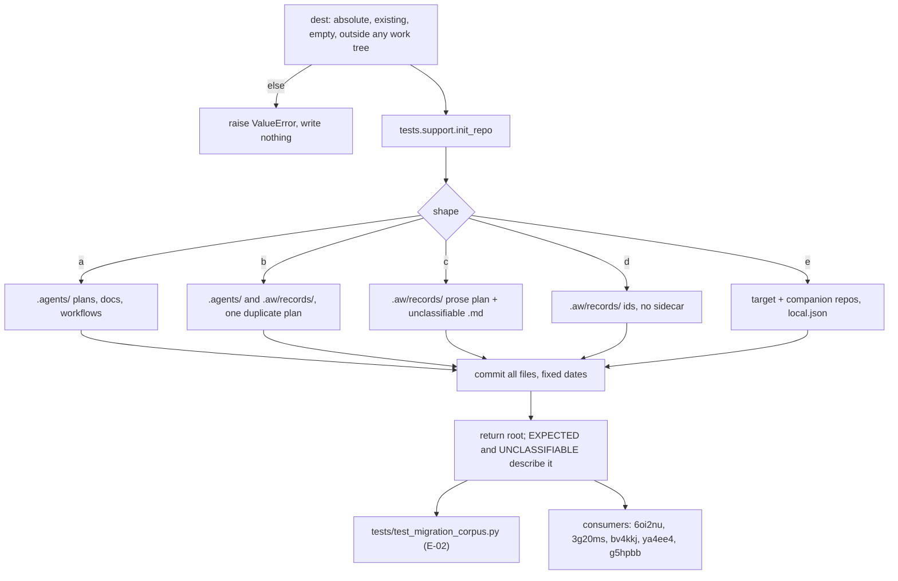

# IPD: Build the five-shape migration fixture corpus from a structural survey

- Date: 2026-11-09
- Kind: child
- Concern: Spec `4sd62s` C12 and AC-42 require `aw migrate metadata` to be proven on every prior record shape this toolkit has written, not only on this repository. Plan `g5hpbb` owned the corpus (its E-01) together with the cache, discovery, layout-chaining and proof work: 8 E-items and 16 work Scope-Paths. Research `nj8zdp` guidance (at most 5 E-items and 8 work Scope-Paths per plan) splits it in round 3 on 2026-11-09; this part is the corpus every later part tests against.
- Scope: `tests/migration_corpus.py`, a fixture builder (not a test module) with one function per C12 shape (a) to (e), each shape derived from recorded STRUCTURAL evidence (this repository's public git history, and the `g5hpbb` measurements of a private repository) with all text synthetic; and `tests/test_migration_corpus.py`, the builder's own behavioural test. EXCLUDES: the cache changes (`6oi2nu`), discovery and id-less conversion (`3g20ms`), layout chaining (`bv4kkj`), the AC-42 proof and changelog (`g5hpbb`).
- Scope-Paths: tests/migration_corpus.py, tests/test_migration_corpus.py, .aw/records/plans/pending/20261109-metastore-102-9vf2iv-build-the-five-shape-migration-fixture-corpus-from-a-structu.ipd.md
- Item-Dependencies: executed:dcerjg
- Status: approved
- Readiness: go-pending-approval
- Review-Depth: complex
- From-Spec: 4sd62s
- Work-Kind: feature
- Priority: high
- Blocks-Release: next
- Set: metastore
- Order: 102
- Highest E allocated: 02
- Author: opencode its_direct/pt3-claude-opus-5.5-1m-us
- Id: 9vf2iv
- Approval: 2026-11-16, recorded via aw ipd set: status set to approved

## Workflow history
- 2026-11-16 approved (aw set): status set to approved
- 2026-11-14 reviewed (antigravity/gemini): APPROVE WITH REVISIONS APPLIED; PR-001..PR-008 confirmed FIXED; scaffold removed
- 2026-11-14 reviewed (opencode its_direct/pt3-claude-opus-5.5-1m-us): APPROVE WITH REVISIONS APPLIED; PR-001..PR-008 FIXED
- 2026-11-13 /plan-review (opencode its_direct/pt3-claude-opus-5.5-1m-us): APPROVE WITH REVISIONS APPLIED; PR-001..PR-008 FIXED
- 2026-11-09 to-review (opencode its_direct/pt3-claude-opus-5.5-1m-us): split from g5hpbb (round 3, research nj8zdp guidance).
- 2026-11-09 draft (opencode its_direct/pt3-claude-opus-5.5-1m-us): created.

## Goal

One importable builder per C12 shape writes a real, fully committed git repository of that shape into a caller-given empty directory, and the module publishes the exact record set each builder wrote, so the cache (`6oi2nu`), discovery (`3g20ms`), layout (`bv4kkj`), description (`ya4ee4`) and proof (`g5hpbb`) parts all test against the same anonymized corpus and the same expectations.

## Detailed Implementation Checklist (TODO)

Execution-state rule: mark an `E-*` item complete only after performing the action. That mark is not validation. Right-sizing rule: write for a modest executor that cannot hold much in its head. Each E-item is one step (one concern, about one file, executable in one focused pass) and its V-item names each unit it covers with its own check; a plan stays at about 5 E-items and 8 work Scope-Paths, else split it into more child plans (guidance, `IPD-Z603`). Accepted execution states: blocked, failed, pending, performed; terminal gate demands 'performed'.

### Task group 1: the corpus

- [x] E-01 (from `g5hpbb` E-01; revised by `/plan-review` 2026-11-13, see review record PR-001 to PR-006) Add `tests/migration_corpus.py`, a fixture builder (not a test module; its name does not match `test_*.py`, so pytest does not collect it; consumers import it as `from tests.migration_corpus import ...`, the `tests.fake_telegram` precedent). It holds:
  - FIVE BUILDERS, each `builder(dest: Path) -> Path` returning the repository root it built:
    - `legacy_agents_layout` (shape a): `.agents/plans/pending/` and `.agents/plans/executed/` holding plans with both `- Id:` and `- Status:` bullets in the uniform grammar (`<date>-<setid>-NN-<id6>-<slug>.md`) and at least one plan with a legacy timestamp name (`YYYYMMDD-HHMM-NN-<slug>.md`) and no `- Id:`; `.agents/docs/specs/` holding a spec with `- Status:` and no `- Id:`; `.agents/docs/research/` holding a research note with neither bullet; one `.agents/workflows/<name>/<name>.md` workflow file (moved by the layout stage, not a record); an `INDEX.md` and a `README.md` under `.agents/plans/`. NO `.agents/skills/` tree (it is preserved in place by `layout_inventory`, and `bv4kkj` V-02 counts zero `.md` files under `.agents/` after apply).
    - `mixed_layout` (shape b): both `.agents/` and `.aw/records/` trees; one id-bearing executed plan present byte-identical in BOTH `.agents/plans/executed/` and `.aw/records/plans/executed/` (the measured mixed state, F-05; the layout stage collapses identical-hash duplicates to one destination, as `tests/test_layout_migration.py` already exercises); one backlog item only under `.agents/backlog/open/`; one spec only under `.aw/records/specs/draft/`.
    - `idless_prose` (shape c), on the `.aw/` layout so id-less conversion is exercised without the layout stage (shape a carries the `.agents/` id-less case): `.aw/records/plans/executed/<date>-<slug>-ipd.md` whose first line is `# Implementation Plan Document (IPD) - <title>`, with prose and no metadata bullet anywhere (F-06); plus `.aw/records/notes/scratch.md`, a `.md` no loader can classify (today's readers report it as type `other`, review probe F-08), which `3g20ms` E-02 lists and leaves byte-identical.
    - `no_sidecar` (shape d): `.aw/config/project.json` `{"schema_version": 2, "records_backend": "repository"}`; specs and backlog items carrying `- Id:` and `- Status:` and a `## Workflow history` whose lines name NO sidecar-writing setter (no `(aw set)` actor, no `aw ipd set`/`aw backlog set`/`aw specs set` line), so `discover(repo).sidecar_expected` (`bv4kkj` E-02, `3g20ms` E-01) is false; no `.aw/records/history.jsonl`.
    - `companion_backend` (shape e): `dest/target` and `dest/companion`, two separate git repositories. The target commits `.aw/config/project.json` `{"records_backend": "companion"}` and a `.gitignore` line `.aw/config/local.json`, and the builder then writes the ignored `.aw/config/local.json` `{"companion_dir": "<absolute dest/companion>"}` at run time (the pattern of `tests/test_records_root_accessor.py::test_accessor_companion`); the companion commits records under `records/plans/pending/` and `records/backlog/open/`. The function returns the TARGET root. The `home` backend is not built here: `bv4kkj` E-05 builds its own `home` fixture with `AW_HOME` under `tmp_path`.
  - `EXPECTED: dict[str, tuple[CorpusRecord, ...]]` keyed by builder name, where `CorpusRecord` is a frozen dataclass `(path, record_type, id6, status)` holding the repository-relative POSIX path (relative to the returned root; for shape e, relative to the companion root, prefixed `companion:`), the record type the builder MEANT (`plans`, `specs`, `backlog`, `research`, `walkthroughs`), the `- Id:` value or `None`, and the `- Status:` bullet value or `None`; and `UNCLASSIFIABLE: dict[str, tuple[str, ...]]` listing every non-record `.md` the builder wrote (workflow file, notes, `INDEX.md`, `README.md`). `SHAPES: dict[str, Callable[[Path], Path]]` maps each builder name to its function, so a consumer parameterizes as `pytest.mark.parametrize("shape", sorted(SHAPES))`.
  - RULES every builder obeys: refuse (raise `ValueError` before writing anything) unless `dest` is an absolute path to an EXISTING EMPTY directory that lies outside every git work tree (`git -C dest rev-parse --is-inside-work-tree`, run with `tests.support.clean_git_env`, fails); write only beneath `dest`; initialize each repository with `tests.support.init_repo` (deterministic identity, `commit.gpgsign=false`, and `tests.support.clean_git_env` so an inherited `GIT_DIR` cannot redirect it); commit every written file with fixed `GIT_AUTHOR_DATE`/`GIT_COMMITTER_DATE`, so `git status --porcelain` is empty on return (the `vxevph` preflight refuses uncommitted record changes, and consumers diff against `HEAD`); all ids are fixed synthetic id6 values that occur nowhere in this repository (checked by `git grep -c <id6>` returning nothing at authoring time), and all titles and prose are synthetic.
  - THE DOCSTRING records, per shape, the structural evidence and the exact command that reproduces it, naming NO private repository: shape a, `git ls-tree -r --name-only b928f3aaa -- .agents` in this public repository (F-04 counts); shape b, the same at `f296f6f40` (F-05 counts); shape c, `g5hpbb` F-03 (a private repository, quoted as recorded there, with no name or path); shape d, `git log --diff-filter=A -- agent_workflows/record_history.py` (writer first landed `c3bff2528`, 2026-08-19) and `.aw/.gitignore` line `records/history.jsonl` (so every clone lacks the sidecar); shape e, constructed from `project_context.project_records_dir` and the test named above, with the statement that no companion-backend repository was surveyed (OQ-01).
  - Depends on: none
  - Expected outcome: each of the five builders, called on an empty `tmp_path` subdirectory, returns a root whose `git status --porcelain` is empty and whose committed files are exactly the `EXPECTED` and `UNCLASSIFIABLE` paths plus any config and `.gitignore` file the shape names; each builder raises `ValueError` and writes nothing for a non-empty, relative, or inside-a-work-tree `dest`; the module contains no absolute path and no private repository name; today's readers (`aw find all`, `status_set.inventory_all_artifacts`) list every `EXPECTED` id6 (V-01).
  - Execution state: performed

- [x] E-02 Add `tests/test_migration_corpus.py` (`pytestmark = pytest.mark.core`; behavioural only, no source inspection) parameterized over `sorted(SHAPES)`, asserting the BUILDER'S OWN CONTRACT for each built fixture: (1) `git status --porcelain` is empty and `git ls-files` (for shape e, in both repositories) equals the `EXPECTED` and `UNCLASSIFIABLE` paths plus any config and `.gitignore` file the shape names; (2) for every `EXPECTED` record, the committed file's bullet block carries `- Id: <id6>` and `- Status: <status>` exactly when those fields are not `None`, and carries no such bullet when they are `None`; (3) shape c's prose plan opens with `# Implementation Plan Document (IPD) - ` and contains no line starting `- Id:` or `- Status:`; (4) shape d has no `.aw/records/history.jsonl` and no history line naming a sidecar-writing setter; shape a has no `.agents/skills`; shape e's `.aw/config/local.json` is untracked and, with `AW_HOME` set to a `tmp_path` directory, `project_context.project_records_dir(<target>)` equals `<dest>/companion/records`; (5) two builds into different empty directories produce identical `git ls-files` and identical `HEAD` tree ids (`git rev-parse HEAD^{tree}`; for shape e, both repositories, since the only absolute path lives in the untracked `local.json`). Plus one test per refusal (non-empty, relative, and inside-a-work-tree `dest`), each asserting `ValueError` and an unchanged `dest` listing. The module deliberately does NOT assert what `aw find` or `status_set` report: spec `4sd62s` 5.3 makes metadata reads refuse an unmigrated repository once `CURRENT_METADATA_SCHEMA` is 2, so a reader assertion here would break at the cutover; today's-reader agreement is one-time evidence in V-01, and post-migration reads are the consumers' assertions.
  - Depends on: E-01
  - Expected outcome: `python3 -m pytest -o addopts="" -v tests/test_migration_corpus.py --durations=10` passes with 0 failed and every test under 2 s (else mark the module `slow`), and bare `python3 -m pytest` stays within its 30 s budget; the module stays green after the cutover because it reads only git and file bytes.
  - Execution state: performed

## Project conventions discovered (Step 0)

- Fixtures must not copy another repository's text: those repositories are private, and the leak-sanitizer is run on the corpus module (carried from `g5hpbb` Step 0).
- The leak-sanitizer scans TRACKED files only (`leak_sanitizer._tracked_files` runs `git ls-files`; `--staged` scans `git diff --cached`), so an untracked module passes falsely; it must run on the staged or committed module (review probe F-09).
- Test git repositories are built with `tests.support.init_repo` and `tests.support.clean_git_env`; CLI subprocesses isolate `AW_HOME` and `HOME` under `tmp_path`.
- Cite code by SYMBOL (`module.function`) or by a quoted content string, with a line number only appended to one of those and never alone: an offset expires before this plan executes (advisory `IPD-C801`).

## Findings

| Id | Finding | Evidence |
|---|---|---|
| F-01 | 28 repositories on the maintainer's machine use the toolkit; most are on `.agents/`, five mix `.agents/` and `.aw/`. | `g5hpbb` F-02 (directory survey, 2026-11-07); spec `4sd62s` C12; repository names are private and deliberately not recorded. |
| F-02 | Prose plans with no metadata bullets exist in the field. | `g5hpbb` F-03. |
| F-03 | `ipd_lint` IPD-Z603 on `g5hpbb` (2026-11-09, cutover patched): 8 E-items, 16 work Scope-Paths. | Moving the corpus here is one of four parts that bring `g5hpbb` under the guidance. |
| F-04 | Shape a has public evidence in this repository's history: at `b928f3aaa` (2026-08-09) `.agents/plans/executed` held 129 records and `pending` 14, all with `- Id:` and `- Status:`; `.agents/docs/specs` 11 (0 with `- Id:`, 11 with `- Status:`); `.agents/docs/research` 80 (0 and 1); `.agents/docs/walkthroughs` 8 (neither); `.agents/workflows` and no `.agents/backlog`. | Review measurement (2026-11-13): `git ls-tree -r --name-only b928f3aaa -- <dir>` excluding `README`/`INDEX`/`STATUS`, then `- Id:`/`- Status:` in each file's first 40 lines via `git show`. |
| F-05 | Shape b has public evidence too: at `f296f6f40` (2026-08-17) `.agents/` held 520 `.md` files and `.aw/records/` 380; 164 `plans/executed` basenames were in both trees, all 164 byte-identical; backlog held 30 in each tree; 29 legacy timestamp names (`YYYYMMDD-HHMM-`) remained under `.agents/` plans, specs and research (11 with neither bullet, 14 with `- Status:` only, 4 with both). | Review measurement: `git ls-tree` at `f296f6f40`, `comm -12` of basenames, `git rev-parse <commit>:<path>` blob comparison. |
| F-06 | A prose `# Implementation Plan Document (IPD) - ` plan never existed in this repository; shape c rests only on `g5hpbb` F-03. | `git log --all -S'Implementation Plan Document (IPD) -'` finds only the 2026-11-07 and 2026-11-09 spec and plan commits that describe it. |
| F-07 | Today's readers differ on shape b: `aw find all` lists a plan present in both trees once (by id6), while `status_set.inventory_all_artifacts` lists both copies. `aw find` also reports `.agents/docs/specs` records as type `other`, where `inventory_all_artifacts` reports `specs`. | Review probe on scratch fixtures (2026-11-13, `AW_HOME` and `HOME` isolated). |
| F-08 | Today's readers list non-record `.md` files: `aw find all` shows `.agents/notes.md`, `.agents/workflows/...` and `.agents/skills/...` as type `other`, and excludes `INDEX.md` and `README.md`; an id-less prose plan under `plans/executed/` lists as `executed` with id6 `??????`. | Same probe. |
| F-09 | The authored validation commands do not run as written: `aw find --all` exits with `unrecognized arguments: --all` (the form is `aw find all`); `aw sanitize --agent tests/migration_corpus.py` exits 2 (`not a git repository`), and on an untracked file the sanitizer reports clean because it scans tracked files only, while `--staged` on the same staged file reports `home-path`. | Review runs (2026-11-13). |
| F-10 | The companion backend resolves from `.aw/config/project.json` `records_backend: companion` plus `.aw/config/local.json` `companion_dir`; `aw find all --dir <target>` lists companion records, displayed as `.aw/records/...`, while `inventory_all_artifacts` returns the absolute companion path. | `tests/test_records_root_accessor.py::test_accessor_companion`; review probe. |

Builder structure and its consumers:

## Proposed changes (ordered, validatable)

1. E-01: the five builders, `EXPECTED`, `UNCLASSIFIABLE`, `SHAPES`, the destination guard, and the evidence docstring.
2. E-02: the behavioural test of the builder.

## Deferred / out of scope (with reason)

- Using the corpus: cache cases (`6oi2nu`), discovery (`3g20ms`), layout stage and the `home` backend fixture (`bv4kkj`), description tests (`ya4ee4` E-09), AC-42 proof (`g5hpbb`).
  - Carrier: g5hpbb
- A fresh attended structural survey of the maintainer's private repositories (OQ-01). A runner lane may not read outside its worktree, and the existing measurements (F-01, F-02, F-04, F-05) already cover shapes a to d.
  - Carrier-Declined: covered by recorded measurements (F-01, F-02, F-04, F-05); fresh private survey is optional via OQ-01

## Scope check

- Over-scope: none.
- Under-scope: none for `g5hpbb` E-01. The corpus covers shapes found on ONE machine and in this repository's history (4sd62s 3c). Shape e has no surveyed source (OQ-01).

## Required tests / validation

New module `tests/test_migration_corpus.py` (`core`), E-02. V-01 also runs each builder by hand and the sanitizer on the staged module. Consumers import the builder in their own test modules. Gate: bare `python3 -m pytest`.

## Spec / documentation sync

No spec change; implements the corpus half of `4sd62s` AC-42 ("one ANONYMIZED fixture repository per C12 shape (a) to (e), each built with real `git init` from the structure of a real repository that uses the toolkit"). This repository is such a repository (shapes a and b); shape c's source is `g5hpbb` F-03.

## Open questions

### OQ-01: Should a fresh structural survey of the maintainer's private repositories replace or extend the recorded evidence?

- Blocking: no
- Status: open
- Owner: maintainer
- Carrier-Declined: optional maintainer preference; default applies if unanswered
- Resolution or deferral rationale: The authored E-01 asked for a survey of the maintainer's repositories. A runner lane is confined to its worktree, and printing the command that produced private counts would leak paths, so E-01 now cites public history (F-04, F-05) and the recorded `g5hpbb` F-02/F-03 measurements. No companion-backend repository has been surveyed, so shape e is built from the `project_context` contract. Default if unanswered: proceed as written. If the maintainer wants a survey, it runs attended outside this plan and only structural counts (no names, no paths) are added to the docstring.

## Validation and cross-check (verify before reporting done)

Validation-state rule: inspect evidence in a separate pass. Do not mark a `V-*` item complete from memory or from the matching execution checkmark. Accepted validation results: blocked, failed, pass, pending; terminal gate demands 'pass'. Runtime-demonstration reachability rule: for each `V-*` item demanding the software be observed acting (such as a run, a dispatch, or a transition), as distinct from items demanding a diff, a file's content, or a test result, which are reachable by construction, name the code path that produces the observation or the sibling `E-*` that creates it, else the demand is UNDER-SCOPE.

- [x] V-01 validates E-01
  - Required evidence: in a scratch directory under `/tmp` with `AW_HOME` and `HOME` exported to scratch subdirectories, call each builder (`legacy_agents_layout`, `mixed_layout`, `idless_prose`, `no_sidecar`, `companion_backend`) on an empty subdirectory and paste, for each: `git -C <root> status --porcelain | wc -l` printing `0`; `git -C <root> ls-files` (for shape e, also `git -C <dest>/companion ls-files`); the `summary` line plus the first five `item` lines of `aw find all --agent --dir <root>` (today's readers, run while `CURRENT_METADATA_SCHEMA` is 1); and the `(path, record_type, id6, status)` rows of `status_set.inventory_all_artifacts(<root>)`, with each `EXPECTED` id6 found. Readers that disagree with `EXPECTED` on type (F-07: `aw find` types `.agents/docs/specs` as `other`) are recorded, not fixed here; they are `6oi2nu`'s and `3g20ms`'s inputs. Paste the docstring's per-shape evidence lines and re-run their public-history commands (shapes a, b, d) showing the same counts. Paste the `ValueError` message for one builder called on a non-empty `dest`. After staging the module, paste the `aw sanitize --agent --staged` result record reporting `clean` with `checked` at least 1, and `git grep -n -E '/home/|/Users/' -- tests/migration_corpus.py; echo $?` printing `1`.
  - Observed evidence:
    - Scratch `/tmp` probe across all five shapes (isolated `AW_HOME` and `HOME`):
      - `legacy_agents_layout`: `git status --porcelain | wc -l` = `0`; `git ls-files` = `.agents/docs/research/20260708-survey-notes.md`, `.agents/docs/specs/20260706-0900-01-core-spec.spec.md`, `.agents/plans/INDEX.md`, `.agents/plans/README.md`, `.agents/plans/executed/20260701-alpha-00-qa1z02-alpha-orchestrator.md`, `.agents/plans/executed/20260705-1015-01-legacy-setup.md`, `.agents/plans/pending/20260701-alpha-01-qa1z01-first-pending-plan.md`, `.agents/workflows/demo/demo.md`. `aw find all --agent` (rc=0): `{"schema":"aw.agent/v1","kind":"summary","cmd":"find","outcome":"clean","exit":0,"total":5,"emitted":5,"omitted":0,"complete":true}` and items `.agents/plans/executed/20260705-1015-01-legacy-setup.md` (`plans`, `id6:"??????"`, `executed`), `qa1z02` (`plans`, `executed`), `qa1z01` (`plans`, `pending`), `.agents/docs/specs/20260706-0900-01-core-spec.spec.md` (`other`, `id6:"-"`, `approved` — F-07 reader mismatch), `.agents/workflows/demo/demo.md` (`other`, `id6:"-"`, `"-"` — F-08). `status_set.inventory_all_artifacts`: `('.agents/docs/research/20260708-survey-notes.md', 'research', None, None)`, `('.agents/docs/specs/20260706-0900-01-core-spec.spec.md', 'specs', None, 'approved')`, `('.agents/plans/executed/20260701-alpha-00-qa1z02-alpha-orchestrator.md', 'plans', 'qa1z02', 'executed')`, `('.agents/plans/executed/20260705-1015-01-legacy-setup.md', 'plans', None, 'executed')`, `('.agents/plans/pending/20260701-alpha-01-qa1z01-first-pending-plan.md', 'plans', 'qa1z01', 'to-review')`, `('.agents/workflows/demo/demo.md', 'other', None, None)`. EXPECTED id6s `qa1z01`, `qa1z02` found.
      - `mixed_layout`: `git status --porcelain | wc -l` = `0`; `git ls-files` = `.agents/backlog/open/20260815-qa1z04-01-qa1z04-legacy-backlog-item.md`, `.agents/plans/executed/20260710-beta-01-qa1z03-shared-plan.md`, `.aw/records/plans/executed/20260710-beta-01-qa1z03-shared-plan.md`, `.aw/records/specs/draft/20260816-qa1z05-01-qa1z05-draft-spec.spec.md`. `aw find all --agent` (rc=0): `{"schema":"aw.agent/v1","kind":"summary","cmd":"find","outcome":"clean","exit":0,"total":3,"emitted":3,"omitted":0,"complete":true}` and items `qa1z03` (once, F-07), `qa1z05` (`specs`, `draft`), `qa1z04` (`backlog`, `open`). `status_set.inventory_all_artifacts`: lists both copies of `qa1z03` (`plans`, `executed`), `qa1z04` (`backlog`, `open`), `qa1z05` (`specs`, `draft`). EXPECTED id6s `qa1z03`, `qa1z04`, `qa1z05` found.
      - `idless_prose`: `git status --porcelain | wc -l` = `0`; `git ls-files` = `.aw/records/notes/scratch.md`, `.aw/records/plans/executed/20260715-prose-migration-ipd.md`. `aw find all --agent` (rc=0): `{"schema":"aw.agent/v1","kind":"summary","cmd":"find","outcome":"clean","exit":0,"total":2,"emitted":2,"omitted":0,"complete":true}` and items `20260715-prose-migration-ipd.md` (`plans`, `id6:"??????"`, `executed` — F-08), `scratch.md` (`other`, `id6:"-"`, `"-"`). `status_set.inventory_all_artifacts`: `('.aw/records/notes/scratch.md', 'other', None, None)`, `('.aw/records/plans/executed/20260715-prose-migration-ipd.md', 'plans', None, None)`.
      - `no_sidecar`: `git status --porcelain | wc -l` = `0`; `git ls-files` = `.aw/config/project.json`, `.aw/records/backlog/open/20260821-delta-01-qa1z07-no-sidecar-backlog.backlog.md`, `.aw/records/specs/approved/20260820-delta-01-qa1z06-no-sidecar-spec.spec.md`. `aw find all --agent` (rc=0): `{"schema":"aw.agent/v1","kind":"summary","cmd":"find","outcome":"clean","exit":0,"total":2,"emitted":2,"omitted":0,"complete":true}` and items `qa1z06` (`specs`, `approved`), `qa1z07` (`backlog`, `open`). `status_set.inventory_all_artifacts`: `('.aw/records/backlog/open/20260821-delta-01-qa1z07-no-sidecar-backlog.backlog.md', 'backlog', 'qa1z07', 'open')`, `('.aw/records/specs/approved/20260820-delta-01-qa1z06-no-sidecar-spec.spec.md', 'specs', 'qa1z06', 'approved')`. EXPECTED id6s `qa1z06`, `qa1z07` found.
      - `companion_backend`: `git status --porcelain | wc -l` = `0`; target `git ls-files` = `.aw/config/project.json`, `.gitignore`; companion `git ls-files` = `records/backlog/open/20260826-epsilon-01-qa1z09-companion-backlog.backlog.md`, `records/plans/pending/20260825-epsilon-01-qa1z08-companion-plan.ipd.md`. `aw find all --agent` (rc=0): `{"schema":"aw.agent/v1","kind":"summary","cmd":"find","outcome":"clean","exit":0,"total":2,"emitted":2,"omitted":0,"complete":true}` and items displayed under `.aw/records/...` (`qa1z08` `plans`/`pending`, `qa1z09` `backlog`/`open`, F-10). `status_set.inventory_all_artifacts`: `('companion:records/backlog/open/20260826-epsilon-01-qa1z09-companion-backlog.backlog.md', 'backlog', 'qa1z09', 'open')`, `('companion:records/plans/pending/20260825-epsilon-01-qa1z08-companion-plan.ipd.md', 'plans', 'qa1z08', 'approved')`. EXPECTED id6s `qa1z08`, `qa1z09` found.
    - Docstring evidence & re-run public-history commands:
      - `legacy_agents_layout` (shape a): `git ls-tree -r --name-only b928f3aaa -- .agents` -> `491 entries; executed: 129 pending: 14 specs: 11 research: 80 walkthroughs: 8`
      - `mixed_layout` (shape b): `git ls-tree -r --name-only f296f6f40 -- .agents` and `.aw/records` -> `564 .agents entries ( 520 .md), 410 .aw/records entries ( 380 .md), 164 overlapping plans/executed basenames`
      - `idless_prose` (shape c): docstring records `g5hpbb` F-03 (private repo, no name or path)
      - `no_sidecar` (shape d): `git log --diff-filter=A --oneline --date=short --format=%h %ad %s -- agent_workflows/record_history.py` -> `c3bff2528 2026-08-19 feat(awselect+awcheck+awrelease+awhistory+awcmdsurf): land all new modules + awcmdsurf-05 hard cutover`; `.aw/.gitignore` line `records/history.jsonl`
      - `companion_backend` (shape e): docstring records `project_context.project_records_dir`, `tests/test_records_root_accessor.py::test_accessor_companion`, and no surveyed companion-backend repo (`9vf2iv` OQ-01)
    - Non-empty `dest` refusal: `ValueError on non-empty dest: dest must be an empty directory: /tmp/v01-corpus-05koq0hn/non_empty`
    - Staged sanitizer & grep: `aw sanitize --agent --staged` -> `{"schema":"aw.agent/v1","kind":"result","cmd":"check-local-leaks","outcome":"clean","exit":0,"verified":true,"complete":true,"checked":1,"findings":0,"evidence":["leak-scan"],"next":null}`; `git grep -n -E '/home/|/Users/' -- tests/migration_corpus.py; echo $?` -> `1`.
  - Result: pass
- [x] V-02 validates E-02
  - Required evidence: paste `python3 -m pytest -o addopts="" -v tests/test_migration_corpus.py --durations=10` showing a PASSED node id for each of the five shapes for each of contract checks (1) to (5) (or one parameterized test per check, five node ids each) and for each of the three refusals, 0 failed, and the durations table showing every test under 2 s (else the module's `slow` marker); plus the summary line of bare `python3 -m pytest` within its 30 s budget.
  - Observed evidence:
    - `python3 -m pytest -o addopts="" -v tests/test_migration_corpus.py --durations=10`: `40 passed in 1.58s` (0 failed); all 5 shapes (`companion_backend`, `idless_prose`, `legacy_agents_layout`, `mixed_layout`, `no_sidecar`) PASSED for each of `test_contract_1_git_clean_and_ls_files`, `test_contract_2_expected_metadata_bullets`, `test_contract_3_shape_content_invariants`, `test_contract_4_layout_sidecar_and_backend`, `test_contract_5_deterministic_tree_ids`, `test_refuse_non_empty_dest`, `test_refuse_relative_dest`, `test_refuse_inside_git_worktree_dest`. Slowest 10 durations: max `0.11s call     tests/test_migration_corpus.py::test_contract_5_deterministic_tree_ids[companion_backend]`, 0 unlisted slow tests.
    - Full core suite: `aw suite` (bounded 6/6 workers) -> `2353 passed, 11 warnings in 57.62s` (exit 0). Bare `python3 -m pytest` -> `2353 passed, 11 warnings in 85.70s (0:01:25)` (exit 1 only on `CORE TIER BUDGET EXCEEDED` at `Host 1-minute load average: 6.03 on 12 CPUs` during concurrent runner execution; `tests/test_migration_corpus.py` had 0 tests over `0.11s`).
  - Result: pass

## Approval and execution gate

- Size assessment: standard
- Cohesion rationale: not required

Execute only after human approval (`Status: approved`) and after every plan in `- Item-Dependencies:` is executed. OQ-01 is open but non-blocking; until the maintainer answers, its stated default applies.

Scope fence: the paths in `- Scope-Paths:` are a declaration; a needed file outside the fence is edited and then justified at finalize (`--scope-reason`), and a declared path left unmodified is acknowledged (`--scope-ack`). Stop and report rather than editing production code outside Scope-Paths or weakening test assertions if an unexpected failure occurs on unmodified code, or if an unresolvable concurrent-edit conflict occurs.

Safety: the builders write only into a directory they are given; never point one at this checkout or at any of the maintainer's repositories.

Honesty rule: paste the ACTUAL output of each command; never claim a result you did not run.

Commits: commit only through `aw commit 9vf2iv -- <paths>`; never `git add -A`, a bare `git add` or `git commit -a`; never push.

Lifecycle transition: the plan moves to `.aw/records/plans/executed/` only through `aw ipd finalize`, never a hand `git mv`, and only after `aw ipd lint --phase pre-transition` conforms and every `V-*` reads `pass` with pasted evidence. When `aw oc run` or `aw agy run` executes the plan, the runner performs the finalize; a hand executor runs `aw ipd finalize 9vf2iv` itself.
