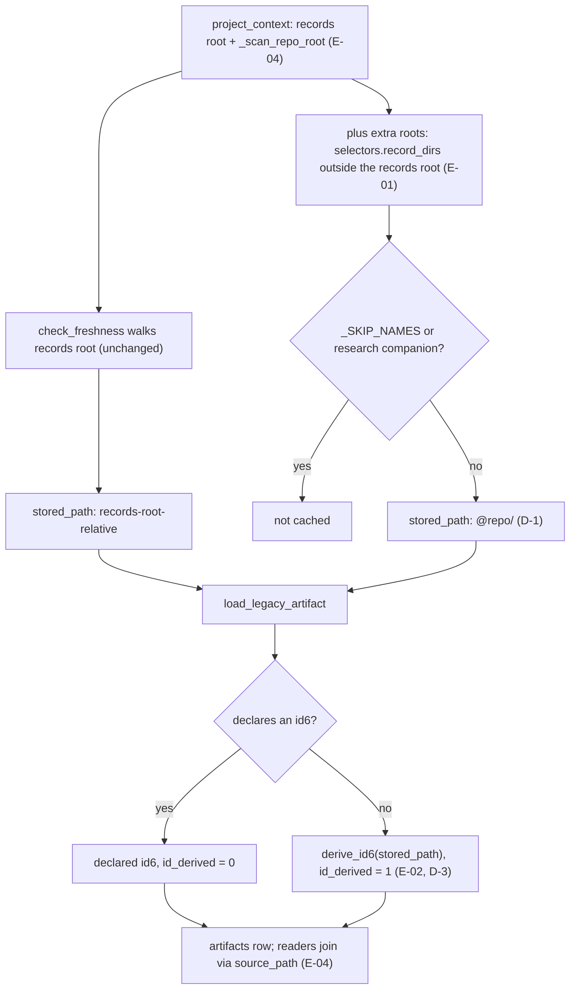

# IPD: Make the artifact_meta cache scan every record tree and give id-less records a stable identity

- Date: 2026-11-09
- Kind: child
- Concern: Measured 2026-11-07 on a copy of a private `.agents/`-layout repository (`g5hpbb` F-01): `status_set.inventory_all_artifacts` saw 201 records while `artifact_meta.query` saw 0, because the phase-A cache scans only the one records root `project_context` resolves. Id-less records also get a fresh random id6 per process (`g5hpbb` F-05). Plan `g5hpbb` owned both fixes (its E-02, E-03) beside six other items; research `nj8zdp` guidance splits it in round 3 on 2026-11-09.
- Scope: In `agent_workflows/artifact_meta.py`: scan the same directory set as `selectors.record_dirs` (E-01, from `g5hpbb` E-02) and give an id-less record a stable path-derived identity (E-02, from `g5hpbb` E-03); route every in-module join of a stored path through one helper (E-04); pass the repository root to the scan from the readers and `meta_cli` (E-06); phase-B notes in spec `4sd62s` 5.2a item 3 and the 4.5a `ARTIFACTS` diagram (E-05); and the cache-case test module `tests/test_artifact_meta_shapes.py` (E-03, the `g5hpbb` E-07 subset for those two items). EXCLUDES: discovery and conversion (`3g20ms`), layout stage (`bv4kkj`), the AC-42 proof (`g5hpbb`).
- Scope-Paths: agent_workflows/artifact_meta.py, agent_workflows/meta_cli.py, tests/test_artifact_meta_shapes.py, .aw/records/specs/approved/20260925-metastore-01-4sd62s-artifact-metadata-store.spec.md, .aw/records/plans/pending/20261109-metastore-103-6oi2nu-make-the-artifact-meta-cache-scan-every-record-tree-and-give.ipd.md
- Item-Dependencies: executed:dcerjg, executed:9vf2iv
- Status: approved
- Readiness: go-pending-approval
- Review-Depth: complex
- From-Spec: 4sd62s
- Work-Kind: feature
- Priority: high
- Blocks-Release: next
- Set: metastore
- Order: 103
- Highest E allocated: 06
- Author: opencode its_direct/pt3-claude-opus-5.5-1m-us
- Id: 6oi2nu
- Approval: 2026-11-16, recorded via aw ipd set: status set to approved

> Write and proofread this plan per the technical writing standard, `.aw/system/workflows/technical-writing/technical-writing.md` (`.agents/workflows/technical-writing/technical-writing.md` in a legacy-layout install), including requirement 12 (diagrams).

## Workflow history
- 2026-11-16 approved (aw set): status set to approved

- 2026-11-14 /plan-review (opencode its_direct/pt3-claude-opus-5.5-1m-us): APPROVE WITH REVISIONS APPLIED; PR-001..PR-012 FIXED; review record .aw/records/reviews/20261109-metastore-103-6oi2nu-make-the-artifact-meta-cache-scan-every-record-tree-and-give.review.md
- 2026-11-14 reviewed (aw set): APPROVE WITH REVISIONS APPLIED; PR-001..PR-012 FIXED
- 2026-11-09 to-review (opencode its_direct/pt3-claude-opus-5.5-1m-us): split from g5hpbb (round 3, research nj8zdp guidance).
- 2026-11-09 draft (opencode its_direct/pt3-claude-opus-5.5-1m-us): created.

## Goal

The phase-A cache sees every record today's readers see in a repository of each C12 shape, and an id-less record keeps the same identity across cold, warm and edited builds, so later reader moves preserve behavior everywhere.

## Detailed Implementation Checklist (TODO)

Execution-state rule: mark an `E-*` item complete only after performing the action. That mark is not validation. Right-sizing rule: write for a modest executor that cannot hold much in its head. Each E-item is one step (one concern, about one file, executable in one focused pass) and its V-item names each unit it covers with its own check; a plan stays at about 5 E-items and 8 work Scope-Paths, else split it into more child plans (guidance, `IPD-Z603`). Accepted execution states: blocked, failed, pending, performed; terminal gate demands 'performed'.

PIN-FIRST RULE, before E-04: create `.aw/state/6oi2nu/` (`mkdir -p .aw/state/6oi2nu`), run the baseline modules GREEN on the unmodified code, and save the per-test outcome list (`python3 -m pytest -o addopts="" -m "" -p no:randomly -n 0 -rA tests/test_artifact_meta_legacy.py tests/test_artifact_meta_cache.py tests/test_artifact_meta_loader_parity.py tests/test_artifact_meta_legacy_write.py tests/test_artifact_meta_read.py tests/test_cli_show.py tests/test_show_history.py | grep -E "^(PASSED|FAILED|ERROR|SKIPPED|XFAIL|XPASS) " | sed -E 's/ - .*//' | sort > .aw/state/6oi2nu/baseline-before.txt`; `-m ""` includes `slow` tests, `-p no:randomly -n 0` makes the list deterministic, and `-q` is not repeated because `addopts` is cleared). Also save the parity probe of V-01 to `.aw/state/6oi2nu/parity-before.txt` and, for each `9vf2iv` corpus shape, `status_set.inventory_all_artifacts(<root>)` as (`path` relative to the fixture root, `record_type`, `id6`, `set_id`, `status`) to `.aw/state/6oi2nu/<shape>-before.json`. After E-05, run the same pytest command into `baseline-after.txt`; `diff` of the two must print nothing. An existing assertion may change only where Behavior decisions `D-1` to `D-5` name it.

STOP CONDITIONS (unsafe conditions, not scope questions): stop and report without editing production code if `tests/migration_corpus.py` (from `9vf2iv`) or any of its five builders `legacy_agents_layout`, `mixed_layout`, `idless_prose`, `no_sidecar`, `companion_backend` is absent, or if `artifact_meta.load_legacy_artifact`, `artifact_meta.check_freshness` or `selectors.record_dirs` is absent or has a different signature from the one this plan cites; stop and report if a concurrent edit to `agent_workflows/artifact_meta.py` cannot be combined with this plan's edits.

### Task group 1: the phase-A cache sees every shape

- [ ] E-04 In `agent_workflows/artifact_meta.py`, add the STORED-PATH form of `D-1` as two helpers: `stored_path(abs_path, records_root, repo_root) -> str` (records-root-relative POSIX path when the file is inside the records root, else `@repo/` plus the repository-relative POSIX path, and `ValueError` when it is inside neither) and `source_path(stored, records_root, repo_root) -> Path` (the inverse). Route every place the module joins a stored path to the records root through `source_path`: `_load_sources` (the `records_root / path_str` join and the review-subject join), `history` (the `records_root / art[0]` join), `append` (the `LegacyTarget(records_root / rel, ...)` build and the `records_root / state.path` in-file mirror) and `repair` (both joins). `create` is NOT changed: a new record is always written inside the records root. Add `_scan_repo_root(ctx, records_root) -> Optional[Path]`, which returns `ctx.repo_root` (`legacy_context`, `meta_cli.MetaContext`), else `ctx.target_repo` (`project_context.ProjectContext`), else `project_context.record_git_root(records_root)`, else `None`.
  - Depends on: none
  - Expected outcome: for a file inside the records root, `stored_path` returns the value the loader stores today (so every existing cache path is unchanged); for a file under `<repo>/.agents/`, it returns `@repo/.agents/...` and `source_path` maps it back to the same resolved file; the pin-first baseline list is unchanged.
  - Execution state: pending

- [ ] E-01 (carried from `g5hpbb` E-02, corrected) In `artifact_meta`, make `check_freshness` also walk every EXTRA ROOT: each directory `selectors.record_dirs(repo_root, t)` returns for `t` in the nine types `status_set.inventory_all_artifacts` scans (`plans`, `specs`, `prompts`, `backlog`, `releases`, `research`, `walkthroughs`, `roadmaps`, `other`) whose resolved path is NOT inside the resolved records root, with `repo_root` from `_scan_repo_root` (no extra roots when it is `None`). For a `.agents/` layout these are `.agents/<type>`, `.agents/docs/research`, and, through the `other` sweep, every other `.agents/` child directory such as `.agents/docs` (which holds `.agents/docs/specs`) and `.agents/workflows`. Walk each file once, de-duplicated by resolved path, and apply the inventory's skips to extra-root files only: names in `selectors._SKIP_NAMES` and research companion files (`research_contract.companion_owner_stem`). Store each extra-root file under its `stored_path` (in `files.path`, `directories.path` and `artifacts.path`), so removal and rename detection keep working, and type it per `D-2` (import `status_set` and `selectors` inside the function, the pattern `artifact_meta` already uses for `selectors`). Replace the early `return` when the records root does not exist with a walk of the extra roots only. Bump `LEGACY_LOADER_VERSION` from `"legacy_v3"` to `"legacy_v4"`, because `compute_schema_hash` folds it into the schema hash and that is what rebuilds an existing cache. `check_freshness` takes the new keyword `repo_root: Optional[Path] = None`; its callers are wired in E-06.
  - Depends on: E-04
  - Expected outcome (observed after E-06): for every corpus shape, the set of resolved paths `artifact_meta.query(project_context=artifact_meta.legacy_context(<root>))` returns contains every path in `.aw/state/6oi2nu/<shape>-before.json` (for `legacy_agents_layout` this is 0 rows before the change); on this repository the V-01 parity probe output is unchanged (this repository has no extra root, measured 2026-11-14 at `83f29302f`).
  - Execution state: pending

- [ ] E-06 Wire the callers of `check_freshness` to the scan of E-01: in `agent_workflows/artifact_meta.py`, pass `repo_root=_scan_repo_root(ctx, records_root)` from `read`, `history`, `resolve`, `query` and `review_rows`; in `agent_workflows/meta_cli.py`, pass `repo_root=ctx.repo_root` from `index_rebuild` and `refresh_cache`, make `refresh_cache` skip only when neither the records root nor an extra root exists, and make `resolve_selector` also try `@repo/<token>` for a relative path token and `@repo/<repo-relative path>` for an absolute path outside the records root.
  - Depends on: E-01
  - Expected outcome: in the `legacy_agents_layout` fixture, `aw show <derived id6> --format json` and `aw show .agents/<a plan path> --format json` both return that record, and `aw index rebuild` counts it; on this repository the V-01 parity probe output is unchanged.
  - Execution state: pending

- [ ] E-02 (carried from `g5hpbb` E-03, corrected) Give an id-less record a STABLE DERIVED identity in the cache per `D-3`: replace the `_core.generate_id6(_pool)` branch of `load_legacy_artifact` with `derive_id6(stored_path, taken)`, which returns the first candidate, for `k` = 0, 1, 2 and so on, of six base36 characters (`artifact_core.ID6_ALPHABET`) taken from `sha256(stored_path + "\0" + str(k))` that is not in `taken`. `taken` is the existing per-records-root pool (`_LEGACY_MINT_POOLS`, seeded from `artifact_core.global_id6s`) plus every DECLARED id6 already in the cache. When a newly loaded record DECLARES an id6 that an existing derived row holds, re-derive that row first, so a declared id always wins. Record the identity kind: add `id_derived INTEGER` (1 for a derived id6, else 0) to the cache `artifacts` table in `generate_schema` and `id_derived: bool = False` to `State`, filled by the loader and by the row-to-`State` reads. A derived id6 is never written to a file or a sidecar: when `append` receives an id6 string whose `State.id_derived` is true, it builds `LegacyTarget(<file>, <plural>, None)`, so the legacy write keys it by path (`LegacyTarget.key` returns `path-` plus a SHA-256 prefix) exactly as an id-less setter target is keyed today.
  - Depends on: E-06
  - Expected outcome: for each id-less record of `idless_prose` and `legacy_agents_layout`, a cold build, a warm build, a build after appending a line to the file and a build after deleting `index.db` give the same id6 (today they give four different values, `D-3`); each derived id6 fully matches `artifact_core.ID6_RE`, passes `validate_id6`, is absent from `artifact_core.global_id6s(<root>)` and has `State.id_derived` true; every declared id6 is unchanged and has `id_derived` false; a note `append` on a derived id6 leaves no id6 in the file or the sidecar.
  - Execution state: pending

- [ ] E-05 Amend spec `4sd62s` (the `- Scope-Paths:` spec file) for phase B, in two places, and log it with `aw specs note <spec> --message "6oi2nu: phase-B extra-root path form and derived id6 (D-1, D-3)"`: (1) in 5.2a item 3, one sentence saying that in phase B the legacy loader also scans the `selectors.record_dirs` trees outside the records root and stores those files as `@repo/<repository-relative path>` until the layout stage moves them; (2) in the section 4.5a ER diagram, append to the `ARTIFACTS` `path` note "In phase B only, a file outside the records root is stored as @repo/<repository-relative path>" and add the row `int id_derived "Phase B only: 1 when the legacy loader derived the id6 from the path because the file declares none (6oi2nu D-3). Always 0 after the cutover."`.
  - Depends on: E-01, E-02
  - Expected outcome: `git diff` of the spec shows only those two edits plus the one `## Workflow history` line `aw specs note` writes, and `aw specs check` on the spec reports no new error.
  - Execution state: pending

### Task group 2: tests

- [ ] E-03 Add `tests/test_artifact_meta_shapes.py` with `pytestmark = pytest.mark.core`, building each fixture with the `9vf2iv` builders of `tests/migration_corpus.py` (each returns the fixture root) and calling the real functions only (no test reads production source, AGENTS.md "TEST OUTCOMES, NOT CODE STRUCTURE"). Cases: (a) parameterized over the five shapes, the resolved path set of `artifact_meta.query(project_context=artifact_meta.legacy_context(root))` contains every resolved path of `status_set.inventory_all_artifacts(root)`, and id6 (where the inventory has one) and lowercased status agree for each; (b) for `idless_prose` and `legacy_agents_layout`, the cold, warm, after-edit and deleted-`index.db` builds give identical id6 values for every id-less record, each fully matching `artifact_core.ID6_RE`, none in `artifact_core.global_id6s(root)` and each with `id_derived` true; (c) for `legacy_agents_layout`, `artifact_meta.read(<derived id6>)` returns a `State` whose `source_path` is the `.agents/` file, and `artifact_meta.history(<derived id6>)` returns without error; (d) the same query through a `project_context.resolve_project_context(target_repo=str(root))` context and through a context carrying only `logical_roots` returns the same path set as (a); (e) a declared-id collision: a record declaring the id6 that an id-less record derived at `k` = 0 makes that record re-derive, and the declared record keeps its id6; (f) a note `append` on a derived id6 of an id-less spec writes no `- Id:` line to the file and no derived id6 to `records/history.jsonl`. Any test that `--durations=0` reports over 2 s is marked `@pytest.mark.slow` (do not edit `tests/slow_allowlist.txt`, which is outside `- Scope-Paths:`) and named in the V-03 evidence.
  - Depends on: E-01, E-02, E-04, E-06
  - Expected outcome: every case passes, and the pin-first `diff` prints nothing.
  - Execution state: pending

## Project conventions discovered (Step 0)

- `selectors.record_dirs` is the existing, tested authority for "which directories hold records of a type"; E-01 reuses its rule rather than inventing a second one (carried from `g5hpbb` Step 0). It is `functools.lru_cache`d through `selectors._record_dirs_cached`, so tests that build several fixtures call `selectors._record_dirs_cached.cache_clear()` as `tests/test_cli_find.py` does.
- `status_set.inventory_all_artifacts` is today's reader and scans nine types including the `other` sweep; `status_set.detect_artifact_type` types a file by facet, then by its directory under the records root or `.agents/`.
- AGENTS.md forbids tests that read production source (P16). New test modules set `pytestmark = pytest.mark.core`; `conftest.py` warns on any test over 2 s not listed in `tests/slow_allowlist.txt`.
- The cache rebuilds only when `compute_schema_hash` changes, and that hash folds in `LEGACY_LOADER_VERSION` (backlog `suth7l`).
- Cite code by SYMBOL (`module.function`) or by a quoted content string, with a line number only appended to one of those and never alone: an offset expires before this plan executes (advisory `IPD-C801`).

## Findings

| Id | Evidence (F-01 measured 2026-11-07 by `g5hpbb`; F-02 to F-07 measured 2026-11-14 at `83f29302f`) | Finding |
|---|---|---|
| F-01 | `g5hpbb` F-01; reproduced on a scratch `.agents/` repository: `artifact_meta.legacy_context` resolves the records root to `<repo>/.aw/records`, which does not exist, `artifact_meta.check_freshness` returns at `if not records_root.exists(): return`, and `artifact_meta.query` returns 0 rows while `status_set.inventory_all_artifacts` returns 4 | The cache scans only the records root, so an `.agents/` repository is invisible to it. |
| F-02 | `artifact_meta.load_legacy_artifact` calls `_core.generate_id6(_pool)` for a record with no id; a scratch id-less spec gave `8i63bk` cold, `8i63bk` warm, `efguhv` after a one-line edit, `kmkq94` after deleting `index.db` | An id-less record's id6 changes on every cold build AND on every edit. |
| F-03 | `artifact_core.ID6_RE` is `\A[0-9a-z]{6}\Z` and `artifact_core.generate_id6` draws every position from the full `ID6_ALPHABET`; `artifacts.id6 TEXT PRIMARY KEY`; `validate_id6` runs in `load_legacy_artifact`, `read`, `history`, `read_at`, `create` and `append` | A "reserved, non-mintable prefix" of six characters does not exist, and any other form fails `validate_id6`; so the identity must be a valid id6 (`D-3`). |
| F-04 | `load_legacy_artifact` computes `rel_path` with `path.relative_to(records_root)`, which raises `ValueError ... is not in the subpath of` for a `.agents/` file; `_load_sources`, `history`, `append` and `repair` join `records_root / <stored path>`; spec `4sd62s` ER says `ARTIFACT_PATHS.path` is "never outside the root" | An extra-root file needs a stored-path form that the joins can map back (`D-1`). |
| F-05 | `selectors._record_dirs_cached` adds `.agents/<type>` and, for research only, `.agents/docs/research`; `.agents/docs/specs` is reached only through the `other` sweep of `.agents/` children, which also returns `.agents/workflows` (scratch repository: `other` gave `.agents/workflows`, `.agents/docs`; `specs` gave none) | Typing an extra-root file by the directory that found it would type `.agents/docs/specs` files as `other`; the loader must type by `detect_artifact_type` (`D-2`). |
| F-06 | On this repository the cache has 3391 rows and the inventory 3355 records; 0 inventory records are missing from the cache; the 36 cache-only rows are 26 `README.md`, 8 `comms` files typed `ipd`, 3 research `.data` companion files and others; 66 inventory records have no id6; Set differs on 246 records (242 where the inventory has no Set, the `suth7l` decision, plus 4 legacy-timestamp plans whose `- Set:` bullet the cache does not read) | The in-root behavior is the parity baseline, and V-01 compares before and after instead of a fixed count. |
| F-07 | `artifact_meta.query` took 0.89 s, 0.93 s and 0.93 s per process on this repository; computing every extra root took 0.035 s | The added scan costs little where no extra root exists. |

## Behavior decisions (kept or changed behavior, 4.3)

- D-1 (stored path of an extra-root file). CHANGED for extra-root files only: stored as `@repo/<repository-relative POSIX path>` in `files.path`, `directories.path`, `artifacts.path` and `State.path`, mapped back by `artifact_meta.source_path`. Every in-root path is unchanged. The form is cache-only and gitignored; it ends when the layout stage (`bv4kkj`) moves the files under the records root. Rejected: repository-relative paths for every record (changes every in-root path that the reader-move plans pin) and `../` paths (`_check_path_safety` and spec 4.5a forbid them). Recommendation strength: strong.
- D-2 (type of an extra-root file). `status_set.detect_artifact_type(path, repo_root)` gives the plural type, mapped through `_LEGACY_PLURAL_TO_TYPE`; a filename facet still overrides it, as for in-root files. A plural with no registry type (`roadmaps`, `other`) gets the loader's existing default `ipd`, which is what the in-root walk already does for `comms/`, `prompt-library/` and `roadmaps/` files (measured: 8 `comms`, 5 `prompt-library` and 1 `roadmaps` rows typed `ipd`). KEPT, so a reader move sees the same typing rule in both trees. Recommendation strength: medium.
- D-3 (identity of an id-less record). CHANGED: a derived id6 from `sha256(stored_path + "\0" + k)` with a collision walk, marked `id_derived`. It lives only in the gitignored cache and is never written to a file or a sidecar (E-02 keys a write by path). It is stable across cold, warm and edited builds because it depends only on the stored path; a rename gives a new id6, which is inherent to a file that declares none. It is still not the record's permanent id6: `3g20ms` mints that in the migration, so a derived id6 a user copies from `aw show` output stops resolving after the migration (today's random id6 stops resolving on the next edit). Demonstrated 2026-11-14: two processes derived `0uf2yo` at `k` = 0 for the same path, and with `0uf2yo` taken the walk returned `2xaht4` at `k` = 1. A residual instability remains only when two id-less records derive the same candidate: about n^2 / (2 * 36^6), about 1e-6 for this repository's 66 id-less records, and then the two may swap `k` between builds. Rejected: a reserved prefix (does not exist, F-03) and a separate `path_key` column (every `validate_id6` site and `artifacts.id6 PRIMARY KEY` would need a second identity). Recommendation strength: strong.
- D-4 (extra-root skips). Only extra-root files skip `selectors._SKIP_NAMES` and research companion files, matching `inventory_all_artifacts`. KEPT for in-root files: the in-root walk still caches `README.md` and companion files (F-06), so this plan changes no in-root row. Recommendation strength: medium.
- D-5 (toolkit docs under `.agents/workflows`). KEPT: they are cached as records, because `inventory_all_artifacts` lists them as `other` records today and the goal is parity. Moving them out of the record trees is the layout stage's work (`bv4kkj`). Recommendation strength: medium.

## Proposed changes (ordered, validatable)

1. Add the stored-path helpers and route the module's joins through them in `agent_workflows/artifact_meta.py` (E-04).
2. Walk the extra roots from `selectors.record_dirs` in `artifact_meta.check_freshness` and bump `LEGACY_LOADER_VERSION` (E-01).
3. Pass `repo_root` to `check_freshness` from the `artifact_meta` readers and from `meta_cli`, and accept the `@repo/` path form in `meta_cli.resolve_selector` (E-06).
4. Replace the random id-less mint in `artifact_meta.load_legacy_artifact` with the derived id6 and the `id_derived` marker (E-02).
5. Amend spec `4sd62s` 5.2a item 3 and the 4.5a `ARTIFACTS` diagram for the phase-B path form and marker (E-05).
6. Add `tests/test_artifact_meta_shapes.py` (E-03).

E-04 comes first because E-01 stores extra-root paths that only E-04's helpers can map back; E-06 then turns the scan on for every reader, and E-02 runs after it so its four-build check sees extra-root records.

## Deferred / out of scope (with reason)

- Discovery, id-less minting in the migration, the layout stage and the AC-42 proof.
  - Carrier: g5hpbb
- Consuming `State.id_derived` (to report "no id" for parity with today's readers, which return `id6: None` for 66 records here) and `artifact_meta.source_path` (to open an extra-root record) in the reader moves. The scan-root extension that `ffceq0` `## Scope check` allows E-12 to make is owned here instead, so `ffceq0` needs no `artifact_meta.py` scan change.
  - Carrier: ffceq0
- Reading the `- Set:` bullet of a legacy-timestamp record (4 records, F-06) and typing `comms`/`roadmaps` rows: pre-existing in-root loader behavior this plan keeps (`D-2`).
  - Carrier: g5hpbb

## Scope check

- Over-scope: none. `artifact_meta.py` changes its scan set, stored-path joins and id-less identity; `meta_cli.py` only passes `repo_root` and accepts the `@repo/` path form; the spec gets two phase-B notes.
- Under-scope: none for `g5hpbb` E-02, E-03 and the shapes module of its E-07.

## Required tests / validation

New module: `tests/test_artifact_meta_shapes.py`. Existing, pinned before and after by the pin-first rule: `tests/test_artifact_meta_legacy.py`, `tests/test_artifact_meta_cache.py`, `tests/test_artifact_meta_loader_parity.py`, `tests/test_artifact_meta_legacy_write.py`, `tests/test_artifact_meta_read.py`, `tests/test_cli_show.py`, `tests/test_show_history.py`.

## Spec / documentation sync

Spec `4sd62s` is amended by E-05 (declared in `- Scope-Paths:`). Why: spec 4.5a says every cache `path` is records-root-relative and never outside the root, and a `.agents/` file in phase B is outside it, so `D-1` would otherwise contradict an approved contract that the reader-move plans are reviewed against; and the `id_derived` marker is a new cache column those plans must read. The amendment is phase-B only and ends at the layout stage and the cutover. No user-facing documentation changes.

## Open questions

### OQ-01: Should id-less records get their permanent id6 in phase B instead of at migration?

- Blocking: no
- Status: resolved
- Owner: plan author
- Resolution or deferral rationale: Carried from `g5hpbb` OQ-01: No. Writing an id into another repository's files is a migration act that 5.2 confines to `aw migrate metadata`; phase B only reads. E-02 gives the cache a stable derived identity that is never written to a file, and `3g20ms` mints the real id6 inside the migration. Recommendation strength: strong.

## Validation and cross-check (verify before reporting done)

Validation-state rule: inspect evidence in a separate pass. Do not mark a `V-*` item complete from memory or from the matching execution checkmark. Accepted validation results: blocked, failed, pass, pending; terminal gate demands 'pass'. Runtime-demonstration reachability rule: for each `V-*` item demanding the software be observed acting (such as a run, a dispatch, or a transition), as distinct from items demanding a diff, a file's content, or a test result, which are reachable by construction, name the code path that produces the observation or the sibling `E-*` that creates it, else the demand is UNDER-SCOPE.

- [ ] V-04 validates E-04
  - Required evidence: paste a scratch run (in `/tmp`) of `stored_path` and `source_path` on one in-root file and one `.agents/` file, showing the in-root value equals today's records-root-relative path and both round-trip to the same resolved file; paste `diff .aw/state/6oi2nu/baseline-before.txt .aw/state/6oi2nu/baseline-after.txt` printing nothing.
  - Observed evidence:
  - Result: pending
- [ ] V-01 validates E-01
  - Required evidence: paste, per corpus shape, the before-dump record count from `.aw/state/6oi2nu/<shape>-before.json` and the count of those paths found in `artifact_meta.query` after the change (equal), with `legacy_agents_layout`'s before-change query count of 0; paste the `LEGACY_LOADER_VERSION` diff line; and paste `.aw/state/6oi2nu/parity-before.txt` and `parity-after.txt` and their empty `diff`, where each file is the output of this probe run at the repository root: `python3 -c "from pathlib import Path; from agent_workflows import artifact_meta as m, project_context as p, status_set as s; c=p.resolve_project_context(); root=Path(c.logical_roots['records']).resolve(); by={str((root/r.path).resolve()):r for r in m.query(project_context=c) if r.path and not r.path.startswith('@repo/')}; inv=s.inventory_all_artifacts(Path('.')); print('rows', len(by), 'inventory', len(inv)); print('missing_from_cache', sum(1 for r in inv if str(r.path.resolve()) not in by)); print('id6_mismatch_declared', sum(1 for r in inv if r.id6 and by[str(r.path.resolve())].id6 != r.id6)); print('status_mismatch', sum(1 for r in inv if (by[str(r.path.resolve())].status or '') != (r.status or '').lower())); print('set_mismatch', sum(1 for r in inv if by[str(r.path.resolve())].set_id != r.set_id))"` (the code path is `artifact_meta.query` -> `check_freshness`, E-01). Measured at `83f29302f`: `rows 3391 inventory 3355`, `missing_from_cache 0`, `id6_mismatch_declared 0`, `status_mismatch 0`, `set_mismatch 246`.
  - Observed evidence:
  - Result: pending
- [ ] V-06 validates E-06
  - Required evidence: paste, from the `legacy_agents_layout` fixture, the output of `aw show <derived id6> --format json`, `aw show .agents/<a plan path> --format json` (both naming the same record, code path `meta_cli.resolve_selector` -> `artifact_meta.read`, E-06) and `aw index rebuild` with the record counted; paste the V-01 parity probe output after E-06 with an empty `diff` against `parity-before.txt`.
  - Observed evidence:
  - Result: pending
- [ ] V-02 validates E-02
  - Required evidence: paste, for every id-less record of `idless_prose` and `legacy_agents_layout`, the id6 from a cold build, a warm build, a build after appending a line, and a build after deleting `index.db` (all four identical, code path `artifact_meta.query` -> `load_legacy_artifact`, E-02), its `id_derived` value (true), and a check that none is in `artifact_core.global_id6s(<fixture>)`; paste the `generate_schema` diff adding `id_derived`; paste `grep -c` of the derived id6 in the file and in `records/history.jsonl` after a note `append` (both 0).
  - Observed evidence:
  - Result: pending
- [ ] V-05 validates E-05
  - Required evidence: paste `git diff` of `.aw/records/specs/approved/20260925-metastore-01-4sd62s-artifact-metadata-store.spec.md` showing only the 5.2a item 3 sentence, the two `ARTIFACTS` diagram edits and the `aw specs note` history line, and the `aw specs check` output for the spec with no new error.
  - Observed evidence:
  - Result: pending
- [ ] V-03 validates E-03
  - Required evidence: paste `python3 -m pytest -o addopts="" -v --durations=0 tests/test_artifact_meta_shapes.py tests/test_artifact_meta_legacy.py tests/test_artifact_meta_cache.py tests/test_artifact_meta_loader_parity.py tests/test_artifact_meta_legacy_write.py tests/test_artifact_meta_read.py tests/test_cli_show.py tests/test_show_history.py` with every case (a) to (f) of `tests/test_artifact_meta_shapes.py` PASSED by node id (five shape ids for case (a)), 0 failed in the seven existing modules, and every test over 2 s named and marked `slow`; paste `grep -n "pytestmark" tests/test_artifact_meta_shapes.py` showing `pytest.mark.core`.
  - Observed evidence:
  - Result: pending

## Approval and execution gate

- Size assessment: standard
- Cohesion rationale: six E-items, one over the five-item guidance (`IPD-Z603`, advisory). E-04, E-01, E-06 and E-02 change one cache scan in one module and cannot merge separately without a broken intermediate state (E-01 stores paths only E-04 can map back, and E-06 turns the scan on for every reader); E-05 is the spec note of the same change and E-03 its tests.

Execute only after human approval (`Status: approved`) and after every plan in `- Item-Dependencies:` (`dcerjg`, `9vf2iv`) is executed. Apply the STOP CONDITIONS above (absent `9vf2iv` builders or changed `artifact_meta`/`selectors` symbols, or an unmergeable concurrent edit). All open questions are resolved.

Scope fence: the paths in `- Scope-Paths:` are a declaration; a needed file outside the fence is edited and then justified at finalize (`--scope-reason`), and a declared path left unmodified is acknowledged (`--scope-ack`).

Safety: tests and probes that write run only on generated fixtures or scratch directories under `/tmp`; the only writes in this checkout are the declared paths and the gitignored `.aw/state/6oi2nu/` and `.aw/state/index.db`.

Honesty rule: paste the ACTUAL output; never claim a result you did not run.

Commits: commit only through `aw commit 6oi2nu -- <paths>`; never `git add -A`, a bare `git add` or `git commit -a`; never push.

Lifecycle transition: the plan moves to `.aw/records/plans/executed/` only through `aw ipd finalize`, never a hand `git mv`, and only after `aw ipd lint --phase pre-transition` conforms and every `V-*` reads `pass` with pasted evidence. When `aw oc run` or `aw agy run` executes the plan, the runner performs the finalize; a hand executor runs `aw ipd finalize 6oi2nu` itself.
