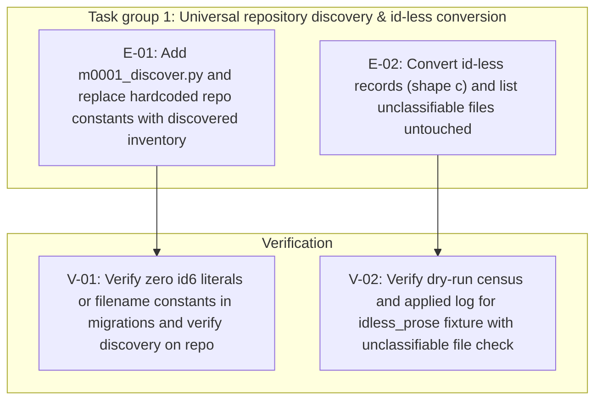

# IPD: Make m0001 discover its inputs and convert id-less records

- Date: 2026-11-09
- Kind: child
- Concern: Spec `4sd62s` 5.2a requires `aw migrate metadata` to discover its inputs in any repository instead of using this repository's constants (the 34-entry rename map, the 28-id mint list, `wvlk84`), and to convert id-less records (C12 shape c). Plan `g5hpbb` owned this (its E-04, E-05) beside six other items; research `nj8zdp` guidance splits it in round 3 on 2026-11-09.
- Scope: Add `agent_workflows/migrations/m0001_discover.py` with `discover(repo) -> Inventory` and replace every repository-specific constant in the `m0001_*` modules with values computed from it (E-01, from `g5hpbb` E-04); mint ids, statuses, titles and Set/order for id-less records and list unclassifiable files untouched (E-02, from `g5hpbb` E-05). EXCLUDES: the cache changes (`6oi2nu`), layout stage and sidecar expectation (`bv4kkj`), the AC-42 test module and changelog (`g5hpbb`).
- Scope-Paths: agent_workflows/migrations/m0001_discover.py, agent_workflows/migrations/m0001_metadata_v2.py, agent_workflows/migrations/m0001_renames.py, agent_workflows/migrations/m0001_convert.py, agent_workflows/migrations/m0001_verify.py, .aw/records/plans/pending/20261109-metastore-104-3g20ms-make-m0001-discover-its-inputs-and-convert-id-less-records.ipd.md
- Item-Dependencies: executed:dcerjg, executed:9vf2iv, executed:6oi2nu
- Status: approved
- Readiness: go-pending-approval
- Review-Depth: standard
- From-Spec: 4sd62s
- Work-Kind: feature
- Priority: high
- Blocks-Release: next
- Set: metastore
- Order: 104
- Highest E allocated: 02
- Author: opencode its_direct/pt3-claude-opus-5.5-1m-us
- Id: 3g20ms
- Approval: 2026-11-16, recorded via aw ipd set: status set to approved

> Written to `.aw/system/workflows/technical-writing/technical-writing.md`. Every obligation, exact identifier, quotation, evidence record, and lifecycle status is preserved.

## Workflow history
- 2026-11-16 approved (aw set): status set to approved

- 2026-11-14 reviewed (antigravity/gemini-3.8-flash): /plan-review (antigravity/gemini-3.8-flash): APPROVE WITH REVISIONS APPLIED; PR-001, PR-002, PR-003, PR-004.
- 2026-11-09 to-review (opencode its_direct/pt3-claude-opus-5.5-1m-us): split from g5hpbb (round 3, research nj8zdp guidance).
- 2026-11-09 draft (opencode its_direct/pt3-claude-opus-5.5-1m-us): created.

## Goal

`m0001` computes its renames, mints and counts from a discovered inventory and converts id-less records, so the same code migrates this repository and any other.

## Detailed Implementation Checklist (TODO)

Execution-state rule: mark an `E-*` item complete only after performing the action. That mark is not validation. Right-sizing rule: write for a modest executor that cannot hold much in its head. Each E-item is one step (one concern, about one file, executable in one focused pass) and its V-item names each unit it covers with its own check; a plan stays at about 5 E-items and 8 work Scope-Paths, else split it into more child plans (guidance, `IPD-Z603`). Accepted execution states: blocked, failed, pending, performed; terminal gate demands 'performed'.

### Task group 1: one migration for every repository

- [ ] E-01 (carried verbatim from `g5hpbb` E-04) Add `agent_workflows/migrations/m0001_discover.py`: `discover(repo) -> Inventory` returns every candidate record with its source tree, type, identity (present, or to mint), status source (bullet, YAML, comment, disposition directory), and a reason for every file it cannot classify; whether a sidecar is EXPECTED (5.2a item 5: some record's own history shows a sidecar-writing setter ran) and whether one is present; and whether a legacy layout stage is needed. Replace every repository-specific constant in `m0001_*` (the 34-entry rename map, the 28-id mint list, counts, the `wvlk84` special case) with values computed from this inventory; the measured values for this repository become assertions in `g5hpbb` E-07's this-repository case, not code.
  - Depends on: none
  - Expected outcome: a pasted `rg` over `agent_workflows/migrations/` finds no id6 literal, no record filename and no corpus count; `discover` on this repository reproduces the 34 legacy-name renames and 28 mints that `dcerjg` measured.
  - Execution state: pending

- [ ] E-02 (carried verbatim from `g5hpbb` E-05) Convert id-less records (shape c) per 5.2a item 4: mint a repository-unique id6 through `artifact_core.mint_id6`, take `status` from the disposition directory, `title` from the first `# ` line, and Set and order by the 5.2 step 3 rule; record each minted value in the migration journal so a dry run and the apply mint the same id. Files `discover` could not classify are listed in the census with their reason and left byte-identical by `--apply`.
  - Depends on: E-01
  - Expected outcome: on `idless_prose`, the dry-run census lists the prose plan with its minted id6, `executed` status and title, and the unclassifiable file with its reason; after `--apply` the plan has a log and the unclassifiable file is unchanged (`git diff --quiet -- <file>`).
  - Execution state: pending

## Project conventions discovered (Step 0)

- Ids are minted by `artifact_core.mint_id6` (repository-wide collision check) (carried from `dcerjg` Step 0).
- Cite code by SYMBOL (`module.function`) or by a quoted content string, with a line number only appended to one of those and never alone: an offset expires before this plan executes (advisory `IPD-C801`).

## Findings

| Id | Finding | Evidence |
|---|---|---|
| F-01 | Spec 5.2 and plan `dcerjg` are this-repository-specific. | `g5hpbb` F-06: 5.2 step 3 names 34 renames, 28 mints and `wvlk84`. |
| F-02 | Prose plans with no metadata bullets exist in the field. | `g5hpbb` F-03. |

## Proposed changes (ordered, validatable)

1. E-01: discovery and constant removal.
2. E-02: id-less conversion.

## Deferred / out of scope (with reason)

- Layout stage, companion backends and the no-sidecar rule; the AC-42 proof.
  - Carrier: g5hpbb

## Scope check

- Over-scope: none. The four existing `m0001_*` modules change only to read discovered values instead of constants.
- Under-scope: none for `g5hpbb` E-04 and E-05; their cases are proven end to end in `g5hpbb` E-07.

## Required tests / validation

Proven by V-01 and V-02 directly; the parameterized AC-42 module `tests/test_m0001_any_repo.py` is `g5hpbb`'s. Existing `tests/test_m0001_renames.py`, `tests/test_m0001_conversion.py` and `tests/test_m0001_roundtrip.py` must still pass (named in V-01).

## Spec / documentation sync

No spec change; implements `4sd62s` 5.2a items 1 and 4.

## Open questions

None.

## Validation and cross-check (verify before reporting done)

Validation-state rule: inspect evidence in a separate pass. Do not mark a `V-*` item complete from memory or from the matching execution checkmark. Accepted validation results: blocked, failed, pass, pending; terminal gate demands 'pass'. Runtime-demonstration reachability rule: for each `V-*` item demanding the software be observed acting (such as a run, a dispatch, or a transition) (as distinct from items demanding a diff, a file's content, or a test result, which are reachable by construction), name the code path that produces the observation or the sibling `E-*` that creates it, else the demand is UNDER-SCOPE.

- [ ] V-01 validates E-01
  - Required evidence: paste the `rg` over `agent_workflows/migrations/` for id6 literals, record filenames and corpus counts (no hits), and `discover(<this repo>)` reporting 34 legacy-name renames and 28 mints; and `python3 -m pytest -o addopts="" -v tests/test_m0001_renames.py tests/test_m0001_conversion.py tests/test_m0001_roundtrip.py` with 0 failed (each module's node ids PASSED).
  - Observed evidence:
  - Result: pending
- [ ] V-02 validates E-02
  - Required evidence: paste the `idless_prose` dry-run census lines for the prose plan (minted id6, status `executed`, title) and the unclassifiable file (reason); then, after `--apply`, its log's first event and `git diff --quiet -- <unclassifiable file>; echo $?` printing `0`. Produced by `aw migrate metadata` (E-02 code path).
  - Observed evidence:
  - Result: pending

## Approval and execution gate

- Size assessment: standard
- Cohesion rationale: not required

Execute only after human approval (`Status: approved`) and after every plan in `- Item-Dependencies:` is executed. A narrow safety stop applies if prerequisite metastore symbols from `dcerjg`, `9vf2iv`, or `6oi2nu` are absent. All open questions are resolved.

Scope fence: the paths in `- Scope-Paths:` are a declaration; a needed file outside the fence is edited and then justified at finalize (`--scope-reason`), and a declared path left unmodified is acknowledged (`--scope-ack`).

Safety: never run `aw migrate metadata --apply` on this checkout or any of the maintainer's other repositories; only on generated fixtures.

Honesty rule: paste the ACTUAL output; never claim a result you did not run.

Commits: commit only through `aw commit 3g20ms -- <paths>`; never `git add -A`, a bare `git add` or `git commit -a`; never push.

Lifecycle transition: the plan moves to `.aw/records/plans/executed/` only through `aw ipd finalize`, never a hand `git mv`, and only after `aw ipd lint --phase pre-transition` conforms and every `V-*` reads `pass` with pasted evidence. When `aw oc run` or `aw agy run` executes the plan, the runner performs the finalize; a hand executor runs `aw ipd finalize 3g20ms` itself.
