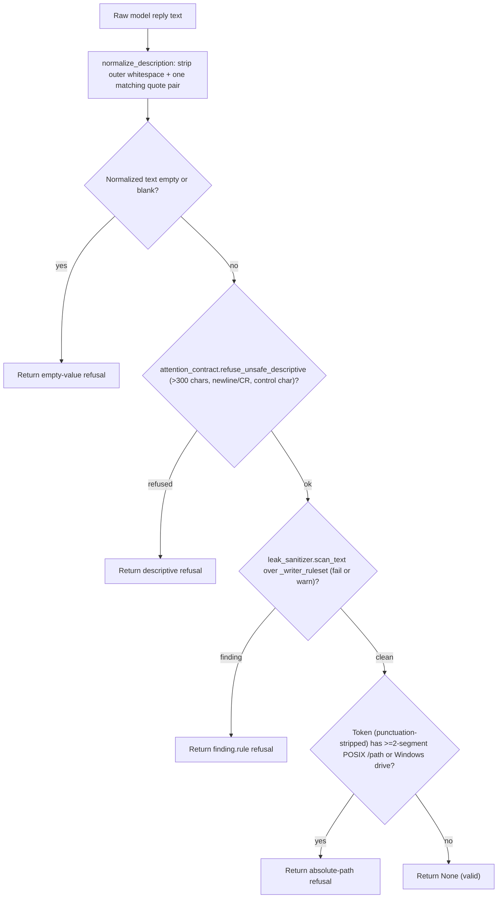

# IPD: Build the m0001 short-description validation

- Date: 2026-11-09
- Kind: child
- Concern: Spec `4sd62s` 4.2 SAFEGUARDS require every model-generated `short_description` to be refused when it is too long, holds a newline or control character, or leaks a path, user name or host name. Plan `odeo9z` owned this as its E-05 beside five other items (6 E-items); research `nj8zdp` guidance (at most 5 E-items per plan) moves it here, split from `odeo9z` in round 3 on 2026-11-09. It is a pure function with no dependency on the journal or the model call, so it can be built first.
- Scope: Create `agent_workflows/migrations/m0001_describe.py` with `normalize_description`, `build_describe_ruleset`, and `validate(text, repo, *, ruleset=None) -> str | None`, plus unit tests in `tests/test_m0001_describe.py` (executed before `odeo9z`, which depends on `executed:830wku`). EXCLUDES: the prompt, journal, tool-less call and regenerate-once rule (`odeo9z`); wiring, CLI options and the real trial (`ya4ee4`).
- Scope-Paths: agent_workflows/migrations/m0001_describe.py, tests/test_m0001_describe.py, .aw/records/plans/pending/20261109-metastore-106-830wku-build-the-m0001-short-description-validation.ipd.md
- Item-Dependencies: executed:dcerjg
- Status: reviewed
- Readiness: go-pending-approval
- Review-Depth: complex
- From-Spec: 4sd62s
- Work-Kind: feature
- Priority: high
- Blocks-Release: next
- Set: metastore
- Order: 106
- Highest E allocated: 01
- Author: opencode its_direct/pt3-claude-opus-5.5-1m-us
- Id: 830wku

> Write and proofread this plan per the technical writing standard, `.aw/system/workflows/technical-writing/technical-writing.md` (`.agents/workflows/technical-writing/technical-writing.md` in a legacy-layout install), including requirement 12 (diagrams).

## Workflow history
- 2026-11-14 reviewed (antigravity/gemini-4-carbon): /plan-review (antigravity/gemini-4-carbon): APPROVE WITH REVISIONS APPLIED; PR-001, PR-002, PR-003, PR-004

- 2026-11-09 to-review (opencode its_direct/pt3-claude-opus-5.5-1m-us): split from odeo9z (round 3, research nj8zdp guidance).
- 2026-11-09 draft (opencode its_direct/pt3-claude-opus-5.5-1m-us): created.

## Goal

One function decides whether a generated description is safe to store, with the same refusals the `artifact_meta` writer applies, so `odeo9z`'s regenerate-once rule has a validator to call.

## Detailed Implementation Checklist (TODO)

Execution-state rule: mark an `E-*` item complete only after performing the action. That mark is not validation. Right-sizing rule: write for a modest executor that cannot hold much in its head. Each E-item is one step (one concern, about one file, executable in one focused pass) and its V-item names each unit it covers with its own check; a plan stays at about 5 E-items and 8 work Scope-Paths, else split it into more child plans (guidance, `IPD-Z603`). Accepted execution states: blocked, failed, pending, performed; terminal gate demands 'performed'.

### Task group 1: validation

- [ ] E-01 Create `agent_workflows/migrations/m0001_describe.py` and `tests/test_m0001_describe.py` (`pytestmark = pytest.mark.core`, zero source inspection, runtime-assembled leak fixtures so `aw sanitize` stays clean) implementing `normalize_description(text: str) -> str`, `build_describe_ruleset(repo: Path) -> leak_sanitizer.Ruleset`, and `validate(text: str, repo: Path, *, ruleset: leak_sanitizer.Ruleset | None = None) -> str | None` (carried from `odeo9z` E-05). `normalize_description` strips surrounding whitespace and, when `len >= 2` and `s[0] == s[-1]` and `s[0] in ('"', "'")`, strips that one matching pair of quotes without truncating, stripping unmatched quotes, or rewriting inner text. `build_describe_ruleset(repo)` delegates to `artifact_meta._writer_ruleset(Path(repo))` (`leak_sanitizer.build_ruleset(Path(repo), include_warn=True)` minus `.aw/worktrees/<lane>` sibling lane directory names per `2xwb9b` D-02) so callers build it once per run and pass `ruleset=ruleset` while 2-argument `validate(text, repo)` still works standalone. `validate` normalizes `text` first and returns the first refusal reason: (1) empty or whitespace-only normalized text refused (`"aw migrate metadata: short_description must not be empty"`); (2) `attention_contract.refuse_unsafe_descriptive("aw migrate metadata", "short_description", cleaned)` (300-character bound, embedded newline/CR, control characters); (3) `leak_sanitizer.scan_text(cleaned, "short_description", active_ruleset, include_warn=True)` refusing ANY `fail` or `warn` finding naming `finding.rule`; (4) any whitespace-separated token that, after stripping leading `` `"'([{< `` and trailing `` `"'.,;:!?)]}> ``, contains a Windows drive prefix (`[A-Za-z]:[/\\]`) or starts with `/` (not `//`) with `count("/") >= 2` (matching `artifact_meta._check_no_absolute_paths_in_text` plus sentence punctuation).
  - Depends on: none
  - Expected outcome: empty/`""`/`"   "`/`'""'`, a 301-character value, an inner `\n` value, a `\x07` control-character value, a runtime-synthesized POSIX home path (sanitizer `home-path`), another user's path `/home/alice/x` both bare and wrapped as `("/home/alice/x").` or `C:\work\secret.txt` (absolute-path rule), and a monkeypatched/derived host name (sanitizer `derived:<host>` warn) each return a distinct non-empty refusal string; a 300-character sentence (including one wrapped in `'  "..."\n'`, normalized to 300 characters by `normalize_description`), a sentence mentioning `/plan-review` or `` `/plan-review` ``, and a sentence naming relative path `agent_workflows/migrations/m0001_describe.py` return `None`; passing a pre-built `ruleset` avoids rebuilding it per call; `aw sanitize --agent` reports zero findings on the working tree.
  - Execution state: pending

## Project conventions discovered (Step 0)

- Descriptive-value safety is `attention_contract.refuse_unsafe_descriptive` with `MAX_DESCRIPTIVE_LEN` 300 (`refuse_unsafe_descriptive` returns `None` on `""`, so `validate` refuses empty/blank normalized strings explicitly); writer leak scanning uses `artifact_meta._writer_ruleset` over `leak_sanitizer.build_ruleset(..., include_warn=True)` (`2xwb9b` D-02) and `leak_sanitizer.scan_text(..., include_warn=True)`.
- `agent_workflows/migrations/__init__.py` is created upstream by `g8na48` E-01 (transitively required via `executed:dcerjg`), and `odeo9z` depends on `executed:830wku`, so `830wku` creates `agent_workflows/migrations/m0001_describe.py` and `tests/test_m0001_describe.py` first.
- `tests/test_m0001_describe.py` is not in `leak_sanitizer._ALLOWED_PATHS`: never write a real or `/home/<non-placeholder>` path literal in test source; synthesize leak strings from fragments or `monkeypatch` (`HOME`, `socket.gethostname`) at runtime so tests pass deterministically on developer machines and CI containers (`_GENERIC_DERIVED_TOKENS`) while keeping `aw sanitize` clean (AGENTS.md "TEST OUTCOMES, NOT CODE STRUCTURE").
- Cite code by SYMBOL (`module.function`) or by a quoted content string, with a line number only appended to one of those and never alone: an offset expires before this plan executes (advisory `IPD-C801`).

## Findings

| Id | Evidence (re-verified 2026-11-14 at `e3470de08`) | Finding |
|---|---|---|
| F-01 | `odeo9z` F-02 and `agent_workflows/artifact_meta.py`: `attention_contract.refuse_unsafe_descriptive`, `leak_sanitizer.scan_text`, `leak_sanitizer.build_ruleset`, `artifact_meta._writer_ruleset`, and `artifact_meta._check_no_absolute_paths_in_text` all exist at HEAD | Every validation helper this module composes already exists; `agent_workflows/migrations/__init__.py` lands via prerequisite `dcerjg` (`g8na48` E-01). |
| F-02 | `ipd_lint` IPD-Z603 on `odeo9z` (2026-11-09, cutover patched): "plan has 6 E-items (guidance: at most 5)" | Moving `odeo9z` E-05 here brings `odeo9z` to 5 items, with `odeo9z` depending on `executed:830wku`. |
| F-03 | `attention_contract.refuse_unsafe_descriptive(..., "")` returns `None`, `artifact_meta._writer_ruleset` (`2xwb9b` D-02) strips `.aw/worktrees/<lane>` sibling directory warn tokens while `build_ruleset` spawns two `git config` subprocesses per call, and `odeo9z` E-06 calls `validate(reply, repo)` on immutable `str` | `m0001_describe` exports `normalize_description`, `build_describe_ruleset`, and `validate(text, repo, *, ruleset=None)` refusing empty normalized text and punctuation-wrapped absolute paths; `odeo9z` E-06 should journal `normalize_description(reply)` and pass one `build_describe_ruleset(repo)` per run (noted for `odeo9z`'s review). |

## Proposed changes (ordered, validatable)

1. Implement `normalize_description`, `build_describe_ruleset`, and `validate(text, repo, *, ruleset=None)` in `agent_workflows/migrations/m0001_describe.py` and verify every refusal, normalization, and pass branch in `tests/test_m0001_describe.py` (E-01).

## Deferred / out of scope (with reason)

- The rest of the describe module (prompt, journal, tool-less call, regenerate-once).
  - Carrier: odeo9z

## Scope check

- Over-scope: none.
- Under-scope: none for `odeo9z` E-05.

## Required tests / validation

New core module: `tests/test_m0001_describe.py` (`pytestmark = pytest.mark.core`), holding the `validate`, `normalize_description`, and `build_describe_ruleset` unit tests; `odeo9z` and `ya4ee4` add the prompt, journal, spawn, and fake-host cases. Regression and self-cleanliness checks: `tests/test_artifact_meta_registry.py`, bare `python3 -m pytest`, and `aw sanitize --agent`.

## Spec / documentation sync

No spec change; implements `4sd62s` 4.2 SAFEGUARDS and OQ-31 (validation half).

## Open questions

None.

## Validation and cross-check (verify before reporting done)

Validation-state rule: inspect evidence in a separate pass. Do not mark a `V-*` item complete from memory or from the matching execution checkmark. Accepted validation results: blocked, failed, pass, pending; terminal gate demands 'pass'. Runtime-demonstration reachability rule: for each `V-*` item demanding the software be observed acting (such as a run, a dispatch, or a transition), as distinct from items demanding a diff, a file's content, or a test result, which are reachable by construction, name the code path that produces the observation or the sibling `E-*` that creates it, else the demand is UNDER-SCOPE.

- [ ] V-01 validates E-01
  - Required evidence: paste `python3 -m pytest -o addopts="" -v tests/test_m0001_describe.py -k validate -rA` all PASSED, quoting or printing the distinct refusal reasons for empty/blank/`'""'`, 301-character length, inner `\n`, `\x07` control character, sanitizer `home-path` (synthesized/monkeypatched at runtime), bare and punctuation-wrapped absolute paths (`/home/alice/x`, `("/home/alice/x").`, `C:\work\secret.txt`), and sanitizer `derived:<host>` warn (monkeypatched/derived hostname), plus the passing node ids for a 300-character sentence (plain and `'  "..."\n'` normalized via `normalize_description`), unmatched-quote preservation, `/plan-review` and `` `/plan-review` ``, relative path `agent_workflows/migrations/m0001_describe.py`, and pre-built `ruleset` reuse; plus paste summary lines of `python3 -m pytest -o addopts="" tests/test_artifact_meta_registry.py`, bare `python3 -m pytest`, `aw sanitize --agent` reporting 0 findings, and `rg -n "^(import|from) (inspect|ast)\b|\.read_text\(" tests/test_m0001_describe.py` printing nothing.
  - Observed evidence:
  - Result: pending

## Approval and execution gate

- Size assessment: standard
- Cohesion rationale: not required

Execute only after human approval (`Status: approved`) and after every plan in `- Item-Dependencies:` is executed. All open questions are resolved.

Scope fence: the paths in `- Scope-Paths:` are a declaration; a needed file outside the fence is edited and then justified at finalize (`--scope-reason`), and a declared path left unmodified is acknowledged (`--scope-ack`).

Unsafe-condition stop: if `agent_workflows/migrations/__init__.py` or `artifact_meta._writer_ruleset` is absent at execution (prerequisite `dcerjg` / `g8na48` not landed), or another party is changing a file you must edit and the changes cannot be safely combined, stop and report.

Safety: no model call. Never write this machine's real home path, user name or host name (or any literal `/home/<non-placeholder>` path) into a test file; synthesize or monkeypatch them at test time.

Honesty rule: run `tests/test_m0001_describe.py`, `tests/test_artifact_meta_registry.py`, `aw sanitize --agent`, and the bare core gate `python3 -m pytest`, and paste the ACTUAL output; never claim a result you did not run.

Commits: commit only through `aw commit 830wku -- <paths>`; never `git add -A`, a bare `git add` or `git commit -a`; never push.

Lifecycle transition: the plan moves to `.aw/records/plans/executed/` only through `aw ipd finalize`, never a hand `git mv`, and only after `aw ipd lint --phase pre-transition` conforms and every `V-*` reads `pass` with pasted evidence. When `aw oc run` or `aw agy run` executes the plan, the runner performs the finalize; a hand executor runs `aw ipd finalize 830wku` itself.
