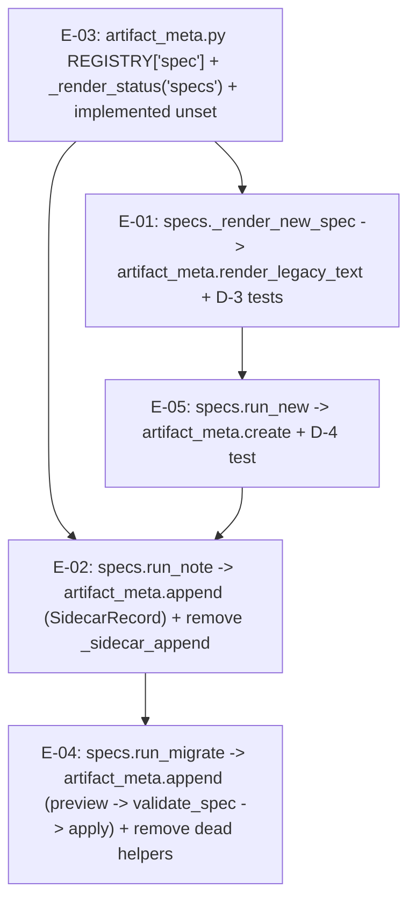

# IPD: Move the specs create, note, and migrate writers onto artifact_meta

- Date: 2026-11-09
- Kind: child
- Concern: Spec `4sd62s` section 7 step 4 requires every metadata writer to write through `artifact_meta` in phase B. The specs module still builds its `- Field:` bullets, `## Workflow history` lines, and file writes by hand (measured: 15 `- Field:` bullet literals across `_set_status`, `_add_gate_fields`, `run_migrate`, and `_render_new_spec`, 3 raw `atomic_write` calls in `run_migrate`, `run_note`, and `run_new`, and 8 `Workflow history` references in `agent_workflows/specs.py`). This is part of `g6tw94` (itself part of `xexn45`), split 2026-11-09 so each item names one module's writers.
- Scope: Register `spec` fields (`author`, `canonical`, and migration-only `implemented` unset) and in-place free-form spec `- Status:` replacement in `agent_workflows/artifact_meta.py`, move `agent_workflows/specs.py::run_new` and `agent_workflows/specs.py::_render_new_spec` onto `artifact_meta.create` and `artifact_meta.render_legacy_text` (`g6tw94` E-01, specs subset), move `agent_workflows/specs.py::run_note` and `agent_workflows/specs.py::run_migrate` onto `artifact_meta.append` (`g6tw94` E-02, specs subset) through the legacy writer of `7yr827`, and remove the unreferenced private metadata/history writer helpers in `agent_workflows/specs.py`. EXCLUDES: backlog (`jlwedt`), releases (`3466h8`), the family audit (`g6tw94`), and `--summary` as `short_description` (`fekdwv`).
- Scope-Paths: agent_workflows/specs.py, agent_workflows/artifact_meta.py, tests/test_specs_date_containment.py, tests/test_specs_releases_descriptive_safety.py, .aw/records/plans/pending/20261109-metastore-120-b3l7y6-move-the-specs-create-note-and-migrate-writers-onto-artifact.ipd.md
- Item-Dependencies: executed:tve77h, executed:2xwb9b, executed:7yr827
- Status: approved
- Readiness: go-pending-approval
- Review-Depth: complex
- From-Spec: 4sd62s
- Work-Kind: feature
- Priority: high
- Blocks-Release: next
- Set: metastore
- Order: 120
- Highest E allocated: 05
- Author: opencode its_direct/pt3-claude-opus-5.5-1m-us
- Id: b3l7y6
- Approval: 2026-11-16, recorded via aw ipd set: status set to approved

> Write and proofread this plan per the technical writing standard, `.aw/system/workflows/technical-writing/technical-writing.md` (`.agents/workflows/technical-writing/technical-writing.md` in a legacy-layout install), including requirement 12 (diagrams).

## Workflow history
- 2026-11-16 approved (aw set): status set to approved

- 2026-11-13 reviewed (aw set): APPROVE WITH REVISIONS APPLIED; PR-001..PR-006 FIXED
- 2026-11-13 /plan-review (antigravity/gemini): APPROVE WITH REVISIONS APPLIED; PR-001..PR-006 FIXED; review record .aw/records/reviews/20261109-metastore-120-b3l7y6-move-the-specs-create-note-and-migrate-writers-onto-artifact.review.md
- 2026-11-09 to-review (opencode its_direct/pt3-claude-opus-5.5-1m-us): split from g6tw94 (round 3, research nj8zdp guidance).
- 2026-11-09 draft (opencode its_direct/pt3-claude-opus-5.5-1m-us): created.

## Goal

The specs create (`run_new` and `_render_new_spec`), note (`run_note`), and migrate (`run_migrate`) paths write through `artifact_meta` with zero hand-built metadata bullets, `## Workflow history` lines, or raw file writes remaining in `agent_workflows/specs.py`.

## Detailed Implementation Checklist (TODO)

Execution-state rule: mark an `E-*` item complete only after performing the action. That mark is not validation. Right-sizing rule: write for a modest executor that cannot hold much in its head. Each E-item is one step (one concern, about one file, executable in one focused pass) and its V-item names each unit it covers with its own check; a plan stays at about 5 E-items and 8 work Scope-Paths, else split it into more child plans (guidance, `IPD-Z603`). Accepted execution states: blocked, failed, pending, performed; terminal gate demands 'performed'.

PIN-FIRST RULE for every "move" item: run the test modules its V-item names GREEN on the unmodified code and save the per-test outcome list under the gitignored `.aw/state/b3l7y6/` (`python3 -m pytest -o addopts="" -m "" -p no:randomly -n 0 -rA <modules> | grep -E "^(PASSED|FAILED|ERROR|SKIPPED|XFAIL|XPASS) " | sed -E 's/ - .*//' | sort > .aw/state/b3l7y6/<E>-before.txt`; `-m ""` includes `slow` modules, `-p no:randomly -n 0` makes the list deterministic, and `-q` is not repeated because `addopts` is cleared); make the move; run the same command into `-after.txt`; `diff` of the two must print nothing, so a test that newly fails, errors or skips is caught, not only a lost PASSED line. An existing assertion may change only when the Behavior decisions below name it. New tests set `pytestmark = pytest.mark.core`, build fixtures in `tmp_path`, drive the real CLI or function, and never read production source (AGENTS.md "TEST OUTCOMES, NOT CODE STRUCTURE").

### Task group 1: specs writers

- [ ] E-03 In `agent_workflows/artifact_meta.py`, register `author` (`generic`), `canonical` (`generic`, `spec 4sd62s` 4.2c), and `implemented` (`migration-only`, for `unset` during `specs migrate`) in `REGISTRY["spec"]`, map `"author": "Author"` (`anchors=("Id", "Status")`) and `"canonical": "Canonical"` in `_LEGACY_BULLET_LABEL` plus `"implemented"` (`re.compile(r"^-\s*Implemented:.*$")`) in `_LEGACY_REMOVE_RE` and `legacy_vocab`, and extend `_render_status` for `plural == "specs"` so an in-front free-form `- Status: <prose>` bullet is replaced in place without duplicating `- Status:` and a bare `Status:` line is dropped before inserting `- Status: <status>`. Pin `tests/test_artifact_meta_legacy_write.py` and `tests/test_status_set_meta_writer.py` (plus `tests/test_artifact_meta_legacy_writer.py` from `7yr827`).
  - Depends on: none
  - Expected outcome: `REGISTRY["spec"]` and `write_legacy`/`render_legacy_text` support `author`, `canonical`, `unset` of `implemented`, and in-place replacement of free-form spec `- Status:` lines, and the PIN-FIRST outcome diff across the pinned `artifact_meta` modules is empty.
  - Execution state: pending

- [ ] E-01 Move the spec skeleton renderer `agent_workflows/specs.py::_render_new_spec` onto `artifact_meta.render_legacy_text` (`g6tw94` E-01, helper half), pinned first. Build body prose (`# Spec: <title>`, `writing_standard_pointer("spec")`, and optional `## Scope` section per `D-4`) in `_render_new_spec`, delegate `- Status: draft`, `- Id:`, `- Author: aw specs new`, and `## Workflow history` (`created (aw specs)`) to `artifact_meta.render_legacy_text`, and update the two `D-3` assertions in `tests/test_specs_releases_descriptive_safety.py`. Pin `tests/test_specs_releases_descriptive_safety.py` and `tests/test_generators_writing_standard_pointer.py`.
  - Depends on: E-03
  - Expected outcome: both pinned modules pass before and after with an empty PIN-FIRST outcome diff (with the `D-3` assertion update), and `rg -n "Workflow history" agent_workflows/specs.py` shows no hit inside `_render_new_spec`.
  - Execution state: pending

- [ ] E-05 Move the CLI verb `agent_workflows/specs.py::run_new` onto `artifact_meta.create` (`g6tw94` E-01, CLI half; `xexn45` E-14), pinned first. Pass the `E-01` body prose, `fields={"status": "draft", "title": title, "author": "aw specs new"}`, `message=summary or title`, and `LegacyRender(tag="created", day=history_date, actor_label="aw specs", history=True)` to `artifact_meta.create` (`dry_run=True` for preview, `dry_run=False` for `--apply` replacing `atomic_write`, with `LegacyContext` rooted at `specs_dir.parent` for `.agents/docs/specs` and companion layouts), and update `tests/test_specs_date_containment.py::test_non_regression_conforming_bytes` per `D-1` and `D-4`. Pin `tests/test_spec_id6_filenames.py`, `tests/test_history_date_clock.py`, `tests/test_descriptive_refusal_hoist.py`, and `tests/test_specs_date_containment.py`.
  - Depends on: E-01
  - Expected outcome: all four pinned modules pass before and after with an empty PIN-FIRST outcome diff, and `run_new` contains no `atomic_write` call or `Workflow history` string.
  - Execution state: pending

- [ ] E-02 Move `agent_workflows/specs.py::run_note` onto `artifact_meta.append` (`g6tw94` E-02, note half) and remove the now-unused `agent_workflows/specs.py::_sidecar_append`, pinned first. Keep `run_note`'s `OSError` and `--message` line-integrity exit-2 refusals and `same_status_message_is_duplicate` skip (writing neither file nor sidecar on duplicate), and pass `LegacyTarget(path, "specs", id6)` with `[{"op": "note", "message": args.message}]`, `repo_root=_repo_root_of(path)`, `LegacyRender(tag="note", day=date, actor_label="aw specs", history=True)`, and `SidecarRecord(tree="specs", workflow="aw specs", actor="aw specs", message=f"note: {args.message}")` to `artifact_meta.append` so the sidecar writes only after the durable file write (`spec 4sd62s` C6). Pin `tests/test_specs_verbs.py`, `tests/test_history_order.py`, `tests/test_specs_date_containment.py`, and `tests/test_history_write_order.py`.
  - Depends on: E-03, E-05
  - Expected outcome: all four pinned modules pass before and after with an empty PIN-FIRST outcome diff, `run_note` has no `atomic_write` or `_append_history` call, and `_sidecar_append` is removed.
  - Execution state: pending

- [ ] E-04 Move `agent_workflows/specs.py::run_migrate` onto `artifact_meta.append` (`g6tw94` E-02, migrate half; `xexn45` E-14) and delete the remaining unreferenced private writer helpers in `agent_workflows/specs.py` (`_append_history`, `_set_status`, `_gate_field_indices`, `_remove_gate_fields`, and `_add_gate_fields`), pinned first against `tests/test_specs_verbs.py` and `tests/test_history_order.py`. Extract `old_prose` and `implemented_prose` for `hist_msg`, build `[transition(to=new, message=?), set(canonical/gate_*), unset(["implemented"])]`, call `artifact_meta.append(..., dry_run=True)` first to validate `preview.text` through `validate_spec(path, preview.text)` (refusing at exit 1 with `path` byte-identical on residual drift), and commit via `artifact_meta.append(..., dry_run=False)`.
  - Depends on: E-03, E-02
  - Expected outcome: both pinned modules pass before and after with an empty PIN-FIRST outcome diff, `rg -n "atomic_write\(|write_text\(" agent_workflows/specs.py` prints nothing (`xexn45` E-14), `rg -n "f\"- \{(date|today|hdate)\} " agent_workflows/specs.py` prints nothing, and `rg -n "Workflow history" agent_workflows/specs.py` matches only the reader `_history_block` and validator `validate_spec`.
  - Execution state: pending

Add further leaves as `- [ ] E-NEW <action>` and run `aw ipd sync` to assign ids.

## Project conventions discovered (Step 0)

- The `artifact_meta` interface names come from Order 02 (`tve77h`) and are used exactly: `artifact_meta.read(id6) -> State`, `append(id6, events, *, expect_seq)`, `create(...)`, `validate_new_events(type, events, *, records_root, migration_import=False)`. In phase B, `append` and `create` render through the one legacy renderer `artifact_meta.write_legacy` (file form) and `artifact_meta.render_legacy_text` (string form), both added by `7yr827`.
- `specs.validate_spec` (`agent_workflows/specs.py::validate_spec`) requires single-valued metadata bullets before the first `## `, a bare-enum `- Status:`, typed `Gate-Kind`/`Gate-Ref` iff `status == "deferred"`, and at least one `HISTORY_RECORD_RE` line inside `## Workflow history`; prose `Scope` moves to a `## Scope` body section at creation (`spec 4sd62s` 4.2c, N3; `fekdwv` E-02), while existing `- Scope:` bullets on legacy specs remain valid until cutover.
- UTC history days come from `artifact_core.utc_history_date` (spec `2vev8j` 4.4); atomic replacement is `artifact_core.atomic_write(path, text, *, prefix)`.
- Core tier: `pyproject.toml` marker `core`; modules set `pytestmark = pytest.mark.core`.
- Cite code by SYMBOL (`path::Symbol` or `module.function`) or by a quoted content string, never by a line number alone (advisory `IPD-C801`).

## Findings

| Id | Evidence (measured 2026-11-09 at `3d0ddb845` and re-verified 2026-11-13 at `ffb0ca743`) | Finding |
|---|---|---|
| F-01 | `rg -n "f\"- \{(date|today|hdate)\} " agent_workflows/specs.py`, `rg -n "atomic_write\(|write_text\(" agent_workflows/specs.py`, and `rg -n 'f"- ' agent_workflows/specs.py`: 3 active writers (`run_migrate`, `run_note`, `run_new` + `_render_new_spec`), 3 raw `atomic_write` calls (`run_migrate`, `run_note`, `run_new`), and 6 unreferenced private helpers (`_sidecar_append`, `_append_history`, `_set_status`, `_gate_field_indices`, `_remove_gate_fields`, `_add_gate_fields`) | Moving the 3 active writers and deleting the 6 unreferenced private helpers removes every hand-built metadata bullet, history line, and raw file write from `agent_workflows/specs.py` (`xexn45` F-01, F-02, E-14; `g6tw94` E-03). |
| F-02 | Non-binding `def test_` counts at `ffb0ca743` (re-derived dynamically at execution by the PIN-FIRST command): `test_artifact_meta_legacy_write` 27, `test_status_set_meta_writer` 8, `test_spec_id6_filenames` 21, `test_history_date_clock` 5, `test_specs_releases_descriptive_safety` 19, `test_descriptive_refusal_hoist` 3, `test_specs_date_containment` 15, `test_generators_writing_standard_pointer` 6, `test_specs_verbs` 20, `test_history_order` 7, `test_history_write_order` 8 | Splitting into 5 single-concern steps (`E-03`, `E-01`, `E-05`, `E-02`, `E-04`) keeps every step at `<=6` named units (`IPD-Z603`); `test_history_write_order.py` exercises `specs set` and `specs note` (not `specs new`) and is pinned on `E-02`. |
| F-03 | `agent_workflows/artifact_meta.py::REGISTRY["spec"]` omits `author`, `canonical` (`spec 4sd62s` 4.2c), and migration-only `implemented`, and `_render_status` matches only single-token `^-\s*Status:\s*(\S+)\s*$` on `specs` (the annotated status fallback is gated on `plural == "plans"`) | `E-03` must add those `spec` mappings and replace free-form spec `- Status:` bullets in place so `specs.run_new` (`- Author: aw specs new`) and `specs.run_migrate` (`--canonical`, `- Implemented:` folding, and free-form `- Status:` / bare `Status:` normalization) succeed without `ValueError` or duplicate `- Status:` drift. |
| F-04 | `tests/test_specs_releases_descriptive_safety.py::test_pre_fix_title_injection_forges_approval_and_checker_blind` and `test_pre_fix_summary_injection_smuggles_gate_and_checker_blind` call `specs._render_new_spec` directly with embedded `\n`, `tests/test_specs_date_containment.py::test_non_regression_conforming_bytes` asserts pre-phase-B `- Date:`, `- Scope:`, and `## Workflow history\n\n` bytes, and `test_conforming_new_in_legacy_layout` creates under `.agents/docs/specs/draft` where `project_records_dir` returns `.aw/records` | `D-3` (`E-01`) and `D-4` (`E-05`) name the intentional assertion updates in those two test files (declared in `- Scope-Paths:`), and `E-05` roots `run_new`'s `LegacyContext` at `specs_dir.parent` so `.agents/docs/specs` containment stays green. |

## Behavior decisions (kept behavior where writers disagreed, 4.3)

- D-1 (blank line under the history heading). KEPT per file: the legacy writer inserts the new line after an existing blank line when one is present and directly under the heading otherwise; it never adds or removes a blank line. This keeps every existing file's shape and matches `attention_contract.history_block`, which ignores blank lines. CHANGED: `specs._append_history`'s normalization of a missing blank line (19 specs) no longer adds one, and `specs._append_history` and `status_set._prepend_workflow_history_entry` create a missing section differently today (specs at end of file, plans before the first `##`); the legacy writer uses the `status_set` rule for every type except prompts, which keep end-of-file (pinned by `2xwb9b` E-02). Named tests (non-binding pointers): `tests/test_specs_verbs.py::test_note_appends_one_record_only` (asserts the record count, not the blank line), `tests/test_history_order.py::test_fixture_a_newest_first`, and `tests/test_specs_date_containment.py::test_non_regression_conforming_bytes` (updated per `D-4` to assert no blank line between `## Workflow history` and the created entry).
- D-2 (new bullet position). KEPT: in place when present; otherwise after `- Status:`, else after `- Id:` (`anchors=("Id", "Status")` for `Author`), else end of metadata bullet block; never in the body (`a88210`). Gate bullets (`Gate-Kind`, `Gate-Ref`, `Gate-Summary`) stay directly after `- Status:` (`_render_gate`). No reader depends on bullet order (`ipd_schema.parse_metadata_block` and `specs.validate_spec` are order-free).
- D-3 (writer-side descriptive refusal at `specs._render_new_spec` library boundary). CHANGED per `spec 4sd62s` 4.2 and AC-15: routing `agent_workflows/specs.py::_render_new_spec` through `artifact_meta.render_legacy_text` runs `artifact_meta.validate_new_events` on `fields` and `message`, closing IPD `uz05bl`'s former library-level bypass so embedded newlines or control characters in `title` or `summary` raise `ValueError` (while CLI `specs.run_new` keeps its pre-mint `specs._refuse_unsafe_descriptive` exit-2 envelope). Named tests with updated assertions: `tests/test_specs_releases_descriptive_safety.py::test_pre_fix_title_injection_forges_approval_and_checker_blind` and `tests/test_specs_releases_descriptive_safety.py::test_pre_fix_summary_injection_smuggles_gate_and_checker_blind` (assert `self.assertRaises(ValueError)` on `S._render_new_spec(...)` while keeping their `S._read_status`, `S._find_status_index`, and `S.validate_spec` checks on the raw forged strings so zero validator coverage is lost).
- D-4 (created-spec prose `Scope` section and day-only `Date` omission). CHANGED in file layout, KEPT in `validate_spec`, `writing_standard_pointer`, and `aw specs check` conformance (`spec 4sd62s` 4.2b, 4.2c, N3, AC-32(5); `fekdwv` E-02): `specs.run_new` and `specs._render_new_spec` emit body `# Spec: {title}\n\n{writing_standard_pointer("spec")}\n` (plus `\n## Scope\n\n{summary}\n` when `summary` is non-empty, which accepts up to `MAX_PROSE_DESCRIPTIVE_LEN = 4300` characters and aligns with `fekdwv` E-02's body-summary contract), pass `fields={"status": "draft", "title": title, "author": "aw specs new"}` (omitting day-only `- Date:`, since `date_iso` drives the `YYYYMMDD` filename prefix and `history_date` drives `LegacyRender.day`), and place `## Workflow history` before `## Scope` (after `writing_standard_pointer("spec")`). Named test with updated assertion: `tests/test_specs_date_containment.py::test_non_regression_conforming_bytes`.

## Proposed changes (ordered, validatable)

1. Extend `agent_workflows/artifact_meta.py` (`REGISTRY["spec"]`, `_LEGACY_BULLET_LABEL`, `_LEGACY_REMOVE_RE`, and `_render_status` for `specs`) so phase-B spec creation and migration events validate and render cleanly (E-03).
2. Move `agent_workflows/specs.py::_render_new_spec` onto `artifact_meta.render_legacy_text` and update the `D-3` assertions in `tests/test_specs_releases_descriptive_safety.py` (E-01).
3. Move `agent_workflows/specs.py::run_new` onto `artifact_meta.create` and update the `D-1`/`D-4` assertion in `tests/test_specs_date_containment.py` (E-05).
4. Move `agent_workflows/specs.py::run_note` onto `artifact_meta.append` (`SidecarRecord` after durable write) and remove `_sidecar_append` (E-02).
5. Move `agent_workflows/specs.py::run_migrate` onto `artifact_meta.append` (`dry_run=True` preview validated by `validate_spec` before `dry_run=False` write) and remove the five remaining unused private writer helpers in `agent_workflows/specs.py` (E-04).

## Deferred / out of scope (with reason)

- The family finish (the cross-module `rg` audit of `specs.py`, `backlog.py`, and `releases.py`) and, after the whole writer move, the merge-independence test, the AC-21 obligations test, the raw-write audit (F-09), the documentation lines, and the full gates.
  - Carrier: g6tw94
- Writing `--summary` as `short_description` in `specs.run_new` at creation when `len(summary) <= MAX_DESCRIPTIVE_LEN`.
  - Carrier: fekdwv

## Scope check

- Over-scope: none.
- Under-scope: none. `agent_workflows/artifact_meta.py` (`E-03`), `agent_workflows/specs.py` (`E-01`, `E-05`, `E-02`, `E-04`), `tests/test_specs_releases_descriptive_safety.py` (`E-01` per `D-3`), and `tests/test_specs_date_containment.py` (`E-05` per `D-4`) are all declared in `- Scope-Paths:`.

## Required tests / validation

No new test module. Pinned before and after under `.aw/state/b3l7y6/` with empty outcome-list diffs: the modules of `V-03` (`E-03`), `V-01` (`E-01`, with the named `D-3` assertion updates), `V-05` (`E-05`, with the named `D-4` assertion update), `V-02` (`E-02`), and `V-04` (`E-04`).

## Spec / documentation sync

None. Implements `4sd62s` section 7 step 4 for `agent_workflows/specs.py`; no user-facing CLI flags or documented contracts change.

## Open questions

None open. Every question this work raised was resolved from repository code and `spec 4sd62s`; `D-1` through `D-4` record the kept and changed behaviors.

## Validation and cross-check (verify before reporting done)

Validation-state rule: inspect evidence in a separate pass. Do not mark a `V-*` item complete from memory or from the matching execution checkmark. Accepted validation results: blocked, failed, pass, pending; terminal gate demands 'pass'. Runtime-demonstration reachability rule: for each `V-*` item demanding the software be observed acting (such as a run, a dispatch, or a transition), as distinct from items demanding a diff, a file's content, or a test result, which are reachable by construction, name the code path that produces the observation or the sibling `E-*` that creates it, else the demand is UNDER-SCOPE.

- [ ] V-01 validates E-01
  - Required evidence: paste the `diff` of `.aw/state/b3l7y6/E-01-before.txt` and `.aw/state/b3l7y6/E-01-after.txt` (must print nothing across `tests/test_specs_releases_descriptive_safety.py` and `tests/test_generators_writing_standard_pointer.py`), paste the `PASSED` lines of the non-binding pointer units (`test_pre_fix_title_injection_forges_approval_and_checker_blind`, `test_pre_fix_summary_injection_smuggles_gate_and_checker_blind`, and `test_specs_new_writing_standard_pointer`) plus per-module `PASSED` counts before and after, and paste `rg -n "Workflow history" agent_workflows/specs.py` showing no hit inside `_render_new_spec`.
  - Observed evidence:
  - Result: pending
- [ ] V-02 validates E-02
  - Required evidence: paste the `diff` of `.aw/state/b3l7y6/E-02-before.txt` and `.aw/state/b3l7y6/E-02-after.txt` (must print nothing across `tests/test_specs_verbs.py`, `tests/test_history_order.py`, `tests/test_specs_date_containment.py`, and `tests/test_history_write_order.py`), paste the `PASSED` lines of the non-binding pointer units (`test_note_appends_one_record_only`, `test_note_deduplicates_identical_call`, `test_fixture_a_newest_first`, `test_non_regression_run_set_and_run_note_date_behavior`, `test_specs_note_failed_write_leaves_no_sidecar_and_artifact_unchanged`, and `test_specs_note_successful_write_records_sidecar_event`) plus per-module `PASSED` counts before and after, and paste `rg -n "_sidecar_append" agent_workflows/specs.py` (must print nothing).
  - Observed evidence:
  - Result: pending
- [ ] V-03 validates E-03
  - Required evidence: paste the `diff` of `.aw/state/b3l7y6/E-03-before.txt` and `.aw/state/b3l7y6/E-03-after.txt` (must print nothing across `tests/test_artifact_meta_legacy_write.py` and `tests/test_status_set_meta_writer.py`, plus `tests/test_artifact_meta_legacy_writer.py` from `7yr827`), paste the per-module `PASSED` counts before and after, and paste `python3 -m pytest -o addopts="" -v tests/test_artifact_meta_registry.py tests/test_artifact_meta_cache.py` showing `REGISTRY["spec"]` (`author`, `canonical`, and `implemented`) passes registry and cache schema checks.
  - Observed evidence:
  - Result: pending
- [ ] V-04 validates E-04
  - Required evidence: paste the `diff` of `.aw/state/b3l7y6/E-04-before.txt` and `.aw/state/b3l7y6/E-04-after.txt` (must print nothing across `tests/test_specs_verbs.py` and `tests/test_history_order.py`), paste the `PASSED` lines of the non-binding pointer units (`test_migrate_free_form_to_bare_enum`, `test_migrate_to_deferred_with_gate`, `test_migrate_folds_implemented_line`, and `test_fixture_a_newest_first`) plus per-module `PASSED` counts before and after, and paste `rg -n "atomic_write\(|write_text\(" agent_workflows/specs.py` (must print nothing, `xexn45` E-14), `rg -n "f\"- \{(date|today|hdate)\} " agent_workflows/specs.py` (must print nothing), and `rg -n "Workflow history" agent_workflows/specs.py` (each remaining hit labeled by its enclosing `def` and limited to reader `_history_block` and validator `validate_spec`).
  - Observed evidence:
  - Result: pending
- [ ] V-05 validates E-05
  - Required evidence: paste the `diff` of `.aw/state/b3l7y6/E-05-before.txt` and `.aw/state/b3l7y6/E-05-after.txt` (must print nothing across `tests/test_spec_id6_filenames.py`, `tests/test_history_date_clock.py`, `tests/test_descriptive_refusal_hoist.py`, and `tests/test_specs_date_containment.py`), paste the `PASSED` lines of the non-binding pointer units (`test_new_preview_then_apply_conformant`, `test_specs_new_records_utc_date_and_local_filename`, `test_non_regression_conforming_bytes`, and `test_conforming_new_in_legacy_layout`) plus per-module `PASSED` counts before and after, and paste `rg -n "Workflow history" agent_workflows/specs.py` showing no hit inside `run_new` or `_render_new_spec`.
  - Observed evidence:
  - Result: pending

## Approval and execution gate

- Size assessment: standard
- Cohesion rationale: not required

Execute only after human approval (`Status: approved`) and after every plan in `- Item-Dependencies:` (`tve77h`, `2xwb9b`, and `7yr827`) is executed. Stop and report without overwriting if `7yr827`'s `write_legacy`, `render_legacy_text`, or `LegacyRender` entry points are absent on `HEAD`, if a pinned module fails on unmodified `HEAD` before the move, or if concurrent edits in a shared checkout conflict with `- Scope-Paths:`.

Scope fence: the paths in `- Scope-Paths:` are a declaration; a needed file outside the fence is edited and then justified at finalize (`--scope-reason`), and a declared path left unmodified is acknowledged (`--scope-ack`). Every move is pin-first: the named existing modules run green on the unmodified code before the move, and an assertion may change only where the Behavior decisions name it.

Honesty rule: run the named modules and the bare core gate `python3 -m pytest`, and paste the ACTUAL summary lines; never claim a result you did not run.

Commits: commit only through `aw commit b3l7y6 -- <paths>`; never `git add -A`, a bare `git add` or `git commit -a`; never push.

Lifecycle transition: the plan moves to `.aw/records/plans/executed/` only through `aw ipd finalize`, never a hand `git mv`, and only after `aw ipd lint --phase pre-transition` conforms and every `V-*` reads `pass` with pasted evidence. When `aw oc run` or `aw agy run` executes the plan, the runner performs the finalize; a hand executor runs `aw ipd finalize b3l7y6` itself.
