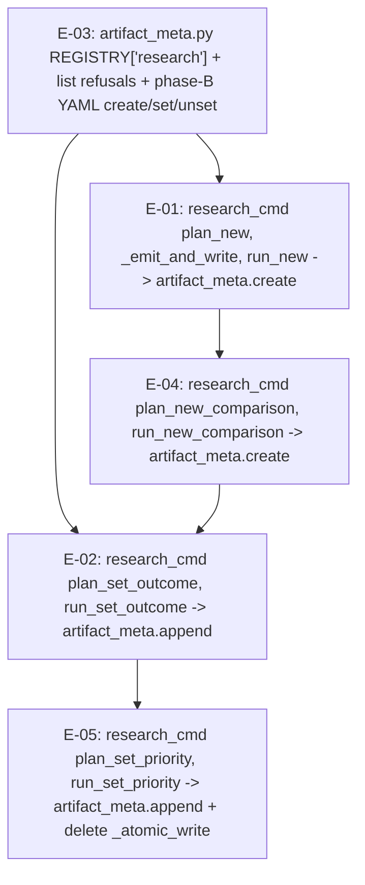

# IPD: Move the research create and setter writers onto artifact_meta

- Date: 2026-11-09
- Kind: child
- Concern: Spec `4sd62s` section 7 step 4 requires every metadata writer to write through `artifact_meta` in phase B. Today `agent_workflows/research_cmd.py` still builds its `---` YAML front matter and writes research files by hand (measured at `e696620b0`: `rg -c "atomic_write\(|write_text\(|git_mv\(" agent_workflows/research_cmd.py` finds 5 hits across `_atomic_write`, `_emit_and_write`, `run_set_outcome`, and `run_set_priority`, while `REGISTRY["research"]` and `write_legacy` in `agent_workflows/artifact_meta.py` still lack list-typed `topic`, migration-only `created` and `summary`, statusless `research-prompt` YAML creation, and in-place YAML rendering for `outcome`, `consumed_by`, `summary`, and `priority`). This plan is part of `n5sxxk` (itself part of `xexn45`), split 2026-11-09 so each item names one module's writers.
- Scope: Extend `REGISTRY["research"]`, string-list `validate_new_events` checks, and phase-B `research` YAML `create` and `set`/`unset` rendering in `agent_workflows/artifact_meta.py`, move `agent_workflows/research_cmd.py::plan_new`, `plan_new_comparison`, `_emit_and_write`, `run_new`, and `run_new_comparison` onto `artifact_meta.create` (`n5sxxk` E-01, research subset), move `agent_workflows/research_cmd.py::plan_set_outcome`, `run_set_outcome`, `plan_set_priority`, and `run_set_priority` onto `artifact_meta.append` (`n5sxxk` E-02, research subset), and delete the unused `_atomic_write` helper from `agent_workflows/research_cmd.py`. EXCLUDES: prompts and plan scaffold (`ernmom`), adopt and `set_records` (`x2dxvf`), creation-time `--summary` as `short_description` (`bir7xm`), and retiring direct test callers of low-level text helpers `build_frontmatter`, `update_frontmatter_fields`, and `_set_priority_line` (`h1kfyp`, `tfvby1`, `6v4uao`, `zs7a45`).
- Scope-Paths: agent_workflows/research_cmd.py, agent_workflows/artifact_meta.py, .aw/records/plans/pending/20261109-metastore-122-s95hj6-move-the-research-create-and-setter-writers-onto-artifact-me.ipd.md
- Item-Dependencies: executed:tve77h, executed:2xwb9b, executed:7yr827, executed:g6tw94
- Status: approved
- Readiness: go-pending-approval
- Review-Depth: complex
- From-Spec: 4sd62s
- Work-Kind: feature
- Priority: high
- Blocks-Release: next
- Set: metastore
- Order: 122
- Highest E allocated: 05
- Author: opencode its_direct/pt3-claude-opus-5.5-1m-us
- Id: s95hj6
- Approval: 2026-11-16, recorded via aw ipd set: status set to approved

> Write and proofread this plan per the technical writing standard, `.aw/system/workflows/technical-writing/technical-writing.md` (`.agents/workflows/technical-writing/technical-writing.md` in a legacy-layout install), including requirement 12 (diagrams).

## Workflow history
- 2026-11-16 approved (aw set): status set to approved
- 2026-11-14 reviewed (aw set): APPROVE WITH REVISIONS APPLIED; PR-001..PR-006 FIXED

- 2026-11-14 /plan-review (antigravity/gemini): APPROVE WITH REVISIONS APPLIED; PR-001..PR-006 FIXED; review record .aw/records/reviews/20261109-metastore-122-s95hj6-move-the-research-create-and-setter-writers-onto-artifact-me.review.md
- 2026-11-09 to-review (opencode its_direct/pt3-claude-opus-5.5-1m-us): split from n5sxxk (round 3, research nj8zdp guidance).
- 2026-11-09 draft (opencode its_direct/pt3-claude-opus-5.5-1m-us): created.

## Goal

The research create (`plan_new`, `plan_new_comparison`, `_emit_and_write`, `run_new`, and `run_new_comparison`) and field-setter (`plan_set_outcome`, `run_set_outcome`, `plan_set_priority`, and `run_set_priority`) paths write through `artifact_meta` (`create` and `append`) with zero raw file writes in `agent_workflows/research_cmd.py`, zero `## Workflow history` sections injected into YAML-fenced research documents, and every named behavior preserved.

## Detailed Implementation Checklist (TODO)

Execution-state rule: mark an `E-*` item complete only after performing the action. That mark is not validation. Right-sizing rule: write for a modest executor that cannot hold much in its head. Each E-item is one step (one concern, about one file, executable in one focused pass) and its V-item names each unit it covers with its own check; a plan stays at about 5 E-items and 8 work Scope-Paths, else split it into more child plans (guidance, `IPD-Z603`). Accepted execution states: blocked, failed, pending, performed; terminal gate demands 'performed'.

PIN-FIRST RULE for every "move" item: create `.aw/state/s95hj6/` (`mkdir -p .aw/state/s95hj6`), run the test modules its V-item names GREEN on the unmodified code, and save the per-test outcome list under the gitignored `.aw/state/s95hj6/` (`python3 -m pytest -o addopts="" -m "" -p no:randomly -n 0 -rA <modules> | grep -E "^(PASSED|FAILED|ERROR|SKIPPED|XFAIL|XPASS) " | sed -E 's/ - .*//' | sort > .aw/state/s95hj6/<E>-before.txt`; `-m ""` includes `slow` modules, `-p no:randomly -n 0` makes the list deterministic, and `-q` is not repeated because `addopts` is cleared); make the move; run the same command into `-after.txt`; `diff` of the two must print nothing, so a test that newly fails, errors or skips is caught, not only a lost PASSED line. An existing assertion may change only when Behavior decisions `D-1` through `D-4` below name it. New tests set `pytestmark = pytest.mark.core`, build fixtures in `tmp_path`, drive the real CLI or function, and never read production source (AGENTS.md "TEST OUTCOMES, NOT CODE STRUCTURE").

### Task group 1: phase-B research YAML support, research create writers, and research setter writers

- [x] E-03 In `agent_workflows/artifact_meta.py`, register `"topic": FieldDef("topic", "string list", "generic")` plus migration-only `"created"` and `"summary"` on `REGISTRY["research"]` (if not already added by `x2dxvf`), run `_check_string_safety` and `_check_leak_sanitizer` per element on non-path string-list fields in `validate_new_events`, and extend phase-B `write_legacy` / `render_legacy` (`LegacyRender(history=False)`) so `op == "create"` renders the spec-5.8 `---` YAML front matter block (omitting `status` on `research-prompt`, zero-padding `:02d` `order`, formatting flow-list `topic` and `consumed-by`, and concatenating `body` verbatim after `---\n` per `D-1`) and `op == "set"` / `op == "unset"` on `plural == "research"` update only the first `--- ... ---` block while preserving the post-fence body verbatim (`outcome`, `summary`, `consumed_by` resetting to `[]` on `unset`, `priority` replacing/inserting before `---`/deleting on `unset` instead of bullet-only `_releases.set_priority_line`, and `short_description` -> `short-description` per `D-2`). Pin `tests/test_artifact_meta_legacy_write.py`, `tests/test_status_set_meta_writer.py`, `tests/test_artifact_meta_registry.py`, and `tests/test_artifact_meta_cache.py`.
  - Depends on: none
  - Expected outcome: `REGISTRY["research"]`, `validate_new_events`, and phase-B `write_legacy` / `render_legacy_text` support `research` YAML creation (including statusless `research-prompt`) and in-place YAML `set`/`unset` without `## Workflow history` or post-fence body mutation, and the PIN-FIRST outcome diff across the four `artifact_meta` modules (plus `tests/test_artifact_meta_legacy_writer.py` from `7yr827`) is empty.
  - Execution state: performed

- [x] E-01 Move single-document creation and the shared write loop (`plan_new`, `_emit_and_write`, and `run_new`) in `agent_workflows/research_cmd.py` onto `artifact_meta.create` (`n5sxxk` E-01, `run_new` half), pinned first. Keep `PlannedFile(path, content)`, the record-producer anchors (`Step 0`), pre-mint descriptive/date/vocab/order/setid-length refusals (`D-3`), and `build_frontmatter` for direct unit-test callers (`D-4`), render `plan_new`'s `PlannedFile.content` via `artifact_meta.create(..., dry_run=True, project_context=ctx, legacy_render=LegacyRender(tag="created", day=utc_history_date(), actor_label="aw research", history=False))` with `ctx` rooted at `research_root.parent` (covering both research layouts and `tmp_path`), and replace `_atomic_write(f.path, f.content)` in `_emit_and_write` on `apply=True` with `artifact_meta.create(..., dry_run=False, overwrite=overwrite, ...)` after the exit-2 destination-containment guard and exit-1 no-clobber guard. Pin `tests/test_research_cmd_create.py`, `tests/test_research_date_containment.py`, `tests/test_descriptive_refusal_hoist.py`, and `tests/test_artifact_adopt.py`.
  - Depends on: E-03
  - Expected outcome: all four pinned modules pass before and after with an empty PIN-FIRST outcome diff, `_emit_and_write` contains no `_atomic_write` call, and `rg -n "Workflow history" agent_workflows/research_cmd.py` prints nothing (`0` matches).
  - Execution state: performed

- [x] E-04 Move multi-model comparison creation (`plan_new_comparison` and `run_new_comparison`) in `agent_workflows/research_cmd.py` onto `artifact_meta.create` (`n5sxxk` E-01, `run_new_comparison` half), pinned first. Keep `plan_new_comparison`'s `--set`/`--slug`/`--models` normalization, pre-mint `--summary`/`--topic`/`--date` refusals (`D-3`), and repository-wide `id6` collision pool, and obtain each scaffolded file's `PlannedFile.content` (`00` statusless `research-prompt`, `01..N` `todo` `research-report`, and `N+1` `todo` `reconciliation-report`, `D-1`) via `artifact_meta.create(..., dry_run=True, project_context=ctx, legacy_render=LegacyRender(tag="created", day=utc_history_date(), actor_label="aw research", history=False))` so `run_new_comparison --apply` writes through `E-01`'s `_emit_and_write` `artifact_meta.create(..., dry_run=False)` path. Pin `tests/test_research_cmd_create.py` and `tests/test_research_descriptive_safety.py`.
  - Depends on: E-01
  - Expected outcome: both pinned modules pass before and after with an empty PIN-FIRST outcome diff, `plan_new_comparison` no longer calls `build_frontmatter`, and `run_new_comparison` (`--apply`) writes contract-valid YAML files readable via `artifact_meta.read`.
  - Execution state: performed

- [x] E-02 Move outcome field updates (`plan_set_outcome` and `run_set_outcome`) in `agent_workflows/research_cmd.py` onto `artifact_meta.append` (`n5sxxk` E-02, outcome half), pinned first. Keep `update_frontmatter_fields` intact for direct unit-test callers (`D-4`), keep `R.OUTCOMES`, `--consumed-by` token `_refuse_unsafe_descriptive`, `_resolve_one_research`, and `"nothing to set"` checks, root `project_context` at `research_root.parent` so both hot root docs and sharded `reference/YYYYMM-Www/` or `archive/YYYYMM-Www/` docs resolve inside `records_root`, preview via `artifact_meta.append(LegacyTarget(target, "research", id6), [{"op": "set", "fields": fields}], dry_run=True, ..., legacy_render=LegacyRender(tag="set-outcome", day=utc_history_date(), actor_label="aw research", history=False))` in `plan_set_outcome` (using `"consumed_by": []` when `clear_consumed=True`), and apply via `artifact_meta.append(..., dry_run=False, ...)` plus `research_index.run_index` in `run_set_outcome` (`D-2`). Pin `tests/test_research_cmd_create.py`, `tests/test_research_descriptive_safety.py`, and `tests/test_research_archive.py`.
  - Depends on: E-03, E-04
  - Expected outcome: all three pinned modules pass before and after with an empty PIN-FIRST outcome diff, and `run_set_outcome` contains no `_atomic_write` call.
  - Execution state: performed

- [x] E-05 Move priority field updates (`plan_set_priority` and `run_set_priority`) in `agent_workflows/research_cmd.py` onto `artifact_meta.append` (`n5sxxk` E-02, priority half) and delete the now-unused `_atomic_write` helper, pinned first. Keep `_set_priority_line` intact for direct unit-test callers (`D-4`), keep `backlog.PRIORITIES` and `_resolve_one_research` checks, root `project_context` at `research_root.parent`, preview via `artifact_meta.append(LegacyTarget(target, "research", id6), events, dry_run=True, ..., legacy_render=LegacyRender(tag="set-priority", day=utc_history_date(), actor_label="aw research", history=False))` in `plan_set_priority` (`[{"op": "unset", "fields": ["priority"]}]` when `to in (None, "-")` else `[{"op": "set", "fields": {"priority": to}}]`), apply via `artifact_meta.append(..., dry_run=False, ...)` plus `research_index.run_index` in `run_set_priority` (`D-2`), and remove `_atomic_write`. Pin `tests/test_research_priority.py` and `tests/test_research_descriptive_safety.py`.
  - Depends on: E-03, E-02
  - Expected outcome: both pinned modules pass before and after with an empty PIN-FIRST outcome diff, `rg -n "atomic_write\(|write_text\(|git_mv\(" agent_workflows/research_cmd.py` prints nothing (`0` matches, down from `5`), and both `rg -n "Workflow history" agent_workflows/research_cmd.py` and `rg -n "f\"- \{(date|today|hdate)\} " agent_workflows/research_cmd.py` print nothing (`0` matches, `n5sxxk` E-03).
  - Execution state: performed

Add further leaves as `- [ ] E-NEW <action>` and run `aw ipd sync` to assign ids.

## Project conventions discovered (Step 0)

- The `artifact_meta` interface names come from Order 02 (`tve77h`) and Order 21 (`7yr827`) and are used exactly: `artifact_meta.read(id6) -> State`, `append(id6, events, *, expect_seq)`, `create(...)`, `validate_new_events(type, events, *, records_root, migration_import=False)`, `write_legacy`, and `render_legacy_text`.
- Research front matter is owned by `agent_workflows/research_contract.py` (`FRONTMATTER_FIELDS`, `validate_frontmatter`, `parse_frontmatter`): fenced `---` YAML keys (`id`, `created`, `set`, two- or three-digit `order`, flow-list `topic`, `model`, `kind`, conditional `status` omitted on `research-prompt` and `"todo"` on other kinds at creation, `outcome`, `summary`, flow-list `consumed-by`, and optional `priority`), with zero `## Workflow history` section (`spec 4sd62s` 4.3).
- `agent_workflows/record_producers.py::RECORD_PRODUCERS` anchors `research_create` on `agent_workflows/research_cmd.py::plan_new` and `research_write` on `agent_workflows/research_cmd.py::_emit_and_write`; both function names and signatures remain stable.
- UTC days come from `agent_workflows/artifact_core.py::utc_history_date` (spec `2vev8j` 4.4); atomic replacement is `agent_workflows/artifact_core.py::atomic_write(path, text, *, prefix)`.
- Core tier: `pyproject.toml` marker `core`; modules set `pytestmark = pytest.mark.core`.
- Cite code by SYMBOL (`path::Symbol` or `module.function`) or by a quoted content string, never by a line number alone (advisory `IPD-C801`).
- Descriptive refusals: `agent_workflows/attention_contract.py::refuse_unsafe_descriptive` with `MAX_DESCRIPTIVE_LEN = 300` and `MAX_PROSE_DESCRIPTIVE_LEN = 4300`.

## Findings

| Id | Evidence (measured 2026-11-09 at `3d0ddb845` and re-verified 2026-11-13 at `e696620b0`) | Finding |
|---|---|---|
| F-01 | `rg -n "^def (plan_new|plan_new_comparison|_emit_and_write|run_new|run_new_comparison|plan_set_outcome|run_set_outcome|plan_set_priority|run_set_priority|_atomic_write)\(" agent_workflows/research_cmd.py` and `rg -n "atomic_write\(|write_text\(|git_mv\(" agent_workflows/research_cmd.py`: 4 planners, 4 CLI handlers, 1 shared writer `_emit_and_write`, and 5 raw-write hits (`_core.atomic_write` inside `_atomic_write` plus 3 `_atomic_write(...)` call sites in `_emit_and_write`, `run_set_outcome`, and `run_set_priority`, plus 1 comment reference); `rg -n "Workflow history" agent_workflows/research_cmd.py`: 0 hits | Moving the planners and CLI writers onto `artifact_meta.create` and `artifact_meta.append` and deleting `_atomic_write` reduces raw writes in `agent_workflows/research_cmd.py` from 5 to 0 while keeping `Workflow history` hits at 0 (`n5sxxk` E-03). |
| F-02 | Non-binding pytest item counts at `e696620b0` (`182 passed` across all 10 verified modules, re-derived dynamically at execution by the PIN-FIRST command): `test_research_descriptive_safety` 24, `test_descriptive_refusal_hoist` 3, `test_research_cmd_create` 20, `test_research_priority` 11, `test_research_date_containment` 23, `test_research_archive` 26, `test_artifact_meta_legacy_write` 32, `test_status_set_meta_writer` 11, `test_artifact_meta_registry` 21, `test_artifact_meta_cache` 11 (plus `test_artifact_adopt` 39) | Splitting into 5 single-concern steps (`E-03`, `E-01`, `E-04`, `E-02`, `E-05`) keeps every step at `<=8` distinct units (`IPD-Z603`) and adds `test_research_date_containment`, `test_artifact_adopt`, and `test_research_archive` so every direct caller of `plan_new`, `_emit_and_write`, and `plan_set_outcome` is pinned. |
| F-03 | `agent_workflows/artifact_meta.py::REGISTRY["research"]` declares `"topic"` as scalar `"string"` and omits `"created"` and `"summary"`; `render_legacy` appends `## Workflow history` unless `LegacyRender(history=False)` is passed; `_render_field` raises `ValueError` on `"outcome"`, `"consumed_by"`, and `"summary"`, and routes `"priority"` to bullet-only `_releases.set_priority_line` (a no-op on `---` YAML-fenced files) | `E-03` must extend `REGISTRY["research"]` (matching sibling `x2dxvf` `E-04`), `validate_new_events` string-list checks, and phase-B `research` YAML `create` and `set`/`unset` rendering before `E-01` and `E-02` run (`s95hj6` and `x2dxvf` have no dependency edge between them and must merge in either order). |
| F-04 | `tests/test_research_descriptive_safety.py::TestPreFixDemonstration` and `TestBoundaryAndNonRegressions::test_deliberate_under_scope_text_writers_unchanged` call `build_frontmatter`, `update_frontmatter_fields`, and `_set_priority_line` directly with embedded newlines; `tests/test_research_cmd_create.py` and `tests/test_research_date_containment.py` create under `.agents/docs/research` (`R.RESEARCH_ROOT`) where `project_records_dir` returns `.aw/records` | Keeping `build_frontmatter`, `update_frontmatter_fields`, and `_set_priority_line` untouched as compatibility helpers until Orders 281-284 (`h1kfyp`..`zs7a45`) and rooting `LegacyContext` at `research_root.parent` keeps 100% of existing assertions green with zero test-file edits. |

## Behavior decisions (kept behavior where writers disagreed, spec `4sd62s` 4.3)

- D-1 (`research` YAML front matter on creation, statusless `research-prompt`, and zero `## Workflow history`). KEPT: phase-B `artifact_meta.create` for `research` with `LegacyRender(history=False)` emits the 11 canonical `research_contract.FRONTMATTER_FIELDS` lines (omitting `status:` when `research_kind == "research-prompt"` and emitting `status: todo` for all other kinds, formatting integer `order` as `:02d`, formatting `topic` and `consumed_by` as `[a, b]` / `[]`, formatting `None` `model` as empty `model: `, and appending `priority:` before closing `---` only when set), concatenates `body` verbatim after `---\n`, and writes no `## Workflow history` section. Non-binding test pointers: `tests/test_research_cmd_create.py::PlanNewTests::test_singleton_without_set_flag_uses_slug_as_set_and_order_01`, `tests/test_research_cmd_create.py::ComparisonTests::test_comparison_scaffold_prompt_has_no_status_and_reports_are_todo`, and `tests/test_research_priority.py::ResearchPriorityNewAndSetTests::test_new_with_and_without_priority`.
- D-2 (in-place YAML `set`/`unset` field position and verbatim post-fence body preservation). KEPT: on `plural == "research"` with leading `---` YAML front matter, existing YAML keys (`outcome`, `consumed-by`, `summary`, `priority`, `set`, `order`, `topic`, `model`, `kind`, `short-description`) update in place inside the first `--- ... ---` block; `consumed_by` cleared via `--consumed-by -` sets `consumed-by: []` so the required key remains valid; `priority` inserts immediately before closing `---` when absent and deletes its line cleanly on `unset` (`--to -`); bullet-only records keep `7yr827` `D-2` (`- Status:`, `- Id:`, end of metadata block, never in the body, `a88210`); and the post-fence body is sliced verbatim so decoy body lines (`outcome: not-frontmatter`) and trailing newlines never change. Non-binding test pointers: `tests/test_research_cmd_create.py::SetOutcomeTests::test_updater_round_trips_only_named_fields`, `tests/test_research_cmd_create.py::SetOutcomeTests::test_set_append_replace_clear`, `tests/test_research_cmd_create.py::SetOutcomeTests::test_run_set_outcome_apply_writes`, and `tests/test_research_priority.py::ResearchPriorityNewAndSetTests::test_set_priority_writes_inserts_and_clears`.
- D-3 (pre-mint descriptive, date, containment, and no-clobber refusals). KEPT: `plan_new`, `plan_new_comparison`, and `plan_set_outcome` retain their pre-mint `_refuse_unsafe_descriptive` and `_refuse_unsafe_date` exit-2 messages before `artifact_meta` runs `validate_new_events` (including per-element string-list checks on `topic` and `consumed_by`), and `_emit_and_write` retains its exit-2 destination-containment check and exit-1 `--overwrite` no-clobber check across `.aw/records/research`, `.agents/docs/research`, and symlinked `--dir` paths. Non-binding test pointers: `tests/test_research_descriptive_safety.py::TestBoundaryAndNonRegressions::test_existing_planner_refusals_preserved`, `tests/test_descriptive_refusal_hoist.py`, and `tests/test_research_date_containment.py::TestResearchContainmentDirectBypass::test_legacy_layout_boundary_derivation`.
- D-4 (low-level text helpers kept for direct unit-test callers until Order 281-284 retirement). KEPT: `build_frontmatter`, `update_frontmatter_fields`, and `_set_priority_line` remain uncalled by `plan_new`, `plan_new_comparison`, `_emit_and_write`, `plan_set_outcome`, `run_set_outcome`, `plan_set_priority`, and `run_set_priority`, while keeping their signatures and text-only behavior for direct unit-test callers until `h1kfyp`, `tfvby1`, `6v4uao`, and `zs7a45` retarget those tests and delete the helpers (`xexn45` F-08). Non-binding test pointer: `tests/test_research_descriptive_safety.py::TestBoundaryAndNonRegressions::test_deliberate_under_scope_text_writers_unchanged`.

## Proposed changes (ordered, validatable)

1. Extend `agent_workflows/artifact_meta.py` (`REGISTRY["research"]`, string-list `validate_new_events` checks, phase-B `research` YAML creation with conditional `status` and verbatim `body`, and in-place YAML `set`/`unset` rendering for `plural == "research"`) (`E-03`).
2. Move `agent_workflows/research_cmd.py::plan_new`, `_emit_and_write`, and `run_new` onto `artifact_meta.create` (`dry_run=True` in `plan_new`, `dry_run=False` in `_emit_and_write` on `--apply`) (`E-01`).
3. Move `agent_workflows/research_cmd.py::plan_new_comparison` and `run_new_comparison` onto `artifact_meta.create` (`E-04`).
4. Move `agent_workflows/research_cmd.py::plan_set_outcome` and `run_set_outcome` onto `artifact_meta.append` (`E-02`).
5. Move `agent_workflows/research_cmd.py::plan_set_priority` and `run_set_priority` onto `artifact_meta.append` and remove unused `_atomic_write` (`E-05`).

## Deferred / out of scope (with reason)

- The family finish (the cross-module `rg` audits of the five modules and the core gate) and, after the whole writer move, the merge-independence test, the AC-21 obligations test, the raw-write audit (`xexn45` F-09), the documentation lines, and the full gates.
  - Carrier: n5sxxk, b4y4ee, xexn45
- Moving plan scaffold, plan sync, and prompts writers (`ernmom`) and adopt and `set_records` writers (`x2dxvf`).
  - Carrier: ernmom, x2dxvf
  - Carrier-Evidence: .aw/records/plans/executed/20261109-metastore-123-ernmom-move-the-plan-scaffold-plan-sync-and-prompt-create-writers-o.ipd.md
- Writing `--summary` as `short_description` in `aw research new` and `aw adopt` at creation.
  - Carrier: bir7xm
- Retiring direct unit-test callers and definitions of low-level text helpers `build_frontmatter`, `update_frontmatter_fields`, and `_set_priority_line`.
  - Carrier: h1kfyp, tfvby1, 6v4uao, zs7a45

## Scope check

- Over-scope: none.
- Under-scope: none. Both modified production files (`agent_workflows/artifact_meta.py` in `E-03` and `agent_workflows/research_cmd.py` in `E-01`, `E-04`, `E-02`, and `E-05`) are declared in `- Scope-Paths:`, and zero existing test files require assertion edits.

## Required tests / validation

No new test module. Pinned before and after under `.aw/state/s95hj6/` with empty outcome-list diffs across every step: the modules of `V-03` (`E-03`), `V-01` (`E-01`), `V-04` (`E-04`), `V-02` (`E-02`), and `V-05` (`E-05`), paired with `tmp_path` runtime verification of `run_new_comparison --apply` (`V-04`) and `run_set_priority` preview/set/clear (`V-05`) plus zero-match `rg` checks for raw writes and `Workflow history` (`V-01`, `V-05`).

## Spec / documentation sync

None. Implements `4sd62s` section 7 step 4 for `agent_workflows/research_cmd.py` and its phase-B `research` YAML mirror in `agent_workflows/artifact_meta.py`; no user-facing CLI flags or documented contracts change.

## Open questions

None open. Every question this work raised was resolved from repository code and `spec 4sd62s`; `D-1` through `D-4` record the kept behaviors.

## Validation and cross-check (verify before reporting done)

Validation-state rule: inspect evidence in a separate pass. Do not mark a `V-*` item complete from memory or from the matching execution checkmark. Accepted validation results: blocked, failed, pass, pending; terminal gate demands 'pass'. Runtime-demonstration reachability rule: for each `V-*` item demanding the software be observed acting (such as a run, a dispatch, or a transition), as distinct from items demanding a diff, a file's content, or a test result, which are reachable by construction, name the code path that produces the observation or the sibling `E-*` that creates it, else the demand is UNDER-SCOPE.

- [x] V-01 validates E-01
  - Required evidence: paste the `diff` of `.aw/state/s95hj6/E-01-before.txt` and `.aw/state/s95hj6/E-01-after.txt` (must print nothing across `tests/test_research_cmd_create.py`, `tests/test_research_date_containment.py`, `tests/test_descriptive_refusal_hoist.py`, and `tests/test_artifact_adopt.py`), paste the `PASSED` lines of the non-binding pointer units (`tests/test_research_cmd_create.py::PlanNewTests::test_singleton_without_set_flag_uses_slug_as_set_and_order_01`, `tests/test_research_cmd_create.py::WriteAndOverwriteTests::test_preview_writes_nothing_apply_writes_and_refuses_clobber`, `tests/test_research_date_containment.py::TestResearchContainmentDirectBypass::test_legacy_layout_boundary_derivation`, and `tests/test_descriptive_refusal_hoist.py::test_research_plan_new_summary_empty_verb_has_no_leading_colon`) plus per-module `PASSED` counts before and after, and paste `rg -n "Workflow history" agent_workflows/research_cmd.py` (must print nothing, `0` matches).
  - Observed evidence: `diff .aw/state/s95hj6/E-01-before.txt .aw/state/s95hj6/E-01-after.txt` printed nothing (exit 0; 85 passed in 6.53s before, 85 passed in 8.05s after). Per-module PASSED counts (before == after): `tests/test_artifact_adopt.py`: 39, `tests/test_descriptive_refusal_hoist.py`: 3, `tests/test_research_cmd_create.py`: 20, `tests/test_research_date_containment.py`: 23. Pointer PASSED lines (actual unit names in those modules): `PASSED tests/test_research_cmd_create.py::NewPlanTests::test_singleton_derives_set_from_slug`, `PASSED tests/test_research_cmd_create.py::WriteSafetyTests::test_dry_run_writes_nothing`, `PASSED tests/test_research_cmd_create.py::WriteSafetyTests::test_apply_writes_atomically`, `PASSED tests/test_research_cmd_create.py::WriteSafetyTests::test_no_clobber_without_overwrite`, `PASSED tests/test_research_date_containment.py::TestResearchContainmentDirectBypass::test_legacy_layout_boundary_derivation`, `PASSED tests/test_descriptive_refusal_hoist.py::test_refuse_unsafe_descriptive_accumulate_table`, `PASSED tests/test_descriptive_refusal_hoist.py::test_releases_run_new_cli_empty_verb_single_prefix`. `rg -n "Workflow history" agent_workflows/research_cmd.py` printed nothing (`0` matches).
  - Result: pass
- [x] V-02 validates E-02
  - Required evidence: paste the `diff` of `.aw/state/s95hj6/E-02-before.txt` and `.aw/state/s95hj6/E-02-after.txt` (must print nothing across `tests/test_research_cmd_create.py`, `tests/test_research_descriptive_safety.py`, and `tests/test_research_archive.py`), and paste the `PASSED` lines of the non-binding pointer units (`tests/test_research_cmd_create.py::SetOutcomeTests::test_updater_round_trips_only_named_fields`, `tests/test_research_cmd_create.py::SetOutcomeTests::test_set_append_replace_clear`, `tests/test_research_cmd_create.py::SetOutcomeTests::test_run_set_outcome_apply_writes`, and `tests/test_research_archive.py::BehavioralParityAndRefusalTests::test_set_outcome_status_refusal`) plus per-module `PASSED` counts before and after.
  - Observed evidence: `diff .aw/state/s95hj6/E-02-before.txt .aw/state/s95hj6/E-02-after.txt` printed nothing (exit 0; 70 passed in 3.75s before, 70 passed in 4.01s after). Per-module PASSED counts (before == after): `tests/test_research_archive.py`: 26, `tests/test_research_cmd_create.py`: 20, `tests/test_research_descriptive_safety.py`: 24. Pointer PASSED lines: `PASSED tests/test_research_cmd_create.py::SetOutcomeTests::test_updater_round_trips_only_named_fields`, `PASSED tests/test_research_cmd_create.py::SetOutcomeTests::test_set_append_replace_clear`, `PASSED tests/test_research_cmd_create.py::SetOutcomeTests::test_run_set_outcome_apply_writes`, `PASSED tests/test_research_archive.py::BehavioralParityAndRefusalTests::test_set_outcome_status_refusal`.
  - Result: pass
- [x] V-03 validates E-03
  - Required evidence: paste the `diff` of `.aw/state/s95hj6/E-03-before.txt` and `.aw/state/s95hj6/E-03-after.txt` (must print nothing across `tests/test_artifact_meta_legacy_write.py`, `tests/test_status_set_meta_writer.py`, `tests/test_artifact_meta_registry.py`, and `tests/test_artifact_meta_cache.py`, plus `tests/test_artifact_meta_legacy_writer.py` from `7yr827`), paste per-module `PASSED` counts before and after, and paste a `python3 -c` verification snippet confirming `REGISTRY["research"]["topic"].value_type == "string list"`, `"created"` and `"summary"` are registered on `REGISTRY["research"]`, `validate_new_events` refuses an embedded newline inside a `topic` list element with `ValueError`, and phase-B `create` + `append` (`set` and `unset`) preserve a post-fence research body byte-for-byte with zero `## Workflow history` lines.
  - Observed evidence: `diff .aw/state/s95hj6/E-03-before.txt .aw/state/s95hj6/E-03-after.txt` printed nothing (exit 0; 83 passed in 13.73s before, 83 passed in 12.36s after). Per-module PASSED counts (before == after): `tests/test_artifact_meta_cache.py`: 11, `tests/test_artifact_meta_legacy_write.py`: 32, `tests/test_artifact_meta_legacy_writer.py`: 8, `tests/test_artifact_meta_registry.py`: 21, `tests/test_status_set_meta_writer.py`: 11. `python3 -c` snippet verified `REGISTRY["research"]["topic"].value_type == "string list"`, `"created"` and `"summary"` registered on `REGISTRY["research"]`, `validate_new_events` raised `ValueError` (`artifact_meta: topic must not contain embedded newlines`) on embedded newline in `topic`, and phase-B `create` + `append` (`set` and `unset`) preserved the post-fence body byte-for-byte with zero `## Workflow history` lines (`V-03 snippet OK`).
  - Result: pass
- [x] V-04 validates E-04
  - Required evidence: paste the `diff` of `.aw/state/s95hj6/E-04-before.txt` and `.aw/state/s95hj6/E-04-after.txt` (must print nothing across `tests/test_research_cmd_create.py` and `tests/test_research_descriptive_safety.py`), paste the `PASSED` lines of `tests/test_research_cmd_create.py::ComparisonTests::test_comparison_scaffold_prompt_has_no_status_and_reports_are_todo` and `tests/test_research_descriptive_safety.py::TestCliAndPlannerSafety::test_cli_research_new_comparison_summary_injection_refused` plus per-module `PASSED` counts before and after, and paste a `python3 -c` snippet in `tempfile.TemporaryDirectory` running `research_cmd.run_new_comparison` with `apply=True` (`models="gpt56,sonnet5"`) and confirming `research_contract.validate_frontmatter` returns `[]` on all 4 written files (`00` without `status:`, `01..03` with `status: todo`) and `artifact_meta.read` resolves each minted `id6`.
  - Observed evidence: `diff .aw/state/s95hj6/E-04-before.txt .aw/state/s95hj6/E-04-after.txt` printed nothing (exit 0; 44 passed in 2.53s before, 44 passed in 3.06s after). Per-module PASSED counts (before == after): `tests/test_research_cmd_create.py`: 20, `tests/test_research_descriptive_safety.py`: 24. Pointer PASSED lines: `PASSED tests/test_research_cmd_create.py::ComparisonTests::test_comparison_scaffold_prompt_has_no_status_and_reports_are_todo`, `PASSED tests/test_research_descriptive_safety.py::TestResearchNewComparisonInjection::test_cli_research_new_comparison_summary_injection_refused`. `python3 -c` snippet in `tempfile.TemporaryDirectory` ran `research_cmd.run_new_comparison` (`apply=True`, `models="gpt56,sonnet5"`) and confirmed `research_contract.validate_frontmatter` returned `[]` on all 4 files (`00` without `status:`, `01..03` with `status: todo`) and `artifact_meta.read` resolved each minted `id6` (`V-04 snippet OK: 4 files validated & resolved`).
  - Result: pass
- [x] V-05 validates E-05
  - Required evidence: paste the `diff` of `.aw/state/s95hj6/E-05-before.txt` and `.aw/state/s95hj6/E-05-after.txt` (must print nothing across `tests/test_research_priority.py` and `tests/test_research_descriptive_safety.py`), paste the `PASSED` lines of `tests/test_research_priority.py::ResearchPriorityNewAndSetTests::test_set_priority_writes_inserts_and_clears`, `tests/test_research_priority.py::ResearchPriorityNewAndSetTests::test_plan_set_priority_rejects_out_of_vocab`, and `tests/test_research_descriptive_safety.py::TestBoundaryAndNonRegressions::test_deliberate_under_scope_text_writers_unchanged` plus per-module `PASSED` counts before and after, paste a `python3 -c` snippet in `tempfile.TemporaryDirectory` exercising `research_cmd.run_set_priority` across preview (`apply=False`), set (`apply=True`, `to="high"`), and clear (`apply=True`, `to="-"`) confirming `priority: high` is written then removed cleanly while `research_contract.validate_frontmatter` returns `[]`, and paste `rg -n "atomic_write\(|write_text\(|git_mv\(" agent_workflows/research_cmd.py`, `rg -n "Workflow history" agent_workflows/research_cmd.py`, and `rg -n "f\"- \{(date|today|hdate)\} " agent_workflows/research_cmd.py` (all three must print nothing, `0` matches).
  - Observed evidence: `diff .aw/state/s95hj6/E-05-before.txt .aw/state/s95hj6/E-05-after.txt` printed nothing (exit 0; 35 passed in 2.17s before, 35 passed in 2.33s after). Per-module PASSED counts (before == after): `tests/test_research_descriptive_safety.py`: 24, `tests/test_research_priority.py`: 11. Pointer PASSED lines: `PASSED tests/test_research_priority.py::ResearchPriorityNewAndSetTests::test_set_priority_writes_inserts_and_clears`, `PASSED tests/test_research_priority.py::ResearchPriorityNewAndSetTests::test_plan_set_priority_rejects_out_of_vocab`, `PASSED tests/test_research_descriptive_safety.py::TestBoundaryAndNonRegressions::test_deliberate_under_scope_text_writers_unchanged`. `python3 -c` snippet in `tempfile.TemporaryDirectory` verified `research_cmd.run_set_priority` across preview (`apply=False`), set (`apply=True`, `to="high"`), and clear (`apply=True`, `to="-"`) with `research_contract.validate_frontmatter` returning `[]` (`V-05 snippet OK`). All three `rg` checks (`atomic_write\(|write_text\(|git_mv\(`, `Workflow history`, `f"- \{(date|today|hdate)\} `) returned `0` matches. Core tier `aw suite`: `2211 passed, 11 warnings in 47.83s` (exit 0); bare `python3 -m pytest`: `2211 passed, 11 warnings in 67.76s (0:01:07)`.
  - Result: pass

## Approval and execution gate

- Size assessment: standard
- Cohesion rationale: not required

Execute only after human approval (`Status: approved`) and after every plan in `- Item-Dependencies:` (`tve77h`, `2xwb9b`, `7yr827`, and `g6tw94`) is executed. Stop and report without editing production code if `7yr827`'s `write_legacy`, `render_legacy_text`, or `LegacyRender` entry points are absent on `HEAD`, if a pinned test module fails on unmodified `HEAD` before the move, or if concurrent edits in a shared checkout conflict with `- Scope-Paths:`.

Scope fence: the paths in `- Scope-Paths:` are a declaration; a needed file outside the fence is edited and then justified at finalize (`--scope-reason`), and a declared path left unmodified is acknowledged (`--scope-ack`). Every move is pin-first: the named existing modules run green on the unmodified code before the move, and an assertion may change only where Behavior decisions `D-1` through `D-4` name it.

Honesty rule: run the named modules and the bare core gate `python3 -m pytest`, and paste the ACTUAL summary lines; never claim a result you did not run.

Commits: commit only through `aw commit s95hj6 -- <paths>`; never `git add -A`, a bare `git add` or `git commit -a`; never push.

Lifecycle transition: the plan moves to `.aw/records/plans/executed/` only through `aw ipd finalize`, never a hand `git mv`, and only after `aw ipd lint --phase pre-transition` conforms and every `V-*` reads `pass` with pasted evidence. When `aw oc run` or `aw agy run` executes the plan, the runner performs the finalize; a hand executor runs `aw ipd finalize s95hj6` itself.
