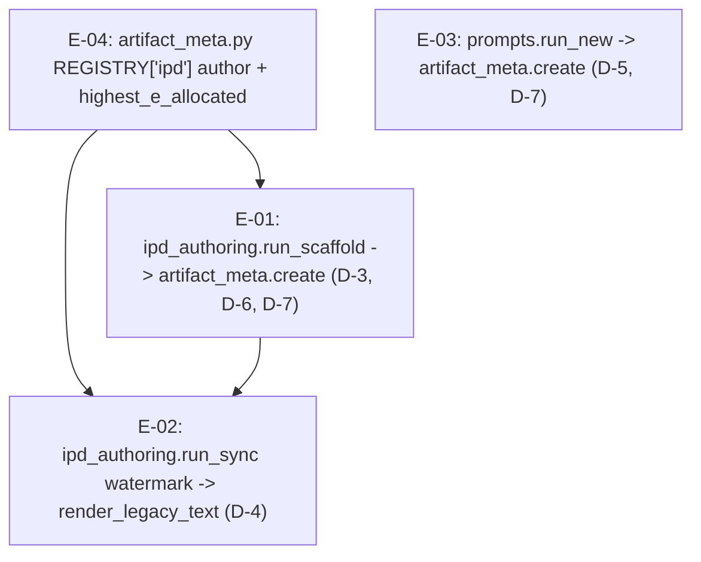

# IPD: Move the plan scaffold, plan sync and prompt create writers onto artifact_meta

- Date: 2026-11-09
- Kind: child
- Concern: Spec `4sd62s` section 7 step 4 requires every metadata writer to write through `artifact_meta` in phase B. `aw ipd scaffold`, `aw ipd sync` and `aw prompts new` still write metadata by hand (`rg -c "atomic_write\(|write_text\(|git_mv\("`: `ipd_authoring` 5, `prompts` 1). This is part of `n5sxxk` (itself part of `xexn45`), split 2026-11-09 so each item names one command's writers.
- Scope: Register the plan fields `author` and `highest_e_allocated` in `artifact_meta.REGISTRY["ipd"]`, move `ipd_authoring.run_scaffold` and `prompts.run_new` (with `prompts.render_metadata_comment` kept as a pure helper) onto `artifact_meta.create` (`n5sxxk` E-01, scaffold and prompts subset), and move the watermark write of `ipd_authoring.run_sync` onto the phase-B legacy writer `artifact_meta.render_legacy_text` (`n5sxxk` E-02, sync subset). EXCLUDES: research (`s95hj6`), adopt and set_records (`x2dxvf`), `--summary` (`py2vu9`); `ipd_authoring.backfill_plan_ids` and `ipd_authoring._atomic_write` are not named writers (`xexn45` F-09 records them).
- Scope-Paths: agent_workflows/ipd_authoring.py, agent_workflows/prompts.py, agent_workflows/artifact_meta.py, .aw/records/plans/pending/20261109-metastore-123-ernmom-move-the-plan-scaffold-plan-sync-and-prompt-create-writers-o.ipd.md
- Item-Dependencies: executed:tve77h, executed:2xwb9b, executed:7yr827, executed:g6tw94
- Status: reviewed
- Readiness: go-pending-approval
- Review-Depth: complex
- From-Spec: 4sd62s
- Work-Kind: feature
- Priority: high
- Blocks-Release: next
- Set: metastore
- Order: 123
- Highest E allocated: 04
- Author: opencode its_direct/pt3-claude-opus-5.5-1m-us
- Id: ernmom

> Write and proofread this plan per the technical writing standard, `.aw/system/workflows/technical-writing/technical-writing.md` (`.agents/workflows/technical-writing/technical-writing.md` in a legacy-layout install), including requirement 12 (diagrams).

## Workflow history

- 2026-11-14 /plan-review (opencode its_direct/pt3-claude-opus-5.5-1m-us): APPROVE WITH REVISIONS APPLIED; PR-001..PR-010 FIXED; review record .aw/records/reviews/20261109-metastore-123-ernmom-move-the-plan-scaffold-plan-sync-and-prompt-create-writers-o.review.md
- 2026-11-14 reviewed (aw set): APPROVE WITH REVISIONS APPLIED; PR-001..PR-010 FIXED
- 2026-11-09 to-review (opencode its_direct/pt3-claude-opus-5.5-1m-us): split from n5sxxk (round 3, research nj8zdp guidance).
- 2026-11-09 draft (opencode its_direct/pt3-claude-opus-5.5-1m-us): created.

## Goal

The plan scaffold, the plan id sync and the prompt create command write through `artifact_meta`, each keeping a named, tested behavior.

## Detailed Implementation Checklist (TODO)

Execution-state rule: mark an `E-*` item complete only after performing the action. That mark is not validation. Right-sizing rule: write for a modest executor that cannot hold much in its head. Each E-item is one step (one concern, about one file, executable in one focused pass) and its V-item names each unit it covers with its own check; a plan stays at about 5 E-items and 8 work Scope-Paths, else split it into more child plans (guidance, `IPD-Z603`). Accepted execution states: blocked, failed, pending, performed; terminal gate demands 'performed'.

PIN-FIRST RULE for every "move" item: run the test modules its V-item names GREEN on the unmodified code and save the per-test outcome list under the gitignored `.aw/state/ernmom/` (`python3 -m pytest -o addopts="" -m "" -p no:randomly -n 0 -rA <modules> | grep -E "^(PASSED|FAILED|ERROR|SKIPPED|XFAIL|XPASS) " | sed -E 's/ - .*//' | sort > .aw/state/ernmom/<E>-before.txt`; `-m ""` includes `slow` modules, `-p no:randomly -n 0` makes the list deterministic, and `-q` is not repeated because `addopts` is cleared); make the move; run the same command into `-after.txt`; `diff` of the two must print nothing, so a test that newly fails, errors or skips is caught, not only a lost PASSED line. An existing assertion may change only when the Behavior decisions below name it. New tests set `pytestmark = pytest.mark.core`, build fixtures in `tmp_path`, drive the real CLI or function, and never read production source (AGENTS.md "TEST OUTCOMES, NOT CODE STRUCTURE").

### Task group 1: plan and prompt writers

- [ ] E-01 Move the plan scaffold onto `artifact_meta.create`, pinned first (`n5sxxk` E-01, scaffold subset) against `tests/test_ipd_authoring.py`, `tests/test_scaffold_history_clock.py`, `tests/test_ipd_templates.py`, `tests/test_atomic_write_mode.py`, `tests/test_record_owner_root.py`, and `tests/test_companion_record_owner_root.py`. Follow `D-3` (fields, body, and history), `D-6` (`build_skeleton` default output unchanged), and `D-7` (destination containment and the outside-root fallback). Non-binding pointer units: `tests/test_ipd_authoring.py::ScaffoldTests::test_dry_run_writes_nothing`, `ScaffoldTests::test_apply_writes_conforming_child`, `ScaffoldTests::test_scaffold_with_dir_writes_inside_target_without_climbing`, and `tests/test_ipd_templates.py` (byte-pinned templates).
  - Depends on: E-04
  - Expected outcome: all six pinned modules pass before and after with an empty PIN-FIRST outcome diff; a scaffold written inside the records root and one written outside it are byte-identical to the pre-move output for the same inputs; the preview body equals the applied bytes; and an unsafe `--author` value is refused with nothing written (`D-3`).
  - Execution state: pending

- [ ] E-02 Move the plan id sync's watermark write onto the phase-B legacy writer, pinned first (`n5sxxk` E-02, sync subset) against `tests/test_ipd_authoring.py`. Follow `D-4`: `ipd_authoring.run_sync` keeps the `- Id:` backfill (`_backfill_id`) and the E/V leaf numbering (`compute_sync`) as body edits, and renders the watermark as a `set` of `highest_e_allocated` through `artifact_meta.render_legacy_text` in the same single write. Non-binding pointer units: `tests/test_ipd_authoring.py::SyncTests::test_sync_assigns_from_watermark_and_advances`, `SyncTests::test_sync_backfills_missing_id_and_leaves_present_id`, `SyncTests::test_sync_backfills_id_on_approved_plan_without_touching_structure`, `SyncTests::test_dry_run_writes_nothing`, and `SyncTests::test_no_reuse_after_deleting_highest`.
  - Depends on: E-04, E-01
  - Expected outcome: `tests/test_ipd_authoring.py` passes before and after with an empty PIN-FIRST outcome diff, and `rg -n "Highest E allocated" agent_workflows/ipd_authoring.py` shows no hit that formats the watermark line inside `compute_sync` or `run_sync` (the `_WATERMARK_RE` reader pattern may remain).
  - Execution state: pending

- [ ] E-03 Move the prompt create command onto `artifact_meta.create`, pinned first (`n5sxxk` E-01, prompts subset) against `tests/test_prompts_new.py` and `tests/test_prompts_set_surface.py`. Follow `D-5`: `prompts.run_new` passes the comment fields to `artifact_meta.create` with an empty body, so the phase-B legacy writer renders the single leading `aw-prompt` comment; `prompts.render_metadata_comment` keeps its signature and output bytes and stays a pure helper that writes no file. Follow `D-7` for the records root. Non-binding pointer units: `tests/test_prompts_new.py::TestDryRunDefault::test_dry_run_prints_intended_path_and_writes_nothing`, `TestApplyWritesConformingFile::test_first_line_is_single_line_aw_prompt_comment_with_fields`, `TestApplyWritesConformingFile::test_omitted_author_emits_no_placeholder`, and `tests/test_prompts_set_surface.py::test_comment_write_with_body_byte_identity`.
  - Depends on: none
  - Expected outcome: both pinned modules pass before and after with an empty PIN-FIRST outcome diff; the first line of a prompt written by `aw prompts new --apply` equals `prompts.render_metadata_comment(...)` for the same inputs; `rg -n "atomic_write\(|write_text\(" agent_workflows/prompts.py` shows no hit inside `prompts.run_new`; and an unsafe `--author` value is refused with nothing written.
  - Execution state: pending

- [ ] E-04 In `agent_workflows/artifact_meta.py`, register `author` and `highest_e_allocated` in `REGISTRY["ipd"]` (both `FieldDef(..., "string", "generic")`; `highest_e_allocated` stays a string so the zero-padded `- Highest E allocated: 03` bytes round-trip), and map them to the `Author` and `Highest E allocated` bullet labels in `_LEGACY_BULLET_LABEL` when `7yr827` (which maps `highest_e_allocated`) or `b3l7y6` E-03 (which adds `author` for specs) has not already done so. Pinned first against `tests/test_artifact_meta_registry.py`, `tests/test_artifact_meta_cache.py`, `tests/test_artifact_meta_loader_parity.py`, `tests/test_artifact_meta_legacy_write.py`, and `tests/test_artifact_meta_legacy_writer.py` (`7yr827`).
  - Depends on: none
  - Expected outcome: the five pinned modules pass before and after with an empty PIN-FIRST outcome diff, and a one-off probe shows `artifact_meta._prepare_legacy_events("ipd", [{"op": "set", "fields": {"author": "tester", "highest_e_allocated": "02"}}], ...)` no longer raises `unknown field`.
  - Execution state: pending

Add further leaves as `- [ ] E-NEW <action>` and run `aw ipd sync` to assign ids.

## Project conventions discovered (Step 0)

- The `artifact_meta` interface names come from Order 02 (`tve77h`) and are used exactly: `artifact_meta.read(id6) -> State`, `append(id6, events, *, expect_seq)`, `create(...)`, `validate_new_events(type, events, *, records_root, migration_import=False)`. In phase B, `append` and `create` render through the one legacy renderer `artifact_meta.write_legacy` (file form) and `artifact_meta.render_legacy_text` (string form), both added by `7yr827`.
- UTC history days come from `artifact_core.utc_history_date` (spec `2vev8j` 4.4); atomic replacement is `artifact_core.atomic_write(path, text, *, prefix)`.
- Core tier: `pyproject.toml` marker `core`; modules set `pytestmark = pytest.mark.core`.
- Cite code by SYMBOL (`module.function`) or by a quoted content string, never by a line number alone (advisory `IPD-C801`).
- The prompt mirror is the single `aw-prompt` comment (`prompts.render_metadata_comment`, `inject_metadata_id6`, `update_metadata_status`); nothing visible may precede the prompt body (spec `20260808-1958-01-prompt-purity-lint` R1/P4).

## Findings

| Id | Evidence (measured 2026-11-09 at `3d0ddb845`; F-04 to F-07 measured 2026-11-13 at `01c564538`) | Finding |
|---|---|---|
| F-01 | Raw writes attributed to the enclosing `def` (`rg -n "atomic_write\(|write_text\("` then the nearest preceding `def`): `prompts.run_new`, `ipd_authoring.run_scaffold`, `ipd_authoring.run_sync`, `ipd_authoring.backfill_plan_ids`, `ipd_authoring._atomic_write` (2) | `backfill_plan_ids` and `_atomic_write` are not named writers; `xexn45` records them in F-09 with a reason. |
| F-02 | Non-binding pinned-module test counts (`rg -c "^\s*def test_"`; the PIN-FIRST command re-derives the real lists at execution): `test_ipd_authoring` 31, `test_scaffold_history_clock` 8, `test_prompts_new` 22, `test_prompts_set_surface` 6 | Each E-item names at most 5 pointer units (`IPD-Z603`); the pinned modules, not the pointers, are the gate. |
| F-03 | `tests/test_prompts_set_surface.py::create_conforming_prompt` calls `prompts.render_metadata_comment` directly to build its fixtures; no other production caller exists besides `prompts.run_new` | `D-5` keeps the helper's signature and bytes, so the fixture stays valid without editing assertions; Order 11 (`9o83cr`) may delete the helper once nothing calls it. |
| F-04 | A probe of `artifact_meta._prepare_legacy_events("ipd", [{"op": "set", "fields": {f: ...}}], ...)` raises `unknown field '<f>' for type 'ipd'` for `author` and `highest_e_allocated`, and accepts `plan_role`, `set`, `order`, `work_kind`, `priority`, `scope_paths`, and `item_dependencies: unresolved`; `ipd_schema.META_REQUIRED` still requires the `Date`, `Kind`, `Concern`, `Scope`, `Status`, `Author`, and `Id` bullets | `E-04` must register `author` and `highest_e_allocated` before `E-01` and `E-02` can pass them; `Date`, `Concern`, and `Scope` stay command-rendered skeleton text in phase B (`D-3`). |
| F-05 | `ipd_authoring.run_sync` makes three edits: the `- Id:` backfill (`_backfill_id` via `insert_id_line`), the E/V leaf and V-skeleton numbering (`compute_sync`), and the watermark line (`compute_sync`, `_WATERMARK_RE`); `artifact_meta._check_owned_fields` refuses a `set` of `id` ("refuse generic set of identity/status field: 'id'") | Only the watermark is an aw-owned field write; the Id backfill and the E/V numbering stay body edits (`D-4`). |
| F-06 | `ipd_authoring.build_skeleton` output is byte-pinned by `tests/test_ipd_templates.py` and called directly by `tests/test_ipd_authoring.py`, `tests/test_plan_priority_required.py`, and `tests/support.py`; the `draft` history record comes from `_SECTION_BODY[S.H_WORKFLOW_HISTORY]` inside `build_skeleton`, not from `run_scaffold`, and the only literal `Workflow history` hit in `ipd_authoring.py` is the `build_skeleton` docstring | A literal `rg "Workflow history"` check is vacuous for this move; `D-6` keeps the default `build_skeleton` output unchanged and `V-01` proves the move by byte comparison instead. |
| F-07 | `artifact_meta._check_path_safety` refuses an absolute path, a `..` segment, or a path resolving outside the records root; `ScaffoldTests` and `SyncTests` scaffold into `tempfile.mkdtemp()` with `legacy_name=True`, and `prompts.prompts_root` may return the legacy `.agents/prompts` root, which lies outside `project_context.project_records_dir` | A scaffold or prompt destination outside the `legacy_context` records root needs a stated rule (`D-7`), else the move refuses today's accepted paths. |

## Behavior decisions (kept behavior where writers disagreed, 4.3)

- D-2 (new bullet position). KEPT: in place when present; otherwise after `- Status:`, else after `- Id:`, else end of block; never in the body (a88210). No reader depends on bullet order (`ipd_schema.parse_metadata_block` is order-free).
- D-3 (scaffold fields, body, and history). KEPT in file bytes; CHANGED in writer-side refusal. `run_scaffold` builds the skeleton with `build_skeleton(..., history_record=False)` (`D-6`) and passes it as `body` to `artifact_meta.create`, with `fields` holding the registry values the skeleton's bullet block already shows (`status`, `plan_role` from `--kind`, `set`, `order`, `work_kind`, `priority`, `from_backlog` and `blocks_release` when given, `scope_paths` and `item_dependencies` placeholders, `author`, and `highest_e_allocated: "01"`), `message="created."`, and `legacy_render=LegacyRender(tag="draft", day=history_date, actor_label=author)`, where `history_date` is `artifact_core.utc_history_date()` as today. In-place sets of equal values change no byte, so the written file is byte-identical to today's `build_skeleton` output; if the `V-01` byte comparison shows that the legacy renderer reformats a placeholder value (for example the `Scope-Paths` TODO text), leave that one field out of `fields` as skeleton text and name it in a new Findings row rather than changing the bytes. `Date`, `Concern`, and `Scope` are not registry fields (`Date` mirrors the migration-only `created_day`, which spec `4sd62s` 4.2b forbids on new creations, and `Concern` and `Scope` are prose that 4.2 moves to the body at migration), so they stay skeleton text in phase B; the cutover plan `cxxmyv` owns their removal with `META_REQUIRED`. The preview prints the `text` of the `dry_run=True` result, which equals the applied bytes. CHANGED per spec `4sd62s` 4.2 and AC-15: `artifact_meta.validate_new_events` now refuses an unsafe field value (for example an absolute or home path in `--author`); `run_scaffold` maps the `ValueError` to its existing exit-2 refusal (`_refuse_scaffold`) with nothing written. No existing test passes such a value.
- D-4 (sync edits). KEPT: `run_sync` still backfills a missing `- Id:` through `_backfill_id` (identity is not settable through a `set` event, F-05, the same disposition `xexn45` F-09 gives `backfill_plan_ids`) and still numbers E/V leaves and V skeletons through `compute_sync` (body structure, spec `4sd62s` N3). CHANGED: `compute_sync` returns the new watermark instead of rewriting the `- Highest E allocated:` line, and `run_sync` renders the combined text with `artifact_meta.render_legacy_text(text, [{"op": "set", "fields": {"highest_e_allocated": "<NN>"}}], record_type="ipd", render=LegacyRender(tag="sync", day=artifact_core.utc_history_date(), actor_label="aw ipd sync", history=False))`, then writes it once through `ipd_authoring._atomic_write` (one write, so a crash cannot leave numbered leaves under a stale watermark). Sync takes no per-record lock, as today; `artifact_meta.write_legacy` is not used because it renders events over the file on disk and cannot carry the body edits in the same write. Sync writes no history line, as today. The preview prints from the same rendered text. An id-only backfill (approved plan) passes no watermark event, so only the `- Id:` line changes (`test_sync_backfills_id_on_approved_plan_without_touching_structure`).
- D-5 (prompt create). KEPT in file bytes: `run_new` passes `artifact_meta.create` the fields `prompt_kind`, `set`, `status`, `created_day` (the `date_iso` value), and `author`, `targets`, and `concerns` when supplied, in today's comment order (`Kind`, `Id`, `Set`, `Status`, `Created`, `Author`, `Targets`, `Concerns`), with `body=""` and `legacy_render=LegacyRender(tag="created", day=artifact_core.utc_history_date(), actor_label="aw prompts new", history=False, is_prompt=True)`, so the written file stays the single comment line. `created_day` is KEPT in the phase-B comment mirror because `tests/test_prompts_new.py::TestApplyWritesConformingFile::test_first_line_is_single_line_aw_prompt_comment_with_fields` pins `Created: 2026-08-30` and the 4.2b rule against `created_day` on new creations governs log events after the cutover; this is reversible, and `cxxmyv` owns the cutover form. `render_metadata_comment` stays a pure helper (F-03), and `V-03` proves that its output equals the first line `run_new` writes. CHANGED per spec `4sd62s` 4.2: an unsafe `--author`, `--targets`, or `--concerns` value is refused at exit 2 with nothing written.
- D-6 (`build_skeleton`). KEPT: `build_skeleton` gains one keyword-only parameter, `history_record: bool = True`; with the default its output is byte-unchanged, so `tests/test_ipd_templates.py` and every direct caller stay green with no test edit. Only `run_scaffold` passes `history_record=False`, and the phase-B legacy writer's history render then produces the identical `- <day> draft (<author>): created.` record under the heading.
- D-7 (destination containment). KEPT: the containment root for `run_scaffold` is `artifact_meta.legacy_context(repo_root).logical_roots["records"]`, and for `run_new` it is the same context with `logical_roots["records"]` set to `prompts_root(repo_root).parent`, so a legacy `.agents/prompts` tree passes `destination="prompts/pending/<name>"` (the `b3l7y6` `specs_dir.parent` precedent). A target that resolves inside that root goes through `artifact_meta.create` with the records-relative `destination`. A target outside it (an explicit `--path` with `--legacy-name` into any directory, as `ScaffoldTests` uses), or an existing file replaced under `--overwrite` (a create of an existing record is not a creation), falls back to `artifact_meta.render_legacy_text` over the same body and events plus one `ipd_authoring._atomic_write`, the pattern `7yr827` E-03 uses for `_write_fallback_record`. The fallback still runs the writer-side refusals, and its bytes equal the `create` route's bytes.

## Proposed changes (ordered, validatable)

1. Register `author` and `highest_e_allocated` for plans in `agent_workflows/artifact_meta.py` (E-04).
2. Move the plan scaffold onto `artifact_meta.create`, with the `build_skeleton` keyword and the outside-root fallback (E-01).
3. Move the plan id sync's watermark write onto `artifact_meta.render_legacy_text` (E-02).
4. Move the prompt create command onto `artifact_meta.create` (E-03).

`E-03` has no edge: it touches only `agent_workflows/prompts.py` and uses fields that `REGISTRY["prompt"]` already holds.

## Deferred / out of scope (with reason)

- The family finish (the cross-module `rg` audits of the five modules and the core gate) and, after the whole writer move, the merge-independence test, the AC-21 obligations test, the raw-write audit (F-09), the documentation lines and the full gates.
  - Carrier: n5sxxk

## Scope check

- Over-scope: none.
- Under-scope: none. `agent_workflows/artifact_meta.py` is changed by `E-04`; `agent_workflows/ipd_authoring.py` by `E-01` and `E-02`; `agent_workflows/prompts.py` by `E-03`. No test file is edited: `D-3` to `D-7` keep every pinned assertion.

## Required tests / validation

No new test module. Pinned before and after under `.aw/state/ernmom/` with empty outcome-list diffs: the modules of `V-04` (`E-04`), `V-01` (`E-01`), `V-02` (`E-02`), and `V-03` (`E-03`). The bare core gate `python3 -m pytest` runs once after the last move.

## Spec / documentation sync

None. Implements `4sd62s` section 7 step 4 for these commands; no documented behavior changes.

## Open questions

None open. Every question this work raised was resolved from repository code and spec `4sd62s`, before the split or in the 2026-11-13 review; `D-2` to `D-7` record the kept and changed behaviors.

## Validation and cross-check (verify before reporting done)

Validation-state rule: inspect evidence in a separate pass. Do not mark a `V-*` item complete from memory or from the matching execution checkmark. Accepted validation results: blocked, failed, pass, pending; terminal gate demands 'pass'. Runtime-demonstration reachability rule: for each `V-*` item demanding the software be observed acting (such as a run, a dispatch, or a transition), as distinct from items demanding a diff, a file's content, or a test result, which are reachable by construction, name the code path that produces the observation or the sibling `E-*` that creates it, else the demand is UNDER-SCOPE.

- [ ] V-01 validates E-01
  - Required evidence: paste the `diff` of `.aw/state/ernmom/E-01-before.txt` and `.aw/state/ernmom/E-01-after.txt` (must print nothing across `tests/test_ipd_authoring.py`, `tests/test_scaffold_history_clock.py`, `tests/test_ipd_templates.py`, `tests/test_atomic_write_mode.py`, `tests/test_record_owner_root.py`, and `tests/test_companion_record_owner_root.py`) and the per-module `PASSED` counts before and after. Paste the byte comparison: before the move, on unmodified `HEAD`, run `aw ipd scaffold --apply --kind child --set x --order 1 --title t --author tester --priority medium --work-kind chore` once with `--path <tmp repo>/.aw/records/plans/pending/20261113-x-01-abc123-t.ipd.md` (inside the records root of a `tmp_path` repository with `.aw/records/plans/pending/`) and once with `--path <tmp dir>/20261113-x-01-abc124-t.ipd.md` (outside any records root), saving both files under `.aw/state/ernmom/`; after the move, rerun both on the same UTC and local day and paste `cmp` of each pair (must print nothing). Paste the preview check: the scaffold preview body for a third path equals the bytes that `--apply` then writes there (`cmp` prints nothing). Paste the refusal check: `--author` set to an absolute home path exits 2 and the target path does not exist.
  - Observed evidence:
  - Result: pending
- [ ] V-02 validates E-02
  - Required evidence: paste the `diff` of `.aw/state/ernmom/E-02-before.txt` and `.aw/state/ernmom/E-02-after.txt` (must print nothing across `tests/test_ipd_authoring.py`), the per-module `PASSED` count before and after, the `PASSED` lines of the non-binding pointer units (`SyncTests::test_sync_assigns_from_watermark_and_advances`, `SyncTests::test_sync_backfills_missing_id_and_leaves_present_id`, `SyncTests::test_sync_backfills_id_on_approved_plan_without_touching_structure`, `SyncTests::test_dry_run_writes_nothing`, and `SyncTests::test_no_reuse_after_deleting_highest`), and `rg -n "Highest E allocated" agent_workflows/ipd_authoring.py` with each hit labeled by its enclosing `def` (only the `_WATERMARK_RE` reader pattern and the `build_skeleton` skeleton line may remain).
  - Observed evidence:
  - Result: pending
- [ ] V-03 validates E-03
  - Required evidence: paste the `diff` of `.aw/state/ernmom/E-03-before.txt` and `.aw/state/ernmom/E-03-after.txt` (must print nothing across `tests/test_prompts_new.py` and `tests/test_prompts_set_surface.py`), the per-module `PASSED` counts before and after, and the `PASSED` lines of the non-binding pointer units (`TestDryRunDefault::test_dry_run_prints_intended_path_and_writes_nothing`, `TestApplyWritesConformingFile::test_first_line_is_single_line_aw_prompt_comment_with_fields`, `TestApplyWritesConformingFile::test_omitted_author_emits_no_placeholder`, and `test_comment_write_with_body_byte_identity`). Paste a one-off check in a `tmp_path` repository: `aw prompts new --apply --slug token-compression --date 2026-08-30 --author tester` writes a file whose content equals `prompts.render_metadata_comment(kind=..., status=..., created="2026-08-30", id6=<minted id6>, set_id=<set>, author="tester") + "\n"`, and `--author` set to an absolute home path exits 2 with no file written. Paste `rg -n "atomic_write\(|write_text\(" agent_workflows/prompts.py` with each hit labeled by its enclosing `def` (none inside `run_new`).
  - Observed evidence:
  - Result: pending
- [ ] V-04 validates E-04
  - Required evidence: paste the `diff` of `.aw/state/ernmom/E-04-before.txt` and `.aw/state/ernmom/E-04-after.txt` (must print nothing across `tests/test_artifact_meta_registry.py`, `tests/test_artifact_meta_cache.py`, `tests/test_artifact_meta_loader_parity.py`, `tests/test_artifact_meta_legacy_write.py`, and `tests/test_artifact_meta_legacy_writer.py`), the per-module `PASSED` counts before and after, and the output of the `E-04` probe showing that `author` and `highest_e_allocated` validate for type `ipd` and that `artifact_meta.render_legacy_text` of a `set` of `highest_e_allocated: "05"` on a scaffolded plan changes only the `- Highest E allocated:` line.
  - Observed evidence:
  - Result: pending

## Approval and execution gate

- Size assessment: standard
- Cohesion rationale: not required

Execute only after human approval (`Status: approved`) and after every plan in `- Item-Dependencies:` (`tve77h`, `2xwb9b`, `7yr827`, and `g6tw94`) is executed. Stop and report without overwriting if `7yr827`'s `write_legacy`, `render_legacy_text`, `LegacyRender`, or the phase-B `create(..., legacy_render=...)` branch is absent on `HEAD`, if a pinned module fails on unmodified `HEAD` before the move, or if concurrent edits in a shared checkout conflict with `- Scope-Paths:`.

Scope fence: the paths in `- Scope-Paths:` are a declaration; a needed file outside the fence is edited and then justified at finalize (`--scope-reason`), and a declared path left unmodified is acknowledged (`--scope-ack`). Every move is pin-first: the named existing modules run green on the unmodified code before the move, and an assertion may change only where the Behavior decisions name it.

Honesty rule: run the named modules and the bare core gate `python3 -m pytest`, and paste the ACTUAL summary lines; never claim a result you did not run.

Commits: commit only through `aw commit ernmom -- <paths>`; never `git add -A`, a bare `git add` or `git commit -a`; never push.

Lifecycle transition: the plan moves to `.aw/records/plans/executed/` only through `aw ipd finalize`, never a hand `git mv`, and only after `aw ipd lint --phase pre-transition` conforms and every `V-*` reads `pass` with pasted evidence. When `aw oc run` or `aw agy run` executes the plan, the runner performs the finalize; a hand executor runs `aw ipd finalize ernmom` itself.
