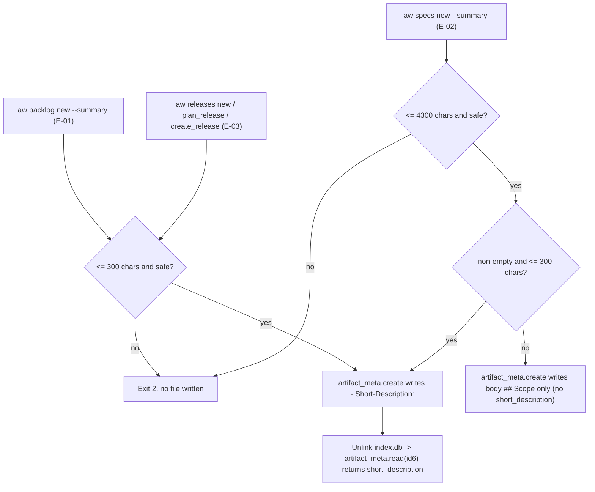

# IPD: Write short_description at creation for backlog, specs and releases

- Date: 2026-11-09
- Kind: child
- Concern: Spec `4sd62s` 4.2 SHORT DESCRIPTION and AC-36 case 1 require every creating command to accept `--summary` and write it as `short_description`. `aw backlog new`, `aw specs new` and `aw releases new` already take `--summary` (F-01) but write it only into body text. This is part of `6e93gt` (itself part of `xexn45`), split 2026-11-09 so each item names one command.
- Scope: Make `aw backlog new`, `aw specs new` and `aw releases new` write `--summary` as `short_description` in their `create` event (`6e93gt` E-01, the backlog, specs and releases subset), update the exact-byte spec creation test in `tests/test_specs_date_containment.py`, and create the shared test module `tests/test_writers_create_summary.py`. EXCLUDES: research and adopt (`bir7xm`), plan scaffold and prompts with `ipd_schema.META_RECOGNIZED` (`py2vu9`), `aw describe` (`h06gs7`).
- Scope-Paths: agent_workflows/backlog.py, agent_workflows/specs.py, agent_workflows/releases.py, agent_workflows/artifact_meta.py, tests/test_specs_date_containment.py, tests/test_writers_create_summary.py, .aw/records/plans/pending/20261109-metastore-124-fekdwv-write-short-description-at-creation-for-backlog-specs-and-re.ipd.md
- Item-Dependencies: executed:tve77h, executed:2xwb9b, executed:7yr827, executed:g6tw94, executed:n5sxxk
- Status: reviewed
- Readiness: go-pending-approval
- Review-Depth: complex
- From-Spec: 4sd62s
- Work-Kind: feature
- Priority: high
- Blocks-Release: next
- Set: metastore
- Order: 124
- Highest E allocated: 03
- Author: opencode its_direct/pt3-claude-opus-5.5-1m-us
- Id: fekdwv

> Write and proofread this plan per the technical writing standard, `.aw/system/workflows/technical-writing/technical-writing.md` (`.agents/workflows/technical-writing/technical-writing.md` in a legacy-layout install), including requirement 12 (diagrams).

## Workflow history
- 2026-11-14 reviewed (antigravity/gemini-4-carbon): /plan-review (antigravity/gemini-4-carbon): APPROVE WITH REVISIONS APPLIED; PR-001, PR-002, PR-003, PR-004

- 2026-11-09 to-review (opencode its_direct/pt3-claude-opus-5.5-1m-us): split from 6e93gt (round 3, research nj8zdp guidance).
- 2026-11-09 draft (opencode its_direct/pt3-claude-opus-5.5-1m-us): created.

## Goal

`aw backlog new`, `aw specs new` and `aw releases new` store their `--summary` as `short_description` through `artifact_meta`, with the same refusals as today.

## Detailed Implementation Checklist (TODO)

Execution-state rule: mark an `E-*` item complete only after performing the action. That mark is not validation. Right-sizing rule: write for a modest executor that cannot hold much in its head. Each E-item is one step (one concern, about one file, executable in one focused pass) and its V-item names each unit it covers with its own check; a plan stays at about 5 E-items and 8 work Scope-Paths, else split it into more child plans (guidance, `IPD-Z603`). Accepted execution states: blocked, failed, pending, performed; terminal gate demands 'performed'.

### Task group 1: short description at creation

- [ ] E-01 Create `tests/test_writers_create_summary.py` (`pytestmark = pytest.mark.core`, fixtures in `tmp_path`, real CLI, zero source inspection) and make `aw backlog new --summary` write `short_description` (`6e93gt` E-01, backlog subset). In `agent_workflows/backlog.py::run_new`, add `"short_description": item.summary` alongside phase-B `"summary": item.summary` (`jlwedt` D-3, kept for `backlog.validate_item`) in the `artifact_meta.create` `fields` dict once `item.summary` passes `attention_contract.refuse_unsafe_descriptive` at `MAX_DESCRIPTIVE_LEN` (300); the legacy writer renders `- Short-Description:` (`OQ-02`). Name every backlog test with `backlog` so `-k backlog` selects them all, unlink `.aw/state/index.db` before `artifact_meta.read`, and run `aw check all --agent` on the fixture asserting no diagnostic names the field.
  - Depends on: none
  - Expected outcome: for `aw backlog new --summary "Adds a widget." --apply`, `- Short-Description: Adds a widget.` is on disk and after unlinking `.aw/state/index.db`, `artifact_meta.read(<id6>).fields["short_description"] == "Adds a widget."`; a 301-character, embedded-newline, and control-character value each exit nonzero with no file written; `tests/test_backlog.py` and `tests/test_backlog_descriptive_safety.py` pass unchanged.
  - Execution state: pending

- [ ] E-02 Make `aw specs new --summary` write `short_description` (`6e93gt` E-01, specs subset). In `agent_workflows/specs.py::run_new`, add `"short_description": summary` to the `artifact_meta.create` `fields` dict only when stripped `summary` is non-empty and passes `attention_contract.refuse_unsafe_descriptive` at `MAX_DESCRIPTIVE_LEN` (300); the legacy writer renders `- Short-Description:`. Keep `specs._refuse_unsafe_descriptive(..., prose=True)` (`MAX_PROSE_DESCRIPTIVE_LEN` 4300) as the CLI refusal gate: when `summary` is omitted it writes no `short_description`; when `301 <= len(summary) <= 4300` it writes the body `## Scope` summary (`b3l7y6` D-4) and omits `short_description` (spec `4sd62s` 4.2); when `len > 4300` or unsafe (newline, control char) it exits 2 with no file written. Update `tests/test_specs_date_containment.py::test_non_regression_conforming_bytes` (`D-1`) and add the `specs`-named cases to `tests/test_writers_create_summary.py`.
  - Depends on: E-01
  - Expected outcome: for `aw specs new --summary "Adds a widget." --apply`, `- Short-Description: Adds a widget.` is on disk and after unlinking `.aw/state/index.db`, `artifact_meta.read(<id6>).fields["short_description"] == "Adds a widget."`; omitted `--summary`, 301-character, and 400-character values succeed with `short_description` `None` (and body summary present for 301/400); a 4301-character, embedded-newline, and control-character value each exit nonzero with no file written; `tests/test_specs_date_containment.py` and `tests/test_specs_releases_descriptive_safety.py` pass.
  - Execution state: pending

- [ ] E-03 Make `aw releases new --summary` write `short_description` (`6e93gt` E-01, releases subset). In the shared `artifact_meta.create` helper of `agent_workflows/releases.py` (`3466h8` E-01 and E-05, shared by `plan_release`, `create_release`, and `run_new`), include `"short_description": summary` in `fields` whenever `summary` is non-empty so preview and `--apply` stay byte-identical; `releases.run_new` keeps its pre-mint `attention_contract.refuse_unsafe_descriptive` refusal at `MAX_DESCRIPTIVE_LEN` (300), and the legacy writer renders `- Short-Description:`. Add the `releases`-named cases to `tests/test_writers_create_summary.py`.
  - Depends on: E-01
  - Expected outcome: for `aw releases new --summary "Adds a widget." --apply`, `- Short-Description: Adds a widget.` is on disk and after unlinking `.aw/state/index.db`, `artifact_meta.read(<id6>).fields["short_description"] == "Adds a widget."`; a 301-character, embedded-newline, and control-character value each exit nonzero with no file written; `tests/test_releases.py` and `tests/test_releases_cli.py` pass unchanged.
  - Execution state: pending

Add further leaves as `- [ ] E-NEW <action>` and run `aw ipd sync` to assign ids.

## Project conventions discovered (Step 0)

- The `artifact_meta` interface names come from Order 02 (`tve77h`) and are used exactly: `artifact_meta.read(id6) -> State`, `append(id6, events, *, expect_seq)`, `create(...)`, `validate_new_events(type, events, *, records_root, migration_import=False)`. In phase B, `append` and `create` render through the one legacy renderer `artifact_meta.write_legacy` (file form) and `artifact_meta.render_legacy_text` (string form), both added by `7yr827`. The SQLite cache lives at `.aw/state/index.db` (`artifact_meta.open_cache`).
- Prerequisite `g6tw94` (via its round-3 parts `jlwedt` for `backlog.py`, `b3l7y6` for `specs.py`, and `3466h8` for `releases.py`) has already moved `backlog.run_new`, `specs.run_new`, and `releases` (`plan_release`, `create_release`, `run_new`) onto `artifact_meta.create(..., legacy_render=LegacyRender(...))`.
- UTC history days come from `artifact_core.utc_history_date` (spec `2vev8j` 4.4); atomic replacement is `artifact_core.atomic_write(path, text, *, prefix)`.
- Core tier: `pyproject.toml` marker `core`; modules set `pytestmark = pytest.mark.core`.
- Cite code by SYMBOL (`path::Symbol` or `module.function`) or by a quoted content string, never by a line number alone (advisory `IPD-C801`).
- Descriptive refusals: `attention_contract.refuse_unsafe_descriptive` with `MAX_DESCRIPTIVE_LEN` 300 and `MAX_PROSE_DESCRIPTIVE_LEN` 4300 (`refuse_unsafe_descriptive` returns `None` on `""` and `None`, so optional `--summary` paths must guard on non-empty stripped text); `specs._refuse_unsafe_descriptive(..., prose=True)` is the spec `--summary` CLI refusal path.
- Recognized plan bullets are `ipd_schema.META_RECOGNIZED`; an unrecognized bullet is lint error `IPD-M103` (`ipd_lint.C_META_UNKNOWN`). The other types have no unknown-bullet check today (`specs.validate_spec`, `backlog.validate_item`, `releases.validate_release`; research validates only its required YAML keys in `research_contract.FRONTMATTER_FIELDS`), while `backlog.validate_item` still requires `- Summary:` in phase B (`backlog.summary-missing`).

## Findings

| Id | Evidence (measured 2026-11-09 at `3d0ddb845`; re-verified 2026-11-14 at `6e4dd37e9` by the review) | Finding |
|---|---|---|
| F-01 | `rg -n "\"--summary\"" agent_workflows/cli.py`: `research new`, `research comparison`, `backlog new`, `specs new`, `releases new` and `adopt` carry `--summary`; `scaffold` and `prompts new` do not | These three commands need no new CLI option, only `"short_description"` in their `artifact_meta.create` `fields` dict. |
| F-02 | `agent_workflows/artifact_meta.py::_COMMON_FIELDS` registers `short_description` across all record types and `agent_workflows/artifact_meta.py::load_legacy_artifact` (`field_map`) maps `"Short-Description"` to `"short_description"` on read at HEAD; `7yr827` E-01 adds `"short_description" -> "Short-Description"` to `_LEGACY_BULLET_LABEL` on write | `agent_workflows/artifact_meta.py` needs an edit here only if `7yr827` left a write-side gap; otherwise acknowledge it at finalize via `--scope-ack`. |
| F-03 | `agent_workflows/specs.py::run_new` validates `--summary` via `specs._refuse_unsafe_descriptive(..., prose=True)` (`MAX_PROSE_DESCRIPTIVE_LEN` = 4300, pinned by `tests/test_specs_releases_descriptive_safety.py`), and `tests/test_specs_date_containment.py::test_non_regression_conforming_bytes` asserts exact bytes on a 24-character `specs new --summary` | For `aw specs new`, `1..300` chars writes both body `## Scope` and `short_description`, `301..4300` chars writes body `## Scope` only, and `>= 4301` chars exits 2; `test_non_regression_conforming_bytes` updates its expected string (`D-1`), and finishing plan `6e93gt` V-03 should reconcile its copy-pasted 301-char phrasing for `specs new` during its own review. |

## Behavior decisions (kept behavior where writers disagreed, 4.3)

- D-1 (phase-B `- Short-Description:` bullet on created specs, backlog items, and releases). CHANGED on disk per `OQ-02` and spec `4sd62s` 4.2 SHORT DESCRIPTION: `aw backlog new --summary`, `aw specs new --summary` (when non-empty and `<= 300` chars), and `aw releases new --summary` (plus `plan_release` and `create_release` through their shared helper) now emit `- Short-Description: 
` in phase B alongside `backlog`'s phase-B `- Summary:` bullet (`jlwedt` D-3), `specs`'s `## Scope` prose section (`b3l7y6` D-4), and `releases`'s `## Summary` prose section (`3466h8` D-1). Named existing test with updated expected string: `tests/test_specs_date_containment.py::test_non_regression_conforming_bytes` (adds `- Short-Description: Conforming summary text.\n` in the rendered metadata block).

## Proposed changes (ordered, validatable)

1. Create `tests/test_writers_create_summary.py` and wire `short_description` in `agent_workflows/backlog.py::run_new` alongside phase-B `summary` (E-01).
2. Wire `short_description` in `agent_workflows/specs.py::run_new` with the non-empty `<= 300` vs `301..4300` vs `>= 4301` three-way rule, and update `tests/test_specs_date_containment.py::test_non_regression_conforming_bytes` (E-02).
3. Wire `short_description` in the shared `artifact_meta.create` helper of `agent_workflows/releases.py` (E-03).

## Deferred / out of scope (with reason)

- The final merge-independence test, the AC-21 obligations test, the raw-write audit (F-09), the `docs/cli-output-contract.md` reconciliation of the `--summary` options and the `CHANGELOG.md` line, and the full gates of the writer move.
  - Carrier: xexn45
- `--summary` for research and adopt.
  - Carrier: bir7xm
- `--summary` for plan scaffold and prompts, and the `ipd_schema.META_RECOGNIZED` entry.
  - Carrier: py2vu9
- The `aw describe` setter.
  - Carrier: h06gs7

## Scope check

- Over-scope: none.
- Under-scope: none. `tests/test_specs_date_containment.py` is declared for `D-1`; `agent_workflows/artifact_meta.py` is declared in case a write-side mapping gap remains after `7yr827` and is acknowledged at finalize (`--scope-ack`) when unmodified.

## Required tests / validation

New core test module: `tests/test_writers_create_summary.py` (created here; `bir7xm`, `py2vu9` and `h06gs7` add cases). Existing suite checks: `tests/test_backlog.py`, `tests/test_backlog_descriptive_safety.py`, `tests/test_specs_date_containment.py`, `tests/test_specs_releases_descriptive_safety.py`, `tests/test_releases.py`, and `tests/test_releases_cli.py` (`179 passed` at review baseline with `test_spec_id6_filenames.py`). Contributes to `4sd62s` AC-36 case 1 (`cxxmyv` re-demonstrates the full criterion).

## Spec / documentation sync

None. Implements `4sd62s` 4.2 SHORT DESCRIPTION as written; `xexn45` E-14 adds the documentation and changelog lines.

## Open questions

### OQ-02: How does `short_description` appear on disk in phase B?

- Blocking: no
- Status: resolved
- Owner: plan author
- Resolution or deferral rationale: As a `- Short-Description:` bullet (a `Short-Description:` key inside a prompt's comment; a `short-description:` YAML key in research front matter), registered as a recognized field in `ipd_schema.META_RECOGNIZED` and proven unflagged for the other types by `aw check all --agent`. Evidence: phase B has one on-disk format (C10a), the legacy loader reads bullets (tve77h E-11) so the value survives a cache rebuild, and an unregistered bullet is lint error `IPD-M103` on plans. The alternative (no on-disk form until the cutover) would make AC-36 case 1 untestable through `read()` after a cache deletion. The migration (dcerjg) maps the bullet to `short_description` with `description_source` absent (written by a command, not generated), and the census lists it. Recommendation strength: strong.
- Note: carried from `6e93gt` (originally `xexn45`) with its id so item citations resolve; `- Owner:` set to `plan author` during the 2026-11-14 review.

## Validation and cross-check (verify before reporting done)

Validation-state rule: inspect evidence in a separate pass. Do not mark a `V-*` item complete from memory or from the matching execution checkmark. Accepted validation results: blocked, failed, pass, pending; terminal gate demands 'pass'. Runtime-demonstration reachability rule: for each `V-*` item demanding the software be observed acting (such as a run, a dispatch, or a transition), as distinct from items demanding a diff, a file's content, or a test result, which are reachable by construction, name the code path that produces the observation or the sibling `E-*` that creates it, else the demand is UNDER-SCOPE.

- [ ] V-01 validates E-01
  - Required evidence: paste `python3 -m pytest -o addopts="" -v tests/test_writers_create_summary.py -k backlog` all PASSED, naming the `tests/test_writers_create_summary.py` cases for `aw backlog new`: the stored-value case (asserting `- Short-Description: Adds a widget.` on disk and, after unlinking `.aw/state/index.db`, quoting `artifact_meta.read(id6).fields["short_description"] == "Adds a widget."`), the 301-character, embedded-newline, and control-character refusal cases (each asserting a nonzero exit code and `git status --porcelain` empty), and the `aw check all --agent` case asserting zero diagnostics (confirming both `- Short-Description:` and phase-B `- Summary:` pass `backlog.validate_item`); plus paste summary lines of `python3 -m pytest -o addopts="" tests/test_backlog.py tests/test_backlog_descriptive_safety.py` all PASSED and `rg -n "^(import|from) (inspect|ast)\b|agent_workflows/[a-z_]+\.py" tests/test_writers_create_summary.py` printing nothing.
  - Observed evidence:
  - Result: pending
- [ ] V-02 validates E-02
  - Required evidence: paste `python3 -m pytest -o addopts="" -v tests/test_writers_create_summary.py -k specs` all PASSED, naming the `tests/test_writers_create_summary.py` cases for `aw specs new`: the stored-value case (asserting `- Short-Description: Adds a widget.` on disk and, after unlinking `.aw/state/index.db`, quoting `artifact_meta.read(id6).fields["short_description"] == "Adds a widget."`), the omitted-`--summary` case asserting `short_description` is `None` and no `- Short-Description:` bullet is written, the 301-character and 400-character cases each asserting exit 0, `short_description` `None`, and the body summary present, the 4301-character (`MAX_PROSE_DESCRIPTIVE_LEN + 1`), embedded-newline, and control-character refusal cases (each asserting exit 2 and `git status --porcelain` empty), and the `aw check all --agent` case asserting no diagnostic names the new field; plus paste summary lines of `python3 -m pytest -o addopts="" tests/test_specs_date_containment.py tests/test_specs_releases_descriptive_safety.py` all PASSED.
  - Observed evidence:
  - Result: pending
- [ ] V-03 validates E-03
  - Required evidence: paste `python3 -m pytest -o addopts="" -v tests/test_writers_create_summary.py -k releases` all PASSED, naming the `tests/test_writers_create_summary.py` cases for `aw releases new`: the stored-value case (asserting `- Short-Description: Adds a widget.` on disk, preview-equals-apply parity, and, after unlinking `.aw/state/index.db`, quoting `artifact_meta.read(id6).fields["short_description"] == "Adds a widget."`), the 301-character, embedded-newline, and control-character refusal cases (each asserting a nonzero exit code and `git status --porcelain` empty), and the `aw check all --agent` case asserting no diagnostic names the new field; plus paste summary lines of `python3 -m pytest -o addopts="" tests/test_releases.py tests/test_releases_cli.py` all PASSED.
  - Observed evidence:
  - Result: pending

## Approval and execution gate

- Size assessment: standard
- Cohesion rationale: not required

Execute only after human approval (`Status: approved`) and after every plan in `- Item-Dependencies:` is executed.

Scope fence: the paths in `- Scope-Paths:` are a declaration; a needed file outside the fence is edited and then justified at finalize (`--scope-reason`), and a declared path left unmodified is acknowledged (`--scope-ack`). An existing test assertion may change only where the Behavior decisions above name it (`D-1`).

Unsafe-condition stop: if `artifact_meta.write_legacy` is absent or `backlog.run_new`, `specs.run_new`, or `releases.run_new` does not yet route through `artifact_meta.create` at execution (prerequisites `7yr827` and `g6tw94` not landed), or another party is changing a file you must edit and the changes cannot be safely combined, stop and report; do not hand-build `- Short-Description:` bullets outside `artifact_meta`.

Honesty rule: run the named modules and the bare core gate `python3 -m pytest`, and paste the ACTUAL summary lines; never claim a result you did not run.

Commits: commit only through `aw commit fekdwv -- <paths>`; never `git add -A`, a bare `git add` or `git commit -a`; never push.

Lifecycle transition: the plan moves to `.aw/records/plans/executed/` only through `aw ipd finalize`, never a hand `git mv`, and only after `aw ipd lint --phase pre-transition` conforms and every `V-*` reads `pass` with pasted evidence. When `aw oc run` or `aw agy run` executes the plan, the runner performs the finalize; a hand executor runs `aw ipd finalize fekdwv` itself.
