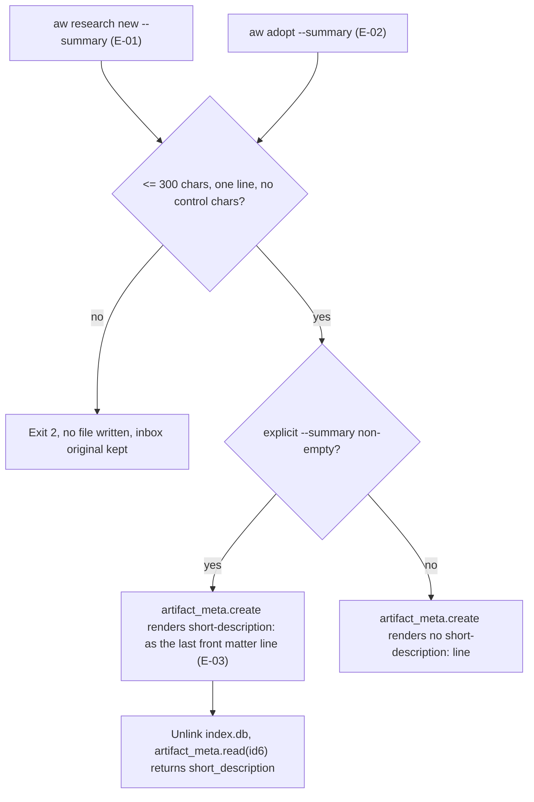

# IPD: Write short_description at creation for research and adopt

- Date: 2026-11-09
- Kind: child
- Concern: Spec `4sd62s` 4.2 SHORT DESCRIPTION and AC-36 case 1 require every creating command to write `--summary` as `short_description`. `aw research new` and `aw adopt` take `--summary` (F-01) but do not store it as that field. This is part of `6e93gt` (itself part of `xexn45`), split 2026-11-09 so each item names one command.
- Scope: Make `aw research new` and `aw adopt` write `--summary` as `short_description` in their `create` event (`6e93gt` E-01, research and adopt subset). Research renders the value as a `short-description:` YAML key, not a bullet (OQ-02). EXCLUDES: backlog, specs, releases (`fekdwv`); plan scaffold and prompts (`py2vu9`).
- Scope-Paths: agent_workflows/research_cmd.py, agent_workflows/artifact_adopt.py, agent_workflows/artifact_meta.py, tests/test_writers_create_summary.py, .aw/records/plans/pending/20261109-metastore-125-bir7xm-write-short-description-at-creation-for-research-and-adopt.ipd.md
- Item-Dependencies: executed:tve77h, executed:2xwb9b, executed:7yr827, executed:g6tw94, executed:n5sxxk, executed:fekdwv
- Status: reviewed
- Readiness: go-pending-approval
- Review-Depth: standard
- From-Spec: 4sd62s
- Work-Kind: feature
- Priority: high
- Blocks-Release: next
- Set: metastore
- Order: 125
- Highest E allocated: 03
- Author: opencode its_direct/pt3-claude-opus-5.5-1m-us
- Id: bir7xm

> Write and proofread this plan per the technical writing standard, `.aw/system/workflows/technical-writing/technical-writing.md` (`.agents/workflows/technical-writing/technical-writing.md` in a legacy-layout install), including requirement 12 (diagrams).

## Workflow history

- 2026-11-14 /plan-review (opencode its_direct/pt3-claude-opus-5.5-1m-us): APPROVE WITH REVISIONS APPLIED; PR-001..PR-008 FIXED; review record .aw/records/reviews/20261109-metastore-125-bir7xm-write-short-description-at-creation-for-research-and-adopt.review.md
- 2026-11-14 reviewed (aw set): APPROVE WITH REVISIONS APPLIED; PR-001..PR-008 FIXED
- 2026-11-09 to-review (opencode its_direct/pt3-claude-opus-5.5-1m-us): split from 6e93gt (round 3, research nj8zdp guidance).
- 2026-11-09 draft (opencode its_direct/pt3-claude-opus-5.5-1m-us): created.

## Goal

`aw research new` and `aw adopt` store their `--summary` as `short_description` through `artifact_meta`.

## Detailed Implementation Checklist (TODO)

Execution-state rule: mark an `E-*` item complete only after performing the action. That mark is not validation. Right-sizing rule: write for a modest executor that cannot hold much in its head. Each E-item is one step (one concern, about one file, executable in one focused pass) and its V-item names each unit it covers with its own check; a plan stays at about 5 E-items and 8 work Scope-Paths, else split it into more child plans (guidance, `IPD-Z603`). Accepted execution states: blocked, failed, pending, performed; terminal gate demands 'performed'.

### Task group 1: short description at creation

PIN-FIRST RULE for every item: create `.aw/state/bir7xm/` (`mkdir -p .aw/state/bir7xm`), run the existing test modules its V-item names GREEN on the unmodified code, and save the per-test outcome list (`python3 -m pytest -o addopts="" -m "" -p no:randomly -n 0 -rA <modules> | grep -E "^(PASSED|FAILED|ERROR|SKIPPED|XFAIL|XPASS) " | sed -E 's/ - .*//' | sort > .aw/state/bir7xm/<E>-before.txt`); make the change; run the same command into `<E>-after.txt`; `diff` of the two must print nothing. An existing assertion may change only where the Behavior decisions name it (none do). New tests in `tests/test_writers_create_summary.py` set `pytestmark = pytest.mark.core` (module-level, set by `fekdwv`), build fixture repositories in `tmp_path`, drive the real CLI or function, and never read production source (AGENTS.md "TEST OUTCOMES, NOT CODE STRUCTURE").

- [ ] E-03 Render `short_description` as a `short-description:` YAML key on phase-B `research` creation (`OQ-02`, `D-1`). In `agent_workflows/artifact_meta.py`, extend the phase-B `research` `op == "create"` YAML front matter rendering that `s95hj6` E-03 and `x2dxvf` E-04 add (`LegacyRender(history=False)`) so that a non-empty `fields["short_description"]` renders one line `short-description: <value>` as the LAST line of the front matter block, after `consumed-by:` and after the optional `priority:`, immediately before the closing `---`; an absent or `None` value renders no line. `_COMMON_FIELDS["short_description"]` already registers the field for every type, and `load_legacy_artifact` already maps an unmapped YAML key `short-description` to `short_description` (`bk.lower().replace("-", "_")`), so no registry or loader edit is expected (F-04). Add `yaml_short_description`-named cases to `tests/test_writers_create_summary.py` that call `artifact_meta.create(..., dry_run=True)` for a `research` record with and without the field.
  - Depends on: none
  - Expected outcome: a `research` create with `short_description="Adds a widget."` renders `short-description: Adds a widget.` as the line directly before the closing `---` (after `priority: high` when a priority is given); a create without the field renders no `short-description:` line and is otherwise byte-identical to the same create before the change; the PIN-FIRST outcome diff of `tests/test_artifact_meta_legacy_write.py`, `tests/test_artifact_meta_registry.py`, `tests/test_artifact_meta_cache.py` and `tests/test_status_set_meta_writer.py` is empty.
  - Execution state: pending

- [ ] E-01 Make `aw research new --summary` write `short_description` (`6e93gt` E-01, research subset). In `agent_workflows/research_cmd.py`, add a keyword-only `short_description: Optional[str] = None` parameter to `plan_new` and include it in the `fields` of the `artifact_meta.create(..., dry_run=True)` call through which `plan_new` renders `PlannedFile.content` after `s95hj6` E-01, only when it is non-empty after `strip()`; `run_new` passes `short_description=summary` from `--summary`. The existing pre-mint refusal (`plan_new` comment "E-02: Refuse unsafe descriptive value for --summary", `attention_contract.refuse_unsafe_descriptive` at `MAX_DESCRIPTIVE_LEN` 300) stays the refusal gate, and `plan_new` runs the same `_refuse_unsafe_descriptive("aw research new", "--summary", ...)` check on `short_description` when a caller passes a value different from `summary`, so no caller can bypass it; `_emit_and_write` writes the same `PlannedFile.content`, so preview and `--apply` show identical text. `plan_new_comparison` is not changed (`D-2`). Add `research_new`-named cases to `tests/test_writers_create_summary.py`.
  - Depends on: E-03
  - Expected outcome: `aw research new --kind findings --slug widget --summary "Adds a widget." --apply` in a fixture repository writes `short-description: Adds a widget.` as the last front matter line, and after unlinking the fixture's `.aw/state/index.db`, `artifact_meta.read(<id6>).fields["short_description"] == "Adds a widget."`; `--slug widget` with no `--summary` writes no `short-description:` line and `short_description` reads `None`; a 301-character, an embedded-newline and a control-character `--summary` each exit 2 with no file written; `aw check all --agent` on the fixture reports no diagnostic naming `short-description` or `short_description`; the PIN-FIRST outcome diff of the research modules named in V-01 is empty.
  - Execution state: pending

- [ ] E-02 Make `aw adopt --summary` write `short_description` (`6e93gt` E-01, adopt subset). In `agent_workflows/artifact_adopt.py`, `plan_adoption` passes `short_description=summary` (the explicit `--summary` value only) to `research_cmd.plan_new`, never the derived `summary or heading_text or suggestion.slug` fallback it passes as `summary` (`D-3`); add `short_description: Optional[str]` to `AdoptionPlan` beside the research fields that `x2dxvf` E-01 carries, and include it in the `fields` of the `artifact_meta.create` call in `apply_adoption` when non-empty, so the adopted file and `render_preview` both carry the `short-description:` YAML key that E-03 renders (adopt creates `research` only: `artifact_adopt.SUPPORTED_TYPES = ("research",)`). The `plan_new` pre-mint refusal stays the refusal gate, including on the `--allow-leaks` path where `migration_import=True` skips `validate_new_events` string safety. Add `adopt`-named cases to `tests/test_writers_create_summary.py`.
  - Depends on: E-01, E-03
  - Expected outcome: `aw adopt <inbox-file> --summary "Adds a widget." --apply` in a fixture repository writes `short-description: Adds a widget.` as the last front matter line, and after unlinking the fixture's `.aw/state/index.db`, `artifact_meta.read(<id6>).fields["short_description"] == "Adds a widget."`; the preview without `--apply` shows the same front matter; adopting a drop whose first heading is `# Derived Heading` with no `--summary` writes no `short-description:` line and `short_description` reads `None`; a 301-character, an embedded-newline and a control-character `--summary` each exit 2 with no file written under `.aw/records/research/` and the inbox original still present; `aw check all --agent` on the fixture reports no diagnostic naming the field; the PIN-FIRST outcome diff of `tests/test_artifact_adopt.py` and `tests/test_research_date_containment.py` is empty.
  - Execution state: pending

Add further leaves as `- [ ] E-NEW <action>` and run `aw ipd sync` to assign ids.

## Project conventions discovered (Step 0)

- The `artifact_meta` interface names come from Order 02 (`tve77h`) and are used exactly: `artifact_meta.read(id6) -> State`, `append(id6, events, *, expect_seq)`, `create(...)`, `validate_new_events(type, events, *, records_root, migration_import=False)`. In phase B, `append` and `create` render through the one legacy renderer `artifact_meta.write_legacy` (file form) and `artifact_meta.render_legacy_text` (string form), both added by `7yr827`. Phase-B `research` YAML creation is added by `s95hj6` E-03 and `x2dxvf` E-04; `research_cmd.plan_new` renders through `artifact_meta.create(..., dry_run=True)` after `s95hj6` E-01, and `artifact_adopt.apply_adoption` writes through `artifact_meta.create` after `x2dxvf` E-01.
- UTC history days come from `artifact_core.utc_history_date` (spec `2vev8j` 4.4); atomic replacement is `artifact_core.atomic_write(path, text, *, prefix)`.
- Core tier: `pyproject.toml` marker `core`; modules set `pytestmark = pytest.mark.core`.
- Cite code by SYMBOL (`module.function`) or by a quoted content string, never by a line number alone (advisory `IPD-C801`).
- Descriptive refusals: `attention_contract.refuse_unsafe_descriptive` with `MAX_DESCRIPTIVE_LEN` 300 and `MAX_PROSE_DESCRIPTIVE_LEN` 4300; `specs._refuse_unsafe_descriptive(..., prose=True)` is the spec `--summary` path.
- Recognized plan bullets are `ipd_schema.META_RECOGNIZED`; an unrecognized bullet is lint error `IPD-M103` (`ipd_lint.C_META_UNKNOWN`). The other types have no unknown-bullet check today (`specs.validate_spec`, `backlog._render_item`, `releases.validate_release`; research validates only its required YAML keys in `research_contract.FRONTMATTER_FIELDS`).

## Findings

| Id | Evidence (F-01 and F-02 measured 2026-11-09 at `3d0ddb845`; F-03 to F-07 measured 2026-11-14 at `aadf6adf7`) | Finding |
|---|---|---|
| F-01 | `rg -n "\"--summary\"" agent_workflows/cli.py`: `p_research_new`, `p_research_cmp` and `p_adopt` carry it, each with `default=""` | No new option; only the stored field. An omitted `--summary` arrives as `""`. |
| F-02 | `research_contract.validate_frontmatter` checks only the required `research_contract.FRONTMATTER_FIELDS` and has no unknown-key check | An extra `short-description:` key is not flagged; the `aw check all` cases prove it. |
| F-03 | `artifact_adopt.SUPPORTED_TYPES = ("research",)`; `artifact_adopt.plan_adoption` takes `AdoptionPlan.frontmatter` from `research_cmd.plan_new` | An adopted file is a research document with YAML front matter, so adopt renders the `short-description:` YAML key, not a `- Short-Description:` bullet. |
| F-04 | `artifact_meta._COMMON_FIELDS["short_description"]`; `artifact_meta.load_legacy_artifact` maps an unmapped key with `field_map.get(bk, bk.lower().replace("-", "_"))`; `artifact_meta._parse_yaml_front_matter` reads every `key: value` line | The field is registered for `research`, and a `short-description:` key survives a cache rebuild without a loader edit. |
| F-05 | `artifact_adopt.plan_adoption` calls `_rc.plan_new(..., summary=summary or heading_text or suggestion.slug, ...)` | The `summary` value adopt passes is often derived, so the explicit `--summary` needs its own parameter (`D-3`). |
| F-06 | `s95hj6` E-03 and `x2dxvf` E-04 render the spec-5.8 keys plus `priority` on research create; neither renders `short-description` (`s95hj6` D-2 covers only in-place `set`) | No sibling owns the create-time YAML rendering, so this plan adds it (E-03). |
| F-07 | `research_cmd.plan_new` refuses `--summary` over 300 characters, with a newline or with a control character before minting (`_refuse_unsafe_descriptive`, `bound_length=True`); `artifact_adopt.run_adopt` reports a planning error as `_emit("cannot-run", 2, ...)` | The 4.2 refusals already exist for both commands and stay the gate; exit code 2. Baseline: the eight research and adopt modules named in V-01 to V-03 report `140 passed` at `aadf6adf7`. |

## Behavior decisions (kept behavior where writers disagreed, 4.3)

- D-1 (on-disk position of `short-description:` in research front matter). CHANGED on disk per `OQ-02` and spec `4sd62s` 4.2 SHORT DESCRIPTION: a created or adopted research document given a non-empty `--summary` carries one extra line `short-description: <value>` as the last front matter line, after `consumed-by:` and the optional `priority:`, matching the `priority` placement rule of `s95hj6` D-2. The required `summary:` key is unchanged and keeps the same value, because `research_contract.FRONTMATTER_FIELDS` requires it. `research_cmd.build_frontmatter` is not changed (`s95hj6` D-4). No existing assertion changes: no pinned test compares the full front matter bytes or its key set (searched `tests/` for full-block and key-set assertions; the `"consumed-by: []\n---"` literals in `tests/test_artifact_adopt.py` and `tests/test_research_priority.py` are fixture inputs). Recommendation strength: strong.
- D-2 (`aw research new-comparison`). KEPT: it writes no `short_description`. Spec `4sd62s` 4.2 names `aw research new --summary`, not `new-comparison`, and `plan_new_comparison` composes a different summary per file (`_compose_comparison_summary`), so no single value is the user's description of each document. Recommendation strength: moderate.
- D-3 (adopt with no `--summary`). KEPT: no `short_description` is written when `--summary` is omitted or blank, even though adopt derives a `summary:` value from the drop's first heading or slug. Spec `4sd62s` 4.2 says the field is "written only by tools (--summary on the creating command, or a setter)" and that the migration, not a derivation, fills missing values. Recommendation strength: strong.

## Proposed changes (ordered, validatable)

1. Render the `short-description:` YAML key on phase-B research creation in `agent_workflows/artifact_meta.py` (E-03).
2. Pass the explicit `--summary` as `short_description` from `research_cmd.run_new` through `plan_new` (E-01).
3. Pass the explicit `--summary` as `short_description` from `artifact_adopt.plan_adoption` through `AdoptionPlan` into `apply_adoption`'s create event (E-02).

E-03 comes first because E-01 and E-02 only pass a field that E-03 renders.

## Deferred / out of scope (with reason)

- The final merge-independence test, the AC-21 obligations test, the raw-write audit (F-09), the `docs/cli-output-contract.md` reconciliation of the `--summary` options and the `CHANGELOG.md` line, and the full gates of the writer move.
  - Carrier: xexn45

## Scope check

- Over-scope: none.
- Under-scope: none. `agent_workflows/artifact_meta.py` carries E-03. The pinned modules run unchanged, so no existing test file is declared.

## Required tests / validation

Adds `yaml_short_description`, `research_new` and `adopt` cases to `tests/test_writers_create_summary.py` (created by `fekdwv`). Existing suite checks through PIN-FIRST: `tests/test_artifact_meta_legacy_write.py`, `tests/test_artifact_meta_registry.py`, `tests/test_artifact_meta_cache.py`, `tests/test_status_set_meta_writer.py` (E-03); `tests/test_research_cmd_create.py`, `tests/test_research_descriptive_safety.py`, `tests/test_descriptive_refusal_hoist.py`, `tests/test_research_priority.py`, `tests/test_research_first_order.py`, `tests/test_research_companion.py` (E-01); `tests/test_artifact_adopt.py`, `tests/test_research_date_containment.py` (E-02). Contributes to `4sd62s` AC-36 case 1 (`6e93gt` E-03 re-demonstrates all creating commands).

## Spec / documentation sync

None. Implements `4sd62s` 4.2 SHORT DESCRIPTION as written.

## Open questions

### OQ-02: How does `short_description` appear on disk in phase B?

- Blocking: no
- Status: resolved
- Owner: plan author
- Resolution or deferral rationale: As a `- Short-Description:` bullet (a `Short-Description:` key inside a prompt's comment; a `short-description:` YAML key in research front matter), registered as a recognized field in `ipd_schema.META_RECOGNIZED` and proven unflagged for the other types by `aw check all --agent`. Evidence: phase B has one on-disk format (C10a), the legacy loader reads bullets (tve77h E-11) so the value survives a cache rebuild, and an unregistered bullet is lint error `IPD-M103` on plans. The alternative (no on-disk form until the cutover) would make AC-36 case 1 untestable through `read()` after a cache deletion. The migration (dcerjg) maps the bullet to `short_description` with `description_source` absent (written by a command, not generated), and the census lists it. Recommendation strength: strong.
- Note: carried from `6e93gt` (originally `xexn45`) with its id so item citations resolve. Both commands in this plan create research documents, so only the `short-description:` YAML key form applies here (F-03); its position is `D-1`. `- Owner:` set to `plan author` during the 2026-11-14 review.

## Validation and cross-check (verify before reporting done)

Validation-state rule: inspect evidence in a separate pass. Do not mark a `V-*` item complete from memory or from the matching execution checkmark. Accepted validation results: blocked, failed, pass, pending; terminal gate demands 'pass'. Runtime-demonstration reachability rule: for each `V-*` item demanding the software be observed acting (such as a run, a dispatch, or a transition), as distinct from items demanding a diff, a file's content, or a test result, which are reachable by construction, name the code path that produces the observation or the sibling `E-*` that creates it, else the demand is UNDER-SCOPE.

- [ ] V-01 validates E-01
  - Required evidence: paste `python3 -m pytest -o addopts="" -v tests/test_writers_create_summary.py -k research_new` all PASSED, naming the `tests/test_writers_create_summary.py` cases for `aw research new`: the stored-value case (quote its assertion that `short-description: Adds a widget.` is the last line before the closing `---` on disk, and, after unlinking the fixture's `.aw/state/index.db`, its `artifact_meta.read(id6).fields["short_description"] == "Adds a widget."` assertion), the omitted-`--summary` case (no `short-description:` line, `short_description` is `None`), the 301-character, embedded-newline and control-character refusal cases (each asserting exit 2 and the fixture repository's `git status --porcelain` empty), and the `aw check all --agent` case asserting no diagnostic names `short-description` or `short_description`; plus paste `diff .aw/state/bir7xm/E-01-before.txt .aw/state/bir7xm/E-01-after.txt` printing nothing for `tests/test_research_cmd_create.py`, `tests/test_research_descriptive_safety.py`, `tests/test_descriptive_refusal_hoist.py`, `tests/test_research_priority.py`, `tests/test_research_first_order.py` and `tests/test_research_companion.py`, with the `N passed` summary line of the after run.
  - Observed evidence:
  - Result: pending
- [ ] V-02 validates E-02
  - Required evidence: paste `python3 -m pytest -o addopts="" -v tests/test_writers_create_summary.py -k adopt` all PASSED, naming the `tests/test_writers_create_summary.py` cases for `aw adopt`: the stored-value case (quote its assertion that `short-description: Adds a widget.` is the last line before the closing `---` in both the preview and the adopted file, and, after unlinking the fixture's `.aw/state/index.db`, its `artifact_meta.read(id6).fields["short_description"] == "Adds a widget."` assertion), the derived-heading case with no `--summary` (no `short-description:` line, `short_description` is `None`), the 301-character, embedded-newline and control-character refusal cases (each asserting exit 2, no new file under the fixture's `.aw/records/research/`, and the inbox original still present), and the `aw check all --agent` case asserting no diagnostic names the field; plus paste `diff .aw/state/bir7xm/E-02-before.txt .aw/state/bir7xm/E-02-after.txt` printing nothing for `tests/test_artifact_adopt.py` and `tests/test_research_date_containment.py`, with the `N passed` summary line of the after run.
  - Observed evidence:
  - Result: pending
- [ ] V-03 validates E-03
  - Required evidence: paste `python3 -m pytest -o addopts="" -v tests/test_writers_create_summary.py -k yaml_short_description` all PASSED, naming the case that quotes the rendered front matter of an `artifact_meta.create(..., dry_run=True)` `research` create with `short_description="Adds a widget."` and `priority="high"` (asserting the last two lines before the closing `---` are `priority: high` then `short-description: Adds a widget.`) and the case asserting a create without the field renders no `short-description:` line; plus paste `diff .aw/state/bir7xm/E-03-before.txt .aw/state/bir7xm/E-03-after.txt` printing nothing for `tests/test_artifact_meta_legacy_write.py`, `tests/test_artifact_meta_registry.py`, `tests/test_artifact_meta_cache.py` and `tests/test_status_set_meta_writer.py`, and the `N passed` summary line of the bare core gate `python3 -m pytest` after all three items.
  - Observed evidence:
  - Result: pending

## Approval and execution gate

- Size assessment: standard
- Cohesion rationale: not required

Execute only after human approval (`Status: approved`) and after every plan in `- Item-Dependencies:` is executed.

Scope fence: the paths in `- Scope-Paths:` are a declaration; a needed file outside the fence is edited and then justified at finalize (`--scope-reason`), and a declared path left unmodified is acknowledged (`--scope-ack`). Every item is pin-first (the PIN-FIRST RULE above names the command and each V-item names the modules); no existing assertion changes, because `D-1` to `D-3` name none.

Unsafe-condition stop: if, at execution, `research_cmd.plan_new` does not render through `artifact_meta.create(..., dry_run=True)`, `artifact_adopt.apply_adoption` does not write through `artifact_meta.create`, or phase-B `research` YAML creation is absent from `artifact_meta` (prerequisites `s95hj6` and `x2dxvf`, through `n5sxxk`, not landed); if a pinned module fails on the unmodified code; or if another party is changing a file you must edit and the changes cannot be safely combined: stop and report. Do not hand-build a `short-description:` line outside `artifact_meta`.

Honesty rule: run the named modules and the bare core gate `python3 -m pytest`, and paste the ACTUAL summary lines; never claim a result you did not run.

Commits: commit only through `aw commit bir7xm -- <paths>`; never `git add -A`, a bare `git add` or `git commit -a`; never push.

Lifecycle transition: the plan moves to `.aw/records/plans/executed/` only through `aw ipd finalize`, never a hand `git mv`, and only after `aw ipd lint --phase pre-transition` conforms and every `V-*` reads `pass` with pasted evidence. When `aw oc run` or `aw agy run` executes the plan, the runner performs the finalize; a hand executor runs `aw ipd finalize bir7xm` itself.
