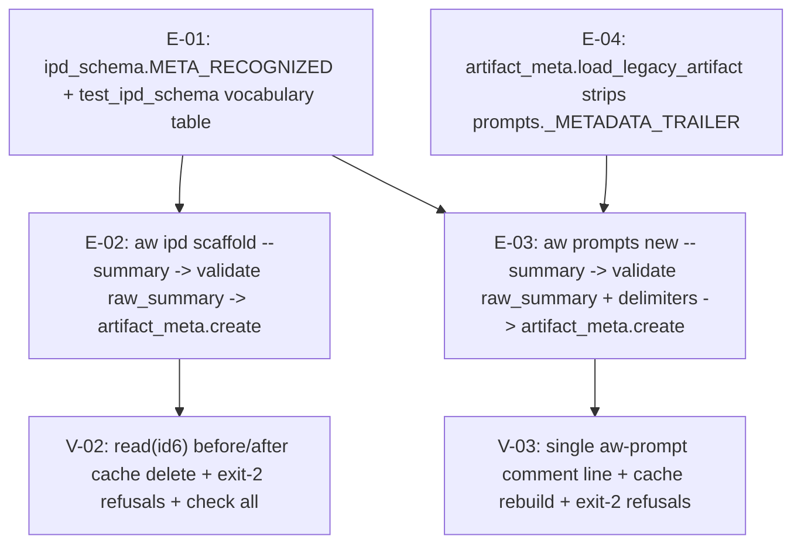

# IPD: Add --summary to aw ipd scaffold and aw prompts new

- Date: 2026-11-09
- Kind: child
- Concern: Spec `4sd62s` 4.2 SHORT DESCRIPTION and AC-36 case 1 require every creating command to accept `--summary`. Measured at `3d0ddb845` and re-verified at `cf53a9466`: `aw ipd scaffold --help` and `aw prompts new --help` show no `--summary`, `rg -n "Short-Description" agent_workflows/ipd_schema.py` finds no match (so a plan bullet fails lint with `IPD-M103`, while `tests/test_ipd_schema.py::MetadataVocabularyTests` enforces a two-sided set equality against `ipd_schema.META_RECOGNIZED`), and `agent_workflows/artifact_meta.py::load_legacy_artifact` splits `aw-prompt` metadata comments on pipe delimiters without stripping `prompts._METADATA_TRAILER` (contaminating the last comment field on cache rebuild). This plan is part of `6e93gt` (itself part of `xexn45`), split 2026-11-09.
- Scope: Register `Short-Description` (`META_SHORT_DESCRIPTION`) in `ipd_schema.META_RECOGNIZED` and `tests/test_ipd_schema.py::MetadataVocabularyTests.FIELDS`; strip `prompts._METADATA_TRAILER` in `agent_workflows/artifact_meta.py::load_legacy_artifact` before splitting `aw-prompt` comments; add `--summary` to `aw ipd scaffold` and `aw prompts new` (registered in `agent_workflows/cli.py` and `agent_workflows/command_surface.py` `legacy_flags`), validate raw `--summary` input before `.strip()` and before `mint_id6` (including refusing prompt comment-closing and field-delimiter tokens on `aw prompts new`), and write non-blank summaries as `short_description` in their `artifact_meta.create` events (`6e93gt` E-01, scaffold and prompts subset). EXCLUDES: the other five creating commands (`fekdwv`, `bir7xm`), `aw describe` (`h06gs7`).
- Scope-Paths: agent_workflows/ipd_schema.py, agent_workflows/artifact_meta.py, agent_workflows/cli.py, agent_workflows/command_surface.py, agent_workflows/ipd_authoring.py, agent_workflows/prompts.py, tests/test_ipd_schema.py, tests/test_writers_create_summary.py, .aw/records/plans/pending/20261109-metastore-126-py2vu9-add-summary-to-aw-ipd-scaffold-and-aw-prompts-new.ipd.md
- Item-Dependencies: executed:tve77h, executed:2xwb9b, executed:7yr827, executed:g6tw94, executed:n5sxxk, executed:fekdwv
- Status: reviewed
- Readiness: go-pending-approval
- Review-Depth: complex
- From-Spec: 4sd62s
- Work-Kind: feature
- Priority: high
- Blocks-Release: next
- Set: metastore
- Order: 126
- Highest E allocated: 04
- Author: opencode its_direct/pt3-claude-opus-5.5-1m-us
- Id: py2vu9

> Write and proofread this plan per the technical writing standard, `.aw/system/workflows/technical-writing/technical-writing.md` (`.agents/workflows/technical-writing/technical-writing.md` in a legacy-layout install), including requirement 12 (diagrams).

## Workflow history
- 2026-11-14 reviewed (aw set): APPROVE WITH REVISIONS APPLIED; PR-001..PR-005 FIXED

- 2026-11-14 /plan-review (antigravity/gemini): APPROVE WITH REVISIONS APPLIED; PR-001..PR-005 FIXED; review record .aw/records/reviews/20261109-metastore-126-py2vu9-add-summary-to-aw-ipd-scaffold-and-aw-prompts-new.review.md
- 2026-11-09 to-review (opencode its_direct/pt3-claude-opus-5.5-1m-us): split from 6e93gt (round 3, research nj8zdp guidance).
- 2026-11-09 draft (opencode its_direct/pt3-claude-opus-5.5-1m-us): created.

## Goal

`aw ipd scaffold` and `aw prompts new` accept optional `--summary`, validate raw input before minting an id or writing to disk, and store non-blank values as `short_description` through `artifact_meta.create` so `artifact_meta.read(id6)` returns the exact summary both from cache and after cache deletion, while plans carrying `- Short-Description:` lint clean.

## Detailed Implementation Checklist (TODO)

Execution-state rule: mark an `E-*` item complete only after performing the action. That mark is not validation. Right-sizing rule: write for a modest executor that cannot hold much in its head. Each E-item is one step (one concern, about one file, executable in one focused pass) and its V-item names each unit it covers with its own check; a plan stays at about 5 E-items and 8 work Scope-Paths, else split it into more child plans (guidance, `IPD-Z603`). Accepted execution states: blocked, failed, pending, performed; terminal gate demands 'performed'.

### Task group 1: schema, prompt legacy loader, and the two new `--summary` options

- [ ] E-01 Define `META_SHORT_DESCRIPTION = "Short-Description"` in `agent_workflows/ipd_schema.py` and register it as an optional recognized plan bullet in `ipd_schema.META_RECOGNIZED` (`6e93gt` E-01, schema subset), add the matching optional `(Short-Description, META_SHORT_DESCRIPTION, False, ...)` row to `MetadataVocabularyTests.FIELDS` in `tests/test_ipd_schema.py` (`D-1`), and add a schema lint case in `tests/test_writers_create_summary.py` verifying that a fixture plan carrying `- Short-Description:` raises no `IPD-M103`.
  - Depends on: none
  - Expected outcome: `tests/test_ipd_schema.py` passes in full, and `aw ipd lint` on a fixture plan carrying `- Short-Description: Adds a widget.` reports zero `IPD-M103` diagnostics.
  - Execution state: pending

- [ ] E-04 In `agent_workflows/artifact_meta.py`, update `artifact_meta.load_legacy_artifact` so the `aw-prompt` HTML-comment parser strips `prompts._METADATA_TRAILER` (`" . This HTML comment is..."`, matching the `prompts_index` comment parser) before splitting on `"|"` (`D-2`), preventing trailer prose from contaminating the final comment field (`Short-Description`) when `artifact_meta.read` rebuilds `State.short_description` from disk, and verify `tests/test_artifact_meta_legacy_write.py` and `tests/test_artifact_meta_cache.py` stay green.
  - Depends on: none
  - Expected outcome: loading a legacy prompt whose `aw-prompt` comment ends with `Short-Description: Adds a widget.` followed by `prompts._METADATA_TRAILER` yields exact `"Adds a widget."` on both `State.short_description` and `State.fields["short_description"]`, and both existing `artifact_meta` test modules pass.
  - Execution state: pending

- [ ] E-02 Add optional `--summary` (`default=None`) to `aw ipd scaffold` in `agent_workflows/cli.py` and `legacy_flags` in `agent_workflows/command_surface.py` (`6e93gt` E-01, scaffold subset); in `ipd_authoring.run_scaffold`, validate non-empty raw `--summary` via `attention_contract.refuse_unsafe_descriptive` (`verb="aw ipd scaffold"`, `flag="--summary"`, `bound_length=True`, `MAX_DESCRIPTIVE_LEN` 300) before `.strip()` and before minting an id (exiting `2` on refusal with nothing written), omit `short_description` when `--summary` is `None` or whitespace-only (`D-3`), pass `short_description` in the `artifact_meta.create` fields dict so both dry-run preview and `--apply` render `- Short-Description:`, and add scaffold and surface-parity cases in `tests/test_writers_create_summary.py` while keeping `tests/test_ipd_authoring.py` green.
  - Depends on: E-01
  - Expected outcome: `aw ipd scaffold --summary "Adds a widget." --apply` stores `State.short_description == "Adds a widget."` and `State.fields["short_description"] == "Adds a widget."` both before and after cache deletion; dry-run preview includes `- Short-Description: Adds a widget.` and writes nothing; omitted or whitespace-only `--summary` writes no `- Short-Description:` bullet; 301-character, newline (including trailing `\n`), and control-character values each exit `2` with nothing written; `aw ipd scaffold --help` and `command_surface` list `--summary`; and `tests/test_ipd_authoring.py` passes.
  - Execution state: pending

- [ ] E-03 Add optional `--summary` (`default=None`) to `aw prompts new` in `agent_workflows/cli.py` and `legacy_flags` in `agent_workflows/command_surface.py` (`6e93gt` E-01, prompts subset); in `prompts.run_new` (and optional `short_description: Optional[str] = None` on `prompts.render_metadata_comment`), validate non-empty raw `--summary` via `attention_contract.refuse_unsafe_descriptive` (`verb="aw prompts new"`, `flag="--summary"`, `bound_length=True`, `MAX_DESCRIPTIVE_LEN` 300) before `.strip()` and before minting an id, additionally refuse `"-->"` and `"|"` in raw `--summary` with usage exit `2` (`D-2`), omit `short_description` when `--summary` is `None` or whitespace-only (`D-3`), pass `short_description` in the `artifact_meta.create` fields dict so line 1 renders `Short-Description:` inside the single `aw-prompt` comment and never as a visible bullet, and add prompt, delimiter-refusal, and cache-rebuild cases in `tests/test_writers_create_summary.py` while keeping `tests/test_prompts_new.py` (and `test_prompts_set_surface`) green.
  - Depends on: E-01, E-04
  - Expected outcome: `aw prompts new --summary "Adds a widget." --apply` stores `State.short_description == "Adds a widget."` and `State.fields["short_description"] == "Adds a widget."` both before and after cache deletion; omitting `--summary` or passing whitespace-only emits no `Short-Description:` key; 301-character, newline, control-character, `"-->"`, and `"|"` values each exit `2` with nothing written; `aw prompts new --help` and `command_surface` list `--summary`; line 1 is the sole `aw-prompt` comment with zero visible bullets and identical empty content below line 1 with and without `--summary`; and `tests/test_prompts_new.py` and `test_prompts_set_surface` pass.
  - Execution state: pending

Add further leaves as `- [ ] E-NEW <action>` and run `aw ipd sync` to assign ids.

## Project conventions discovered (Step 0)

- The `artifact_meta` interface names come from Order 02 (`tve77h`) and are used exactly: `artifact_meta.read(id6) -> State`, `append(id6, events, *, expect_seq)`, `create(...)`, `validate_new_events(type, events, *, records_root, migration_import=False)`. In phase B, `append` and `create` render through `artifact_meta.write_legacy` (file form) and `artifact_meta.render_legacy_text` (string form), both added by `7yr827`; prerequisite `ernmom` (via `n5sxxk`) moves `ipd_authoring.run_scaffold` and `prompts.run_new` (with `prompts.render_metadata_comment` kept as a backward-compatible adapter) onto `artifact_meta.create`.
- UTC history days come from `artifact_core.utc_history_date` (spec `2vev8j` 4.4); atomic replacement is `artifact_core.atomic_write(path, text, *, prefix)`.
- Core tier: `pyproject.toml` marker `core`; modules set `pytestmark = pytest.mark.core`.
- Cite code by SYMBOL (`module.function` or `path::Symbol`) or by a quoted content string, never by a line number alone (advisory `IPD-C801`).
- Descriptive refusals: `attention_contract.refuse_unsafe_descriptive` with `MAX_DESCRIPTIVE_LEN` 300 and `MAX_PROSE_DESCRIPTIVE_LEN` 4300 (`agent_workflows/backlog.py::run_new` validates `raw_summary` BEFORE `.strip()` and BEFORE `mint_id6`, exiting `2` via usage refusal).
- Recognized plan bullets are `ipd_schema.META_RECOGNIZED`; an unrecognized bullet is lint error `IPD-M103` (`ipd_lint.C_META_UNKNOWN`), and `tests/test_ipd_schema.py::MetadataVocabularyTests` enforces exact set equality between `MetadataVocabularyTests.FIELDS` and `ipd_schema.META_RECOGNIZED`.
- Prompt mirror purity: `prompts.run_new` writes a single line `<!-- aw-prompt: ... . This HTML comment is pipeline metadata only; it is invisible when pasted into a chat and is not part of the prompt. -->\n` (`prompts._METADATA_TRAILER`); nothing visible may precede the prompt body (`prompt-purity-lint` R1/P4), and `prompts_index._parse_metadata_comment` strips `" . This HTML comment is"` before splitting fields on `"|"`.

## Findings

| Id | Evidence (measured 2026-11-09 at `3d0ddb845` and re-verified 2026-11-14 at `cf53a9466`) | Finding |
|---|---|---|
| F-01 | `rg -n "Short-Description" agent_workflows/ipd_schema.py`: 0 matches; `tests/test_ipd_schema.py::MetadataVocabularyTests::test_the_table_covers_the_whole_recognized_vocabulary` asserts `tabulated == set(S.META_RECOGNIZED)` | `E-01` must update both `agent_workflows/ipd_schema.py::META_RECOGNIZED` (`META_SHORT_DESCRIPTION`) and `tests/test_ipd_schema.py::MetadataVocabularyTests.FIELDS`, or bare `python3 -m pytest` fails immediately. |
| F-02 | `aw ipd scaffold --help` and `aw prompts new --help` show no `--summary`; `tests/test_prompts_new.py::DeclaredCommandSurfaceParityTests::test_the_declared_flag_surface_matches_the_parser` checks `command_surface.py` `legacy_flags` against `cli.py` | Both `agent_workflows/cli.py` and `agent_workflows/command_surface.py` (`"ipd scaffold"` and `"prompts new"` `legacy_flags`) must register `"--summary"`. |
| F-03 | `agent_workflows/artifact_meta.py::load_legacy_artifact` parses `<!-- aw-prompt: (.*?) -->` via `m_aw.group(1).split("|")` without stripping `prompts._METADATA_TRAILER`, whereas `prompts_index._parse_metadata_comment` strips `" . This HTML comment is"` first | Without `E-04`, `Short-Description` (the final comment field) reads back through `artifact_meta.read(id6)` with `" . This HTML comment is pipeline metadata only; ..."` appended whenever the cache rebuilds from disk. |
| F-04 | `attention_contract.refuse_unsafe_descriptive` checks length (`<= 300`), `\n`/`\r`, and control characters, but allows `"-->"` and `"|"`; non-binding baseline test count at `cf53a9466`: `85 passed` across `test_ipd_schema` (26), `test_ipd_authoring` (31), `test_prompts_new` (22), and `test_prompts_set_surface` (6) | `prompts.run_new` (`E-03`) must additionally refuse `"-->"` (HTML comment breakout) and `"|"` (comment field injection) before `mint_id6` with exit code `2`. |

## Behavior decisions (spec `4sd62s` 4.2 and 4.3)

- D-1 (`Short-Description` optionality in `ipd_schema.META_RECOGNIZED`). CHOSEN: `META_SHORT_DESCRIPTION = "Short-Description"` is added to `ipd_schema.META_RECOGNIZED` (optional, not `META_REQUIRED`), and `("Short-Description", "META_SHORT_DESCRIPTION", False, ...)` is added to `tests/test_ipd_schema.py::MetadataVocabularyTests.FIELDS`. Existing plans without `- Short-Description:` remain valid (`4sd62s` 4.2: `--summary` is optional at creation). Non-binding test pointer: `tests/test_ipd_schema.py::MetadataVocabularyTests::test_the_table_covers_the_whole_recognized_vocabulary`.
- D-2 (prompt `aw-prompt` comment trailer stripping and delimiter refusal). CHOSEN: `artifact_meta.load_legacy_artifact` strips `prompts._METADATA_TRAILER` (`" . This HTML comment is..."`) before splitting `aw-prompt` segments on `"|"`, `prompts.render_metadata_comment` accepts optional keyword `short_description: Optional[str] = None` (preserving existing callers in `tests/test_prompts_set_surface.py`), and `prompts.run_new` refuses `"-->"` and `"|"` in raw `--summary` with usage exit `2` before `mint_id6` so no summary can break out of the HTML comment or inject synthetic metadata keys. Non-binding test pointers: `tests/test_prompts_new.py` and `tests/test_prompts_set_surface.py::test_comment_write_with_body_byte_identity`.
- D-3 (pre-strip, pre-mint validation and omitted/blank `--summary` semantics). CHOSEN: both `ipd_authoring.run_scaffold` and `prompts.run_new` validate `raw_summary` via `attention_contract.refuse_unsafe_descriptive(..., bound_length=True)` BEFORE `.strip()` (catching trailing `\n`/`\r`, matching `backlog.run_new`) and BEFORE `mint_id6` or any disk write (returning usage exit `2` via `_refuse_scaffold` / `_refuse`). When `--summary` is omitted (`None`) or whitespace-only after validation (`raw_summary.strip() == ""`), `"short_description"` is omitted from the `create` event `fields` dict so no empty `- Short-Description:` bullet or `Short-Description:` key is written and `State.short_description` is `None`.

## Proposed changes (ordered, validatable)

1. Register `META_SHORT_DESCRIPTION = "Short-Description"` in `agent_workflows/ipd_schema.py` and update `tests/test_ipd_schema.py::MetadataVocabularyTests.FIELDS`, plus add the schema lint test in `tests/test_writers_create_summary.py` (`E-01`).
2. Strip `prompts._METADATA_TRAILER` before `"|"` splitting in `agent_workflows/artifact_meta.py::load_legacy_artifact` (`E-04`).
3. Add `--summary` to `aw ipd scaffold` (`cli.py`, `command_surface.py`, `ipd_authoring.run_scaffold`) with pre-strip, pre-mint validation (`MAX_DESCRIPTIVE_LEN` 300) and `short_description` event emission (`E-02`).
4. Add `--summary` to `aw prompts new` (`cli.py`, `command_surface.py`, `prompts.run_new`, `prompts.render_metadata_comment`) with pre-strip, pre-mint validation (`MAX_DESCRIPTIVE_LEN` 300 plus `"-->"` and `"|"` refusal) and comment-only `Short-Description:` emission (`E-03`).

## Deferred / out of scope (with reason)

- The final merge-independence test, the AC-21 obligations test, the raw-write audit (F-09), the `docs/cli-output-contract.md` reconciliation of the `--summary` options and the `CHANGELOG.md` line, and the full gates of the writer move.
  - Carrier: xexn45

## Scope check

- Over-scope: none.
- Under-scope: none. All eight work paths modified by `E-01`, `E-04`, `E-02`, and `E-03` (`agent_workflows/ipd_schema.py`, `agent_workflows/artifact_meta.py`, `agent_workflows/cli.py`, `agent_workflows/command_surface.py`, `agent_workflows/ipd_authoring.py`, `agent_workflows/prompts.py`, `tests/test_ipd_schema.py`, and `tests/test_writers_create_summary.py`) are declared in `- Scope-Paths:`.

## Required tests / validation

Adds schema, `aw ipd scaffold`, and `aw prompts new` cases (including `command_surface` parity, exit-2 pre-mint refusals, HTML-comment breakout/delimiter refusals, and post-cache-deletion `artifact_meta.read(id6)` rebuild checks) to `tests/test_writers_create_summary.py` (created by `fekdwv`), updates `tests/test_ipd_schema.py::MetadataVocabularyTests.FIELDS`, and verifies `tests/test_ipd_schema.py`, `tests/test_artifact_meta_legacy_write.py`, `tests/test_artifact_meta_cache.py`, `tests/test_ipd_authoring.py`, `tests/test_prompts_new.py`, and `tests/test_prompts_set_surface.py` stay green.

## Spec / documentation sync

None here; `xexn45` E-14 reconciles `docs/cli-output-contract.md` with the two new `--summary` options and adds the `CHANGELOG.md` line.

## Open questions

### OQ-02: How does `short_description` appear on disk in phase B?

- Blocking: no
- Status: resolved
- Owner: none
- Resolution or deferral rationale: As a `- Short-Description:` bullet (a `Short-Description:` key inside a prompt's comment; a `short-description:` YAML key in research front matter), registered as a recognized field in `ipd_schema.META_RECOGNIZED` and proven unflagged for the other types by `aw check all --agent`. Evidence: phase B has one on-disk format (C10a), the legacy loader reads bullets (tve77h E-11) so the value survives a cache rebuild, and an unregistered bullet is lint error `IPD-M103` on plans. The alternative (no on-disk form until the cutover) would make AC-36 case 1 untestable through `read()` after a cache deletion. The migration (dcerjg) maps the bullet to `short_description` with `description_source` absent (written by a command, not generated), and the census lists it. Recommendation strength: strong.
- Note: carried unchanged from `6e93gt` (originally `xexn45`) with its id, so the item text that cites it still resolves.

## Validation and cross-check (verify before reporting done)

Validation-state rule: inspect evidence in a separate pass. Do not mark a `V-*` item complete from memory or from the matching execution checkmark. Accepted validation results: blocked, failed, pass, pending; terminal gate demands 'pass'. Runtime-demonstration reachability rule: for each `V-*` item demanding the software be observed acting (such as a run, a dispatch, or a transition), as distinct from items demanding a diff, a file's content, or a test result, which are reachable by construction, name the code path that produces the observation or the sibling `E-*` that creates it, else the demand is UNDER-SCOPE.

- [ ] V-01 validates E-01
  - Required evidence: paste `python3 -m pytest -o addopts="" -v tests/test_ipd_schema.py tests/test_writers_create_summary.py -k "MetadataVocabularyTests or schema"` all PASSED (naming `MetadataVocabularyTests::test_the_table_covers_the_whole_recognized_vocabulary`, `MetadataVocabularyTests::test_every_recognized_field_has_the_requiredness_the_schema_promises`, and the `tests/test_writers_create_summary.py` schema case asserting zero `IPD-M103` diagnostics on `- Short-Description: Adds a widget.`), plus `rg -n "Short-Description" agent_workflows/ipd_schema.py tests/test_ipd_schema.py`.
  - Observed evidence:
  - Result: pending
- [ ] V-02 validates E-02
  - Required evidence: paste `python3 -m pytest -o addopts="" -v tests/test_writers_create_summary.py -k scaffold` and `python3 -m pytest -o addopts="" tests/test_ipd_authoring.py` all PASSED, naming the `tests/test_writers_create_summary.py` cases for `aw ipd scaffold`: stored-value and post-cache-deletion rebuild (`artifact_meta.read(id6).short_description == "Adds a widget."` and `.fields["short_description"] == "Adds a widget."`), dry-run preview containing `- Short-Description: Adds a widget.` with nothing written, omitted/blank `--summary` emitting no `- Short-Description:` bullet, 301-character, newline (including trailing `\n`), and control-character refusals (each asserting exit code `2` and `git status --porcelain` empty), `command_surface` `"--summary"` parity, and `aw check all --agent` reporting zero diagnostics naming the field, plus the `aw ipd scaffold --help` line showing `--summary`.
  - Observed evidence:
  - Result: pending
- [ ] V-03 validates E-03
  - Required evidence: paste `python3 -m pytest -o addopts="" -v tests/test_writers_create_summary.py -k prompts` and `python3 -m pytest -o addopts="" tests/test_prompts_new.py tests/test_prompts_set_surface.py` all PASSED, naming the `tests/test_writers_create_summary.py` cases for `aw prompts new`: stored-value and post-cache-deletion rebuild (`artifact_meta.read(id6).short_description == "Adds a widget."` and `.fields["short_description"] == "Adds a widget."`), omitted/blank `--summary` emitting no `Short-Description:` key, 301-character, newline, control-character, `"-->"`, and `"|"` refusals (each asserting exit code `2` and `git status --porcelain` empty), `command_surface` `"--summary"` parity, `aw check all --agent` reporting zero diagnostics naming the field, and single-line `aw-prompt` comment purity (zero visible `- Short-Description:` bullets and identical empty content after line 1 with and without `--summary`), plus the `aw prompts new --help` line showing `--summary`.
  - Observed evidence:
  - Result: pending
- [ ] V-04 validates E-04
  - Required evidence: paste `python3 -m pytest -o addopts="" tests/test_artifact_meta_legacy_write.py tests/test_artifact_meta_cache.py` all PASSED, and paste a Python or pytest verification snippet calling `artifact_meta.load_legacy_artifact` (and `artifact_meta.read(id6)` after cache deletion) on a prompt file whose `aw-prompt` comment ends with `Short-Description: Adds a widget.` followed by `prompts._METADATA_TRAILER`, confirming `State.short_description == "Adds a widget."` and `State.fields["short_description"] == "Adds a widget."` with zero trailing boilerplate text.
  - Observed evidence:
  - Result: pending

## Approval and execution gate

- Size assessment: standard
- Cohesion rationale: not required

Execute only after human approval (`Status: approved`) and after every plan in `- Item-Dependencies:` (`tve77h`, `2xwb9b`, `7yr827`, `g6tw94`, `n5sxxk`, and `fekdwv`) is executed. Stop and report without editing production code if `n5sxxk`/`ernmom`'s `artifact_meta.create` wiring in `ipd_authoring.run_scaffold` or `prompts.run_new` or `fekdwv`'s `tests/test_writers_create_summary.py` is absent on `HEAD`, if an existing test module (`test_ipd_schema`, `test_ipd_authoring`, `test_prompts_new`, `test_prompts_set_surface`, `test_artifact_meta_legacy_write`, or `test_artifact_meta_cache`) fails on unmodified `HEAD`, or if concurrent edits in a shared checkout conflict with `- Scope-Paths:`.

Scope fence: the paths in `- Scope-Paths:` are a declaration; a needed file outside the fence is edited and then justified at finalize (`--scope-reason`), and a declared path left unmodified is acknowledged (`--scope-ack`). Existing assertions in `tests/test_ipd_authoring.py`, `tests/test_prompts_new.py`, `tests/test_prompts_set_surface.py`, `tests/test_artifact_meta_legacy_write.py`, and `tests/test_artifact_meta_cache.py` must continue to pass unchanged; `tests/test_ipd_schema.py::MetadataVocabularyTests.FIELDS` changes only as specified in `D-1`.

Honesty rule: run the named modules and the bare core gate `python3 -m pytest`, and paste the ACTUAL summary lines; never claim a result you did not run.

Commits: commit only through `aw commit py2vu9 -- <paths>`; never `git add -A`, a bare `git add` or `git commit -a`; never push.

Lifecycle transition: the plan moves to `.aw/records/plans/executed/` only through `aw ipd finalize`, never a hand `git mv`, and only after `aw ipd lint --phase pre-transition` conforms and every `V-*` reads `pass` with pasted evidence. When `aw oc run` or `aw agy run` executes the plan, the runner performs the finalize; a hand executor runs `aw ipd finalize py2vu9` itself.
