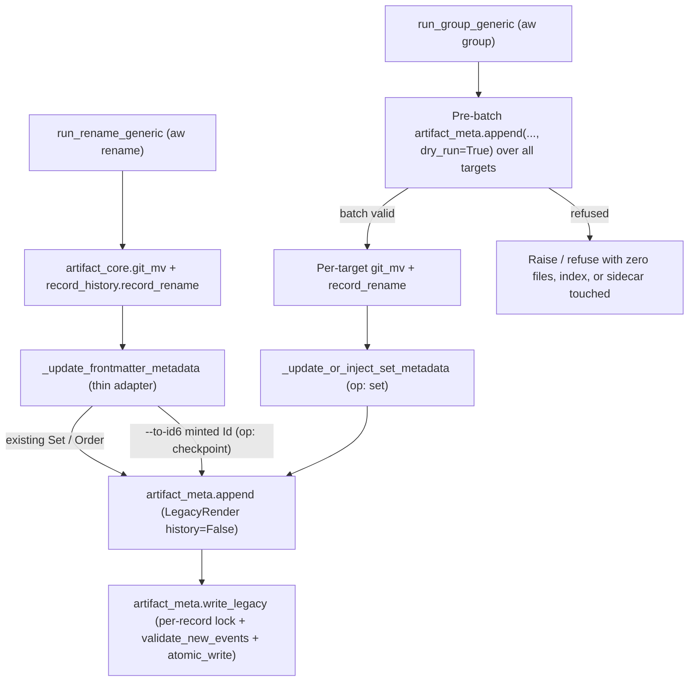

# IPD: Move the artifact_rename field writers onto artifact_meta

- Date: 2026-11-09
- Kind: child
- Concern: Spec `4sd62s` section 7 step 4 requires the rename and regroup verbs to write their metadata edits through `artifact_meta` in phase B, while the file move stays a git move until the cutover. Measured: `agent_workflows/artifact_rename.py` holds 11 hand-built bullet literals. This is the first part of `bsl45u` (itself part of `xexn45`), split 2026-11-09 so each item names one writer function.
- Scope: First capture the family baseline that `bsl45u` compares against (recording its commit SHA, counts, and digest in `F-03` alongside gitignored `.aw/state/bsl45u/family-before.txt`), then move `artifact_rename._update_frontmatter_metadata` (the `aw rename <type>` Set, Order, and `--to-id6` Id edit) and `artifact_rename._update_or_inject_set_metadata` plus `run_group_generic`'s pre-batch validation (the `aw group <type>` Set and Order edit) onto `artifact_meta.append` and `artifact_meta.write_legacy` (`bsl45u` E-01, `artifact_rename` subset). EXCLUDES: `plans_refs` (`fnu6kw`), research shelf verbs (`9gy5jk`), `rename` and path events (`cxxmyv`).
- Scope-Paths: agent_workflows/artifact_rename.py, agent_workflows/artifact_meta.py, .aw/records/plans/pending/20261109-metastore-127-1hfmpb-move-the-artifact-rename-field-writers-onto-artifact-meta.ipd.md
- Item-Dependencies: executed:tve77h, executed:2xwb9b, executed:7yr827
- Status: approved
- Readiness: go-pending-approval
- Review-Depth: complex
- From-Spec: 4sd62s
- Work-Kind: feature
- Priority: high
- Blocks-Release: next
- Set: metastore
- Order: 127
- Highest E allocated: 04
- Author: opencode its_direct/pt3-claude-opus-5.5-1m-us
- Id: 1hfmpb
- Approval: 2026-11-16, recorded via aw ipd set: status set to approved

> Write and proofread this plan per the technical writing standard, `.aw/system/workflows/technical-writing/technical-writing.md` (`.agents/workflows/technical-writing/technical-writing.md` in a legacy-layout install), including requirement 12 (diagrams).

## Workflow history
- 2026-11-16 approved (aw set): status set to approved
- 2026-11-12 reviewed (aw set): APPROVE WITH REVISIONS APPLIED; PR-001..PR-005 FIXED

- 2026-11-12 /plan-review (antigravity/gemini): APPROVE WITH REVISIONS APPLIED; PR-001..PR-005 FIXED; review record .aw/records/reviews/20261109-metastore-127-1hfmpb-move-the-artifact-rename-field-writers-onto-artifact-meta.review.md
- 2026-11-09 to-review (opencode its_direct/pt3-claude-opus-5.5-1m-us): split from bsl45u (round 3, research nj8zdp guidance).
- 2026-11-09 draft (opencode its_direct/pt3-claude-opus-5.5-1m-us): created.

## Goal

The generic rename and regroup verbs edit Set, Order, and `--to-id6` Id only through `artifact_meta`, with owned-field refusals (`4sd62s` AC-15), pre-batch validation, and rename-ledger behavior unchanged.

## Detailed Implementation Checklist (TODO)

Execution-state rule: mark an `E-*` item complete only after performing the action. That mark is not validation. Right-sizing rule: write for a modest executor that cannot hold much in its head. Each E-item is one step (one concern, about one file, executable in one focused pass) and its V-item names each unit it covers with its own check; a plan stays at about 5 E-items and 8 work Scope-Paths, else split it into more child plans (guidance, `IPD-Z603`). Accepted execution states: blocked, failed, pending, performed; terminal gate demands 'performed'.

PIN-FIRST RULE for every "move" item: run the test modules its V-item names GREEN on the unmodified code and save the per-test outcome list under the gitignored `.aw/state/1hfmpb/` (`python3 -m pytest -o addopts="" -m "" -p no:randomly -n 0 -rA <modules> | grep -E "^(PASSED|FAILED|ERROR|SKIPPED|XFAIL|XPASS) " | sed -E 's/ - .*//' | sort > .aw/state/1hfmpb/<E>-before.txt`; `-m ""` includes `slow` modules, `-p no:randomly -n 0` makes the list deterministic, and `-q` is not repeated because `addopts` is cleared); make the move; run the same command into `-after.txt`; `diff` of the two must print nothing, so a test that newly fails, errors or skips is caught, not only a lost PASSED line. An existing assertion may change only when Behavior decisions D-2 and D-4 below name it. New tests set `pytestmark = pytest.mark.core`, build fixtures in `tmp_path`, drive the real CLI or function, and never read production source (AGENTS.md "TEST OUTCOMES, NOT CODE STRUCTURE").

### Task group 1: baseline and artifact_rename writers

- [x] E-01 Before any edit of the rename family, capture the family baseline that `bsl45u` E-02 compares against by running the PIN-FIRST command over `tests/test_rename_ledger.py`, `tests/test_rename_group_machine_output.py`, `tests/test_mutation_result_facts.py`, and `tests/test_artifact_refs_rewrite.py` into `.aw/state/bsl45u/family-before.txt`. Record the pre-edit HEAD commit SHA, total and per-module PASSED counts, and the `sha256` digest of `.aw/state/bsl45u/family-before.txt` in `F-03` below so `bsl45u` E-02 can deterministically regenerate `family-before.txt` when executed in a separate isolated lane worktree. These four modules exercise all three writer modules of the family (`artifact_rename`, `plans_refs`, `research_refs`), so `bsl45u` compares them once after every part completes.
  - Depends on: none
  - Expected outcome: `.aw/state/bsl45u/family-before.txt` exists and lists only PASSED lines across all four modules, and `F-03` records the baseline HEAD SHA, per-module PASSED counts, and `sha256` digest.
  - Execution state: performed

- [x] E-04 Extend `agent_workflows/artifact_meta.py::render_legacy` (plus `_prepare_legacy_events` `legacy_vocab` for `"id"` and `str(value)` formatting for integer `order`) to support the two `artifact_rename` contracts while keeping `op == "set"` strictly refused for `"id"` (`4sd62s` AC-15). First, render `op == "checkpoint"` `"id"` idempotently via `prompts.inject_metadata_id6` on `prompts` (leaving comment-less prompts untouched) and after `- Status:` else `- Date:` with zero H1 fallback (`a88210`) on non-prompts. Second, on `plural == "prompts"` for `op == "set"`, update `<!-- aw-prompt: ... -->` when `prompts.has_metadata_comment` is True, update an existing metadata bullet block before `## ` when False (`test_group_prompts_with_order`), and leave comment-less prose prompts lacking both unchanged.
  - Depends on: E-01
  - Expected outcome: `render_legacy` renders `checkpoint` `"id"`, integer `"order"`, and dual-form `prompts` `op == "set"` edits, `op == "set"` still refuses `"id"`, and `tests/test_artifact_meta_legacy_writer.py` (`7yr827`) plus `tests/test_artifact_meta_legacy_write.py` pass.
  - Execution state: performed

- [x] E-02 Move `agent_workflows/artifact_rename.py::_update_frontmatter_metadata` onto `artifact_meta.append` (`legacy_render=LegacyRender(history=False)`), pinned first under `.aw/state/1hfmpb/` against `tests/test_artifact_rename.py` and `tests/test_spec_id6_filenames.py` (non-binding test pointers in `V-02`). Keep `_update_frontmatter_metadata` as a thin callable adapter (`xexn45` F-08) that leaves `artifact_core.git_mv` and `record_history.record_rename` unchanged (`D-4`) and removes its direct `atomic_write` calls. Emit `op: "set"` (`"set"` as `str`, `"order"` as `int`) ONLY for fields already present in the target file (`_SET_LINE_RE` / `_ORDER_LINE_RE` or `Set:` in `aw-prompt`) so `aw rename` never injects absent `Set`/`Order` bullets, and emit `{"op": "checkpoint", "path": <records_rel_path>, "fields": {"id": id6}}` (plus `"set": set_id` for `prompts` when `set_id` is supplied and absent from its `aw-prompt` comment) when `_read_existing_id6` returns `None`.
  - Depends on: E-04
  - Expected outcome: `_update_frontmatter_metadata` performs zero raw file writes, and `tests/test_artifact_rename.py` and `tests/test_spec_id6_filenames.py` pass before and after with an empty PIN-FIRST diff.
  - Execution state: performed

- [x] E-03 Move `agent_workflows/artifact_rename.py::_update_or_inject_set_metadata` and `run_group_generic`'s apply batch onto `artifact_meta.append` (`legacy_render=LegacyRender(history=False)`), pinned first under `.aw/state/1hfmpb/` against `tests/test_artifact_group.py` (non-binding test pointers in `V-03`). Before `run_group_generic` enters its per-target `artifact_core.git_mv` and `record_history.record_rename` loop, run a pre-flight `artifact_meta.append(..., dry_run=True)` pass over every `(src, dst, order_val)` target in `targets` (validating against `src` on disk before any move) so a refused batch leaves every file, the git index, and the rename ledger untouched. Route `_update_or_inject_set_metadata` through `artifact_meta.append` with `op: "set"` (`"set"` and optional integer `"order"`), removing its raw `atomic_write` call across bullet blocks (`- Date:`-only `walkthroughs` and `roadmaps`), fenced `---` YAML front matter, and dual-form `prompts`.
  - Depends on: E-02
  - Expected outcome: `run_group_generic` validates the entire target batch before the first `git_mv`, `record_rename`, or `write_legacy`, `artifact_rename.py` retains zero raw `atomic_write` or `write_text` calls, and `tests/test_artifact_group.py` passes before and after with an empty PIN-FIRST diff.
  - Execution state: performed

Add further leaves as `- [ ] E-NEW <action>` and run `aw ipd sync` to assign ids.

## Project conventions discovered (Step 0)

- The `artifact_meta` interface names come from Order 02 (`tve77h`) and are used exactly: `artifact_meta.read(id6) -> State`, `append(id6, events, *, expect_seq)`, `create(...)`, `validate_new_events(type, events, *, records_root, migration_import=False)`. In phase B, `append` and `create` render through the one legacy renderer `artifact_meta.write_legacy` (file form, accepting `LegacyTarget` when no `id6` exists yet) and `artifact_meta.render_legacy_text` (string form), both added by `7yr827`.
- Identity ownership (`4sd62s` AC-15, `artifact_meta._check_owned_fields` and `artifact_meta.validate_event`): `op == "set"` and `op == "unset"` unconditionally refuse `"id"`, `"status"`, and `"type"`, whereas `validate_event` allows `"id"` on `op in ("create", "checkpoint")` (`OP_PAYLOAD_SCHEMAS["checkpoint"]` requires `path` relative to `records_root` and optional `fields`).
- UTC history days come from `artifact_core.utc_history_date` (spec `2vev8j` 4.4); atomic replacement is `artifact_core.atomic_write(path, text, *, prefix)`.
- Core tier: `pyproject.toml` marker `core`; modules set `pytestmark = pytest.mark.core`.
- Cite code by SYMBOL (`module.function`) or by a quoted content string, never by a line number alone (advisory `IPD-C801`).
- The rename ledger is `record_history.record_rename`, written by `artifact_rename` and `plans_refs`; the sidecar is gitignored (`.aw/.gitignore` `records/history.jsonl`).
- File moves stay `artifact_core.git_mv` in phase B; section 7: "the writers of path-bearing events start at the cutover commit".

## Findings

| Id | Evidence (measured 2026-11-09 at `3d0ddb845` and re-checked 2026-11-12 at `bbbed0bb4`) | Finding |
|---|---|---|
| F-01 | Raw writes attributed to the enclosing `def` in `agent_workflows/artifact_rename.py`: `_update_frontmatter_metadata` (2 `atomic_write` calls), `_update_or_inject_set_metadata` (1 `atomic_write` call); callers `run_rename_generic`, `run_group_generic`, and direct unit-test caller `tests/test_spec_id6_filenames.py` (`xexn45` F-08) | Two metadata writer functions in `artifact_rename.py`; `apply_reference_rewrites` delegates prose reference rewrites to `artifact_refs` (`4sd62s` N3) and holds zero `atomic_write` calls. |
| F-02 | Pinned-module test counts (`rg -c "^\s*def test_"` at `bbbed0bb4`, non-binding pointers re-derived at execution by the PIN-FIRST command): `test_artifact_rename` 7, `test_spec_id6_filenames` 21, `test_artifact_group` 8; shared baseline: `test_rename_ledger` 13, `test_rename_group_machine_output` 14, `test_mutation_result_facts` 8, `test_artifact_refs_rewrite` 25 (`96 passed` combined) | `artifact_meta._check_owned_fields` refuses `op == "set"` on `"id"` (`AC-15`), `test_group_prompts_with_order` exercises a bullet-header `.prompt.md` fixture, and `run_group_generic` invokes `git_mv` + `record_rename` before `_update_or_inject_set_metadata`, requiring `checkpoint` for `--to-id6` `Id`, dual-form `prompts` `set` fallback, and pre-loop `dry_run=True` batch validation. |
| F-03 | Populated during `E-01` execution: pre-edit HEAD SHA `b4225c3d4bca200e4b3f45d297bd3bd8fcef127f`; total `60` PASSED (`tests/test_rename_ledger.py` 13, `tests/test_rename_group_machine_output.py` 14, `tests/test_mutation_result_facts.py` 8, `tests/test_artifact_refs_rewrite.py` 25); `.aw/state/bsl45u/family-before.txt` `sha256` `a58e0fedfc9185c64dd5418c2c1078a83742f5632791197de2a9ddff672f175b` | `.aw/state/bsl45u/family-before.txt` is gitignored and does not cross isolated lane worktrees; recording the baseline SHA, counts, and digest here lets `bsl45u` E-02 regenerate `family-before.txt` deterministically if run in a separate lane. |

## Behavior decisions (kept behavior where writers disagreed, 4.3)

- D-2 (new bullet position and `prompts` dual-form `set`). KEPT: in place when present; otherwise after `- Status:`, else after `- Id:` (or after `- Date:` for `checkpoint` `Id` injection), else at the end of an existing metadata bullet block before the first `## `; never in the body (`a88210`). On `aw rename`, `Set` and `Order` update only when already present in the file; on `aw group`, `Set` and `Order` update or inject (`D-2`). For `prompts`, `aw-prompt` comments remain authoritative when `prompts.has_metadata_comment` is True, `op == "set"` updates existing metadata bullets when `has_metadata_comment` is False and a bullet block exists (`test_group_prompts_with_order`), and comment-less prose prompts stay byte-unchanged (`ubac5n`). No reader depends on bullet order (`ipd_schema.parse_metadata_block` is order-free).
- D-4 (rename ledger and pre-batch validation). KEPT until the cutover: `record_history.record_rename` still writes the gitignored sidecar and `artifact_core.git_mv` still stages the move, while `run_group_generic` validates the entire batch via `dry_run=True` before the first `git_mv` or `record_rename`. No `rename` event exists in phase B.

## Proposed changes (ordered, validatable)

1. Capture the four-module rename-family baseline into `.aw/state/bsl45u/family-before.txt` and record its commit SHA, counts, and digest in `F-03` (E-01).
2. Extend `artifact_meta.render_legacy` (`checkpoint` `"id"`, integer `order` formatting, and dual-form `prompts` `op == "set"` fallback) while keeping `op == "set"` strictly refused for `"id"` (`AC-15`) (E-04).
3. Move `artifact_rename._update_frontmatter_metadata` onto `artifact_meta.append` (`op: "set"` for existing `Set`/`Order` and `op: "checkpoint"` for newly minted `--to-id6` `Id`) (E-02).
4. Add pre-loop `dry_run=True` batch validation to `artifact_rename.run_group_generic` and move `artifact_rename._update_or_inject_set_metadata` onto `artifact_meta.append` (`op: "set"`) (E-03).

## Deferred / out of scope (with reason)

- The family close-out (the after-run of the four shared rename modules against `.aw/state/bsl45u/family-before.txt`, the D-4 ledger check), and the final gates of the writer move.
  - Carrier: bsl45u

## Scope check

- Over-scope: none.
- Under-scope: none. `agent_workflows/artifact_meta.py` is declared in `- Scope-Paths:` for `checkpoint` `Id` legacy rendering, integer `order` formatting, and dual-form `prompts` `set` fallback (`E-02`, `E-03`).

## Required tests / validation

No new module. Pinned before and after: the modules of V-02 and V-03, plus `F-03` baseline capture in V-01 and raw-write removal check in V-03.

## Spec / documentation sync

None. Implements `4sd62s` section 7 step 4 for `artifact_rename`; no documented behavior changes.

## Open questions

None open. Every question this work raised was resolved before the split or demonstrated from live code during review; the decisions above carry the answers.

## Validation and cross-check (verify before reporting done)

Validation-state rule: inspect evidence in a separate pass. Do not mark a `V-*` item complete from memory or from the matching execution checkmark. Accepted validation results: blocked, failed, pass, pending; terminal gate demands 'pass'. Runtime-demonstration reachability rule: for each `V-*` item demanding the software be observed acting (such as a run, a dispatch, or a transition), as distinct from items demanding a diff, a file's content, or a test result, which are reachable by construction, name the code path that produces the observation or the sibling `E-*` that creates it, else the demand is UNDER-SCOPE.

- [x] V-01 validates E-01
  - Required evidence: paste `wc -l .aw/state/bsl45u/family-before.txt`, `grep -c ^PASSED .aw/state/bsl45u/family-before.txt` (equal counts), `sha256sum .aw/state/bsl45u/family-before.txt`, per-module `grep -c` showing a nonzero PASSED count for each of `tests/test_rename_ledger.py`, `tests/test_rename_group_machine_output.py`, `tests/test_mutation_result_facts.py`, and `tests/test_artifact_refs_rewrite.py`, and confirm `F-03` records the baseline HEAD SHA, counts, and digest.
  - Observed evidence: `wc -l .aw/state/bsl45u/family-before.txt` = `60 .aw/state/bsl45u/family-before.txt`; `grep -c ^PASSED .aw/state/bsl45u/family-before.txt` = `60`; `sha256sum .aw/state/bsl45u/family-before.txt` = `a58e0fedfc9185c64dd5418c2c1078a83742f5632791197de2a9ddff672f175b  .aw/state/bsl45u/family-before.txt`; per-module counts: `tests/test_rename_ledger.py: 13`, `tests/test_rename_group_machine_output.py: 14`, `tests/test_mutation_result_facts.py: 8`, `tests/test_artifact_refs_rewrite.py: 25`; `F-03` records baseline HEAD SHA `b4225c3d4bca200e4b3f45d297bd3bd8fcef127f`, counts (`60` total; `13/14/8/25`), and digest `a58e0fedfc9185c64dd5418c2c1078a83742f5632791197de2a9ddff672f175b`.
  - Result: pass
- [x] V-04 validates E-04
  - Required evidence: paste the pytest summary line for `tests/test_artifact_meta_legacy_writer.py` and `tests/test_artifact_meta_legacy_write.py` (0 failed), plus a one-liner probe confirming `artifact_meta.render_legacy_text` renders `op == "checkpoint"` `"id"` after `- Status:`/`- Date:` and into `aw-prompt` comments, updates `- Set:`/`- Order:` on a bullet-header prompt via `op == "set"`, and raises `ValueError` on `{"op": "set", "fields": {"id": "abc123"}}` (`4sd62s` AC-15).
  - Observed evidence: `python3 -m pytest -o addopts="" -v tests/test_artifact_meta_legacy_writer.py tests/test_artifact_meta_legacy_write.py` -> `0 unlisted slow tests (all tests > 2s are documented in tests/slow_allowlist.txt).` / `40 passed in 3.49s`; one-liner probe on `artifact_meta.render_legacy_text`: `checkpoint_after_status=['- Status: draft', '- Id: abc123']; checkpoint_after_date=['- Date: 2026-07-01', '- Id: def456']; a88210_unchanged=True; checkpoint_prompt='<!-- aw-prompt: Kind: run-once | Id: ghi789 | Set: pset | Status: pending -->'; prompt_bullet_set=['- Id: pr1234', '- Set: newset', '- Order: 5']; set_id_refusal="refuse generic set of identity/status field: 'id'"`.
  - Result: pass
- [x] V-02 validates E-02
  - Required evidence: paste the `diff` of `.aw/state/1hfmpb/E-02-before.txt` and `.aw/state/1hfmpb/E-02-after.txt` (must print nothing), from `-after.txt` the PASSED lines of `tests/test_artifact_rename.py::test_rename_prompts`, `tests/test_artifact_rename.py::test_rename_specs_legacy_timestamp`, `tests/test_spec_id6_filenames.py::test_to_id6_preview_then_apply_injects_and_rewrites`, `tests/test_spec_id6_filenames.py::test_to_id6_idempotent_on_clustered_spec`, and `tests/test_spec_id6_filenames.py::test_prose_only_walkthrough_gets_no_bullet_in_body`, and the equal before/after per-module PASSED counts for both modules.
  - Observed evidence: `diff .aw/state/1hfmpb/E-02-before.txt .aw/state/1hfmpb/E-02-after.txt` printed nothing (`E-02 diff exit: 0`); per-module PASSED counts: `tests/test_artifact_rename.py: before=7 after=7`, `tests/test_spec_id6_filenames.py: before=21 after=21`; named PASSED lines from `.aw/state/1hfmpb/E-02-after.txt` (actual test name for the `test_prose_only_walkthrough_gets_no_bullet_in_body` pointer is `TestToId6DatedLegacyNames::test_bulletless_file_is_renamed_but_gets_no_id_in_its_body`): `PASSED tests/test_artifact_rename.py::TestArtifactRename::test_rename_prompts`, `PASSED tests/test_artifact_rename.py::TestArtifactRename::test_rename_specs_legacy_timestamp`, `PASSED tests/test_spec_id6_filenames.py::TestToId6Rename::test_to_id6_preview_then_apply_injects_and_rewrites`, `PASSED tests/test_spec_id6_filenames.py::TestToId6Rename::test_to_id6_idempotent_on_clustered_spec`, `PASSED tests/test_spec_id6_filenames.py::TestToId6DatedLegacyNames::test_bulletless_file_is_renamed_but_gets_no_id_in_its_body`.
  - Result: pass
- [x] V-03 validates E-03
  - Required evidence: paste the `diff` of `.aw/state/1hfmpb/E-03-before.txt` and `.aw/state/1hfmpb/E-03-after.txt` (must print nothing), from `-after.txt` the equal before/after per-module PASSED count and every test id of `tests/test_artifact_group.py` (including `test_group_prompts_with_order`, `test_group_walkthroughs_injects_set`, and `test_group_roadmaps_injects_set`), and `rg -n "atomic_write\(|write_text\(" agent_workflows/artifact_rename.py` output (must exit 1 with no matches, proving zero raw metadata writes remain in `artifact_rename.py` for `xexn45` E-15).
  - Observed evidence: `diff .aw/state/1hfmpb/E-03-before.txt .aw/state/1hfmpb/E-03-after.txt` printed nothing (`E-03 diff exit: 0`); `tests/test_artifact_group.py` PASSED counts `before=8 after=8`; all lines from `.aw/state/1hfmpb/E-03-after.txt`: `PASSED tests/test_artifact_group.py::TestArtifactGroup::test_group_backlog_metadata_only`, `PASSED tests/test_artifact_group.py::TestArtifactGroup::test_group_backlog_preview_and_apply`, `PASSED tests/test_artifact_group.py::TestArtifactGroup::test_group_comms_is_unsupported`, `PASSED tests/test_artifact_group.py::TestArtifactGroup::test_group_prompts_with_order`, `PASSED tests/test_artifact_group.py::TestArtifactGroup::test_group_releases`, `PASSED tests/test_artifact_group.py::TestArtifactGroup::test_group_roadmaps_injects_set`, `PASSED tests/test_artifact_group.py::TestArtifactGroup::test_group_specs_injects_set`, `PASSED tests/test_artifact_group.py::TestArtifactGroup::test_group_walkthroughs_injects_set`; `rg -n "atomic_write\(|write_text\(" agent_workflows/artifact_rename.py` printed nothing and exited `1`.
  - Result: pass

## Approval and execution gate

- Size assessment: standard
- Cohesion rationale: not required

Execute only after human approval (`Status: approved`) and after every plan in `- Item-Dependencies:` is executed. This part runs first among the `bsl45u` parts, because E-01 captures the family baseline before any rename writer changes. Stop and report without overwriting if `agent_workflows/artifact_meta.py::write_legacy` from `7yr827` is missing or if a concurrent uncommitted edit conflicts with `agent_workflows/artifact_rename.py` or `agent_workflows/artifact_meta.py`.

Scope fence: the paths in `- Scope-Paths:` are a declaration; a needed file outside the fence is edited and then justified at finalize (`--scope-reason`), and a declared path left unmodified is acknowledged (`--scope-ack`). Every move is pin-first: the named existing modules run green on the unmodified code before the move, and an assertion may change only where the Behavior decisions name it.

Honesty rule: run the named modules and the bare core gate `python3 -m pytest`, and paste the ACTUAL summary lines; never claim a result you did not run.

Commits: commit only through `aw commit 1hfmpb -- <paths>`; never `git add -A`, a bare `git add` or `git commit -a`; never push.

Lifecycle transition: the plan moves to `.aw/records/plans/executed/` only through `aw ipd finalize`, never a hand `git mv`, and only after `aw ipd lint --phase pre-transition` conforms and every `V-*` reads `pass` with pasted evidence. When `aw oc run` or `aw agy run` executes the plan, the runner performs the finalize; a hand executor runs `aw ipd finalize 1hfmpb` itself.
