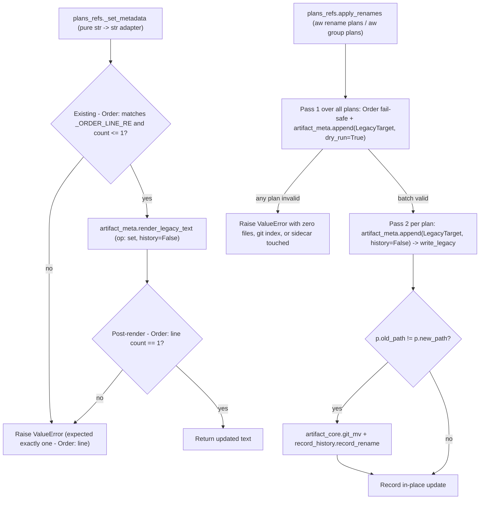

# IPD: Move the plans_refs regroup field writers onto artifact_meta

- Date: 2026-11-09
- Kind: child
- Concern: Spec `4sd62s` section 7 step 4 requires `aw rename plans` and `aw group plans` to write their metadata edits through `artifact_meta` in phase B. Measured: `agent_workflows/plans_refs.py::_set_metadata` holds 4 hand-built bullet literals, written to disk by `agent_workflows/plans_refs.py::apply_renames`. This is part of `bsl45u` (itself part of `xexn45`), split 2026-11-09.
- Scope: Move `agent_workflows/plans_refs.py::_set_metadata` onto `artifact_meta.render_legacy_text` and its caller `agent_workflows/plans_refs.py::apply_renames` onto `artifact_meta.append` and `artifact_meta.write_legacy` with pre-batch `dry_run=True` and `- Order:` grammar validation (`bsl45u` E-01, `plans_refs` subset), and confirm `agent_workflows/plans_archive.py::apply_shard_moves` stays a pure move. EXCLUDES: `artifact_rename` (`1hfmpb`), research shelf verbs (`9gy5jk`), `rename` and path events (`cxxmyv`).
- Scope-Paths: agent_workflows/plans_refs.py, agent_workflows/artifact_meta.py, .aw/records/plans/pending/20261109-metastore-128-fnu6kw-move-the-plans-refs-regroup-field-writers-onto-artifact-meta.ipd.md
- Item-Dependencies: executed:tve77h, executed:2xwb9b, executed:7yr827, executed:1hfmpb
- Status: approved
- Readiness: go-pending-approval
- Review-Depth: complex
- From-Spec: 4sd62s
- Work-Kind: feature
- Priority: high
- Blocks-Release: next
- Set: metastore
- Order: 128
- Highest E allocated: 03
- Author: opencode its_direct/pt3-claude-opus-5.5-1m-us
- Id: fnu6kw
- Approval: 2026-11-16, recorded via aw ipd set: status set to approved

> Write and proofread this plan per the technical writing standard, `.aw/system/workflows/technical-writing/technical-writing.md` (`.agents/workflows/technical-writing/technical-writing.md` in a legacy-layout install), including requirement 12 (diagrams).

## Workflow history
- 2026-11-16 approved (aw set): status set to approved
- 2026-11-14 reviewed (aw set): APPROVE WITH REVISIONS APPLIED; PR-001..PR-005 FIXED

- 2026-11-14 /plan-review (antigravity/gemini): APPROVE WITH REVISIONS APPLIED; PR-001..PR-005 FIXED; review record .aw/records/reviews/20261109-metastore-128-fnu6kw-move-the-plans-refs-regroup-field-writers-onto-artifact-meta.review.md
- 2026-11-09 to-review (opencode its_direct/pt3-claude-opus-5.5-1m-us): split from bsl45u (round 3, research nj8zdp guidance).
- 2026-11-09 draft (opencode its_direct/pt3-claude-opus-5.5-1m-us): created.

## Goal

The plans rename and regroup verbs (`aw rename plans`, `aw group plans`) edit `Set` and `Order` metadata only through `artifact_meta`, `plans_archive.apply_shard_moves` stays a pure git move, and any invalid plan in a batch refuses before any file, git index entry, or rename-ledger record is touched.

## Detailed Implementation Checklist (TODO)

Execution-state rule: mark an `E-*` item complete only after performing the action. That mark is not validation. Right-sizing rule: write for a modest executor that cannot hold much in its head. Each E-item is one step (one concern, about one file, executable in one focused pass) and its V-item names each unit it covers with its own check; a plan stays at about 5 E-items and 8 work Scope-Paths, else split it into more child plans (guidance, `IPD-Z603`). Accepted execution states: blocked, failed, pending, performed; terminal gate demands 'performed'.

PIN-FIRST RULE for every "move" item: run the test modules its V-item names GREEN on the unmodified code and save the per-test outcome list under the gitignored `.aw/state/fnu6kw/` (`python3 -m pytest -o addopts="" -m "" -p no:randomly -n 0 -rA <modules> | grep -E "^(PASSED|FAILED|ERROR|SKIPPED|XFAIL|XPASS) " | sed -E 's/ - .*//' | sort > .aw/state/fnu6kw/<E>-before.txt`; `-m ""` includes `slow` modules, `-p no:randomly -n 0` makes the list deterministic, and `-q` is not repeated because `addopts` is cleared); make the move; run the same command into `-after.txt`; `diff` of the two must print nothing, so a test that newly fails, errors or skips is caught, not only a lost PASSED line. An existing assertion may change only when Behavior decisions D-2 and D-4 below name it. New tests set `pytestmark = pytest.mark.core`, build fixtures in `tmp_path`, drive the real CLI or function, and never read production source (AGENTS.md "TEST OUTCOMES, NOT CODE STRUCTURE").

### Task group 1: plans_refs writers and archive pure-move check

- [x] E-03 Move the pure-string adapter `plans_refs._set_metadata` onto `artifact_meta.render_legacy_text` (`LegacyRender(history=False)`), pinned first under `.aw/state/fnu6kw/` against `tests/test_plans_order_grammar.py` (non-binding test pointers in `V-03`). Keep `_set_metadata(text, *, set_id, order, descriptive=None, plan_name=None) -> str` for direct unit-test callers, emit `op: "set"` with `"set": _set_value(set_id, descriptive)` (`str`) and `"order": order` (`int`, formatted via `str(value)` from `1hfmpb` E-04), and remove all four hand-built `- Set:` and `- Order:` bullet literals. Because `_set_bullet` overwrites any `- Order:` line in place instead of duplicating malformed lines, retain the `yqv6b7` E-03 fail-safe: reject any existing `(?m)^- Order:` line that fails `_ORDER_LINE_RE` (`(?m)^- Order:\s*(-?\d+)\s*$`) or appears more than once, verify exactly one `- Order:` line exists after rendering, and raise `ValueError("plan '<target>': expected exactly one '- Order:' line after metadata update, found ...")` on failure.
  - Depends on: none
  - Expected outcome: `plans_refs._set_metadata` delegates `Set` and `Order` rendering to `artifact_meta.render_legacy_text` with zero hand-built bullet literals, raises `ValueError` on malformed, duplicate, or uninjected `- Order:` lines, and passes `tests/test_plans_order_grammar.py` with an empty PIN-FIRST diff.
  - Execution state: performed

- [x] E-01 Move `plans_refs.apply_renames` onto `artifact_meta.append` (`LegacyRender(history=False)`), pinned first under `.aw/state/fnu6kw/` against `tests/test_plans_group_order_preservation.py` and `tests/test_plans_order_grammar.py` (`bsl45u` E-01, non-binding test pointers in `V-01`). Construct a `LegacyTarget` with each plan's source path, `"plans"`, and `id6` (rather than passing bare `id6`) so untracked test fixtures and legacy `.agents` plan trees (`4sd62s` C12) bypass SQLite cache lookup. Run a first-pass validation over every plan in `plans` (verifying both the `- Order:` fail-safe of `E-03` and `artifact_meta.append(..., dry_run=True)`) before the second pass calls `artifact_meta.append` on the source path followed by conditional `artifact_core.git_mv` and `record_history.record_rename` (`D-4`), removing the sole `atomic_write` call in `apply_renames`.
  - Depends on: E-03
  - Expected outcome: `apply_renames` validates the entire batch before touching any file, git index entry, or rename-ledger record, zero `atomic_write` or `write_text` calls remain in `plans_refs`, and both pinned modules pass before and after with an empty PIN-FIRST diff.
  - Execution state: performed

- [x] E-02 Confirm `plans_archive.apply_shard_moves` stays a pure `artifact_core.git_mv` move in phase B (writing zero path or metadata events per `4sd62s` section 7): run the PIN-FIRST command over `tests/test_plans_archive.py` (non-binding pointer: `tests/test_plans_archive.py::ShardMoveTests::test_move_is_tracked_git_rename`) under `.aw/state/fnu6kw/` before and after `E-03` and `E-01`, and verify `agent_workflows/plans_archive.py::apply_shard_moves` is unmodified.
  - Depends on: E-01
  - Expected outcome: `tests/test_plans_archive.py` passes before and after with an empty PIN-FIRST diff, and `git diff --stat agent_workflows/plans_archive.py` prints nothing.
  - Execution state: performed

Add further leaves as `- [ ] E-NEW <action>` and run `aw ipd sync` to assign ids.

## Project conventions discovered (Step 0)

- The `artifact_meta` interface names come from Order 02 (`tve77h`) and are used exactly: `artifact_meta.read(id6) -> State`, `append(id6, events, *, expect_seq)`, `create(...)`, `validate_new_events(type, events, *, records_root, migration_import=False)`. In phase B, `append` and `create` render through the one legacy renderer `artifact_meta.write_legacy` (file form, accepting `LegacyTarget` when bypassing SQLite cache lookup) and `artifact_meta.render_legacy_text` (pure string form), both added by `7yr827` and extended with integer `order` formatting by `1hfmpb` E-04.
- Field schema (`tve77h` `REGISTRY["ipd"]`): `"set"` has `value_type == "string"` (`_set_value(set_id, descriptive)`) and `"order"` has `value_type == "integer"` (`int`, never `str`).
- UTC history days come from `artifact_core.utc_history_date` (spec `2vev8j` 4.4); atomic replacement is `artifact_core.atomic_write(path, text, *, prefix)`; per-record locking is `platform_lock.held`.
- Core tier: `pyproject.toml` marker `core`; modules set `pytestmark = pytest.mark.core`.
- Cite code by SYMBOL (`module.function`) or by a quoted content string, never by a line number alone (advisory `IPD-C801`).
- The rename ledger is `record_history.record_rename`, written by `artifact_rename` and `plans_refs`; the sidecar is gitignored (`.aw/.gitignore` `records/history.jsonl`).
- File moves stay `artifact_core.git_mv` in phase B; `4sd62s` section 7: "the writers of path-bearing events start at the cutover commit".

## Findings

| Id | Evidence (measured 2026-11-09 at `3d0ddb845` and re-checked 2026-11-14 at `01c564538`) | Finding |
|---|---|---|
| F-01 | `rg -n "_set_metadata\(" agent_workflows/plans_refs.py`: pure `str -> str` def (`plans_refs._set_metadata`) called by `plans_refs.apply_renames` and directly by `tests/test_plans_order_grammar.py`; `rg -n "atomic_write\(|write_text\(" agent_workflows/plans_refs.py agent_workflows/plans_archive.py`: 1 `atomic_write` in `plans_refs.apply_renames`, 0 in `plans_archive.apply_shard_moves` (2 `write_text` in `plans_archive._refresh_index` manifest generation only) | `_set_metadata` requires `artifact_meta.render_legacy_text` (`str -> str`), `apply_renames` requires `LegacyTarget` + pre-batch `dry_run=True` + `artifact_meta.append`, and `plans_archive.apply_shard_moves` stays untouched. |
| F-02 | Pinned-module test counts (`rg -c "^\s*def test_"` at `01c564538`, non-binding pointers re-derived at execution by the PIN-FIRST command): `test_plans_group_order_preservation` 8, `test_plans_order_grammar` 12, `test_plans_archive` 15 (`ShardMoveTests`, `ArchiveVerbTests`, `DefaultAgeTests`); shared rename modules: 60 (`95 passed` combined) | `artifact_meta._set_bullet` overwrites malformed `- Order: x1` lines in place rather than duplicating them, so `_set_metadata` and `apply_renames` must explicitly enforce the `_ORDER_LINE_RE` + single-line post-check fail-safe (`yqv6b7` E-03) to preserve `test_set_metadata_raises_on_unmatchable_order_line` and `test_forced_raise_in_apply_renames_leaves_batch_unmoved_and_unchanged`. |

## Behavior decisions (kept behavior where writers disagreed, 4.3)

- D-2 (new bullet position and `- Order:` fail-safe). KEPT: in place when present; otherwise after `- Status:`, else after `- Id:`, else at the end of an existing metadata bullet block before the first `## ` (covering `- Author:`-only headers); never in the body when no bullet block exists (`a88210`). When an input carries a malformed or duplicate `- Order:` line or lacks any metadata bullet block so `- Order:` cannot be injected, `_set_metadata` and `apply_renames` raise `ValueError("plan '<target>': expected exactly one '- Order:' line after metadata update, found ...")` (`yqv6b7` E-03). No reader depends on bullet order (`ipd_schema.parse_metadata_block` is order-free).
- D-4 (rename ledger and pre-batch validation). KEPT until the cutover: `record_history.record_rename` still writes the gitignored sidecar and `artifact_core.git_mv` still stages the move, after `apply_renames` validates every plan in `plans` via the `- Order:` fail-safe and `artifact_meta.append(..., dry_run=True)` before the first write or move. No `rename` event exists in phase B.

## Proposed changes (ordered, validatable)

1. Move `plans_refs._set_metadata` onto `artifact_meta.render_legacy_text` while keeping its pure `str -> str` signature and `yqv6b7` E-03 `- Order:` fail-safe (E-03).
2. Move `plans_refs.apply_renames` onto `artifact_meta.append` (`LegacyTarget`, `LegacyRender(history=False)`) with pre-batch `dry_run=True` + `- Order:` validation and zero remaining raw `atomic_write` calls (E-01).
3. Confirm `plans_archive.apply_shard_moves` stays a pure `artifact_core.git_mv` move with `agent_workflows/plans_archive.py::apply_shard_moves` unmodified (E-02).

## Deferred / out of scope (with reason)

- The family close-out (the after-run of the four shared rename modules against `.aw/state/bsl45u/family-before.txt` and `1hfmpb` `F-03`, plus the D-4 ledger check), and the final gates of the writer move.
  - Carrier: bsl45u

## Scope check

- Over-scope: none. `agent_workflows/artifact_meta.py` (`write_legacy`, `render_legacy_text`) is declared in `- Scope-Paths:` because `7yr827` and `1hfmpb` E-04 own the phase-B legacy renderer; acknowledge `agent_workflows/artifact_meta.py` via `--scope-ack` at finalize when unmodified.
- Under-scope: none. `agent_workflows/plans_archive.py::apply_shard_moves` is deliberately NOT declared in `- Scope-Paths:` because it stays a pure move (`E-02`).

## Required tests / validation

No new module. Pinned before and after: `tests/test_plans_order_grammar.py` (`V-03`, `V-01`), `tests/test_plans_group_order_preservation.py` (`V-01`), and `tests/test_plans_archive.py` (`V-02`), plus the zero-match raw-write audit on `agent_workflows/plans_refs.py::apply_renames` (`V-01`, feeding `xexn45` E-15 and `4sd62s` AC-34).

## Spec / documentation sync

None. Implements `4sd62s` section 7 step 4 (`C1`, `C10a`, `C12`, `AC-34`) for `plans_refs`; no documented user-visible behavior changes.

## Open questions

None open. Every question this work raised was resolved before the split or demonstrated from live code during review; the decisions above carry the answers.

## Validation and cross-check (verify before reporting done)

Validation-state rule: inspect evidence in a separate pass. Do not mark a `V-*` item complete from memory or from the matching execution checkmark. Accepted validation results: blocked, failed, pass, pending; terminal gate demands 'pass'. Runtime-demonstration reachability rule: for each `V-*` item demanding the software be observed acting (such as a run, a dispatch, or a transition), as distinct from items demanding a diff, a file's content, or a test result, which are reachable by construction, name the code path that produces the observation or the sibling `E-*` that creates it, else the demand is UNDER-SCOPE.

- [x] V-03 validates E-03
  - Required evidence: paste the `diff` of `.aw/state/fnu6kw/E-03-before.txt` and `.aw/state/fnu6kw/E-03-after.txt` (must print nothing), from `-after.txt` the PASSED lines of `tests/test_plans_order_grammar.py::test_set_metadata_substitutes_negative_order_in_place` and `tests/test_plans_order_grammar.py::test_set_metadata_raises_on_unmatchable_order_line` and the equal before/after PASSED count of `tests/test_plans_order_grammar.py`, plus `rg -n "^-\s*(Set|Order):" agent_workflows/plans_refs.py` or `rg -n "\"- (Set|Order):" agent_workflows/plans_refs.py` confirming zero hand-built `- Set:` or `- Order:` bullet literals remain in `plans_refs._set_metadata`.
  - Observed evidence: `diff .aw/state/fnu6kw/E-03-before.txt .aw/state/fnu6kw/E-03-after.txt` printed nothing (`E-03 diff exit=0`); `tests/test_plans_order_grammar.py` PASSED counts `before=12 after=12`; named lines from `.aw/state/fnu6kw/E-03-after.txt`: `PASSED tests/test_plans_order_grammar.py::test_set_metadata_substitutes_negative_order_in_place`, `PASSED tests/test_plans_order_grammar.py::test_set_metadata_raises_on_unmatchable_order_line`; `rg -n "^-\s*(Set|Order):" agent_workflows/plans_refs.py` printed nothing (`rg1_exit=1`) and `rg -n "\"- (Set|Order):" agent_workflows/plans_refs.py` printed nothing (`rg2_exit=1`).
  - Result: pass
- [x] V-01 validates E-01
  - Required evidence: paste the `diff` of `.aw/state/fnu6kw/E-01-before.txt` and `.aw/state/fnu6kw/E-01-after.txt` (must print nothing), from `-after.txt` the PASSED lines of `tests/test_plans_order_grammar.py::test_forced_raise_in_apply_renames_leaves_batch_unmoved_and_unchanged`, `tests/test_plans_group_order_preservation.py::test_bare_rename_regroup_preserves_a_child_order`, `tests/test_plans_group_order_preservation.py::test_bare_metadata_only_regroup_preserves_a_child_order`, and `tests/test_plans_group_order_preservation.py::test_mv_preserves_order_date_and_adds_facet`, the equal before/after per-module PASSED counts of `tests/test_plans_group_order_preservation.py` and `tests/test_plans_order_grammar.py`, and `rg -n "atomic_write\(|write_text\(" agent_workflows/plans_refs.py` output (must exit 1 with zero matches, proving zero raw writes remain in `plans_refs.py` for `xexn45` E-15).
  - Observed evidence: `diff .aw/state/fnu6kw/E-01-before.txt .aw/state/fnu6kw/E-01-after.txt` printed nothing (`E-01 diff exit=0`); per-module PASSED counts: `tests/test_plans_group_order_preservation.py: before=8 after=8`, `tests/test_plans_order_grammar.py: before=12 after=12`; named lines from `.aw/state/fnu6kw/E-01-after.txt`: `PASSED tests/test_plans_order_grammar.py::test_forced_raise_in_apply_renames_leaves_batch_unmoved_and_unchanged`, `PASSED tests/test_plans_group_order_preservation.py::test_bare_rename_regroup_preserves_a_child_order`, `PASSED tests/test_plans_group_order_preservation.py::test_bare_metadata_only_regroup_preserves_a_child_order`, `PASSED tests/test_plans_group_order_preservation.py::test_mv_preserves_order_date_and_adds_facet`; `rg -n "atomic_write\(|write_text\(" agent_workflows/plans_refs.py` printed nothing and exited `1` (`rg3_exit=1`).
  - Result: pass
- [x] V-02 validates E-02
  - Required evidence: paste the `diff` of `.aw/state/fnu6kw/E-02-before.txt` and `.aw/state/fnu6kw/E-02-after.txt` (must print nothing), from `-after.txt` the equal before/after PASSED count of `tests/test_plans_archive.py` and the PASSED line of `tests/test_plans_archive.py::ShardMoveTests::test_move_is_tracked_git_rename`, and the empty output of `git diff --stat agent_workflows/plans_archive.py`.
  - Observed evidence: `diff .aw/state/fnu6kw/E-02-before.txt .aw/state/fnu6kw/E-02-after.txt` printed nothing (`E-02 diff exit=0`); `tests/test_plans_archive.py` PASSED counts `before=15 after=15`; named line from `.aw/state/fnu6kw/E-02-after.txt`: `PASSED tests/test_plans_archive.py::ShardMoveTests::test_move_is_tracked_git_rename`; `git diff --stat agent_workflows/plans_archive.py` printed nothing (`archive_diff_exit=0`).
  - Result: pass

## Approval and execution gate

- Size assessment: standard
- Cohesion rationale: not required

Execute only after human approval (`Status: approved`) and after every plan in `- Item-Dependencies:` is executed. Stop and report without overwriting if `agent_workflows/artifact_meta.py::write_legacy` or `agent_workflows/artifact_meta.py::render_legacy_text` from `7yr827` (or integer `order` rendering from `1hfmpb` E-04) is missing, or if an unresolvable concurrent uncommitted edit conflicts with `agent_workflows/plans_refs.py` or `agent_workflows/artifact_meta.py`.

Scope fence: the paths in `- Scope-Paths:` are a declaration; a needed file outside the fence is edited and then justified at finalize (`--scope-reason`), and a declared path left unmodified is acknowledged (`--scope-ack`). Every move is pin-first: the named existing modules run green on the unmodified code before the move, and an assertion may change only where Behavior decisions D-2 and D-4 name it.

Honesty rule: run the named modules and the bare core gate `python3 -m pytest`, and paste the ACTUAL summary lines; never claim a result you did not run.

Commits: commit only through `aw commit fnu6kw -- <paths>`; never `git add -A`, a bare `git add` or `git commit -a`; never push.

Lifecycle transition: the plan moves to `.aw/records/plans/executed/` only through `aw ipd finalize`, never a hand `git mv`, and only after `aw ipd lint --phase pre-transition` conforms and every `V-*` reads `pass` with pasted evidence. When `aw oc run` or `aw agy run` executes the plan, the runner performs the finalize; a hand executor runs `aw ipd finalize fnu6kw` itself.
