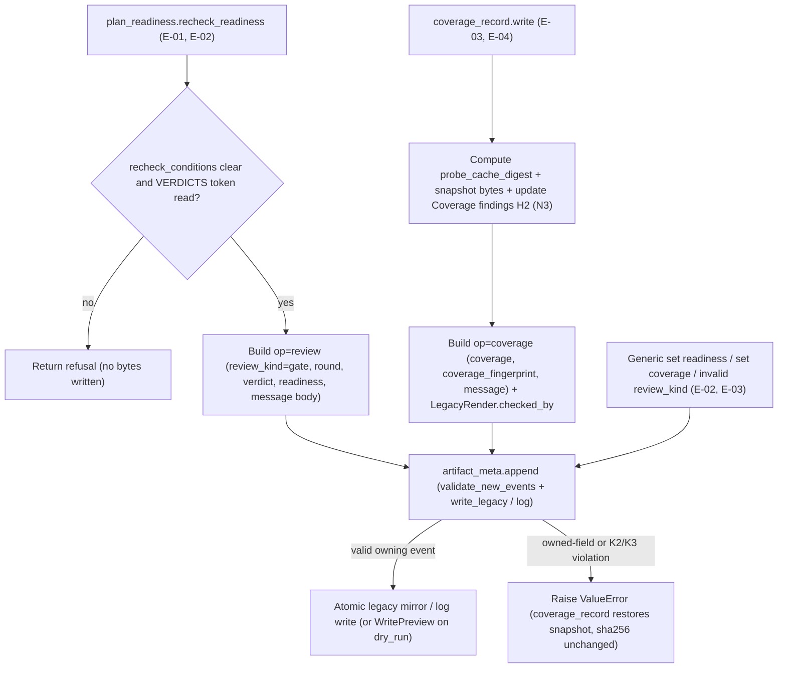

# IPD: Move the readiness re-check and coverage writers onto artifact_meta

- Date: 2026-11-09
- Kind: child
- Concern: Spec `4sd62s` 4.4 requires the readiness re-check to write one gate `review` event and the coverage record to write one `op: coverage` event so `readiness` and `coverage` are written only by their owning events (`4sd62s` AC-15, AC-14a). Measured at `3d0ddb845`: 61 history lines contain `readiness re-check` and 39 plans carry `- Coverage:` (`xexn45` F-06). Split 2026-11-09 from `8q27jt` (itself split from `xexn45`) so each item names one writer.
- Scope: Move `agent_workflows/plan_readiness.py::recheck_readiness` (`8q27jt` E-01) and `agent_workflows/coverage_record.py::write` (`8q27jt` E-02) onto `agent_workflows/artifact_meta.py::append`, decouple `- Coverage-Checked:` model attribution from `LegacyRender.actor_label` in `agent_workflows/artifact_meta.py`, and create `tests/test_writers_obligations.py` with the `4sd62s` AC-15 (1)-(3) and AC-14a (1)-(2) readiness and coverage refusal cases, which `xexn45` E-13 extends. EXCLUDES: finalize scope fields (`9qhtrc`, `1dvb08`), retirement (`8q27jt`), and the `status_set` engine (`2xwb9b`).
- Scope-Paths: agent_workflows/plan_readiness.py, agent_workflows/readiness_recheck.py, agent_workflows/coverage_record.py, agent_workflows/artifact_meta.py, tests/test_writers_obligations.py, .aw/records/plans/pending/20261109-metastore-130-d4w53g-move-the-readiness-re-check-and-coverage-writers-onto-artifa.ipd.md
- Item-Dependencies: executed:tve77h, executed:2xwb9b, executed:7yr827
- Status: approved
- Readiness: go-pending-approval
- Review-Depth: complex
- From-Spec: 4sd62s
- Work-Kind: feature
- Priority: high
- Blocks-Release: next
- Set: metastore
- Order: 130
- Highest E allocated: 04
- Author: opencode its_direct/pt3-claude-opus-5.5-1m-us
- Id: d4w53g
- Approval: 2026-11-16, recorded via aw ipd set: status set to approved

> Write and proofread this plan per the technical writing standard, `.aw/system/workflows/technical-writing/technical-writing.md` (`.agents/workflows/technical-writing/technical-writing.md` in a legacy-layout install), including requirement 12 (diagrams).

## Workflow history
- 2026-11-16 approved (aw set): status set to approved

- 2026-11-13 reviewed (aw set): APPROVE WITH REVISIONS APPLIED; PR-001..PR-006 FIXED
- 2026-11-13 /plan-review (antigravity/gemini): APPROVE WITH REVISIONS APPLIED; PR-001..PR-006 FIXED; review record .aw/records/reviews/20261109-metastore-130-d4w53g-move-the-readiness-re-check-and-coverage-writers-onto-artifa.review.md
- 2026-11-09 to-review (opencode its_direct/pt3-claude-opus-5.5-1m-us): split from 8q27jt (round 3, research nj8zdp guidance).
- 2026-11-09 draft (opencode its_direct/pt3-claude-opus-5.5-1m-us): created.

## Goal

The readiness re-check (`aw ipd recheck-readiness`) and the orchestrator coverage writer (`coverage_record.write`) write through `artifact_meta.append` as their owning `review` (`review_kind: "gate"`) and `coverage` events, and generic `set readiness`, `set coverage`, and invalid-kind `review` payloads are refused with zero bytes written.

## Detailed Implementation Checklist (TODO)

Execution-state rule: mark an `E-*` item complete only after performing the action. That mark is not validation. Right-sizing rule: write for a modest executor that cannot hold much in its head. Each E-item is one step (one concern, about one file, executable in one focused pass) and its V-item names each unit it covers with its own check; a plan stays at about 5 E-items and 8 work Scope-Paths, else split it into more child plans (guidance, `IPD-Z603`). Accepted execution states: blocked, failed, pending, performed; terminal gate demands 'performed'.

PIN-FIRST RULE for every "move" item: re-derive the per-test outcome list at execution time on the unmodified code and save it under the gitignored `.aw/state/d4w53g/` (`python3 -m pytest -o addopts="" -m "" -p no:randomly -n 0 -rA <modules> | grep -E "^(PASSED|FAILED|ERROR|SKIPPED|XFAIL|XPASS) " | sed -E 's/ - .*//' | sort > .aw/state/d4w53g/<E>-before.txt`; `-m ""` includes `slow` modules, `-p no:randomly -n 0` makes the list deterministic, and `-q` is not repeated because `addopts` is cleared); make the move; run the same command into `-after.txt`; `diff` of the two must print nothing, so any test that newly fails, errors, or skips is caught, not only a lost PASSED line (collected test counts noted in `F-01` and `F-02` are non-binding authoring-time context). An existing assertion may change only when the Behavior decisions below name it. New tests set `pytestmark = pytest.mark.core`, build fixtures in `tmp_path`, drive the real CLI or function, and never read production source (AGENTS.md "TEST OUTCOMES, NOT CODE STRUCTURE").

### Task group 1: readiness re-check

- [ ] E-01 Move `agent_workflows/plan_readiness.py::recheck_readiness` (`aw ipd recheck-readiness`, driven via `agent_workflows/readiness_recheck.py::run_recheck_readiness`) onto `agent_workflows/artifact_meta.py::append` as ONE gate `review` event (`4sd62s` 4.4, 4.1a K2), pinned first under `.aw/state/d4w53g/E-01-{before,after}.txt`. Build `{"op": "review", "review_kind": "gate", "round": round_num, "verdict": verdict_token, "readiness": RECHECK_TARGET_READINESS, "message": msg_body}` (plus `"review_ref"` as the repo-relative POSIX path when `review_findings.subject_review_files(repo_root, id6)` resolves a conforming review file inside `repo_root`, setting `round_num` to its latest round number and `1` otherwise). Read `RECHECK_TARGET_READINESS` dynamically at call time (never caller input and never a literal baked at import) and keep `_READINESS_LINE_SUB_RE` defined on `plan_readiness` so the widened-writer falsification pins stay live. Factor `_format_recheck_history_message` so `ev["message"]` carries ONLY the body after `- <date> readiness re-check (<actor>): ` while `format_recheck_history_entry` still returns the full bullet `- <date> readiness re-check (<actor>): <msg_body>` (preventing `LegacyRender(tag="readiness re-check", day=resolved_date, actor_label=actor, history=True)` from double-prefixing the history line). Call `artifact_meta.append(LegacyTarget(plan_path, "plans", id6), [event], actor={"tool": "aw ipd recheck-readiness"}, legacy_render=render, repo_root=repo_root, project_context=artifact_meta.legacy_context(repo_root), dry_run=not apply)`, re-verify `read_readiness(result.text) == RECHECK_TARGET_READINESS` before returning `(res, result.text)`, and keep `dry_run` (`apply=False`) side-effect-free. Pinned modules (re-derived at execution; non-binding pointers in parentheses): `tests/test_plan_readiness_recheck.py` (`test_the_only_permitted_write_is_no_go_to_go_pending_approval`, `test_apply_writes_exactly_the_readiness_line_and_one_history_record`, `test_the_recheck_CLEARS_once_the_stale_finding_is_closed`), `tests/test_review_record_classifier.py`, and `tests/test_read_verb_zero_match_refusal.py`.
  - Depends on: none
  - Expected outcome: `recheck_readiness` writes solely through `artifact_meta.append` (`dry_run=not apply`) with no double-prefixed history line, and the PIN-FIRST before/after outcome diff across all three pinned modules is empty.
  - Execution state: pending

- [ ] E-02 Enforce the `4sd62s` 4.1a K2 verdict precondition in `agent_workflows/plan_readiness.py::recheck_conditions` (`8q27jt` E-01, Behavior decision D-3) and create core test module `tests/test_writers_obligations.py` (`xexn45` E-13 extends this file). In `recheck_conditions`, `newest_verdict` returns `(polarity, entry)` and `classify_verdict(entry)` reads `(verdict_token, _)`; hold `C_NEGATIVE_VERDICT` (failing closed rather than minting or omitting `verdict`) whenever `entry is None` or `verdict_token is None` (not in `plan_readiness.VERDICTS`), while keeping `agent_workflows/readiness_recheck.py::_run_stale_findings` and `review_findings.append_round_resolving_stale` as `.review.md` body text edits (`4sd62s` N3). In `tests/test_writers_obligations.py` (`pytestmark = pytest.mark.core`, real `tmp_path` fixtures, zero source inspection), add the `4sd62s` AC-15 (1)-(2), AC-14a (1)-(2), and K2 readiness cases: (a) `op: "set"` with `fields={"readiness": "go"}` (alone and paired with a `review` event) through `artifact_meta.append` raises `ValueError` and leaves target plan `sha256` identical; (b) a `gate` `review` event carrying a refinement verdict (`AC-14a` case 1) and a `refinement` `review` event carrying `readiness` (`AC-14a` case 2) are both refused by `artifact_meta.append` with unchanged `sha256`; (c) `recheck_readiness` refuses a `no-go` plan whose `## Workflow history` contains no `plan_readiness.VERDICTS` token with unchanged `sha256`, while a qualifying `no-go` plan writes `- Readiness: go-pending-approval`.
  - Depends on: E-01
  - Expected outcome: all readiness, `AC-14a` (1)-(2), and missing-verdict-token refusal cases in `tests/test_writers_obligations.py` pass with unchanged `sha256` on every refusal, and `tests/test_plan_readiness_recheck.py` keeps an identical outcome list.
  - Execution state: pending

### Task group 2: coverage record

- [ ] E-04 In `agent_workflows/artifact_meta.py`, decouple `- Coverage-Checked:` model attribution from the `## Workflow history` tool label on `op == "coverage"` legacy renders (`LegacyRender` and `render_legacy`/`write_legacy`, Behavior decision D-4). Add optional `checked_by: Optional[str] = None` on `LegacyRender` and render `- Coverage-Checked: {render.day} by {checked_by_label}` using `render.checked_by or ev.get("actor", {}).get("model") or render.actor_label`, while keeping the `## Workflow history` bullet as `- {render.day} {render.tag} ({render.actor_label}): {msg}`. Existing `LegacyRender("same-status", DAY, "model-x", history=False)` callers in `tests/test_artifact_meta_legacy_write.py` and `tests/test_artifact_meta_legacy_writer.py` (`7yr827`) continue to render `- Coverage-Checked: <DAY> by model-x`, while `coverage_record.write` can set `actor_label=<tool>` and `checked_by=<model|host-default>` independently.
  - Depends on: none
  - Expected outcome: `op == "coverage"` renders `- Coverage-Checked: <day> by <checked_by>` and `- <day> coverage <verdict> (<actor_label>): <msg>` independently, and `tests/test_artifact_meta_legacy_write.py` (plus `tests/test_artifact_meta_legacy_writer.py` when present after `7yr827`) passes unchanged.
  - Execution state: pending

- [ ] E-03 Move `agent_workflows/coverage_record.py::write` onto `agent_workflows/artifact_meta.py::append` as ONE `op: "coverage"` event carrying `coverage` and `coverage_fingerprint` (`4sd62s` 4.4), pinned first under `.aw/state/d4w53g/E-03-{before,after}.txt`. Compute `fingerprint` (`probe_cache_digest`) before any mutation; normalize `clean_model = "" if not model or model == "host-default" else model` (`hist_model = clean_model or "by host-default"`), update or remove the `## Coverage findings` H2 body section (`4sd62s` N3), and call `append(LegacyTarget(path, "plans", id6_or_none), [{"op": "coverage", "coverage": verdict, "coverage_fingerprint": fingerprint, "message": f"fingerprint {fingerprint[:12]}, model {hist_model}"}], actor={"tool": tool_str, **({"model": clean_model} if clean_model else {})}, legacy_render=LegacyRender(tag=f"coverage {verdict}", day=today, actor_label=tool_str, checked_by=clean_model or "host-default", history=True), repo_root=resolved_repo, project_context=...)`. Resolve `resolved_repo` via the Step 0 owner-root fallback (`repo` else owner root else the plan's parent directory) so standalone `tmp_path` plans outside `.aw/records/` never create lock files in the caller's working directory, and restore the pre-call file bytes if `append` raises so errors return `CoverageWriteResult(written=False, committed=False, detail=...)` with zero partial write. Add the `4sd62s` AC-15 (3) coverage case to `tests/test_writers_obligations.py`: `op: "set"` with `fields={"coverage": "pass"}` is refused with unchanged `sha256`, while `write` succeeds and round-trips through `read`. Pinned modules (re-derived at execution; non-binding pointers in parentheses): `tests/test_coverage_record.py` (`test_write_and_read_fail`, `test_write_pass_removes_findings_and_lints_conforming`, `test_checklist_edit_makes_is_current_false`), `tests/test_coverage_not_written.py`, `tests/test_history_date_clock_residual.py` (`test_coverage_record_write_records_utc_date`), `tests/test_orchestrator_readiness.py`, and `tests/test_gradcover_end_to_end.py`.
  - Depends on: E-02, E-04
  - Expected outcome: the PIN-FIRST before/after outcome diff across all five pinned modules is empty, failed writes restore pre-call bytes and return `CoverageWriteResult(written=False, ...)`, and the `AC-15` (3) coverage refusal and round-trip case in `tests/test_writers_obligations.py` passes.
  - Execution state: pending

Add further leaves as `- [ ] E-NEW <action>` and run `aw ipd sync` to assign ids.

## Project conventions discovered (Step 0)

- The `artifact_meta` interface names come from Order 02 (`tve77h`) and are used verbatim: `artifact_meta.read(id6) -> State`, `append(target, events, *, expect_seq=None, ...)`, `create(...)`, and `validate_new_events(type, events, *, records_root, migration_import=False)`. In phase B, `append` and `create` render through the shared legacy writer `agent_workflows/artifact_meta.py::write_legacy` (file form, with `append_legacy` as compatibility delegate) and `render_legacy_text` (string form), completed by Order 21 (`7yr827`).
- `OP_PAYLOAD_SCHEMAS["review"]` (`agent_workflows/artifact_meta.py`) requires `"round": (int, True)` and `"review_kind": (str, True)` (`"gate"` or `"refinement"`); `OP_PAYLOAD_SCHEMAS["coverage"]` requires `"coverage": (str, True)` and `"coverage_fingerprint": (str, True)`.
- Direct-path callers pass `LegacyTarget(path, "plans", id6_or_none)` (`id6_or_none = None` hashes `path` to a `path-<12hex>` lock key for standalone fixtures without `- Id:`) and resolve `repo_root` via `agent_workflows/project_context.py::record_owner_root` before falling back to `path.parent` (`agent_workflows/status_set.py`).
- UTC history days come from `agent_workflows/artifact_core.py::utc_history_date` (spec `2vev8j` 4.4); atomic replacement is `agent_workflows/artifact_core.py::atomic_write(path, text, *, prefix)`.
- Core tier: `pyproject.toml` marker `core`; new core test modules set `pytestmark = pytest.mark.core`.
- Cite code by symbol (`path::Symbol`) or by a quoted content string, never by a line number alone (advisory `IPD-C801`).

## Findings

| Id | Evidence (measured 2026-11-09 at `3d0ddb845` and verified 2026-11-13 at `08d16fb76`) | Finding |
|---|---|---|
| F-01 | Readiness move surface: `agent_workflows/plan_readiness.py::recheck_readiness`, `recheck_conditions`, `newest_verdict`, `classify_verdict`, `format_recheck_history_entry` (which returns `- {date} readiness re-check ({actor}): ...`), `OP_PAYLOAD_SCHEMAS["review"]["round"] = (int, True)`, 3 pinned modules (non-binding authoring-time counts: `test_plan_readiness_recheck` 40, `test_review_record_classifier` 13, `test_read_verb_zero_match_refusal` 11), plus `4sd62s` AC-15 (1)-(2) and AC-14a (1)-(2) | Split into the `recheck_readiness` event move with unprefixed `ev["message"]` and required `round` (`E-01`) and the K2 missing-verdict-token refusal rule plus `tests/test_writers_obligations.py` readiness and `AC-14a` cases (`E-02`). |
| F-02 | Coverage move surface: `agent_workflows/coverage_record.py::write`, `agent_workflows/artifact_meta.py::render_legacy` (which used `render.actor_label` for both `- Coverage-Checked: <day> by ...` and `(<tool>)` in history), 5 pinned modules (non-binding authoring-time counts: `test_coverage_record` 7, `test_coverage_not_written` 8, `test_history_date_clock_residual` 2 passed / 2 skipped, `test_orchestrator_readiness` 24, `test_gradcover_end_to_end` 5), plus `4sd62s` AC-15 (3) | Decouple `LegacyRender.checked_by` from `LegacyRender.actor_label` in `artifact_meta.py` (`E-04`) before moving `coverage_record.write` and adding the `AC-15` (3) refusal case (`E-03`). |

## Behavior decisions (kept behavior where writers disagreed, `4sd62s` 4.3)

- D-2 (new bullet position, `4sd62s` 4.3). KEPT: replace in place when present; otherwise insert after `- Status:`, else after `- Id:`, else at the end of an existing metadata bullet block before the first `## `; never insert into the body (`a88210`). No reader depends on bullet order (`agent_workflows/ipd_schema.py::parse_metadata_block` is order-free).
- D-3 (missing review verdict token on `recheck-readiness`, `4sd62s` 4.1a K2). CHANGED from unattested pass-through to fail-closed refusal: `agent_workflows/plan_readiness.py::recheck_conditions` previously set `holds=False` on `C_NEGATIVE_VERDICT` when `classify_verdict` read no token from `## Workflow history`. Because `4sd62s` 4.1a K2 requires every `gate` `review` event to carry a `plan_readiness.VERDICTS` token without minting one, `recheck_conditions` now holds `C_NEGATIVE_VERDICT` when `entry is None` or `classify_verdict(entry)[0] is None`. Every fixture in the three pinned readiness modules already carries a `VERDICTS` token, so their PIN-FIRST outcome lists stay identical.
- D-4 (`- Coverage-Checked:` vs history actor label on `op == "coverage"`, `4sd62s` 4.4). KEPT: `- Coverage-Checked:` continues to record `<YYYY-MM-DD> by <model>` (`by host-default` when `model` is empty or `"host-default"`, matching `coverage_record.read`), while the `## Workflow history` entry continues to record `- <YYYY-MM-DD> coverage <verdict> (<tool>): fingerprint <12>, model <hist_model>` (matching `IPD-M112` and `tests/test_coverage_record.py`). `LegacyRender.checked_by` decouples the two labels without breaking single-label `LegacyRender` callers.

## Proposed changes (ordered, validatable)

1. Move `plan_readiness.recheck_readiness` onto `artifact_meta.append` as one `gate` `review` event with required `round`, dynamic `RECHECK_TARGET_READINESS`, and unprefixed `message` body (`E-01`).
2. Hold `C_NEGATIVE_VERDICT` in `plan_readiness.recheck_conditions` when no `VERDICTS` token is readable (`4sd62s` 4.1a K2), and create `tests/test_writers_obligations.py` with the `4sd62s` AC-15 (1)-(2), AC-14a (1)-(2), and missing-verdict-token readiness refusal cases (`E-02`).
3. Add `LegacyRender.checked_by` fallback in `artifact_meta.py` so `op == "coverage"` renders `- Coverage-Checked: <day> by <model|host-default>` independently of the history `(<tool>)` label (`E-04`).
4. Move `coverage_record.write` onto `artifact_meta.append` as one `op: "coverage"` event with pre-call byte rollback on failure and owner-root lock resolution, and add the `4sd62s` AC-15 (3) coverage refusal and round-trip case to `tests/test_writers_obligations.py` (`E-03`).

## Deferred / out of scope (with reason)

- The final merge-independence test, the `4sd62s` AC-21 obligations cases (which extend `tests/test_writers_obligations.py`), the `4sd62s` AC-6 diff test, the raw-write audit (`xexn45` F-09), documentation updates, and the full writer-move gates.
  - Carrier: xexn45
- Finalize scope fields and the repository-root path rule (`9qhtrc`, `1dvb08`).
  - Carrier: 1dvb08
- Orchestrator and child-retirement writers.
  - Carrier: 8q27jt

## Scope check

- Over-scope: none.
- Under-scope: none.

## Required tests / validation

New core test module: `tests/test_writers_obligations.py` (`4sd62s` AC-15 (1)-(3), AC-14a (1)-(2), and 4.1a K2 missing-verdict-token readiness and coverage refusal cases; `xexn45` E-13 adds the `4sd62s` AC-21 and AC-6 cases). Contributes to `4sd62s` AC-15 and AC-14a (1)-(2) (owners named in `xexn45`).

## Spec / documentation sync

None. Implements `4sd62s` 4.4, 4.1a K2, AC-14a (1)-(2), and AC-15 (1)-(3) for these two writers.

## Open questions

None open. Every question this work raised was resolved before or during `/plan-review`; Behavior decisions D-2 through D-4 carry the answers.

## Validation and cross-check (verify before reporting done)

Validation-state rule: inspect evidence in a separate pass. Do not mark a `V-*` item complete from memory or from the matching execution checkmark. Accepted validation results: blocked, failed, pass, pending; terminal gate demands 'pass'. Runtime-demonstration reachability rule: for each `V-*` item demanding the software be observed acting (such as a run, a dispatch, or a transition), as distinct from items demanding a diff, a file's content, or a test result, which are reachable by construction, name the code path that produces the observation or the sibling `E-*` that creates it, else the demand is UNDER-SCOPE.

- [ ] V-01 validates E-01
  - Required evidence: paste the `diff` of `.aw/state/d4w53g/E-01-before.txt` and `.aw/state/d4w53g/E-01-after.txt` (must print nothing), and from `-after.txt` paste the PASSED lines of `tests/test_plan_readiness_recheck.py::WriteTargetIsPinnedTests::test_the_only_permitted_write_is_no_go_to_go_pending_approval`, `tests/test_plan_readiness_recheck.py::CliVerbTests::test_apply_writes_exactly_the_readiness_line_and_one_history_record`, and `tests/test_plan_readiness_recheck.py::StaleEscalationTests::test_the_recheck_CLEARS_once_the_stale_finding_is_closed`, plus the equal before/after per-module outcome counts of `tests/test_plan_readiness_recheck.py`, `tests/test_review_record_classifier.py`, and `tests/test_read_verb_zero_match_refusal.py`.
  - Observed evidence:
  - Result: pending
- [ ] V-02 validates E-02
  - Required evidence: paste `python3 -m pytest -o addopts="" -v tests/test_writers_obligations.py -k "readiness or review_kind or verdict"` showing every case PASSED by node id (`set readiness=go` alone and paired with `review` refused with unchanged `sha256`, `AC-14a` case 1 `gate` with refinement verdict refused with unchanged `sha256`, `AC-14a` case 2 `refinement` with `readiness` refused with unchanged `sha256`, missing-verdict-token `no-go` plan refused by `recheck_readiness` with unchanged `sha256`, and qualifying `recheck_readiness` writing `go-pending-approval`), plus the re-run outcome diff of `tests/test_plan_readiness_recheck.py` against `.aw/state/d4w53g/E-01-before.txt` printing nothing.
  - Observed evidence:
  - Result: pending
- [ ] V-03 validates E-03
  - Required evidence: paste the `diff` of `.aw/state/d4w53g/E-03-before.txt` and `.aw/state/d4w53g/E-03-after.txt` (must print nothing), and from `-after.txt` paste the PASSED lines of `tests/test_coverage_record.py::TestCoverageRecordReadWrite::test_write_and_read_fail`, `tests/test_coverage_record.py::TestCoverageRecordReadWrite::test_write_pass_removes_findings_and_lints_conforming`, `tests/test_coverage_record.py::TestCoverageRecordReadWrite::test_checklist_edit_makes_is_current_false`, `tests/test_coverage_record.py::TestCoverageRecordReadWrite::test_host_default_model_token`, and `tests/test_history_date_clock_residual.py::test_coverage_record_write_records_utc_date`, plus the equal before/after per-module outcome counts of `tests/test_coverage_not_written.py`, `tests/test_orchestrator_readiness.py`, and `tests/test_gradcover_end_to_end.py`; plus paste `python3 -m pytest -o addopts="" -v tests/test_writers_obligations.py -k coverage` showing the `set coverage=pass` refusal (unchanged `sha256`) and `coverage_record.write` positive-control round-trip PASSED by node id, and paste the bare `python3 -m pytest` summary line.
  - Observed evidence:
  - Result: pending
- [ ] V-04 validates E-04
  - Required evidence: paste `python3 -m pytest -o addopts="" -v tests/test_artifact_meta_legacy_write.py -k coverage` showing `test_owned_ac15_3_set_coverage_refused_and_coverage_event_renders_three_bullets` PASSED alongside a unit or obligations check demonstrating `LegacyRender(tag="coverage pass", day=..., actor_label="aw oc run", checked_by="claude-sonnet-4-6", history=True)` renders `- Coverage-Checked: <day> by claude-sonnet-4-6` and `- <day> coverage pass (aw oc run): ...`, plus the full pass summary of `tests/test_artifact_meta_legacy_write.py` (and `tests/test_artifact_meta_legacy_writer.py` from `7yr827`).
  - Observed evidence:
  - Result: pending

## Approval and execution gate

- Size assessment: standard
- Cohesion rationale: not required

Execute only after human approval (`Status: approved`) and after every plan in `- Item-Dependencies:` is executed.

Unsafe-condition stop rule: if a pinned baseline test module fails before any edit on the unmodified checkout, if a co-worker or concurrent edit modifies any file in `- Scope-Paths:` in a way that cannot be safely combined, or if `7yr827`'s `write_legacy` contract differs from the signature documented here, STOP immediately without committing partial work and report the discrepancy.

Scope fence: the paths in `- Scope-Paths:` are a declaration; a needed file outside the fence is edited and then justified at finalize (`--scope-reason`), and a declared path left unmodified is acknowledged (`--scope-ack`). Every move is pin-first: the named existing modules run green on the unmodified code before the move, and an assertion may change only where the Behavior decisions name it.

Honesty rule: run the named modules and the bare core gate `python3 -m pytest`, and paste the ACTUAL summary lines; never claim a result you did not run.

Commits: commit only through `aw commit d4w53g -- <paths>`; never `git add -A`, a bare `git add` or `git commit -a`; never push.

Lifecycle transition: the plan moves to `.aw/records/plans/executed/` only through `aw ipd finalize`, never a hand `git mv`, and only after `aw ipd lint --phase pre-transition` conforms and every `V-*` reads `pass` with pasted evidence. When `aw oc run` or `aw agy run` executes the plan, the runner performs the finalize; a hand executor runs `aw ipd finalize d4w53g` itself.
