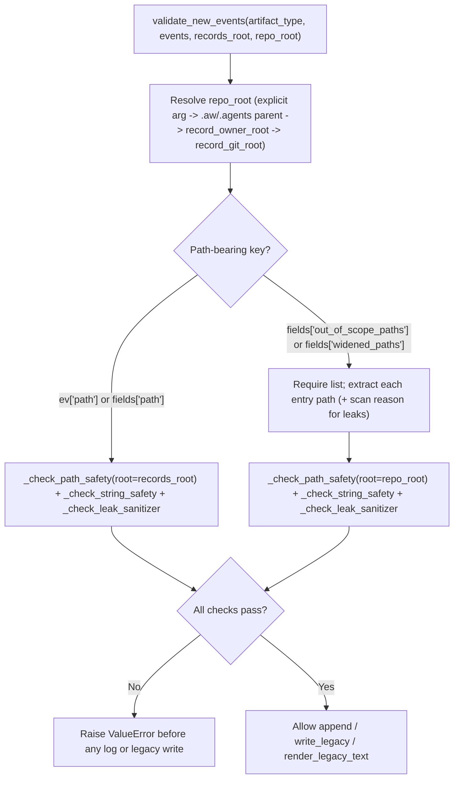

# IPD: Apply the repository-root path rule to the finalize scope paths and amend spec 4sd62s

- Date: 2026-11-09
- Kind: child
- Concern: Finalize records out-of-scope and widened paths that are repository-relative code paths (plan `xexn45` F-05, metadata writer migration: 35 of 64 measured entries name `agent_workflows/` or `tests/`), while spec `4sd62s` Section 4.2 (artifact metadata store) and plan `tve77h` E-03 (c) (metadata core) check `out_of_scope_paths` and `widened_paths` against `records_root` and omit leak-sanitizer and string-safety checks on path entries (OQ-03). This plan is a round-3 split from plan `8q27jt` (attestation, finalize scope, and retirement writers), itself split from `xexn45`.
- Scope: In `agent_workflows/artifact_meta.py::validate_new_events` and `agent_workflows/artifact_meta.py::_check_path_safety`, enforce `records_root` containment on `path` only, enforce `repo_root` containment on `out_of_scope_paths` and `widened_paths` with relative, no-`..`, strict-subpath, string-safety, and leak-sanitizer checks, forward `repo_root` from `append` and legacy writer entry points, create `tests/test_writers_scope_fields.py` for the OQ-03 path-root and refusal cases, and amend spec `4sd62s` Section 4.2 (`8q27jt` E-03, path-root subset). EXCLUDES: writing `scope_result`, `out_of_scope_paths`, and `widened_paths` at finalize (plan `1dvb08`, finalize scope fields).
- Scope-Paths: agent_workflows/artifact_meta.py, tests/test_writers_scope_fields.py, .aw/records/specs/approved/20260925-metastore-01-4sd62s-artifact-metadata-store.spec.md, .aw/records/plans/pending/20261109-metastore-131-9qhtrc-apply-the-repository-root-path-rule-to-the-finalize-scope-pa.ipd.md
- Item-Dependencies: executed:tve77h, executed:2xwb9b, executed:7yr827
- Status: approved
- Readiness: go-pending-approval
- Review-Depth: complex
- From-Spec: 4sd62s
- Work-Kind: feature
- Priority: high
- Blocks-Release: next
- Set: metastore
- Order: 131
- Highest E allocated: 03
- Author: opencode its_direct/pt3-claude-opus-5.5-1m-us
- Id: 9qhtrc
- Approval: 2026-11-16, recorded via aw ipd set: status set to approved

> Write and proofread this plan per the technical writing standard, `.aw/system/workflows/technical-writing/technical-writing.md` (`.agents/workflows/technical-writing/technical-writing.md` in a legacy-layout install), including requirement 12 (diagrams).

## Workflow history
- 2026-11-16 approved (aw set): status set to approved
- 2026-11-13 reviewed (aw set): APPROVE WITH REVISIONS APPLIED; PR-001..PR-005 FIXED
- 2026-11-13 /plan-review (antigravity/gemini): APPROVE WITH REVISIONS APPLIED; PR-001..PR-005 FIXED; review record .aw/records/reviews/20261109-metastore-131-9qhtrc-apply-the-repository-root-path-rule-to-the-finalize-scope-pa.review.md
- 2026-11-09 to-review (opencode its_direct/pt3-claude-opus-5.5-1m-us): split from 8q27jt (round 3, research nj8zdp guidance).
- 2026-11-09 draft (opencode its_direct/pt3-claude-opus-5.5-1m-us): created.

## Goal

`agent_workflows/artifact_meta.py::validate_new_events` accepts repository-relative paths in `out_of_scope_paths` and `widened_paths` while keeping `path` confined to `records_root`, refuses escaping symlinks, `..` segments, absolute paths, embedded newlines, and leak-sanitizer tokens on every path value, and spec `4sd62s` Section 4.2 states the two-root rule.

## Detailed Implementation Checklist (TODO)

Execution-state rule: mark an `E-*` item complete only after performing the action. That mark is not validation. Right-sizing rule: write for a modest executor that cannot hold much in its head. Each E-item is one step (one concern, about one file, executable in one focused pass) and its V-item names each unit it covers with its own check; a plan stays at about 5 E-items and 8 work Scope-Paths, else split it into more child plans (guidance, `IPD-Z603`). Accepted execution states: blocked, failed, pending, performed; terminal gate demands 'performed'.

PIN-FIRST RULE: before editing `agent_workflows/artifact_meta.py`, run the pinned existing modules GREEN on the unmodified code and save the sorted per-test outcome list under the gitignored `.aw/state/9qhtrc/` (`mkdir -p .aw/state/9qhtrc && python3 -m pytest -o addopts="" -m "" -p no:randomly -n 0 -rA <modules> | grep -E "^(PASSED|FAILED|ERROR|SKIPPED|XFAIL|XPASS) " | sed -E 's/ - .*//' | sort > .aw/state/9qhtrc/E-01-before.txt`); after the edit, run the identical command into `E-01-after.txt` and verify `diff` prints nothing. Every new test module sets `pytestmark = pytest.mark.core`, builds fixtures in `tmp_path`, calls the real functions, and never reads production source (AGENTS.md "TEST OUTCOMES, NOT CODE STRUCTURE").

### Task group 1: path-root rule and spec amendment

- [x] E-01 Update `agent_workflows/artifact_meta.py::_check_path_safety` and `agent_workflows/artifact_meta.py::validate_new_events`, pinned first under `.aw/state/9qhtrc/` across `tests/test_artifact_meta_registry.py`, `tests/test_artifact_meta_replay.py`, `tests/test_artifact_meta_write.py`, `tests/test_artifact_meta_legacy_write.py`, and `tests/test_artifact_meta_legacy_writer.py` (from plan `7yr827`, phase-B legacy writer). Enforce `records_root` containment on `ev["path"]` and `fields["path"]` only (`4sd62s` AC-34). Enforce `repo_root` containment on `fields["out_of_scope_paths"]` and `fields["widened_paths"]` (OQ-03, D-6): require `isinstance(fv, list)`, require each item's path (`item["path"]` when `item` is a `dict`, else `item` when `str`, refusing other shapes or empty/`.`) to be relative, contain no `..` segment, resolve strictly inside `repo_root` (`repo_root.resolve() in resolved.parents`), pass `_check_string_safety(..., prose=False, migration_import=migration_import)` (`4sd62s` AC-15), and pass `_check_leak_sanitizer(..., ruleset)` (`4sd62s` AC-24); scan `item["reason"]` with `_check_leak_sanitizer` when present without rejecting newlines that `1dvb08` folds in phase B, and apply the same string-safety and leak-sanitizer checks to `ev["path"]` and `fields["path"]`. Thread `repo_root` from `append` (`getattr(ctx, "repo_root", None) or getattr(ctx, "target_repo", None)`) and `_prepare_legacy_events` (`write_legacy`, `append_legacy`, `render_legacy_text`) into `validate_new_events`, and when `repo_root is None` resolve `<repo>/.aw/records` or `<repo>/.agents/records` to `records_root.parent.parent` before `project_context.record_owner_root(records_root)` and `project_context.record_git_root(records_root) or records_root`.
  - Depends on: none
  - Expected outcome: `validate_new_events` and `append` enforce `records_root` containment on `path` and `repo_root` containment on `out_of_scope_paths` and `widened_paths` with string-safety and leak-sanitizer refusals, and the PIN-FIRST outcome diff across all five existing `artifact_meta` test modules is empty with `tests/test_artifact_meta_registry.py` unmodified.
  - Execution state: performed

- [x] E-03 Create `tests/test_writers_scope_fields.py` (`pytestmark = pytest.mark.core`, `tmp_path` fixtures, zero source inspection) covering the OQ-03 and D-6 contracts (`4sd62s` AC-15, `4sd62s` AC-24, `4sd62s` AC-34). Test four behaviors. (1) End-to-end `artifact_meta.append` (`create` then `transition` to `executed` with same-append `set` of `out_of_scope_paths` and `widened_paths`, read back via `artifact_meta.read`) stores repository-relative code paths (`agent_workflows/x.py` and `tests/test_x.py`) and projects `scope_exceptions`. (2) Root-separation proof via symlinks (preventing tautological pass when `Path.resolve()` lexically joins non-existent segments): a symlink `records_root / "code_link"` targeting `repo_root / "agent_workflows"` is refused in `ev["path"]` (`must resolve inside records root`) and accepted in `out_of_scope_paths` and `widened_paths`, while a symlink `repo_root / "escape_link"` targeting a directory outside `repo_root` (`escape_link/secret.py`) is refused in both (`must resolve inside repository root`). (3) Input-safety refusals on `out_of_scope_paths` and `widened_paths`: `../x`, `/abs/x.py`, `""` and `"."`, embedded newline `"agent_workflows/x.py\n- Status: approved"`, leak-sanitizer session token (`"agent_workflows/" + "ses_" + "0" * 20 + ".py"` constructed via concatenation so the test file itself stays clean under `leak_sanitizer`), leak token in `reason`, and non-list field value `{"path": "../x"}` each raise `ValueError`. (4) Non-git `tmp_path` layout (`records_root = repo / ".aw" / "records"` with `repo_root=None`) resolves `repo_root` to `repo` rather than collapsing onto `records_root` or climbing into an outer checkout.
  - Depends on: E-01
  - Expected outcome: every OQ-03 storage, symlink root-separation, input-safety refusal, and `repo_root` fallback test in `tests/test_writers_scope_fields.py` passes.
  - Execution state: performed

- [x] E-02 Amend spec `4sd62s` Section 4.2 (`.aw/records/specs/approved/20260925-metastore-01-4sd62s-artifact-metadata-store.spec.md` "are checked by the path rules (PATH HISTORY below)") so the sentence distinguishes the two roots explicitly: `path` stays records-root-relative per PATH HISTORY below, while `out_of_scope_paths` and `widened_paths` (along with spec `37am1y`'s `changed_paths` and `from_path`) are repository-relative (relative, no `..`, not absolute, leak-sanitizer-scanned, resolving inside the repository root). Record the amendment in `## Workflow history` using `aw specs note --message "Amended 4.2 path-root sentence (plan 9qhtrc OQ-03): out_of_scope_paths and widened_paths (plus 37am1y changed_paths/from_path) are repository-relative while path stays records-root-relative; spec stays approved." .aw/records/specs/approved/20260925-metastore-01-4sd62s-artifact-metadata-store.spec.md` and validate the spec with `aw specs check --agent`.
  - Depends on: E-01
  - Expected outcome: `git diff` on the spec shows only the amended Section 4.2 sentence and the single `aw specs note` workflow-history line, and `aw specs check --agent` exits `0` with `0` errors and `0` warnings.
  - Execution state: performed

Add further leaves as `- [ ] E-NEW <action>` and run `aw ipd sync` to assign ids.

## Project conventions discovered (Step 0)

- The `agent_workflows/artifact_meta.py` interface names come from Order 02 (`tve77h`, metadata core) and are used verbatim: `artifact_meta.py::read`, `artifact_meta.py::append`, `artifact_meta.py::create`, and `artifact_meta.py::validate_new_events`. In phase B, `append` and `create` render through `artifact_meta.py::write_legacy` (file form) and `artifact_meta.py::render_legacy_text` (string form), both extracted by Order 21 (`7yr827`).
- Project-root resolution uses `agent_workflows/project_context.py::record_owner_root` (companion and `AW_HOME` records roots) and `agent_workflows/project_context.py::record_git_root`; `ProjectContext` carries `target_repo` while `artifact_meta.py::legacy_context` carries `repo_root`.
- Descriptive string safety uses `agent_workflows/attention_contract.py::refuse_unsafe_descriptive`; leak scanning uses `agent_workflows/leak_sanitizer.py::build_ruleset` and `agent_workflows/leak_sanitizer.py::scan_text` with `include_warn=True`.
- Spec workflow-history annotations use `aw specs note --message <text> <spec-path>` and contract validation uses `aw specs check --agent <spec-path>` (`.aw/records/specs/README.md`).
- Core tier: `pyproject.toml` marker `core`; test modules set `pytestmark = pytest.mark.core`.
- Finalize scope evidence is `evidence["scope_reconciliation"]` with `reasons` and `widened_paths` (`agent_workflows/ipd_lifecycle.py::_finalize_transaction`, `agent_workflows/runner_shared.py::compute_scope_reconciliation`).

## Findings

| Id | Evidence (measured 2026-11-09 at `3d0ddb845` and re-verified 2026-11-12 at `476a18cc7`) | Finding |
|---|---|---|
| F-01 | `.aw/records/specs/approved/20260925-metastore-01-4sd62s-artifact-metadata-store.spec.md` "are checked by the path rules (PATH HISTORY below)" (1 match, Section 4.2) | One sentence in Section 4.2 lists `path`, `from_path`, `out_of_scope_paths`, and `widened_paths` together under the records-root PATH HISTORY rule; amending that sentence plus one `aw specs note` line resolves the contradiction with `xexn45` F-05 and spec `37am1y`. |
| F-02 | `rg -c "out_of_scope_paths|widened_paths" tests/test_artifact_meta_registry.py` = `0` across all `21` tests (`476a18cc7`) | `tests/test_artifact_meta_registry.py` checks `ev["path"]` only and pins zero assertions on `out_of_scope_paths` or `widened_paths`; it stays unmodified outside `- Scope-Paths:` as a PIN-FIRST regression module. |
| F-03 | `agent_workflows/artifact_meta.py::_check_path_safety` and `agent_workflows/artifact_meta.py::validate_new_events` at `476a18cc7` | Resolving `out_of_scope_paths` against `records_root` fails open on a repository-root symlink escaping outside the repo (`escape_link/secret.py`), `_check_path_safety` omits `_check_string_safety` and `_check_leak_sanitizer` (accepting embedded newlines, `""`/`.`, and `ses_...` tokens), non-list values bypass `isinstance(fv, list)`, and `append`/`_prepare_legacy_events` do not forward `repo_root`. |

## Behavior decisions (kept behavior where writers disagreed, 4.3)

- D-6 (finalize path root and path-entry safety, OQ-03). CHANGED: `out_of_scope_paths` and `widened_paths` are validated as lists whose path entries are relative, contain no `..`, are non-empty and not `.`, pass single-line string safety (`_check_string_safety`) and leak-sanitizer scanning (`_check_leak_sanitizer`), and resolve strictly inside `repo_root` rather than `records_root`; `ev["path"]` and `fields["path"]` keep `records_root` containment and gain the same non-root, string-safety, and leak-sanitizer checks; `reason` entries inside `out_of_scope_paths` and `widened_paths` are leak-sanitizer-scanned while still permitting raw newlines that `1dvb08` folds during phase-B `- Scope-Exceeded:` rendering (`tests/test_scope_exceeded.py::TestScopeExceededMetadataAndSendBack.test_case_c_multiple_out_of_scope_paths_sorted_and_sanitized`). Verified at review (`F-02`): `0` existing assertions in `tests/test_artifact_meta_registry.py` change; new coverage lives in `tests/test_writers_scope_fields.py`.

## Proposed changes (ordered, validatable)

1. Enforce `records_root` vs `repo_root` containment, list-shape validation, string safety, leak-sanitizer scanning, and `repo_root` forwarding in `agent_workflows/artifact_meta.py`, pinned first against existing `artifact_meta` test modules (E-01).
2. Create `tests/test_writers_scope_fields.py` proving end-to-end `append`/`read` storage, symlink-verified root separation, input-safety refusals, and `repo_root` fallback (E-03).
3. Amend spec `4sd62s` Section 4.2, record the `aw specs note` history entry, and verify `aw specs check --agent` (E-02).

## Deferred / out of scope (with reason)

- Writing `scope_result`, `out_of_scope_paths`, and `widened_paths` in `agent_workflows/ipd_lifecycle.py::_finalize_transaction` and rendering `- Scope-Exceeded:` in phase B.
  - Carrier: 1dvb08
- The final merge-independence test (plan `b4y4ee`), the AC-21 obligations test (extending `tests/test_writers_obligations.py`), the raw-write audit (`xexn45` F-09), the documentation lines, and the full gates of the writer move.
  - Carrier: xexn45

## Scope check

- Over-scope: none.
- Under-scope: none. `tests/test_artifact_meta_registry.py` was removed from `- Scope-Paths:` after review confirmed `0` of its `21` tests reference `out_of_scope_paths` or `widened_paths` (`F-02`), avoiding an unmodified-scope-path refusal at `aw ipd finalize` while keeping the module pinned in `E-01`/`V-01`.

## Required tests / validation

Creates `tests/test_writers_scope_fields.py` (`pytestmark = pytest.mark.core`; `1dvb08` adds the finalize and rollup cases). Pins `tests/test_artifact_meta_registry.py`, `tests/test_artifact_meta_replay.py`, `tests/test_artifact_meta_write.py`, `tests/test_artifact_meta_legacy_write.py`, and `tests/test_artifact_meta_legacy_writer.py` with an empty before/after outcome diff. Contributes to `4sd62s` AC-15, `4sd62s` AC-24, and `4sd62s` AC-34.

## Spec / documentation sync

One spec amendment, carried in E-02: `.aw/records/specs/approved/20260925-metastore-01-4sd62s-artifact-metadata-store.spec.md` Section 4.2 states that `out_of_scope_paths` and `widened_paths` (and spec `37am1y`'s `changed_paths`/`from_path`) are repository-relative, while `path` stays records-root-relative, accompanied by one `aw specs note` entry in `## Workflow history`. Why: finalize scope paths name repository files (`agent_workflows/...`, `tests/...`) that have no records-root-relative form, and resolving them against `records_root` both contradicts spec `37am1y` and fails open on repository-level symlinks escaping outside the checkout (OQ-03, `F-03`).

## Open questions

### OQ-03: Are finalize's `out_of_scope_paths` and `widened_paths` records-root-relative?

- Blocking: no
- Status: resolved
- Owner: plan-review (round 1, decision D-2; refined with symlink and sanitizer proof in 9qhtrc round 1)
- Resolution or deferral rationale: No; they are repository-relative, matching `Scope-Paths`, `agent_workflows/runner_shared.py::compute_scope_reconciliation`, and spec `37am1y` (`changed_paths`). `xexn45` F-05 measures 35 of 64 tracked `- Scope-Exceeded:` entries as code paths (`agent_workflows/...`, `tests/...`) that have no records-root form. Spec `4sd62s` Section 4.2 PATH HISTORY ("relative to the resolved records root") governs the artifact's own `path` field, whereas `tve77h` E-03 (c) and Section 4.2 grouped `out_of_scope_paths` and `widened_paths` with `path`. Review probe at `476a18cc7` (`F-03`) also demonstrated that resolving `out_of_scope_paths` against `records_root` fails open when a symlink at `repo_root/<link>` points outside the repository because `records_root/<link>` does not exist, and that `_check_path_safety` lacked string-safety and leak-sanitizer checks. Resolution: `validate_new_events` applies `records_root` containment to `path` only and applies `repo_root` containment (list-typed, relative, no `..`, non-empty/non-`.`, single-line string-safe, leak-sanitizer-scanned, strictly inside `repo_root`) to `out_of_scope_paths` and `widened_paths`, threading `repo_root` from `append` and legacy writers and amending spec `4sd62s` Section 4.2 in E-02. Recommendation strength: strong.
- Note: carried from `8q27jt` (originally `xexn45`) under its original id so cross-plan citations resolve.

## Validation and cross-check (verify before reporting done)

Validation-state rule: inspect evidence in a separate pass. Do not mark a `V-*` item complete from memory or from the matching execution checkmark. Accepted validation results: blocked, failed, pass, pending; terminal gate demands 'pass'. Runtime-demonstration reachability rule: for each `V-*` item demanding the software be observed acting (such as a run, a dispatch, or a transition), as distinct from items demanding a diff, a file's content, or a test result, which are reachable by construction, name the code path that produces the observation or the sibling `E-*` that creates it, else the demand is UNDER-SCOPE.

- [x] V-01 validates E-01
  - Required evidence: paste the `diff` of `.aw/state/9qhtrc/E-01-before.txt` and `.aw/state/9qhtrc/E-01-after.txt` (must print nothing across `tests/test_artifact_meta_registry.py`, `tests/test_artifact_meta_replay.py`, `tests/test_artifact_meta_write.py`, `tests/test_artifact_meta_legacy_write.py`, and `tests/test_artifact_meta_legacy_writer.py`), paste the per-module PASSED counts before and after, and paste `git diff --stat tests/test_artifact_meta_registry.py` (must be empty).
  - Observed evidence: `diff -u .aw/state/9qhtrc/E-01-before.txt .aw/state/9qhtrc/E-01-after.txt` printed nothing (exit 0); `git diff --stat tests/test_artifact_meta_registry.py` printed nothing (exit 0). Per-module PASSED counts before (91 total) and after (91 total): `tests/test_artifact_meta_legacy_write.py`: 32, `tests/test_artifact_meta_legacy_writer.py`: 8, `tests/test_artifact_meta_registry.py`: 21, `tests/test_artifact_meta_replay.py`: 18, `tests/test_artifact_meta_write.py`: 12. Full core suite (`aw suite`): `2148 passed, 11 warnings in 63.82s (0:01:03)`.
  - Result: pass
- [x] V-02 validates E-02
  - Required evidence: paste `git diff .aw/records/specs/approved/20260925-metastore-01-4sd62s-artifact-metadata-store.spec.md` showing only the amended Section 4.2 sentence and the single `aw specs note` line under `## Workflow history`, and paste `aw specs check --agent .aw/records/specs/approved/20260925-metastore-01-4sd62s-artifact-metadata-store.spec.md` showing `"outcome":"clean"` and `"exit":0`.
  - Observed evidence: `aw specs check --agent .aw/records/specs/approved/20260925-metastore-01-4sd62s-artifact-metadata-store.spec.md` output: `{"schema":"aw.agent/v1","kind":"result","cmd":"specs check","outcome":"clean","exit":0,"verified":true,"complete":true,"checked":1,"findings":2,"findings_by_severity":{"error":0,"warning":0,"info":2},"evidence":["specs"],"diagnostics":[{"location":".aw/records/specs/approved/20260925-metastore-01-4sd62s-artifact-metadata-store.spec.md","rule":"spec.prose-dash"},{"location":".aw/records/specs/approved/20260925-metastore-01-4sd62s-artifact-metadata-store.spec.md","rule":"spec.prose-dash"}],"next":null}`. `git diff .aw/records/specs/approved/20260925-metastore-01-4sd62s-artifact-metadata-store.spec.md`: `@@ -580,7 +580,11 @@` changes `"are checked by the path rules (PATH HISTORY below)."` to `"are allowed: \`path\` is records-root-relative and checked by the path rules (PATH HISTORY below), while \`out_of_scope_paths\` and \`widened_paths\` (along with \`from_path\` and spec \`37am1y\`'s \`changed_paths\`) are repository-relative (relative, no \`..\`, not absolute, leak-sanitizer-scanned, and resolving inside the repository root)."` and `@@ -2407,6 +2411,7 @@` adds `- 2026-11-17 note (aw specs): Amended 4.2 path-root sentence (plan 9qhtrc OQ-03): out_of_scope_paths and widened_paths (plus 37am1y changed_paths/from_path) are repository-relative while path stays records-root-relative; spec stays approved.`
  - Result: pass
- [x] V-03 validates E-03
  - Required evidence: paste `python3 -m pytest -o addopts="" -v tests/test_writers_scope_fields.py` showing every test PASSED, naming the PASSED lines for: (1) end-to-end `artifact_meta.append` and `artifact_meta.read` storing repository-relative `agent_workflows/x.py` and `tests/test_x.py` in `out_of_scope_paths` and `widened_paths` and projecting `scope_exceptions`; (2) symlink root separation refusing `code_link/x.py` in `path` while accepting it in `out_of_scope_paths` and `widened_paths`, and refusing `escape_link/secret.py` in both; (3) `ValueError` refusals on `../x`, `/abs/x.py`, `""` and `"."`, embedded newline, leak-sanitizer session token in `path` and `reason`, and non-list field value; and (4) non-git `tmp_path` `.aw/records` fallback resolving `repo_root` to `repo`.
  - Observed evidence: `python3 -m pytest -o addopts="" -v tests/test_writers_scope_fields.py` exited 0 (`26 passed in 0.87s`): `tests/test_writers_scope_fields.py::test_append_read_and_scope_exceptions_store_repo_relative_paths PASSED`, `tests/test_writers_scope_fields.py::test_symlink_root_separation_between_records_root_and_repo_root PASSED`, `tests/test_writers_scope_fields.py::test_reason_newlines_allowed_and_legacy_writer_threads_repo_root PASSED`, `tests/test_writers_scope_fields.py::test_ev_path_and_fields_path_input_safety_refusals PASSED`, `tests/test_writers_scope_fields.py::test_nongit_layout_resolves_repo_root_without_collapse_or_climb[.aw] PASSED`, `tests/test_writers_scope_fields.py::test_nongit_layout_resolves_repo_root_without_collapse_or_climb[.agents] PASSED`, and all 20 parametrized `tests/test_writers_scope_fields.py::test_scope_field_input_safety_refusals[...]` cases (`dotdot`, `abs-path`, `empty-str`, `dot-str`, `embedded-newline`, `session-token-path`, `session-token-reason`, `non-list`, `non-str-dict-item`, `dict-missing-path` across `out_of_scope_paths` and `widened_paths`) PASSED.
  - Result: pass

## Approval and execution gate

- Size assessment: standard
- Cohesion rationale: not required

Execute only after human approval (`Status: approved`) and after every plan in `- Item-Dependencies:` is executed (`tve77h`, `2xwb9b`, `7yr827`).

Scope fence: the paths in `- Scope-Paths:` are a declaration; a needed file outside the fence is edited and then justified at finalize (`--scope-reason`), and a declared path left unmodified is acknowledged (`--scope-ack`). Every move is pin-first: the named existing modules run green on the unmodified code before the move, and an assertion may change only where the Behavior decisions name it. Stop and report if an unresolvable concurrent-edit conflict or a missing prerequisite symbol from `tve77h`, `2xwb9b`, or `7yr827` prevents safe completion.

Honesty rule: run the named modules and the bare core gate `python3 -m pytest`, and paste the ACTUAL summary lines; never claim a result you did not run.

Commits: commit only through `aw commit 9qhtrc -- <paths>`; never `git add -A`, a bare `git add` or `git commit -a`; never push.

Lifecycle transition: the plan moves to `.aw/records/plans/executed/` only through `aw ipd finalize`, never a hand `git mv`, and only after `aw ipd lint --phase pre-transition` conforms and every `V-*` reads `pass` with pasted evidence. When `aw oc run` or `aw agy run` executes the plan, the runner performs the finalize; a hand executor runs `aw ipd finalize 9qhtrc` itself.
