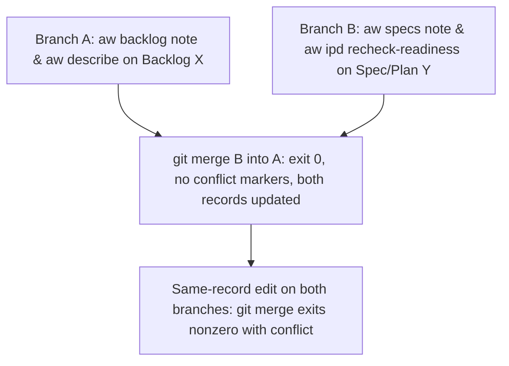

# IPD: Prove the phase-B writers keep different-record merges conflict-free

- Date: 2026-11-09
- Kind: child
- Concern: Spec `4sd62s` AC-3 (phase-B form) requires that two branches changing DIFFERENT records through the moved writers merge without conflict, while the same-record limit that the cutover removes (4.7) is pinned honestly. No test drives the moved writers across a real `git merge` yet. This is part of `xexn45`, split 2026-11-09 per research `nj8zdp` so the finishing plan stays at five items.
- Scope: Add `tests/test_writers_merge_independence.py` (`xexn45` E-12). Depends on every writer part, because the test drives `aw backlog note`, `aw describe`, `aw specs note` and `aw ipd recheck-readiness` after their moves. EXCLUDES: the AC-21 obligations and AC-6 diff test, the audit and the gates (`xexn45`).
- Scope-Paths: tests/test_writers_merge_independence.py, .aw/records/plans/pending/20261109-metastore-133-b4y4ee-prove-the-phase-b-writers-keep-different-record-merges-confl.ipd.md
- Item-Dependencies: executed:tve77h, executed:2xwb9b, executed:7yr827, executed:g6tw94, executed:n5sxxk, executed:6e93gt, executed:bsl45u, executed:8q27jt
- Status: reviewed
- Readiness: go-pending-approval
- Review-Depth: standard
- From-Spec: 4sd62s
- Work-Kind: feature
- Priority: high
- Blocks-Release: next
- Set: metastore
- Order: 133
- Highest E allocated: 01
- Author: opencode its_direct/pt3-claude-opus-5.5-1m-us
- Id: b4y4ee

> Write and proofread this plan per the technical writing standard, `.aw/system/workflows/technical-writing/technical-writing.md` (`.agents/workflows/technical-writing/technical-writing.md` in a legacy-layout install), including requirement 12 (diagrams).

## Workflow history
- 2026-11-14 reviewed (aw set): APPROVE WITH REVISIONS APPLIED; PR-001..PR-005 FIXED
- 2026-11-14 /plan-review (antigravity/gemini-3.8-flash): APPROVE WITH REVISIONS APPLIED; PR-001..PR-005 FIXED; review record .aw/records/reviews/20261109-metastore-133-b4y4ee-prove-the-phase-b-writers-keep-different-record-merges-confl.review.md

- 2026-11-09 to-review (opencode its_direct/pt3-claude-opus-5.5-1m-us): split from xexn45 (round 3, research nj8zdp guidance).
- 2026-11-09 draft (opencode its_direct/pt3-claude-opus-5.5-1m-us): created.

## Goal

A real-git test shows that the moved writers keep different-record changes on two branches merge-clean, and pins that same-record history edits still conflict in phase B.

## Detailed Implementation Checklist (TODO)

Execution-state rule: mark an `E-*` item complete only after performing the action. That mark is not validation. Right-sizing rule: write for a modest executor that cannot hold much in its head. Each E-item is one step (one concern, about one file, executable in one focused pass) and its V-item names each unit it covers with its own check; a plan stays at about 5 E-items and 8 work Scope-Paths, else split it into more child plans (guidance, `IPD-Z603`). Accepted execution states: blocked, failed, pending, performed; terminal gate demands 'performed'.

### Task group 1: merge independence

- [ ] E-01 Add `tests/test_writers_merge_independence.py` (AC-3, phase-B form; the commands it drives are moved by `g6tw94`, `6e93gt` and `8q27jt`): in a real git repository fixture, branch A runs `aw backlog note` and `aw describe` on backlog item X while branch B runs `aw specs note` and `aw ipd recheck-readiness` on a different spec and plan; `git merge` of B into A completes with no conflict, and `artifact_meta.read` on all three records afterwards shows both branches' changes. A second case changes the SAME record on both branches (one history line each) and asserts that `git merge` exits nonzero with that file in `git diff --name-only --diff-filter=U`: measured at review, two branches that each prepend one line directly under `## Workflow history` of the same file conflict, which is the phase-B limit that 4.7 removes at the cutover. The test pins that outcome; it does not accept either result.
  - Depends on: none
  - Expected outcome: the different-artifacts merge has exit 0 and no conflict markers; the same-record merge exits nonzero naming the shared file.
  - Execution state: pending

Add further leaves as `- [ ] E-NEW <action>` and run `aw ipd sync` to assign ids.

## Project conventions discovered (Step 0)

- The `artifact_meta` interface names come from Order 02 (`tve77h`) and are used exactly: `agent_workflows/artifact_meta.py::read`, `agent_workflows/artifact_meta.py::append`, `agent_workflows/artifact_meta.py::create`, `agent_workflows/artifact_meta.py::validate_new_events`. In phase B, `append` and `create` render through the one legacy renderer `agent_workflows/artifact_meta.py::write_legacy` (file form) and `agent_workflows/artifact_meta.py::render_legacy_text` (string form), both added by `7yr827`.
- UTC history days come from `agent_workflows/artifact_core.py::utc_history_date` (spec `2vev8j` 4.4); atomic replacement is `agent_workflows/artifact_core.py::atomic_write`.
- Core tier: `pyproject.toml` marker `core`; modules set `pytestmark = pytest.mark.core`.
- Cite code by SYMBOL (`path::Symbol`) or by a quoted content string, never by a line number alone (advisory `IPD-C801`).

## Findings

| Id | Evidence (measured 2026-11-09 at `3d0ddb845`) | Finding |
|---|---|---|
| F-01 | Measured at the `xexn45` review: two branches that each prepend one line directly under `## Workflow history` of the same file conflict under `git merge` | The phase-B limit; the test pins it rather than accepting either result. |
| F-02 | Hidden units: 1 new module, 2 cases, 4 driven commands | One item. |

## Proposed changes (ordered, validatable)

1. Add the merge-independence test (E-01).

## Deferred / out of scope (with reason)

- The AC-21 obligations and AC-6 phase-B diff test, the raw-write audit (F-09), the documentation lines and the full gates.
  - Carrier: xexn45
- The log-format re-demonstration of AC-3.
  - Carrier: cxxmyv

## Scope check

- Over-scope: none.
- Under-scope: none.

## Required tests / validation

New core test module: `tests/test_writers_merge_independence.py` (real git repository in `tmp_path`, real CLI, never reads source). Contributes to `4sd62s` AC-3 (phase-B form; `cxxmyv` re-demonstrates on logs).

## Spec / documentation sync

None.

## Open questions

### OQ-01: How is merge independence proven without test-flakiness across worktrees?

- Blocking: no
- Status: resolved
- Owner: plan author
- Resolution or deferral rationale: In `tests/test_writers_merge_independence.py`, construct an isolated git repository fixture using pytest's `tmp_path`, create two branches with divergent writer commits, and assert that `git merge` exits 0 with both records preserved. A second case asserts that concurrent same-record history prepends exit nonzero with conflict markers. The test runs in a clean temporary directory with no dependence on external repository state or concurrent worktrees. Recommendation strength: very strong.

## Validation and cross-check (verify before reporting done)

Validation-state rule: inspect evidence in a separate pass. Do not mark a `V-*` item complete from memory or from the matching execution checkmark. Accepted validation results: blocked, failed, pass, pending; terminal gate demands 'pass'. Runtime-demonstration reachability rule: for each `V-*` item demanding the software be observed acting (such as a run, a dispatch, or a transition; as distinct from items demanding a diff, a file's content, or a test result, which are reachable by construction), name the code path that produces the observation or the sibling `E-*` that creates it, else the demand is UNDER-SCOPE.

- [ ] V-01 validates E-01
  - Required evidence: paste `python3 -m pytest -o addopts="" -v tests/test_writers_merge_independence.py` with both cases PASSED by name, and from the test log the `git merge` exit code `0` and empty `git diff --name-only --diff-filter=U` for the different-artifacts case, plus the nonzero exit code and the `--diff-filter=U` file name for the same-record case.
  - Observed evidence:
  - Result: pending

## Approval and execution gate

- Size assessment: standard
- Cohesion rationale: not required

Execute only after human approval (`Status: approved`) and after every plan in `- Item-Dependencies:` is executed. Stop and report without editing production code or tests if prerequisite symbols from writer dependencies (`tve77h`, `2xwb9b`, `7yr827`, `g6tw94`, `n5sxxk`, `6e93gt`, `bsl45u`, `8q27jt`) are absent on HEAD, if baseline test suites fail on unmodified HEAD before starting, or if concurrent edits in a shared checkout conflict with `- Scope-Paths:`.

Scope fence: the paths in `- Scope-Paths:` are a declaration; a needed file outside the fence is edited and then justified at finalize (`--scope-reason`), and a declared path left unmodified is acknowledged (`--scope-ack`). Every move is pin-first: the named existing modules run green on the unmodified code before the move, and an assertion may change only where the Behavior decisions name it.

Honesty rule: run the named modules and the bare core gate `python3 -m pytest`, and paste the ACTUAL summary lines; never claim a result you did not run.

Commits: commit only through `aw commit b4y4ee -- <paths>`; never `git add -A`, a bare `git add` or `git commit -a`; never push.

Lifecycle transition: the plan moves to `.aw/records/plans/executed/` only through `aw ipd finalize`, never a hand `git mv`, and only after `aw ipd lint --phase pre-transition` conforms and every `V-*` reads `pass` with pasted evidence. When `aw oc run` or `aw agy run` executes the plan, the runner owns retirement to `executed/` and runs finalize automatically upon task completion; when executed standalone by hand or direct agent turn, the executor runs `aw ipd finalize b4y4ee`.
