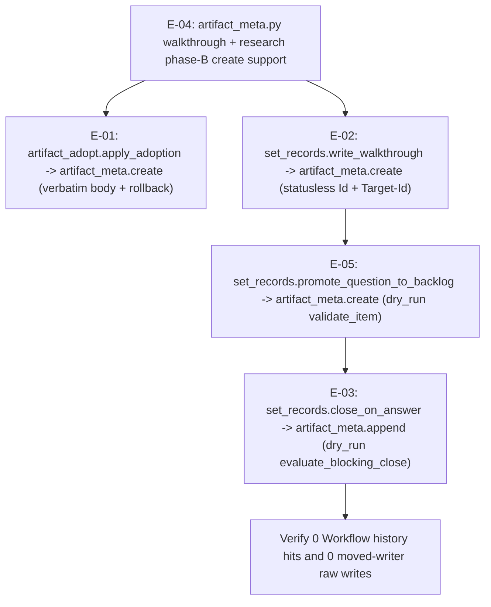

# IPD: Move the adopt and set_records create and setter writers onto artifact_meta

- Date: 2026-11-09
- Kind: child
- Concern: Spec `4sd62s` section 7 step 4 requires every metadata writer to write through `artifact_meta` in phase B. Today `agent_workflows/artifact_adopt.py` (`apply_adoption`) and `agent_workflows/set_records.py` (`write_walkthrough`, `promote_question_to_backlog`, `close_on_answer`) still build or rewrite metadata and write files by hand (measured at `8873fbf3a`: `rg -c "atomic_write\(|write_text\(|git_mv\("` finds 1 hit in `artifact_adopt.py` inside `apply_adoption` and 6 hits in `set_records.py`, 3 across `write_walkthrough`, `promote_question_to_backlog`, and `close_on_answer` plus 3 non-metadata projection writes in `write_local_projections`). This plan is part of `n5sxxk` (itself part of `xexn45`), split 2026-11-09 so each item names one writer concern.
- Scope: Register `walkthrough` fields (`set`, `order`, `target_id`) plus statusless walkthrough creation and verbatim-body `research` YAML creation in `agent_workflows/artifact_meta.py`, move `agent_workflows/artifact_adopt.py::apply_adoption`, `agent_workflows/set_records.py::write_walkthrough`, and `agent_workflows/set_records.py::promote_question_to_backlog` onto `artifact_meta.create` (`n5sxxk` E-01 adopt and walkthrough subsets plus E-02 question-promotion subset), move `agent_workflows/set_records.py::close_on_answer` onto `artifact_meta.append` (`n5sxxk` E-02 close-on-answer subset), and remove unused `_extract_body` from `agent_workflows/set_records.py`. Depends on `jlwedt`, which registers `backlog` creation fields (`set` and migration-only `summary`), widens initial `backlog` statuses (`blocked`), and supports headerless backlog creation layout in `artifact_meta`. EXCLUDES: research CLI writers (`s95hj6`), scaffold and prompts (`ernmom`), creation-time `short_description` (`py2vu9`, `fekdwv`), and `set_records.write_local_projections` (generated projection files recorded in `xexn45` F-09, not metadata).
- Scope-Paths: agent_workflows/artifact_adopt.py, agent_workflows/set_records.py, agent_workflows/artifact_meta.py, .aw/records/plans/pending/20261109-metastore-135-x2dxvf-move-the-adopt-and-set-records-create-and-setter-writers-ont.ipd.md
- Item-Dependencies: executed:tve77h, executed:2xwb9b, executed:7yr827, executed:g6tw94, executed:jlwedt
- Status: approved
- Readiness: go-pending-approval
- Review-Depth: complex
- From-Spec: 4sd62s
- Work-Kind: feature
- Priority: high
- Blocks-Release: next
- Set: metastore
- Order: 135
- Highest E allocated: 05
- Author: opencode its_direct/pt3-claude-opus-5.5-1m-us
- Id: x2dxvf
- Approval: 2026-11-16, recorded via aw ipd set: status set to approved

> Write and proofread this plan per the technical writing standard, `.aw/system/workflows/technical-writing/technical-writing.md` (`.agents/workflows/technical-writing/technical-writing.md` in a legacy-layout install), including requirement 12 (diagrams).

## Workflow history
- 2026-11-16 approved (aw set): status set to approved
- 2026-11-14 reviewed (aw set): APPROVE WITH REVISIONS APPLIED; PR-001..PR-005 FIXED

- 2026-11-14 /plan-review (antigravity/gemini): APPROVE WITH REVISIONS APPLIED; PR-001..PR-005 FIXED; review record .aw/records/reviews/20261109-metastore-135-x2dxvf-move-the-adopt-and-set-records-create-and-setter-writers-ont.review.md
- 2026-11-09 to-review (opencode its_direct/pt3-claude-opus-5.5-1m-us): split from n5sxxk (round 3, research nj8zdp guidance).
- 2026-11-09 draft (opencode its_direct/pt3-claude-opus-5.5-1m-us): created.

## Goal

`artifact_adopt.apply_adoption`, `set_records.write_walkthrough`, `set_records.promote_question_to_backlog`, and `set_records.close_on_answer` write through `artifact_meta` (`create` and `append`) with zero raw file writes in any moved writer, zero `Workflow history` strings in `agent_workflows/artifact_adopt.py` or `agent_workflows/set_records.py`, and every named behavior preserved.

## Detailed Implementation Checklist (TODO)

Execution-state rule: mark an `E-*` item complete only after performing the action. That mark is not validation. Right-sizing rule: write for a modest executor that cannot hold much in its head. Each E-item is one step (one concern, about one file, executable in one focused pass) and its V-item names each unit it covers with its own check; a plan stays at about 5 E-items and 8 work Scope-Paths, else split it into more child plans (guidance, `IPD-Z603`). Accepted execution states: blocked, failed, pending, performed; terminal gate demands 'performed'.

PIN-FIRST RULE for every "move" item: run the test modules its V-item names GREEN on the unmodified code and save the per-test outcome list under the gitignored `.aw/state/x2dxvf/` (`python3 -m pytest -o addopts="" -m "" -p no:randomly -n 0 -rA <modules> | grep -E "^(PASSED|FAILED|ERROR|SKIPPED|XFAIL|XPASS) " | sed -E 's/ - .*//' | sort > .aw/state/x2dxvf/<E>-before.txt`; `-m ""` includes `slow` modules, `-p no:randomly -n 0` makes the list deterministic, and `-q` is not repeated because `addopts` is cleared); make the move; run the same command into `-after.txt`; `diff` of the two must print nothing, so a test that newly fails, errors or skips is caught, not only a lost PASSED line. An existing assertion may change only when Behavior decisions D-1 through D-4 below name it. New tests set `pytestmark = pytest.mark.core`, build fixtures in `tmp_path`, drive the real CLI or function, and never read production source (AGENTS.md "TEST OUTCOMES, NOT CODE STRUCTURE").

### Task group 1: phase-B schema and create support, adopt writer, and set_records writers

- [ ] E-04 In `agent_workflows/artifact_meta.py`, extend phase-B `create` and field registration for `walkthrough` and `research` (`4sd62s` 4.1, 4.2c, 4.3), pinned first: (1) register `"set": FieldDef("set", "string", "generic")`, `"order": FieldDef("order", "integer", "generic")`, and `"target_id": FieldDef("target_id", "reference", "generic")` in `REGISTRY["walkthrough"]`, map `"target_id": "Target-Id"` in `_LEGACY_BULLET_LABEL`, and support statusless `walkthrough` creation (`op == "create"`, `LegacyRender(history=False)`) that injects `- Id: <id6>` and `- Target-Id: <target_id>` directly after `- Set:` (else after `# `, else at the top of the metadata block before `## `) without requiring or writing `- Status:` or `## Workflow history`; and (2) register `"topic": FieldDef("topic", "string list", "generic")` plus migration-only `"created"` and `"summary"` in `REGISTRY["research"]` (if not already added by `s95hj6`) and support phase-B `research` creation (`op == "create"`, `LegacyRender(history=False)`) that renders the leading spec-5.8 `---` YAML front matter block, concatenates `body` verbatim after the closing `---\n` fence without newline normalization or trailing-newline mutation (`D-3`), emits no `## Workflow history`, refuses existing destinations when `overwrite=False`, and honors `migration_import=True` for attested `--allow-leaks` adoptions. Pin `tests/test_artifact_meta_legacy_write.py`, `tests/test_status_set_meta_writer.py`, `tests/test_artifact_meta_registry.py`, and `tests/test_artifact_meta_cache.py`.
  - Depends on: none
  - Expected outcome: `REGISTRY["walkthrough"]`, `REGISTRY["research"]`, and phase-B `artifact_meta.create` support statusless walkthrough bullet injection and verbatim-body research YAML creation without `## Workflow history`, and the PIN-FIRST outcome diff across the four `artifact_meta` modules is empty.
  - Execution state: pending

- [ ] E-01 Move `agent_workflows/artifact_adopt.py::apply_adoption` onto `artifact_meta.create`, pinned first (`n5sxxk` E-01, adopt subset): carry or parse the adopted research fields (`research_kind`, `status`, `created`, `set`, `order`, `outcome`, `priority`, `topic`, `summary`) alongside `AdoptionPlan.frontmatter` (preserving `render_preview`), keep Step 0's `"refusing to overwrite existing path"` guard, call `artifact_meta.create` in Step 1 with `body = plan.provenance + plan.body`, `destination=plan.destination`, `overwrite=overwrite`, `migration_import=plan.leaks.has_fail`, and `LegacyRender(history=False)` (catching write exceptions to return `(None, f"destination write failed (original left in place): {exc}")` without touching `plan.source`), and preserve Step 2 `refresh_index` rollback (`plan.destination.unlink()`), Step 3 `plan.source.unlink()`, and Step 4 leak-override audit logging (`D-3`). Pin `tests/test_artifact_adopt.py`.
  - Depends on: E-04
  - Expected outcome: `tests/test_artifact_adopt.py` passes before and after with an empty PIN-FIRST outcome diff, and both `rg -n "Workflow history" agent_workflows/artifact_adopt.py` and `rg -n "atomic_write\(|write_text\(" agent_workflows/artifact_adopt.py` print nothing (`0` matches).
  - Execution state: pending

- [ ] E-02 Move `agent_workflows/set_records.py::write_walkthrough` onto `artifact_meta.create`, pinned first (`n5sxxk` E-01, walkthrough subset): keep `_collect_walkthrough_ids`, `mint_id6`, `kebab_slug`, local filename date, and `_walkthroughs_dir` resolution (`.aw/records/walkthroughs` and `.agents/walkthroughs`), and replace the manual line-splitting loop and `atomic_write` with `artifact_meta.create` (`record_type="walkthrough"`, `fields={"set": set_id, "order": int(order), "target_id": target_id6}`, `body=body`, `destination=out`, `project_context` rooted at `root.parent`, and `LegacyRender(history=False)`) so `- Id:` and `- Target-Id:` land in the metadata region with zero `- Status:` or `## Workflow history` (`D-4`). Pin `tests/test_walkthrough_id6.py` and `tests/test_exec_set_workflow.py`.
  - Depends on: E-04
  - Expected outcome: both pinned modules pass before and after with an empty PIN-FIRST outcome diff, and `write_walkthrough` contains no `atomic_write` call or manual `- Id:` / `- Target-Id:` string assembly.
  - Execution state: pending

- [ ] E-05 Move `agent_workflows/set_records.py::promote_question_to_backlog` onto `artifact_meta.create`, pinned first (`n5sxxk` E-02, question-promotion subset, `D-1`): keep pre-mint `validate_gate_ref("decision", gate_ref)` validation, `mint_id6`, `kebab_slug(summary or "question", 50, "question")`, and `_backlog_root` resolution, run `artifact_meta.create` first with `dry_run=True` (`record_type="backlog"`, `fields={"status": "blocked", "set": set_val, "priority": "high", "work_kind": "followup", "summary": summary.strip(), "gate_kind": "decision", "gate_ref": gate_ref}`, `body=body`, `message=f"promoted blocking question {question_id} ({gate_ref})"`, `destination=dest`, `project_context` rooted at `root.parent`, and `LegacyRender(tag="created", day=utc_history_date(), actor_label="aw backlog", history=True)`) so `backlog.validate_item(dest, preview.text)` fails closed before any disk write, and then run `artifact_meta.create` with `dry_run=False` to write `dest` atomically under lock. Pin `tests/test_slug_slice_trailing_hyphen.py`, `tests/test_exec_set_workflow.py`, and `tests/test_backlog.py`.
  - Depends on: E-02
  - Expected outcome: all three pinned modules pass before and after with an empty PIN-FIRST outcome diff, and `promote_question_to_backlog` contains no `_render_item` or `atomic_write` call.
  - Execution state: pending

- [ ] E-03 Move `agent_workflows/set_records.py::close_on_answer` onto `artifact_meta.append` and delete unused `_extract_body`, pinned first (`n5sxxk` E-02, close-on-answer subset): keep existence and `item.status == "blocked"` checks, build `LegacyTarget(backlog_path, "backlog", item.id)` with `[{"op": "transition", "from": item.status, "to": "done", "message": "question answered; close-on-answer"}, {"op": "unset", "fields": ["gate_kind", "gate_ref", "gate_summary"]}]`, `destination=dest`, `project_context` rooted at `root.parent`, and `LegacyRender(tag="done", day=utc_history_date(), actor_label="aw backlog", history=True)`, run `artifact_meta.append(..., dry_run=True)` first to enforce `backlog.validate_item(dest, preview.text)` and `check_engine.evaluate_blocking_close(repo_root, backlog_path, "done", item_text=preview.text)` before any file write or move, then run `artifact_meta.append(..., dry_run=False)` to update metadata in place and move `backlog_path` to `dest`, and remove dead `_extract_body` (`D-2`). Pin `tests/test_backlog.py`, `tests/test_history_block_bounding.py`, and `tests/test_exec_set_workflow.py`.
  - Depends on: E-05
  - Expected outcome: all three pinned modules pass before and after with an empty PIN-FIRST outcome diff; `rg -n "Workflow history" agent_workflows/set_records.py` and `rg -n 'f"- \{[^}]+\} |f"- \{(date|today|hdate)\} ' agent_workflows/set_records.py` print nothing (`0` matches); and `rg -n "atomic_write\(|write_text\(" agent_workflows/set_records.py` matches only the 3 projection writes inside `write_local_projections` (`xexn45` F-09 / E-15).
  - Execution state: pending

Add further leaves as `- [ ] E-NEW <action>` and run `aw ipd sync` to assign ids.

## Project conventions discovered (Step 0)

- The `artifact_meta` interface names come from Order 02 (`tve77h`) and Order 21 (`7yr827`): `artifact_meta.read(id6) -> State`, `append(id6, events, *, expect_seq)`, `create(...)`, `validate_new_events(type, events, *, records_root, migration_import=False)`, `write_legacy`, and `render_legacy_text`. Prerequisite `jlwedt` (Order 121) registers `set` and migration-only `summary` on `REGISTRY["backlog"]`, widens initial `backlog` statuses to `backlog.STATUSES | {"draft"}` (including `"blocked"`), and adds headerless backlog `op == "create"` layout in `artifact_meta`.
- `aw adopt` (`agent_workflows/artifact_adopt.py`) adopts `SUPPORTED_TYPES = ("research",)` into `.aw/records/research/` using spec-5.8 fenced `---` YAML front matter (`research_cmd.build_frontmatter`), no `## Workflow history` section, and a byte-identical provenance + raw drop body (`VerbatimBodyTests::test_body_is_byte_identical_after_adoption`, including bodies without a trailing newline and bodies containing embedded `---` fences).
- Walkthrough records (`agent_workflows/set_records.py::write_walkthrough`) carry `- Id:` and `- Target-Id:` in their metadata bullet block before the first `## ` heading (`check_engine._identity_declared_values`) and never carry `- Status:` or `## Workflow history` (`4sd62s` section 0 and section 4.3).
- `set_records.close_on_answer` enforces `check_engine.evaluate_blocking_close(repo_root, backlog_path, "done", item_text=...)` before writing or moving a `- Blocks-Release:` backlog item, and preserves unknown bullets (`- Custom-Field:`), header prose, wrapped multi-line history records, and indented quoted history lines in the body (`tests/test_backlog.py`, `tests/test_history_block_bounding.py`).
- UTC history days come from `artifact_core.utc_history_date` (`4sd62s` 4.2b); atomic replacement is `artifact_core.atomic_write(path, text, *, prefix)`; per-record locking is `platform_lock.held`.
- Core tier: `pyproject.toml` marker `core`; run the routine gate bare as `python3 -m pytest` (`4sd62s` AC-1b).
- Cite code by SYMBOL (`module.function` or `path::Symbol`) or by a quoted content string, never by a line number alone (advisory `IPD-C801`).

## Findings

| Id | Evidence (measured 2026-11-09 at `3d0ddb845` and re-verified 2026-11-14 at `8873fbf3a`) | Finding |
|---|---|---|
| F-01 | `rg -n "atomic_write\(|write_text\(|git_mv\(" agent_workflows/artifact_adopt.py agent_workflows/set_records.py`: `artifact_adopt.apply_adoption` (1 `atomic_write`), `set_records.write_walkthrough` (1 `atomic_write`), `set_records.promote_question_to_backlog` (1 `atomic_write`), `set_records.close_on_answer` (1 `atomic_write` + `unlink`), and `set_records.write_local_projections` (3 `atomic_write` calls writing `run-state.json`, `CURRENT_STATE.md`, and `QUESTIONS.md`); `rg -n "Workflow history" agent_workflows/artifact_adopt.py agent_workflows/set_records.py`: 0 hits in `artifact_adopt.py`, 1 hit in `set_records.py` inside `_extract_body` docstring | Moving the four metadata writers and deleting dead `_extract_body` leaves 0 raw writes in `artifact_adopt.py`, only the 3 projection writes in `set_records.write_local_projections` (`xexn45` F-09), and 0 `Workflow history` hits in both modules (`n5sxxk` E-03). |
| F-02 | Non-binding `def test_` counts at `8873fbf3a` (`185 passed` across all 10 verified modules, re-derived dynamically at execution by the PIN-FIRST command): `test_artifact_adopt` 39, `test_walkthrough_id6` 4, `test_backlog` 47, `test_slug_slice_trailing_hyphen` 2, `test_history_block_bounding` 9, `test_exec_set_workflow` 9, `test_artifact_meta_legacy_write` 32, `test_status_set_meta_writer` 11, `test_artifact_meta_registry` 21, `test_artifact_meta_cache` 11 | Splitting into 5 single-concern items (`E-04`, `E-01`, `E-02`, `E-05`, `E-03`) keeps every item at `<=8` named units (`IPD-Z603`), adds `tests/test_history_block_bounding.py` and `tests/test_exec_set_workflow.py` to the pinned set, and fixes class-qualified `unittest.TestCase` nodeids. |
| F-03 | `agent_workflows/artifact_meta.py::REGISTRY["walkthrough"]` currently holds only `_COMMON_FIELDS` (missing `set`, `order`, `target_id`), walkthroughs have no `- Status:` (`4sd62s` 4.3), `REGISTRY["research"]` lacks list-typed `topic` and phase-B `created`/`summary`, and `render_legacy` normalizes trailing newlines via `splitlines()` + `out.rstrip() + "\n"`, which breaks `VerbatimBodyTests::test_body_is_byte_identical_after_adoption` on a drop body with no trailing newline | `E-04` must extend `REGISTRY["walkthrough"]`, `REGISTRY["research"]`, and phase-B `artifact_meta.create` before `E-01` and `E-02` run (`x2dxvf` does not depend on `s95hj6`, so `x2dxvf` cannot rely on `s95hj6` having landed first). |
| F-04 | `agent_workflows/set_records.py::promote_question_to_backlog` mints a brand-new `blocked` backlog file (`mint_id6` + new path under `blocked/`) rather than mutating an existing record, while `close_on_answer` mutates an existing `blocked` item in place (`blocked -> done`, unsetting `Gate-*`, pre-checking `check_engine.evaluate_blocking_close`, and moving `blocked/` -> `done/`) | `promote_question_to_backlog` (`E-05`) belongs on `artifact_meta.create` (reusing `jlwedt` E-03's `backlog` create support), whereas `close_on_answer` (`E-03`) belongs on `artifact_meta.append` (`dry_run=True` pre-check followed by `dry_run=False` with `destination=dest`). |

## Behavior decisions (kept behavior where writers disagreed, spec `4sd62s` 4.3)

- D-1 (`promote_question_to_backlog` uses `artifact_meta.create` with fail-closed `dry_run=True` pre-validation). KEPT: `promote_question_to_backlog` creates a new `blocked` backlog item (`op: "create"` at cutover, legacy bullet + `## Workflow history` mirror in phase B via `jlwedt` E-03) after validating `gate_ref` and running `backlog.validate_item(dest, preview.text)` on `artifact_meta.create(..., dry_run=True)`, writing nothing on failure. Non-binding test pointers: `tests/test_slug_slice_trailing_hyphen.py::SlugSliceTrailingHyphenTests::test_promote_question_to_backlog_strips_trailing_hyphen_after_slug_slice` and `tests/test_exec_set_workflow.py`.
- D-2 (new bullet position and in-place `close_on_answer` preservation). KEPT: existing bullets update in place; gate bullets (`Gate-Kind`, `Gate-Ref`, `Gate-Summary`) are removed via `op: "unset"` on `blocked -> done`; new bullets insert after `- Status:`, else after `- Id:`, else at the end of the metadata bullet block before `## `, and never in the body (`a88210`). `close_on_answer` runs `artifact_meta.append(..., dry_run=True)` first so `check_engine.evaluate_blocking_close` refuses an uncarried `- Blocks-Release:` item before any file write or move, and in-place `write_legacy` preserves unknown bullets (`- Custom-Field:`), header prose, wrapped prior history records, and indented quoted history lines in the body without `_extract_body`. Non-binding test pointers: `tests/test_backlog.py::BacklogPreservationTests::test_close_on_answer_preserves_custom_field_and_handed_off_blocks_release`, `tests/test_backlog.py::BacklogPreservationTests::test_gated_close_refused_without_carrier`, and `tests/test_history_block_bounding.py::HistoryBlockBoundingTests::test_e2_writer_round_trip_wrapped_and_quoted`.
- D-3 (adopted `research` YAML mirror, zero `## Workflow history`, and byte-identical body). KEPT: phase-B `artifact_meta.create` for `research` with `LegacyRender(history=False)` renders only the leading spec-5.8 `---` YAML front matter block and concatenates `plan.provenance + plan.body` verbatim without `splitlines()` or trailing-newline mutation, writes no `## Workflow history` section, honors `migration_import=plan.leaks.has_fail` when `--allow-leaks` was attested, and preserves `apply_adoption`'s Step 0 overwrite refusal, Step 1 `"destination write failed (original left in place)"` error contract, and Step 2 `refresh_index` destination rollback before unlinking `plan.source`. Non-binding test pointers: `tests/test_artifact_adopt.py::VerbatimBodyTests::test_body_is_byte_identical_after_adoption`, `tests/test_artifact_adopt.py::ConformanceOfTheAdoptedArtifactTests::test_adopted_artifact_passes_name_and_frontmatter_validation`, `tests/test_artifact_adopt.py::LeakGateTests::test_fail_severity_leak_refuses_before_any_write`, and `tests/test_artifact_adopt.py::FailureOrderingTests::test_destination_write_failure_leaves_the_original`.
- D-4 (statusless `walkthrough` creation with `- Id:` and `- Target-Id:` in the metadata block). KEPT: `walkthrough` records have no `- Status:` and no `## Workflow history` (`4sd62s` 4.3); phase-B `artifact_meta.create` with `LegacyRender(history=False)` injects `- Id: <minted_id6>` and `- Target-Id: <target_id6>` after `- Set:` (else after `# `, else at top of file) inside the metadata region before the first `## ` heading. Non-binding test pointers: `tests/test_walkthrough_id6.py::TestWalkthroughOutcome::test_write_walkthrough_mints_own_id6` and `tests/test_walkthrough_id6.py::TestWalkthroughDeclaredIdMatchesSlot::test_matching_id_passes`.

## Proposed changes (ordered, validatable)

1. Extend `agent_workflows/artifact_meta.py` (`REGISTRY["walkthrough"]`, `REGISTRY["research"]`, `_LEGACY_BULLET_LABEL`, and phase-B `artifact_meta.create` for statusless `walkthrough` bullet injection and verbatim-body `research` YAML creation) (`E-04`).
2. Move `agent_workflows/artifact_adopt.py::apply_adoption` onto `artifact_meta.create` while preserving Step 0 overwrite refusal, verbatim body bytes, Step 1 error handling, and Step 2 index-failure rollback (`E-01`).
3. Move `agent_workflows/set_records.py::write_walkthrough` onto `artifact_meta.create` with `LegacyRender(history=False)` (`E-02`).
4. Move `agent_workflows/set_records.py::promote_question_to_backlog` onto `artifact_meta.create` with `dry_run=True` + `backlog.validate_item` pre-validation before `dry_run=False` (`E-05`).
5. Move `agent_workflows/set_records.py::close_on_answer` onto `artifact_meta.append` with `dry_run=True` + `evaluate_blocking_close` pre-validation before `dry_run=False` (`destination=dest`), and delete unused `_extract_body` (`E-03`).

## Deferred / out of scope (with reason)

- The family finish (the cross-module `rg` audits across `prompts.py`, `ipd_authoring.py`, `research_cmd.py`, `artifact_adopt.py`, and `set_records.py` plus the core gate) and, after the whole writer move, the merge-independence test, the AC-21 obligations test, the raw-write audit (`xexn45` F-09), the documentation lines, and the full gates.
  - Carrier: n5sxxk, b4y4ee, xexn45
- Moving `research_cmd` create and field-setter commands (`run_new`, `run_new_comparison`, `run_set_outcome`, `run_set_priority`) and `ipd_authoring` / `prompts` create and sync commands.
  - Carrier: s95hj6, ernmom
- Creation-time `short_description` (`--summary`) for `aw adopt` and `aw backlog new`, and `aw describe`.
  - Carrier: py2vu9, fekdwv

## Scope check

- Over-scope: none.
- Under-scope: none. All three production files modified by `E-04`, `E-01`, `E-02`, `E-05`, and `E-03` (`agent_workflows/artifact_meta.py`, `agent_workflows/artifact_adopt.py`, and `agent_workflows/set_records.py`) are declared in `- Scope-Paths:`, and zero existing test assertions change.

## Required tests / validation

No new test module. Pinned before and after under `.aw/state/x2dxvf/` with empty outcome-list diffs across every step: the modules of `V-04` (`E-04`), `V-01` (`E-01`), `V-02` (`E-02`), `V-05` (`E-05`), and `V-03` (`E-03`), plus the zero-match `rg` checks for `Workflow history`, hand-built history lines, and raw file writes (`n5sxxk` E-03 and `xexn45` E-15).

## Spec / documentation sync

None. Implements `4sd62s` section 7 step 4 for `agent_workflows/artifact_adopt.py` and `agent_workflows/set_records.py`; no user-facing CLI flags or documented contracts change.

## Open questions

None open. Every question this work raised was resolved from repository code and `4sd62s`; `D-1` through `D-4` record the kept behaviors.

## Validation and cross-check (verify before reporting done)

Validation-state rule: inspect evidence in a separate pass. Do not mark a `V-*` item complete from memory or from the matching execution checkmark. Accepted validation results: blocked, failed, pass, pending; terminal gate demands 'pass'. Runtime-demonstration reachability rule: for each `V-*` item demanding the software be observed acting (such as a run, a dispatch, or a transition), as distinct from items demanding a diff, a file's content, or a test result, which are reachable by construction, name the code path that produces the observation or the sibling `E-*` that creates it, else the demand is UNDER-SCOPE.

- [ ] V-01 validates E-01
  - Required evidence: paste the `diff` of `.aw/state/x2dxvf/E-01-before.txt` and `.aw/state/x2dxvf/E-01-after.txt` (must print nothing across `tests/test_artifact_adopt.py`), paste the `PASSED` lines of the non-binding pointer units (`tests/test_artifact_adopt.py::LeakGateTests::test_fail_severity_leak_refuses_before_any_write`, `tests/test_artifact_adopt.py::FailureOrderingTests::test_destination_write_failure_leaves_the_original`, `tests/test_artifact_adopt.py::VerbatimBodyTests::test_body_is_byte_identical_after_adoption`, and `tests/test_artifact_adopt.py::ConformanceOfTheAdoptedArtifactTests::test_adopted_artifact_passes_name_and_frontmatter_validation`) plus the per-module `PASSED` count before and after, and paste both `rg -n "Workflow history" agent_workflows/artifact_adopt.py` and `rg -n "atomic_write\(|write_text\(" agent_workflows/artifact_adopt.py` (both must print nothing, `0` matches).
  - Observed evidence:
  - Result: pending
- [ ] V-02 validates E-02
  - Required evidence: paste the `diff` of `.aw/state/x2dxvf/E-02-before.txt` and `.aw/state/x2dxvf/E-02-after.txt` (must print nothing across `tests/test_walkthrough_id6.py` and `tests/test_exec_set_workflow.py`), and paste the `PASSED` lines of the non-binding pointer units (`tests/test_walkthrough_id6.py::TestWalkthroughOutcome::test_write_walkthrough_mints_own_id6` and `tests/test_walkthrough_id6.py::TestWalkthroughDeclaredIdMatchesSlot::test_matching_id_passes`) plus per-module `PASSED` counts before and after.
  - Observed evidence:
  - Result: pending
- [ ] V-03 validates E-03
  - Required evidence: paste the `diff` of `.aw/state/x2dxvf/E-03-before.txt` and `.aw/state/x2dxvf/E-03-after.txt` (must print nothing across `tests/test_backlog.py`, `tests/test_history_block_bounding.py`, and `tests/test_exec_set_workflow.py`), paste the `PASSED` lines of the non-binding pointer units (`tests/test_backlog.py::BacklogPreservationTests::test_close_on_answer_preserves_custom_field_and_handed_off_blocks_release`, `tests/test_backlog.py::BacklogPreservationTests::test_backlog_set_metadata_preservation_both_spellings_agree`, `tests/test_backlog.py::BacklogPreservationTests::test_gated_close_refused_without_carrier`, and `tests/test_history_block_bounding.py::HistoryBlockBoundingTests::test_e2_writer_round_trip_wrapped_and_quoted`) plus per-module `PASSED` counts before and after, paste `rg -n "Workflow history" agent_workflows/set_records.py` and `rg -n 'f"- \{[^}]+\} |f"- \{(date|today|hdate)\} ' agent_workflows/set_records.py` (both must print nothing, `0` matches), and paste `rg -n "atomic_write\(|write_text\(" agent_workflows/set_records.py` showing that every match falls inside `write_local_projections` and zero matches fall inside `write_walkthrough`, `promote_question_to_backlog`, or `close_on_answer` (`xexn45` E-15).
  - Observed evidence:
  - Result: pending
- [ ] V-04 validates E-04
  - Required evidence: paste the `diff` of `.aw/state/x2dxvf/E-04-before.txt` and `.aw/state/x2dxvf/E-04-after.txt` (must print nothing across `tests/test_artifact_meta_legacy_write.py`, `tests/test_status_set_meta_writer.py`, `tests/test_artifact_meta_registry.py`, and `tests/test_artifact_meta_cache.py`, plus `tests/test_artifact_meta_legacy_writer.py` from `7yr827`), paste per-module `PASSED` counts before and after, and paste a Python or pytest verification snippet confirming `REGISTRY["walkthrough"]` registers `set`, `order`, and `target_id` without emitting `- Status:` on phase-B `create` and `REGISTRY["research"]` preserves a trailing-newline-less `body` verbatim on phase-B `create`.
  - Observed evidence:
  - Result: pending
- [ ] V-05 validates E-05
  - Required evidence: paste the `diff` of `.aw/state/x2dxvf/E-05-before.txt` and `.aw/state/x2dxvf/E-05-after.txt` (must print nothing across `tests/test_slug_slice_trailing_hyphen.py`, `tests/test_exec_set_workflow.py`, and `tests/test_backlog.py`), and paste the `PASSED` line of `tests/test_slug_slice_trailing_hyphen.py::SlugSliceTrailingHyphenTests::test_promote_question_to_backlog_strips_trailing_hyphen_after_slug_slice` plus per-module `PASSED` counts before and after.
  - Observed evidence:
  - Result: pending

## Approval and execution gate

- Size assessment: standard
- Cohesion rationale: not required

Execute only after human approval (`Status: approved`) and after every plan in `- Item-Dependencies:` (`tve77h`, `2xwb9b`, `7yr827`, `g6tw94`, and `jlwedt`) is executed. Stop and report without editing production code if `7yr827`'s `write_legacy`/`LegacyRender` entry points or `jlwedt`'s `backlog` create schema are absent on `HEAD`, if a pinned test module fails on unmodified `HEAD` before the move, or if concurrent edits in a shared checkout conflict with `- Scope-Paths:`.

Scope fence: the paths in `- Scope-Paths:` are a declaration; a needed file outside the fence is edited and then justified at finalize (`--scope-reason`), and a declared path left unmodified is acknowledged (`--scope-ack`). Every move is pin-first: the named existing modules run green on the unmodified code before the move, and an assertion may change only where Behavior decisions `D-1` through `D-4` name it.

Honesty rule: run the named modules and the bare core gate `python3 -m pytest`, and paste the ACTUAL summary lines; never claim a result you did not run.

Commits: commit only through `aw commit x2dxvf -- <paths>`; never `git add -A`, a bare `git add` or `git commit -a`; never push.

Lifecycle transition: the plan moves to `.aw/records/plans/executed/` only through `aw ipd finalize`, never a hand `git mv`, and only after `aw ipd lint --phase pre-transition` conforms and every `V-*` reads `pass` with pasted evidence. When `aw oc run` or `aw agy run` executes the plan, the runner performs the finalize; a hand executor runs `aw ipd finalize x2dxvf` itself.
