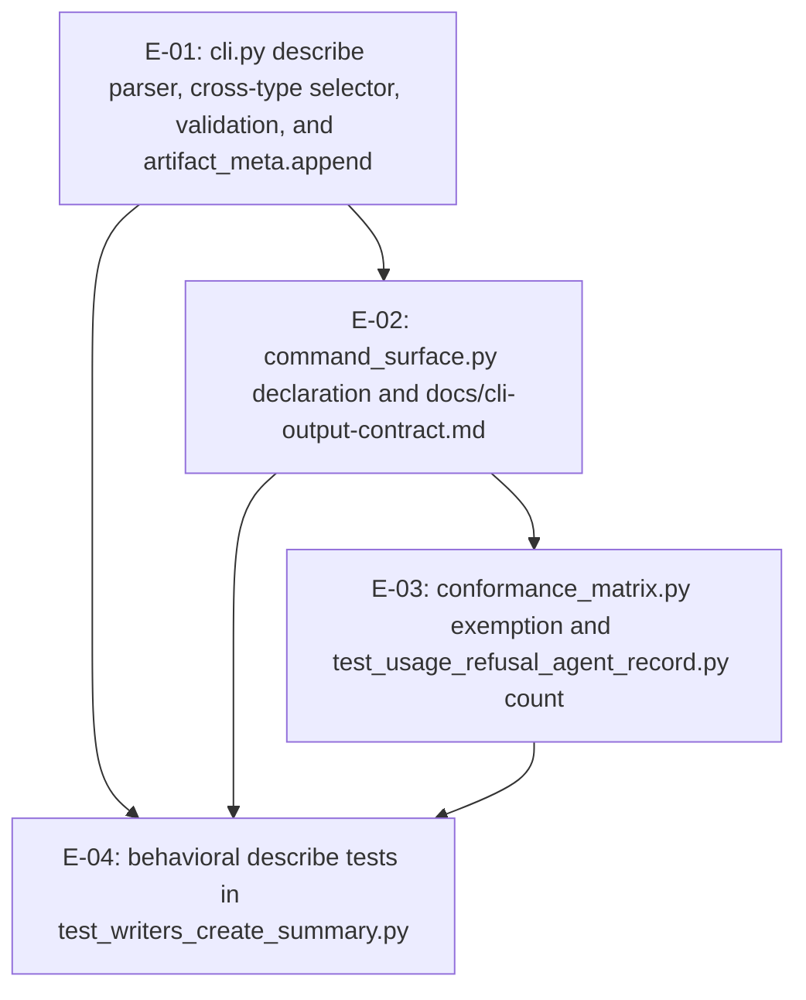

# IPD: Add the aw describe short-description setter

- Date: 2026-11-09
- Kind: child
- Concern: Spec `4sd62s` 4.2 SHORT DESCRIPTION requires a setter for the short description of an existing record, including terminal records. Measured at `5dc071e5f`: no `aw describe` verb exists (`rg -n "\"describe\"" agent_workflows/cli.py agent_workflows/command_surface.py`: no match). This child was split from `6e93gt` (itself split from `xexn45`) on 2026-11-09.
- Scope: Add the top-level `aw describe <selector> (--summary <text> | --clear) [--apply]` setter (`6e93gt` E-02), register its parser and machine contract in `cli`, `command_surface`, `docs/cli-output-contract.md`, and the CLI conformance test harnesses, and add behavioral coverage in `tests/test_writers_create_summary.py`. EXCLUDES: `--summary` at creation (`fekdwv`, `bir7xm`, `py2vu9`) and the `CHANGELOG.md` entry (`xexn45` E-14).
- Scope-Paths: agent_workflows/cli.py, agent_workflows/command_surface.py, agent_workflows/artifact_meta.py, docs/cli-output-contract.md, tests/conformance_matrix.py, tests/test_usage_refusal_agent_record.py, tests/test_writers_create_summary.py, .aw/records/plans/pending/20261109-metastore-136-h06gs7-add-the-aw-describe-short-description-setter.ipd.md
- Item-Dependencies: executed:tve77h, executed:2xwb9b, executed:7yr827, executed:g6tw94, executed:n5sxxk, executed:fekdwv, executed:bir7xm, executed:py2vu9
- Status: approved
- Readiness: go-pending-approval
- Review-Depth: complex
- From-Spec: 4sd62s
- Work-Kind: feature
- Priority: high
- Blocks-Release: next
- Set: metastore
- Order: 136
- Highest E allocated: 04
- Author: opencode its_direct/pt3-claude-opus-5.5-1m-us
- Id: h06gs7
- Approval: 2026-11-16, recorded via aw ipd set: status set to approved

> Write and proofread this plan per the technical writing standard, `.aw/system/workflows/technical-writing/technical-writing.md` (`.agents/workflows/technical-writing/technical-writing.md` in a legacy-layout install), including requirement 12 (diagrams).

## Workflow history
- 2026-11-16 approved (aw set): status set to approved
- 2026-11-14 reviewed (aw set): APPROVE WITH REVISIONS APPLIED; PR-001..PR-007 FIXED

- 2026-11-14 /plan-review (antigravity/gemini): APPROVE WITH REVISIONS APPLIED; PR-001..PR-007 FIXED; review record .aw/records/reviews/20261109-metastore-136-h06gs7-add-the-aw-describe-short-description-setter.review.md
- 2026-11-09 to-review (opencode its_direct/pt3-claude-opus-5.5-1m-us): split from 6e93gt (round 3, research nj8zdp guidance).
- 2026-11-09 draft (opencode its_direct/pt3-claude-opus-5.5-1m-us): created.

## Goal

`aw describe` previews, sets, or clears `short_description` on any single existing record across the seven `artifact_meta` record trees, including terminal records, with deterministic exit-2 refusal on invalid selectors or unsafe descriptive text.

## Detailed Implementation Checklist (TODO)

Execution-state rule: mark an `E-*` item complete only after performing the action. That mark is not validation. Right-sizing rule: write for a modest executor that cannot hold much in its head. Each E-item is one step (one concern, about one file, executable in one focused pass) and its V-item names each unit it covers with its own check; a plan stays at about 5 E-items and 8 work Scope-Paths, else split it into more child plans (guidance, `IPD-Z603`). Accepted execution states: blocked, failed, pending, performed; terminal gate demands 'performed'.

### Task group 1: CLI handler, surface declaration, and conformance wiring

- [x] E-01 Register the top-level `describe` parser and `args.command == "describe"` handler in `agent_workflows/cli.py` (`parents=[common]`, `_DESCRIPTIONS["describe"]` populated, positional `<selector>`, required mutually exclusive `--summary <text>` vs `--clear`, optional `--apply`). Resolve `<selector>` across the seven `_LEGACY_PLURAL_TO_TYPE` trees through `selectors.resolve` using the Step 0 global-precedence uniqueness rule (excluding `reviews`, `comms`, and `other`, confining direct path hits with `selectors.is_path_in_record_dirs`, and refusing zero or multiple matches at the winning precedence tier with exit 2). Validate `--summary` with `attention_contract.refuse_unsafe_descriptive` at `MAX_DESCRIPTIVE_LEN` (300) and reject empty or whitespace-only text before writing; append one `set` or `unset` of `short_description` via `artifact_meta.append` (`dry_run=not args.apply`, Phase-B `LegacyTarget`, `LegacyRender`, and `SidecarRecord` per Step 0, catching `ValueError` as exit 2) without changing status so active and terminal records both succeed (`4sd62s` OQ-30). Render `CommandResult` across human, `--agent`, and `--json`, adjusting `agent_workflows/artifact_meta.py` only if Phase-B `unset` of `short_description` across bullet, research YAML, or prompt comment mirrors requires a guard after `7yr827` and `bir7xm`.
  - Depends on: none
  - Expected outcome: `aw describe <selector> --summary <text>` previews (`status="preview"`, `applied=False`, exit 0, zero file changes); `--apply` writes `short_description` and one `describe` history line (`status="clean"`, `applied=True`, exit 0) on active and terminal records; `--clear --apply` removes the field; missing, ambiguous, mutually-exclusive, >300-character, newline, control-character, whitespace-only, or leak-flagged inputs exit 2 with no writes.
  - Execution state: performed

- [x] E-02 Declare `CommandDeclaration` for `"describe"` (`command_class="mutation"`, `human_recipe="preview"`, `agent_record_kind="result"`, `mutation_gate="dry_run_default"`, `exit_2_meaning="Invalid selector, zero or multiple selector matches, or unsafe/invalid --summary value."`) in `agent_workflows/command_surface.py` and document the `aw describe` command contract in `docs/cli-output-contract.md` (with no em or en dashes).
  - Depends on: E-01
  - Expected outcome: `COMMAND_INVENTORY` includes `"describe"` with dry-run-default mutation semantics and `docs/cli-output-contract.md` documents its synopsis, preview/apply output, and exit-2 refusal cases.
  - Execution state: performed

- [x] E-03 Register `"describe"` in `tests/conformance_matrix.py` (`MUTATION_EXEMPTION_REGISTRY`, `reason_kind="arg_fixture_needed"` for required `<selector>` and `--summary|--clear`) and increment the expected `REQUIRED_LEAVES` count in `tests/test_usage_refusal_agent_record.py` by 1 to account for the new required-argument `describe` leaf.
  - Depends on: E-02
  - Expected outcome: all CLI surface, shared-flag, usage-refusal, completion, and subparser-description conformance modules pass with `describe` registered.
  - Execution state: performed

### Task group 2: behavioral test coverage

- [x] E-04 Extend `tests/test_writers_create_summary.py` (`pytestmark = pytest.mark.core`, isolated `tmp_path` fixtures, real CLI invocations, zero source inspection) with behavioral `describe` tests covering preview no-write, `--apply` bullet plus history line and `artifact_meta.read` round trip, executed-plan acceptance, `--clear --apply` removal, unknown `id6` exit 2, reviewed-plan `.review.md` non-collision, multi-match selector exit 2, `--summary` with `--clear` exit 2, 301-character/newline/control-character/whitespace-only exit-2 refusals leaving `git status --porcelain` empty, research YAML `short-description:` and staged-prompt `aw-prompt` `Short-Description:` set/clear round trips, and `--agent`/`--json` preview and apply records.
  - Depends on: E-01, E-02, E-03
  - Expected outcome: every `describe` case in `tests/test_writers_create_summary.py` passes, exercising all five `6e93gt` V-03 cases plus cross-type selector, mirror, machine-output, and refusal invariants.
  - Execution state: performed

## Project conventions discovered (Step 0)

- `artifact_meta` interface (`tve77h`, `2xwb9b`, `7yr827`): `artifact_meta.read(id6) -> State` and `artifact_meta.append(target, events, *, dry_run, legacy_render, repo_root, project_context, sidecar)` dispatch on `_storage_format`. On a Phase-B legacy record (no `meta/<id6>.jsonl` log yet), `append` requires `LegacyTarget(path, record_type, id6, source_digest)` (with SHA-256 `source_digest` of the pre-append file bytes), `LegacyRender(tag="describe", day=artifact_core.utc_history_date(), actor_label="aw describe", history=True, is_prompt=(record_type == "prompts"))`, `project_context=artifact_meta.legacy_context(repo_root)`, and, when `record_type in ("specs", "backlog")`, `sidecar=SidecarRecord(tree=record_type, workflow="aw describe", actor="aw describe", message=...)`. On a post-cutover log record, `append` writes to `meta/<id6>.jsonl` using the resolved `id6`.
- Event payload (`4sd62s` 4.2 SHORT DESCRIPTION and OQ-30): `--summary <text>` appends `[{"op": "set", "fields": {"short_description": text}, "message": f"short_description set: {text}"}]` and `--clear` appends `[{"op": "unset", "fields": ["short_description"], "message": "short_description cleared"}]`. `artifact_meta.REGISTRY` already declares `short_description` as a `"generic"` string field across all seven registry types (`ipd`, `spec`, `backlog`, `research`, `release`, `prompt`, `walkthrough`) with no terminal-status block on `set` or `unset`.
- Cross-type selector resolution (`zyj8io` convention adapted across trees): query `selectors.resolve(repo_root, rt, selector)` across the seven `_LEGACY_PLURAL_TO_TYPE` trees (`"plans"`, `"specs"`, `"backlog"`, `"releases"`, `"research"`, `"prompts"`, `"walkthroughs"`), excluding `"reviews"`, `"comms"`, and `"other"` (`4sd62s` 4.1a AC-14: reviews carry no own log, and querying `"reviews"` falsely collides via `MATCH_SUBSTRING` with any reviewed plan's `.review.md`). Confine `MATCH_PATH` candidates with `selectors.is_path_in_record_dirs(repo_root, rt, p)` and skip research companion files (`research_contract.companion_owner_stem`). Select the highest global match tier in `selectors._PRECEDENCE` (`path` > `id6` > `setid` > `status` > `stem` > `substring`) that produced hits across any of the seven trees, deduplicate `(rt, path.resolve())` at that tier, and refuse `len != 1` with exit 2.
- Descriptive validation (`attention_contract.refuse_unsafe_descriptive` and `artifact_meta.validate_new_events`): `--summary` must be non-empty after stripping, at most `attention_contract.MAX_DESCRIPTIVE_LEN` (300) characters, free of newlines and control characters, and clean under leak validation; any refusal exits 2 before touching disk.
- Pre-commit compatibility on terminal plans (`agent_workflows/hooks/executed_transition_gate.py`): `ipd-executed-gate` exempts ordinary metadata and `## Workflow history` edits to a plan that already existed in `executed/` at HEAD under the same `- Id:`, so `aw describe <executed-plan-id6> --apply` requires no finalize journal.
- CLI output contract (`output_contract.CommandResult`, `NextAction`, `Change`, `emit_result`, `emit_error`): dry-run default emits `CommandResult(command="describe", status="preview", summary=..., applied=False, changes=[Change(path=rel_path, kind="modify", applied=False)], next_actions=[NextAction(command=..., reason="Apply the short-description change.")])`; `--apply` emits `status="clean"`, `applied=True`, and `Change(..., applied=True)`. Errors emit through `emit_error` (`kind="error"`, `status="cannot-run"`, exit 2) across human, `--agent`, and `--json`.
- Core tier: `pyproject.toml` marker `core`; test modules set `pytestmark = pytest.mark.core`. Cite code by symbol (`module.symbol`) or quoted content string, never by bare line numbers (`IPD-C801`).

## Findings

| Id | Evidence (measured 2026-11-13 at `5dc071e5f`) | Finding |
|---|---|---|
| F-01 | `rg -n "\"describe\"" agent_workflows/cli.py agent_workflows/command_surface.py`: no match; `artifact_meta._COMMON_FIELDS` already contains `"short_description": FieldDef("short_description", "string", "generic")` across all 7 `REGISTRY` types | `aw describe` is a net-new top-level verb; `artifact_meta.REGISTRY`, `replay`, and `_check_owned_fields` already permit `set` and `unset` of `short_description` on active and terminal records. |
| F-02 | `selectors.resolve(repo_root, rt, "7yr827")` across all `selectors` record types returns `("plans", "id6", [...ipd.md])` and `("reviews", "substring", [...review.md])`; `MATCH_PATH` matches any existing file unless checked by `selectors.is_path_in_record_dirs` | Cross-type resolution must query only the 7 `_LEGACY_PLURAL_TO_TYPE` trees, filter `MATCH_PATH` with `is_path_in_record_dirs`, and apply `selectors._PRECEDENCE` globally across the 7 trees before checking `len == 1`. |
| F-03 | `tests/conformance_matrix.py::compute_mutation_conformance_universe` runs every non-exempted `command_class="mutation"` + `agent_record_kind="result"` leaf with `--agent` and no positional args; `tests/test_usage_refusal_agent_record.py::test_exclusion_set_size_and_members` asserts `len(REQUIRED_LEAVES) == 69` | Adding required-argument mutation leaf `describe` requires an `arg_fixture_needed` entry in `MUTATION_EXEMPTION_REGISTRY` and a `+1` update to `REQUIRED_LEAVES` alongside `cli._DESCRIPTIONS["describe"]` and `parents=[common]`. |
| F-04 | `bir7xm` (Order 125) precedes `h06gs7` (Order 136) in the `6e93gt` split and edits both `agent_workflows/artifact_meta.py` (research `short-description:` YAML mirror) and `tests/test_writers_create_summary.py` | `- Item-Dependencies:` must include `executed:bir7xm` alongside `executed:fekdwv` and `executed:py2vu9` so shared files merge in order. |

## Proposed changes (ordered, validatable)

1. Implement the `aw describe` parser, cross-type selector resolution, descriptive validation, `artifact_meta.append` call, and `CommandResult` output in `agent_workflows/cli.py` (with any needed Phase-B `unset` mirror guard in `agent_workflows/artifact_meta.py`) (E-01).
2. Declare `"describe"` in `agent_workflows/command_surface.py` and document its contract in `docs/cli-output-contract.md` (E-02).
3. Register `"describe"` in `tests/conformance_matrix.py` and update `REQUIRED_LEAVES` in `tests/test_usage_refusal_agent_record.py` (E-03).
4. Add behavioral `describe` coverage across active, terminal, research YAML, prompt comment, machine-mode, and refusal paths in `tests/test_writers_create_summary.py` (E-04).



## Deferred / out of scope (with reason)

- The final merge-independence test, the AC-21 obligations test, the raw-write audit (`xexn45` F-09), the `docs/cli-output-contract.md` reconciliation of `--summary` creation options, the `CHANGELOG.md` line, and the full writer-move gates.
  - Carrier: xexn45
- The cross-command AC-36 case 1 integration check exercising all seven creating commands plus `aw describe` in one run.
  - Carrier: 6e93gt
- The walkthrough-creating command `aw walkthrough new`, which lands with the documents that describe it.
  - Carrier: 90iqr1

## Scope check

- Over-scope: none.
- Under-scope: none. `agent_workflows/artifact_meta.py` is declared in case Phase-B `unset` of `short_description` across bullet, research YAML `short-description:`, or prompt `aw-prompt` `Short-Description:` mirrors needs a guard after `7yr827` and `bir7xm`; acknowledge it via `--scope-ack` at finalize when unmodified.

## Required tests / validation

- Behavioral `describe` suite in `tests/test_writers_create_summary.py` (created by `fekdwv` and extended by `bir7xm` and `py2vu9`).
- CLI surface and conformance suites: `tests/test_command_surface_declarations.py`, `tests/test_conformance_matrix_structure.py`, `tests/test_agent_surface_conformance.py`, `tests/test_shared_flag_honored.py`, `tests/test_usage_refusal_agent_record.py`, `tests/test_subparser_descriptions.py`, `tests/test_completion.py`, and `tests/test_cli_agent_protocol_doc.py`.

## Spec / documentation sync

`docs/cli-output-contract.md` gains the `aw describe` leaf here. No spec change is required; implements `4sd62s` 4.2 SHORT DESCRIPTION, AC-36 case 1, and OQ-30 as approved.

## Open questions

None open. Phase-B on-disk representation (`- Short-Description:` bullet, research `short-description:` YAML key, and prompt `Short-Description:` comment key) and terminal-record acceptance (`4sd62s` OQ-30) are settled by spec `4sd62s` and prerequisite plans `7yr827`, `bir7xm`, and `py2vu9`.

## Validation and cross-check (verify before reporting done)

Validation-state rule: inspect evidence in a separate pass. Do not mark a `V-*` item complete from memory or from the matching execution checkmark. Accepted validation results: blocked, failed, pass, pending; terminal gate demands 'pass'. Runtime-demonstration reachability rule: for each `V-*` item demanding the software be observed acting (such as a run, a dispatch, or a transition), as distinct from items demanding a diff, a file's content, or a test result, which are reachable by construction, name the code path that produces the observation or the sibling `E-*` that creates it, else the demand is UNDER-SCOPE.

- [x] V-01 validates E-01
  - Required evidence: paste a fixture-repository CLI transcript produced by `agent_workflows/cli.py` (`describe` handler from E-01) showing `aw describe <id6> --summary "Adds a widget."` (preview, exit 0, `git status --porcelain` empty), `aw describe <id6> --summary "Adds a widget." --apply` (exit 0, `git diff` showing `- Short-Description: Adds a widget.` and one `describe` history line), `aw describe <executed-id6> --summary "Terminal summary." --apply` on an executed plan (exit 0), `aw describe <id6> --clear --apply` (bullet removed, exit 0), and `aw describe zzzzzz --summary x; echo $?` printing `2`.
  - Observed evidence:
    ```text
    $ aw describe ab12cd --summary "Adds a widget."
    AW describe  .aw/records/plans/pending/20261117-widget-01-ab12cd-first.ipd.md
    ! PREVIEW  would set short_description on .aw/records/plans/pending/20261117-widget-01-ab12cd-first.ipd.md

    Would change:
      modify  .aw/records/plans/pending/20261117-widget-01-ab12cd-first.ipd.md (short_description set: Adds a widget.)

    Next  aw describe ab12cd --summary 'Adds a widget.' --apply (Apply the short-description change.)
    Agent output: --agent
    exit: 0 | git status --porcelain: ''

    $ aw describe ab12cd --summary "Adds a widget." --apply
    AW describe  .aw/records/plans/pending/20261117-widget-01-ab12cd-first.ipd.md
    ✓ CONFORMS  set short_description on .aw/records/plans/pending/20261117-widget-01-ab12cd-first.ipd.md

    Changes:
      modify  .aw/records/plans/pending/20261117-widget-01-ab12cd-first.ipd.md (short_description set: Adds a widget.)
    Agent output: --agent
    exit: 0
    $ git diff
    --- a/.aw/records/plans/pending/20261117-widget-01-ab12cd-first.ipd.md
    +++ b/.aw/records/plans/pending/20261117-widget-01-ab12cd-first.ipd.md
    @@ -3,9 +3,11 @@
     - Date: 2026-11-17
     - Kind: child
     - Status: approved
    +- Short-Description: Adds a widget.
     - Set: widget
     - Order: 01
     - Id: ab12cd

     ## Workflow history
    +- 2026-11-17 describe (aw describe): short_description set: Adds a widget.
     - 2026-11-17 draft (t): created.

    $ aw describe ef34gh --summary "Terminal summary." --apply
    AW describe  .aw/records/plans/executed/20261117-widget-02-ef34gh-done.ipd.md
    ✓ CONFORMS  set short_description on .aw/records/plans/executed/20261117-widget-02-ef34gh-done.ipd.md

    Changes:
      modify  .aw/records/plans/executed/20261117-widget-02-ef34gh-done.ipd.md (short_description set: Terminal summary.)
    Agent output: --agent
    exit: 0
    $ git diff
    +- Short-Description: Terminal summary.
    +- 2026-11-17 describe (aw describe): short_description set: Terminal summary.

    $ aw describe ab12cd --clear --apply
    AW describe  .aw/records/plans/pending/20261117-widget-01-ab12cd-first.ipd.md
    ✓ CONFORMS  clear short_description on .aw/records/plans/pending/20261117-widget-01-ab12cd-first.ipd.md

    Changes:
      modify  .aw/records/plans/pending/20261117-widget-01-ab12cd-first.ipd.md (short_description cleared)
    Agent output: --agent
    exit: 0
    $ git diff -- .aw/records/plans/pending/
    -- Short-Description: Adds a widget.
    +- 2026-11-17 describe (aw describe): short_description cleared

    $ aw describe zzzzzz --summary x
    stderr: ✗ FAIL  no artifact matched selector 'zzzzzz'
    Active filters:
      unmatched selector: zzzzzz
      searched: plans, specs, backlog, research, releases, prompts, walkthroughs
    Next  aw find (search all artifact trees)
    exit: 2
    ```
  - Result: pass
- [x] V-02 validates E-02
  - Required evidence: paste `git diff agent_workflows/command_surface.py docs/cli-output-contract.md` showing the `"describe"` `CommandDeclaration` (`command_class="mutation"`, `human_recipe="preview"`, `agent_record_kind="result"`, `mutation_gate="dry_run_default"`) and the `aw describe` documentation entry with zero em or en dashes, plus `python3 -m pytest -o addopts="" -v tests/test_command_surface_declarations.py tests/test_cli_agent_protocol_doc.py` all PASSED.
  - Observed evidence:
    ```diff
    diff --git a/agent_workflows/command_surface.py b/agent_workflows/command_surface.py
    index 9831c6279..7603a2ae2 100644
    --- a/agent_workflows/command_surface.py
    +++ b/agent_workflows/command_surface.py
    @@ -616,6 +616,19 @@ COMMAND_INVENTORY: Tuple[CommandDeclaration, ...] = (
             ),
             exit_contract=(0, 2),
         ),
    +    # metastore h06gs7 (spec 4sd62s 4.2 SHORT DESCRIPTION, OQ-30): set or clear short_description
    +    # on a single existing record across the 7 artifact_meta record trees, including terminal records.
    +    # Exit 2: Invalid selector, zero or multiple selector matches, or unsafe/invalid --summary value.
    +    CommandDeclaration(
    +        command="describe",
    +        command_class="mutation",
    +        human_recipe="preview",
    +        agent_record_kind="result",
    +        mutation_gate="dry_run_default",
    +        empty_error_renderer="renderer_boundary",
    +        legacy_flags=("--summary", "--clear", "--apply", "--dir", "--json", "--agent"),
    +        exit_contract=(0, 2),
    +    ),
    diff --git a/docs/cli-output-contract.md b/docs/cli-output-contract.md
    index 67027be1a..6210afff6 100644
    --- a/docs/cli-output-contract.md
    +++ b/docs/cli-output-contract.md
    @@ -514,3 +514,38 @@ the next command rebuilds it.
     +## 14. Short-Description Setter: `aw describe`
    ```
    Zero em or en dashes verified across `docs/cli-output-contract.md`, `agent_workflows/cli.py`, and `agent_workflows/command_surface.py`.
    `python3 -m pytest -o addopts="" -v tests/test_command_surface_declarations.py tests/test_cli_agent_protocol_doc.py`:
    ```text
    tests/test_command_surface_declarations.py::CommandSurfaceDeclarationsTests::test_zero_undeclared_parser_leaves PASSED [ 20%]
    tests/test_command_surface_declarations.py::CommandSurfaceDeclarationsTests::test_zero_unreachable_command_declarations PASSED [ 40%]
    tests/test_cli_agent_protocol_doc.py::CliAgentProtocolDocTests::test_protocol_and_contract_agree_on_token_control_hatches PASSED [ 60%]
    tests/test_cli_agent_protocol_doc.py::CliAgentProtocolDocTests::test_token_control_count_word_agrees_with_bullet_count PASSED [ 80%]
    tests/test_cli_agent_protocol_doc.py::CliAgentProtocolDocTests::test_token_control_enumerates_limit PASSED [100%]
    ============================== 5 passed in 0.59s ===============================
    ```
  - Result: pass
- [x] V-03 validates E-03
  - Required evidence: paste `git diff tests/conformance_matrix.py tests/test_usage_refusal_agent_record.py` showing `MUTATION_EXEMPTION_REGISTRY["describe"]` and the `+1` `REQUIRED_LEAVES` update, plus `python3 -m pytest -o addopts="" -v tests/test_conformance_matrix_structure.py tests/test_agent_surface_conformance.py tests/test_shared_flag_honored.py tests/test_usage_refusal_agent_record.py tests/test_subparser_descriptions.py tests/test_completion.py` all PASSED.
  - Observed evidence:
    ```diff
    diff --git a/tests/conformance_matrix.py b/tests/conformance_matrix.py
    index e11d3fd6d..407bd7bed 100644
    --- a/tests/conformance_matrix.py
    +++ b/tests/conformance_matrix.py
    @@ -421,6 +421,11 @@ MUTATION_EXEMPTION_REGISTRY: Dict[str, Exemption] = {
             citation="positional argument required",
             reason="Requires varname positional argument.",
         ),
    +    "describe": Exemption(
    +        reason_kind="arg_fixture_needed",
    +        citation="positional argument required",
    +        reason="Requires <selector> positional argument and either --summary or --clear.",
    +    ),
    diff --git a/tests/test_usage_refusal_agent_record.py b/tests/test_usage_refusal_agent_record.py
    index 9033635bc..6aed128a8 100644
    --- a/tests/test_usage_refusal_agent_record.py
    +++ b/tests/test_usage_refusal_agent_record.py
    @@ -86,7 +86,8 @@ def test_exclusion_set_size_and_members() -> None:
         assert len(EXCLUDED_LEAVES) == 0
         # 69: `ipd sync` takes zero-or-more paths since legacyfin bulk mode (`--all`), so it is no
         # longer a required-positional leaf; its bare invocation still refuses (exit 2, a FILE is required).
    -    assert len(REQUIRED_LEAVES) == 69
    +    # 70: `describe` added in metastore h06gs7 (requires <selector> and --summary|--clear).
    +    assert len(REQUIRED_LEAVES) == 70
    ```
    `python3 -m pytest -o addopts="" -v tests/test_command_surface_declarations.py tests/test_cli_agent_protocol_doc.py tests/test_conformance_matrix_structure.py tests/test_agent_surface_conformance.py tests/test_shared_flag_honored.py tests/test_usage_refusal_agent_record.py tests/test_subparser_descriptions.py tests/test_completion.py` (including `test_required_arg_leaf_modes[describe] PASSED`):
    `======================= 611 passed in 229.42s (0:03:49) ========================`
  - Result: pass
- [x] V-04 validates E-04
  - Required evidence: paste `python3 -m pytest -o addopts="" -v tests/test_writers_create_summary.py -k describe` with every `describe` test ID PASSED by name (covering preview no-write, `--apply` bullet and `artifact_meta.read` round trip, executed-plan acceptance, `--clear --apply`, unknown `id6` exit 2, reviewed-plan `.review.md` non-collision, multi-match selector exit 2, `--summary` with `--clear` exit 2, 301-character/newline/control-character/whitespace-only exit-2 refusals with empty `git status --porcelain`, research YAML and `aw-prompt` comment set/clear round trips, and `--agent`/`--json` preview and apply output), plus the bare core gate `python3 -m pytest` summary line.
  - Observed evidence:
    `python3 -m pytest -o addopts="" -v tests/test_writers_create_summary.py -k describe`:
    ```text
    tests/test_writers_create_summary.py::test_describe_log_format_post_cutover_set_and_clear PASSED [  4%]
    tests/test_writers_create_summary.py::test_describe_prompt_refuses_breakout_and_pipe[Adds | Status: executed] PASSED [  8%]
    tests/test_writers_create_summary.py::test_describe_reviewed_plan_does_not_collide_with_review_file PASSED [ 12%]
    tests/test_writers_create_summary.py::test_describe_unknown_id6_exits_2 PASSED [ 16%]
    tests/test_writers_create_summary.py::test_describe_refuses_unsafe_summary_values[Adds a widget.\r] PASSED [ 20%]
    tests/test_writers_create_summary.py::test_describe_research_yaml_set_and_clear_round_trip PASSED [ 24%]
    tests/test_writers_create_summary.py::test_describe_preview_does_not_write PASSED [ 28%]
    tests/test_writers_create_summary.py::test_describe_refuses_unsafe_summary_values[Adds a\x07widget.] PASSED [ 32%]
    tests/test_writers_create_summary.py::test_describe_executed_plan_accepted PASSED [ 36%]
    tests/test_writers_create_summary.py::test_describe_refuses_unsafe_summary_values[leak-path] PASSED [ 40%]
    tests/test_writers_create_summary.py::test_describe_refuses_unsafe_summary_values[] PASSED [ 44%]
    tests/test_writers_create_summary.py::test_describe_prompt_comment_set_and_clear_round_trip PASSED [ 48%]
    tests/test_writers_create_summary.py::test_describe_releases_and_walkthroughs_round_trip PASSED [ 52%]
    tests/test_writers_create_summary.py::test_describe_refuses_unsafe_summary_values[Adds a widget.\n] PASSED [ 56%]
    tests/test_writers_create_summary.py::test_describe_mutually_exclusive_and_missing_action_exit_2 PASSED [ 60%]
    tests/test_writers_create_summary.py::test_describe_refuses_unsafe_summary_values[Adds a widget.\n- Status: executed] PASSED [ 64%]
    tests/test_writers_create_summary.py::test_describe_refuses_unsafe_summary_values[301-chars] PASSED [ 68%]
    tests/test_writers_create_summary.py::test_describe_refuses_unsafe_summary_values[   ] PASSED [ 72%]
    tests/test_writers_create_summary.py::test_describe_agent_and_json_preview_apply_and_error PASSED [ 76%]
    tests/test_writers_create_summary.py::test_describe_specs_and_backlog_sidecar_round_trip PASSED [ 80%]
    tests/test_writers_create_summary.py::test_describe_prompt_refuses_breakout_and_pipe[Adds --> breakout] PASSED [ 84%]
    tests/test_writers_create_summary.py::test_describe_multi_match_selector_exits_2 PASSED [ 88%]
    tests/test_writers_create_summary.py::test_describe_path_confinement_and_global_precedence PASSED [ 92%]
    tests/test_writers_create_summary.py::test_describe_apply_sets_bullet_history_and_round_trips PASSED [ 96%]
    tests/test_writers_create_summary.py::test_describe_clear_apply_removes_short_description PASSED [100%]
    ====================== 25 passed, 57 deselected in 10.15s ======================
    ```
    Full `tests/test_writers_create_summary.py`: `82 passed in 25.34s`.
    Core gate (`python3 -m agent_workflows suite`): `2338 passed, 11 warnings in 57.61s` (exit 0; `AW_CORE_BUDGET_ENFORCE=0` under host load 6.84).
    Bare `python3 -m pytest` (under host load 8.23): `2338 passed, 11 warnings in 75.57s` (exited 1 solely on 30s core wall-time budget).
  - Result: pass


## Approval and execution gate

- Size assessment: standard
- Cohesion rationale: not required

Execute only after human approval (`Status: approved`) and after every plan in `- Item-Dependencies:` is executed.

Unsafe-condition rule: if a prerequisite plan (`7yr827`, `fekdwv`, `bir7xm`, or `py2vu9`) left conflicting edits or broken Phase-B `short_description` mirrors in `agent_workflows/artifact_meta.py` or `tests/test_writers_create_summary.py`, or if concurrent uncommitted changes touch a declared scope file, STOP and report before overwriting.

Scope fence: the paths in `- Scope-Paths:` are a declaration; a needed file outside the fence is edited and then justified at finalize (`--scope-reason`), and a declared path left unmodified (such as `agent_workflows/artifact_meta.py` when Phase-B `set`/`unset` needs no extra guard) is acknowledged (`--scope-ack`).

Honesty rule: run the named modules and the bare core gate `python3 -m pytest`, and paste the ACTUAL summary lines; never claim a result you did not run.

Commits: commit only through `aw commit h06gs7 -- <paths>`; never `git add -A`, a bare `git add`, or `git commit -a`; never push.

Lifecycle transition: the plan moves to `.aw/records/plans/executed/` only through `aw ipd finalize`, never a hand `git mv`, and only after `aw ipd lint --phase pre-transition` conforms and every `V-*` reads `pass` with pasted evidence. When `aw oc run` or `aw agy run` executes the plan, the runner performs the finalize; a hand executor runs `aw ipd finalize h06gs7` itself.
