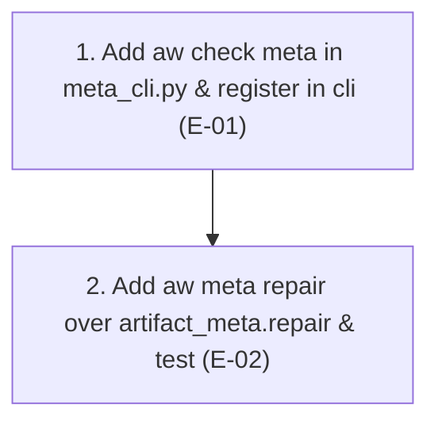

# IPD: Add aw check meta and aw meta repair over artifact_meta

- Date: 2026-11-09
- Kind: child
- Concern: Split from `ffceq0` (Order 08, its Task group 4) in round 3 of the metastore re-split, per research `nj8zdp` guidance (at most 5 E-items, 8 work Scope-Paths and about 8 named units per item). Spec `4sd62s` 4.6 requires an `aw check meta` drift check and 4.3/4.7 require an `aw meta repair` command over the Order 02 `artifact_meta.repair` function; neither exists today (`ffceq0` F-10: `aw check --help` lists plans, specs, prompts, research, backlog, walkthroughs, roadmaps, comms, releases, all, and there is no `aw meta` command).
- Scope: Add the two CLI leaves `aw check meta` and `aw meta repair` in `agent_workflows/meta_cli.py`, register them in `cli`, `command_surface` and `tests/conformance_matrix.py`, and test each in its own core module (`ffceq0` E-10 and E-11 carried unchanged). EXCLUDES: every reader move (the other `ffceq0` parts), the cache-parity and offline tests, the residual audit, `docs/cli-output-contract.md` and `CHANGELOG.md` (all kept in `ffceq0`).
- Scope-Paths: agent_workflows/meta_cli.py, agent_workflows/cli.py, agent_workflows/command_surface.py, tests/conformance_matrix.py, tests/test_check_meta.py, tests/test_meta_repair_cli.py, .aw/records/plans/pending/20261109-metastore-140-a5ijjx-add-aw-check-meta-and-aw-meta-repair-over-artifact-meta.ipd.md
- Item-Dependencies: executed:g5hpbb, executed:tve77h, executed:xexn45, executed:r81uvz, executed:dqutt8, executed:w1cs3p, executed:na188y, executed:i3b5zu, executed:ebrc4t
- Status: approved
- Readiness: go-pending-approval
- Review-Depth: complex
- From-Spec: 4sd62s
- Work-Kind: feature
- Priority: high
- Blocks-Release: next
- Set: metastore
- Order: 140
- Highest E allocated: 02
- Author: opencode its_direct/pt3-claude-opus-5.5-1m-us
- Id: a5ijjx
- Approval: 2026-11-16, recorded via aw ipd set: status set to approved

> Write and proofread this plan per the technical writing standard, `.aw/system/workflows/technical-writing/technical-writing.md` (`.agents/workflows/technical-writing/technical-writing.md` in a legacy-layout install), including requirement 12 (diagrams).

## Workflow history
- 2026-11-16 approved (aw set): status set to approved
- 2026-11-14 reviewed (aw set): APPROVE WITH REVISIONS APPLIED; PR-001..PR-003 FIXED

- 2026-11-14 /plan-review (antigravity/gemini): APPROVE WITH REVISIONS APPLIED; PR-001..PR-003 FIXED; review record .aw/records/reviews/20261109-metastore-140-a5ijjx-add-aw-check-meta-and-aw-meta-repair-over-artifact-meta.review.md
- 2026-11-09 to-review (opencode its_direct/pt3-claude-opus-5.5-1m-us): split from ffceq0 (round 3, research nj8zdp guidance).
- 2026-11-09 draft (opencode its_direct/pt3-claude-opus-5.5-1m-us): created.

## Goal

`aw check meta` reports every 4.6 drift row the legacy format can express (and names the rows it cannot), and `aw meta repair` previews and applies mirror repairs on synthetic log fixtures, so the split parent `ffceq0` can include both commands in its cache-parity test.

## Detailed Implementation Checklist (TODO)

Execution-state rule: mark an `E-*` item complete only after performing the action. That mark is not validation. Right-sizing rule: write for a modest executor that cannot hold much in its head. Each E-item is one step (one concern, about one file, executable in one focused pass) and its V-item names each unit it covers with its own check; a plan stays at about 5 E-items and 8 work Scope-Paths, else split it into more child plans (guidance, `IPD-Z603`). Accepted execution states: blocked, failed, pending, performed; terminal gate demands 'performed'.

This plan moves no reader, so the pin-first reader rule and decisions D-1 to D-6 of `ffceq0` do not govern it. New test modules set `pytestmark = pytest.mark.core`, call real functions or the real `aw` CLI, and never read production source. Commit through `aw commit a5ijjx -- <each changed path>`, one commit per item allowed, never `git add -A`, a bare `git add` or `git commit -a`. Never push.

### Task group 1: the new meta commands

- [x] E-01 (carried from `ffceq0` E-10) Add `aw check meta` (4.6) in `agent_workflows/meta_cli.py`, registered in `cli`, `command_surface` and `tests/conformance_matrix.py`: in phase B it runs every 4.6 row that the legacy format can express, reading only `artifact_meta.query` (in-file `status` and `id` mirror against cached state; filename Set, `NN`, `id6`, date and D177 facets through `artifact_naming`; research filename facets; disposition directory against status; review rounds against review rows; orphans: a `meta/*.jsonl` file with no record, and, once logs exist, a record with no log). Rows that need a log (logged path, and the "artifact with no log" orphan half) report `not-applicable (legacy format)` so the output names them instead of skipping them; in phase B the in-file `status` and `id` rows compare each record's in-file value with its cached state and so mostly confirm the loader, and they become real drift checks once logs exist (Order 13). `meta` is a reserved word of `aw check`'s `type` positional, dispatched by `cli._run_check` before type validation in the way `1ajqaa` E-05 routes `rebuild` for `aw index`; `aw check all` does not include it in phase B, so the `aw check all` rule-id baselines of the check_engine parts stay comparable. Exit 0 clean, 1 findings, 2 cannot-run; `--agent` emits `aw.agent/v1` records with `{location, rule}`. Test module `tests/test_check_meta.py`: one fixture per drift kind, each detected (AC-7 phase-B form), plus a clean fixture with zero findings.
  - Depends on: none
  - Expected outcome: each drift fixture produces exactly its rule id; the clean fixture exits 0; `aw check meta --agent` on this checkout runs to completion and its finding count by rule is pasted (not required to be zero before the cutover).
  - Execution state: performed

- [x] E-02 (carried from `ffceq0` E-11) Add `aw meta repair <id6> [--apply] [--confirm]` in `meta_cli.py` over the Order 02 `artifact_meta.repair` function: preview by default; `--apply` performs mirror and move repair (no event, log byte-identical, idempotent); a divergent-tail repair requires `--confirm` and prints every resulting field change first (4.7). In phase B no log exists, so the command reports `nothing to repair (legacy format)` on a legacy record and is exercised on synthetic log fixtures. A synthetic fixture writes its `meta/<id6>.jsonl` from `artifact_meta.encode_event` lines and a two-key `---` front-matter mirror directly, NOT through `artifact_meta.create`/`append`, because in phase B those write the legacy format (the same rule as `1ajqaa` E-04 (b)); the fixture is its own `git init` repository so `git status --porcelain` in V-02 observes only the fixture. Registered in `cli`, `command_surface` and `tests/conformance_matrix.py`. Test module `tests/test_meta_repair_cli.py`.
  - Depends on: E-01
  - Expected outcome: on a synthetic log fixture with a stale front-matter `status`, `aw meta repair <id6>` previews one mirror change and exits 0 with no file change, `--apply` rewrites the mirror and a second `--apply` changes nothing; on a legacy record it reports the legacy message.
  - Execution state: performed

Add further leaves as `- [ ] E-NEW <action>` and run `aw ipd sync` to assign ids.

## Project conventions discovered (Step 0)

Carried from `ffceq0` Step 0, the lines this part relies on:

- The `artifact_meta` interface names come from Order 02 (`tve77h`) and are used exactly: `artifact_meta.read(id6) -> State`, `artifact_meta.history(id6)`, `artifact_meta.query(...)` with typed filters (type, status, Set, order, `depends_on`, `latest_gate_review_of`, `path`) and an `incomplete` list, `artifact_meta.resolve(path_or_id6)`, `artifact_meta.repair(id6, *, confirm=None)`.
- New CLI leaves are declared in `command_surface` (`CommandDeclaration`) and covered by `tests/conformance_matrix.py`. Order 03 (`1ajqaa`) creates `agent_workflows/meta_cli.py` for `aw show --history`, so this plan adds `check meta` and `meta repair` to that module.
- Core tier: modules set `pytestmark = pytest.mark.core`; the bare gate is `python3 -m pytest` (30 s budget).
- Cite code by SYMBOL (`module.function`) or by a quoted content string, with a line number only appended to one of those and never alone: an offset expires before this plan executes (advisory `IPD-C801`).

## Findings

Carried from `ffceq0` `## Findings` (measured 2026-11-02 at `0cbfcc706`):

| Id | Evidence | Finding |
|---|---|---|
| F-10 | No `aw check meta` and no `aw meta` command exist (`aw check --help` lists plans, specs, prompts, research, backlog, walkthroughs, roadmaps, comms, releases, all). Order 02 defers the `aw meta repair` CLI to `ffceq0`; Orders 03, 04 and 05 defer `aw check meta` to `ffceq0` | E-01 and E-02 own them. |

Size (round 3, research `nj8zdp` guidance): E-01 is one command with 11 drift fixtures plus a clean fixture and 3 registration files; E-02 is one command over an existing function, 3 registrations and 4 fixture cases. Both items name at most 6 distinct units (measured with `ipd_schema.count_named_units`).

## Behavior decisions (spec `4sd62s` 4.6, 4.7)

- D-1 (Conservative dependency chain). This plan retains the reader-move dependencies (`r81uvz`, `dqutt8`, `w1cs3p`, `na188y`, `i3b5zu`, `ebrc4t`) carried from `ffceq0` to preserve conservative ordering across the Set.
- D-2 (CLI dispatch of `aw check meta`). `meta` is dispatched as a reserved word by `cli._run_check` before standard type validation, mirroring `1ajqaa`'s `rebuild` routing in `aw index`. In Phase B, `aw check all` does not include `meta`, keeping baseline rule-id counts stable.
- D-3 (Repair confirmation and preview). `aw meta repair <id6>` previews changes by default without mutating files; `--apply` performs mirror and layout repairs; and diverged-tail repairs require `--confirm` with explicit diff output.
- D-4 (Phase B legacy reporting). When executed against a legacy repository without log sidecars, `aw meta repair` reports `nothing to repair (legacy format)` without failing. Tests validate full behavior using synthetic log fixtures.

## Proposed changes (ordered, validatable)

1. Add `aw check meta` (E-01).
2. Add `aw meta repair` (E-02).

## Deferred / out of scope (with reason)

- `docs/cli-output-contract.md` entries for the two leaves and the `CHANGELOG.md` line: written by the split parent's finishing item.
  - Carrier: ffceq0
- The logged-path drift row of `aw check meta` and AC-7 "zero findings on the migrated corpus".
  - Carrier: cxxmyv

## Scope check

- Over-scope: none. `cli.py`, `command_surface.py` and `tests/conformance_matrix.py` change only to register the two leaves.
- Under-scope: none known. This part carries `ffceq0` E-10 and E-11 unchanged.

## Required tests / validation

New core modules `tests/test_check_meta.py` and `tests/test_meta_repair_cli.py` (`tmp_path` fixtures, real `aw` CLI, assert on outputs and exit codes, no production-source reads). Owns the AC-7 phase-B form jointly with `ffceq0` (the split table in `ffceq0` `## Required tests / validation` is authoritative). Commands: the two modules, `python3 -m pytest -o addopts="" tests/conformance_matrix.py` if it is collected as a test module, the bare core gate `python3 -m pytest`, `aw sanitize --agent`.

## Spec / documentation sync

N/A: no spec text changes; implements `4sd62s` 4.6 (`aw check meta`) and 4.7/4.8 (`aw meta repair`). The documentation lines are written by `ffceq0` E-14.

## Open questions

### OQ-01: Why does this part wait for every reader-move part?

- Blocking: no
- Status: resolved
- Owner: plan author
- Resolution or deferral rationale: The round-3 rules give each new part the original plan's own dependencies; `ffceq0`'s edges include the six round-1 reader parts. `aw check meta` reads only `artifact_meta.query`, so the edges are conservative ordering, not a data need. Carried from `ffceq0`. Recommendation strength: medium.

## Validation and cross-check (verify before reporting done)

Validation-state rule: inspect evidence in a separate pass. Do not mark a `V-*` item complete from memory or from the matching execution checkmark. Accepted validation results: blocked, failed, pass, pending; terminal gate demands 'pass'. Runtime-demonstration reachability rule: for each `V-*` item demanding the software be observed acting (such as a run, a dispatch, or a transition), as distinct from items demanding a diff, a file's content, or a test result, which are reachable by construction, name the code path that produces the observation or the sibling `E-*` that creates it, else the demand is UNDER-SCOPE.

- [x] V-01 validates E-01
  - Required evidence: paste `python3 -m pytest -o addopts="" -v tests/test_check_meta.py` all PASSED with one named test per drift kind (status mirror, id mirror, filename Set, NN, id6, date, D177 facet, research facet, disposition, review rounds, orphan log) and the clean fixture exiting 0; paste `aw check meta --agent` on this checkout ending with its `summary` record and a per-rule count, with the not-applicable rows named; paste `aw check --help` or `aw check meta --help` output naming `meta`; and paste `aw check all --agent` rule-id counts showing no `meta` rule id (the reserved word is not part of `all` in phase B).
  - Observed evidence: `python3 -m pytest -o addopts="" -v tests/test_check_meta.py` -> `16 passed in 2.34s` (PASSED: `test_clean_fixture_exits_zero_and_names_not_applicable_rows`, `test_drift_status_mirror`, `test_drift_id_mirror`, `test_drift_filename_set`, `test_drift_filename_nn`, `test_drift_filename_id6`, `test_drift_filename_date`, `test_drift_d177_facet`, `test_drift_research_facet`, `test_drift_disposition`, `test_drift_review_rounds`, `test_drift_orphan_log`, `test_check_help_names_meta`, `test_check_all_excludes_meta_rules_in_phase_b`, `test_check_meta_agent_limit_and_schema_validity`, `test_check_meta_outside_project_exits_two`). Live `python3 -m agent_workflows check meta --agent` terminal summary record: `{"schema":"aw.agent/v1","kind":"summary","cmd":"check meta","outcome":"findings","exit":1,"total":116,"emitted":116,"omitted":0,"complete":true,"checked":3401,"counts_by_rule":{"meta.disposition-drift":2,"meta.filename-set-drift":1,"meta.id-mirror-drift":38,"meta.research-facet-drift":1,"meta.review-rounds-drift":34,"meta.status-mirror-drift":40},"not_applicable":[{"row":"logged-path","status":"not-applicable (legacy format)"},{"row":"orphan-record","status":"not-applicable (legacy format)"}]}`. `python3 -m agent_workflows check --help` positional `type`: `Artifact type (plans, specs, prompts, research, backlog, walkthroughs, roadmaps, comms, releases), 'all' (default: all), or 'meta' (metadata mirrors and drift).` `python3 -m agent_workflows check all --agent` rule counts (77 findings, `meta_rules: []`): `check.graduated-to-dangling: 1`, `check.identity-absent-from-name: 1`, `check.ipd-carrier-finished-unverified: 4`, `check.lifecycle-transition-unvalidated: 14`, `check.name-nonconformant: 4`, `check.prompt-metadata-missing: 6`, `check.source-test-citation-dangling: 42`, `check.spec-criteria-uncovered: 2`, `check.system-layout-missing: 1`, `spec.prose-dash: 2`.
  - Result: pass

- [x] V-02 validates E-02
  - Required evidence: paste the transcript of the synthetic-log fixture (its own `git init` repository, log written from `artifact_meta.encode_event` lines): `aw meta repair <id6>` preview text and exit 0 with `git status --porcelain` empty, `aw meta repair <id6> --apply` exit 0 with the mirror line changed in `git diff`, a second `--apply` with `git status --porcelain` unchanged; and the legacy-record run printing `nothing to repair (legacy format)`; plus `python3 -m pytest -o addopts="" -v tests/test_meta_repair_cli.py` all PASSED.
  - Observed evidence: `python3 -m pytest -o addopts="" -v tests/test_meta_repair_cli.py` -> `6 passed in 0.99s` (PASSED: `test_preview_then_apply_then_idempotent_mirror_repair`, `test_move_repair_completes_pending_move_without_new_event`, `test_diverged_tail_requires_confirm_and_prints_field_changes`, `test_legacy_record_reports_nothing_to_repair`, `test_unknown_and_invalid_id6_exit_two`, `test_meta_family_root_agent_conformance`). Synthetic `git init` fixture transcript (`mr0001` log written from `artifact_meta.encode_event` lines): `[preview] exit= 0` -> `Planned changes (preview, no files modified): [mirror] .aw/records/plans/pending/20261109-mrset-01-mr0001-mirror-repair.ipd.md: status: 'draft' -> 'to-review'`, `git status --porcelain: ''`; `[apply1] exit= 0` -> `Applied: [mirror] .aw/records/plans/pending/20261109-mrset-01-mr0001-mirror-repair.ipd.md: status: 'draft' -> 'to-review'`, `git diff` shows `-status: draft` / `+status: to-review` (and managed banner), `git status --porcelain: ' M .aw/records/plans/pending/20261109-mrset-01-mr0001-mirror-repair.ipd.md\n'`; `[apply2] exit= 0` -> `nothing to repair: mr0001 mirrors and location match the log`, `git status --porcelain unchanged: True`; `[legacy] exit= 0` -> `nothing to repair (legacy format)`.
  - Result: pass

## Approval and execution gate

- Size assessment: standard
- Cohesion rationale: not required

Execute only after human approval (`Status: approved`) and after every `- Item-Dependencies:` edge is executed. Every open question is resolved.

Scope fence: the paths in `- Scope-Paths:` are a declaration. A needed file outside the fence is edited and then justified at finalize (`--scope-reason`), and a declared path left unmodified is acknowledged (`--scope-ack`).

Honesty rule: run the named modules and `python3 -m pytest` (core gate) and paste the ACTUAL summary lines; never claim a result you did not run.

Commits: commit only through `aw commit a5ijjx -- <paths>`; never `git add -A`, a bare `git add` or `git commit -a`; never push.

Lifecycle transition: the plan moves to `.aw/records/plans/executed/` only through `aw ipd finalize`, never a hand `git mv`, and only after `aw ipd lint --phase pre-transition` conforms and every `V-*` reads `pass` with pasted evidence. When `aw oc run` or `aw agy run` executes the plan, the runner performs the finalize; a hand executor runs `aw ipd finalize a5ijjx` itself.
