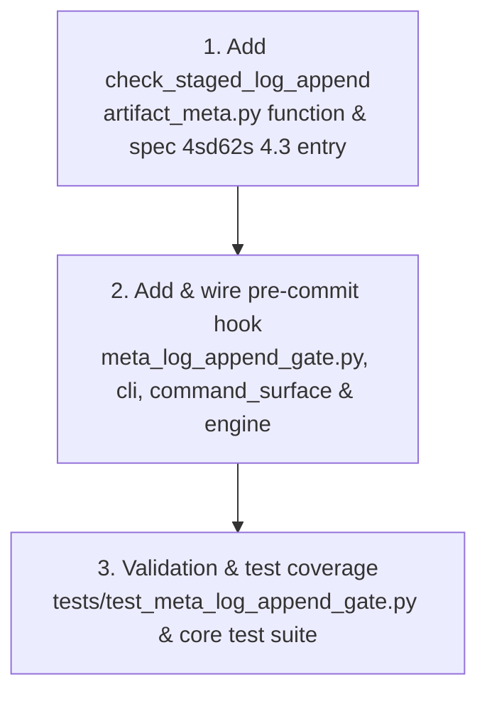

# IPD: Add the staged meta log append hook over artifact_meta

- Date: 2026-11-09
- Kind: child
- Concern: Split from `t4gl15` (Order 09) in round 3 of the metastore re-split, per research `nj8zdp` guidance (at most 8 work Scope-Paths per plan): `t4gl15` declared 9 work Scope-Paths, 7 of them for this one hook. Spec `4sd62s` 4.8 (last bullet) requires a hook that refuses a staged non-append change to `meta/*.jsonl`, and 4.3 says "No other code, inside or outside `artifact_meta`, opens a log", so the judgement must be an `artifact_meta` function. No hook inspects `meta/*.jsonl` today (`t4gl15` F-08).
- Scope: Add `artifact_meta.check_staged_log_append` with its spec 4.3 function-list entry, add the hook module `agent_workflows/hooks/meta_log_append_gate.py`, and wire it as the `aw meta-log-append-gate` leaf and an optional pre-commit hook (`t4gl15` E-05, carried and divided into two steps). EXCLUDES: the gate cache-parity and offline tests, the residual audit and the `CHANGELOG.md` line (kept in `t4gl15`); the post-cutover gate rules (`cxxmyv`).
- Scope-Paths: agent_workflows/artifact_meta.py, agent_workflows/hooks/meta_log_append_gate.py, agent_workflows/cli.py, agent_workflows/command_surface.py, agent_workflows/engine.py, tests/conformance_matrix.py, tests/test_meta_log_append_gate.py, .aw/records/specs/approved/20260925-metastore-01-4sd62s-artifact-metadata-store.spec.md, .aw/records/plans/pending/20261109-metastore-141-jq82as-add-the-staged-meta-log-append-hook-over-artifact-meta.ipd.md
- Item-Dependencies: executed:2zpw22, executed:ffceq0, executed:g5hpbb, executed:h58z9n, executed:jd7874, executed:tve77h, executed:xexn45, executed:y97k46
- Status: approved
- Readiness: go-pending-approval
- Review-Depth: standard
- From-Spec: 4sd62s
- Work-Kind: feature
- Priority: high
- Blocks-Release: next
- Set: metastore
- Order: 141
- Highest E allocated: 02
- Author: opencode its_direct/pt3-claude-opus-5.5-1m-us
- Id: jq82as
- Approval: 2026-11-16, recorded via aw ipd set: status set to approved

> Write and proofread this plan per the technical writing standard, `.aw/system/workflows/technical-writing/technical-writing.md` (`.agents/workflows/technical-writing/technical-writing.md` in a legacy-layout install), including requirement 12 (diagrams).

## Workflow history
- 2026-11-16 approved (aw set): status set to approved

- 2026-11-14 reviewed (antigravity/gemini-3.8-flash): plan-review verified E/V bijection, Scope-Paths, hook specification, execution gate, and tests; findings PR-001..PR-004 fixed; marked reviewed and go-pending-approval.
- 2026-11-09 to-review (opencode its_direct/pt3-claude-opus-5.5-1m-us): split from t4gl15 (round 3, research nj8zdp guidance).
- 2026-11-09 draft (opencode its_direct/pt3-claude-opus-5.5-1m-us): created.

## Goal

A staged `.aw/records/meta/*.jsonl` change is refused unless its staged bytes are the HEAD bytes plus whole new lines that the loader accepts, judged by one `artifact_meta` function and reachable as an optional pre-commit hook.

## Detailed Implementation Checklist (TODO)

Execution-state rule: mark an `E-*` item complete only after performing the action. That mark is not validation. Right-sizing rule: write for a modest executor that cannot hold much in its head. Each E-item is one step (one concern, about one file, executable in one focused pass) and its V-item names each unit it covers with its own check; a plan stays at about 5 E-items and 8 work Scope-Paths, else split it into more child plans (guidance, `IPD-Z603`). Accepted execution states: blocked, failed, pending, performed; terminal gate demands 'performed'.

This plan moves no existing reader, so the pin-first rule and decisions D-1 to D-4 of `t4gl15` do not govern it. New test modules set `pytestmark = pytest.mark.core` unless they need real `git` subprocesses across many commits, in which case they are marked `slow` with the reason in the module docstring; none reads production source. Commit through `aw commit jq82as -- <each changed path>`, one commit per item allowed, never `git add -A`, a bare `git add` or `git commit -a`. Never push.

### Task group 1: the staged metadata-log append hook (4.8)

- [ ] E-01 (carried from `t4gl15` E-05, function step) Add ONE additive function, `artifact_meta.check_staged_log_append(id6) -> list[str]` (refusal reasons; empty when acceptable), that reads the HEAD and staged log blobs through `read_at`'s blob path and the loader, so no caller reads log bytes itself. It refuses unless the staged bytes are the HEAD bytes plus whole new lines that the loader accepts (valid events, consecutive `seq`, valid `append`); a deleted or rewritten line, a new invalid event, or a new file whose first event is not `create` seq 1 or `checkpoint` seq 0 is refused with a teaching message. Add the function to the spec `4sd62s` 4.3 function list (a `note` through `aw specs note`, then the text edit; the same kind of additive amendment `cdglt1` makes for `read_text`). Test it directly in `tests/test_meta_log_append_gate.py` on `git init` fixtures.
  - Depends on: none
  - Expected outcome: fixtures for a valid append (empty list), a rewritten earlier line, a deleted line, an invalid appended event and a bad first event (each a non-empty list naming the log) pass; the spec diff is the one function-list entry.
  - Execution state: pending

- [ ] E-02 (carried from `t4gl15` E-05, hook step) Add `agent_workflows/hooks/meta_log_append_gate.py`, wired as `aw meta-log-append-gate` in `cli` and `command_surface` (and covered in `tests/conformance_matrix.py`) and offered as an optional pre-commit hook beside the four existing ones in the `engine` hook template: for every staged `.aw/records/meta/*.jsonl` it calls `artifact_meta.check_staged_log_append` and exits 1 with the reasons when any is non-empty. In phase B no log exists in this repository, so the hook is a no-op here and is proven on fixtures in `tests/test_meta_log_append_gate.py` through the real CLI leaf.
  - Depends on: E-01
  - Expected outcome: the five E-01 fixtures driven through `aw meta-log-append-gate` give exit 0 for the valid append and exit 1 for each refusal; `aw meta-log-append-gate` exits 0 on this checkout.
  - Execution state: pending

Add further leaves as `- [ ] E-NEW <action>` and run `aw ipd sync` to assign ids.

## Project conventions discovered (Step 0)

Carried from `t4gl15` Step 0:

- Interface names from Order 02 (`tve77h`), used exactly: `artifact_meta.read(id6) -> State`, `artifact_meta.history(id6)`, `artifact_meta.read_at(id6, rev)`, which resolves the record's path inside that revision (`git ls-files -s` for the index, `git rev-parse <rev>:<path>` for a commit), caches by blob sha, feeds a miss to the same loader and fails closed on a validation error.
- The hooks are thin and are dispatched by `cli` (`ipd-status-untooled-gate`, `backlog-blocking-close-gate`, `ipd-executed-gate`, `ipd-dependency-statement-gate`) and installed as optional pre-commit hooks from the `engine` template (`ipd-executed-transition-gate`, `ipd-status-untooled-gate`).
- New CLI leaves are declared in `command_surface` (`CommandDeclaration`) and covered by `tests/conformance_matrix.py`.
- Cite code by SYMBOL (`module.function`), never a bare line number (advisory `IPD-C801`).

## Findings

Carried from `t4gl15` `## Findings`:

| Id | Evidence | Finding |
|---|---|---|
| F-08 | No hook inspects `meta/*.jsonl`; 4.8 requires one | E-01 and E-02 add it. |

Size (round 3): measured with `ipd_schema.count_named_units`, each item names at most 6 distinct units; the plan has 7 work Scope-Paths, all for one hook.

## Proposed changes (ordered, validatable)

1. Add the judging function and its spec entry (E-01).
2. Add and wire the hook (E-02).

## Deferred / out of scope (with reason)

- The `CHANGELOG.md` line for the new optional hook, the gate cache-parity and offline tests, and the residual audit.
  - Carrier: t4gl15
- The post-cutover gate rule "staged log violates append rules" as a mandatory hook, and the managed-block hook description.
  - Carrier: cxxmyv

## Scope check

- Over-scope: none. `cli.py`, `command_surface.py`, `engine.py` and `tests/conformance_matrix.py` change only to register the new hook; `artifact_meta.py` changes only to add `check_staged_log_append`; the spec changes only by its function-list entry.
- Under-scope: none known. This part carries `t4gl15` E-05 unchanged, divided into a function step and a hook step.

## Required tests / validation

New test module `tests/test_meta_log_append_gate.py` (`tmp_path` `git init` fixtures, the real function and the real CLI leaf, assertions on return values and exit codes). CONTRIBUTES to `4sd62s` AC-16 (the append hook exists; final proof on the cutover commit by `cxxmyv`). Commands: the module, the bare core gate `python3 -m pytest`, `aw sanitize --agent`.

## Spec / documentation sync

ONE spec amendment, carried from `t4gl15`: `4sd62s` 4.3 gains `check_staged_log_append(id6) -> list[str]` in its function list (E-01). Reason: 4.3 says no code outside the loader opens a log, and 4.8 requires a hook that judges staged log bytes, so the judgement must be an `artifact_meta` function and the spec's interface list must name it. The amendment adds a function and changes no rule.

## Open questions

### OQ-01: Why does this hook wait for every reader-move part of `t4gl15`?

- Blocking: no
- Status: resolved
- Owner: plan author
- Resolution or deferral rationale: The round-3 rules give each new part the original plan's own dependencies. The function needs only `read_at` (`tve77h`); the other edges are conservative ordering, and they keep the hook's registration edits in `cli.py` and `engine.py` from overlapping the reader parts' edits in time. Recommendation strength: medium.

## Validation and cross-check (verify before reporting done)

Validation-state rule: inspect evidence in a separate pass. Do not mark a `V-*` item complete from memory or from the matching execution checkmark. Accepted validation results: blocked, failed, pass, pending; terminal gate demands 'pass'. Runtime-demonstration reachability rule: for each `V-*` item demanding the software be observed acting (such as a run, a dispatch, or a transition), as distinct from items demanding a diff, a file's content, or a test result, which are reachable by construction, name the code path that produces the observation or the sibling `E-*` that creates it, else the demand is UNDER-SCOPE.

- [ ] V-01 validates E-01
  - Required evidence: paste `python3 -m pytest -o addopts="" -v tests/test_meta_log_append_gate.py -k check_staged` with five named tests PASSED (valid append returns an empty list; rewritten line, deleted line, invalid appended event and bad first event each return a reason naming the log), and `git diff` of the spec showing only the `check_staged_log_append` function-list entry.
  - Observed evidence:
  - Result: pending

- [ ] V-02 validates E-02
  - Required evidence: paste `python3 -m pytest -o addopts="" -v tests/test_meta_log_append_gate.py -k hook` all PASSED, each test driving the real `aw meta-log-append-gate` leaf on a staged fixture and asserting exit 0 for the valid append and exit 1 with the function's reason for each refusal; `aw meta-log-append-gate; echo $?` on this checkout printing 0; `rg -n "meta-log-append-gate" agent_workflows/cli.py agent_workflows/command_surface.py agent_workflows/engine.py tests/conformance_matrix.py` showing one registration in each.
  - Observed evidence:
  - Result: pending

## Approval and execution gate

- Size assessment: standard
- Cohesion rationale: not required

Execute only after human approval (`Status: approved`) and after every `- Item-Dependencies:` edge is executed. OQ-01 is resolved.

Safety stop: if prerequisite metastore symbols from `tve77h` (`artifact_meta.read_at`) or dependencies are absent upon starting, stop and report rather than proceeding. Scope fence: the paths in `- Scope-Paths:` are a declaration; a needed file outside the fence is edited and then justified at finalize (`--scope-reason`), and a declared path left unmodified is acknowledged (`--scope-ack`).

Honesty rule: run the named module and `python3 -m pytest` (core gate) and paste the ACTUAL summary lines; never claim a result you did not run.

Commits: commit only through `aw commit jq82as -- <paths>`; never `git add -A`, a bare `git add` or `git commit -a`; never push.

Lifecycle transition: the plan moves to `.aw/records/plans/executed/` only through `aw ipd finalize`, never a hand `git mv`, and only after `aw ipd lint --phase pre-transition` conforms and every `V-*` reads `pass` with pasted evidence. When `aw oc run` or `aw agy run` executes the plan, the runner performs the finalize; a hand executor runs `aw ipd finalize jq82as` itself.
