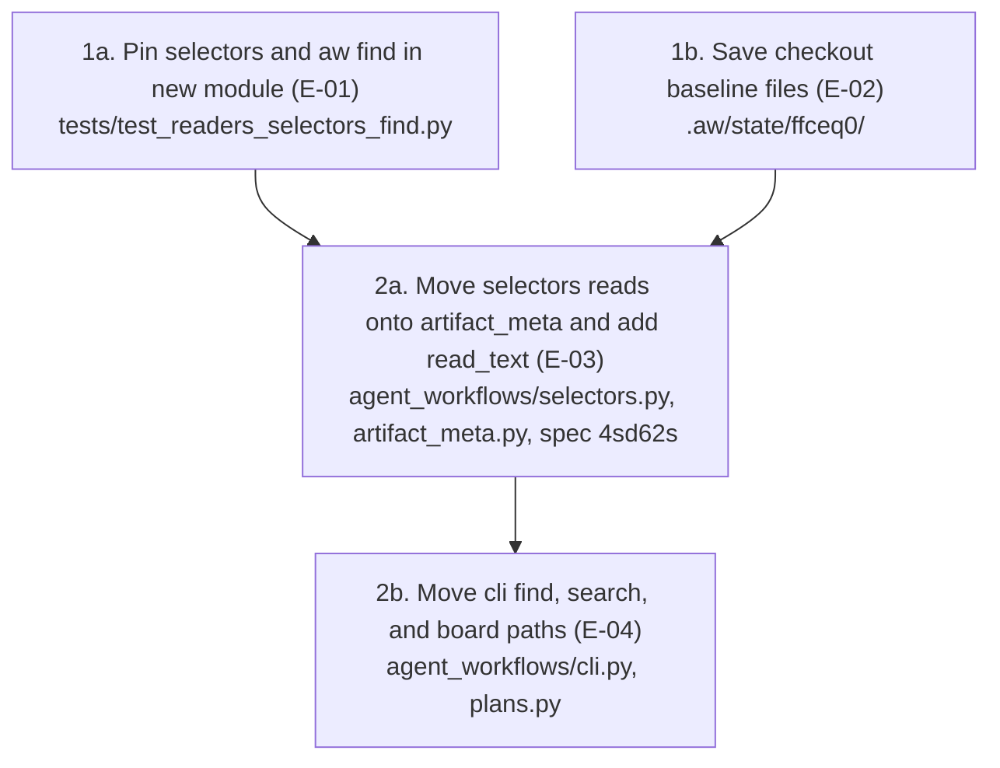

# IPD: Pin and move the selectors and aw find reads onto artifact_meta

- Date: 2026-11-09
- Kind: child
- Concern: Split from `r81uvz` (Order 27) in round 3 of the metastore re-split, per research `nj8zdp` guidance (at most 5 E-items, 8 work Scope-Paths, about 8 named units per item). Spec `4sd62s` C5 and C5a require that every metadata read goes through `artifact_meta`; `selectors` holds 7 `^-` metadata regular expressions and the selector status reader disagrees with the `plans_index` filter on 24 plans, so `aw find plans executed` and `aw find plans --status executed` list different sets (F-03, F-04).
- Scope: Pin the current `selectors` and `aw find` behavior and save the checkout baselines, then move the `selectors` reads and the `aw find`, `aw search` and `aw ipd board` paths in `cli` onto `artifact_meta`, add `artifact_meta.read_text` with its spec 4.3 entry, and apply decisions D-1 and D-2 (`r81uvz` E-01, E-02 and E-03 carried; `r81uvz` E-01 is split into a pin item and a baseline item). EXCLUDES: the `status_set` reads (kept in `r81uvz`), `attention` and `ipd_lint` (`dqutt8`, `1suzlp`), `check_engine` (Orders 29 to 32), and everything `ffceq0` keeps.
- Scope-Paths: agent_workflows/selectors.py, agent_workflows/artifact_meta.py, agent_workflows/cli.py, agent_workflows/plans.py, tests/test_readers_selectors_find.py, tests/test_artifact_meta_legacy.py, tests/test_find_single_read.py, tests/test_front_matter_loose_whitespace.py, .aw/records/specs/approved/20260925-metastore-01-4sd62s-artifact-metadata-store.spec.md, .aw/records/plans/pending/20261109-metastore-142-cdglt1-pin-and-move-the-selectors-and-aw-find-reads-onto-artifact-m.ipd.md
- Item-Dependencies: executed:g5hpbb, executed:tve77h, executed:xexn45
- Status: reviewed
- Readiness: go-pending-approval
- Review-Depth: complex
- From-Spec: 4sd62s
- Work-Kind: feature
- Priority: high
- Blocks-Release: next
- Set: metastore
- Order: 142
- Highest E allocated: 04
- Author: opencode its_direct/pt3-claude-opus-5.5-1m-us
- Id: cdglt1

> Written to `.aw/system/workflows/technical-writing/technical-writing.md`. Every obligation, exact identifier, quotation, evidence record, and lifecycle status is preserved.

## Workflow history
- 2026-11-14 reviewed (aw set): APPROVE WITH REVISIONS APPLIED; PR-001..PR-006 FIXED

- 2026-11-14 /plan-review (antigravity/gemini-3.8-flash): APPROVE WITH REVISIONS APPLIED; PR-001..PR-006 FIXED; review record .aw/records/reviews/20261109-metastore-142-cdglt1-pin-and-move-the-selectors-and-aw-find-reads-onto-artifact-m.review.md
- 2026-11-09 to-review (opencode its_direct/pt3-claude-opus-5.5-1m-us): split from r81uvz (round 3, research nj8zdp guidance).
- 2026-11-09 draft (opencode its_direct/pt3-claude-opus-5.5-1m-us): created.

## Goal

The `selectors` readers and the `aw find`/`aw search`/`aw ipd board` paths answer from the `artifact_meta` cache, `artifact_meta.read_text` exists for in-memory text, and both `aw find` status paths give one answer, the one decision D-1 records.

## Detailed Implementation Checklist (TODO)

Execution-state rule: mark an `E-*` item complete only after performing the action. That mark is not validation. Right-sizing rule: write for a modest executor that cannot hold much in its head. Each E-item is one step (one concern, about one file, executable in one focused pass) and its V-item names each unit it covers with its own check; a plan stays at about 5 E-items and 8 work Scope-Paths, else split it into more child plans (guidance, `IPD-Z603`). Accepted execution states: blocked, failed, pending, performed; terminal gate demands 'performed'.

Every E-item that moves a reader follows one rule, so a reviewer can check each the same way: (1) BEFORE the edit, add or extend a behavioral test in the named module that pins the reader's CURRENT observable behavior on a `tmp_path` fixture repository (the "prior behavior" column of the reader ledger in `## Findings`), and run it green against the unmodified code; (2) change the reader to call `artifact_meta`; (3) run the same test unchanged. A test that has to change in step 3 is a behavior change and must be one of the decisions copied below (D-1, D-2), never a silent one. For every existing module named as a baseline, ensure directory existence (`mkdir -p .aw/state/ffceq0 .aw/state/cdglt1`), save the per-test outcome list under the gitignored `.aw/state/ffceq0/` (`python3 -m pytest -o addopts="" -m "" -p no:randomly -n 0 -rA <modules> | grep -E "^(PASSED|FAILED|ERROR|SKIPPED|XFAIL|XPASS) " | sed -E 's/ - .*//' | sort > .aw/state/ffceq0/<E>-before.txt`) before the move and the same command into `<E>-after.txt` after it; `diff` of the two prints nothing except lines a named decision explains. Every saved baseline also goes under `.aw/state/ffceq0/`, never `/tmp`. A count measured at authoring (for example the 1,635 executed plans of F-03) is context, never the bar. New test modules set `pytestmark = pytest.mark.core`, call real functions or the real `aw` CLI, and never read production source. The `<E>` file names keep the ORIGINAL `ffceq0` item numbers (`E-01-before.txt`, `E-02-after.txt`), so the split parent `ffceq0` finds them.

Commit through `aw commit cdglt1 -- <each changed path>`, one commit per item allowed, never `git add -A`, a bare `git add` or `git commit -a`. Never push.

### Task group 1: pin and baselines

- [ ] E-01 (carried from `r81uvz` E-01, pin half) Pin the current `aw find` and `selectors` behavior in `tests/test_readers_selectors_find.py` before any change: id6, Set, status, stem and substring selector matching per type; `aw find plans <id6>` and `--status`/`--status-not`/`--set`/`--id` filters; `aw find research` and `aw find prompts` rows (prompt id and Set from the `aw-prompt` comment, then the filename slot); `selectors.read_front_matter_id`, `read_front_matter_status`, `read_front_matter_blocks_release` and `declared_id6` on loose-whitespace (`-  `, `-\t`) and quoted-example fixtures; `aw find` exit code 2 for a selector that matches nothing (4.4a row `zyj8io`); and the fixture form of the 24-plan disagreement (one plan with `- Status: EXECUTED (approved ...)` in `executed/`). Also run the existing `tests/test_find_filters.py` (4.4a row `wja06w`), `tests/test_find_single_read.py`, `tests/test_selector_two_dialect_readers.py`, `tests/test_front_matter_loose_whitespace.py` and `tests/test_selector_resolver_matrix.py` green and save their outcome list to `.aw/state/ffceq0/E-01-before.txt`.
  - Depends on: none
  - Expected outcome: the new module passes on the unmodified code; the outcome list of the five existing modules is saved.
  - Execution state: pending

- [ ] E-02 (carried from `r81uvz` E-01, baseline half) Before any code edit, ensure directory existence (`mkdir -p .aw/state/ffceq0 .aw/state/cdglt1`) and save these checkout baselines under `.aw/state/ffceq0/`: the sorted path lists of `aw find plans executed --paths` (`find-executed-sel-before.txt`) and `aw find plans --status executed --paths` (`find-executed-flt-before.txt`); `aw find <type> --agent` for every type (`find-<type>-before.jsonl`); `aw ipd board --json` (`board-before.json`, whose `plans-board` evidence carries `count`); and `aw attention --all --format json` (`att-before.json`, used by `dqutt8`).
  - Depends on: none
  - Expected outcome: every checkout baseline above is saved before the first code edit of this plan.
  - Execution state: pending

### Task group 2: move selectors and aw find

- [ ] E-03 (carried from `r81uvz` E-02) Move `selectors` reads onto `artifact_meta`: `_read_id`, `_read_status`, `_read_setid`, `_read_yaml_scalar`, `read_front_matter_id`, `read_front_matter_status`, `read_front_matter_blocks_release`, `declared_id6`, `declares_id6`, `id6_ownership` and the `resolve` selector kinds `MATCH_ID6`/`MATCH_SETID`/`MATCH_STATUS` answer from `artifact_meta.resolve`/`artifact_meta.read`/`artifact_meta.query`; filename-only kinds (`MATCH_STEM`, `MATCH_SUBSTRING`, `MATCH_PATH`) keep reading no file content. The public `read_front_matter_*(text)` functions keep their text signature for Order 09's callers in this phase and answer through the one additive interface function this plan adds, `artifact_meta.read_text(text, *, record_type=None) -> State` (OQ-03 of `ffceq0`), so no `^-` metadata regex remains in `selectors`. `read_text` returns a `State` that carries BOTH the strict-grammar fields (what `read`/`query` see) and, for `id`, `status` and `blocks_release`, the value the loose `^-[ \t]*` bullet spelling would give (D-2); the public `read_front_matter_*` readers answer from the loose value and the internal `_read_*` readers and the cache answer from the strict value. Add `read_text` to the function list of spec `4sd62s` 4.3 (a `note` through `aw specs note`, then the text edit). Add `read_text` and its tests in `tests/test_artifact_meta_legacy.py`: a strict, a two-space, a tab, a YAML-only research and a multi-word-status fixture each give the expected strict and loose values. Apply decision D-1 (status) and D-2 (whitespace). Other modules that import `selectors` private readers (`partition._read_setid`, `runner_shared` `_read_id`) keep working because the private names keep their signatures and answers in this phase; Order 09 or Order 11 retires them.
  - Depends on: E-01, E-02
  - Expected outcome: `rg -n "re\.(compile|search|match)\(\s*r?[\"'](\(\?m\))?\^-" agent_workflows/selectors.py` prints nothing; `tests/test_artifact_meta_legacy.py -k read_text` passes; the E-01 module and the five existing modules pass with an outcome-list diff that is empty except the assertions that D-1 names.
  - Execution state: pending

- [ ] E-04 (carried from `r81uvz` E-03) Move the `aw find` and `aw search` paths in `cli` onto `artifact_meta.query`: `_find_type_records` (plans, research, prompts, specs, backlog, releases branches), `_find_prompt_id6`, `_find_prompt_setid`, `_run_search._artifact_status`, and `_run_plans` (`aw ipd board` through `plans.scan`/`plans.read_status`). `plans.read_status` and `plans.scan` keep their signatures and return the same canonical readiness value (`plans.normalize_status`), now computed from the cached raw status. `aw find` shows `artifacts.short_description` when present and the current `detail` otherwise (AC-36 case 2 owner side).
  - Depends on: E-03
  - Expected outcome: E-01 passes; `aw find plans executed --paths` and `aw find plans --status executed --paths` list the same sorted paths, and that list equals the E-02 `find-executed-flt-before.txt` list (D-1: the selector path gains exactly the multi-word and upper-case records and the filter path loses none); `aw find plans zzzzzz` exits 2; the `count` of `aw ipd board --json` equals the E-02 `board-before.json` count; for every type, `aw find <type> --agent` item records equal the E-02 baseline except the `status` values D-1 names.
  - Execution state: pending

Add further leaves as `- [ ] E-NEW <action>` and run `aw ipd sync` to assign ids.

## Project conventions discovered (Step 0)

Carried from `r81uvz` (and through it `ffceq0`) Step 0:

- The `artifact_meta` interface names come from Order 02 (`tve77h`) and are used exactly: `agent_workflows/artifact_meta.py::read`, `agent_workflows/artifact_meta.py::history`, `agent_workflows/artifact_meta.py::query` with typed filters (type, status, Set, order, `depends_on`, `latest_gate_review_of`, `path`) and an `incomplete` list, `agent_workflows/artifact_meta.py::resolve`, and the `artifacts.short_description` column. The legacy loader stores a multi-word `- Status:` raw value in a legacy-only column and sets `artifacts.status` only for a single token (`tve77h` OQ-03).
- One status normalizer already exists: `agent_workflows/plans.py::normalize_status` maps `EXECUTED`/`DONE` to `executed` and any other unrecognized token to `agent_workflows/plans.py::LEGACY_GROUP` (`legacy/unknown`); `agent_workflows/plans.py::read_status` applies it to the FIRST token of the whole-file `- Status:` line.
- `agent_workflows/selectors.py::metadata_region` is the shared region bound. The PARITY CONSTRAINT comment above `agent_workflows/selectors.py::_STATUS_RE` records the 24-plan disagreement and forbids changing it without "owning that contract change", which D-1 does here.
- `aw find` for plans uses `agent_workflows/plans_index.py::plan_entry` and `agent_workflows/plans_index.py::query` for display rows and `agent_workflows/selectors.py::resolve` (through `agent_workflows/cli.py::_resolve_selectors_with_kinds`) for selector hits; `aw ipd board` is `agent_workflows/cli.py::_run_plans` over `agent_workflows/plans.py::scan`.
- Core tier: modules set `pytestmark = pytest.mark.core`; the bare gate is `python3 -m pytest` (30 s budget).
- Cite code by repo-relative `path::Symbol` identifiers or by a quoted content string, never a bare line number (advisory `IPD-C801`, Technical Writing Standard Requirement 7).

## Findings

Carried from `ffceq0` `## Findings` (measured 2026-11-02 at `0cbfcc706`):

| Id | Evidence | Finding |
|---|---|---|
| F-03 | `aw find plans executed` lists 1,610 paths; `aw find plans --status executed` lists 1,635. The 25 extra: 24 multi-word `- Status:` plans in `executed/` plus `vfa1tl`, whose single token is upper-case `EXECUTED` | The selector path (`selectors._read_status`, exact token) and the filter path (`plans_index.query`, status OR disposition) answer the same question differently. |
| F-04 | `selectors._read_status` and `plans_index.plan_entry(...).status` disagree on exactly 24 plans; for all 24, `plans.read_status` (first token) is `executed`, and `aw attention` reports `native_status: executed` | D-1 picks one answer. |
| F-05 | `selectors._read_status` (strict `^- `, YAML fallback) and `selectors.read_front_matter_status` (loose `^-\s*`, no YAML) disagree on 157 records, ALL research files with YAML status. No tracked record uses `-  ` or `-\t` before a metadata field (0 matches) | D-2 keeps each caller's answer. |
| F-11 | `aw find plans zzzzzz` exits 2 today (4.4a `zyj8io`) | Pinned by E-01, re-checked after E-04. |

Size (round 3): measured with `ipd_schema.count_named_units`, every item names at most 7 distinct units. `r81uvz` E-01 named 9 (a pin module, five baseline modules, a reader and two baseline JSON files), so it is split here into E-01 (pin) and E-02 (checkout baselines). Site counts measured at the round-1 split remain valid: 7 `^-` literals in `selectors` (`rg -c` on `agent_workflows/selectors.py`), 5 `cli` functions and 3 `^-` literals in `plans`.

READER LEDGER rows this part moves (copied from `ffceq0`):

| Reader | Prior behavior | Pinning test | After |
|---|---|---|---|
| `selectors._read_status`, `resolve` `MATCH_STATUS` | exact single token of the region `- Status:`; YAML `status:` for research; none for multi-word | E-01 module; `tests/test_selector_two_dialect_readers.py`; `tests/test_front_matter_loose_whitespace.py::test_single_token_status_contract_survives` | D-1: canonical status from the cache; multi-word executed plans match `executed` |
| `selectors.read_front_matter_id`/`_status`/`_blocks_release` | loose `^-\s*` bullet only, region-bounded, no YAML | `tests/test_front_matter_loose_whitespace.py`, `tests/test_blocks_release_reader_bounding.py` | D-2: same answers |
| `selectors.declared_id6`, `id6_ownership` | whole-file id read for the ownership verdict | `tests/test_plans_rename_selectors.py`, E-01 | cached `id` |
| `plans_index.plan_entry` status in `aw find plans` JSON | whole prose line | `tests/test_find_single_read.py::test_d_status_disagreement_record_matches_and_preserves_plans_index_status` | D-1: canonical value |
| `plans.read_status`, `plans.scan` (`aw ipd board`, attention, M105) | first token of whole-file line, normalized | `tests/test_plan_status.py`, `tests/test_plans_board.py` | same normalized value from the cached raw status |
| `cli._find_prompt_id6`/`_find_prompt_setid` | `aw-prompt` comment first, then guarded filename slot | `tests/test_find_prompts_lane_status.py`, E-01 | cached `id`/`set` |
| `cli._run_search._artifact_status` | loose `^-\s*Status:` over the whole file | `tests/test_cli_search.py` | cached status |

### Behavior decisions

Decisions that govern this part's reader moves (copied verbatim from `ffceq0`):

- D-1 (status of the 24 multi-word plans; F-03, F-04). KEPT: the canonical normalized status that `aw attention`, `aw ipd board` and `ipd_lint` already report (`executed` for `EXECUTED ...` and `DONE ...`, `legacy/unknown` for any other unrecognized token). For PLAN records only, both `aw find` paths match `plans.normalize_status` of the FIRST token of the cached raw value (the `plans.read_status` rule). Every other type keeps today's exact single-token match on the raw value, because `plans.normalize_status` knows only the plan vocabulary and maps `open`, `implemented`, `active` and `planned` to `legacy/unknown` (measured at review: `aw find backlog open` lists 27 rows and `aw find specs implemented` 22 today, and both must stay unchanged). The rule lives in `selectors`' `MATCH_STATUS` branch, so every `selectors.resolve` caller that allows `MATCH_STATUS` sees it; E-01 pins one non-find caller (`tests/test_selector_resolver_matrix.py`) so the change to those callers is observed, not assumed. WHAT EACH CONSUMER LOSES OR GAINS: `aw find plans executed` (selector path) GAINS the 24 plans plus `vfa1tl` and agrees with `--status executed` (1,635 rows at authoring); `aw find plans EXECUTED` stops matching `vfa1tl` by exact case (its only match today); the `aw find` JSON `status` of those 24 changes from the prose line to `executed` (the prose stays in the raw legacy column and in the file); the test edits are the expected value in `tests/test_find_single_read.py::test_d_status_disagreement_record_matches_and_preserves_plans_index_status` (only if its `plans_index` assertion reads through the moved path; Order 09 owns `plans_index`) and the `_read_status(multi)` assertion in `tests/test_front_matter_loose_whitespace.py::test_single_token_status_contract_survives`, whose `read_front_matter_status(multi)` and `parse_plan_file` assertions stay unchanged (D-2; the runner is Order 09's). Reason: one reader, one answer (4.3), and it is the answer three surfaces already give. The migration (Order 04) normalizes these terminal records at the cutover.
- D-2 (whitespace and YAML; F-05). KEPT: each caller's current answer. The cache holds research YAML status, so `_read_status`/`MATCH_STATUS` keep matching research by it, while the public `read_front_matter_status` keeps returning None for a YAML-only record (Order 09's runner callers read plans, which use bullets). Whitespace keeps each caller's current answer too: the legacy loader parses "one strict `- Field: value` grammar" (`tve77h` E-11), which matches the strict internal readers (`_read_id`/`_read_status` reject `-  ` and `-\t`, pinned by `tests/test_front_matter_loose_whitespace.py::test_internal_readers_stay_strict`), while the public `read_front_matter_*` readers keep accepting `-  ` and `-\t` (pinned by `test_public_readers_tolerate_loose_leading_whitespace`) through the loose values that `read_text` also returns (E-03). Today 0 tracked records use the loose spelling (F-05), so the cache and the public readers agree on the whole corpus; Order 11 retires the loose values with the public readers.
- D-3 (detail text; AC-36 case 2 owner side). KEPT: the `_extract_detail` cascade as the fallback; `short_description` wins when present (`4sd62s` 4.4 first bullet). In phase B no record has one, so output is unchanged until Order 13.
- D-4 (status bullet outside the metadata region; F-06). KEPT: region-bounded reading. The 4 records are 3 reviews and 1 walkthrough, which have no lifecycle status, so no plan-status consumer changes.
- D-5 (where the skip list applies; E-08). KEPT: record walkers skip `README.md`, `INDEX.md` and `STATUS.md` exactly as today; citation scans through `artifact_core.iter_scan_files` keep reading `README.md` (`0u0ako`). ADDED: every walker skips `records/meta/`. No record row changes today, because no `meta/` directory exists before the cutover.
- D-6 (records with no in-file `- Set:` bullet; maintainer decision recorded on backlog `suth7l`). KEPT: the cache's filename-derived Set. `status_set`'s reader returns no Set for these records (242 on this repository on 2026-11-07: 164 research, 30 prompts, 23 specs, 14 plans, 8 walkthroughs, 3 roadmaps), while the cache takes it from the filename, which spec `4sd62s` C1/C10 make the checked mirror of `set` and 5.2 step 3 already uses as the default.

## Proposed changes (ordered, validatable)

1. Pin `selectors` and `aw find`, save the checkout baselines (E-01, E-02).
2. Move `selectors` and add `read_text` (E-03); move the `cli` find/search/board paths (E-04).

## Deferred / out of scope (with reason)

- The `status_set` inventory and transition reads (`r81uvz` E-04, E-05).
  - Carrier: r81uvz
- Deleting `selectors._STATUS_RE` and every other leftover parser.
  - Carrier: 9o83cr
- The `CHANGELOG.md` line for the D-1 matching change.
  - Carrier: ffceq0

## Scope check

- Over-scope: none. `artifact_meta.py` changes only to add `artifact_meta.read_text`; `tests/test_artifact_meta_legacy.py` gains only the `read_text` tests; the spec changes only by the function-list entry; `tests/test_find_single_read.py` and `tests/test_front_matter_loose_whitespace.py` change only in the assertions D-1 names.
- Under-scope: none known. This part carries `r81uvz` E-01, E-02 and E-03 unchanged except the split of E-01 into E-01 and E-02 here.

## Required tests / validation

New core module `tests/test_readers_selectors_find.py`. The existing modules named in E-01 run before and after each move, plus `tests/test_find_prompts_lane_status.py` and `tests/test_cli_search.py` for E-04. AC-21 rows `wja06w` and `zyj8io` are pasted (AC-21 is owned by `xexn45`). Commands: the named modules, the bare core gate `python3 -m pytest`, `aw sanitize --agent`.

## Spec / documentation sync

ONE spec amendment, carried from `ffceq0` OQ-03 through `r81uvz`: `4sd62s` 4.3 gains `read_text(text, *, record_type=None) -> State` in its function list, with one sentence stating that it runs the same loader as `read_at`, caches nothing, and exists for in-memory text in phase B. Reason: the function list is the C5 contract, and without the entry the public `selectors.read_front_matter_*(text)` readers would need either a second grammar or a function the spec does not name.

## Open questions

### OQ-01: Does this part fit the round-3 guidance?

- Blocking: no
- Status: resolved
- Owner: plan author
- Resolution or deferral rationale: Yes: 4 E-items, 8 work Scope-Paths, at most 7 named units per item. E-03 is the largest step (one module plus one additive function); splitting `read_text` out would leave the public readers with nothing to call. Recommendation strength: strong.

## Validation and cross-check (verify before reporting done)

Validation-state rule: inspect evidence in a separate pass. Do not mark a `V-*` item complete from memory or from the matching execution checkmark. Accepted validation results: blocked, failed, pass, pending; terminal gate demands 'pass'. Runtime-demonstration reachability rule: for each `V-*` item demanding the software be observed acting (such as a run, a dispatch, or a transition), as distinct from items demanding a diff, a file's content, or a test result, which are reachable by construction, name the code path that produces the observation or the sibling `E-*` that creates it, else the demand is UNDER-SCOPE.

- [ ] V-01 validates E-01
  - Required evidence: paste `git diff --stat agent_workflows/` empty (proving the code is unmodified), then `python3 -m pytest -o addopts="" -v tests/test_readers_selectors_find.py` with every test PASSED, including named tests for the multi-word `EXECUTED (approved ...)` fixture, the loose-whitespace fixtures and the zero-match exit code 2; then `wc -l .aw/state/ffceq0/E-01-before.txt` (the five existing modules' outcome list).
  - Observed evidence:
  - Result: pending

- [ ] V-02 validates E-02
  - Required evidence: paste `ls -l .aw/state/ffceq0/` showing `find-executed-sel-before.txt`, `find-executed-flt-before.txt`, one `find-<type>-before.jsonl` per type, `board-before.json` and `att-before.json`, each with a modification time earlier than this plan's first code commit (`git log -1 --format=%ci -- agent_workflows/selectors.py`).
  - Observed evidence:
  - Result: pending

- [ ] V-03 validates E-03
  - Required evidence: paste the empty output of `rg -n "re\.(compile|search|match)\(\s*r?[\"'](\(\?m\))?\^-" agent_workflows/selectors.py`; the E-01 module re-run all PASSED; `diff .aw/state/ffceq0/E-01-before.txt .aw/state/ffceq0/E-02-after.txt` printing nothing or only the lines D-1 names; `python3 -m pytest -o addopts="" -v tests/test_artifact_meta_legacy.py -k read_text` with the strict, two-space, tab, YAML-only and multi-word cases PASSED; `git diff tests/` showing that the only changed existing assertions are the ones D-1 names; and `git diff` of the spec showing the one 4.3 function-list entry.
  - Observed evidence:
  - Result: pending

- [ ] V-04 validates E-04
  - Required evidence: paste `aw find plans executed --paths | sort | diff - <(aw find plans --status executed --paths | sort)` printing nothing, `diff` of that list against `.aw/state/ffceq0/find-executed-flt-before.txt` printing nothing, the line counts of the selector list before (`find-executed-sel-before.txt`) and after, `aw find backlog open --paths | wc -l` and `aw find specs implemented --paths | wc -l` equal to their E-02 values, `aw find plans zzzzzz; echo $?` printing 2, the `aw ipd board --json` `count` before and after (equal), the per-type `diff` of `aw find <type> --agent` item records against the E-02 baselines (differences only in D-1 `status` values), and `python3 -m pytest -o addopts="" -v tests/test_readers_selectors_find.py tests/test_find_prompts_lane_status.py tests/test_cli_search.py` all PASSED.
  - Observed evidence:
  - Result: pending

## Approval and execution gate

- Size assessment: standard
- Cohesion rationale: not required

Execute only after human approval (`Status: approved`) and after every `- Item-Dependencies:` edge is executed (`executed:g5hpbb`, `executed:tve77h`, `executed:xexn45`). Every reader move is pin-first, and a test edited after a move must be one that the copied decisions name. Stop and report without editing production code or weakening assertions if prerequisite symbols from `executed:tve77h` (`artifact_meta.read`, `artifact_meta.query`, `artifact_meta.resolve`), `executed:xexn45`, or `executed:g5hpbb` are absent on HEAD, if unmodified baseline tests fail on HEAD before starting, or if concurrent edits in a shared checkout conflict unresolvably with `- Scope-Paths:`.

Scope fence: the paths in `- Scope-Paths:` are a declaration. A needed test-tree file outside the fence is edited and then justified at finalize (`--scope-reason`), and a declared path left unmodified is acknowledged (`--scope-ack`). Production code outside the declared scope is out of this plan's purpose: if a reader cannot answer from `artifact_meta` without an out-of-scope production change, stop that item and report the missing capability rather than changing production code or an assertion.

Honesty rule: run the named modules and `python3 -m pytest` (core gate) and paste the ACTUAL summary lines; never claim a result you did not run.

Commits: commit only through `aw commit cdglt1 -- <paths>`; never `git add -A`, a bare `git add` or `git commit -a`; never push.

Lifecycle transition: the plan moves to `.aw/records/plans/executed/` only through `aw ipd finalize`, never a hand `git mv`, and only after `aw ipd lint --phase pre-transition` conforms and every `V-*` reads `pass` with pasted evidence. When `aw oc run` or `aw agy run` executes the plan, the runner owns retirement to `executed/` and runs finalize automatically upon task completion; when executed standalone by hand or direct agent turn, the executor runs `aw ipd finalize cdglt1`.
