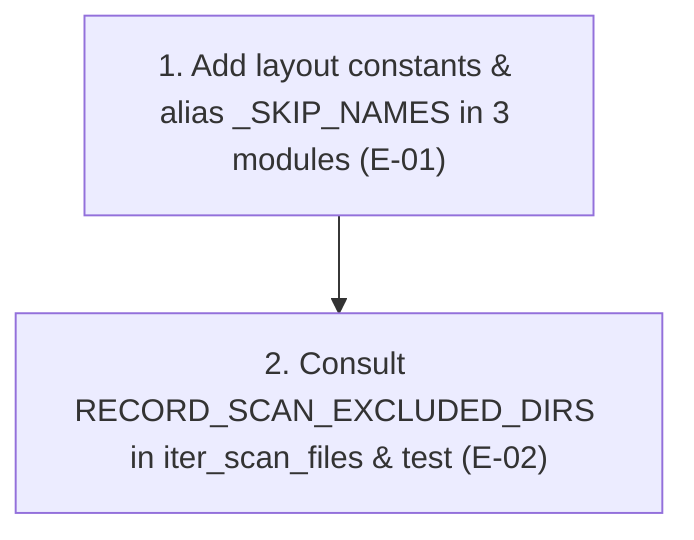

# IPD: Add the one record skip list in layout and use it in check_engine, selectors and artifact_refs

- Date: 2026-11-09
- Kind: child
- Concern: Split from `ebrc4t` (Order 32) in round 3 of the metastore re-split, per research `nj8zdp` guidance: `ebrc4t` declared 11 work Scope-Paths and its skip-list item E-03 named 10 units across seven modules. Spec `4sd62s` 4.4 (last bullet) asks for ONE record exclusion list. Today `_SKIP_NAMES = {"README.md", "INDEX.md", "STATUS.md"}` is defined identically in `check_engine`, `selectors` and `artifact_refs`, with further inline copies in `specs`, `releases` and `ipd_lint` (F-09), and no walker skips a future `records/meta/` directory.
- Scope: The first part of `ebrc4t` E-03, its site list partitioned by module: add `layout.RECORD_SCAN_SKIP_NAMES` and `layout.RECORD_SCAN_EXCLUDED_DIRS`, make the three `_SKIP_NAMES` copies (`check_engine`, `selectors`, `artifact_refs`) aliases of the `layout` constant and their walkers consult both constants (E-01), and make `artifact_core.iter_scan_files` consult only the excluded-directory constant, with the behavioral fixture test (E-02). EXCLUDES: the inline copies in `specs`, `releases` and `ipd_lint` (kept in `ebrc4t` E-03), the `check_engine` graduation readers (`dbq57g`), and retiring the aliases (Order 11).
- Scope-Paths: agent_workflows/layout.py, agent_workflows/check_engine.py, agent_workflows/selectors.py, agent_workflows/artifact_refs.py, agent_workflows/artifact_core.py, tests/test_readers_check_engine.py, .aw/records/plans/pending/20261109-metastore-144-i16on1-add-the-one-record-skip-list-in-layout-and-use-it-in-check-e.ipd.md
- Item-Dependencies: executed:g5hpbb, executed:tve77h, executed:xexn45, executed:w1cs3p, executed:na188y, executed:i3b5zu, executed:dbq57g
- Status: approved
- Readiness: go-pending-approval
- Review-Depth: complex
- From-Spec: 4sd62s
- Work-Kind: feature
- Priority: high
- Blocks-Release: next
- Set: metastore
- Order: 144
- Highest E allocated: 02
- Author: opencode its_direct/pt3-claude-opus-5.5-1m-us
- Id: i16on1
- Approval: 2026-11-16, recorded via aw ipd set: status set to approved

> Write and proofread this plan per the technical writing standard, `.aw/system/workflows/technical-writing/technical-writing.md` (`.agents/workflows/technical-writing/technical-writing.md` in a legacy-layout install), including requirement 12 (diagrams).

## Workflow history
- 2026-11-16 approved (aw set): status set to approved
- 2026-11-14 reviewed (aw set): APPROVE WITH REVISIONS APPLIED; PR-001..PR-003 FIXED

- 2026-11-14 /plan-review (antigravity/gemini): APPROVE WITH REVISIONS APPLIED; PR-001..PR-003 FIXED; review record .aw/records/reviews/20261109-metastore-144-i16on1-add-the-one-record-skip-list-in-layout-and-use-it-in-check-e.review.md
- 2026-11-09 to-review (opencode its_direct/pt3-claude-opus-5.5-1m-us): split from ebrc4t (round 3, research nj8zdp guidance).
- 2026-11-09 draft (opencode its_direct/pt3-claude-opus-5.5-1m-us): created.

## Goal

One skip-name list and one excluded records subdirectory constant live in `layout`, the `check_engine`, `selectors` and `artifact_refs` record walkers use them, and a `meta/*.jsonl` log is never walked as a record by `aw find`, `aw check` or `aw attention`, while citation scans keep reading `README.md`.

## Detailed Implementation Checklist (TODO)

Execution-state rule: mark an `E-*` item complete only after performing the action. That mark is not validation. Right-sizing rule: write for a modest executor that cannot hold much in its head. Each E-item is one step (one concern, about one file, executable in one focused pass) and its V-item names each unit it covers with its own check; a plan stays at about 5 E-items and 8 work Scope-Paths, else split it into more child plans (guidance, `IPD-Z603`). Accepted execution states: blocked, failed, pending, performed; terminal gate demands 'performed'.

This plan changes which files record walkers visit; decision D-5 (copied below) states what may and may not change. New tests set `pytestmark = pytest.mark.core`, call real functions or the real `aw` CLI, and never read production source. Commit through `aw commit i16on1 -- <each changed path>`, one commit per item allowed, never `git add -A`, a bare `git add` or `git commit -a`. Never push.

### Task group 1: the shared skip list

- [ ] E-01 (carried from `ebrc4t` E-03, constants and three-module subset) Add ONE list, `layout.RECORD_SCAN_SKIP_NAMES` (the three names README.md, INDEX.md and STATUS.md), and ONE excluded records subdirectory constant, `layout.RECORD_SCAN_EXCLUDED_DIRS` (`meta`), beside the existing traversal exclusions in `layout`. Replace the three `_SKIP_NAMES` definitions in `check_engine`, `selectors` and `artifact_refs` with aliases of `layout.RECORD_SCAN_SKIP_NAMES` (the old names stay, because `runner_shared` and `status_set` import `check_engine._SKIP_NAMES` and `selectors._SKIP_NAMES`; Order 11 retires the aliases). Make the record walkers in those three modules (`selectors._iter_md`, `check_engine`'s walkers, `artifact_refs`'s target enumeration) consult both constants. (Measured at the round-1 split: 7 walker uses in these modules, `check_engine` 3, `selectors` 3, `artifact_refs` 1.)
  - Depends on: none
  - Expected outcome: `rg -n "_SKIP_NAMES\s*=" agent_workflows` lists only the three alias lines, each assigning `layout.RECORD_SCAN_SKIP_NAMES`; the existing tests of the three modules pass.
  - Execution state: pending

- [ ] E-02 (carried from `ebrc4t` E-03, citation-scan subset and test) Make `artifact_core.iter_scan_files` consult only `RECORD_SCAN_EXCLUDED_DIRS`, because its callers (citation rewrite, research index, attention) deliberately scan `README.md` as a citing document (`artifact_refs` comment "`README.md` is scanned as a citing document (0u0ako)"). So a `meta/*.jsonl` log is never walked as a record. Test behaviorally in `tests/test_readers_check_engine.py`: a fixture with `.aw/records/meta/abc123.jsonl`, `.aw/records/meta/README.md` and `.aw/records/plans/pending/README.md` yields no `aw find`, `aw check` or `aw attention` row for any of them, and `aw rename` on a fixture still rewrites a citation inside a records `README.md`.
  - Depends on: E-01
  - Expected outcome: the fixture tests pass; `tests/test_artifact_refs_rewrite.py` passes unchanged.
  - Execution state: pending

Add further leaves as `- [ ] E-NEW <action>` and run `aw ipd sync` to assign ids.

## Project conventions discovered (Step 0)

Carried from `ebrc4t` (and through it `ffceq0`) Step 0:

- Traversal exclusions live in `layout.TRAVERSAL_EXCLUSIONS` (consumed by `selectors`); `_SKIP_NAMES` is defined separately in `check_engine`, `selectors` and `artifact_refs`.
- Core tier: modules set `pytestmark = pytest.mark.core`; the bare gate is `python3 -m pytest` (30 s budget).
- Cite code by SYMBOL (`module.function`) or by a quoted content string, never a bare line number (advisory `IPD-C801`).

## Findings

Carried from `ebrc4t` (measured 2026-11-07 at the round-1 split):

| Id | Evidence | Finding |
|---|---|---|
| F-09 | `_SKIP_NAMES = {"README.md", "INDEX.md", "STATUS.md"}` is defined identically in `check_engine`, `selectors` and `artifact_refs`; `layout.TRAVERSAL_EXCLUSIONS` holds 7 directory names | 4.4 asks for one list; E-01 places it in `layout`. |

Measurement of the original `ebrc4t` E-03: `rg -n '_SKIP_NAMES|_NON_IPD_BASENAMES|skip_names|"README.md", "INDEX.md"' agent_workflows` gives 3 `_SKIP_NAMES` definitions (`check_engine`, `selectors`, `artifact_refs`), 1 `skip_names` set (`specs._spec_files`), 3 inline tuples in `releases` (`count_blocks_release_sentinel`, `check_blocks_release`, `check_from_backlog`), `ipd_lint._NON_IPD_BASENAMES` plus 1 inline tuple (`_default_pending_files`); 9 walker uses (`check_engine` 3, `selectors` 3, `artifact_refs` 1, `specs` 1, `ipd_lint` 2). This part takes the `check_engine`, `selectors`, `artifact_refs` and `artifact_core` share; the `specs`, `releases` and `ipd_lint` share stays in `ebrc4t` E-03. Together they equal the original list. Round 3: measured with `ipd_schema.count_named_units`, each item names at most 6 distinct units; 6 work Scope-Paths.

## Behavior decisions (spec `4sd62s` 4.4, OQ-01)

- D-1 (Alias retention). `_SKIP_NAMES` remains defined in `check_engine`, `selectors`, and `artifact_refs` as module-level aliases of `layout.RECORD_SCAN_SKIP_NAMES` so callers like `runner_shared` and `status_set` keep importing them until Order 11 (`9o83cr`) retires them.
- D-2 (Where the skip list applies; carried from `ffceq0` D-5). KEPT: record walkers skip `README.md`, `INDEX.md`, and `STATUS.md` exactly as today; citation scans through `artifact_core.iter_scan_files` keep reading `README.md` (0u0ako). ADDED: every walker skips `records/meta/`. No record row changes today, because no `meta/` directory exists before the cutover.
- D-3 (Tuple representation). `RECORD_SCAN_SKIP_NAMES` and `RECORD_SCAN_EXCLUDED_DIRS` are defined as tuples in `agent_workflows/layout.py` alongside `TRAVERSAL_EXCLUSIONS`, ensuring deterministic order.

## Proposed changes (ordered, validatable)

1. Add the constants and point the three `_SKIP_NAMES` copies and their walkers at them (E-01).
2. Exclude `meta/` from citation scans and prove it with a fixture (E-02).

## Deferred / out of scope (with reason)

- The inline skip-name copies in `specs`, `releases` and `ipd_lint`, and the final one-definition check.
  - Carrier: ebrc4t
- Retiring the `_SKIP_NAMES` aliases that `runner_shared` and `status_set` still import.
  - Carrier: 9o83cr

## Scope check

- Over-scope: none. `layout.py` gains only the two constants; `check_engine.py`, `selectors.py`, `artifact_refs.py` and `artifact_core.py` change only to consult them.
- Under-scope: none known. This part carries the named subset of `ebrc4t` E-03 unchanged.

## Required tests / validation

The `meta_dir` fixture test added to `tests/test_readers_check_engine.py` (E-02), `tests/test_artifact_refs_rewrite.py` unchanged. Commands: those modules, the bare core gate `python3 -m pytest`, `aw sanitize --agent`.

## Spec / documentation sync

N/A: no spec text changes; implements `4sd62s` 4.4 last bullet (one exclusion list) for these four modules.

## Open questions

### OQ-01: Why keep `_SKIP_NAMES` as aliases?

- Blocking: no
- Status: resolved
- Owner: plan author
- Resolution or deferral rationale: `runner_shared` and `status_set` import `check_engine._SKIP_NAMES` and `selectors._SKIP_NAMES` (measured with `rg -n "_SKIP_NAMES" agent_workflows/runner_shared.py agent_workflows/status_set.py`); keeping the names as aliases leaves those modules untouched until Order 11 deletes them. Carried from `ebrc4t`. Recommendation strength: strong.

## Validation and cross-check (verify before reporting done)

Validation-state rule: inspect evidence in a separate pass. Do not mark a `V-*` item complete from memory or from the matching execution checkmark. Accepted validation results: blocked, failed, pass, pending; terminal gate demands 'pass'. Runtime-demonstration reachability rule: for each `V-*` item demanding the software be observed acting (such as a run, a dispatch, or a transition), as distinct from items demanding a diff, a file's content, or a test result, which are reachable by construction, name the code path that produces the observation or the sibling `E-*` that creates it, else the demand is UNDER-SCOPE.

- [ ] V-01 validates E-01
  - Required evidence: paste `rg -n "RECORD_SCAN_SKIP_NAMES\s*=|RECORD_SCAN_EXCLUDED_DIRS\s*=" agent_workflows` listing only `agent_workflows/layout.py`; `rg -n "_SKIP_NAMES\s*=" agent_workflows` listing exactly the three alias lines in `check_engine.py`, `selectors.py` and `artifact_refs.py`; and the summary line of `python3 -m pytest -o addopts="" tests/test_readers_check_engine.py tests/test_selector_resolver_matrix.py tests/test_artifact_refs_rewrite.py` with 0 failed.
  - Observed evidence:
  - Result: pending

- [ ] V-02 validates E-02
  - Required evidence: paste `python3 -m pytest -o addopts="" -v tests/test_readers_check_engine.py -k meta_dir` PASSED for the fixture with `.aw/records/meta/abc123.jsonl`, `.aw/records/meta/README.md` and `.aw/records/plans/pending/README.md`, asserting zero rows from `aw find`, `aw check` and `aw attention`; the `README.md` citation-rewrite test PASSED; and the summary line of `python3 -m pytest -o addopts="" tests/test_artifact_refs_rewrite.py` with 0 failed.
  - Observed evidence:
  - Result: pending

## Approval and execution gate

- Size assessment: standard
- Cohesion rationale: not required

Execute only after human approval (`Status: approved`) and after every `- Item-Dependencies:` edge is executed. Every open question is resolved.

Scope fence: the paths in `- Scope-Paths:` are a declaration. A needed file outside the fence is edited and then justified at finalize (`--scope-reason`), and a declared path left unmodified is acknowledged (`--scope-ack`).

Honesty rule: run the named modules and `python3 -m pytest` (core gate) and paste the ACTUAL summary lines; never claim a result you did not run.

Commits: commit only through `aw commit i16on1 -- <paths>`; never `git add -A`, a bare `git add` or `git commit -a`; never push.

Lifecycle transition: the plan moves to `.aw/records/plans/executed/` only through `aw ipd finalize`, never a hand `git mv`, and only after `aw ipd lint --phase pre-transition` conforms and every `V-*` reads `pass` with pasted evidence. When `aw oc run` or `aw agy run` executes the plan, the runner performs the finalize; a hand executor runs `aw ipd finalize i16on1` itself.
