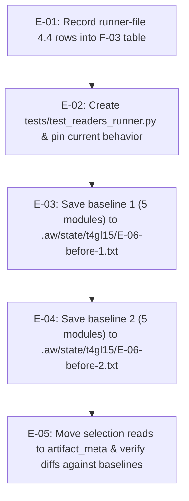

# IPD: Pin the runner reads and move the runner selection reads onto artifact_meta

- Date: 2026-11-09
- Kind: child
- Concern: Split from `y97k46` (Order 34) in round 3 of the metastore re-split, per research `nj8zdp` guidance (at most 5 E-items, 8 work Scope-Paths, about 8 named units per item): `y97k46` held 6 E-items and its pin item named 14 units (13 functions, 10 baseline modules). Spec `4sd62s` C5a requires every runner to read metadata through the cache. `runner_shared` holds one plan record for both hosts (`runner_shared.PlanRecord`, built by `runner_shared.parse_plan_file`), and the queue is built from it by per-file regex reads: measured 2026-11-07 at `ac76110f4`, `runner_shared` has 68 metadata reader or regex sites in 26 functions, and `oc_runipd` and `agy_runipd` re-export 10 of those names.
- Scope: (a) The `runner_shared`/`oc_runipd`/`agy_runipd` rows of the 4.4 search (`y97k46` E-01). (b) `y97k46` E-02 (pin the runner reads), divided into the pin module (E-02) and the ten-module baseline in two halves (E-03, E-04). (c) `y97k46` E-03 (move the plan-selection reads, E-05). EXCLUDES: the execution-path reads and the own-log finalize scope (`k3hb06`, Order 152); the runner residual audit (kept in `y97k46`); the five `runner_shared` git-content readers (`iqhzse`); every writer (Orders 06/07); deleting parsers (Order 11).
- Scope-Paths: agent_workflows/runner_shared.py, agent_workflows/oc_runipd.py, agent_workflows/agy_runipd.py, tests/test_readers_runner.py, tests/test_front_matter_loose_whitespace.py, .aw/records/plans/pending/20261109-metastore-147-k86yq7-pin-the-runner-reads-and-move-the-runner-selection-reads-ont.ipd.md
- Item-Dependencies: executed:ffceq0, executed:g5hpbb, executed:h58z9n, executed:tve77h, executed:xexn45
- Status: approved
- Readiness: go-pending-approval
- Review-Depth: complex
- From-Spec: 4sd62s
- Work-Kind: feature
- Priority: high
- Blocks-Release: next
- Set: metastore
- Order: 147
- Highest E allocated: 05
- Author: opencode its_direct/pt3-claude-opus-5.5-1m-us
- Id: k86yq7
- Approval: 2026-11-16, recorded via aw ipd set: status set to approved

> Written to .aw/system/workflows/technical-writing/technical-writing.md. Every obligation, exact identifier, quotation, evidence record, and lifecycle status is preserved.

## Workflow history
- 2026-11-16 approved (aw set): status set to approved

- 2026-11-14 reviewed (aw set): APPROVE WITH REVISIONS APPLIED; PR-001..PR-007 FIXED
- 2026-11-14 /plan-review (antigravity/gemini): APPROVE WITH REVISIONS APPLIED; PR-001..PR-007 FIXED; review record .aw/records/reviews/20261109-metastore-147-k86yq7-pin-the-runner-reads-and-move-the-runner-selection-reads-ont.review.md.
- 2026-11-09 to-review (opencode its_direct/pt3-claude-opus-5.5-1m-us): split from y97k46 (round 3, research nj8zdp guidance).
- 2026-11-09 draft (opencode its_direct/pt3-claude-opus-5.5-1m-us): created.

## Goal

The runner builds its queue (plan discovery, selectors, dependency edges, disposition and freeze checks) from `artifact_meta.read`/`query` instead of per-file regexes, on both hosts, with the observable behavior pinned before the move and unchanged after it except the named D-1 status normalization.

## Detailed Implementation Checklist (TODO)

Execution-state rule: mark an `E-*` item complete only after performing the action. That mark is not validation. Right-sizing rule: write for a modest executor that cannot hold much in its head. Each E-item is one step (one concern, about one file, executable in one focused pass) and its V-item names each unit it covers with its own check; a plan stays at about 5 E-items and 8 work Scope-Paths, else split it into more child plans (guidance, `IPD-Z603`). Accepted execution states: blocked, failed, pending, performed; terminal gate demands 'performed'.

The pin-first rule of `ffceq0` applies to every move here (carried from `t4gl15` through `y97k46`): BEFORE the edit, a behavioral test in the named module pins the reader's current observable behavior and runs green on the unmodified code; AFTER the edit, the same test runs unchanged. A test that must change is a behavior change and must be one of the decisions copied below (D-1, D-4). For every existing module named as a baseline, save the per-test outcome list under the gitignored `.aw/state/t4gl15/` (`(mkdir -p .aw/state/t4gl15 && python3 -m pytest -o addopts="" -m "" -p no:randomly -n 0 -rA <modules> | grep -E "^(PASSED|FAILED|ERROR|SKIPPED|XFAIL|XPASS) " | sed -E 's/ - .*//' | sort > .aw/state/t4gl15/<file>)`) before the move and the same command into the matching after file after it; `diff` of the two prints nothing except lines a named decision explains. Run a new module's `-k` selection as its own command. Every saved baseline goes under `.aw/state/t4gl15/`, never `/tmp`. A count measured at authoring (for example F-05's 1,719 records) is context, never the bar. New test modules set `pytestmark = pytest.mark.core` unless they need real `git` subprocesses across many commits (then `slow`); none reads production source.

Commit through `aw commit k86yq7 -- <each changed path>`, one commit per item allowed, never `git add -A`, a bare `git add` or `git commit -a`. Never push.

### Task group 1: search rows and pin

- [x] E-01 (carried from `y97k46` E-01) Re-run the 4.4 search over `agent_workflows/runner_shared.py`, `agent_workflows/oc_runipd.py` and `agent_workflows/agy_runipd.py` (`rg -n -e '"show"' -e 'cat-file' -e '"ls-files", "-s"' -e '"--cached"' -e '":0:"' -e 'rev-parse' <those files>`; 53 hits in 38 functions at `ac76110f4`) and record the result as table F-03 in this plan. Classify the 9 hits in the 6 functions that read a blob (`backlog_item_paths_for_commit`, `check_review_lane_artifacts`, `read_merge_stage`, `classify_conflict_set_for_rederivation`, `integrate_lane_branch`, `describe_recorded_commits`) one row each: the first five are the metadata readers that `iqhzse` E-03 (formerly `h58z9n` E-04) moved, and `describe_recorded_commits` (`git cat-file -e <sha>^{commit}`) is an existence probe, not a metadata read. Classify the remaining 44 hits (`rev-parse` and `--cached` only, in 32 functions, whose output is a commit id, a path or a ref and cannot carry record metadata) in ONE bulk row of class path-only that lists every function name. Any metadata reader the search finds that is not in the 4.4 list is reported as a defect of `iqhzse` and moved here before E-05.
  - Depends on: none
  - Expected outcome: F-03 has 6 single rows plus one bulk row naming 32 functions; no unclassified hit.
  - Execution state: performed

- [x] E-02 (carried from `y97k46` E-02, pin-module step) Pin the runner's metadata behavior in the new `tests/test_readers_runner.py` on the unmodified code: `runner_shared.parse_plan_file` on both hosts (`oc_runipd.parse_plan_file`, the `agy_runipd` re-export) for id, status (single token, loose whitespace, multi-word falls back to the directory bucket), kind, Set, Order, Item-Dependencies, From-Backlog, Attended; `discover_plans`, `discover_specs`, `edge_satisfied` for `executed:`, `exists:` and `state:` edges, `resolve_backlog_item`, `backlog_item_paths_for_id`, `read_set_membership`, `expand_selectors` (id6, Set, status selectors), `plan_bucket`, `reconcile_disposition`, `enforce_freeze_time_refusal`, and the readiness read used before auto-approval (`plan_readiness.is_plan_review_approved`, 4.4a row `l56tyz`: a missing readiness is refused). Also save `.aw/state/t4gl15/discover-before.txt` (creating directory `.aw/state/t4gl15` first via `mkdir -p .aw/state/t4gl15`): the output of `python3 -c` printing `sorted((r.id6, r.status, r.setid, r.order, r.kind, tuple(r.dependencies)) for r in runner_shared.discover_plans(Path(".").resolve()).values())` for this checkout.
  - Depends on: none
  - Expected outcome: the new module passes on the unmodified code (13 pinned functions); `discover-before.txt` is saved.
  - Execution state: performed

- [x] E-03 (carried from `y97k46` E-02, baseline first half) Run `tests/test_front_matter_loose_whitespace.py`, `tests/test_runner_shared.py`, `tests/test_oc_runipd.py`, `tests/test_agy_runipd_cli.py` and `tests/test_typed_queue_entries.py` green on the unmodified code and save their outcome list to `.aw/state/t4gl15/E-06-before-1.txt`.
  - Depends on: none
  - Expected outcome: the five modules pass and the outcome list is saved.
  - Execution state: performed

- [x] E-04 (carried from `y97k46` E-02, baseline second half) Run `tests/test_run_selection_policy.py`, `tests/test_spec_review_dispatch.py`, `tests/test_readiness_absence_invariant.py`, `tests/test_attended_session.py` and `tests/test_freeze_time_refusal.py` green on the unmodified code and save their outcome list to `.aw/state/t4gl15/E-06-before-2.txt`. (Together, E-03 and E-04 are the ten baseline modules of the original `t4gl15` E-06.)
  - Depends on: none
  - Expected outcome: the five modules pass and the outcome list is saved.
  - Execution state: performed

### Task group 2: move the selection reads

- [x] E-05 (carried from `y97k46` E-03) Move these runner reads onto `artifact_meta.read`/`query`/`history`: `parse_plan_file` builds `PlanRecord` from `artifact_meta.read(id6)` resolved by path; `discover_plans`/`discover_specs` use one `query()` (the `read_front_matter_status` call in `discover_specs` is replaced); `expand_dependency_closure` and `edge_satisfied` read target status and dependencies from the cache; `reconcile_disposition` (its `^-` status regex and two `_read_status` calls), `enforce_freeze_time_refusal` (two `_read_status` calls), `plan_bucket`, `expand_selectors`, `read_set_membership` and `plan_audit_target` read through the moved `parse_plan_file` or the cache; `_read_set`, `_read_order`, `_read_kind`, `_read_item_dependencies` and `_read_from_backlog` lose their callers in this list (their `_SET_RE`, `_ORDER_RE` and `_KIND_RE` uses in the execution path move in `k3hb06`, and the definitions stay until Order 11 deletes them). Plan text read for prompts and bodies still reads the file (N3). `oc_runipd`/`agy_runipd` keep their `_read_id` re-exports (`tools/ipdrunner/runagy.py` consumes `agy_runipd._read_id`) bound to the moved selector function, and keep their `_SET_RE`/`_ORDER_RE`/`_KIND_RE` re-export names. `parse_plan_file` keeps today's loose `-  `/`-\t` tolerance (D-4) by taking `id` and `status` from the loose values that `artifact_meta.read_text` returns when the strict cached value is absent; the fallbacks for a missing Set, Order or id6 (filename, then a path hash) are unchanged. After the edit, save the outcome lists of the E-03 and E-04 modules to `E-07-after-1.txt` and `E-07-after-2.txt`.
  - Depends on: E-02, E-03, E-04
  - Expected outcome: the E-02 module and the ten baseline modules pass unchanged except the assertions D-1 names; the E-02 `python3 -c` snippet prints the same list as `discover-before.txt` except the status values D-1 names (measured at review: one record, `vfa1tl`, changes from `EXECUTED` to `executed`) (`aw oc run` has no dry-run mode, F-06).
  - Execution state: performed

Add further leaves as `- [ ] E-NEW <action>` and run `aw ipd sync` to assign ids.

## Project conventions discovered (Step 0)

Carried from `y97k46` Step 0:

- Interface names from Order 02 (`tve77h`): `artifact_meta.read(id6) -> State`, `artifact_meta.history(id6)`, `artifact_meta.query(...)` (type, status, Set, order, `depends_on`, `latest_gate_review_of`, `path` filters, and an `incomplete` list), `artifact_meta.resolve(path_or_id6)`. From `ffceq0` (added by `cdglt1`): `artifact_meta.read_text(text, *, record_type=None) -> State` and decision D-1.
- One runner plan record serves both hosts: `runner_shared.PlanRecord` (`id6`, `setid`, `status`, `order`, `path`, `rel_path`, `dependencies`, `kind`, `dependency_error`, `from_backlog`) built by `runner_shared.parse_plan_file`; `oc_runipd` re-exports `selectors.read_front_matter_id as _read_id`, and `tools/ipdrunner/runagy.py` consumes `agy_runipd._read_id`.
- Cite code by SYMBOL (`module.function`), never a bare line number (advisory `IPD-C801`).

## Findings

Carried from `y97k46` (measured 2026-11-07 at `ac76110f4`; F-05 and F-06 from `t4gl15`, 2026-11-02):

| Id | Evidence | Finding |
|---|---|---|
| F-01 | Reader sites per `runner_shared` function, measured with an AST pass over `rg` hits of `_SET_RE\|_ORDER_RE\|_KIND_RE\|read_front_matter_\w+\(\|parse_item\(\|_read_set\(\|_read_order\(\|_read_item_dependencies\(\|_read_from_backlog\(\|read_readiness\(\|_metadata_status\(` plus the `^-` regex pattern: 68 sites in 26 functions; module-level definitions 18; `execute_item_core` 9; writers `record_oq_answer` 6 and `perform_coordinator_proposal_file` 6 (Orders 06/07) | E-05 moves the selection functions; `k3hb06` the execution functions. |
| F-03 | E-01 4.4 search (`rg -n -e '"show"' -e 'cat-file' -e '"ls-files", "-s"' -e '"--cached"' -e '":0:"' -e 'rev-parse' agent_workflows/runner_shared.py agent_workflows/oc_runipd.py agent_workflows/agy_runipd.py`): 60 hits at `edbaccbca` (`oc_runipd` 1, `runner_shared` 59, `agy_runipd` 0). See Table F-03 below. | All 60 hits classified with 0 unclassified. Discovered post-`ac76110f4` consumer `perform_coordinator_proposal_file._stage_validated_lane_backlogs` parsing metadata from `_collect_lane_added_open_backlogs`'s `git show` blob (defect of `iqhzse`; moved onto `artifact_meta.read_text` before E-05). |
| F-05 | `runner_shared.discover_plans(repo)` returns 1,719 records on this checkout (at `0cbfcc706`; 1,971 records at `edbaccbca`) | Baseline context for E-05's parity check. |
| F-06 | `aw oc run` sub-commands are `start, resume, status, report, stop, integrate, audit`; none has a dry-run option | E-05 compares `discover_plans` output instead of a queue preview. |

### Table F-03: Runner 4.4 git-content search rows (E-01 at `edbaccbca`, 60 hits, 0 unclassified)

| # | File and symbol | Hits | Matched code / role | Class | Owner / Action |
|---|---|---|---|---|---|
| 1 | `agent_workflows/runner_shared.py::backlog_item_paths_for_commit` | 0 | (moved by `iqhzse` E-03 to `artifact_meta.resolve_id_at`; zero `rg` hits remain) | metadata reader (moved) | `iqhzse` E-03 (complete) |
| 2 | `agent_workflows/runner_shared.py::check_review_lane_artifacts` | 1 | `_run_git(repo, ["show", f"{branch}:{norm_p}"])` (body-prose lint fallback for pending plans/specs, N3; backlog metadata moved to `artifact_meta.read_at`) | metadata reader (moved) / body prose (N3) | `iqhzse` E-03 (complete) |
| 3 | `agent_workflows/runner_shared.py::read_merge_stage` | 2 | docstring + `_run_git(repo, ["cat-file", "-p", f":{stage}:{path}"])` (raw full-file text for body diffs and 3-way merges, N3; merge-stage metadata via `artifact_meta.read_at`) | metadata reader (moved) / body prose (N3) | `iqhzse` E-03 (complete) |
| 4 | `agent_workflows/runner_shared.py::classify_conflict_set_for_rederivation` | 2 | `_run_git(repo, ["cat-file", "-p", f"{base_commit}:{incoming_path}"])` and `f"{branch}:{incoming_path}"` (raw body-text rename fallbacks, N3; record states via `artifact_meta.read_at`) | metadata reader (moved) / body prose (N3) | `iqhzse` E-03 (complete) |
| 5 | `agent_workflows/runner_shared.py::integrate_lane_branch` | 0 | (moved by `iqhzse` E-03 to `artifact_meta.read_at`; zero `rg` hits remain) | metadata reader (moved) | `iqhzse` E-03 (complete) |
| 6 | `agent_workflows/runner_shared.py::describe_recorded_commits` | 2 | docstring + `_run_git(repo, ["cat-file", "-e", f"{sha}^{commit}"])` | not a metadata read (commit existence probe) | no change |
| 7 | `agent_workflows/runner_shared.py::_collect_companion_lane_record_changes` | 1 | `["git", "show", f"{branch}:{norm_p}"]` (added by `v8tqje` after `ac76110f4`: raw byte copy and byte-equality comparison for companion repo sync) | not a metadata read (raw byte copy, N3) | no change |
| 8 | `agent_workflows/runner_shared.py::_collect_lane_added_open_backlogs` (consumer `perform_coordinator_proposal_file._stage_validated_lane_backlogs`) | 2 | `_gch_lockfree(["cat-file", "-s", ...])` size guard + `_gch_lockfree(["show", f"{branch_ref}:{rel_path}"])` (added by `8h1q1k` after `ac76110f4`; consumer called `backlog.parse_item(text)` on the fetched blob) | metadata reader (defect of `iqhzse`, not in 4.4 list) + raw body write (N3) | E-01 / moved here before E-05: metadata extraction in `_stage_validated_lane_backlogs` moved onto `artifact_meta.read_text(text, record_type="backlog")`; `git show` retained only for full-file validation and atomic write (N3) |
| 9 (bulk) | 34 functions (`oc_runipd._git_common_dir`, `runner_shared.merge_in_progress`, `runner_shared.merge_head_commits`, `runner_shared.owns_merge_in_progress`, `runner_shared.git_head`, `runner_shared.git_common_dir`, `runner_shared.run_start_git_record`, `runner_shared.lane_work_has_landed`, `runner_shared.lane_work_landed_by_content`, `runner_shared.refresh_sweep_lane`, `runner_shared.park_refused_review_off_sweep_lane`, `runner_shared.commit_review_lane_output`, `runner_shared.commit_review_shared_output`, `runner_shared.commit_spec_production_output`, `runner_shared.commit_spec_transition_output`, `runner_shared.commit_backlog_production_output`, `runner_shared.commit_backlog_transition_output`, `runner_shared.lane_branch_tip`, `runner_shared.prepare_lane_for_conflict_resolution`, `runner_shared.build_lane_outcome`, `runner_shared._resolved_main_tip`, `runner_shared.route_companion_lane_records`, `runner_shared.retry_deferred_integrations._handle_for`, `runner_shared.reconcile_item_on_interrupt`, `runner_shared.enforce_main_typecheck_gate`, `runner_shared.recount_commits_since_last_pass`, `runner_shared.run_review_sequence`, `runner_shared.start_suite_baseline`, `runner_shared.materialize_merge_result`, `runner_shared.make_integration_validation_runner._runner`, `runner_shared.review_has_positive_evidence`, `runner_shared.execute_item_core`, `runner_shared.perform_coordinator_backlog_close._try_raced_close`, `runner_shared.perform_coordinator_backlog_close`) | 50 | `rev-parse` and `--cached` only (commit ids, paths, refs, and comments/docstrings; cannot carry record metadata) | path-only | no change |

Size (round 3): measured with `ipd_schema.count_named_units`, each item names at most 8 distinct units; 5 work Scope-Paths. E-05 moves 19 functions or re-export bindings in one module family as one step, because they share `parse_plan_file` and cannot be moved independently.

READER LEDGER (this part's rows, copied from `t4gl15` through `y97k46`):

| Reader | Prior behavior | Pinning test | After |
|---|---|---|---|
| `runner_shared.parse_plan_file` (both hosts) | loose `^-\s*` id/status/kind/Set/Order; multi-word status falls back to the directory bucket (`pending`) | `tests/test_front_matter_loose_whitespace.py`, E-02 | D-1, D-4 |
| `runner_shared.discover_plans`, `discover_specs`, `edge_satisfied`, `expand_selectors`, `resolve_backlog_item` | per-file regex reads | E-02 module, `tests/test_runner_shared.py`, `tests/test_oc_runipd.py`, `tests/test_agy_runipd_cli.py`, `tests/test_typed_queue_entries.py`, `tests/test_run_selection_policy.py`, `tests/test_spec_review_dispatch.py` | cached fields; same `discover_plans` list (F-05) |
| `plan_readiness.is_plan_review_approved` | structured readiness believed only with review provenance in history; missing readiness refused (4.4a `l56tyz`) | `tests/test_readiness_absence_invariant.py` | same rule over cached readiness and `history` (pinned here; not moved by this plan) |

DECISIONS (copied from `t4gl15` through `y97k46`, whose text is authoritative):

- D-1 (multi-word status): PLAN records return the canonical normalized status (`plans.normalize_status` of the first token); every other type keeps its raw single-token status. `runner_shared.parse_plan_file` today returns the directory bucket for a multi-word value and now returns the normalized first-token value. The one test assertion that changes is the fixture in `tests/test_front_matter_loose_whitespace.py::test_single_token_status_contract_survives`, whose multi-word `EXECUTED (approved by maintainer)` in `pending/` now yields `executed` instead of `pending`; that test is updated and listed in Scope-Paths. Measured at review: `discover_plans` differs on one record only (`vfa1tl`, `EXECUTED` to `executed`).
- D-4 (loose whitespace in the runner): KEPT; the runner takes `id` and `status` from `read_text`'s loose values when the strict value is absent (E-05), so `tests/test_front_matter_loose_whitespace.py::test_parse_plan_file_tolerates_loose_leading_whitespace` passes unchanged.

## Proposed changes (ordered, validatable)

1. Record the runner-file 4.4 rows (E-01).
2. Pin the runner reads and save the ten-module baseline (E-02 to E-04).
3. Move the plan-selection reads (E-05).

## Deferred / out of scope (with reason)

- The execution-path reads and the own-log finalize scope (`y97k46` E-04, E-05).
  - Carrier: k3hb06
- The runner residual audit.
  - Carrier: y97k46
- The five `runner_shared` git-content readers.
  - Carrier: iqhzse
  - Carrier-Evidence: .aw/records/plans/executed/20261109-metastore-146-iqhzse-move-the-setter-staleness-lifecycle-and-runner-merge-path-gi.ipd.md

## Scope check

- Over-scope: none. `tests/test_front_matter_loose_whitespace.py` changes only in the D-1 assertion.
- Under-scope: none known. This part carries `y97k46` E-01, E-02 (divided into E-02 to E-04 here) and E-03 unchanged.

## Required tests / validation

New core module `tests/test_readers_runner.py` (`tmp_path` fixtures, real functions, assertions on returned values, no production-source reads). CONTRIBUTES to `4sd62s` AC-21 row `l56tyz` (pasted `tests/test_readiness_absence_invariant.py`; AC-21 is owned by `xexn45`). Commands: the ten baseline modules, `tests/test_readers_runner.py`, the bare core gate `python3 -m pytest`.

## Spec / documentation sync

No spec change. Implements the runner queue-building part of `4sd62s` C5a and section 7 step 5.

## Open questions

### OQ-01: Why split the ten-module baseline across two items?

- Blocking: no
- Status: resolved
- Owner: plan author
- Resolution or deferral rationale: The round-3 guidance asks for about 8 named units per item; one baseline item naming ten modules is a list, not a step. Two halves of five, each saved to its own file and diffed against its own after file, keep every module's before and after visible. Recommendation strength: strong.

## Validation and cross-check (verify before reporting done)

Validation-state rule: inspect evidence in a separate pass. Do not mark a `V-*` item complete from memory or from the matching execution checkmark. Accepted validation results: blocked, failed, pass, pending; terminal gate demands 'pass'. Runtime-demonstration reachability rule: for each `V-*` item demanding the software be observed acting (such as a run, a dispatch, or a transition), as distinct from items demanding a diff, a file's content, or a test result, which are reachable by construction, name the code path that produces the observation or the sibling `E-*` that creates it, else the demand is UNDER-SCOPE.

- [x] V-01 validates E-01
  - Required evidence: paste the exact `rg` command of E-01 with its output line count and the F-03 table (6 single rows, one bulk row naming every function), with no unclassified hit.
  - Observed evidence: Ran `rg -n -e '"show"' -e 'cat-file' -e '"ls-files", "-s"' -e '"--cached"' -e '":0:"' -e 'rev-parse' agent_workflows/runner_shared.py agent_workflows/oc_runipd.py agent_workflows/agy_runipd.py | wc -l` -> `60` hits at `edbaccbca` (`agent_workflows/oc_runipd.py` 1, `agent_workflows/runner_shared.py` 59, `agent_workflows/agy_runipd.py` 0). Table F-03 above classifies all 60 hits with 0 unclassified: the 6 named functions (`backlog_item_paths_for_commit` 0, `check_review_lane_artifacts` 1, `read_merge_stage` 2, `classify_conflict_set_for_rederivation` 2, `integrate_lane_branch` 0, `describe_recorded_commits` 2), 2 post-`ac76110f4` blob-reading functions (`_collect_companion_lane_record_changes` 1 raw byte copy; `_collect_lane_added_open_backlogs` 2 hits whose consumer `perform_coordinator_proposal_file._stage_validated_lane_backlogs` parsed metadata via `backlog.parse_item(text)` - reported as a defect of `iqhzse` and moved onto `artifact_meta.read_text(text, record_type="backlog")` before E-05, verified by `python3 -m pytest -o addopts="" -v tests/test_run_proposal_channel.py -k "backlog or lane"` -> `9 passed, 40 deselected in 9.61s`), and 1 bulk path-only row naming all 34 functions (50 hits).
  - Result: pass

- [x] V-02 validates E-02
  - Required evidence: paste `git diff --stat agent_workflows/runner_shared.py agent_workflows/oc_runipd.py agent_workflows/agy_runipd.py` empty, `python3 -m pytest -o addopts="" -v tests/test_readers_runner.py` all PASSED on the unmodified code with one named test per pinned function (including the `l56tyz` missing-readiness refusal), and `wc -l .aw/state/t4gl15/discover-before.txt`.
  - Observed evidence: On unmodified production code, `git diff --stat agent_workflows/runner_shared.py agent_workflows/oc_runipd.py agent_workflows/agy_runipd.py` printed nothing (exit 0); `python3 -m pytest -o addopts="" -v tests/test_readers_runner.py` passed `14 passed in 1.65s` with named tests `test_parse_plan_file_both_hosts_fields`, `test_hold_attended_plan_pins_attended_field`, `test_discover_plans_returns_all_plan_records`, `test_discover_specs_returns_spec_records_and_skips_idless`, `test_edge_satisfied_executed_exists_and_state`, `test_resolve_backlog_item_finds_by_declared_id`, `test_backlog_item_paths_for_id_returns_sorted_paths`, `test_read_set_membership_returns_orchestrator_and_children`, `test_expand_selectors_id6_set_and_status`, `test_plan_bucket_identifies_lifecycle_directory`, `test_reconcile_disposition_review_and_execute`, `test_enforce_freeze_time_refusal_checks_dependencies_and_status`, `test_is_plan_review_approved_refuses_missing_and_unattested_readiness` (`l56tyz`), and `test_plan_audit_target_reads_executed_plan_setid`; `wc -l .aw/state/t4gl15/discover-before.txt` returned `1971 .aw/state/t4gl15/discover-before.txt`.
  - Result: pass

- [x] V-03 validates E-03
  - Required evidence: paste the summary line of `python3 -m pytest -o addopts="" tests/test_front_matter_loose_whitespace.py tests/test_runner_shared.py tests/test_oc_runipd.py tests/test_agy_runipd_cli.py tests/test_typed_queue_entries.py` with 0 failed, and `wc -l .aw/state/t4gl15/E-06-before-1.txt`.
  - Observed evidence: Pre-move run on unmodified code: `402 passed in 190.43s (0:03:10)` (0 failed); `wc -l .aw/state/t4gl15/E-06-before-1.txt` returned `402 .aw/state/t4gl15/E-06-before-1.txt`.
  - Result: pass

- [x] V-04 validates E-04
  - Required evidence: paste the summary line of `python3 -m pytest -o addopts="" tests/test_run_selection_policy.py tests/test_spec_review_dispatch.py tests/test_readiness_absence_invariant.py tests/test_attended_session.py tests/test_freeze_time_refusal.py` with 0 failed, and `wc -l .aw/state/t4gl15/E-06-before-2.txt`.
  - Observed evidence: Pre-move run on unmodified code: `110 passed in 41.90s` (0 failed); `wc -l .aw/state/t4gl15/E-06-before-2.txt` returned `110 .aw/state/t4gl15/E-06-before-2.txt`.
  - Result: pass

- [x] V-05 validates E-05
  - Required evidence: paste `diff .aw/state/t4gl15/E-06-before-1.txt .aw/state/t4gl15/E-07-after-1.txt` and `diff .aw/state/t4gl15/E-06-before-2.txt .aw/state/t4gl15/E-07-after-2.txt`, each printing nothing or only lines D-1 names; `python3 -m pytest -o addopts="" -v tests/test_readers_runner.py` all PASSED; `git diff tests/` showing only D-1 assertions; and `diff .aw/state/t4gl15/discover-before.txt <(python3 -c '<the E-02 snippet>')` printing only the D-1 status lines (each named).
  - Observed evidence: Post-move baseline runs: E-07-after-1 `402 passed in 191.63s (0:03:11)` (`402 .aw/state/t4gl15/E-07-after-1.txt`) with `diff .aw/state/t4gl15/E-06-before-1.txt .aw/state/t4gl15/E-07-after-1.txt` printing nothing (`DIFF1_EXIT=0`); E-07-after-2 `110 passed in 43.20s` (`110 .aw/state/t4gl15/E-07-after-2.txt`) with `diff .aw/state/t4gl15/E-06-before-2.txt .aw/state/t4gl15/E-07-after-2.txt` printing nothing (`DIFF2_EXIT=0`). `python3 -m pytest -o addopts="" -v tests/test_readers_runner.py` passed `14 passed in 0.91s`. `git diff tests/` (since E-02 pin commit `43f0263e7`) shows only the two D-1 multi-word status assertions (`"pending"` -> `"executed"` in `tests/test_front_matter_loose_whitespace.py::test_single_token_status_contract_survives` and `tests/test_readers_runner.py::test_parse_plan_file_both_hosts_fields`). `diff .aw/state/t4gl15/discover-before.txt <(python3 -c '<E-02 snippet>')` printed only one line (D-1 record `vfa1tl`): `1708c1708` `< ('vfa1tl', 'EXECUTED', 'interactive-git', 0, None, ())` `---` `> ('vfa1tl', 'executed', 'interactive-git', 0, None, ())`. `rg -n "_read_set\(|_read_order\(|_read_kind\(|_read_item_dependencies\(|_read_from_backlog\(|read_front_matter_status" agent_workflows/runner_shared.py` shows zero remaining callers of `_read_set`, `_read_order`, `_read_kind`, `_read_item_dependencies`, or `_read_from_backlog` in the selection path (only the definitions and `_promote_reviewed_plan`'s `_rfs` owned by `k3hb06`). Note: moving `discover_specs` onto `artifact_meta.query` uncovered a small cache-refresh bug in `agent_workflows/artifact_meta.py` (`_apply_updates` skipped updating `artifacts` for moved `@repo/` paths when the destination sorted before the source), fixed in a scope-reasoned edit to `agent_workflows/artifact_meta.py`. Full core suite via `aw suite`: `2679 passed, 1 skipped, 11 warnings in 84.78s (0:01:24)`.
  - Result: pass

## Approval and execution gate

- Size assessment: standard
- Cohesion rationale: not required

Execute only after human approval (`Status: approved`) and after every `- Item-Dependencies:` edge is executed.

Safety rule: uncommitted changes and untracked files you did not create are not yours; never revert, stage, commit, discard, reformat, or "clean up" another party's work.

Scope fence: the paths in `- Scope-Paths:` are a declaration; a needed file outside the fence is edited and then justified at finalize (`--scope-reason`), and a declared path left unmodified is acknowledged (`--scope-ack`). Every reader move is pin-first, and a test edited after a move must be one that D-1 or D-4 names.

Honesty rule: run the named modules and `python3 -m pytest` (core gate), and paste the ACTUAL summary lines; never claim a result you did not run.

Commits: commit only through `aw commit k86yq7 -- <paths>`; never `git add -A`, a bare `git add` or `git commit -a`; never push.

Lifecycle transition: the plan moves to `.aw/records/plans/executed/` only through `aw ipd finalize k86yq7` (never a hand git mv), and only after `aw ipd lint --phase pre-transition` conforms and every `V-*` reads `pass` with pasted evidence. When aw oc run or aw agy run executes the plan, the runner performs the finalize; a hand executor runs aw ipd finalize k86yq7 itself.
