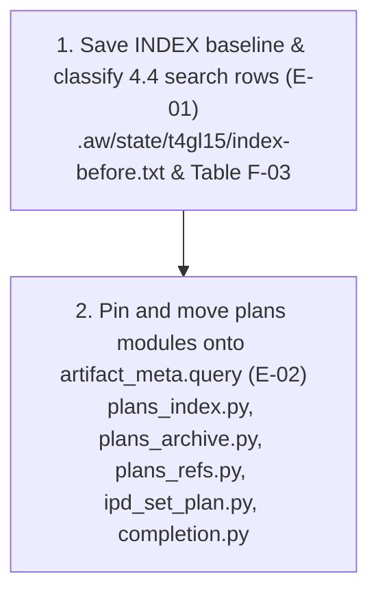

# IPD: Move the plans module reads onto artifact_meta

- Date: 2026-11-09
- Kind: child
- Concern: Split from `jd7874` (Order 35) in round 3 of the metastore re-split, per research `nj8zdp` guidance (at most 8 work Scope-Paths per plan): `jd7874` declared 10 work Scope-Paths across two module families. Spec `4sd62s` C5a requires every record module to read metadata through the cache, and AC-9 requires that no reader depend on an INDEX file. Measured 2026-11-07 at `ac76110f4`: the plans modules read metadata with their own regexes (`plans_index._META_RE` 7 patterns, `plans_archive` 5 `^-` regexes, `plans_refs` 5).
- Scope: (a) `jd7874` E-01: save the INDEX baseline before any code edit of the `jd7874` family, and record the 4.4 search rows for the 31 files outside the gate and runner files. (b) `jd7874` E-02: pin, then move, the plans modules (`plans_index`, `plans_archive`, `plans_refs` read side, `ipd_set_plan`, `completion`). EXCLUDES: the research and prompts modules and the banner fix (`cb5eda`, Order 153); the residual audit (kept in `jd7874`); deleting the INDEX writers (Order 11).
- Scope-Paths: agent_workflows/plans_index.py, agent_workflows/plans_archive.py, agent_workflows/plans_refs.py, agent_workflows/ipd_set_plan.py, agent_workflows/completion.py, tests/test_readers_record_modules.py, tests/test_plans_index.py, .aw/records/plans/pending/20261109-metastore-148-kyl3m4-move-the-plans-module-reads-onto-artifact-meta.ipd.md
- Item-Dependencies: executed:ffceq0, executed:g5hpbb, executed:h58z9n, executed:tve77h, executed:xexn45
- Status: approved
- Readiness: go-pending-approval
- Review-Depth: complex
- From-Spec: 4sd62s
- Work-Kind: feature
- Priority: high
- Blocks-Release: next
- Set: metastore
- Order: 148
- Highest E allocated: 02
- Author: opencode its_direct/pt3-claude-opus-5.5-1m-us
- Id: kyl3m4
- Approval: 2026-11-16, recorded via aw ipd set: status set to approved

> Written to `.aw/system/workflows/technical-writing/technical-writing.md`. Every obligation, exact identifier, quotation, evidence record, and lifecycle status is preserved.

## Workflow history
- 2026-11-16 approved (aw set): status set to approved
- 2026-11-14 reviewed (aw set): APPROVE WITH REVISIONS APPLIED; PR-001..PR-006 FIXED

- 2026-11-14 /plan-review (antigravity/gemini-3.8-flash): APPROVE WITH REVISIONS APPLIED; PR-001..PR-006 FIXED; review record .aw/records/reviews/20261109-metastore-148-kyl3m4-move-the-plans-module-reads-onto-artifact-meta.review.md
- 2026-11-09 to-review (opencode its_direct/pt3-claude-opus-5.5-1m-us): split from jd7874 (round 3, research nj8zdp guidance).
- 2026-11-09 draft (opencode its_direct/pt3-claude-opus-5.5-1m-us): created.

## Goal

The plans modules answer from `artifact_meta.query`, so no plans reader depends on an INDEX file, with the INDEX check output unchanged except D-1, and the 4.4 search rows outside the gate and runner files are classified.

## Detailed Implementation Checklist (TODO)

Execution-state rule: mark an `E-*` item complete only after performing the action. That mark is not validation. Right-sizing rule: write for a modest executor that cannot hold much in its head. Each E-item is one step (one concern, about one file, executable in one focused pass) and its V-item names each unit it covers with its own check; a plan stays at about 5 E-items and 8 work Scope-Paths, else split it into more child plans (guidance, `IPD-Z603`). Accepted execution states: blocked, failed, pending, performed; terminal gate demands 'performed'.

The pin-first rule of `ffceq0` applies to every move here (carried from `t4gl15` through `jd7874`): BEFORE the edit, a behavioral test pins the reader's current observable behavior and runs green on the unmodified code; AFTER the edit, the same test runs unchanged except where decision D-1 (copied below) names it. For every existing module named as a baseline, ensure directory existence (`mkdir -p .aw/state/t4gl15 .aw/state/kyl3m4`), save the per-test outcome list under the gitignored `.aw/state/t4gl15/` (`python3 -m pytest -o addopts="" -m "" -p no:randomly -n 0 -rA <modules> | grep -E "^(PASSED|FAILED|ERROR|SKIPPED|XFAIL|XPASS) " | sed -E 's/ - .*//' | sort > .aw/state/t4gl15/<E>-before.txt`) before the move and into `<E>-after.txt` after it, where `<E>` is the ORIGINAL `t4gl15` item id named below. Run a new module's `-k` selection as its own command. New test modules set `pytestmark = pytest.mark.core`; none reads production source.

Commit through `aw commit kyl3m4 -- <each changed path>`, one commit per item allowed, never `git add -A`, a bare `git add` or `git commit -a`. Never push.

### Task group 1: INDEX baseline and search rows

- [ ] E-01 (carried from `jd7874` E-01) Before any code edit of this plan (and so before any edit of the `jd7874` family, because `cb5eda` depends on this plan), ensure directory existence (`mkdir -p .aw/state/t4gl15 .aw/state/kyl3m4`), save the `aw index plans --check`, `aw index research --check` and `aw index prompts --check` exit codes and outputs to `.aw/state/t4gl15/index-before.txt`. Then record the 4.4 search rows for the 31 files outside the gate and runner files as table F-03 in this plan: run `rg -n -e '"show"' -e 'cat-file' -e '"ls-files", "-s"' -e '"--cached"' -e '":0:"' -e 'rev-parse' agent_workflows -g '!runner_shared.py' -g '!oc_runipd.py' -g '!agy_runipd.py' -g '!check_engine.py' -g '!hooks/*' -g '!plan_readiness.py' -g '!ipd_lifecycle.py' -g '!artifact_meta.py'` (115 hits in 70 functions at `ac76110f4`) and write ONE row per function of the 21 functions with a `show`, `cat-file`, `ls-files -s` or `:0:` hit (named in F-02), each classified as path-only reader, not a metadata read, or metadata reader, and ONE bulk path-only row that names the 49 functions whose only hits are `rev-parse` or `--cached` (a commit id, ref, path or staged path list cannot carry record metadata). Any metadata reader found is a defect of the 4.4 list: name it and add it to E-02 (or to `cb5eda` if it is in a research or prompts module), otherwise report it for `t4gl15` E-15.
  - Depends on: none
  - Expected outcome: `index-before.txt` exists; F-03 has 21 single rows and one bulk row naming 49 functions; every metadata-reader row names the item that moves it.
  - Execution state: pending

### Task group 2: plans modules

- [ ] E-02 (carried from `jd7874` E-02) Pin, then move, `plans_index` (`plan_entry`, `scan_plans`, `query`, `_meta`, `check_drift` metadata reads), `plans_archive` (`_ID_RE`, date, status and Set reads in `sweep_candidates` and `_plan_status`), `plans_refs` read side, `ipd_set_plan` (Set inventory via `plans_index.scan_plans`) and `completion` (active Set ids) onto `artifact_meta.query`. `plans_index` entries keep their fields; `status` for a multi-word plan follows D-1 of `ffceq0` (canonical value). The INDEX writers keep writing INDEX files from the same entries until Order 11 deletes them (AC-9). Pin in `tests/test_readers_record_modules.py` and run `tests/test_plans_index.py`, `tests/test_plans_archive.py`, `tests/test_plans_archive_selectors.py`, `tests/test_ipd_set_plan.py` and `tests/test_completion.py` green before and after (outcome lists `E-09-before.txt`/`E-09-after.txt`). (Measured units at `ac76110f4`: 23 functions with a reader site across the five modules, 5 baseline modules.)
  - Depends on: E-01
  - Expected outcome: all listed modules pass before and after; `aw index plans --check` reports the same exit code and output as `.aw/state/t4gl15/index-before.txt` (any change traced to D-1); `rg -n "re\.\w+\(\s*r?[\"'](\(\?m\))?\^-" agent_workflows/plans_index.py agent_workflows/plans_archive.py` prints nothing.
  - Execution state: pending

Add further leaves as `- [ ] E-NEW <action>` and run `aw ipd sync` to assign ids.

## Project conventions discovered (Step 0)

Carried from `jd7874` Step 0:

- Interface names: `agent_workflows/artifact_meta.py::read(id6) -> State`, `agent_workflows/artifact_meta.py::query(...)` (type, status, Set, order, `path` filters, `incomplete` list), from `tve77h`; decision D-1 from `ffceq0`.
- The plans index writer and reader are one module (`agent_workflows/plans_index.py::run_index`, `agent_workflows/plans_index.py::scan_plans`, `agent_workflows/plans_index.py::plan_entry`, `agent_workflows/plans_index.py::query`); `agent_workflows/ipd_set_plan.py` and `agent_workflows/completion.py` consume `scan_plans`; `agent_workflows/plans_archive.py` reads `agent_workflows/plans_index.py::_EXCLUDE_NAMES` and calls `scan_plans`.
- Cite code by SYMBOL (`path::Symbol`), never a bare line number (advisory `IPD-C801`).

## Findings

Carried from `jd7874` (measured 2026-11-07 at `ac76110f4`):

| Id | Evidence | Finding |
|---|---|---|
| F-01 | AST pass over `rg` hits of each module's reader symbols: `plans_index` 12 sites in 6 functions, `plans_archive` 11 in 8, `plans_refs` 22 in 6, `ipd_set_plan` 1, `completion` 2 | E-02 has 23 functions. |
| F-02 | The 21 functions outside the gate and runner files with a `show`/`cat-file`/`ls-files -s`/`:0:` hit at `ac76110f4`: `cli.<module>`, `cli._build_parser`, `cli._dispatch`, `cli._oc_profile_show`, `cli._rewrite_help_token`, `cli._run_oc_profile`, `cli._run_show`, `cli._run_show_meta`, `command_surface.<module>`, `completion.complete_query`, `layout_migration._is_removable_leftover`, `leak_sanitizer.scan_staged_counted`, `leak_sanitizer.scan_working_tree_counted`, `meta_cli.show_history`, `meta_cli.show_json`, `project_context._git_cached_entries`, `run_analytics_taxonomy.<module>`, `run_cli.run_cli`, `run_viewer.<module>`, `typecheck_gate._tree_declares_mypy`, `worktree_lease._lane_base_sha` | Most are the `show` sub-command NAME, not `git show`; `t4gl15` F-07 classified the rest as path-only or non-metadata. |
| F-03 | (written by E-01) the classified rows | 4.4 says the list is a minimum. |

Size (round 3): measured with `ipd_schema.count_named_units`, each item names at most 8 distinct units; 7 work Scope-Paths.

READER LEDGER (this part's row, copied from `t4gl15` through `jd7874`):

| Reader | Prior behavior | Pinning test | After |
|---|---|---|---|
| `plans_index`, `plans_archive`, `ipd_set_plan`, `completion` | whole-file `_META_RE` reads (whole-line status) | `tests/test_plans_index.py`, `tests/test_plans_archive.py`, `tests/test_plans_archive_selectors.py`, `tests/test_ipd_set_plan.py`, `tests/test_completion.py` | D-1 status; other fields unchanged |

### Behavior decisions

- D-1 (canonical normalized status). PLAN records return the canonical normalized status; `plans_index` and `ipd_set_plan` lose the prose status line for the 24 multi-word executed plans (none runnable or in a pending Set), and any `tests/test_plans_index.py` assertion on a whole-line status may change (in Scope-Paths).
- D-2 (plans_index entry field preservation). `plans_index.plan_entry` retains its standard field dictionary (`Id`, `Status`, `Set`, `Order`, `Date`, etc.) and populates them from `artifact_meta.query` without depending on `_META_RE` regexes.
- D-3 (INDEX.json drift verification). `plans_index.check_drift` and `aw index plans --check` verify disk records against `INDEX.json` using `artifact_meta.query`; any reported drift matches baseline output except for D-1 normalized statuses.
- D-4 (non-plan directory exclusion). `plans_archive` walker skips non-plan directories (`records/meta/`, `records/research/`, etc.) and legacy index markers (`README.md`, `INDEX.md`, `STATUS.md`), matching core registry rules.
- D-5 (state directory initialization). Ensure `.aw/state/t4gl15/` and `.aw/state/kyl3m4/` exist (`mkdir -p .aw/state/t4gl15 .aw/state/kyl3m4`) before capturing baseline outcome lists in isolated lane worktrees.

## Proposed changes (ordered, validatable)

1. INDEX baseline and the remaining-file 4.4 rows (E-01).
2. Pin then move the plans modules (E-02).

## Deferred / out of scope (with reason)

- The research and prompts modules and the banner-blind research body test.
  - Carrier: cb5eda
- The residual audit of the plans, research and prompts modules.
  - Carrier: jd7874
- Deleting the INDEX writers and `plans_index._META_RE`.
  - Carrier: 9o83cr

## Scope check

- Over-scope: none. `tests/test_plans_index.py` changes only in D-1 assertions.
- Under-scope: none known. This part carries `jd7874` E-01 and E-02 unchanged.

## Required tests / validation

New core module `tests/test_readers_record_modules.py` (created here; `cb5eda` adds research, prompts and banner tests to it). CONTRIBUTES to `4sd62s` AC-9 (reader parts). Commands: every module named in E-02, the bare core gate `python3 -m pytest`.

## Spec / documentation sync

No spec change. Implements the plans-module part of `4sd62s` C5a.

## Open questions

### OQ-01: Why is the INDEX baseline taken here?

- Blocking: no
- Status: resolved
- Owner: plan author
- Resolution or deferral rationale: Carried from `jd7874` OQ-01: only the `jd7874` family's items compare against it, and no earlier part edits the INDEX code. This plan is the family's first part, and `.aw/state/` is gitignored and does not travel between lane worktrees, so `cb5eda` re-reads the file only if it runs in the same worktree; otherwise it re-takes the research and prompts half before its first edit (stated in `cb5eda` E-01). Recommendation strength: strong.

## Validation and cross-check (verify before reporting done)

Validation-state rule: inspect evidence in a separate pass. Do not mark a `V-*` item complete from memory or from the matching execution checkmark. Accepted validation results: blocked, failed, pass, pending; terminal gate demands 'pass'. Runtime-demonstration reachability rule: for each `V-*` item demanding the software be observed acting (such as a run, a dispatch, or a transition), as distinct from items demanding a diff, a file's content, or a test result, which are reachable by construction, name the code path that produces the observation or the sibling `E-*` that creates it, else the demand is UNDER-SCOPE.

- [ ] V-01 validates E-01
  - Required evidence: paste `ls -l .aw/state/t4gl15/index-before.txt` older than this plan's first code commit, the exact `rg` command of E-01 with its output line count, and the F-03 table (21 single rows and one bulk row naming 49 functions), every metadata-reader row naming the item that moves it.
  - Observed evidence:
  - Result: pending

- [ ] V-02 validates E-02
  - Required evidence: paste `python3 -m pytest -o addopts="" -v tests/test_readers_record_modules.py -k plans` all PASSED, `diff .aw/state/t4gl15/E-09-before.txt .aw/state/t4gl15/E-09-after.txt` (outcome lists of `tests/test_plans_index.py tests/test_plans_archive.py tests/test_plans_archive_selectors.py tests/test_ipd_set_plan.py tests/test_completion.py`) printing nothing or only D-1 lines, `aw index plans --check; echo $?` compared with `.aw/state/t4gl15/index-before.txt`, and the empty output of `rg -n "re\.\w+\(\s*r?[\"'](\(\?m\))?\^-" agent_workflows/plans_index.py agent_workflows/plans_archive.py`.
  - Observed evidence:
  - Result: pending

## Approval and execution gate

- Size assessment: standard
- Cohesion rationale: not required

Execute only after human approval (`Status: approved`) and after every `- Item-Dependencies:` edge is executed (`executed:ffceq0`, `executed:g5hpbb`, `executed:h58z9n`, `executed:tve77h`, `executed:xexn45`). Stop and report without editing production code or weakening assertions if prerequisite symbols from `executed:tve77h` (`artifact_meta.query`, `artifact_meta.read`), `executed:xexn45`, `executed:g5hpbb`, or `executed:h58z9n` are absent on HEAD, if unmodified baseline tests fail on HEAD before starting, or if concurrent edits in a shared checkout conflict unresolvably with `- Scope-Paths:`.

Scope fence: the paths in `- Scope-Paths:` are a declaration; a needed file outside the fence is edited and then justified at finalize (`--scope-reason`), and a declared path left unmodified is acknowledged (`--scope-ack`). Production code outside declared `- Scope-Paths:` is out of this plan's purpose: if a reader cannot answer from `artifact_meta.query` without an out-of-scope production change, stop that item and report the missing capability rather than changing out-of-scope code. Every reader move is pin-first.

Honesty rule: run the named modules and `python3 -m pytest` (core gate), and paste the ACTUAL summary lines; never claim a result you did not run.

Commits: commit only through `aw commit kyl3m4 -- <paths>`; never `git add -A`, a bare `git add` or `git commit -a`; never push.

Lifecycle transition: the plan moves to `.aw/records/plans/executed/` only through `aw ipd finalize`, never a hand `git mv`, and only after `aw ipd lint --phase pre-transition` conforms and every `V-*` reads `pass` with pasted evidence. When `aw oc run` or `aw agy run` executes the plan, the runner owns retirement to `executed/` and runs finalize automatically upon task completion; when executed standalone by hand or direct agent turn, the executor runs `aw ipd finalize kyl3m4`.
