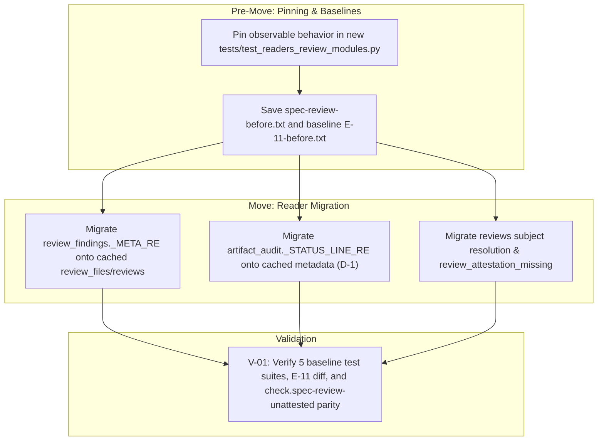

# IPD: Move the review findings, audit and reviews module reads onto artifact_meta

- Date: 2026-11-09
- Kind: child
- Concern: Split from `2zpw22` (Order 36) in round 3 of the metastore re-split, per research `nj8zdp` guidance (at most 8 work Scope-Paths per plan): `2zpw22` declared 12 work Scope-Paths across three module families. Spec `4sd62s` C5a requires every record module to read metadata through the cache. Measured 2026-11-07 at `ac76110f4`: the review modules read front matter with their own patterns (`review_findings._META_RE`, `artifact_audit._STATUS_LINE_RE`), and `reviews` resolves review subjects by its own reads.
- Scope: `2zpw22` E-01 (review findings, audit and review subject lookups), carried unchanged. EXCLUDES: the review sequence, tier, re-review and orchestrator readiness modules (`0i0zsg`, Order 150); the production-check, work and adoption modules (`awmsyq`, Order 154); the residual audit (kept in `2zpw22`); the `->reviewed` gate-only attestation rule (`2xwb9b`).
- Scope-Paths: agent_workflows/review_findings.py, agent_workflows/artifact_audit.py, agent_workflows/reviews.py, tests/test_readers_review_modules.py, tests/test_artifact_audit_verdicts.py, .aw/records/plans/pending/20261109-metastore-149-y4spqy-move-the-review-findings-audit-and-reviews-module-reads-onto.ipd.md
- Item-Dependencies: executed:ffceq0, executed:g5hpbb, executed:h58z9n, executed:tve77h, executed:xexn45
- Status: approved
- Readiness: go-pending-approval
- Review-Depth: complex
- From-Spec: 4sd62s
- Work-Kind: feature
- Priority: high
- Blocks-Release: next
- Set: metastore
- Order: 149
- Highest E allocated: 01
- Author: opencode its_direct/pt3-claude-opus-5.5-1m-us
- Id: y4spqy
- Approval: 2026-11-16, recorded via aw ipd set: status set to approved

## Workflow history
- 2026-11-16 approved (aw set): status set to approved

- 2026-11-14 reviewed (antigravity/gemini): APPROVE WITH REVISIONS APPLIED; PR-001..PR-005 FIXED
- 2026-11-09 to-review (opencode its_direct/pt3-claude-opus-5.5-1m-us): split from 2zpw22 (round 3, research nj8zdp guidance).
- 2026-11-09 draft (opencode its_direct/pt3-claude-opus-5.5-1m-us): created.

## Goal

`review_findings`, `artifact_audit` and `reviews` read review front matter and review subjects from the cached `review_files` and `reviews` rows, with the `check.spec-review-unattested` set unchanged.

## Detailed Implementation Checklist (TODO)

Execution-state rule: mark an `E-*` item complete only after performing the action. That mark is not validation. Right-sizing rule: write for a modest executor that cannot hold much in its head. Each E-item is one step (one concern, about one file, executable in one focused pass) and its V-item names each unit it covers with its own check; a plan stays at about 5 E-items and 8 work Scope-Paths, else split it into more child plans (guidance, `IPD-Z603`). Accepted execution states: blocked, failed, pending, performed; terminal gate demands 'performed'.

The pin-first rule of `ffceq0` applies (carried from `t4gl15` through `2zpw22`): BEFORE the edit, a behavioral test pins the reader's current observable behavior and runs green on the unmodified code; AFTER the edit, the same test runs unchanged except where decision D-1 (copied below) names it. For every existing module named as a baseline, ensure directory creation with `mkdir -p .aw/state/t4gl15`, save the per-test outcome list under the gitignored `.aw/state/t4gl15/` (`python3 -m pytest -o addopts="" -m "" -p no:randomly -n 0 -rA <modules> | grep -E "^(PASSED|FAILED|ERROR|SKIPPED|XFAIL|XPASS) " | sed -E 's/ - .*//' | sort > .aw/state/t4gl15/E-11-before.txt`) before the move and into `E-11-after.txt` after it (`E-11` is the ORIGINAL `t4gl15` item id). Run a new module's `-k` selection as its own command. New test modules set `pytestmark = pytest.mark.core`; none reads production source.

Commit through `aw commit y4spqy -- <each changed path>`, never `git add -A`, a bare `git add` or `git commit -a`. Never push.

### Task group 1: review and audit modules

- [ ] E-01 (carried from `2zpw22` E-01) Pin, then move, `review_findings` (`_META_RE` front-matter read in `parse_review_text`; the review body grammar of rounds and findings stays, N3), `artifact_audit` (`_STATUS_LINE_RE` in `read_declared_status`, which serves every artifact type, so D-1 normalization applies only when the record is a plan), `reviews` subject resolution (`reviews._resolve_selector_paths` and `collect_decisions` subject lookups) and `review_findings.review_attestation_missing` lookups onto the cached `review_files` and `reviews` rows (`artifact_meta.query(latest_gate_review_of=...)`); the predicate's acceptance rule stays as it is (the gate-only change is Order 06's). Pin in the new `tests/test_readers_review_modules.py` and run `tests/test_review_findings_gate.py`, `tests/test_spec_review_attestation.py`, `tests/test_artifact_audit.py`, `tests/test_artifact_audit_verdicts.py` and `tests/test_artifact_audit_identity_staleness.py` green before and after. Before the edit also save the sorted `check.spec-review-unattested` locations from `aw check specs --agent` to `.aw/state/t4gl15/spec-review-before.txt`. (Measured units at `ac76110f4`: 12 functions with a reader site, 5 baseline modules.)
  - Depends on: none
  - Expected outcome: all listed modules pass before and after; `aw check specs --agent` reports the same `check.spec-review-unattested` set as before.
  - Execution state: pending

Add further leaves as `- [ ] E-NEW <action>` and run `aw ipd sync` to assign ids.

## Project conventions discovered (Step 0)

Carried from `2zpw22` Step 0:

- Interface names: `artifact_meta.read(id6) -> State`, `artifact_meta.history(id6)`, `artifact_meta.query(...)` including `latest_gate_review_of`, from `tve77h`; decision D-1 from `ffceq0`.
- Review files: `review_findings.parse_review_text` (front matter via `review_findings._META_RE`, then rounds and findings), `review_findings.review_attestation_missing` (the one attestation predicate).
- Cite code by SYMBOL (`module.function`), never a bare line number (advisory `IPD-C801`).

## Findings

Carried from `2zpw22` (measured 2026-11-07 at `ac76110f4`):

| Id | Evidence | Finding |
|---|---|---|
| F-01 | AST pass over `rg` hits of each module's reader symbols (`_META_RE`, `_STATUS_LINE_RE`, `_resolve_selector_paths`, `collect_decisions`, `review_attestation_missing`, `read_declared_status`, plus the `^-` regex pattern): `review_findings` 8 sites in 5 functions, `artifact_audit` 7 in 4, `reviews` 5 in 3 | E-01: 12 functions. |

Size (round 3): measured with `ipd_schema.count_named_units`, E-01 names 8 distinct units; 5 work Scope-Paths.

READER LEDGER (this part's row, copied from `t4gl15` through `2zpw22`):

| Reader | Prior behavior | Pinning test | After |
|---|---|---|---|
| `review_findings`, `artifact_audit`, `reviews` | review front matter by `_META_RE`; `_STATUS_LINE_RE` strict single-token status | `tests/test_review_findings_gate.py`, `tests/test_spec_review_attestation.py`, `tests/test_artifact_audit.py`, `tests/test_artifact_audit_verdicts.py`, `tests/test_artifact_audit_identity_staleness.py` | cached `review_files`/`reviews` rows; D-1 for status |

DECISIONS (copied from `t4gl15` through `2zpw22`, whose text is authoritative): D-1 PLAN records return the canonical normalized status; `artifact_audit._STATUS_LINE_RE` returned None for the 24 multi-word executed plans and now returns `executed`; `tests/test_artifact_audit_verdicts.py::test_multi_word_status_is_unreadable_by_design` may change only if the moved reader resolves its fixture as a plan (it is in Scope-Paths).

## Proposed changes (ordered, validatable)

1. Pin then move the review and audit modules (E-01).

## Deferred / out of scope (with reason)

- The `->reviewed` gate-only attestation rule (4.4 SR-601).
  - Carrier: 2xwb9b
  - Carrier-Evidence: .aw/records/plans/executed/20261102-metastore-06-2xwb9b-move-the-status-set-setter-engine-onto-artifact-meta.ipd.md
- The residual audit of these modules.
  - Carrier: 2zpw22

## Scope check

- Over-scope: none. `tests/test_artifact_audit_verdicts.py` changes only in a D-1 assertion; `reviews.py` changes only for its subject-resolution reads.
- Under-scope: none known. This part carries `2zpw22` E-01 unchanged.

## Required tests / validation

New core module `tests/test_readers_review_modules.py` (created here; `0i0zsg` and `awmsyq` add their own tests to it). Commands: every module named in E-01, the bare core gate `python3 -m pytest`.

## Spec / documentation sync

No spec change. Implements the review-module part of `4sd62s` C5a.

## Open questions

### OQ-01: Is one item enough for three modules?

- Blocking: no
- Status: resolved
- Owner: plan author
- Resolution or deferral rationale: Yes: the three modules share one concern (review front matter and review subjects) and one cached source (`review_files`/`reviews` rows), and the item names 8 units, inside the round-3 guidance. Recommendation strength: medium.

## Validation and cross-check (verify before reporting done)

Validation-state rule: inspect evidence in a separate pass. Do not mark a `V-*` item complete from memory or from the matching execution checkmark. Accepted validation results: blocked, failed, pass, pending; terminal gate demands 'pass'. Runtime-demonstration reachability rule: for each `V-*` item demanding the software be observed acting (such as a run, a dispatch, or a transition), as distinct from items demanding a diff, a file's content, or a test result, which are reachable by construction, name the code path that produces the observation or the sibling `E-*` that creates it, else the demand is UNDER-SCOPE.

- [ ] V-01 validates E-01
  - Required evidence: paste `python3 -m pytest -o addopts="" -v tests/test_readers_review_modules.py -k "review_findings or audit"` all PASSED, `diff .aw/state/t4gl15/E-11-before.txt .aw/state/t4gl15/E-11-after.txt` (outcome lists of `tests/test_review_findings_gate.py tests/test_spec_review_attestation.py tests/test_artifact_audit.py tests/test_artifact_audit_verdicts.py tests/test_artifact_audit_identity_staleness.py`) printing nothing or only D-1 lines, `rg -n "_META_RE|_STATUS_LINE_RE" agent_workflows/review_findings.py agent_workflows/artifact_audit.py` with each remaining hit's function named (none a front-matter read), and the `diff` of `.aw/state/t4gl15/spec-review-before.txt` against the sorted `check.spec-review-unattested` locations from a fresh `aw check specs --agent`, empty.
  - Observed evidence:
  - Result: pending

## Approval and execution gate

- Size assessment: standard
- Cohesion rationale: not required

Execute only after human approval (`Status: approved`) and after every `- Item-Dependencies:` edge is executed.

Scope fence: the paths in `- Scope-Paths:` are a declaration; a needed file outside the fence is edited and then justified at finalize (`--scope-reason`), and a declared path left unmodified is acknowledged (`--scope-ack`). If prerequisite symbols from `xexn45` or `tve77h` (`artifact_meta.read`, `artifact_meta.query`) are absent on HEAD, or if baseline test suites fail before the move, stop and report: that is a genuinely unsafe condition, not a scope question. Every reader move is pin-first.

Honesty rule: run the named modules and `python3 -m pytest` (core gate), and paste the ACTUAL summary lines; never claim a result you did not run.

Commits: commit only through `aw commit y4spqy -- <paths>`; never `git add -A`, a bare `git add` or `git commit -a`; never push.

Lifecycle transition: the plan moves to `.aw/records/plans/executed/` only through `aw ipd finalize`, never a hand `git mv`, and only after `aw ipd lint --phase pre-transition` conforms and every `V-*` reads `pass` with pasted evidence. When `aw oc run` or `aw agy run` executes the plan, the runner performs the finalize; a hand executor runs `aw ipd finalize y4spqy` itself.
