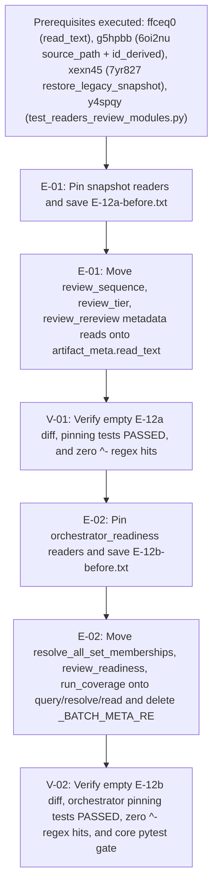

# IPD: Move the review sequence, tier, rereview and orchestrator readiness reads onto artifact_meta

- Date: 2026-11-09
- Kind: child
- Concern: Split from `2zpw22` (Order 36) in round 3 of the metastore re-split, per research `nj8zdp` guidance: `2zpw22` E-02 named 13 distinct units (seven modules and nine baseline modules) in one item. Spec `4sd62s` C5a requires every record module to read metadata through the cache. Measured 2026-11-07 at `ac76110f4`: `review_sequence` (13 sites in 5 functions), `review_tier` (3 in 1) and `review_rereview` (5 in 2) read through `ParsedDoc.meta_fields` and `ipd_schema.read_readiness`, and `orchestrator_readiness` (8 in 4) through `_BATCH_META_RE` and `meta_fields`.
- Scope: The review-sequence and orchestration subset of `2zpw22` E-02, carried unchanged and divided by module family: `review_sequence`, `review_tier` and `review_rereview` (E-01); `orchestrator_readiness` (E-02). EXCLUDES: the review findings, audit and reviews modules (`y4spqy`); `production_checks`, `work_cmd` and `artifact_adopt` (`awmsyq`, Order 154); the WRITE half of `review_sequence.restore_pre_s7_plan` (`7yr827` E-04 via prerequisite `xexn45`); the workflow-history text grammar in `review_sequence.count_verdict_bearing_entries` and `restore_pre_s7_plan` (`ay6sxp` E-02, Order 291); the residual audit (kept in `2zpw22`).
- Scope-Paths: agent_workflows/review_sequence.py, agent_workflows/review_tier.py, agent_workflows/review_rereview.py, agent_workflows/orchestrator_readiness.py, tests/test_readers_review_modules.py, .aw/records/plans/pending/20261109-metastore-150-0i0zsg-move-the-review-sequence-tier-rereview-and-orchestrator-read.ipd.md
- Item-Dependencies: executed:ffceq0, executed:g5hpbb, executed:h58z9n, executed:tve77h, executed:xexn45, executed:y4spqy
- Status: approved
- Readiness: go-pending-approval
- Review-Depth: complex
- From-Spec: 4sd62s
- Work-Kind: feature
- Priority: high
- Blocks-Release: next
- Set: metastore
- Order: 150
- Highest E allocated: 02
- Author: opencode its_direct/pt3-claude-opus-5.5-1m-us
- Id: 0i0zsg
- Approval: 2026-11-16, recorded via aw ipd set: status set to approved

> Written to `.aw/system/workflows/technical-writing/technical-writing.md`. Every obligation, exact identifier, quotation, evidence record, and lifecycle status is preserved.

## Workflow history
- 2026-11-16 approved (aw set): status set to approved

- 2026-11-14 /plan-review (antigravity/gemini): APPROVE WITH REVISIONS APPLIED; PR-001..PR-008 FIXED; review record .aw/records/reviews/20261109-metastore-150-0i0zsg-move-the-review-sequence-tier-rereview-and-orchestrator-read.review.md
- 2026-11-14 reviewed (aw set): APPROVE WITH REVISIONS APPLIED; PR-001..PR-008 FIXED
- 2026-11-09 to-review (opencode its_direct/pt3-claude-opus-5.5-1m-us): split from 2zpw22 (round 3, research nj8zdp guidance).
- 2026-11-09 draft (opencode its_direct/pt3-claude-opus-5.5-1m-us): created.

## Goal

The review sequence, review tier, re-review and orchestrator readiness modules read plan metadata only through `artifact_meta.read`, `artifact_meta.query`, and `artifact_meta.resolve` (or `artifact_meta.read_text` for in-memory snapshots), with each move pinned before and after.

## Detailed Implementation Checklist (TODO)

Execution-state rule: mark an `E-*` item complete only after performing the action. That mark is not validation. Right-sizing rule: write for a modest executor that cannot hold much in its head. Each E-item is one step (one concern, about one file, executable in one focused pass) and its V-item names each unit it covers with its own check; a plan stays at about 5 E-items and 8 work Scope-Paths, else split it into more child plans (guidance, `IPD-Z603`). Accepted execution states: blocked, failed, pending, performed; terminal gate demands 'performed'.

The pin-first rule of `ffceq0` applies (carried from `t4gl15` through `2zpw22`): BEFORE the edit, a behavioral test pins the reader's current observable behavior and runs green on the unmodified code; AFTER the edit, the same test runs unchanged. Ensure `.aw/state/t4gl15/` exists (`mkdir -p .aw/state/t4gl15`) and save each item's per-test outcome list under the gitignored `.aw/state/t4gl15/` (`mkdir -p .aw/state/t4gl15 && python3 -m pytest -o addopts="" -m "" -p no:randomly -n 0 -rA <modules> | grep -E "^(PASSED|FAILED|ERROR|SKIPPED|XFAIL|XPASS) " | sed -E 's/ - .*//' | sort > .aw/state/t4gl15/<file>`) before the move and into the matching after file after it. Run a new module's `-k` selection as its own command. Tests go in `tests/test_readers_review_modules.py` (created by `y4spqy`, retaining `pytestmark = pytest.mark.core`); none reads production source.

Stop conditions (unsafe conditions, not scope questions): stop and report without editing production code if `artifact_meta.read_text` (from `cdglt1` via `ffceq0`), `artifact_meta.restore_legacy_snapshot` (from `7yr827` via `xexn45`), `artifact_meta.source_path` or `State.id_derived` (from `6oi2nu` via `g5hpbb`), or `tests/test_readers_review_modules.py` (from `y4spqy`) is absent, or if an unmergeable concurrent edit touches a `- Scope-Paths:` file.

Commit through `aw commit 0i0zsg -- <each changed path>`, one commit per item allowed, never `git add -A`, a bare `git add` or `git commit -a`. Never push.

### Task group 1: sequence and orchestration modules

- [ ] E-01 (carried from `2zpw22` E-02, review-sequence subset) Pin, then move, the in-memory snapshot metadata reads in `review_sequence` (`structural_diff`, `check_S5`, `verdict_outputs`, `restore_pre_s7_plan` pre-pass status and readiness reads, and `check_S7`), `review_tier` (`tier_facts`) and `review_rereview` (`rereview_triggers` and `check_limit_s7`) onto `artifact_meta.read_text` (`record_type="ipd"`), preserving every function's string signature and behavior per D-1 to D-3 below. Prerequisite `7yr827` E-04 (via `xexn45`) already routes the write half of `restore_pre_s7_plan` through `artifact_meta.restore_legacy_snapshot` (emitting no `set readiness` event); keep that write delegation intact, and leave the `history_block` calls in `count_verdict_bearing_entries` and `restore_pre_s7_plan` for `ay6sxp` E-02. Pin in `tests/test_readers_review_modules.py` and run `tests/test_review_sequence.py`, `tests/test_review_sequence_runner.py`, `tests/test_review_tier.py` and `tests/test_review_rereview.py` green before and after (outcome lists `E-12a-before.txt`/`E-12a-after.txt`).
  - Depends on: none
  - Expected outcome: all four baseline modules and the new `sequence`, `tier` and `rereview` pinning tests pass before and after with an empty outcome-list diff; none of the three production modules contains a `^-` metadata regex call or reads `meta_fields` or `read_readiness`.
  - Execution state: pending

- [ ] E-02 (carried from `2zpw22` E-02, orchestration subset) Pin, then move, `orchestrator_readiness` (`resolve_all_set_memberships`, `review_readiness` and `run_coverage`) onto `artifact_meta.query`, `artifact_meta.resolve` and `artifact_meta.read` (with `artifact_meta.source_path` for cached paths and `artifact_meta.read_text` as the untracked-file fallback per D-3), and delete `_BATCH_META_RE`. Pin in `tests/test_readers_review_modules.py` and run `tests/test_orchestrator_readiness.py` green before and after (outcome lists `E-12b-before.txt`/`E-12b-after.txt`).
  - Depends on: E-01
  - Expected outcome: `tests/test_orchestrator_readiness.py` and the new `orchestrator` pinning tests pass before and after with an empty outcome-list diff; `orchestrator_readiness` defines no `_BATCH_META_RE`, contains no `^-` metadata regex call, and reads no `meta_fields`.
  - Execution state: pending

Add further leaves as `- [ ] E-NEW <action>` and run `aw ipd sync` to assign ids.

## Project conventions discovered (Step 0)

Carried from `2zpw22` Step 0 and prerequisite metastore plans:

- Interface names: `artifact_meta.read(id6) -> State`, `artifact_meta.history(id6)`, `artifact_meta.query(...)`, and `artifact_meta.resolve(path_or_id6)` from `tve77h`; `artifact_meta.source_path` and `State.id_derived` from `6oi2nu` (via `g5hpbb`); `artifact_meta.restore_legacy_snapshot` from `7yr827` (via `xexn45`); `artifact_meta.read_text(text, *, record_type=None) -> State` (added by `cdglt1` via `ffceq0`) and decision D-1 from `ffceq0`.
- Markdown body structure (`exec_leaves`, `valid_leaves`, `open_questions`, `h2`, `orchestrator_row_conformance`) stays in `ipd_lint.parse` per `4sd62s` N3; only plan metadata reads move here.
- Cite code by SYMBOL (`module.function`), never a bare line number (advisory `IPD-C801`).

## Findings

Carried from `2zpw22` (measured 2026-11-07 at `ac76110f4`, re-verified 2026-11-14 at `537a13f3e`):

| Id | Evidence | Finding |
|---|---|---|
| F-02 | AST pass over `rg` hits of each module's reader symbols (`meta_fields`, `read_readiness(`, `_BATCH_META_RE`, plus the `^-` regex pattern): `review_sequence` 13 reader sites in 5 functions (`review_sequence.structural_diff` 4, `review_sequence.check_S5` 1, `review_sequence.verdict_outputs` 2, `review_sequence.restore_pre_s7_plan` 4 reads plus 2 writer regexes moved by `7yr827` E-04, `review_sequence.check_S7` 2; `review_sequence.count_verdict_bearing_entries` has 0 bullet-metadata sites and calls `plan_readiness.history_block`, owned by `ay6sxp` E-02); `review_tier` 3 sites in 1 function (`review_tier.tier_facts`); `review_rereview` 5 sites in 2 functions (`review_rereview.rereview_triggers` 4, `review_rereview.check_limit_s7` 1); `orchestrator_readiness` 8 sites across module scope and 3 functions (`orchestrator_readiness._BATCH_META_RE`, `orchestrator_readiness.resolve_all_set_memberships`, `orchestrator_readiness.review_readiness` 3, `orchestrator_readiness.run_coverage` 2) | E-01 moves 8 functions across 3 snapshot-reading modules; E-02 moves 3 functions and deletes `_BATCH_META_RE` in `orchestrator_readiness`. |

Size (round 3): measured with `ipd_schema.count_named_units`, each item names at most 7 distinct units; 5 work Scope-Paths.

READER LEDGER (this part's subset of the `2zpw22` row, copied from `t4gl15`):

| Reader | Prior behavior | Pinning test | After |
|---|---|---|---|
| `review_sequence`, `review_tier`, `review_rereview` | `ParsedDoc.meta_fields` and `ipd_schema.read_readiness` over snapshot strings | `tests/test_readers_review_modules.py`, `tests/test_review_sequence.py`, `tests/test_review_sequence_runner.py`, `tests/test_review_tier.py`, `tests/test_review_rereview.py` | `artifact_meta.read_text(text, record_type="ipd")` (`D-1`, `D-2`, `D-3`) |
| `orchestrator_readiness` | `_BATCH_META_RE` header scan and `ParsedDoc.meta_fields` reads | `tests/test_readers_review_modules.py`, `tests/test_orchestrator_readiness.py` | `artifact_meta.query`, `resolve`, `read`, and `source_path` (`read_text` fallback, `D-3`) |

## Behavior decisions (kept or changed behavior, 4.3)

- D-1 (canonical plan status, copied from `t4gl15` through `2zpw22`, whose text is authoritative). KEPT: PLAN records return the canonical normalized status (`plans.normalize_status` of the first token); every other type keeps its raw single-token status. Single-token plan statuses checked by `review_sequence` (`draft`, `to-review`, `reviewed`, `approved`) match `State.status` directly. Recommendation strength: strong.
- D-2 (`State` field mapping and snapshot invariants in `E-01`). KEPT: all eight `E-01` functions accept in-memory `str` snapshots, call `artifact_meta.read_text(text, record_type="ipd")`, and preserve their pure string signatures and never-raising fallbacks on empty or headerless text (`tests/test_review_tier.py::test_tier_facts_empty_and_no_metadata`). `review_tier.tier_facts` reads `Kind` from `state.fields.get("plan_role")`, `Set` from `state.set_id or state.fields.get("set")`, and `Scope-Paths` from `state.fields.get("scope_paths")` while preserving its `TODO`-prefix exclusion (`None` when absent or `TODO`-prefixed). `review_rereview.rereview_triggers` compares `state.fields.get("scope_paths")` and `state.fields.get("item_dependencies")`; `check_limit_s7`, `verdict_outputs`, `restore_pre_s7_plan`, and `check_S7` read `state.fields.get("readiness")` and `state.status`. `review_sequence.structural_diff` maps `State` attributes and fields back to canonical IPD bullet names (including `"Priority"`, `"Kind"`, `"Scope-Paths"`, `"Item-Dependencies"`, `"Status"`, `"Readiness"`, `"Review-Depth"`, `"Set"`, `"Order"`, `"Id"`, plus any unmapped legacy bullets carried on the `read_text` result) so diagnostic messages such as `Front-matter field 'Priority' changed...` (`tests/test_review_sequence.py::test_structural_diff`) remain unchanged. Recommendation strength: strong.
- D-3 (id-less records, cached paths and untracked targets in `E-01` and `E-02`). KEPT: when `getattr(state, "id_derived", False)` is true (`6oi2nu` D-3), the file declares no `- Id:`. `review_sequence.check_S5` treats a derived `state.id6` as absent so its `check_engine._read_item_id` and `'pln001'` fallbacks still run on id-less review snippets, and `orchestrator_readiness.resolve_all_set_memberships` skips `id_derived` rows (matching today's `if not id6: continue`). `resolve_all_set_memberships` calls `artifact_meta.query(type="ipd", project_context=artifact_meta.legacy_context(root))` (which scans both `.aw/records/plans` and `.agents/plans` after `6oi2nu`) and maps stored paths back to `Path` via `artifact_meta.source_path`. `orchestrator_readiness.review_readiness` and `run_coverage` resolve tracked plans via `artifact_meta.resolve` and `artifact_meta.read`, falling back to `artifact_meta.read_text(text, record_type="ipd")` for untracked paths outside the cache roots, and keep `_ipd_lint.parse(text)` only for body structure (`4sd62s` N3). Recommendation strength: strong.

## Proposed changes (ordered, validatable)

1. Pin current snapshot-reader behavior in `tests/test_readers_review_modules.py`, capture `.aw/state/t4gl15/E-12a-before.txt`, move the metadata reads in `agent_workflows/review_sequence.py`, `agent_workflows/review_tier.py`, and `agent_workflows/review_rereview.py` onto `artifact_meta.read_text`, and verify an empty `E-12a` outcome-list diff (E-01).
2. Pin current orchestration-reader behavior in `tests/test_readers_review_modules.py`, capture `.aw/state/t4gl15/E-12b-before.txt`, move `agent_workflows/orchestrator_readiness.py` (`resolve_all_set_memberships`, `review_readiness`, `run_coverage`) onto `artifact_meta.query`, `resolve`, `read`, and `source_path` (`read_text` fallback), delete `_BATCH_META_RE`, and verify an empty `E-12b` outcome-list diff (E-02).

E-02 runs after E-01 so both steps extend `tests/test_readers_review_modules.py` sequentially with separate before/after baseline diffs (`E-12a` then `E-12b`).

## Deferred / out of scope (with reason)

- The WRITE half of `review_sequence.restore_pre_s7_plan` (moved onto `artifact_meta.restore_legacy_snapshot` before this plan executes).
  - Carrier: 7yr827, xexn45
- Moving the workflow-history text grammar calls (`plan_readiness.history_block`) in `review_sequence.count_verdict_bearing_entries` and `review_sequence.restore_pre_s7_plan` onto Order 290's `artifact_meta` text entry point.
  - Carrier: ay6sxp
- The residual audit of these modules.
  - Carrier: 2zpw22

## Scope check

- Over-scope: none.
- Under-scope: none known. This part carries the review-sequence and orchestration subset of `2zpw22` E-02 unchanged; the production-check, work and adoption subset is in `awmsyq`, and together they equal the original list.

## Required tests / validation

Tests added to `tests/test_readers_review_modules.py` (`pytestmark = pytest.mark.core`). Commands: every baseline module named in E-01 and E-02 (`tests/test_review_sequence.py`, `tests/test_review_sequence_runner.py`, `tests/test_review_tier.py`, `tests/test_review_rereview.py`, `tests/test_orchestrator_readiness.py`), the bare core gate `python3 -m pytest`, and `aw sanitize --agent`.

## Spec / documentation sync

No spec change. Implements the review-sequence and orchestration part of `4sd62s` C5a.

## Open questions

### OQ-01: How was the `2zpw22` E-02 module list partitioned?

- Blocking: no
- Status: resolved
- Owner: plan author
- Resolution or deferral rationale: By module family: the four review and orchestration modules (which read plan readiness and review state) here, and the three record-shaped readers (`production_checks`, `work_cmd`, `artifact_adopt`) in `awmsyq`. The nine baseline modules follow their modules. Recommendation strength: strong.

## Validation and cross-check (verify before reporting done)

Validation-state rule: inspect evidence in a separate pass. Do not mark a `V-*` item complete from memory or from the matching execution checkmark. Accepted validation results: blocked, failed, pass, pending; terminal gate demands 'pass'. Runtime-demonstration reachability rule: for each `V-*` item demanding the software be observed acting (such as a run, a dispatch, or a transition), as distinct from items demanding a diff, a file's content, or a test result, which are reachable by construction, name the code path that produces the observation or the sibling `E-*` that creates it, else the demand is UNDER-SCOPE.

- [ ] V-01 validates E-01
  - Required evidence: paste `diff .aw/state/t4gl15/E-12a-before.txt .aw/state/t4gl15/E-12a-after.txt` (outcome lists of `tests/test_review_sequence.py tests/test_review_sequence_runner.py tests/test_review_tier.py tests/test_review_rereview.py`) printing nothing, `python3 -m pytest -o addopts="" -v tests/test_readers_review_modules.py -k "sequence or tier or rereview"` all PASSED, and the empty output of `rg -n "re\.\w+\(\s*r?[\"'](\(\?m\))?\^-|meta_fields|read_readiness\(" agent_workflows/review_sequence.py agent_workflows/review_tier.py agent_workflows/review_rereview.py`.
  - Observed evidence:
  - Result: pending

- [ ] V-02 validates E-02
  - Required evidence: paste `diff .aw/state/t4gl15/E-12b-before.txt .aw/state/t4gl15/E-12b-after.txt` (outcome list of `tests/test_orchestrator_readiness.py`) printing nothing, `python3 -m pytest -o addopts="" -v tests/test_readers_review_modules.py -k orchestrator` all PASSED, and the empty output of `rg -n "re\.\w+\(\s*r?[\"'](\(\?m\))?\^-|_BATCH_META_RE|meta_fields" agent_workflows/orchestrator_readiness.py`.
  - Observed evidence:
  - Result: pending

## Approval and execution gate

- Size assessment: standard
- Cohesion rationale: not required

Execute only after human approval (`Status: approved`) and after every `- Item-Dependencies:` edge (`ffceq0`, `g5hpbb`, `h58z9n`, `tve77h`, `xexn45`, `y4spqy`) is executed. Apply the stop conditions in the checklist preamble if any prerequisite symbol or test module is absent.

Shared-checkout safety: other agents and humans may work concurrently in this repository; never revert, stage, commit, discard, or reformat changes outside this plan's edits, and stop and report if a concurrent edit to a `- Scope-Paths:` file cannot be safely combined.

Scope fence: the paths in `- Scope-Paths:` are a declaration; a needed file outside the fence is edited and then justified at finalize (`--scope-reason`), and a declared path left unmodified is acknowledged (`--scope-ack`). Every reader move is pin-first, and any existing test assertion edited after a move must be named in `## Behavior decisions`.

Honesty rule: run the named modules, `python3 -m pytest` (core gate), and `aw sanitize --agent`, and paste the ACTUAL summary lines; never claim a result you did not run.

Commits: commit only through `aw commit 0i0zsg -- <paths>`; never `git add -A`, a bare `git add` or `git commit -a`; never push.

Lifecycle transition: the plan moves to `.aw/records/plans/executed/` only through `aw ipd finalize`, never a hand `git mv`, and only after `aw ipd lint --phase pre-transition` conforms and every `V-*` reads `pass` with pasted evidence. When `aw oc run` or `aw agy run` executes the plan, the runner performs the finalize; a hand executor runs `aw ipd finalize 0i0zsg` itself.
