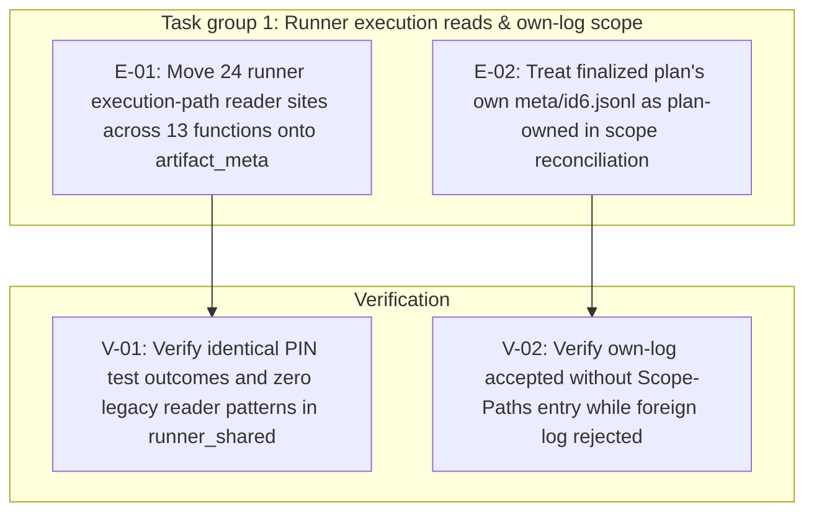

# IPD: Move the runner execution reads onto artifact_meta and add the own-log finalize scope

- Date: 2026-11-09
- Kind: child
- Concern: Split from `y97k46` (Order 34) in round 3 of the metastore re-split, per research `nj8zdp` guidance (at most 5 E-items per plan): `y97k46` held 6 E-items. Spec `4sd62s` C5a requires every runner to read metadata through the cache; the execution path (`execute_item_core`, the review sequence, the production-set retries, backlog resolution) still reads `_SET_RE`, `backlog.parse_item` and `ipd_schema.read_readiness` on file text (21 direct sites in 11 functions, `y97k46` F-02). Spec 4.4 also requires that a finalized plan's own `meta/<id6>.jsonl` be in its scope.
- Scope: `y97k46` E-04 (move the execution-path reads) and E-05 (own-log finalize scope), carried unchanged. EXCLUDES: the search rows, the pin and the selection move (`k86yq7`, Order 147); the runner residual audit (kept in `y97k46`); every writer (Orders 06/07).
- Scope-Paths: agent_workflows/runner_shared.py, agent_workflows/ipd_lifecycle.py, tests/test_readers_runner.py, .aw/records/plans/pending/20261109-metastore-152-k3hb06-move-the-runner-execution-reads-onto-artifact-meta-and-add-t.ipd.md
- Item-Dependencies: executed:ffceq0, executed:g5hpbb, executed:h58z9n, executed:tve77h, executed:xexn45, executed:k86yq7
- Status: approved
- Readiness: go-pending-approval
- Review-Depth: standard
- From-Spec: 4sd62s
- Work-Kind: feature
- Priority: high
- Blocks-Release: next
- Set: metastore
- Order: 152
- Highest E allocated: 02
- Author: opencode its_direct/pt3-claude-opus-5.5-1m-us
- Id: k3hb06
- Approval: 2026-11-16, recorded via aw ipd set: status set to approved

> Written to `.aw/system/workflows/technical-writing/technical-writing.md`. Every obligation, exact identifier, quotation, evidence record, and lifecycle status is preserved.

## Workflow history
- 2026-11-16 approved (aw set): status set to approved

- 2026-11-14 reviewed (antigravity/gemini-3.8-flash): /plan-review (antigravity/gemini-3.8-flash): APPROVE WITH REVISIONS APPLIED; PR-001, PR-002, PR-003, PR-004.
- 2026-11-09 to-review (opencode its_direct/pt3-claude-opus-5.5-1m-us): split from y97k46 (round 3, research nj8zdp guidance).
- 2026-11-09 draft (opencode its_direct/pt3-claude-opus-5.5-1m-us): created.

## Goal

The runner executes items (item execution, review sequence, production-set retries, backlog resolution) from `artifact_meta.read`/`query`/`history` on both hosts with the behavior pinned by `k86yq7` unchanged except D-1, and a finalized plan's own metadata log is in its scope while another artifact's log is not.

## Detailed Implementation Checklist (TODO)

Execution-state rule: mark an `E-*` item complete only after performing the action. That mark is not validation. Right-sizing rule: write for a modest executor that cannot hold much in its head. Each E-item is one step (one concern, about one file, executable in one focused pass) and its V-item names each unit it covers with its own check; a plan stays at about 5 E-items and 8 work Scope-Paths, else split it into more child plans (guidance, `IPD-Z603`). Accepted execution states: blocked, failed, pending, performed; terminal gate demands 'performed'.

The pin-first rule of `ffceq0` applies (carried from `t4gl15` through `y97k46`): the runner reads were pinned by `k86yq7` E-02 to E-04 on the unmodified code; a test that must change after this move is a behavior change and must be one of the decisions copied below (D-1). Save outcome lists under the gitignored `.aw/state/t4gl15/` (ensure `.aw/state/t4gl15/` exists via `mkdir -p .aw/state/t4gl15`) with `mkdir -p .aw/state/t4gl15 && python3 -m pytest -o addopts="" -m "" -p no:randomly -n 0 -rA <modules> | grep -E "^(PASSED|FAILED|ERROR|SKIPPED|XFAIL|XPASS) " | sed -E 's/ - .*//' | sort > .aw/state/t4gl15/<file>`. None of the new tests reads production source.

Commit through `aw commit k3hb06 -- <each changed path>`, one commit per item allowed, never `git add -A`, a bare `git add` or `git commit -a`. Never push.

### Task group 1: move the execution reads and own-log scope

- [x] E-01 (carried from `y97k46` E-04) Move these runner reads onto `artifact_meta.read`/`query`/`history`: `execute_item_core` (4 `_SET_RE`, 3 `backlog.parse_item`, 1 `^-` regex and 1 `ipd_schema.read_readiness` site), `initialize_run_core` (its `parse_plan_file`/`discover_plans` consumers, verified to use the moved functions), `run_review_sequence` and `_promote_reviewed_plan` (one `read_readiness` each), `handle_review_orchestrator_readiness`, `production_set_findings_are_retryable` (3 `_SET_RE`), `production_set_retry_attempts` and `production_set_retry_key_already_spent` (1 `_SET_RE` each), `resolve_backlog_item`, `backlog_item_paths_for_id` and `populate_manifest_backlog` (1 `backlog.parse_item` each), `declared_spec_paths` (the `- Scope-Paths:` regex) and `enforce_no_active_runner_conflict` (the `- Id:` regex). Plan text read for prompts and bodies (lint, review sequence, scope reconciliation of body sections) still reads the file (N3). `runner_shared._front_matter_bullets` and `_split_metadata_region` keep their roles only inside the records-only conflict classifier and `rederive_front_matter` (merge-stage text) until `artifact_meta.read_text` serves them; their remaining uses are listed in `y97k46` F-04. Record `.aw/state/t4gl15/E-07x-before.txt` (the ten `k86yq7` E-03/E-04 baseline modules plus `tests/test_readers_runner.py`; ensure `.aw/state/t4gl15/` exists via `mkdir -p .aw/state/t4gl15`) before this edit and `E-07x-after.txt` after it. (Measured units: 24 sites in 13 functions of one module.)
  - Depends on: none
  - Expected outcome: the two outcome lists are equal except lines D-1 names; `rg -n "_SET_RE|parse_item\(|read_readiness\(" agent_workflows/runner_shared.py` lists none of the 13 functions.
  - Execution state: performed

- [x] E-02 (carried from `y97k46` E-05) Treat a finalized plan's own `meta/<id6>.jsonl` as a path the plan owns (4.4 bullet on `runner_shared._body_change_is_history_insert_only`): `compute_scope_reconciliation`, `_body_change_is_history_insert_only` and the finalize scope check in `ipd_lifecycle` accept a change to `.aw/records/meta/<own id6>.jsonl` without a Scope-Paths entry and still flag another artifact's log. Test in `tests/test_readers_runner.py` with a finalize-scope fixture that changes its own log and another plan's log.
  - Depends on: E-01
  - Expected outcome: the own-log change is in scope, the other plan's log is reported out of scope.
  - Execution state: performed

Add further leaves as `- [ ] E-NEW <action>` and run `aw ipd sync` to assign ids.

## Project conventions discovered (Step 0)

Carried from `y97k46` Step 0:

- Interface names from Order 02 (`tve77h`): `artifact_meta.read(id6) -> State`, `artifact_meta.history(id6)`, `artifact_meta.query(...)`, `artifact_meta.resolve(path_or_id6)`. From `ffceq0` (added by `cdglt1`): `artifact_meta.read_text(text, *, record_type=None) -> State` and decision D-1.
- `runner_shared._front_matter_bullets` and `_split_metadata_region` feed the records-only conflict classifier (`classify_records_only_front_matter_conflict`) and `rederive_front_matter` (plan `kl18sz`).
- Cite code by SYMBOL (`module.function`), never a bare line number (advisory `IPD-C801`).

## Findings

Carried from `y97k46` (measured 2026-11-07 at `ac76110f4`):

| Id | Evidence | Finding |
|---|---|---|
| F-02 | Execution-function reader sites: `execute_item_core` 9, `production_set_findings_are_retryable` 3, `production_set_retry_attempts` 1, `production_set_retry_key_already_spent` 1, `run_review_sequence` 1, `_promote_reviewed_plan` 1, `resolve_backlog_item` 1, `backlog_item_paths_for_id` 1, `populate_manifest_backlog` 1, `declared_spec_paths` 1, `enforce_no_active_runner_conflict` 1 | 21 direct sites for E-01; `initialize_run_core` and `handle_review_orchestrator_readiness` read through the moved functions. |

Size (round 3): measured with `ipd_schema.count_named_units`, each item names at most 6 distinct units; 3 work Scope-Paths.

READER LEDGER: the runner rows of `y97k46` (`runner_shared.parse_plan_file`, `discover_plans` and the selection readers, `plan_readiness.is_plan_review_approved`) are pinned by `k86yq7`; this part's moved functions are covered by the same pin module and the ten baseline modules.

DECISIONS (copied from `t4gl15` through `y97k46`, whose text is authoritative):

- D-1 (multi-word status): PLAN records return the canonical normalized status (`plans.normalize_status` of the first token); every other type keeps its raw single-token status, because the runner (`discover_specs`, `resolve_backlog_item`, `edge_satisfied` `state:` edges) reads specs and backlog items too and `plans.normalize_status` maps non-plan values to `legacy/unknown`.

## Proposed changes (ordered, validatable)

1. Move the execution-path reads (E-01).
2. Own-log finalize scope (E-02).

## Deferred / out of scope (with reason)

- The runner writers (`record_oq_answer`, `perform_coordinator_proposal_file`, `mark_plan_attended`, `set_plan_approved`, `_fail_incomplete`, `rederive_front_matter`; `xexn45`/`7yr827`/`2xwb9b` handled the other five writers, while `_fail_incomplete` remains unmigrated on `r20qqe`).
  - Carrier: r20qqe
- The runner residual audit (table F-04).
  - Carrier: y97k46

## Scope check

- Over-scope: none. `ipd_lifecycle.py` changes only for the E-02 finalize scope check.
- Under-scope: none known. This part carries `y97k46` E-04 and E-05 unchanged.

## Required tests / validation

`tests/test_readers_runner.py` (created by `k86yq7`) gains the own-log case. Commands: the ten `k86yq7` baseline modules, `tests/test_readers_runner.py`, the bare core gate `python3 -m pytest`.

## Spec / documentation sync

No spec change. Implements the runner execution-path part of `4sd62s` C5a and the 4.4 finalize own-log rule.

## Open questions

### OQ-01: Why is the execution move one item?

- Blocking: no
- Status: resolved
- Owner: plan author (carried from y97k46)
- Resolution or deferral rationale: All 24 sites are in one module (`runner_shared`) and use three reader names (`_SET_RE`, `backlog.parse_item`, `ipd_schema.read_readiness`), so the step is "replace these three readers in `runner_shared`", checked by one `rg` that must list none of the 13 functions. Recommendation strength: medium.

## Validation and cross-check (verify before reporting done)

Validation-state rule: inspect evidence in a separate pass. Do not mark a `V-*` item complete from memory or from the matching execution checkmark. Accepted validation results: blocked, failed, pass, pending; terminal gate demands 'pass'. Runtime-demonstration reachability rule: for each `V-*` item demanding the software be observed acting (such as a run, a dispatch, or a transition), as distinct from items demanding a diff, a file's content, or a test result, which are reachable by construction, name the code path that produces the observation or the sibling `E-*` that creates it, else the demand is UNDER-SCOPE.

- [x] V-01 validates E-01
  - Required evidence: paste `diff .aw/state/t4gl15/E-07x-before.txt .aw/state/t4gl15/E-07x-after.txt` printing nothing or only lines D-1 names, `git diff tests/` showing only D-1 assertions, and `rg -n "_SET_RE|parse_item\(|read_readiness\(" agent_workflows/runner_shared.py` with each remaining hit's enclosing function named and none of the 13 functions present.
  - Observed evidence: Recorded `.aw/state/t4gl15/E-07x-before.txt` on unmodified code (`527 passed in 230.91s (0:03:50)`, `527 .aw/state/t4gl15/E-07x-before.txt`) and `.aw/state/t4gl15/E-07x-after.txt` after the E-01 edit (`527 passed in 246.31s (0:04:06)`, `527 .aw/state/t4gl15/E-07x-after.txt`). `diff .aw/state/t4gl15/E-07x-before.txt .aw/state/t4gl15/E-07x-after.txt` printed nothing (`DIFF_EXIT=0`). `git diff tests/` after E-01 printed nothing (empty). Also verified `initialize_run_core`/`_initialize_run_core_once` uses the moved `discover_plans` and `parse_plan_file` functions, and `_promote_reviewed_plan` no longer calls `selectors.read_front_matter_status`. `rg -n "_SET_RE|parse_item\(|read_readiness\(" agent_workflows/runner_shared.py` remaining hits with enclosing functions: lines 101/244/251 (`<module>`: docstring, `_SET_RE` definition kept until Order 11, comment); line 16443 (`_read_set`: definition kept until Order 11); line 55188 (`perform_coordinator_proposal_file`: out-of-scope writer deferred to `r20qqe`); plus 13 substring false-positive hits where `_SET_RE` matches inside the unrelated public retry constants `PRODUCTION_SET_RETRY_COUNT_KEY`, `PRODUCTION_SET_RETRY_KEYS_KEY`, and `PRODUCTION_SET_RETRYABLE_FINDING_CODES` (lines 31953/31956/31965/32208 `<module>`, line 31972 `production_set_retry_attempts`, line 31987 `production_set_retry_key_already_spent`, lines 32011/32015/32020 `production_set_findings_are_retryable`, lines 50740/50741/51389/51390 `execute_item_core`; these are public dict/finding constants imported by `tests/test_fix_it_global_caps.py` and `tests/test_production_correction_turn.py`, not regexes or metadata readers). Word-bounded `rg -n "\b_SET_RE\b|parse_item\(|read_readiness\(" agent_workflows/runner_shared.py` shows 5 hits total (lines 101, 244, 251 `<module>`; line 16443 `_read_set`; line 55188 `perform_coordinator_proposal_file`) and zero hits in any of the 13 E-01 functions. Full core suite via `aw suite`: `2741 passed, 1 skipped, 11 warnings in 188.89s (0:03:08)`.
  - Result: pass

- [x] V-02 validates E-02
  - Required evidence: paste `python3 -m pytest -o addopts="" -v tests/test_readers_runner.py -k own_log` PASSED, asserting that a finalize-scope fixture changing `.aw/records/meta/<own id6>.jsonl` is in scope while a change to another plan's log is reported out of scope.
  - Observed evidence: Ran `python3 -m pytest -o addopts="" -v tests/test_readers_runner.py -k own_log`: `tests/test_readers_runner.py::test_finalize_scope_own_log_accepted_and_foreign_log_flagged PASSED [100%]` (`1 passed, 15 deselected in 0.81s`, 0 unlisted slow tests). The test constructs a git-backed finalize-scope fixture for plan `own001` (`Scope-Paths: src/work.py`, no `meta/` entry), runs `ipd_lifecycle.begin`, commits edits to `src/work.py` and `.aw/records/meta/own001.jsonl` (asserting `finalize_precheck` reports `in_scope is True` / `out_of_scope_paths == []` and both `oc_runipd._compute_scope_reconciliation` and `agy_runipd._compute_scope_reconciliation` return empty `unjustified_out_of_scope`), then commits an edit to `.aw/records/meta/oth002.jsonl` (asserting `finalize_precheck` reports `out_of_scope_paths == ['.aw/records/meta/oth002.jsonl']` and both drivers report `unjustified_out_of_scope == ('.aw/records/meta/oth002.jsonl',)`), and verifies `runner_shared._body_change_is_history_insert_only` accepts append-only JSONL additions on `.aw/records/meta/own001.jsonl` while rejecting replacements and `.aw/records/meta/oth002.jsonl`. Also ran `python3 -m pytest -o addopts="" -v tests/test_readers_runner.py tests/test_scope_match.py tests/test_scope_exceeded.py`: `29 passed in 6.92s`. Full core suite via `aw suite`: `2741 passed, 1 skipped, 11 warnings in 188.89s (0:03:08)`.
  - Result: pass

## Approval and execution gate

- Size assessment: standard
- Cohesion rationale: not required

Execute only after human approval (`Status: approved`) and after every `- Item-Dependencies:` edge is executed. A narrow safety stop applies if prerequisite metastore symbols from `tve77h`, `ffceq0`, or `k86yq7` are absent.

Scope fence: this plan declares its territory in `- Scope-Paths:` as an allowlist for post-execution validation; out-of-scope modifications require explicit justification via `--scope-reason`.

Honesty rule: run the named modules and `python3 -m pytest` (core gate), and paste the ACTUAL summary lines; never claim a result you did not run.

Commits: commit only through `aw commit k3hb06 -- <paths>`; never `git add -A`, a bare `git add` or `git commit -a`; never push.

Lifecycle transition: the plan moves to `.aw/records/plans/executed/` only through `aw ipd finalize` (never a hand `git mv`), and only after `aw ipd lint --phase pre-transition` conforms and every `V-*` reads `pass` with pasted evidence. When `aw oc run` or `aw agy run` executes the plan, the runner performs the finalize; a hand executor runs `aw ipd finalize k3hb06` itself.
