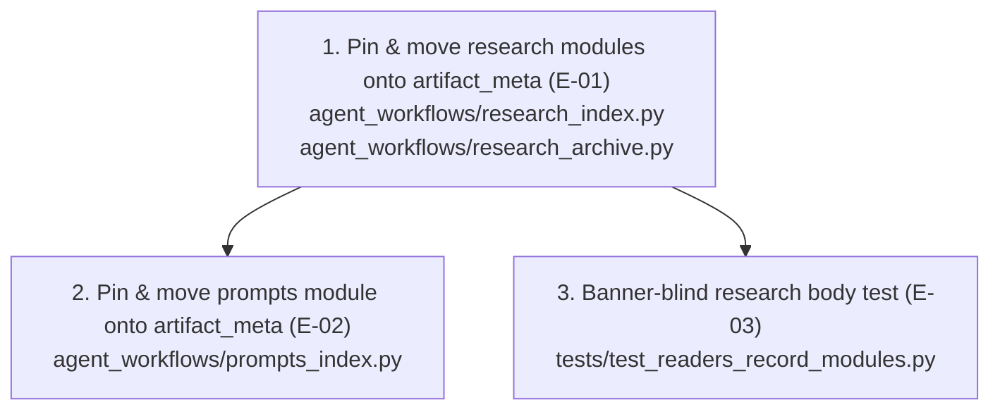

# IPD: Move the research and prompts module reads onto artifact_meta and make the research body test banner-blind

- Date: 2026-11-09
- Kind: child
- Concern: Split from `jd7874` (Order 35) in round 3 of the metastore re-split, per research `nj8zdp` guidance: `jd7874` declared 10 work Scope-Paths and its E-03 named 9 units. Spec `4sd62s` C5a requires every record module to read metadata through the cache. The research modules read through `research_contract.parse_frontmatter` and `research_index._META_ID_RE`, and `prompts_index` through `_parse_metadata_comment`; `research_index._doc_entry` also computes `has_body` in a way the 4.1 `aw-managed` banner will break (F-09).
- Scope: `jd7874` E-03 (research and prompts modules), divided into a research step (E-01) and a prompts step (E-02), and `jd7874` E-04 (banner-blind research body test, E-03), carried unchanged. EXCLUDES: the plans modules and the INDEX baseline (`kyl3m4`); the residual audit (kept in `jd7874`); deleting the INDEX writers and parsers (Order 11).
- Scope-Paths: agent_workflows/research_index.py, agent_workflows/research_archive.py, agent_workflows/prompts_index.py, tests/test_readers_record_modules.py, .aw/records/plans/pending/20261109-metastore-153-cb5eda-move-the-research-and-prompts-module-reads-onto-artifact-met.ipd.md
- Item-Dependencies: executed:ffceq0, executed:g5hpbb, executed:h58z9n, executed:tve77h, executed:xexn45, executed:kyl3m4
- Status: approved
- Readiness: go-pending-approval
- Review-Depth: complex
- From-Spec: 4sd62s
- Work-Kind: feature
- Priority: high
- Blocks-Release: next
- Set: metastore
- Order: 153
- Highest E allocated: 03
- Author: opencode its_direct/pt3-claude-opus-5.5-1m-us
- Id: cb5eda
- Approval: 2026-11-16, recorded via aw ipd set: status set to approved

> Write and proofread this plan per the technical writing standard, `.aw/system/workflows/technical-writing/technical-writing.md` (`.agents/workflows/technical-writing/technical-writing.md` in a legacy-layout install), including requirement 12 (diagrams).

## Workflow history
- 2026-11-16 approved (aw set): status set to approved

- 2026-11-14 reviewed (antigravity): plan-review verified E/V bijection, Scope-Paths, pinning rules, and execution gate; marked reviewed and go-pending-approval.
- 2026-11-09 to-review (opencode its_direct/pt3-claude-opus-5.5-1m-us): split from jd7874 (round 3, research nj8zdp guidance).
- 2026-11-09 draft (opencode its_direct/pt3-claude-opus-5.5-1m-us): created.

## Goal

The research and prompts modules answer from `artifact_meta.query`/`read`, so no research or prompts reader depends on an INDEX file, and the research pipeline position ignores the 4.1 banner.

## Detailed Implementation Checklist (TODO)

Execution-state rule: mark an `E-*` item complete only after performing the action. That mark is not validation. Right-sizing rule: write for a modest executor that cannot hold much in its head. Each E-item is one step (one concern, about one file, executable in one focused pass) and its V-item names each unit it covers with its own check; a plan stays at about 5 E-items and 8 work Scope-Paths, else split it into more child plans (guidance, `IPD-Z603`). Accepted execution states: blocked, failed, pending, performed; terminal gate demands 'performed'.

The pin-first rule of `ffceq0` applies to every move here (carried from `t4gl15` through `jd7874`): BEFORE the edit, a behavioral test pins the reader's current observable behavior and runs green on the unmodified code; AFTER the edit, the same test runs unchanged except where a decision copied below names it. For every existing module named as a baseline, save the per-test outcome list under the gitignored `.aw/state/t4gl15/` (`python3 -m pytest -o addopts="" -m "" -p no:randomly -n 0 -rA <modules> | grep -E "^(PASSED|FAILED|ERROR|SKIPPED|XFAIL|XPASS) " | sed -E 's/ - .*//' | sort > .aw/state/t4gl15/<file>`) before the move and into the matching after file after it. Run a new module's `-k` selection as its own command. If `.aw/state/t4gl15/index-before.txt` (saved by `kyl3m4` E-01) is absent from this checkout, re-save the `aw index research --check` and `aw index prompts --check` exit codes and outputs to it before this plan's first code edit. Tests go in `tests/test_readers_record_modules.py` (created by `kyl3m4`); none reads production source.

Commit through `aw commit cb5eda -- <each changed path>`, one commit per item allowed, never `git add -A`, a bare `git add` or `git commit -a`. Never push.

### Task group 1: research and prompts modules

- [x] E-01 (carried from `jd7874` E-03, research step) Pin, then move, `research_index` (`_scan_docs`, the `- Status:` line reader, `resolvable_consumer_ids` with `_META_ID_RE`) and `research_archive` (`research_contract.parse_frontmatter` reads) onto `artifact_meta.query`/`read`; `research_contract.parse_frontmatter` stays defined (writers and the legacy loader still need the grammar until Order 11) but has no reader caller outside `artifact_meta`. Pin in `tests/test_readers_record_modules.py` and run `tests/test_research_index.py`, `tests/test_research_archive.py` and `tests/test_research_companion.py` green before and after (outcome lists `E-10r-before.txt`/`E-10r-after.txt`).
  - Depends on: none
  - Expected outcome: all listed modules pass before and after; `aw index research --check` reports the same result as `.aw/state/t4gl15/index-before.txt`.
  - Execution state: performed

- [x] E-02 (carried from `jd7874` E-03, prompts step) Pin, then move, `prompts_index` (`_parse_metadata_comment` uses) onto `artifact_meta.query`/`read`; `prompts_index._parse_metadata_comment` stays defined (writers and the legacy loader still need the grammar until Order 11) but has no reader caller outside `artifact_meta`. Pin in `tests/test_readers_record_modules.py` and run `tests/test_prompts_index.py` and `tests/test_index_check_agent_records.py` green before and after (outcome lists `E-10p-before.txt`/`E-10p-after.txt`).
  - Depends on: E-01
  - Expected outcome: both modules pass before and after; `aw index prompts --check` reports the same result as `.aw/state/t4gl15/index-before.txt`.
  - Execution state: performed

### Task group 2: banner-blind research body test

- [x] E-03 (carried from `jd7874` E-04) Make the research body test ignore the 4.1 `aw-managed` banner (F-09): the value that `research_index.derive_pipeline_positions` reads as `has_body` (today computed in `research_index._doc_entry` as "any non-blank text after the closing `---`") must be false when the only text after the front matter is the single leading `<!-- aw-managed: ... -->` banner comment of `4sd62s` 4.1 plus whitespace, and true when any other text follows it. Compute it in ONE place used by every reader of `has_body`, whether that is the moved `research_index` reader or a field `artifact_meta` exposes; do not strip arbitrary HTML comments, only the leading banner. Test in `tests/test_readers_record_modules.py` with `tmp_path` research trees written in the post-cutover shape (two-key front matter plus banner): a Set holding a `research-prompt` with `outcome: none-yet` and a `reconciliation-report` whose body is only the banner yields `unrun`; adding a `research-report` whose body is the banner plus one heading yields `partial`; giving the reconciliation report the banner plus a heading yields `synthesized`. The same three trees in the pre-cutover shape (no banner) yield the same three positions.
  - Depends on: E-01
  - Expected outcome: the six fixture cases yield `unrun`, `partial`, `synthesized` in both shapes; `aw index research --check` reports the same result as before on this checkout.
  - Execution state: performed

Add further leaves as `- [ ] E-NEW <action>` and run `aw ipd sync` to assign ids.

## Project conventions discovered (Step 0)

Carried from `jd7874` Step 0:

- Interface names: `artifact_meta.read(id6) -> State`, `artifact_meta.query(...)` (type, status, Set, order, `path` filters, `incomplete` list), from `tve77h`.
- Cite code by SYMBOL (`module.function`), never a bare line number (advisory `IPD-C801`).

## Findings

Carried from `jd7874` (measured 2026-11-07 at `ac76110f4`; F-09 measured 2026-11-05):

| Id | Evidence | Finding |
|---|---|---|
| F-01 | AST pass over `rg` hits of each module's reader symbols: `research_index` 6 sites in 4 functions, `research_archive` 2, `prompts_index` 3 | E-01 and E-02 together have 9 functions. |
| F-09 | `research_index._doc_entry` sets `has_body` true for any non-blank text after the closing `---`, and `derive_pipeline_positions` uses it to place a Set `unrun`, `partial` or `synthesized`. `4sd62s` 4.1 puts the `aw-managed` banner after the front matter of every artifact; forcing every `has_body` true moves Set `awclia` from `unrun` to `synthesized`, because its reconciliation report `v912ed` has no body today. Found by research `53jbi5` findings E-2/E-3. | E-03 fixes it before Order 13 (`cxxmyv`). |

Size (round 3): measured with `ipd_schema.count_named_units`, each item names at most 6 distinct units; 4 work Scope-Paths.

READER LEDGER (this part's row, copied from `t4gl15` through `jd7874`):

| Reader | Prior behavior | Pinning test | After |
|---|---|---|---|
| `research_index`, `research_archive`, `prompts_index` | YAML and `aw-prompt` comment parse | `tests/test_research_index.py`, `tests/test_research_archive.py`, `tests/test_research_companion.py`, `tests/test_prompts_index.py`, `tests/test_index_check_agent_records.py` | cached fields |

DECISIONS (copied from `t4gl15` through `jd7874`, whose text is authoritative): D-3 the cache carries research YAML status and `id`, so each consumer gets the answer it gets today.

## Proposed changes (ordered, validatable)

1. Pin then move the research modules (E-01) and the prompts module (E-02).
2. Banner-blind research body test (E-03).

## Deferred / out of scope (with reason)

- The residual audit of these modules.
  - Carrier: jd7874
- Deleting `research_contract.parse_frontmatter` and `prompts_index._parse_metadata_comment`.
  - Carrier: 9o83cr

## Scope check

- Over-scope: none.
- Under-scope: none known. This part carries `jd7874` E-03 (divided into E-01 and E-02 here) and E-04 unchanged.

## Required tests / validation

Tests added to `tests/test_readers_record_modules.py` (core). CONTRIBUTES to `4sd62s` AC-9 (reader parts). Commands: every module named in E-01 to E-03, the bare core gate `python3 -m pytest`.

## Spec / documentation sync

No spec change. Implements the research and prompts part of `4sd62s` C5a, and protects the 4.1 banner from changing a research pipeline position.

## Open questions

### OQ-01: Why does E-03 depend only on E-01?

- Blocking: no
- Status: resolved
- Owner: plan author
- Resolution or deferral rationale: The banner test reads the moved `research_index` reader (E-01); the prompts move (E-02) does not touch `has_body`. Carried from `jd7874`, where E-04 followed E-03 as a whole. Recommendation strength: medium.

## Validation and cross-check (verify before reporting done)

Validation-state rule: inspect evidence in a separate pass. Do not mark a `V-*` item complete from memory or from the matching execution checkmark. Accepted validation results: blocked, failed, pass, pending; terminal gate demands 'pass'. Runtime-demonstration reachability rule: for each `V-*` item demanding the software be observed acting (such as a run, a dispatch, or a transition), as distinct from items demanding a diff, a file's content, or a test result, which are reachable by construction, name the code path that produces the observation or the sibling `E-*` that creates it, else the demand is UNDER-SCOPE.

- [x] V-01 validates E-01
  - Required evidence: paste `python3 -m pytest -o addopts="" -v tests/test_readers_record_modules.py -k research` all PASSED, `diff .aw/state/t4gl15/E-10r-before.txt .aw/state/t4gl15/E-10r-after.txt` (outcome lists of `tests/test_research_index.py tests/test_research_archive.py tests/test_research_companion.py`) printing nothing, `rg -n "parse_frontmatter\(" agent_workflows` with every remaining caller named (none a reader outside `artifact_meta`), and `aw index research --check; echo $?` compared with `.aw/state/t4gl15/index-before.txt`.
  - Observed evidence:
    - Pin-first check before production edits (`python3 -m pytest -o addopts="" -v tests/test_readers_record_modules.py -k "research or prompt"`): `3 passed, 8 deselected in 1.11s`.
    - Post-move check (`python3 -m pytest -o addopts="" -v tests/test_readers_record_modules.py -k research`):
      `tests/test_readers_record_modules.py::test_research_banner_pipeline_position[unrun-banner] PASSED [ 10%]`
      `tests/test_readers_record_modules.py::test_research_banner_pipeline_position[synthesized-banner] PASSED [ 20%]`
      `tests/test_readers_record_modules.py::test_research_banner_pipeline_position[unrun-no_banner] PASSED [ 30%]`
      `tests/test_readers_record_modules.py::test_research_body_preserves_arbitrary_html_comment PASSED [ 40%]`
      `tests/test_readers_record_modules.py::test_research_readers_answer_without_index_files_from_log_format_meta PASSED [ 50%]`
      `tests/test_readers_record_modules.py::test_research_index_scan_query_cited_and_consumers PASSED [ 60%]`
      `tests/test_readers_record_modules.py::test_research_banner_pipeline_position[partial-banner] PASSED [ 70%]`
      `tests/test_readers_record_modules.py::test_research_banner_pipeline_position[partial-no_banner] PASSED [ 80%]`
      `tests/test_readers_record_modules.py::test_research_banner_pipeline_position[synthesized-no_banner] PASSED [ 90%]`
      `tests/test_readers_record_modules.py::test_research_archive_plan_sweep_miscategorized_and_apply PASSED [100%]`
      `10 passed, 10 deselected in 1.16s`.
    - Baseline outcome lists (`tests/test_research_index.py tests/test_research_archive.py tests/test_research_companion.py`): before `88 passed in 13.54s` (`.aw/state/t4gl15/E-10r-before.txt`, 88 lines, 8994 bytes); after `88 passed in 15.94s` (`.aw/state/t4gl15/E-10r-after.txt`, 88 lines, 8994 bytes); `diff -u .aw/state/t4gl15/E-10r-before.txt .aw/state/t4gl15/E-10r-after.txt` -> empty output (exit 0).
    - `rg -n "parse_frontmatter\(" agent_workflows` (zero callers in `research_index.py` or `research_archive.py`; remaining matches classified):
      - `agent_workflows/research_contract.py::parse_frontmatter` (line 645): function definition (retained until Order 11).
      - `agent_workflows/artifact_adopt.py::apply_adopt` (line 895): writer converting newly constructed `plan.frontmatter` into `artifact_meta.create` fields.
      - `agent_workflows/research_cmd.py::_write_planned_research_file` (line 579): writer converting newly constructed `planned.content` into `artifact_meta.create` fields.
      - `agent_workflows/migrations/m0001_discover.py` (line 330), `agent_workflows/migrations/m0001_convert.py` (lines 1077, 1562), `agent_workflows/migrations/m0001_verify.py` (lines 319, 648): m0001 legacy-format migration scripts.
      - `agent_workflows/releases.py::_declared_blocks_release` (line 522): out-of-scope reader owned by approved pending plan `sq6v7i` (Order 288, E-02).
    - `rg -n "re\.(compile|search|match|finditer|findall|sub|fullmatch)\(\s*r?[\"'](\(\?m\))?\^-" agent_workflows/research_index.py agent_workflows/research_archive.py agent_workflows/prompts_index.py`: empty output (0 hits).
    - `aw index research --check; echo $?` compared with `.aw/state/t4gl15/index-before.txt` (captured before first edit, 435 lines / 84962 bytes): exit `1` before and exit `1` after; `diff -u .aw/state/t4gl15/index-before.txt .aw/state/t4gl15/index-after.txt` -> empty output (exit 0).
    - Related suites and static checks: `tests/test_research_index_name_fm_mismatch.py tests/test_research_unsafe_field.py tests/test_research_priority.py tests/test_index_write_agent_records.py tests/test_mutation_result_facts.py` (`56 passed in 34.06s`); `python3 -m mypy agent_workflows/research_index.py agent_workflows/research_archive.py agent_workflows/prompts_index.py` (`Success: no issues found in 3 source files`); `aw suite` (`2753 passed, 1 skipped, 11 warnings in 104.44s (0:01:44)`).
  - Result: pass

- [x] V-02 validates E-02
  - Required evidence: paste `python3 -m pytest -o addopts="" -v tests/test_readers_record_modules.py -k prompt` all PASSED, `diff .aw/state/t4gl15/E-10p-before.txt .aw/state/t4gl15/E-10p-after.txt` (outcome lists of `tests/test_prompts_index.py tests/test_index_check_agent_records.py`) printing nothing, `rg -n "_parse_metadata_comment\(" agent_workflows` with every remaining caller named, and `aw index prompts --check; echo $?` compared with `.aw/state/t4gl15/index-before.txt`.
  - Observed evidence:
    - Post-move check (`python3 -m pytest -o addopts="" -v tests/test_readers_record_modules.py -k prompt`):
      `tests/test_readers_record_modules.py::test_prompts_readers_answer_without_index_files_from_log_format_meta PASSED [ 50%]`
      `tests/test_readers_record_modules.py::test_prompts_index_scan_build_and_drift PASSED [100%]`
      `2 passed, 18 deselected in 0.34s`.
    - Baseline outcome lists (`tests/test_prompts_index.py tests/test_index_check_agent_records.py`): before `31 passed in 3.58s` (`.aw/state/t4gl15/E-10p-before.txt`, 31 lines, 3436 bytes); after `31 passed in 4.91s` (`.aw/state/t4gl15/E-10p-after.txt`, 31 lines, 3436 bytes); `diff -u .aw/state/t4gl15/E-10p-before.txt .aw/state/t4gl15/E-10p-after.txt` -> empty output (exit 0).
    - `rg -n "_parse_metadata_comment\(" agent_workflows`:
      `agent_workflows/prompts_index.py:49:def _parse_metadata_comment(text: str) -> Dict[str, str]:`
      Only the definition remains (retained until Order 11); zero callers remain in `agent_workflows/`.
    - `aw index prompts --check; echo $?`:
      `INDEX.json: check.stale-index-missing: INDEX.json has not been generated; run 'aw index prompts'`
      `INDEX.md: check.stale-index-missing: INDEX.md has not been generated; run 'aw index prompts'`
      `0` (matches `.aw/state/t4gl15/index-before.txt` byte-for-byte; `diff -u .aw/state/t4gl15/index-before.txt .aw/state/t4gl15/index-after.txt` empty).
  - Result: pass

- [x] V-03 validates E-03
  - Required evidence: paste `python3 -m pytest -o addopts="" -v tests/test_readers_record_modules.py -k banner` with six tests PASSED (`unrun`, `partial`, `synthesized` for the banner shape and for the no-banner shape), each asserting the position `derive_pipeline_positions` returns for its `tmp_path` tree; `aw index research --check; echo $?` with the same exit code as `.aw/state/t4gl15/index-before.txt`.
  - Observed evidence:
    - `python3 -m pytest -o addopts="" -v tests/test_readers_record_modules.py -k banner`:
      `tests/test_readers_record_modules.py::test_research_banner_pipeline_position[unrun-no_banner] PASSED [ 16%]`
      `tests/test_readers_record_modules.py::test_research_banner_pipeline_position[unrun-banner] PASSED [ 33%]`
      `tests/test_readers_record_modules.py::test_research_banner_pipeline_position[partial-no_banner] PASSED [ 50%]`
      `tests/test_readers_record_modules.py::test_research_banner_pipeline_position[synthesized-banner] PASSED [ 66%]`
      `tests/test_readers_record_modules.py::test_research_banner_pipeline_position[partial-banner] PASSED [ 83%]`
      `tests/test_readers_record_modules.py::test_research_banner_pipeline_position[synthesized-no_banner] PASSED [100%]`
      `6 passed, 14 deselected in 0.33s`.
    - Non-banner HTML comment preservation verified in `tests/test_readers_record_modules.py::test_research_body_preserves_arbitrary_html_comment` (`PASSED` in `-k research` run above), asserting `research_index.has_research_body` ignores only a single leading `<!-- aw-managed: ... -->` banner plus whitespace and treats arbitrary HTML comments and second banner comments as body content.
    - `aw index research --check; echo $?`: exit `1`, identical exit code and byte-for-byte output to `.aw/state/t4gl15/index-before.txt` (`diff -u .aw/state/t4gl15/index-before.txt .aw/state/t4gl15/index-after.txt` empty).
  - Result: pass

## Approval and execution gate

- Size assessment: standard
- Cohesion rationale: not required

Execute only after human approval (`Status: approved`) and after every `- Item-Dependencies:` edge is executed.

Scope fence: the paths in `- Scope-Paths:` are a declaration; a needed file outside the fence is edited and then justified at finalize (`--scope-reason`), and a declared path left unmodified is acknowledged (`--scope-ack`). Every reader move is pin-first.

Honesty rule: run the named modules and `python3 -m pytest` (core gate), and paste the ACTUAL summary lines; never claim a result you did not run.

Commits: commit only through `aw commit cb5eda -- <paths>`; never `git add -A`, a bare `git add` or `git commit -a`; never push.

Lifecycle transition: the plan moves to `.aw/records/plans/executed/` only through `aw ipd finalize`, never a hand `git mv`, and only after `aw ipd lint --phase pre-transition` conforms and every `V-*` reads `pass` with pasted evidence. When `aw oc run` or `aw agy run` executes the plan, the runner performs the finalize; a hand executor runs `aw ipd finalize cb5eda` itself.
